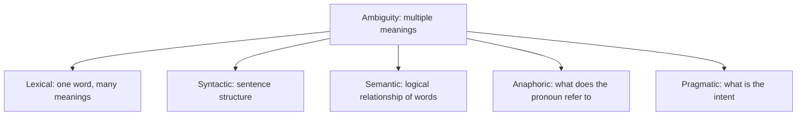
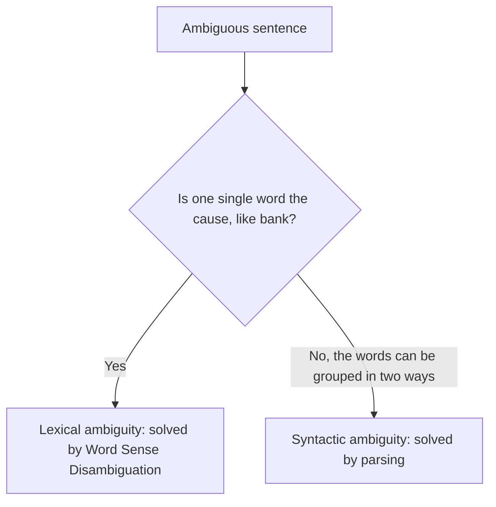
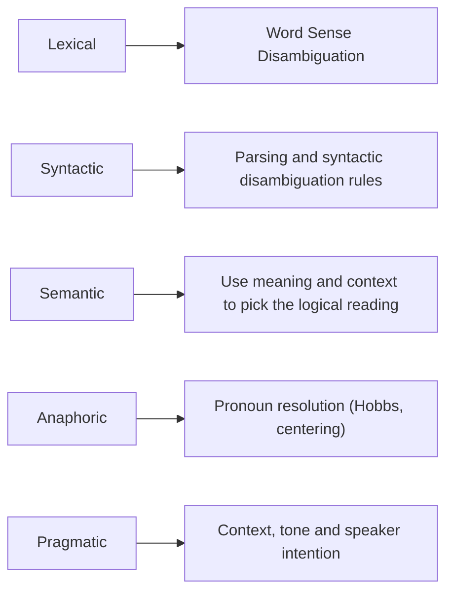

Before the new ideas, here are the old ones you need. If you already know them, skip to the next section.

## The basics first

- A **word** can carry more than one meaning (bank, bat). A **sentence** can be built in more than one way.
- People pick the right meaning from **context**: the words around it and the situation. A computer has no such feeling, so it must be taught to do it.
- The five stages of NLP (words, grammar, meaning, links between sentences, intention) are in <Syl m="1" /> "Introduction". Each type of ambiguity below belongs to one of those stages.

## What is ambiguity?

<Box kind="definition">

**Ambiguity in NLP:** a word, sentence or phrase with multiple meanings. <Cite id="class-nlp-m1" loc="p. 3" />

</Box>

Teacher's example: **"I saw a man with telescope."** Did I use the telescope, or did the man have it? <Cite id="class-nlp-m1" loc="p. 3" />

This is syllabus <Syl m="1" />.

## Types of ambiguity

The class lists five types. <Cite id="class-nlp-m1" loc="p. 3" />

### 1) Lexical ambiguity

Ambiguity caused by a single word having multiple meanings. <Cite id="class-nlp-pyq4" loc="p. 6" /> The teacher gives eight examples (I1 and I2 are the two interpretations). <Cite id="class-nlp-m1" loc="p. 3" /> <Cite id="class-nlp-m1" loc="p. 4" />

| Sentence | Interpretation 1 | Interpretation 2 |
|---|---|---|
| I saw a bat in a cave | Bat, a flying mammal | Bat, a playing toy (cricket bat) |
| He deposited money in the bank | Bank (financial) | River bank |
| The bark was rough | Bark of a dog | Outer covering of a tree |
| She fix the pitch | Voice pitch | Cricket pitch (3rd: presentation pitch) |
| I need a new mouse | Electronic mouse | Small rat |
| They are looking at the board | A piece of wood | Board of directors (3rd: holding board) |
| He dropped the glass | Drinking glass | Piece of glass |
| The athlete broke the record | Musical record disk | Game score record |

### 2) Syntactic ambiguity

One sentence interprets multiple meanings based on its sentence structure. <Cite id="class-nlp-m1" loc="p. 4" /> The same words can be grouped in two ways. <Cite id="class-nlp-m1" loc="p. 4" /> <Cite id="class-nlp-m1" loc="p. 5" />

| Sentence | Interpretation 1 | Interpretation 2 |
|---|---|---|
| Visiting relatives can be boring | We are visiting them | They are visiting us |
| Call me a taxi | Book me a cab for me | Refer to me by the name of taxi |
| The chicken is ready to eat | The cooked chicken is ready to eat | The live chicken is ready to feed |
| Flying planes can be dangerous | Piloting the plane is dangerous | Aeroplanes that are currently flying can be dangerous |
| Look at the dog with one eye | The dog with one eye, looking at him | Looking at the dog using only one eye |
| We need more intelligent leaders | Leaders who possess higher intelligence | A larger quantity of leaders |
| She hit the man with an umbrella | She used an umbrella as a weapon to hit | She hit a man who was carrying an umbrella |
| I shot an elephant in my pajama | I shot an elephant while I was wearing pajamas | I was wearing pajamas and then I shot an elephant (the elephant was in them) |

### 3) Semantic ambiguity

It happens when the grammatical structure is clear but the logical relationship between the words allows for multiple meanings. <Cite id="class-nlp-m1" loc="p. 6" />

| Sentence | Interpretation 1 | Interpretation 2 |
|---|---|---|
| Someone ate every slice of pizza | One single hungry person ate the entire pizza | For each individual slice some person ate it |
| All students did not pass the exam | Not a single student passed | 70% was the pass rate |
| John and Mary are married | They are married to each other | John is married to someone and Mary is married to someone |
| I have not slept for 2 days | Not slept for 48 hours | Slept very little in these 2 days |

### 4) Anaphoric ambiguity

It happens when a pronoun or referring expression could logically point to more than one noun previously mentioned in the text. <Cite id="class-nlp-m1" loc="p. 6" /> The full topic is in <Syl m="5" />.

| Sentence | Who or what does the pronoun mean? |
|---|---|
| When the car crashed into the wall, it was severely damaged | The car was damaged, or the wall was damaged |
| Mary told Susan that she had won the competition | Mary won, or Susan won |
| The children ate the cake because they were very sweet | The children were sweet, or the cake was sweet |
| Dad yelled at Timmy because he left the door open | Timmy left the door open, or Dad did |

<Cite id="class-nlp-m1" loc="p. 7" />

### 5) Pragmatic ambiguity

It happens when the literal dictionary meaning of the sentence is clear but the underlying intent or goal is entirely different. <Cite id="class-nlp-m1" loc="p. 7" />

| Sentence | Literal reading | Intended meaning |
|---|---|---|
| Do you know the time? | Yes or no | Tell me the time |
| My coffee is cold | Just saying a fact | A complaint |

<Cite id="class-nlp-m1" loc="p. 8" />

## Syntactic ambiguity versus lexical ambiguity

This difference was asked many times. The class answer is a table. <Cite id="class-nlp-pyq4" loc="p. 6" />

| Aspect | Syntactic ambiguity | Lexical ambiguity |
|---|---|---|
| Definition | Ambiguity caused by the structure or grammar of a sentence | Ambiguity caused by a single word having multiple meanings |
| Source | Sentence structure leads to more than one possible interpretation | Word meaning leads to confusion because it has different senses |
| Focus | Syntax (sentence formation) | Semantics (word meanings) |
| Example | "I saw the man with the telescope." Who has the telescope? | "He went to the bank." Riverbank or financial bank? |
| Example 2 | "Flying planes can be dangerous." The act of flying planes or planes that are flying? | "The bat flew out of the cave." Bat (animal) or bat (cricket)? |
| Resolution | Parsing techniques and syntactic disambiguation rules | Word Sense Disambiguation (WSD) |
| Relevance in NLP | Syntactic parsing and sentence structure analysis | Semantic analysis and lexical processing |

## Ways to resolve ambiguity

The class names the resolution for two types and shows tools for the others in later modules. <Cite id="class-nlp-pyq4" loc="p. 6" />

- **Lexical:** Word Sense Disambiguation finds which sense of a word is meant in this context. <Cite id="class-nlp-pyq4" loc="p. 5" /> Example: "money" next to "bank" points to the financial bank.
- **Syntactic:** a parser builds the possible structures and rules or probabilities choose one. <Cite id="class-nlp-pyq4" loc="p. 6" />
- **Anaphoric:** pronoun resolution links the pronoun to its noun; the class teaches Hobbs' algorithm (which walks up the syntax tree and checks gender, number and distance) and the Centering algorithm. <Cite id="class-nlp-asol" loc="p. 3" />
- **Pragmatic:** look at context, tone and the speaker's intention beyond the literal meaning. <Cite id="class-nlp-asol" loc="p. 1" />
- **Semantic:** the surrounding sentences and common sense decide which logical reading is meant (this one is not worked out in the class files, so write it in one line).

## Challenges of NLP

The main challenge is that **natural language is ambiguous at every stage**, so one wrong choice early spoils the later stages. <Cite id="class-nlp-m1" loc="p. 3" />

| Stage | Challenge | Example |
|---|---|---|
| Lexical | One word, many meanings | bank, bat, bark |
| Syntactic | One sentence, many structures | I saw a man with telescope |
| Semantic | Logic and scope of words | All students did not pass |
| Discourse | Which noun does the pronoun mean | Mary told Susan that she had won |
| Pragmatic | The real intention | Do you know the time? |

Other challenges the class files mention: figurative language such as idioms and metaphors ("I'm falling for you" is not about falling), <Cite id="class-nlp-asol" loc="p. 1" /> words the model has not seen before (out-of-vocabulary words), idioms and informal language, and models that work well in one domain but not in another. <Cite id="class-nlp-pyq3" loc="p. 5" />

## Applications of NLP

These are the applications taught in the class files. <Cite id="class-nlp-m6" loc="slide 1" />

| Application | One line | Example |
|---|---|---|
| Machine translation | Automatically translates text or speech from one language to another | Website and app localization, subtitles <Cite id="class-nlp-m6" loc="slide 1" /> <Cite id="class-nlp-m6" loc="slide 7" /> |
| Information retrieval | Finds relevant documents from a large collection and ranks them for a query | A search engine <Cite id="class-nlp-m6" loc="slide 9" /> |
| Question answering | Answers human-language questions with precise facts or short passages | Asking who, what or when <Cite id="class-nlp-m6" loc="slide 15" /> |
| Text classification | Assigns predefined labels to text | Spam detection, topic labeling <Cite id="class-nlp-m6" loc="slide 18" /> |
| Summarization | Reduces a large text while keeping the essential information | Banking, law, healthcare reports <Cite id="class-nlp-m6" loc="slide 23" /> |
| Sentiment analysis | Finds opinions and emotions: positive, negative or neutral | Customer feedback <Cite id="class-nlp-m6" loc="slide 26" /> |
| Named entity recognition | Finds names of people, places, organizations and dates | Amazon the company versus the Amazon forest <Cite id="class-nlp-m6" loc="slide 35" /> |
| Language models | Predict the next word and score sentences | Text prediction, spelling correction <Cite id="class-nlp-m6" loc="slide 40" /> <Cite id="class-nlp-pyq2" loc="p. 8" /> |
| Speech assistants | Understand and answer spoken requests | Alexa, Siri, ChatGPT <Cite id="class-nlp-m1" loc="p. 1" /> |

## Where this was asked

| If the question says | What to write | Seen as |
|---|---|---|
| "What is ambiguity? Explain its types and ways to resolve it" | Definition, five types with examples, resolution | <PYQ id="2024-12/q4b" /> <PYQ id="assignment-1/q1b" /> |
| "Ambiguities at each level of NLP with an example" | Five types, each tied to its stage | <PYQ id="2023-05-ce/q3a" /> |
| "Differentiate syntactic and lexical ambiguity" (5 marks) | The comparison table | <PYQ id="2022-12-ce/q1a" /> <PYQ id="2024-12-ce/q1e" /> <PYQ id="assignment-1/q1c" /> |
| "Challenges and applications of NLP" | Ambiguity at each stage, then the applications table | <PYQ id="2025-05/q6a" /> <PYQ id="assignment-1/q1d" /> <PYQ id="2023-05-ce/q1a" /> |
| "Challenges in the various stages of NLP" | The stage-by-challenge table | <PYQ id="2023-12-ce/q2b" /> |
| "Applications of NLP" (5 marks) | The applications table in short | <PYQ id="2024-05-ce/q1a" /> |

## Quick revision

- Ambiguity: a word, sentence or phrase with multiple meanings.
- Lexical: one word, many meanings (bank). Syntactic: the structure (I saw a man with telescope). Semantic: the logic (someone ate every slice of pizza). Anaphoric: the pronoun (Mary told Susan that she had won). Pragmatic: the intent (Do you know the time?).
- Syntactic is about syntax and is solved by parsing; lexical is about word meaning and is solved by WSD.
- Challenge: ambiguity at every stage of NLP.
- Applications: machine translation, information retrieval, question answering, text classification, summarization, sentiment analysis, named entity recognition, language models, speech assistants.

**Conclusion.** Ambiguity is the root difficulty of NLP: the same words can be read in several ways, and each type needs its own remedy. <Cite id="class-nlp-m1" loc="p. 3" />
