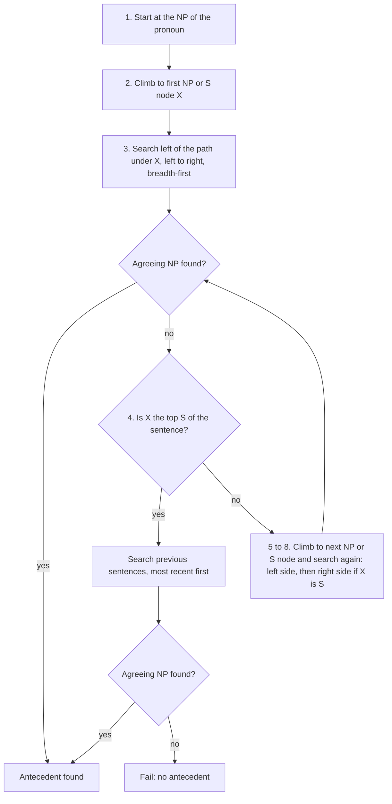
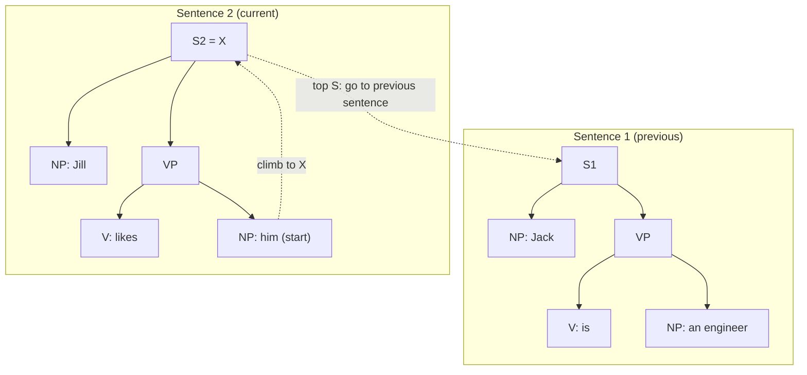
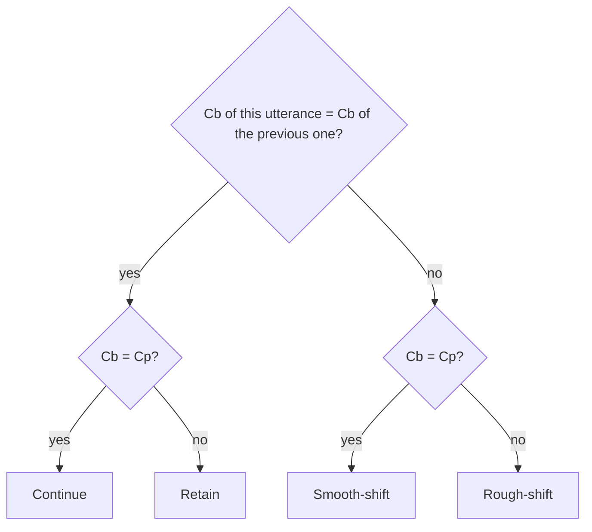
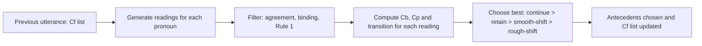

Ye note syllabus <Syl m="5" />, section 5.2 hai: Hobbs aur Centering algorithms se anaphora resolution. Section 5.1 (reference resolution, reference phenomena, syntactic aur semantic constraints) neeche "Basics" aur "Constraints and preferences" mein hai, kyunki dono algorithms inhe use karte hain.

## The basics first

- **Discourse** un sentences ka group hai jo saath mein belong karte hain, jaise paragraph ya conversation. Discourse ke sentences independent nahi hote: *Priya was tired. She went home.* tabhi samajh aata hai jab *She* *Priya* ki taraf point kare. <Cite id="discourse-reference-slp3-disc" /> <Cite id="discourse-reference-wiki-anaphora" />
- **Entity** wo cheez hai jiske baare mein text baat kar raha hai (insaan, jagah, object). **Mention** text ka wo phrase hai jo kisi entity ko refer karta hai. *Priya* aur *She* ek hi entity ke do mentions hain.
- **Referring expression** wo phrase hai jo kisi entity ki taraf point karne ke liye use hota hai. **Pronoun** (he, she, it, they, him, her) sabse chhota type hai. <Cite id="discourse-reference-wiki-pronoun" />
- **Parse tree** dikhata hai ki sentence phrases se kaise bana hai: S matlab sentence, NP noun phrase, VP verb phrase. <Syl m="3" /> "CFG and parsing" dekho. Hobbs ka algorithm isi tree par chalta hai.
- **Agreement** matlab do words number (singular ya plural), gender (he, she, it) aur person (I, you, he) mein match karte hain. *He* *Anita* ki taraf point nahi kar sakta. <Cite id="discourse-reference-wiki-agreement" />

## Reference phenomena

**What it is.** Bolne wale cheezon ki taraf point karne ke liye alag-alag type ke phrases use karte hain, aur har type alag tareeke se kaam karta hai. Ye syllabus 5.1 ke "reference phenomena" hain. <Cite id="discourse-reference-slp3-coref" /> <Cite id="anaphora-resolution-tp-nlp" />

| Kind of expression | Example | How it refers |
|---|---|---|
| Indefinite noun phrase | *a girl*, *some books* | Discourse mein nayi entity laata hai |
| Definite noun phrase | *the girl* | Us entity ki taraf point karta hai jo listener ko pehle se pata hai |
| Proper name | *Priya*, *Mumbai* | Ek specific entity ka naam leta hai |
| Pronoun | *she*, *it*, *they* | Bahut salient entity ki taraf point karta hai |
| Demonstrative | *this book*, *that* | Paas (this) ya door (that) ki cheez ki taraf point karta hai |
| Zero anaphor | *Priya came and (she) sat down.* | Kuch bola nahi jaata, subject drop ho jaata hai (Hindi, Japanese, Spanish mein common) |

**Anaphora** peeche ki taraf pointer hai: *Priya lost her bag.* Yahan *her* **anaphor** hai aur *Priya* **antecedent** hai. **Cataphora** aage ki taraf point karta hai: *When she arrived, Priya smiled.* **Deixis** asli duniya ki taraf point karta hai (*that one over there*, *I*, *now*) aur ise text nahi, situation chahiye. **Coreference** matlab do mentions ek hi entity ko refer karte hain; **anaphora resolution** anaphor ka antecedent dhoondhne ka task hai. Ye overlap karte hain par same nahi hain: *the Prime Minister* aur *Mr. Modi* corefer karte hain bina kisi ke pronoun hue. <Cite id="discourse-reference-wiki-cataphora" /> <Cite id="discourse-reference-wiki-deixis" /> <Cite id="discourse-reference-wiki-coref" />

**Everyday analogy.** Pronoun coat-hook ka tag hai. Bolne wala hook par naam ("Priya") taangta hai aur baad mein sirf hook ki taraf ishara karta hai ("she"). Resolution matlab ye dhoondhna ki tag kis coat ka hai.

<Box kind="definition">

**Anaphora resolution** har anaphor (aam taur pe pronoun) ke liye wo pehle ka phrase (uska antecedent) dhoondhne ka task hai jise wo refer karta hai. Input text hota hai, aksar parse trees ke saath; output har pronoun se ek antecedent tak link hota hai.

</Box>

### Why it is hard

- **Bahut saari candidates.** *Priya met Anita. She gave her a book.* Dono ladkiyan *she* aur *her* ho sakti hain.
- **Meaning decide karta hai, grammar nahi.** Winograd pair: *The trophy did not fit in the suitcase because it was too big* (it = trophy) versus *... too small* (it = suitcase). Grammar same, ek word badalne se jawab badalta hai, aur ise world knowledge chahiye. <Cite id="discourse-reference-wiki-winograd" />
- **Non-referring *it*.** *It is raining* mein *it* kisi ki taraf point nahi karta (pleonastic pronoun) aur ise skip karna padta hai.
- **Galtiyan failti hain.** Galat antecedent translation, summaries aur question answering ko bigaad deta hai jo uske upar bane hain. <Cite id="anaphora-resolution-ibm-coref" />

## Constraints and preferences

Chunne se pehle systems impossible candidates ko hataate hain (**constraints**) aur phir bachi hui ko rank karte hain (**preferences**). <Cite id="discourse-reference-slp3-coref" /> <Cite id="discourse-reference-lappin1994" />

| Kind | Rule | Example |
|---|---|---|
| Agreement (hard) | Pronoun aur antecedent number, gender, person mein match karte hain | *Anita saw him*: *him* Anita nahi ho sakta |
| Syntactic / binding (hard) | Plain pronoun apni hi clause ke noun phrase ki taraf point nahi kar sakta; reflexive (*herself*) ko karna padta hai | *Jill likes him*: *him* Jill nahi hai. *Jill likes herself*: herself Jill hai <Cite id="discourse-reference-wiki-binding" /> |
| Selectional restriction (semantic, hard) | Verb sirf kuch kisam ke objects allow karta hai | *Priya ate it*: *it* khaane layak hona chahiye, *the table* nahi |
| Recency (preference) | Recent mentions zyada likely hain | Pichhle sentence ki entity teen sentence pehle wali se behtar hai |
| Grammatical role (preference) | Subjects objects se zyada likely antecedents hain | *Priya told Anita that she was late*: zyada log Priya chunte hain |
| Parallelism (preference) | Parallel sentences mein same role | *Priya called Anita. Rahul called her too.* |
| Repeated mention (preference) | Baar-baar mention hui entities focus mein rehti hain | |

Hobbs ka algorithm syntactic constraints aur recency aur role preferences ko apne search order mein build kar leta hai. Centering salience preferences ko Cf ranking mein build karti hai. Dono phir bhi agreement check karte hain.

## Part 1: Hobbs' algorithm

### What it is

**What it is.** Hobbs (1978) ne ek step-by-step procedure di jo third-person pronoun ka antecedent current aur pichhle sentences ke parse trees ko ek fixed order mein walk karke dhoondhti hai. "Naive" algorithm sirf trees use karta hai, koi meaning ya discourse model nahi. <Cite id="anaphora-resolution-hobbs1978" /> <Cite id="anaphora-resolution-tetreault2001" />

**Ye kyun zaroori hai.** Ye ek simple, strong baseline hai: koi training data nahi, koi learning nahi, aur ye aksar bahut complex systems ki barabari kar leta hai. Ye dekhne ka bhi achha tareeka hai ki syntax kaise limit karta hai ki pronoun kaun se noun phrases ka matlab ho sakta hai. <Cite id="anaphora-resolution-sukthanker2018" />

**Everyday analogy.** Apna khoya pen dhoondhna: pehle jis desk par ho wahan left se right dekho (sabse paas ki jagah), phir pichhle kamre mein jao aur sabse recently use hui desk pehle dekho. Hobbs tree par yahi karta hai.

### The algorithm

Input pichhle saare sentences ke parse trees aur ek pronoun hai. **Path p** tree mein liya gaya raasta hai. **Breadth-first** matlab ek level ke saare nodes pehle dekho phir gehre jao, taaki paas wale phrases pehle try hon.

1. Us NP node se shuru karo jo seedha pronoun ko dominate karta hai.
2. Tree mein upar jao pehle NP ya S node tak. Use **X** kaho aur wahan tak pahunchne ke raste ko **p**.
3. X ke neeche p ke **left** ki saari branches ko left-to-right aur breadth-first traverse karo. Jo bhi NP node mile jiske aur X ke **beech mein NP ya S node ho**, use antecedent propose karo.
4. Agar X sentence ka sabse upar wala S node hai, to pichhle sentences ke parse trees par jao, most recent pehle. Har tree ko left-to-right, breadth-first search karo, aur milne wala har NP node propose karo. Agar X sabse upar wala S nahi hai, to step 5 par jao.
5. X se agle NP ya S node tak upar jao. Use naya **X** aur path ko **p** kaho.
6. Agar X ek NP hai aur p us N-bar se nahi guzra jise X dominate karta hai, to X ko propose karo.
7. X ke neeche p ke left ki saari branches ko left-to-right, breadth-first traverse karo. Jo bhi NP node mile use propose karo.
8. Agar X ek S node hai, to X ki p ke **right** ki saari branches ko left-to-right, breadth-first traverse karo, par mile hue kisi NP ya S node ke neeche mat jao. Jo bhi NP node mile use propose karo.
9. Step 4 par jao.

Har "propose" par candidate tabhi accept hota hai jab wo pronoun se number, gender aur person mein **agree** kare; warna search bas aage chalta hai. <Cite id="anaphora-resolution-hobbs1978" /> <Cite id="discourse-reference-slp3-coref" />

### Why the order works

- **"NP ya S beech mein" test (step 3).** Pronoun ke same S ke neeche seedha baitha noun phrase, jiske beech mein kuch nahi, skip ho jaata hai. Ye binding rule hai: *Jill likes him* mein *Jill* *him* ke same S ke neeche baithi hai, isliye wo propose nahi hoti. Reflexive ko alag treat karna padega, isiliye ye naive version plain pronouns ke liye hai.
- **Left-to-right (step 3, 7).** English mein subject left mein hota hai, isliye clause ka subject pehle try hota hai. Ye grammatical-role preference hai.
- **Most recent sentence pehle (step 4).** Ye recency preference hai.
- **Right side sirf S ke liye (step 8).** Isse pronoun sentence ke andar aage ki taraf point kar sakta hai (cataphora): *Before he left, Ravi locked the door.*

### Worked example: previous sentence

<Sum>

<Given>

Text: *Jack is an engineer. Jill likes him.* Sentence 1 ka parse: [S [NP Jack] [VP is [NP an engineer]]]. Sentence 2 ka parse: [S [NP Jill] [VP likes [NP him]]]. Pronoun: *him* (masculine, singular, third person).

</Given>

<Find>

Hobbs' algorithm se *him* ka antecedent.

</Find>

<Steps>

1. Step 1: us NP node se shuru karo jo *him* ko dominate karta hai. *Reason: search hamesha pronoun ke apne noun phrase se shuru hota hai.*
2. Step 2: upar jao. Parent VP hai (NP ya S nahi), usse upar S2 hai. To X = S2 aur p = S2, VP, NP(him). *Reason: X pronoun ke upar pehla NP ya S hai.*
3. Step 3: X ke neeche p ke left dekho. Sirf ek branch hai, NP(Jill). NP(Jill) aur X ke beech mein koi aur NP ya S node nahi hai, isliye Jill propose **nahi** hoti. *Reason: yahi rule pronoun ko apne clause ke noun phrase ki taraf point karne se rokta hai (Jill likes him ka matlab Jill likes herself nahi hai).* Left mein aur kuch nahi.
4. Step 4: X = S2 apne sentence ka sabse upar wala S hai, isliye sentence 1 par jao. *Reason: current sentence mein koi candidate nahi mila.*
5. S1 ko left-to-right, breadth-first search karo. Pehla NP jo milta hai NP(Jack) hai. Jack propose karo. Agreement check: *him* singular, masculine, third person hai; *Jack* singular male naam hai. Dono agree karte hain. *Reason: har proposal accept hone se pehle agreement ke liye test hota hai.*

</Steps>

<Answer>

*him* = *Jack*

</Answer>

<Box kind="verify">

Meaning check: agar *him* *Jill* hota, to sentence ko *herself* chahiye hota, aur *Jill* feminine bhi hai, isliye wo agreement mein bhi fail hoti hai. Sirf *Jack* bachta hai, aur *Jill likes Jack* natural reading hai.

</Box>

</Sum>

### Worked example: inside one sentence, going right and up

<Sum>

<Given>

Sentence: *Ravi said that he was late.* Parse: [S1 [NP Ravi] [VP said [SBAR that [S2 [NP he] [VP was late]]]]]. Pronoun: *he* (masculine, singular).

</Given>

<Find>

*he* ka antecedent.

</Find>

<Steps>

1. Step 1: NP(he) se shuru karo. *Reason: search pronoun ke noun phrase se shuru hota hai.*
2. Step 2: upar pehla NP ya S S2 hai (embedded clause). X = S2, p = S2, NP(he). *Reason: X pronoun ke upar sabse paas ka NP ya S hai.*
3. Step 3: S2 ki p ke left ki branches: koi nahi, kyunki *he* pehla word hai. Kuch propose nahi hota.
4. Step 4: S2 sabse upar wala S nahi hai (S1 upar hai), isliye step 5 par jao. *Reason: sentence ka tree abhi aur search karna baaki hai.*
5. Step 5: S2 se SBAR aur VP ke through upar agle NP ya S node tak jao, jo S1 hai. X = S1, p = S1, VP, SBAR, S2. *Reason: SBAR aur VP NP ya S nodes nahi hain, isliye unhe paar kar jaate hain.*
6. Step 6: X ek S hai, NP nahi, to kuch karna nahi.
7. Step 7: S1 ki p ke left ki branches: NP(Ravi). Ravi propose karo. Agreement: *he* singular masculine hai, *Ravi* singular male naam hai. Dono agree karte hain. *Reason: main clause ka subject left ka pehla noun phrase hai.*

</Steps>

<Answer>

*he* = *Ravi*

</Answer>

<Box kind="verify">

Words check: *Ravi said that Ravi was late* sensible reading hai, aur *Ravi* sentence ka akela noun phrase hai jo agree karta hai. Dhyan rakho ki Hobbs hamesha pehla agree karne wala candidate deta hai, isliye *Ravi said that Mohan knew he was late* mein wo *Mohan* chunega (upar ke level par left mein sabse paas); agar bolne wale ka matlab Ravi tha, to algorithm galat hai. Use ye pata nahi chal sakta.

</Box>

</Sum>

### Strengths and limits

| Strengths | Limits |
|---|---|
| Simple, fast, training data nahi chahiye | Har sentence ka **sahi full parse** chahiye; ek galat tree search tod deta hai |
| Hobbs ne apne test kiye 300 pronouns par lagbhag 88% sahi bataya; simple selectional restrictions jodne par kuch points aur | Doosre corpora par baad ke tests mein kam scores aaye, isliye 88% ko best case samjho <Cite id="anaphora-resolution-tetreault2001" /> |
| Real grammar encode karta hai: binding, subject preference, recency | Sirf third-person pronouns; definite noun phrases ya names nahi karta |
| Ek hard baseline jise complex systems ko beat karna padta hai | Koi discourse model ya world knowledge nahi, isliye Winograd-style cases mein fail |
| Zyada tar pronouns ka antecedent same ya pichhle sentence mein hota hai, jahan ye sabse achha chalta hai | Ye nahi bata sakta ki pronoun non-referring hai (*It is raining*), aur do equally achhe NPs mein bhi pehla agree karne wala chun leta hai |

## Part 2: Centering Theory and the Centering algorithm

### What it is

**What it is.** Centering Theory (Grosz, Joshi aur Weinstein, 1995) **local coherence** ka model hai: kuch sentences ka run smooth ya jhatke wala kyun lagta hai. Wo kehti hai ki kisi bhi point par listener ka dhyan chhote se entities ke set par hota hai, aur unmein se ek **center** hai, wo cheez jis ke baare mein sentence mainly hai. Smooth text center ko steady rakhta hai aur use baar-baar nahi badalta. Resolution iske baad aata hai: jab pronoun ambiguous ho, to wo reading chuno jo discourse ko sabse coherent rakhe. <Cite id="discourse-reference-grosz1995" /> <Cite id="anaphora-resolution-poesio2004" />

**Ye kyun zaroori hai.** Hobbs sirf syntax use karta hai. Par log ye bhi use karte hain ki text *kis ke baare mein* hai. Compare karo *Priya met Anita. She gave her a book.* Sirf syntax se faisla nahi hota; Priya ko topic rakhne se hota hai. <Cite id="anaphora-resolution-walker1997" />

**Everyday analogy.** Ek actor par film camera. Smooth scene us actor par rehta hai, doosre actor ki taraf dheere se jaa sakta hai, aur jhatke se cut sirf kabhi-kabhi hota hai. Centering un camera moves ko napti hai, aur pronoun ko "wo actor jis par camera hai" padha jaata hai.

### The terms

$U_n$ ko $n$-th utterance maano (lagbhag ek sentence).

| Term | Meaning |
|---|---|
| **Cf($U_n$)**, forward-looking centers | $U_n$ mein mention hui entities ki list, **salience ke hisaab se ranked**. English ke liye aam ranking: subject, phir object, phir baaki sab. |
| **Cp($U_n$)**, preferred center | Cf($U_n$) ka sabse upar ka item. Ye guess hai ki agla sentence kis ke baare mein hoga. |
| **Cb($U_n$)**, backward-looking center | Cf($U_{n-1}$) ki wo sabse high-ranked entity jo $U_n$ mein dobara mention hui. Ye $U_n$ ko pehle ki cheez se jodti hai. Pehle utterance ka koi Cb nahi hota. |

<Cite id="discourse-reference-grosz1995" /> <Cite id="anaphora-resolution-dieugenio1996" />

### Transitions

Cb($U_n$) ko Cb($U_{n-1}$) se aur Cp($U_n$) se compare karo:

| | Cb($U_n$) = Cp($U_n$) | Cb($U_n$) ≠ Cp($U_n$) |
|---|---|---|
| **Cb($U_n$) = Cb($U_{n-1}$)** | **Continue**: topic same, aur aage bhi rehne ki sambhavna | **Retain**: topic abhi same, par koi aur entity agle topic ke roop mein set ho rahi hai |
| **Cb($U_n$) ≠ Cb($U_{n-1}$)** | **Smooth-shift**: topic badla, aur naya topic hi focus hai | **Rough-shift**: topic badla aur naya topic focus bhi nahi hai |

### The rules and constraints

- **Constraint:** har utterance ka maximum ek Cb hota hai, aur Cb Cf($U_{n-1}$) ka wo sabse high-ranked element hai jo $U_n$ mein realized hua.
- **Rule 1 (pronouns):** agar Cf($U_{n-1}$) ka koi element $U_n$ mein pronoun hai, to $U_n$ ka Cb bhi pronoun hona chahiye. Yaani topic sabse pehle pronominalize hota hai. *Priya met Anita. She ... Priya ...* mein agar Priya topic hai to ye ajeeb hai, kyunki use *She* hona chahiye.
- **Rule 2 (transitions):** **continue** ke sequences **retain** se prefer hote hain, phir **smooth-shift** se, phir **rough-shift** se. Continue > Retain > Smooth-shift > Rough-shift.

<Cite id="discourse-reference-grosz1995" /> <Cite id="anaphora-resolution-dieugenio1996" /> Baad ke kuch kaam retain aur smooth-shift ke order par sawal uthate hain, par yahi standard order padhaya aur exams mein use hota hai. <Cite id="anaphora-resolution-poesio2004" />

### Worked example: label the transitions

<Sum>

<Given>

Utterances:

- U1: *John went to the shop.*
- U2: *He bought a book.*
- U3: *He gave it to Mary.*
- U4: *Mary thanked him.*
- U5: *She liked the book.*
- U6: *Lucy had written it.*

Pronouns: *He* (U2) = John; *He* aur *it* (U3) = John aur the book; *him* (U4) = John; *She* (U5) = Mary; *it* (U6) = the book. Cf subject, phir object, phir other ke hisaab se ranked hai.

</Given>

<Find>

Har utterance ke liye Cf, Cb, Cp aur transition.

</Find>

<Steps>

1. U1: Cf = [John, shop]. Pehle koi utterance nahi, isliye Cb nahi. Cp = John. *Reason: pehle sentence ke paas peeche link karne ko kuch nahi.*
2. U2: Cf = [John, book]. Cf(U1) se dobara aaya: sirf John. To Cb = John. Cp = John. *Reason: Cb pichhle Cf ki wo sabse high-ranked entity hai jo dohrayi gayi.* Cb(U1) khali hai, aur standard definition khali earlier Cb ko "same" maanti hai, isliye Cb = Cp hone se ye **Continue** hai.
3. U3: Cf = [John, book, Mary] (subject, object, other). Cf(U2) = [John, book] se dohraya gaya: dono, aur John upar hai, to Cb = John, Cp = John. Cb(U3) = Cb(U2) = John, aur Cb = Cp. **Continue.**
4. U4: Cf = [Mary, John]. Cf(U3) = [John, book, Mary] se dohraya gaya: Mary aur John, aur Cf(U3) mein John upar hai, to Cb = John (pronoun *him*). Cp = Mary (subject). Cb pehle jaisa hi hai (John), par Cb ≠ Cp. **Retain.** *Reason: topic abhi bhi John hai, par Mary ko agle topic ke roop mein set kiya ja raha hai.*
5. U5: Cf = [Mary, book]. Cf(U4) = [Mary, John] se dohraya gaya: sirf Mary, to Cb = Mary. Cp = Mary. Cb badla (John se Mary) aur Cb = Cp. **Smooth-shift.**
6. U6: Cf = [Lucy, book]. Cf(U5) = [Mary, book] se dohraya gaya: sirf the book (Mary mention nahi hui), to Cb = book. Cp = Lucy. Cb badla (Mary se book) aur Cb ≠ Cp. **Rough-shift.**

</Steps>

<Answer>

| Utterance | Cf (ranked) | Cb | Cp | Transition |
|---|---|---|---|---|
| U1 | John, shop | none | John | none |
| U2 | John, book | John | John | Continue (no earlier Cb) |
| U3 | John, book, Mary | John | John | Continue |
| U4 | Mary, John | John | Mary | Retain |
| U5 | Mary, book | Mary | Mary | Smooth-shift |
| U6 | Lucy, book | book | Lucy | Rough-shift |

</Answer>

<Box kind="verify">

Har label 2 x 2 table se check karo. U3: Cb same, Cb = Cp matlab continue. U4: Cb same, Cb ≠ Cp matlab retain. U5: Cb badla, Cb = Cp matlab smooth-shift. U6: Cb badla, Cb ≠ Cp matlab rough-shift. U3 se U6 tak chaaron cells ek-ek baar use hue, jo achha sign hai ki koi row galat label nahi hui. Rule 1 bhi U4 mein sahi hai: John *him* hai, yaani pronoun, aur Cb John hai.

</Box>

</Sum>

### The Centering algorithm for pronoun resolution (BFP)

Brennan, Friedman aur Pollard (1987) ka pronoun-resolution algorithm theory ko teen steps mein badal deta hai:

1. Saare possible Cb-Cf pairs **generate** karo: har pronoun ke liye pichhle utterance aur sentence ki entities mein se har possible antecedent try karo.
2. Jo readings kisi hard rule ko todti hain unhe **filter** karo: agreement, binding constraints aur Rule 1.
3. Bachi hui ko transition se **rank** karo (continue > retain > smooth-shift > rough-shift) aur sabse achhi chuno.

<Cite id="anaphora-resolution-bfp1987" /> <Cite id="anaphora-resolution-tetreault2001" />

<Sum>

<Given>

Text: U1 *Priya was waiting at the station.* U2 *She met Anita.* U3 *She gave her a book.* Cf subject, object, other ke hisaab se ranked hai. U3 mein *She* aur *her* dono female third-person singular hain, isliye agreement se faisla nahi hota.

</Given>

<Find>

centering se U3 mein *She* aur *her* kaun hain.

</Find>

<Steps>

1. U1: Cf = [Priya, station]. U2: *She* = Priya, Cf = [Priya, Anita]. Cf(U1) se dohraya gaya: Priya, to Cb(U2) = Priya. *Reason: U2 mein *She* sirf Priya ho sakti hai.*
2. Binding U3 mein *she* = *her* ko rokti hai: *her* jaisa plain pronoun apni hi clause ke subject ki taraf point nahi kar sakta. To do readings hain: A: she = Priya, her = Anita; B: she = Anita, her = Priya. *Reason: dono pronouns alag hone chahiye.*
3. Reading A: Cf(U3) = [Priya, Anita, book]. Cf(U2) = [Priya, Anita] se dohraya gaya: dono, Priya upar hai, to Cb = Priya. Cp = Priya. Cb(U3) = Cb(U2) = Priya aur Cb = Cp, to **Continue**.
4. Reading B: Cf(U3) = [Anita, Priya, book]. Dohraya gaya: dono, aur Cf(U2) mein Priya abhi bhi upar hai, to Cb = Priya. Cp = Anita. Cb pehle jaisa hi hai par Cb ≠ Cp, to **Retain**.
5. Rule 1 dono readings mein sahi hai: Cb (Priya) dono mein pronoun hai. To Rule 2 decide karta hai: continue ko retain se prefer kiya jaata hai. *Reason: maqsad sabse smooth topic sequence hai.*

</Steps>

<Answer>

*She* = Priya aur *her* = Anita (reading A, ek Continue).

</Answer>

<Box kind="verify">

Result is aam intuition se match karta hai ki U2 ka subject U3 ka bhi subject rehta hai. Reading B mein topic Priya rehta jabki Anita subject hoti, aisa topic jo "retain" hota hai par focus nahi hai, aur isiliye centering use neeche rank karti hai. Dhyan rakho ye preference hai, proof nahi: *Priya met Anita. She gave her a book. Then she thanked her.* ek insaan ke liye bhi sach mein ambiguous hai.

</Box>

</Sum>

### Strengths and limits

| Strengths | Limits |
|---|---|
| Sirf syntax nahi, salience use karke sentences ke paar kaam karti hai | Entities, unke grammatical roles aur Cf rankings chahiye, jinke liye parser ya tagger chahiye |
| Samjhati hai ki kuch texts coherent aur kuch jhatke wale kyun hain | "Utterance" aur Cf ranking ki definition language-dependent aur debated hai <Cite id="anaphora-resolution-poesio2004" /> |
| Ranking deti hai, isliye ambiguous cases mein bhi best guess milta hai | Retain versus smooth-shift ka preference order settle nahi hai; bahut si readings tie hoti hain |
| Simple versions (left-to-right centering) newspaper aur fiction text par tests mein Hobbs jitna achha chalte hain <Cite id="anaphora-resolution-tetreault2001" /> | Sirf adjacent utterances model karti hai; long-distance reference aur world knowledge iske bahar hain |

## Comparison: Hobbs versus Centering

<PYQ id="2024-12-ce/q3b" />

| Point | Hobbs' algorithm | Centering Theory / algorithm |
|---|---|---|
| Idea | Syntactic tree search | Discourse salience aur coherence |
| Year, authors | Hobbs 1978 | Grosz, Joshi, Weinstein 1983-1995; BFP algorithm 1987 |
| Information used | Parse trees aur agreement | Grammatical role se Cf ranking, pichhla utterance, agreement, Rule 1 |
| Main output | Har pronoun ke liye ek antecedent | Ek topic (Cb), transitions aur best reading |
| Order of search | Left-to-right, breadth-first, nearest sentence pehle | Transition preference se chuni ranked candidates |
| Scope | Pronoun, uska sentence aur pichhle sentences | Adjacent utterances ke pairs |
| Needs | Poore sahi parse trees | Entity list aur grammatical roles |
| Explains coherence? | Nahi | Haan, yahi iska main maqsad hai |
| Weakness | Parse errors; meaning nahi; pehla match chun leta hai | Ranking language-dependent hai; long-distance reference mein kamzor |
| Typical use | Baseline, rule-based system | Discourse modelling, generation, readings ki ranking |

**One-line conclusion.** Hobbs grammar tree walk karke antecedent dhoondhta hai; centering wo antecedent chunti hai jo discourse topic ko steady rakhe; saath mein use karne par syntax aur salience dono cover hote hain. Modern systems (statistical aur neural, jaise Soon et al. aur Lee et al. ke mention-ranking models, aur Stanford CoreNLP aur spaCy ke tools) in cues ko hard-code karne ke bajaye data se seekhte hain. <Cite id="discourse-reference-soon2001" /> <Cite id="discourse-reference-lee2017" /> <Cite id="discourse-reference-corenlp-coref" /> <Cite id="discourse-reference-spacy-coref" />

## Questions asked in exams

<Box kind="exam">

**Explain Hobbs algorithm for pronoun resolution (10 marks):** one-line definition (pronoun ke antecedent ke liye syntactic tree search); nau steps simple words mein; ek tree diagram; worked example *Jack is an engineer. Jill likes him.*; strengths aur limits; ek conclusion. <PYQ id="2022-12-ce/q5b" /> <PYQ id="2025-05/q2a" />

**Describe in detail the Centering algorithm (10 marks):** purpose (local coherence, salience); Cf, Cb, Cp; 2 x 2 table ke saath chaaron transitions; Rule 1 aur Rule 2; teen BFP steps; Cb aur Cp ke saath chhe-utterance wala example. <PYQ id="2023-05-ce/q4b" />

**Anaphora resolution using Hobbs and Centering (10 marks):** anaphora aur antecedent define karo; constraints aur preferences; example ke saath Hobbs ke steps; centering terms, transitions aur Priya-Anita example; ek chhota comparison. <PYQ id="2024-05-ce/q5b" /> <PYQ id="2025-05-ce/q4b" />

**Compare Hobbs' algorithm and Centering Theory (10 marks):** upar ki comparison table, idea, information, scope, strengths aur weaknesses par ek-ek line ke saath. <PYQ id="2024-12-ce/q3b" />

</Box>

<Box kind="pitfall">

Common galtiyan: ye bhoolna ki Hobbs current sentence ke baad **pichhle sentences most recent pehle** search karta hai; Cb ko "subject" samajhna (Cb **pichhle** Cf ki wo sabse high-ranked entity hai jo dohrayi gayi); ye kehna ki Hobbs ko discourse model chahiye (nahi chahiye); retain (Cb same, Cb ≠ Cp) aur smooth-shift (Cb badla, Cb = Cp) ko mix karna.

</Box>
