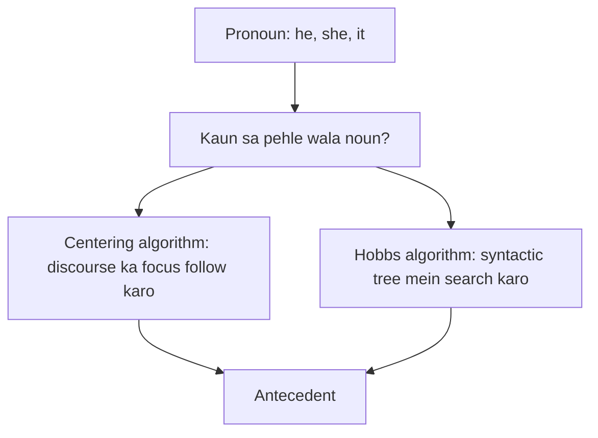
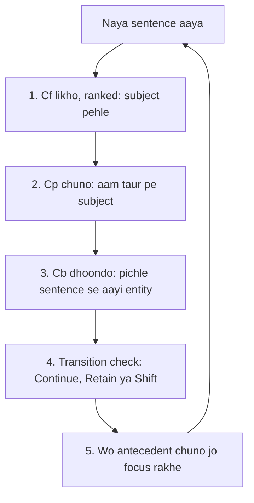
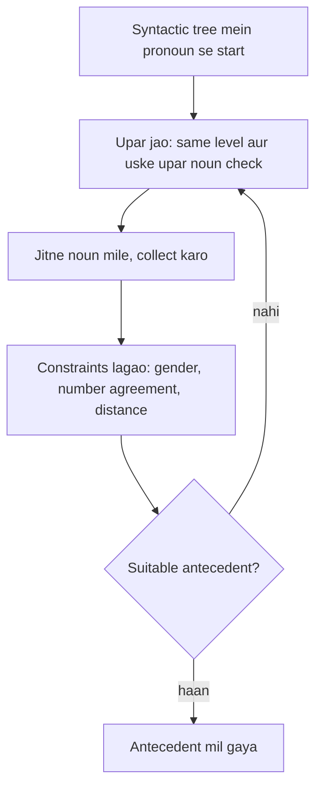
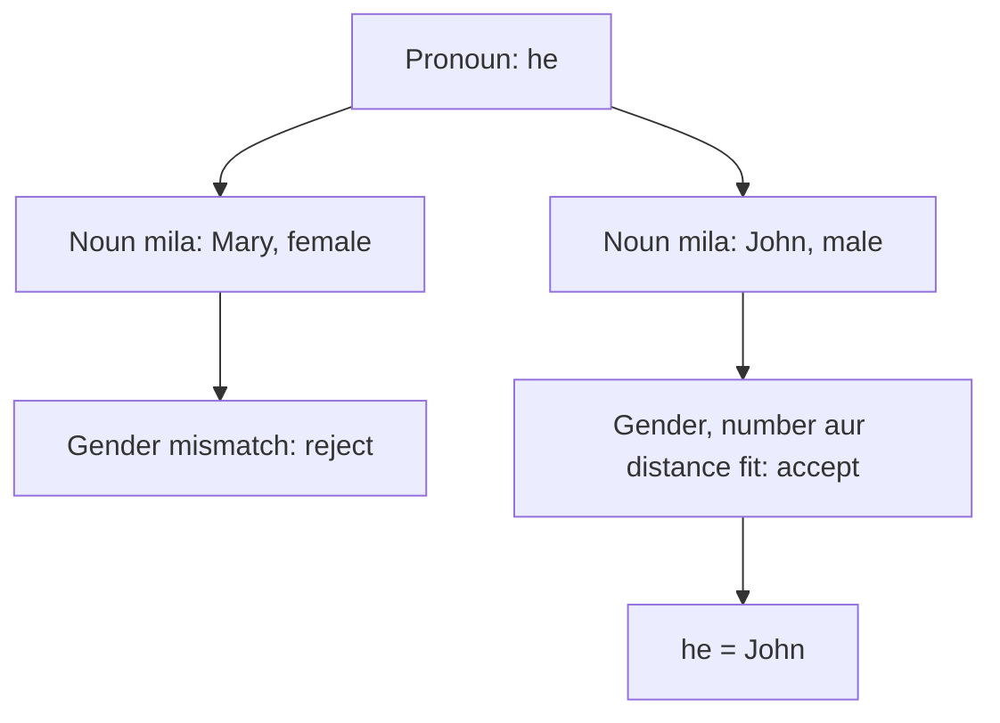

Naye ideas se pehle wo purani baatein jo chahiye. Agar aati hain to agle section pe jao.

## The basics first

- **Pronoun** noun ki jagah use hone wala word hai, jaise *he, she, it, they*. Jis pehle wale noun ke liye wo aaya hai wo uska **antecedent** hai. <Cite id="class-nlp-asol" loc="p. 5" />
- **Anaphora resolution** (pronoun resolution bhi kehte hain) pronoun ka antecedent dhoondhne ka kaam hai, taaki "Taylor went to the store. She bought groceries." ko aise padha jaaye ki *Taylor* ne groceries kharidi. <Cite id="class-nlp-asol" loc="p. 1" />
- **Syntactic tree** (parse tree) dikhata hai ki sentence ke words grammar se kaise group hain: upar sentence S, neeche nouns aur verbs.
- **Agreement:** pronoun aur antecedent gender (he male), number (ek ya kai) aur person mein match karne chahiye.

Ye note syllabus <Syl m="5" /> hai aur discourse aur referring expressions wale pichle note pe bana hai.

## Centering algorithm

<Box kind="definition">

The **Centering Algorithm** is a central part of Centering Theory in NLP, providing a structured mechanism for tracking the "focus" of discourse and determining how pronouns and references are resolved for natural and coherent text understanding. <Cite id="class-nlp-asol" loc="p. 1" />

</Box>

**What it is.** Ye algorithm model karta hai ki discourse coherence kaise rakhta hai: har sentence kin entities (log, objects, concepts) pe focus kar raha hai, aur ye focus ek sentence se dusre mein kaise badalta hai, ye track karke. Ye anaphora resolution ke liye khaas important hai: "he", "she" ya "it" jaise pronouns ko sahi pichle mention (antecedent) se jodna. <Cite id="class-nlp-asol" loc="p. 2" />

**Everyday analogy.** Kahani ek camera ki tarah hai. Har pal camera ek character pe hota hai. Agle sentence ka pronoun lagbhag hamesha usi character ko mean karta hai jis par camera pehle se hai.

### Key concepts

- **Centers:** har utterance (aam taur pe sentence) mein entities ka ek set hota hai jise **forward-looking centers (Cf)** kehte hain, grammatical role ya prominence se ranked. Subject aam taur pe sabse prominent hota hai.
- **Backward-looking center (Cb):** pichle sentence ki wo entity jis par current sentence sabse zyada centered hai.
- **Transitions:** batate hain ki focus sentences ke beech kaise badalta hai: **Continue** (same focus), **Retain** (attention shift hota hai par coherent rehta hai) aur **Shift** (focus kisi dusri, kam related entity pe jaata hai).

**Preferred center (Cp)** current Cf ki sabse high-ranked entity hai, aam taur pe subject. <Cite id="class-nlp-asol" loc="p. 2" />

### How the algorithm works

1. Current utterance ke forward-looking centers (Cf) identify karo (saari mentioned entities, prominence se ranked).
2. Utterance ka preferred center (Cp) decide karo (aam taur pe subject).
3. Pichle utterance ko dekhkar backward-looking center (Cb) decide karo: kaun si entity discourse ke "topic" ki tarah aage carry ho rahi hai?
4. Transition types, Continue (preferred), Retain aur Shift, use karke pronoun resolution aur discourse coherence rakho.
5. Wo antecedents prefer karo jo in transition rules ke hisaab se centers ki continuity aur prominence rakhte hain. <Cite id="class-nlp-asol" loc="p. 2" /> <Cite id="class-nlp-asol" loc="p. 3" />

### Example

"Aragorn picked up the sword. He looked at Frodo." Algorithm *Aragorn* ko backward-looking aur preferred center ki tarah track karta hai, isliye "He" ko *Aragorn* resolve karta hai. <Cite id="class-nlp-asol" loc="p. 3" />

<Sum>

<Given>

U1: *Aragorn picked up the sword.* U2: *He looked at Frodo.* U3a: *Frodo waited for him.* U3b: *Frodo ran to the river.*

</Given>

<Find>

Har sentence ka Cf, Cb aur transition.

</Find>

<Steps>

1. U1: Cf = [Aragorn, sword]; Cp = Aragorn (subject). Ye pehla sentence hai, isliye abhi Cb nahi hai. *Reason: Cb ke liye pichla sentence chahiye.*
2. U2: *He* pronoun hai, to uska antecedent Cf(U1) mein dhoondho. Aragorn top-ranked aur male hai, isliye *He* = Aragorn. Cf(U2) = [Aragorn, Frodo]; Cb(U2) = Aragorn; Cp = Aragorn. Focus Aragorn pe hi hai: **Continue**.
3. U3a: Cf = [Frodo, Aragorn (him)]; Cp = Frodo. Cb Cf(U2) ki wo sabse high-ranked entity hai jo U3a mein hai, yaani Aragorn (pehle jaisa hi Cb), par ab Cp Frodo hai. Attention shift hua par text coherent hai: **Retain**.
4. U3b: Cf = [Frodo, river]; Cp = Frodo. Cf(U2) mein se sirf Frodo aaya, isliye Cb = Frodo, jo ab Aragorn nahi hai. Focus badal gaya: **Shift**.

</Steps>

<Answer>

U2: He = Aragorn, Continue. U3a: Retain. U3b: Shift.

</Answer>

<Box kind="verify">

Preference order check karo: Continue sabse accha, phir Retain, phir Shift. U2 smooth lagta hai kyunki Continue hai; U3b topic change hai, isliye sabse kam preferred. Yahan jo transition rule use hua (Cb same ya changed, aur Cb equal to Cp ya nahi) wo standard Centering rule hai aur class answer mein likha nahi hai.

</Box>

</Sum>

### Importance and applications

Centering Algorithm natural, coherent, human-like text banane aur evaluate karne ke liye crucial hai: **machine translation, summarization, story generation aur conversational AI** mein. Ye ambiguous pronouns resolve karne aur sentences ke beech coherence rakhne ke liye theoretical guidance deta hai. <Cite id="class-nlp-asol" loc="p. 3" />

Exam mein English mein likho: "The Centering Algorithm tracks the focus of discourse to resolve pronouns."

## Hobbs algorithm

<Box kind="definition">

**Hobbs Algorithm** is a heuristic method for pronoun resolution, developed by Jerry Hobbs in 1976. It finds to which noun a pronoun is referring. It uses the syntactic tree of the sentence and finds the solution by operations on that tree. <Cite id="class-nlp-asol" loc="p. 3" />

</Box>

**Heuristic** ek rule of thumb hai jo aam taur pe chalta hai par guaranteed nahi.

### Steps

1. Syntactic tree mein pronoun se **start** karo aur upar jao. Same level aur uske upar wale level mein noun check karo.
2. Jab noun mile to use **consider** karo aur tree mein baaki nouns check karo.
3. Saare nouns dekhne ke baad un pe **constraints lagao**. Constraints: gender, number agreement aur pronoun se distance.
4. Agar suitable antecedent na mile, to saare steps **repeat** karo. <Cite id="class-nlp-asol" loc="p. 3" />

### Example

"John saw Mary, he greeted her." Pronoun *he* ke upar tree mein nouns dekho: **Mary** aur **John**. Constraints lagao: gender, number agreement aur pronoun se distance. *he* male ke liye use hota hai aur John male hai, isliye John suitable candidate hai. Akhir mein *he* **John** ko refer karta hai. <Cite id="class-nlp-asol" loc="p. 4" />

Isi tarah *her* female aur singular hai, isliye wo John nahi ho sakta aur Mary resolve hota hai. Ye doosra step class answer mein likha nahi hai, par wahi rule hai.

Lambe text ke liye standard Hobbs sabse paas wale sentence mein left se right search karta hai, phir pehle ke sentences ek-ek karke. Ye detail class answer mein nahi hai.

## Comparison: Hobbs and Centering

| Point | Hobbs algorithm | Centering algorithm |
|---|---|---|
| Idea | syntactic tree mein noun search | discourse ka focus track |
| Needs | sentence ka syntactic (parse) tree | har sentence ki entities Cf, Cp, Cb mein ranked |
| Works on | ek baar mein ek pronoun | poore text ka flow, sentence se sentence |
| Chooses by | gender, number agreement, distance | centers ki continuity: Continue, phir Retain, phir Shift |
| Type | heuristic, syntax based | discourse based, coherence model karta hai |
| Used in | pronoun resolution | pronoun resolution, MT, summarization, story generation, conversational AI |

Table ki ye comparison class answers se summarise ki hai; comparison khud unme likhi nahi hai.

<Box kind="exam">

Asked as: Hobbs algorithm <PYQ id="2022-12-ce/q5b" /> <PYQ id="2025-05/q2a" />, Centering algorithm <PYQ id="2023-05-ce/q4b" />, both algorithms <PYQ id="2024-05-ce/q5b" /> <PYQ id="2025-05-ce/q4b" /> and Hobbs against Centering <PYQ id="2024-12-ce/q3b" />.

</Box>
