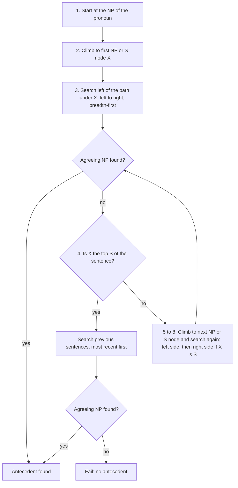
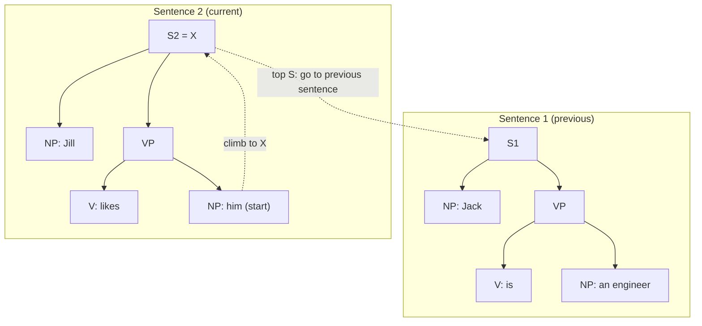
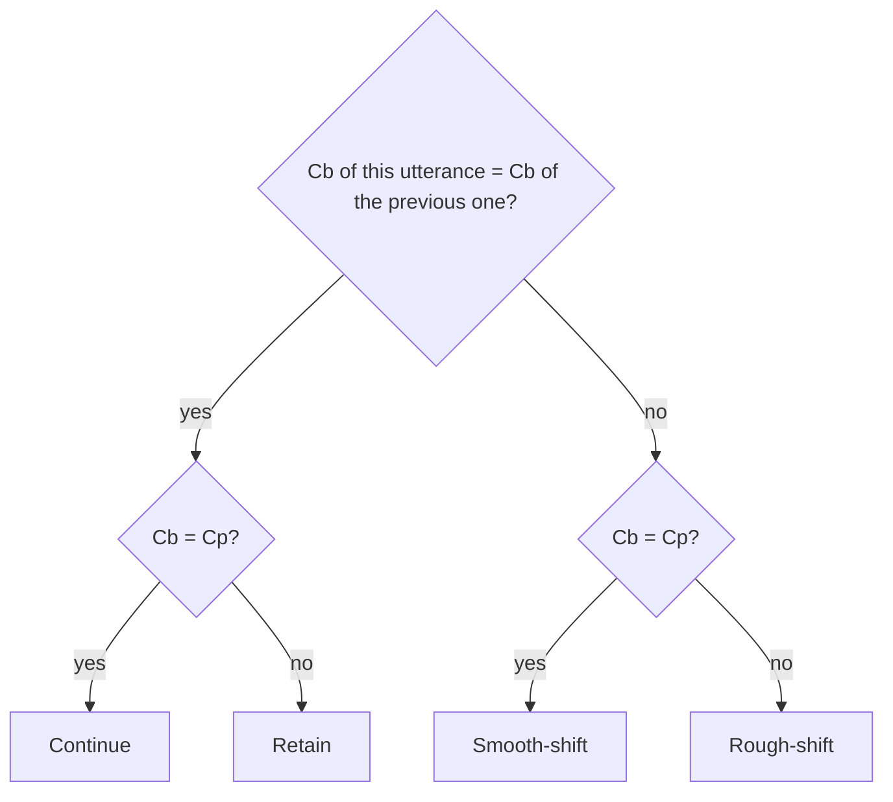

This note is syllabus <Syl m="5" />, section 5.2: anaphora resolution using the Hobbs and Centering algorithms. Section 5.1 (reference resolution, reference phenomena, syntactic and semantic constraints) is covered in the "Basics" and "Constraints and preferences" parts below, because both algorithms use it.

## The basics first

- A **discourse** is a group of sentences that belong together, such as a paragraph or a conversation. Sentences in a discourse are not independent: *Priya was tired. She went home.* only makes sense because *She* points to *Priya*. <Cite id="discourse-reference-slp3-disc" /> <Cite id="discourse-reference-wiki-anaphora" />
- An **entity** is a thing the text talks about (a person, a place, an object). A **mention** is a phrase in the text that refers to an entity. *Priya* and *She* are two mentions of one entity.
- A **referring expression** is a phrase used to point to an entity. A **pronoun** (he, she, it, they, him, her) is the shortest kind. <Cite id="discourse-reference-wiki-pronoun" />
- A **parse tree** shows how a sentence is built from phrases: S is the sentence, NP a noun phrase, VP a verb phrase. See <Syl m="3" /> "CFG and parsing". Hobbs' algorithm walks this tree.
- **Agreement** means two words match in number (singular or plural), gender (he, she, it) and person (I, you, he). *He* cannot point to *Anita*. <Cite id="discourse-reference-wiki-agreement" />

## Reference phenomena

**What it is.** Speakers use different kinds of phrase to point at things, and each kind works differently. These are the "reference phenomena" of syllabus 5.1. <Cite id="discourse-reference-slp3-coref" /> <Cite id="anaphora-resolution-tp-nlp" />

| Kind of expression | Example | How it refers |
|---|---|---|
| Indefinite noun phrase | *a girl*, *some books* | Introduces a new entity into the discourse |
| Definite noun phrase | *the girl* | Points to an entity the listener already knows |
| Proper name | *Priya*, *Mumbai* | Names a specific entity |
| Pronoun | *she*, *it*, *they* | Points to a very salient entity |
| Demonstrative | *this book*, *that* | Points to something near (this) or far (that) |
| Zero anaphor | *Priya came and (she) sat down.* | Nothing is said, the subject is dropped (common in Hindi, Japanese, Spanish) |

**Anaphora** is a backward pointer: *Priya lost her bag.* Here *her* is the **anaphor** and *Priya* is the **antecedent**. **Cataphora** points forward: *When she arrived, Priya smiled.* **Deixis** points to the real world (*that one over there*, *I*, *now*) and needs the situation, not the text. **Coreference** means two mentions refer to the same entity; **anaphora resolution** is the task of finding the antecedent of an anaphor. They overlap but are not the same: *the Prime Minister* and *Mr. Modi* corefer without either being a pronoun. <Cite id="discourse-reference-wiki-cataphora" /> <Cite id="discourse-reference-wiki-deixis" /> <Cite id="discourse-reference-wiki-coref" />

**Everyday analogy.** A pronoun is a coat-hook tag. The speaker hangs a name on a hook ("Priya") and later only points at the hook ("she"). Resolution means finding which coat belongs to the tag.

<Box kind="definition">

**Anaphora resolution** is the task of finding, for each anaphor (usually a pronoun), the earlier phrase (its antecedent) that it refers to. The input is the text, often with parse trees; the output is a link from each pronoun to one antecedent.

</Box>

### Why it is hard

- **Many candidates.** *Priya met Anita. She gave her a book.* Both women can be *she* and *her*.
- **Meaning decides, not grammar.** The Winograd pair: *The trophy did not fit in the suitcase because it was too big* (it = trophy) versus *... too small* (it = suitcase). Same grammar, one word changes the answer, and it needs world knowledge. <Cite id="discourse-reference-wiki-winograd" />
- **Non-referring *it*.** In *It is raining*, *it* points to nothing (a pleonastic pronoun) and must be skipped.
- **Errors spread.** A wrong antecedent ruins translation, summaries and question answering built on top. <Cite id="anaphora-resolution-ibm-coref" />

## Constraints and preferences

Before choosing, systems throw out impossible candidates (**constraints**) and then rank the rest (**preferences**). <Cite id="discourse-reference-slp3-coref" /> <Cite id="discourse-reference-lappin1994" />

| Kind | Rule | Example |
|---|---|---|
| Agreement (hard) | Pronoun and antecedent match in number, gender, person | *Anita saw him*: *him* cannot be Anita |
| Syntactic / binding (hard) | A plain pronoun cannot point to a noun phrase in its own clause; a reflexive (*herself*) must | *Jill likes him*: *him* is not Jill. *Jill likes herself*: herself is Jill <Cite id="discourse-reference-wiki-binding" /> |
| Selectional restriction (semantic, hard) | The verb allows only some kinds of object | *Priya ate it*: *it* must be edible, not *the table* |
| Recency (preference) | Recent mentions are more likely | The last sentence's entity beats one three sentences back |
| Grammatical role (preference) | Subjects are more likely antecedents than objects | *Priya told Anita that she was late*: most readers choose Priya |
| Parallelism (preference) | Same role in parallel sentences | *Priya called Anita. Rahul called her too.* |
| Repeated mention (preference) | Entities mentioned often stay in focus | |

Hobbs' algorithm builds the syntactic constraints and the recency and role preferences into its search order. Centering builds the salience preferences into the Cf ranking. Both still check agreement.

## Part 1: Hobbs' algorithm

### What it is

**What it is.** Hobbs (1978) gave a step-by-step procedure that finds the antecedent of a third-person pronoun by walking the parse trees of the current and earlier sentences in a fixed order. The "naive" algorithm uses only the trees, with no meaning and no discourse model. <Cite id="anaphora-resolution-hobbs1978" /> <Cite id="anaphora-resolution-tetreault2001" />

**Why it is needed.** It is a simple, strong baseline: no training data, no learning, and it often matches far more complex systems. It is also a good way to see how syntax limits which noun phrases a pronoun can mean. <Cite id="anaphora-resolution-sukthanker2018" />

**Everyday analogy.** Looking for your lost pen: first check the desk you are at, left to right (the nearest places), then walk to the previous room and check the most recently used desk first. Hobbs does the same on the tree.

### The algorithm

The input is the parse trees of all sentences so far and a pronoun. **Path p** is the route taken in the tree. **Breadth-first** means visit all nodes at one level before going deeper, so closer phrases are tried first.

1. Begin at the NP node that immediately dominates the pronoun.
2. Go up the tree to the first NP or S node. Call it **X** and call the path used to reach it **p**.
3. Traverse all branches below X to the **left** of p, left-to-right and breadth-first. Propose as antecedent any NP node found that has an NP or S node **between it and X**.
4. If X is the highest S node in the sentence, go to the parse trees of the previous sentences, most recent first. Search each tree left-to-right, breadth-first, and propose every NP node met. If X is not the highest S, go to step 5.
5. From X go up to the next NP or S node. Call it the new **X** and the path **p**.
6. If X is an NP and p did not pass through the N-bar that X dominates, propose X.
7. Traverse all branches below X to the left of p, left-to-right, breadth-first. Propose any NP node found.
8. If X is an S node, traverse all branches of X to the **right** of p, left-to-right, breadth-first, but do not go below any NP or S node found. Propose any NP node found.
9. Go to step 4.

At every "propose", the candidate is accepted only if it **agrees** with the pronoun in number, gender and person; otherwise the search simply continues. <Cite id="anaphora-resolution-hobbs1978" /> <Cite id="discourse-reference-slp3-coref" />

### Why the order works

- **The "NP or S in between" test (step 3).** A noun phrase directly under the same S as the pronoun, with nothing between, is skipped. That is the binding rule: in *Jill likes him*, *Jill* sits directly under the same S as *him*, so she is not proposed. A reflexive would be treated differently, which is why this naive version is for plain pronouns.
- **Left-to-right (step 3, 7).** In English the subject is on the left, so the subject of the clause is tried first. That is the grammatical-role preference.
- **Most recent sentence first (step 4).** That is the recency preference.
- **Right side only for S (step 8).** This allows a pronoun to point forward inside the sentence (cataphora): *Before he left, Ravi locked the door.*

### Worked example: previous sentence

<Sum>

<Given>

Text: *Jack is an engineer. Jill likes him.* Parse of sentence 1: [S [NP Jack] [VP is [NP an engineer]]]. Parse of sentence 2: [S [NP Jill] [VP likes [NP him]]]. Pronoun: *him* (masculine, singular, third person).

</Given>

<Find>

the antecedent of *him* by Hobbs' algorithm.

</Find>

<Steps>

1. Step 1: start at the NP node that dominates *him*. *Reason: the search always starts at the pronoun's own noun phrase.*
2. Step 2: go up. The parent is VP (not NP or S), the next one up is S2. So X = S2 and p = S2, VP, NP(him). *Reason: X is the first NP or S above the pronoun.*
3. Step 3: look left of p under X. The only branch is NP(Jill). Between NP(Jill) and X there is no other NP or S node, so Jill is **not** proposed. *Reason: this is the rule that stops a pronoun pointing to a noun phrase in its own clause (Jill likes him does not mean Jill likes herself).* Nothing else on the left.
4. Step 4: X = S2 is the highest S of its sentence, so go to sentence 1. *Reason: no candidate in the current sentence.*
5. Search S1 left-to-right, breadth-first. The first NP met is NP(Jack). Propose Jack. Check agreement: *him* is singular, masculine, third person; *Jack* is a singular male name. They agree. *Reason: every proposal is tested for agreement before it is accepted.*

</Steps>

<Answer>

*him* = *Jack*

</Answer>

<Box kind="verify">

Meaning check: if *him* were *Jill*, the sentence would need *herself*, and *Jill* is also feminine, so it fails agreement as well. Only *Jack* is left, and *Jill likes Jack* is a natural reading.

</Box>

</Sum>

### Worked example: inside one sentence, going right and up

<Sum>

<Given>

Sentence: *Ravi said that he was late.* Parse: [S1 [NP Ravi] [VP said [SBAR that [S2 [NP he] [VP was late]]]]]. Pronoun: *he* (masculine, singular).

</Given>

<Find>

the antecedent of *he*.

</Find>

<Steps>

1. Step 1: start at NP(he). *Reason: the search starts at the pronoun's noun phrase.*
2. Step 2: the first NP or S above is S2 (the embedded clause). X = S2, p = S2, NP(he). *Reason: X is the nearest NP or S above the pronoun.*
3. Step 3: branches of S2 to the left of p: none, because *he* is the first word. Nothing is proposed.
4. Step 4: S2 is not the highest S (S1 is above it), so go to step 5. *Reason: the sentence has more of the tree to search.*
5. Step 5: go up from S2 through SBAR and VP to the next NP or S node, which is S1. X = S1, p = S1, VP, SBAR, S2. *Reason: SBAR and VP are not NP or S nodes, so they are passed over.*
6. Step 6: X is an S, not an NP, so nothing to do.
7. Step 7: branches of S1 to the left of p: NP(Ravi). Propose Ravi. Agreement: *he* is singular masculine, *Ravi* is a singular male name. They agree. *Reason: the subject of the main clause is the first noun phrase on the left.*

</Steps>

<Answer>

*he* = *Ravi*

</Answer>

<Box kind="verify">

Words check: *Ravi said that Ravi was late* is a sensible reading, and *Ravi* is the only noun phrase in the sentence that agrees. Note that Hobbs always returns the first agreeing candidate, so for *Ravi said that Mohan knew he was late* it would pick *Mohan* first (nearest on the left at the higher level); if the speaker meant Ravi, the algorithm is wrong. It cannot know.

</Box>

</Sum>

### Strengths and limits

| Strengths | Limits |
|---|---|
| Simple, fast, needs no training data | Needs a **correct full parse** of every sentence; one wrong tree breaks the search |
| Hobbs reported about 88% correct on 300 pronouns he tested; with simple selectional restrictions added, a few points more | Later tests on other corpora report lower scores, so treat 88% as a best case <Cite id="anaphora-resolution-tetreault2001" /> |
| Encodes real grammar: binding, subject preference, recency | Only third-person pronouns; does not do definite noun phrases or names |
| A hard baseline that complex systems must beat | No discourse model or world knowledge, so it fails on Winograd-style cases |
| Most pronouns have their antecedent in the same or the previous sentence, where it works best | Cannot say that a pronoun is non-referring (*It is raining*), and picks the first agreeing NP even when two are equally good |

## Part 2: Centering Theory and the Centering algorithm

### What it is

**What it is.** Centering Theory (Grosz, Joshi and Weinstein, 1995) is a model of **local coherence**: why a short run of sentences feels smooth or jumpy. It says that at any point the listener's attention is on a small set of entities, and one of them is the **center**, the thing the sentence is mainly about. A smooth text keeps the center steady and does not change it often. Resolution follows: when a pronoun is ambiguous, pick the reading that keeps the discourse most coherent. <Cite id="discourse-reference-grosz1995" /> <Cite id="anaphora-resolution-poesio2004" />

**Why it is needed.** Hobbs uses only syntax. But people also use what the text is *about*. Compare *Priya met Anita. She gave her a book.* Syntax alone does not settle it; keeping Priya as the topic does. <Cite id="anaphora-resolution-walker1997" />

**Everyday analogy.** A film camera on one actor. A smooth scene stays on that actor, may drift to a second one gently, and cuts jarringly only rarely. Centering measures those camera moves, and a pronoun is read as "the actor the camera is on".

### The terms

Let $U_n$ be the $n$-th utterance (roughly, a sentence).

| Term | Meaning |
|---|---|
| **Cf($U_n$)**, forward-looking centers | The list of entities mentioned in $U_n$, **ranked by salience**. For English the usual ranking is subject, then object, then everything else. |
| **Cp($U_n$)**, preferred center | The top item of Cf($U_n$). It is the guess for what the next sentence will be about. |
| **Cb($U_n$)**, backward-looking center | The highest-ranked entity of Cf($U_{n-1}$) that is mentioned again in $U_n$. It links $U_n$ to what came before. The first utterance has no Cb. |

<Cite id="discourse-reference-grosz1995" /> <Cite id="anaphora-resolution-dieugenio1996" />

### Transitions

Compare Cb($U_n$) with Cb($U_{n-1}$) and with Cp($U_n$):

| | Cb($U_n$) = Cp($U_n$) | Cb($U_n$) ≠ Cp($U_n$) |
|---|---|---|
| **Cb($U_n$) = Cb($U_{n-1}$)** | **Continue**: same topic, and likely to stay | **Retain**: same topic now, but another entity is being set up as the next topic |
| **Cb($U_n$) ≠ Cb($U_{n-1}$)** | **Smooth-shift**: topic changed, and the new topic is the focus | **Rough-shift**: topic changed and the new topic is not even the focus |

### The rules and constraints

- **Constraint:** each utterance has at most one Cb, and Cb is the highest-ranked element of Cf($U_{n-1}$) realized in $U_n$.
- **Rule 1 (pronouns):** if any element of Cf($U_{n-1}$) is a pronoun in $U_n$, then the Cb of $U_n$ must be a pronoun too. So the topic is the first thing to be pronominalized. *Priya met Anita. She ... Priya ...* is odd if Priya is the topic, because she should be *She*.
- **Rule 2 (transitions):** sequences of **continue** are preferred to **retain**, then to **smooth-shift**, then to **rough-shift**. Continue > Retain > Smooth-shift > Rough-shift.

<Cite id="discourse-reference-grosz1995" /> <Cite id="anaphora-resolution-dieugenio1996" /> Some later work questions the order of retain and smooth-shift, but this is the standard order taught and used in exams. <Cite id="anaphora-resolution-poesio2004" />

### Worked example: label the transitions

<Sum>

<Given>

Utterances:

- U1: *John went to the shop.*
- U2: *He bought a book.*
- U3: *He gave it to Mary.*
- U4: *Mary thanked him.*
- U5: *She liked the book.*
- U6: *Lucy had written it.*

Pronouns: *He* (U2) = John; *He* and *it* (U3) = John and the book; *him* (U4) = John; *She* (U5) = Mary; *it* (U6) = the book. Cf is ranked subject, then object, then other.

</Given>

<Find>

Cf, Cb, Cp and the transition for each utterance.

</Find>

<Steps>

1. U1: Cf = [John, shop]. No previous utterance, so no Cb. Cp = John. *Reason: the first sentence has nothing to link back to.*
2. U2: Cf = [John, book]. Mentioned again from Cf(U1): John only. So Cb = John. Cp = John. *Reason: Cb is the highest-ranked entity of the previous Cf that is repeated.* Cb(U1) is empty, and the standard definition counts an empty earlier Cb as "the same", so with Cb = Cp this is a **Continue**.
3. U3: Cf = [John, book, Mary] (subject, object, other). Repeated from Cf(U2) = [John, book]: both, and John ranks higher, so Cb = John, Cp = John. Cb(U3) = Cb(U2) = John, and Cb = Cp. **Continue.**
4. U4: Cf = [Mary, John]. Repeated from Cf(U3) = [John, book, Mary]: Mary and John, and John ranks higher in Cf(U3), so Cb = John (the pronoun *him*). Cp = Mary (the subject). Cb is the same as before (John), but Cb ≠ Cp. **Retain.** *Reason: the topic is still John, but Mary is now set up as the next topic.*
5. U5: Cf = [Mary, book]. Repeated from Cf(U4) = [Mary, John]: Mary only, so Cb = Mary. Cp = Mary. Cb changed (John to Mary) and Cb = Cp. **Smooth-shift.**
6. U6: Cf = [Lucy, book]. Repeated from Cf(U5) = [Mary, book]: the book only (Mary is not mentioned), so Cb = book. Cp = Lucy. Cb changed (Mary to book) and Cb ≠ Cp. **Rough-shift.**

</Steps>

<Answer>

| Utterance | Cf (ranked) | Cb | Cp | Transition |
|---|---|---|---|---|
| U1 | John, shop | none | John | none |
| U2 | John, book | John | John | Continue (no earlier Cb) |
| U3 | John, book, Mary | John | John | Continue |
| U4 | Mary, John | John | Mary | Retain |
| U5 | Mary, book | Mary | Mary | Smooth-shift |
| U6 | Lucy, book | book | Lucy | Rough-shift |

</Answer>

<Box kind="verify">

Check each label with the 2 x 2 table. U3: Cb same, Cb = Cp gives continue. U4: Cb same, Cb ≠ Cp gives retain. U5: Cb changed, Cb = Cp gives smooth-shift. U6: Cb changed, Cb ≠ Cp gives rough-shift. U3 to U6 use all four cells exactly once, which is a good sign that no row was mislabelled. Rule 1 also holds in U4: John is *him*, a pronoun, and Cb is John.

</Box>

</Sum>

### The Centering algorithm for pronoun resolution (BFP)

The pronoun-resolution algorithm of Brennan, Friedman and Pollard (1987) turns the theory into three steps:

1. **Generate** all possible Cb-Cf pairs: for each pronoun, try each possible antecedent from the entities of the previous utterance and the sentence.
2. **Filter** the readings that break a hard rule: agreement, binding constraints, and Rule 1.
3. **Rank** the rest by transition (continue > retain > smooth-shift > rough-shift) and choose the best.

<Cite id="anaphora-resolution-bfp1987" /> <Cite id="anaphora-resolution-tetreault2001" />

<Sum>

<Given>

Text: U1 *Priya was waiting at the station.* U2 *She met Anita.* U3 *She gave her a book.* Cf is ranked subject, object, other. In U3, *She* and *her* are both female third-person singular, so agreement does not decide.

</Given>

<Find>

who *She* and *her* are in U3, using centering.

</Find>

<Steps>

1. U1: Cf = [Priya, station]. U2: *She* = Priya, Cf = [Priya, Anita]. Repeated from Cf(U1): Priya, so Cb(U2) = Priya. *Reason: the only entity that can be *She* in U2 is Priya.*
2. Binding rules out *she* = *her* in U3: a plain pronoun like *her* cannot point to the subject of its own clause. So the two readings are A: she = Priya, her = Anita; B: she = Anita, her = Priya. *Reason: the two pronouns must differ.*
3. Reading A: Cf(U3) = [Priya, Anita, book]. Repeated from Cf(U2) = [Priya, Anita]: both, Priya ranks higher, so Cb = Priya. Cp = Priya. Cb(U3) = Cb(U2) = Priya and Cb = Cp, so **Continue**.
4. Reading B: Cf(U3) = [Anita, Priya, book]. Repeated: both, and Priya still ranks higher in Cf(U2), so Cb = Priya. Cp = Anita. Cb is the same as before but Cb ≠ Cp, so **Retain**.
5. Rule 1 holds in both readings: the Cb (Priya) is a pronoun in both. So Rule 2 decides: continue is preferred to retain. *Reason: the aim is the smoothest topic sequence.*

</Steps>

<Answer>

*She* = Priya and *her* = Anita (reading A, a Continue).

</Answer>

<Box kind="verify">

The result agrees with the plain intuition that the subject of U2 stays the subject of U3. Reading B would need the topic to stay Priya while Anita was the subject, a topic that is "retained" but not the focus, which is exactly why centering ranks it lower. Note this is a preference, not a proof: *Priya met Anita. She gave her a book. Then she thanked her.* is still genuinely ambiguous to a person.

</Box>

</Sum>

### Strengths and limits

| Strengths | Limits |
|---|---|
| Works across sentences using salience, not only syntax | Needs entities, their grammatical roles and Cf rankings, which in turn need a parser or tagger |
| Explains why some texts are coherent and others jumpy | Defining "utterance" and the Cf ranking is language-dependent and debated <Cite id="anaphora-resolution-poesio2004" /> |
| Gives a ranking, so ambiguous cases still get a best guess | The preference order of retain versus smooth-shift is not settled; many readings tie |
| Simple versions (left-to-right centering) work as well as Hobbs in tests on newspaper and fiction text <Cite id="anaphora-resolution-tetreault2001" /> | Only models adjacent utterances; long-distance reference and world knowledge are outside it |

## Comparison: Hobbs versus Centering

<PYQ id="2024-12-ce/q3b" />

| Point | Hobbs' algorithm | Centering Theory / algorithm |
|---|---|---|
| Idea | Syntactic tree search | Discourse salience and coherence |
| Year, authors | Hobbs 1978 | Grosz, Joshi, Weinstein 1983-1995; BFP algorithm 1987 |
| Information used | Parse trees and agreement | Cf ranking by grammatical role, previous utterance, agreement, Rule 1 |
| Main output | One antecedent per pronoun | A topic (Cb), transitions and the best reading |
| Order of search | Left-to-right, breadth-first, nearest sentence first | Ranked candidates chosen by transition preference |
| Scope | Pronoun, its sentence and earlier sentences | Pairs of adjacent utterances |
| Needs | Full correct parse trees | Entity list and grammatical roles |
| Explains coherence? | No | Yes, that is its main aim |
| Weakness | Parse errors; no meaning; picks first match | Ranking is language-dependent; weak on long-distance reference |
| Typical use | Baseline, rule-based system | Discourse modelling, generation, ranking of readings |

**One-line conclusion.** Hobbs finds the antecedent by walking the grammar tree; centering chooses the antecedent that keeps the discourse topic steady; used together they cover syntax and salience. Modern systems (statistical and neural, for example the mention-ranking models of Soon et al. and Lee et al., and tools in Stanford CoreNLP and spaCy) learn these cues from data instead of hard-coding them. <Cite id="discourse-reference-soon2001" /> <Cite id="discourse-reference-lee2017" /> <Cite id="discourse-reference-corenlp-coref" /> <Cite id="discourse-reference-spacy-coref" />

## Questions asked in exams

<Box kind="exam">

**Explain Hobbs algorithm for pronoun resolution (10 marks):** one-line definition (syntactic tree search for a pronoun's antecedent); the nine steps in plain words; a tree diagram; the worked example *Jack is an engineer. Jill likes him.*; strengths and limits; a conclusion. <PYQ id="2022-12-ce/q5b" /> <PYQ id="2025-05/q2a" />

**Describe in detail the Centering algorithm (10 marks):** purpose (local coherence, salience); Cf, Cb, Cp; the four transitions with the 2 x 2 table; Rule 1 and Rule 2; the three BFP steps; the six-utterance example with Cb and Cp. <PYQ id="2023-05-ce/q4b" />

**Anaphora resolution using Hobbs and Centering (10 marks):** define anaphora and antecedent; constraints and preferences; Hobbs' steps with an example; centering terms, transitions and the Priya-Anita example; a short comparison. <PYQ id="2024-05-ce/q5b" /> <PYQ id="2025-05-ce/q4b" />

**Compare Hobbs' algorithm and Centering Theory (10 marks):** the comparison table above, with one line each on idea, information, scope, strengths and weaknesses. <PYQ id="2024-12-ce/q3b" />

</Box>

<Box kind="pitfall">

Common mistakes: forgetting that Hobbs searches **previous sentences most recent first** after the current one; treating Cb as "the subject" (it is the highest-ranked entity of the **previous** Cf that is repeated); saying Hobbs needs a discourse model (it does not); mixing up retain (Cb same, Cb ≠ Cp) and smooth-shift (Cb changed, Cb = Cp).

</Box>
