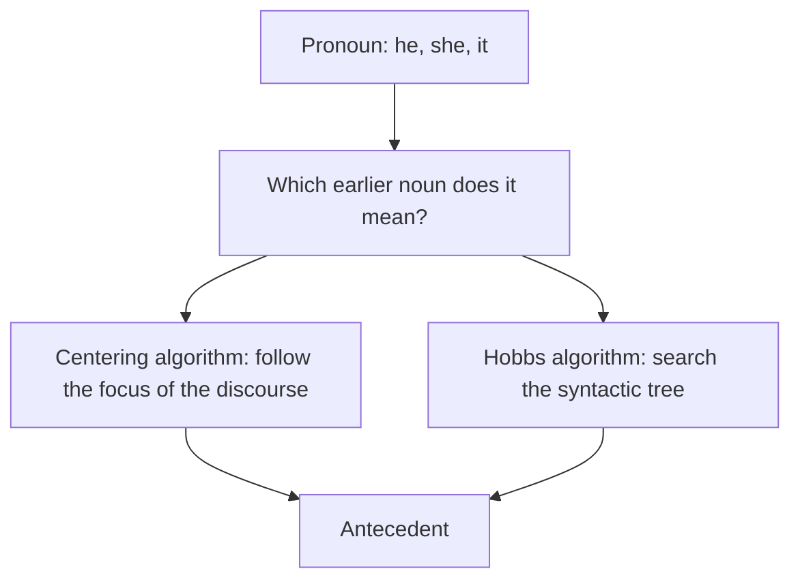
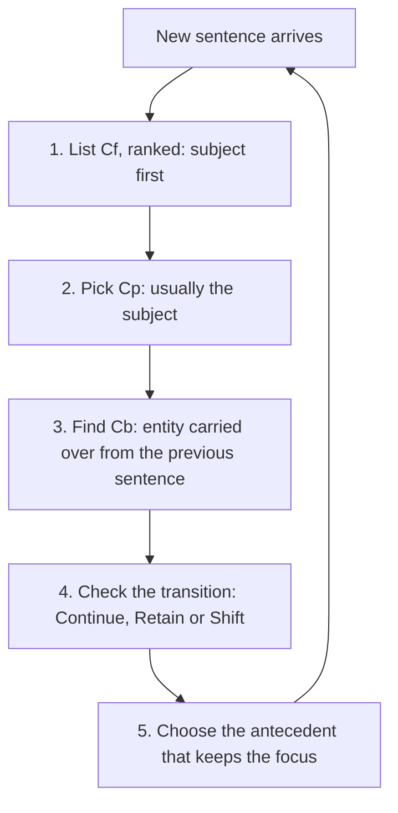
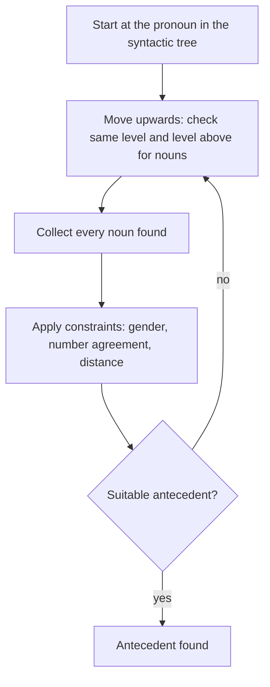
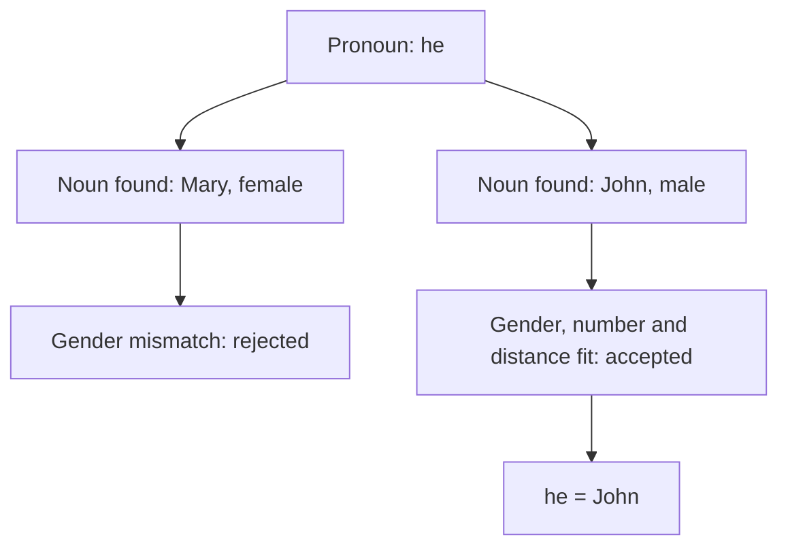

Before the new ideas, here are the old ones you need. If you already know them, skip to the next section.

## The basics first

- A **pronoun** is a word used instead of a noun, such as *he, she, it, they*. The earlier noun it stands for is its **antecedent**. <Cite id="class-nlp-asol" loc="p. 5" />
- **Anaphora resolution** (also called pronoun resolution) is the job of finding the antecedent of a pronoun, so that "Taylor went to the store. She bought groceries." is read as *Taylor* bought the groceries. <Cite id="class-nlp-asol" loc="p. 1" />
- A **syntactic tree** (parse tree) shows how the words of a sentence are grouped by grammar: the sentence S at the top, then the nouns and verbs below.
- **Agreement:** a pronoun and its antecedent must match in gender (he is male), number (one or many) and person.

This note is syllabus <Syl m="5" /> and builds on the previous note on discourse and referring expressions.

## Centering algorithm

<Box kind="definition">

The **Centering Algorithm** is a central part of Centering Theory in NLP, providing a structured mechanism for tracking the "focus" of discourse and determining how pronouns and references are resolved for natural and coherent text understanding. <Cite id="class-nlp-asol" loc="p. 1" />

</Box>

**What it is.** The algorithm models how discourse maintains a sense of coherence by tracking what entities (people, objects, concepts) each sentence is focusing on, and how that focus shifts from one sentence to the next. It is especially important for anaphora resolution: linking pronouns like "he", "she" or "it" back to the correct previous mention (antecedent). <Cite id="class-nlp-asol" loc="p. 2" />

**Everyday analogy.** A story is like a camera. At any moment the camera points at one character. A pronoun in the next sentence almost always means the character the camera is already on.

### Key concepts

- **Centers:** each utterance (typically a sentence) contains a set of entities called **forward-looking centers (Cf)**, ranked by their grammatical role or prominence. The subject is usually the most prominent.
- **Backward-looking center (Cb):** the entity from the previous sentence that the current sentence is most centrally about.
- **Transitions:** describe how the focus shifts between sentences: **Continue** (maintain the same focus), **Retain** (shift attention but stay coherent) and **Shift** (move focus to a different, less related entity).

The **preferred center (Cp)** is the highest-ranked entity of the current Cf, often the subject. <Cite id="class-nlp-asol" loc="p. 2" />

### How the algorithm works

1. Identify the set of forward-looking centers (Cf) in the current utterance (all entities mentioned, ranked by prominence).
2. Determine the preferred center (Cp) of the utterance (often the subject).
3. Determine the backward-looking center (Cb) by referencing the previous utterance: which entity is being carried forward as the discourse "topic"?
4. Use the transition types, Continue (preferred), Retain and Shift, to structure pronoun resolution and keep discourse coherence.
5. Prefer antecedents that maintain the continuity and prominence of centers according to these transition rules. <Cite id="class-nlp-asol" loc="p. 2" /> <Cite id="class-nlp-asol" loc="p. 3" />

### Example

"Aragorn picked up the sword. He looked at Frodo." The algorithm tracks *Aragorn* as the backward-looking and preferred center, so it resolves "He" as *Aragorn*. <Cite id="class-nlp-asol" loc="p. 3" />

<Sum>

<Given>

U1: *Aragorn picked up the sword.* U2: *He looked at Frodo.* U3a: *Frodo waited for him.* U3b: *Frodo ran to the river.*

</Given>

<Find>

Cf, Cb and the transition for each sentence.

</Find>

<Steps>

1. U1: Cf = [Aragorn, sword]; Cp = Aragorn (subject). It is the first sentence, so it has no Cb yet. *Reason: Cb needs a previous sentence.*
2. U2: *He* is a pronoun, so find its antecedent among Cf(U1). Aragorn is the top-ranked and male, so *He* = Aragorn. Cf(U2) = [Aragorn, Frodo]; Cb(U2) = Aragorn; Cp = Aragorn. The focus stays on Aragorn: **Continue**.
3. U3a: Cf = [Frodo, Aragorn (him)]; Cp = Frodo. Cb is the highest-ranked entity of Cf(U2) found in U3a, which is Aragorn (the same Cb as before), but Cp is now Frodo. Attention shifts but the text stays coherent: **Retain**.
4. U3b: Cf = [Frodo, river]; Cp = Frodo. Only Frodo from Cf(U2) appears, so Cb = Frodo, which is not Aragorn any more. The focus has moved: **Shift**.

</Steps>

<Answer>

U2: He = Aragorn, Continue. U3a: Retain. U3b: Shift.

</Answer>

<Box kind="verify">

Check the preference order: Continue is best, then Retain, then Shift. U2 reads smoothly because it Continues; U3b is a change of topic, which is why it is the least preferred. The transition rule used here (Cb same or changed, and Cb equal to Cp or not) is the standard Centering rule and is not written out in the class answer.

</Box>

</Sum>

### Importance and applications

The Centering Algorithm is crucial for creating and evaluating natural, coherent, human-like text in **machine translation, summarization, story generation and conversational AI**. It provides theoretical guidance for how to resolve ambiguous pronouns and maintain coherence across sentences. <Cite id="class-nlp-asol" loc="p. 3" />

## Hobbs algorithm

<Box kind="definition">

**Hobbs Algorithm** is a heuristic method for pronoun resolution, developed by Jerry Hobbs in 1976. It finds to which noun a pronoun is referring. It uses the syntactic tree of the sentence and finds the solution by operations on that tree. <Cite id="class-nlp-asol" loc="p. 3" />

</Box>

A **heuristic** is a rule of thumb that usually works but is not guaranteed.

### Steps

1. **Start** with the pronoun in the syntactic tree and move upwards. Check the same level and the level above for a noun.
2. When a noun occurs, **consider it** and check for other nouns in the tree.
3. After considering all nouns, **apply constraints** on them. The constraints include gender, number agreement and distance from the pronoun.
4. If no suitable antecedent is found, **repeat** all the steps. <Cite id="class-nlp-asol" loc="p. 3" />

### Example

"John saw Mary, he greeted her." Look at the tree for the nouns above the pronoun *he*: they are **Mary** and **John**. Apply the constraints: gender, number agreement and distance from the pronoun. *he* is used for a male and John is a male, so John is a suitable candidate. Finally, *he* refers to **John**. <Cite id="class-nlp-asol" loc="p. 4" />

In the same way, *her* is female and singular, so it cannot be John and it is resolved to Mary. This second step is not written in the class answer, but follows the same rule.

For longer text the standard version of Hobbs searches the nearest sentence first, left to right, and then earlier sentences one by one. That detail is not in the class answer.

## Comparison: Hobbs and Centering

| Point | Hobbs algorithm | Centering algorithm |
|---|---|---|
| Idea | search the syntactic tree for a noun | track the focus of the discourse |
| Needs | a syntactic (parse) tree of the sentence | entities of each sentence ranked into Cf, Cp, Cb |
| Works on | one pronoun at a time | the flow of whole text, sentence to sentence |
| Chooses by | gender, number agreement, distance | continuity of centers: Continue, then Retain, then Shift |
| Type | heuristic, syntax based | discourse based, models coherence |
| Used in | pronoun resolution | pronoun resolution, MT, summarization, story generation, conversational AI |

The last two rows of the table are summarised from the class answers; the comparison itself is not written in them.

<Box kind="exam">

Asked as: Hobbs algorithm <PYQ id="2022-12-ce/q5b" /> <PYQ id="2025-05/q2a" />, Centering algorithm <PYQ id="2023-05-ce/q4b" />, both algorithms <PYQ id="2024-05-ce/q5b" /> <PYQ id="2025-05-ce/q4b" /> and Hobbs against Centering <PYQ id="2024-12-ce/q3b" />.

</Box>
