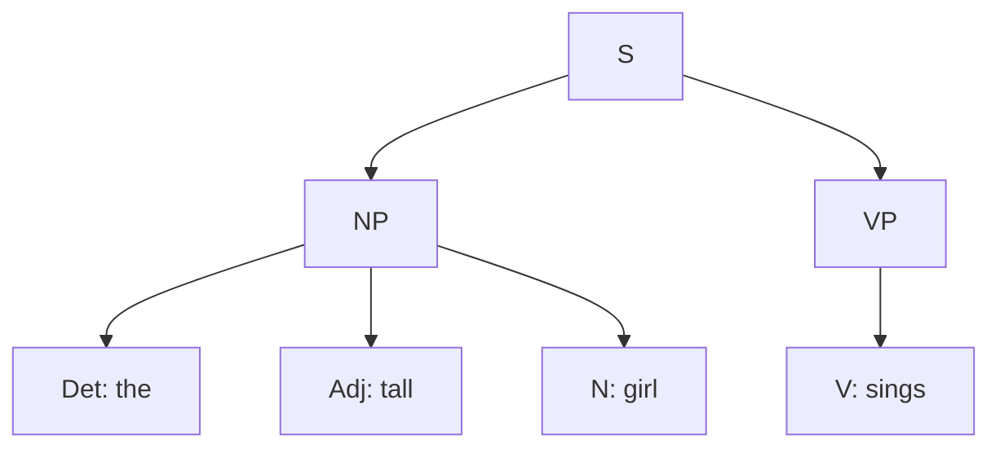
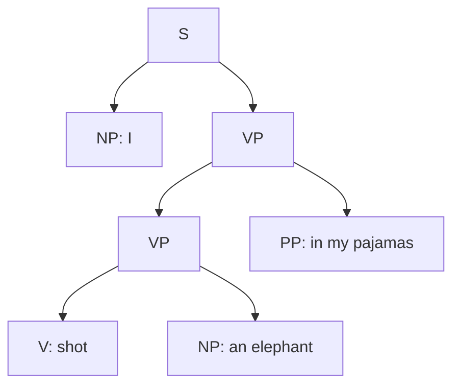
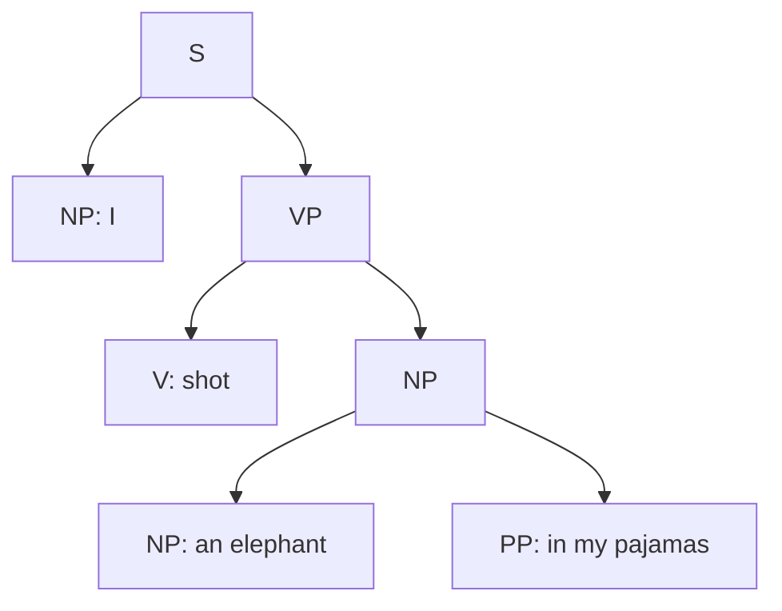
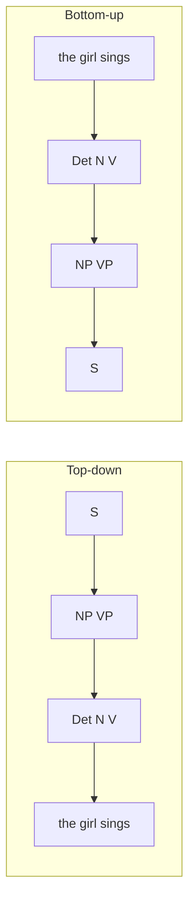
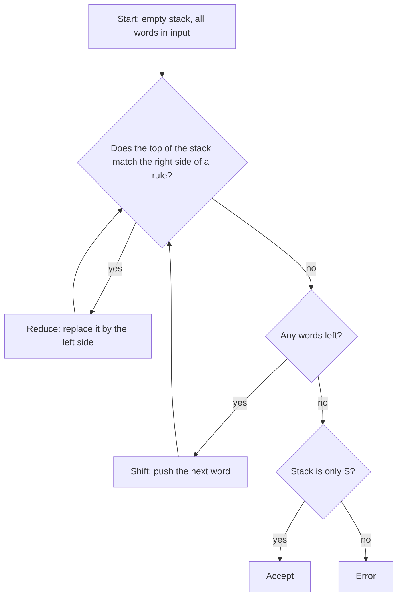
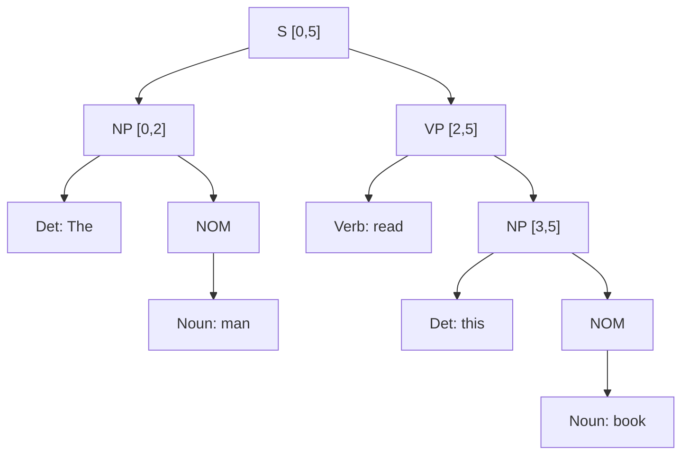

Naye ideas se pehle wo purani baatein jo aapko chahiye. Agar aap jaante ho to seedha next section pe jao.

## The basics first

- **Syntax** words ko sahi sentences mein arrange karne ke rules ka set hai. `The girl sings` sahi hai; `girl the sings` sahi nahi hai.
- **Part of speech (POS)** word ki class hai: noun (N), verb (V), determiner (Det, jaise `the`, `a`, `this`), adjective (Adj), preposition (P). Har word ko POS tag dena is topic se pehle wala topic hai.
- **Phrase** (ya **constituent**) words ka wo group hai jo ek unit ki tarah kaam karta hai. `The tall girl sings` mein `The tall girl` ek unit hai (ise `She` se replace kar sakte hain) aur `sings` doosra unit hai. <Cite id="cfg-parsing-wiki-const" />
- **Noun phrase (NP)** noun ke around bana group hai (`the tall girl`). **Verb phrase (VP)** verb ke around bana group hai (`read this book`). **Prepositional phrase (PP)** preposition plus NP hai (`in my pajamas`).
- **Rewriting rule** kehta hai "ye symbol is string of symbols se replace ho sakta hai", arrow ke saath likha jaata hai, jaise `NP → Det N`.
- **Parsing** matlab sentence ka structure dhoondhna. NLP mein result aam taur par **parse tree** hota hai. <Cite id="cfg-parsing-wiki-parsetree" /> <Cite id="cfg-parsing-tp-syn" />

## Context-free grammar (CFG)

**What it is.** Context-free grammar ek language ko rewriting rules se describe karta hai jisme left side hamesha ek hi symbol hota hai, isliye rule wahan use ho sakta hai jahan wo symbol aaye, chahe aas-paas kuch bhi ho ("context-free"). English ke grammar ke liye ye sabse zyada use hone wala formal system hai. Ye syllabus <Syl m="3" />, section 3.4 (introduction to CFG) hai. <Cite id="cfg-parsing-slp3-19" loc="§19.2" /> <Cite id="cfg-parsing-slp3-F" loc="§F.2" /> <Cite id="cfg-parsing-wiki-cfg" />

**Why it is needed.** Computer har sahi sentence ki list nahi bana sakta, kyunki sentences infinite hain. Rules ka chhota set sab sentences generate kar sakta hai, aur wahi rules ulte chala ke sentence check kar sakte hain aur uska structure nikal sakte hain. Meaning ke liye ye structure zaroori hai: question answering, translation aur information extraction sab isi pe depend karte hain ki kisne kisko kya kiya.

**Everyday analogy.** CFG sentences ki recipe book jaisa hai. `S → NP VP` kehta hai "sentence ek noun phrase aur ek verb phrase se banta hai". Har ingredient ki apni recipe hoti hai jab tak actual words na aa jayein.

<Box kind="definition">

**Context-free grammar** ek 4-tuple $G = (N, \Sigma, R, S)$ hai:

- $N$: **non-terminals** (phrase labels jaise S, NP, VP aur POS labels jaise Det, N, V).
- $\Sigma$: **terminals**, actual words (`the`, `girl`).
- $R$: **rules** (productions) jo $A \rightarrow \alpha$ form mein hote hain, jahan $A$ ek non-terminal hai aur $\alpha$ terminals aur non-terminals ki string hai.
- $S$: **start symbol**, poore sentence ka label.

</Box>

English ka chhota grammar (neeche ke examples mein use hoga):

| Rule | Meaning |
|---|---|
| S → NP VP | sentence = noun phrase ke baad verb phrase |
| NP → Det N, NP → Det Adj N | noun phrase determiner aur noun ho sakta hai, optional adjective ke saath |
| VP → V, VP → V NP | verb phrase sirf verb ho sakta hai, ya verb aur uska object |
| Det → the, Adj → tall, N → girl, V → sings | **lexicon**: wo rules jo words dete hain |

**Derivation.** **Derivation** S se shuru hota hai aur ek non-terminal ko uske kisi rule ki right side se replace karta rehta hai jab tak sirf words na bachein. **Leftmost derivation** mein hamesha sabse left wala non-terminal pehle replace hota hai. **Parse tree** derivation ki picture hai: root S hai, har inner node non-terminal hai, uske children use hue rule ki right side hain, aur leaves left se right padho to sentence milta hai. <Cite id="cfg-parsing-gfg-types" /> <Cite id="cfg-parsing-tp-syn" />

<Cite id="cfg-parsing-tp-syn" loc="diagram" />

TutorialsPoint pe bana constituency tree (upar link hai) wahi idea hai: andar phrase labels, leaves pe words. **Treebank** ek corpus hai jiske sentences haath se aise trees mein parse kiye gaye hain; Penn Treebank sabse famous hai, aur grammar rules seedha uske trees se padhe ja sakte hain. <Cite id="cfg-parsing-slp3-19" loc="§19.3" /> <Cite id="pos-tagging-marcus1993" />

### Worked example: parse tree for a sentence

<Sum>

<Given>

Grammar: S → NP VP; NP → Det Adj N | Det N; VP → V | V NP; Det → "the"; Adj → "tall"; N → "girl"; V → "sings". Sentence: `The tall girl sings`.

</Given>

<Find>

leftmost derivation aur parse tree.

</Find>

<Steps>

1. S se shuru karo. Sirf ek rule ke left mein S hai: S ⇒ NP VP. *Reason: sentence ko subject NP aur ek VP chahiye.*
2. Sabse left symbol NP expand karo. Verb se pehle teen words hain, isliye NP → Det Adj N use karo: ⇒ Det Adj N VP. *Reason: doosra rule NP → Det N sirf do words deta hai aur `tall` unused reh jaata.*
3. Det, Adj, N ko lexicon se replace karo: ⇒ the Adj N VP ⇒ the tall N VP ⇒ the tall girl VP.
4. VP expand karo. `sings` ke baad kuch nahi bacha, isliye VP → V use karo: ⇒ the tall girl V. *Reason: VP → V NP ko object chahiye jo sentence mein hai hi nahi.*
5. V replace karo: ⇒ the tall girl sings. Ab sirf words bache, derivation khatam. Tree upar wali figure mein hai.

</Steps>

<Answer>

S ⇒ NP VP ⇒ Det Adj N VP ⇒ the Adj N VP ⇒ the tall N VP ⇒ the tall girl VP ⇒ the tall girl V ⇒ the tall girl sings. Tree: [S [NP [Det the] [Adj tall] [N girl]] [VP [V sings]]].

</Answer>

<Box kind="verify">

Count: derivation mein 7 arrows hain, matlab 7 rules use hue (S → NP VP, NP → Det Adj N, VP → V aur 4 lexical rules). Tree mein bhi 7 inner nodes apne children ke saath hain: S, NP, VP, Det, Adj, N, V, yaani 7. Leaves `the tall girl sings` padhte hain, jo input hai. <PYQ id="2024-12-ce/q5b" />

</Box>

</Sum>

## Ambiguity: one sentence, many trees

**What it is.** Sentence **structurally ambiguous** hota hai jab grammar uske ek se zyada parse tree deta hai. Classic case **PP attachment** hai: `I shot an elephant in my pajamas` mein `in my pajamas` shooting ko modify kar sakta hai (maine pajamas pehne the) ya elephant ko (elephant ne pajamas pehne the). <Cite id="cfg-parsing-slp3-19" loc="§19.5" /> <Cite id="ambiguity-challenges-nltk-ch8" loc="§1.2" />

<Cite id="ambiguity-challenges-nltk-ch8" loc="§1.2" />

Sentence lamba hone par trees ki sankhya bahut tezi se badhti hai, isliye parser ko saare trees ek-ek karke list nahi karne chahiye. Wo shared parts ko table mein store karta hai (neeche CYK aur chart parsing), aur probabilistic grammar sabse likely tree chunta hai. <Cite id="cfg-parsing-slp3-19" loc="§19.5" /> <Cite id="ambiguity-challenges-nltk-ch8" loc="§4.4" />

## Parsing as search: top-down and bottom-up

**What it is.** Parser ko aisa tree dhoondhna hai jiska root S ho aur leaves exactly input words hon. Search ki do natural directions hain. <Cite id="cfg-parsing-gfg-types" />

- **Top-down (goal-driven):** S se shuru karo, rules se use tree mein expand karo, aur leaves ko words se check karo. <Cite id="cfg-parsing-wiki-td" /> <Cite id="cfg-parsing-tp-td" />
- **Bottom-up (data-driven):** words se shuru karo, unka POS dekho, aur paas-paas ke symbols ko rules ulte use karke bade symbols mein combine karo, jab tak S sab kuch cover na kar le. <Cite id="cfg-parsing-wiki-bu" /> <Cite id="cfg-parsing-gfg-bu" />

<Cite id="cfg-parsing-gfg-bu" loc="diagram" />

### Worked example: top-down and bottom-up on the same sentence

<Sum>

<Given>

Pichle example ka grammar. Sentence: `The girl sings` (is baar adjective nahi hai).

</Given>

<Find>

top-down aur bottom-up parser dono S tak kaise pahunchte hain, aur kaun kaam waste karta hai.

</Find>

<Steps>

1. **Top-down, goal S.** S → NP VP expand karo. Naye goals: NP, phir VP.
2. **Top-down, goal NP.** Pehla rule NP → Det Adj N try karo. Det `the` se match hota hai. Agla goal Adj hai par agla word `girl` hai, jo adjective nahi hai. Ye guess fail hota hai, isliye parser **backtrack** karta hai (guess undo karta hai). *Reason: parser ne input dekhe bina word class predict ki.*
3. **Top-down, retry.** NP → Det N try karo: Det = `the`, N = `girl`, dono match. Phir VP → V: V = `sings` match. Saare goals poore aur saare words use hue: success.
4. **Bottom-up, words to POS.** `the` Det hai, `girl` N hai, `sings` V hai: symbols Det N V.
5. **Bottom-up, combine.** Det N, NP → Det N ki right side se match karta hai, to NP se replace karo. V, VP → V se match karta hai, to VP se replace karo. NP VP, S → NP VP se match karta hai, to S se replace karo. Sirf S bacha, jo saare words cover karta hai: success.

</Steps>

<Answer>

Dono same tree tak pahunchte hain [S [NP [Det the] [N girl]] [VP [V sings]]]. Top-down ne ek galat guess (NP → Det Adj N) kiya aur backtrack kiya; bottom-up ne adjective kabhi try nahi kiya kyunki input mein adjective tha hi nahi.

</Answer>

<Box kind="verify">

Dono trees mein wahi 6 rules hain: S → NP VP, NP → Det N, VP → V, Det → the, N → girl, V → sings. Top-down ne ek galat rule (NP → Det Adj N) bhi lagaya aur undo kiya; bottom-up ne sirf tree ke 6 rules use kiye. Wo ek undo hua guess hi dono ka fark hai. <PYQ id="2022-12-ce/q4c" />

</Box>

</Sum>

### Top-down versus bottom-up

| Point | Top-down | Bottom-up |
|---|---|---|
| Starts from | the start symbol S | the input words |
| Direction | S down to the words | words up to S |
| Driven by | the goal (grammar) | the data (words) |
| Uses rules | left to right (expand) | right to left (reduce) |
| Typical implementation | recursive descent | shift-reduce, CYK |
| Strength | aisa phrase kabhi nahi banata jo sentence ka part na ban sake | input mein na hone wali word class kabhi predict nahi karta |
| Weakness | bahut galat predictions, backtracking, aur NP → NP PP jaise left-recursive rules pe infinite loop | aise phrases banata hai jo S tak kabhi nahi pahunchte (jaise verb chahiye wale sentence mein `book` ko noun banana), aur kaam dobara karta hai |
| Ambiguous words | ek symbol ke saare rules try karta hai | ek word ke saare POS try karta hai |

Dono backtracking ke baad wahi sub-work dobara kar sakte hain. Finished pieces ki table (chart) ya dynamic programming ise theek karta hai. **Left-corner** parser dono ko milata hai: top-down predict karta hai par agle word se bottom-up filter karta hai. <Cite id="ambiguity-challenges-nltk-ch8" loc="§4.1" /> <Cite id="cfg-parsing-slp3-19" loc="§19.6" />

**Conclusion.** Top-down goal-directed hai aur bottom-up data-directed; practical parsers (CYK, Earley, chart) table use karte hain taaki koi sub-parse do baar compute na ho. <Cite id="cfg-parsing-wiki-earley" /> <Cite id="cfg-parsing-nltk-chart" />

## Shift-reduce parsing

**What it is.** Shift-reduce parser ek bottom-up parser hai jo **stack** aur **input buffer** use karta hai. Ye words ko left se right padhta hai aur do moves tab tak repeat karta hai jab tak stack mein sirf S na reh jaaye. <Cite id="cfg-parsing-wiki-sr" /> <Cite id="cfg-parsing-gfg-sr" /> <Cite id="ambiguity-challenges-nltk-ch8" loc="§4.2" />

**Why it is needed.** Ye simple aur fast hai (ek pass, table nahi), isliye compilers aur kai fast NLP parsers ka base hai.

**How it works.** Chaar actions:

1. **Shift:** agla word input se stack pe daalo.
2. **Reduce:** agar stack ka top kisi rule ki right side se match kare, to use left side se replace karo. Match hone wale part ko **handle** kehte hain.
3. **Accept:** input khali hai aur stack mein sirf S hai.
4. **Error:** na shift ho sakta hai na reduce.

<Cite id="cfg-parsing-gfg-sr" loc="diagram" />

### Worked example: shift-reduce trace

<Sum>

<Given>

Pehle example ka grammar. Sentence: `The tall girl sings`.

</Given>

<Find>

har step pe stack, input aur action.

</Find>

<Steps>

1. Har word shift hota hai aur phir lexicon se uske POS mein reduce hota hai (Det → the aur aise hi). Phir phrase rules POS symbols ko reduce karte hain. Poora trace:

| Step | Stack | Input left | Action |
|---|---|---|---|
| 1 | (empty) | the tall girl sings | shift |
| 2 | the | tall girl sings | reduce Det → the |
| 3 | Det | tall girl sings | shift |
| 4 | Det tall | girl sings | reduce Adj → tall |
| 5 | Det Adj | girl sings | shift |
| 6 | Det Adj girl | sings | reduce N → girl |
| 7 | Det Adj N | sings | reduce NP → Det Adj N |
| 8 | NP | sings | shift |
| 9 | NP sings | (empty) | reduce V → sings |
| 10 | NP V | (empty) | reduce VP → V |
| 11 | NP VP | (empty) | reduce S → NP VP |
| 12 | S | (empty) | accept |

2. Step 10 pe `NP V` object ka intezaar bhi kar sakta tha (VP → V NP), par input khali hai, isliye sirf VP → V reduce possible hai. *Reason: shift karne ke liye koi word bacha hi nahi.*

</Steps>

<Answer>

12 steps mein accept: 4 shifts, 7 reduces aur 1 accept. Reductions ye tree dete hain [S [NP [Det the] [Adj tall] [N girl]] [VP [V sings]]].

</Answer>

<Box kind="verify">

Counts: shifts 4 (har word ka ek) + reduces 7 + accept 1 = 12 rows. 7 reduces wahi 7 rules hain jo pehle mile parse tree mein the, to dono methods agree karte hain. Stack mein kabhi teen se zyada symbols nahi hue, step 6 pe. <PYQ id="2025-05-ce/q3b" />

</Box>

</Sum>

**Conflicts and limits.** Kabhi do actions possible hote hain. **Shift-reduce conflict**: stack pe `NP V` ho aur words bache hon, to VP → V reduce karein ya object shift karein? **Reduce-reduce conflict**: do alag rules stack ke top se match karte hain. Basic shift-reduce parser ek choice karta hai aur **kabhi backtrack nahi karta**, isliye valid parse wale sentence pe bhi fail ho sakta hai, aur maximum ek parse deta hai. Real parsers lookahead table (LR parsing) ya trained classifier se action chunte hain. <Cite id="ambiguity-challenges-nltk-ch8" loc="§4.2" /> <Cite id="cfg-parsing-wiki-sr" />

## Chomsky normal form and the CYK algorithm

**What it is.** Grammar **Chomsky normal form (CNF)** mein tab hota hai jab har rule ya to $A \rightarrow B\,C$ (do non-terminals) ho ya $A \rightarrow a$ (ek word). Har CFG ko same language ke saath CNF mein convert kar sakte hain. **CYK (Cocke-Younger-Kasami) algorithm** CNF grammar ke liye bottom-up, dynamic-programming parser hai. <Cite id="cfg-parsing-slp3-19" loc="§19.4" /> <Cite id="cfg-parsing-wiki-cnf" /> <Cite id="cfg-parsing-wiki-cyk" /> <Cite id="cfg-parsing-gfg-cyk" />

**Why it is needed.** Har rule ke do children hone se words ke span ko do hisson mein baantne ke kam hi tarike hote hain. Table har solve ho chuke span ko yaad rakhti hai, isliye kuch bhi do baar compute nahi hota, aur hazaaron parses hone par bhi saare ek table mein pack ho jaate hain. $n$ words aur $|G|$ rules ke liye time $O(n^3 \cdot |G|)$ aur space $O(n^2)$. <Cite id="cfg-parsing-slp3-19" loc="§19.6" />

**How it works.**

1. Grammar ko CNF mein convert karo. <Cite id="cfg-parsing-slp3-19" loc="§19.6.1" /> <Cite id="cfg-parsing-gfg-cnf" />
   - Right side mein do se zyada symbols wala rule: naye symbol se todo (`S → Aux NP VP` se `S → X1 VP` aur `X1 → Aux NP`).
   - Unit rule $A \rightarrow B$: $B$ jo kuch ban sakta hai wo copy karke replace karo (`VP → Verb` se `VP → book | include | read`).
2. Words ke beech ke gaps ko $0, 1, \dots, n$ number do. Cell $[i,j]$ mein wo saare non-terminals hote hain jo gap $i$ se gap $j$ tak ke words bana sakte hain.
3. Length-1 cells lexicon se bharo.
4. Lambe spans ke liye, $i$ aur $j$ ke beech har split point $k$ pe, agar $B$ $[i,k]$ mein hai, $C$ $[k,j]$ mein hai aur rule $A \rightarrow B\,C$ exist karta hai, to $A$ ko $[i,j]$ mein daalo.
5. Sentence accept hota hai agar S $[0,n]$ mein ho. Back-pointers se tree wapas milta hai.

### Worked example: CYK on "The man read this book"

<Sum>

<Given>

Grammar: S → NP VP | Aux NP VP | VP; NP → Det NOM; NOM → Noun | Noun NOM; VP → Verb | Verb NP. Lexicon: Det → that, this, a, the; Noun → book, flight, meal, man; Verb → book, include, read; Aux → does. Sentence: `The man read this book`.

</Given>

<Find>

CYK se sentence accept hota hai ya nahi, aur uska parse tree.

</Find>

<Steps>

1. **Convert to CNF.** `S → Aux NP VP` ko `S → X1 VP` aur `X1 → Aux NP` mein todo. Unit rules hatao: `NOM → Noun` se `NOM → book | flight | meal | man`; `VP → Verb` se `VP → book | include | read`; `S → VP` se `S → Verb NP | book | include | read` (S ko wo har right side milti hai jo VP ke paas hai). CNF grammar: S → NP VP | X1 VP | Verb NP | book | include | read; X1 → Aux NP; NP → Det NOM; NOM → Noun NOM | book | flight | meal | man; VP → Verb NP | book | include | read; saath mein Det, Noun, Verb, Aux ka lexicon. *Reason: CYK tabhi chalta hai jab har rule mein do non-terminals ya ek word ho.*
2. **Number the gaps.** 0 The 1 man 2 read 3 this 4 book 5.
3. **Length-1 cells (lexicon).** [0,1] `the`: Det. [1,2] `man`: Noun, NOM. [2,3] `read`: Verb, VP, S. [3,4] `this`: Det. [4,5] `book`: Noun, NOM, Verb, VP, S.
4. **Length 2.** [0,2] The man: Det + NOM se NP. [1,3] man read: Noun/NOM + Verb/VP/S ka koi rule nahi, empty. [2,4] read this: kuch nahi (Verb, VP ya S ke baad Det ka koi rule nahi), empty. [3,5] this book: Det + NOM se NP.
5. **Length 3.** [0,3] The man read: [0,2] ka NP + [2,3] ka VP se S (S → NP VP). [1,4] man read this: empty (koi split kaam nahi karta). [2,5] read this book: [2,3] ka Verb + [3,5] ka NP se S (S → Verb NP) aur VP (VP → Verb NP).
6. **Length 4.** [0,4] The man read this: empty (S + Det ka rule nahi). [1,5] man read this book: empty (Noun/NOM + S/VP ka rule nahi).
7. **Length 5.** [0,5]: split 2 pe: [0,2] ka NP + [2,5] ka VP se S (S → NP VP). Splits 1, 3, 4 kuch nahi dete. S top cell mein hai, to sentence accept hota hai.

Poori table (row = start gap $i$, column = end gap $j$):

| i \ j | 1 (The) | 2 (man) | 3 (read) | 4 (this) | 5 (book) |
|---|---|---|---|---|---|
| 0 | Det | NP | S | none | **S** |
| 1 | | Noun, NOM | none | none | none |
| 2 | | | Verb, VP, S | none | S, VP |
| 3 | | | | Det | NP |
| 4 | | | | | Noun, NOM, Verb, VP, S |

</Steps>

<Answer>

Accepted: S cell [0,5] mein hai. Parse: [S [NP [Det the] [NOM [Noun man]]] [VP [Verb read] [NP [Det this] [NOM [Noun book]]]]].

</Answer>

<Box kind="verify">

Original (CNF nahi) rules se tree top-down banao: S ⇒ NP VP ⇒ Det NOM VP ⇒ the NOM VP ⇒ the man VP ⇒ the man Verb NP ⇒ the man read NP ⇒ the man read Det NOM ⇒ the man read this NOM ⇒ the man read this book. Har step given grammar ka rule hai, aur words match karte hain. Doosra reading, [2,5] mein S (`read this book` ek command jaise `Book that flight`), poore sentence ke liye sahi tarah nahi ban sakta kyunki `The man` bach jaata hai. <PYQ id="2023-05-ce/q5a" /> <PYQ id="2025-05-ce/q5a" />

</Box>

</Sum>

<Cite id="cfg-parsing-gfg-cyk" loc="diagram" />

GeeksforGeeks page (upar link) doosre grammar aur string `baaba` ke liye wahi triangle table banata hai. Hamari table exam sentence ke liye wahi idea hai.

**Other table parsers.** **Earley parser** kisi bhi CFG pe chalta hai (CNF nahi chahiye) $O(n^3)$ mein aur adhoore rules chart mein rakhta hai. **Chart parser** saare partial parses ek table mein store karta hai taaki koi do baar na bane. <Cite id="cfg-parsing-wiki-earley" /> <Cite id="cfg-parsing-nltk-chart" />

## Probabilistic context-free grammar (PCFG)

**What it is.** **PCFG** ek CFG hai jisme har rule ki probability hoti hai. Ek hi left side wale saare rules ki probabilities ka sum 1 hota hai. To $P(\text{NP} \to \text{Det N}) = 0.6$ ka matlab 60 percent noun phrases isi tarah bante hain. <Cite id="cfg-parsing-slp3-E" loc="§E.1" /> <Cite id="cfg-parsing-wiki-pcfg" /> <Cite id="text-preprocessing-fsnlp" />

**Why it is needed.** Normal CFG sirf kehta hai "ye tree allowed hai". Real sentences ambiguous hote hain, aur grammar nahi bata sakta ki kaunsa tree zyada likely hai. PCFG trees ko rank karta hai, isliye parser sabse probable tree return kar sakta hai. Ye poore sentence ki probability bhi de sakta hai, to language model ki tarah kaam karta hai. <Cite id="cfg-parsing-slp3-E" loc="§E.1" />

**How it works.**

1. **Tree ki probability** = us mein use hue saare rules ki probabilities ka product. Ye assume karta hai ki har rule baaki tree se independent chuna jaata hai (context-free assumption).
2. **Sentence ki probability** = uske saare trees ki probabilities ka sum.
3. **Best parse** = sabse zyada probability wala tree. Probabilistic CKY har cell mein har non-terminal ki best probability rakhke ye dhoondhta hai. <Cite id="cfg-parsing-slp3-E" loc="§E.2" />
4. **Probabilities seekhna.** Treebank mein rules count karo: $P(A \rightarrow \beta) = \dfrac{\text{Count}(A \rightarrow \beta)}{\text{Count}(A)}$. <Cite id="cfg-parsing-slp3-E" loc="§E.3" />

### Worked example: rule probabilities from a treebank

<Sum>

<Given>

Ek treebank mein 100 noun phrases hain: 60 Det N, 25 Det Adj N, 15 NP PP. Usme 100 verb phrases hain: 20 V, 50 V NP, 30 VP PP.

</Given>

<Find>

NP aur VP rules ki PCFG probabilities.

</Find>

<Steps>

1. NP rules, har count ko NP total 100 se divide karo: $P(\text{NP} \to \text{Det N}) = 60/100 = 0.60$; $P(\text{NP} \to \text{Det Adj N}) = 25/100 = 0.25$; $P(\text{NP} \to \text{NP PP}) = 15/100 = 0.15$. *Reason: left mein NP wale saare rules mein relative frequency.*
2. VP rules, 100 se divide karo: $P(\text{VP} \to \text{V}) = 0.20$; $P(\text{VP} \to \text{V NP}) = 0.50$; $P(\text{VP} \to \text{VP PP}) = 0.30$.

</Steps>

<Answer>

NP: 0.60, 0.25, 0.15. VP: 0.20, 0.50, 0.30.

</Answer>

<Box kind="verify">

Har left side ka sum 1 hona chahiye: NP $0.60 + 0.25 + 0.15 = 1.00$; VP $0.20 + 0.50 + 0.30 = 1.00$. <PYQ id="2023-12-ce/q5b" />

</Box>

</Sum>

### Worked example: choosing between two parse trees with a PCFG

Ye Manning aur Schütze ka classic ambiguity example hai, `astronomers saw stars with ears`. <Cite id="text-preprocessing-fsnlp" />

<Sum>

<Given>

Rules and probabilities: S → NP VP 1.0; PP → P NP 1.0; VP → V NP 0.7; VP → VP PP 0.3; NP → NP PP 0.4; NP → astronomers 0.1; NP → ears 0.18; NP → stars 0.18; NP → saw 0.04; NP → telescopes 0.1; P → with 1.0; V → saw 1.0. Sentence: `astronomers saw stars with ears`.

</Given>

<Find>

har parse tree ki probability, best parse aur sentence ki probability.

</Find>

<Steps>

1. Sentence ke do trees hain. Tree 1 PP ko noun phrase `stars` se jodta hai (stars ke kaan hain): VP → V NP, object NP → NP PP ke saath. Tree 2 PP ko verb phrase se jodta hai (dekhna kaan se hua): VP → VP PP, andar VP → V NP ke saath.
2. **Tree 1.** Use hue rules: S → NP VP (1.0), NP → astronomers (0.1), VP → V NP (0.7), V → saw (1.0), NP → NP PP (0.4), NP → stars (0.18), PP → P NP (1.0), P → with (1.0), NP → ears (0.18). Multiply: $1.0 \times 0.1 \times 0.7 \times 1.0 \times 0.4 \times 0.18 \times 1.0 \times 1.0 \times 0.18 = 0.0009072$.
3. **Tree 2.** Use hue rules: S → NP VP (1.0), NP → astronomers (0.1), VP → VP PP (0.3), VP → V NP (0.7), V → saw (1.0), NP → stars (0.18), PP → P NP (1.0), P → with (1.0), NP → ears (0.18). Multiply: $1.0 \times 0.1 \times 0.3 \times 0.7 \times 1.0 \times 0.18 \times 1.0 \times 1.0 \times 0.18 = 0.0006804$.
4. Bada chuno: $0.0009072 > 0.0006804$, to Tree 1 best parse hai.
5. Sentence probability uske trees ka sum hai: $0.0009072 + 0.0006804 = 0.0015876$.

</Steps>

<Answer>

$P(t_1) = 0.0009072$, $P(t_2) = 0.0006804$. Best parse Tree 1 hai (PP noun phrase `stars` se juda). $P(\text{sentence}) = 0.0015876$.

</Answer>

<Box kind="verify">

Stages mein dobara compute karo. Tree 1: $0.1 \times 0.7 = 0.07$; $0.07 \times 0.4 = 0.028$; $0.028 \times 0.18 = 0.00504$; $0.00504 \times 0.18 = 0.0009072$. Tree 2: $0.1 \times 0.3 = 0.03$; $0.03 \times 0.7 = 0.021$; $0.021 \times 0.18 = 0.00378$; $0.00378 \times 0.18 = 0.0006804$. NP rules ka sum bhi 1 hai: $0.4 + 0.1 + 0.18 + 0.18 + 0.04 + 0.1 = 1.0$, aur VP rules ka: $0.7 + 0.3 = 1.0$. <PYQ id="2023-12-ce/q5b" />

</Box>

</Sum>

**Advantages.** Ranking se ambiguity resolve karta hai; rules treebank se seekhe jaate hain; language model deta hai; probabilistic CKY cubic running time rakhta hai. **Disadvantages.** Rules ko independent maana jaata hai (noun phrase subject ho ya object, same tarah expand hota hai, jabki wo alag hote hain); words ignore hote hain (`saw the man with the telescope` ki probability nouns kuch bhi ho, same rehti hai); chhote trees favour hote hain kyunki har rule 1 se chhota number multiply karta hai. Fixes: non-terminals ko split karna aur lexicalized grammars. <Cite id="cfg-parsing-slp3-E" loc="§E.4" /> <Cite id="cfg-parsing-klein2003" /> <Cite id="cfg-parsing-collins2003" /> <Cite id="cfg-parsing-johnson1998" />

**Applications.** Question answering, machine translation aur grammar checking ke liye parsing; ambiguous parses mein se chunna; language modelling.

## Problems with plain CFGs

CFG achha pehla model hai, par English mein aise patterns hain jo context-free rules ka chhota set saaf tarah capture nahi kar sakta. Syllabus teen naam leta hai. <Cite id="cfg-parsing-slp3-F" loc="§F.3" />

### 1. Agreement

**What it is.** Sentence ke words number, person aur gender mein match hone chahiye. Subject aur verb agree karte hain: `She sings` par `*She sing` nahi; `These books` par `*This books` nahi. (Star ka matlab ungrammatical sentence.) Hindi mein gender bhi hota hai: `ladka jaata hai` par `ladki jaati hai`. <Cite id="cfg-parsing-wiki-agree" />

**The problem.** Rule `S → NP VP` `She sing` aur `These book` ko bhi accept kar leta hai, kyunki wo number dekhta hi nahi. Ise rokne ke liye grammar split karna padta hai: `S → NP-sg VP-sg`, `S → NP-pl VP-pl`, aur NP, N, Det, V ke rules bhi. Person, number aur gender saath mein hone par rules ki sankhya multiply ho jaati hai, aur grammar bahut bada aur repetitive ho jaata hai.

**The fix.** Symbols pe features (number, person) lagao aur unka match hona zaroori karo (unification-based grammars). Rule ek hi rehta hai: `S → NP VP` is condition ke saath ki NP aur VP ka number same ho.

### 2. Subcategorization

**What it is.** Verbs alag hote hain is baat mein ki unke baad kaunse phrases aate hain. Is pattern ko verb ka **subcategorization frame** kehte hain. <Cite id="cfg-parsing-slp3-F" loc="§F.3.4" /> <Cite id="cfg-parsing-wiki-subcat" />

| Verb type | Frame | Good | Bad |
|---|---|---|---|
| Intransitive | V | `The girl sleeps` | `*The girl sleeps the book` |
| Transitive | V NP | `She reads a book` | `*She devours` |
| Ditransitive | V NP NP, V NP PP | `He gave her a pen` | `*He handed her` |
| Sentential complement | V S | `I think that she sings` | `*I think a book` |

**The problem.** Ek hi rule `VP → V NP` se har verb object le sakta hai, to `*The girl sleeps the book` accept ho jaata hai. CFG ko V ko $V_{intrans}$, $V_{trans}$, $V_{ditrans}$ mein split karna padta hai aur har ke liye ek VP rule likhna padta hai, jisse grammar phir bada hota hai aur har verb frame ke liye karna padta hai.

**The fix.** Har verb ka frame lexicon mein store karo aur VP rule use check kare.

### 3. Movement

**What it is.** Ek phrase us jagah se door dikhta hai jahan wo logically belong karta hai. `What did John buy?` mein `what` `buy` ka object hai par shuru mein aa gaya. `Which book did you say she read?` mein object `which book` `read` se kai words door hai (long-distance dependency). Passives (`The book was read by Mary`) bhi object ko subject position pe le jaate hain. <Cite id="cfg-parsing-wiki-whmove" /> <Cite id="cfg-parsing-slp3-F" loc="§F.4" />

**The problem.** Context-free rule sirf apne children dekhta hai, isliye wo nahi keh sakta ki sentence mein aage ka gap pehle aaye `what` se bharta hai. Gap jitni positions aur lengths pe aa sakta hai, sabke liye alag rules chahiye, aur length unlimited hai.

**The fix.** **Gap** (trace) aur slash categories use karo: `S/NP` ka matlab "aisa sentence jisme ek NP missing hai". Grammar rule `S → Wh-NP Aux NP VP/NP` missing NP ko tree mein neeche tab tak pass karta hai jab tak `buy` use na kar le.

**Conclusion.** Teeno problems ki ek hi wajah hai: CFG rule local hota hai aur uske paas features, verb type ya door ke words ki memory nahi hoti. Aam ilaaj richer grammars (features, slash categories) ya statistical parsers hain. <Cite id="cfg-parsing-slp3-19" loc="§19.2" />

## Constituency versus dependency parsing

**Constituency parse** (ab tak ka sab kuch) phrases ke andar phrases dikhata hai. **Dependency parse** words ko seedha link karta hai: `sings` head hai aur `girl` subject ki tarah us par depend karta hai; phrase nodes nahi hote. spaCy jaisi modern libraries dependency parse deti hain, jabki CFG aur PCFG constituency parse dete hain. <Cite id="cfg-parsing-tp-syn" />

| Point | Constituency (CFG) | Dependency |
|---|---|---|
| Unit | phrases (NP, VP) | words and links between them |
| Labels | phrase labels | relations such as subject, object |
| Output | tree with inner nodes | tree over the words only |
| Good for | grammar, phrase structure | relations, information extraction, free word order |

## Exam answers

<Box kind="exam">

**Compare top-down and bottom-up parsing with an example (10 marks):** dono ki ek-line definition; direction (S se words versus words se S); example `the girl sings` galat `NP → Det Adj N` guess aur backtrack ke saath; comparison table (goal-driven versus data-driven, wasted predictions versus useless phrases, left recursion); ek-line conclusion. <PYQ id="2022-12-ce/q4c" />

**CYK parse of "The man read this book" (10 marks):** CNF mein convert karo (`Aux NP VP` todo, unit rules hatao), gaps number karo, lexicon cells bharo, split rule se length ke hisaab se bharo, table dikhao, S [0,5] mein, aur tree banao. <PYQ id="2023-05-ce/q5a" /> <PYQ id="2025-05-ce/q5a" />

**PCFG with an example (10 marks):** PCFG define karo (CFG plus rule probabilities jo har left side pe 1 banti hain); kyun (ambiguous parses ko rank karna); tree probability product ke roop mein; do-tree example jaise `astronomers saw stars with ears`; counting se learning; advantages aur limits. <PYQ id="2023-12-ce/q5b" />

**Parse tree with given CFG (10 marks):** rule-by-rule leftmost derivation likho, phir leaves pe labelled words ke saath tree banao, aur likho ki saare rules given grammar ke hain. <PYQ id="2024-12-ce/q5b" />

**Problems in CFG: agreement, subcategorization, movement (10 marks):** har ek ke liye definition, ek sahi aur ek galat sentence, plain CFG kyun fail hota hai, aur fix (features, frames, gaps). <PYQ id="2024-12/q5b" />

**Shift-reduce parser with example (10 marks):** define karo (stack, input buffer, bottom-up), chaar actions, chhote sentence ke liye stack-input-action table, conflicts aur no-backtracking limit. <PYQ id="2025-05-ce/q3b" />

</Box>
