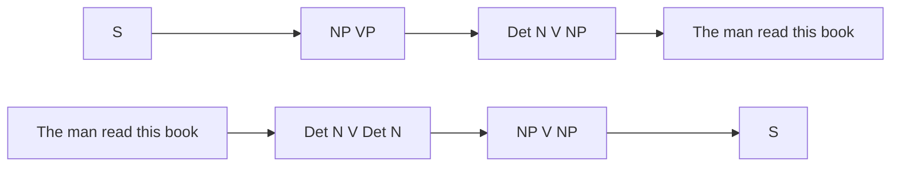
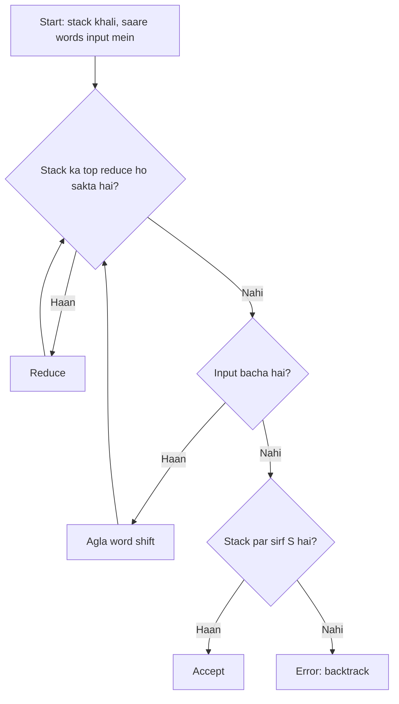
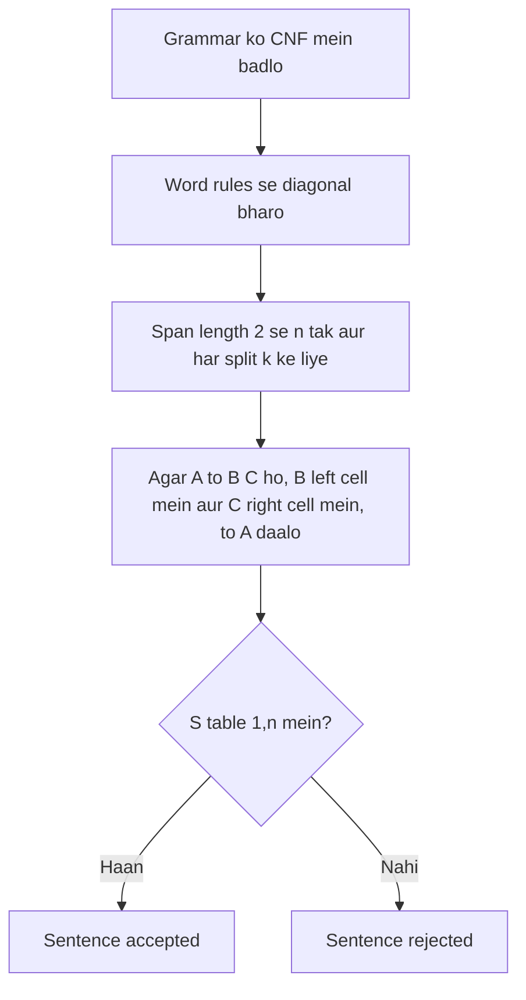
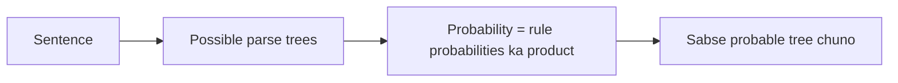
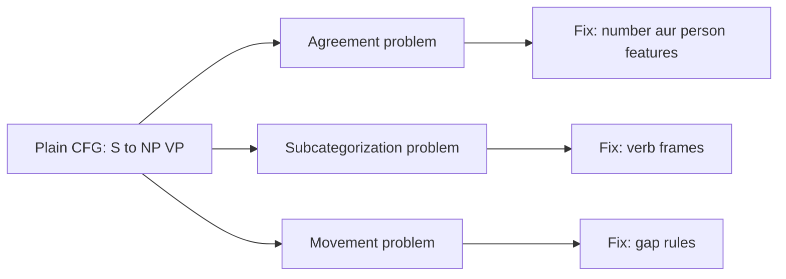

Ye note syllabus <Syl m="3" /> hai: context-free grammar aur parsing ke saath syntax analysis.

## Pehle basics

- **Grammar** sentences banane ke rules ka set hai. **Context-free grammar (CFG)** ke rules ek symbol ko doosron mein rewrite karte hain, jaise S → NP VP (sentence = noun phrase ke baad verb phrase). *(Class files CFG ki alag definition nahi deti; ye standard idea hai.)*
- **Non-terminals** S, NP, VP jaise symbols hain; **terminals** asli words. **Start symbol** S hai.
- **Parse tree** dikhata hai ki rules sentence kaise banate hain. **Parsing** wo tree dhundhna hai.

Class grammar neeche hai: S → NP VP, NP → Det N | N, VP → V NP, Det → 'The' | 'this', N → 'man' | 'book', V → 'read'. <Cite id="class-nlp-pyq3" loc="p. 8" />

## Top-down aur bottom-up parsing

| Point | Top-down parsing | Bottom-up parsing |
|---|---|---|
| Idea | Pehle parse tree ka sabse upar ka level dekhta hai aur grammar ke rules se neeche aata hai | Pehle parse tree ka sabse neeche ka level dekhta hai aur grammar ke rules se upar jaata hai |
| Aim | Input string ka leftmost derivation dhundhta hai | Input string ko grammar ke start symbol tak reduce karta hai |
| Direction | Start symbol (top) se leaf nodes (down) tak | Leaf nodes (bottom) se start symbol tak |
| Derivation | Leftmost derivation | Rightmost derivation (ulta) |
| Main decision | String banane ke liye kaunsa production rule use karna hai | String ko start symbol tak reduce karne ke liye production rule kab use karna hai |
| Example | Recursive descent parser | Shift-reduce parser |

<Cite id="class-nlp-pyq3" loc="p. 6" />

**Example:** class grammar S → NP VP, NP → Det N | N, VP → V NP, Det → The | this, N → man | book, V → read, aur sentence "The man read this book":

- **Top-down:** S ⇒ NP VP ⇒ Det N VP ⇒ The N VP ⇒ The man VP ⇒ The man V NP ⇒ The man read NP ⇒ The man read Det N ⇒ The man read this N ⇒ The man read this book.
- **Bottom-up:** The man read this book ⇒ Det N V Det N ⇒ NP V Det N ⇒ NP V NP ⇒ NP VP ⇒ S.

<PYQ id="2022-12-ce/q4c" />

## Shift-reduce parser

Bottom-up parsing input string ko grammar ke start symbol tak reduce karne ki koshish karti hai (rightmost derivation, ulta). Shift-reduce parser class mein bottom-up parser ka example hai. <Cite id="class-nlp-pyq3" loc="p. 6" />

*(Class files parser ka naam batati hain par steps nahi; neeche ka trace standard method hai.)*

**Parts:** ek **stack**, bache hue words wala **input buffer**, aur chaar actions:

1. **Shift:** input se agla word stack par le aao.
2. **Reduce:** stack ke top par rule ke right side ko uske left side se badlo.
3. **Accept:** stack par sirf S hai aur input khatam.
4. **Error / backtrack:** koi action kaam nahi karta; peeche jaakar doosra choice try karo.

**Example.** Grammar: S → NP VP, NP → Det N | N, VP → V NP, Det → The | this, N → man | book, V → read (class grammar). Sentence: "The man read this book". <Cite id="class-nlp-pyq3" loc="p. 8" />

| Step | Stack | Remaining input | Action |
|---|---|---|---|
| 1 | | The man read this book | Shift |
| 2 | The | man read this book | Reduce Det → The |
| 3 | Det | man read this book | Shift |
| 4 | Det man | read this book | Reduce N → man |
| 5 | Det N | read this book | Reduce NP → Det N |
| 6 | NP | read this book | Shift |
| 7 | NP read | this book | Reduce V → read |
| 8 | NP V | this book | Shift |
| 9 | NP V this | book | Reduce Det → this |
| 10 | NP V Det | book | Shift |
| 11 | NP V Det book | | Reduce N → book |
| 12 | NP V Det N | | Reduce NP → Det N |
| 13 | NP V NP | | Reduce VP → V NP |
| 14 | NP VP | | Reduce S → NP VP |
| 15 | S | | Accept |

**Conflicts:** step 5 par top symbol N ko akele NP → N se bhi reduce kiya ja sakta tha, jisse Det NP bachta, jise koi rule reduce nahi kar sakta. Tab parser ko backtrack karna padta hai ya look-ahead use karna padta hai. Actions ke beech chunna shift-reduce parsing ki main mushkil hai.

**Advantage:** simple, tez, words se bottom-up kaam karta hai. **Disadvantage:** actions ke beech conflicts.

<PYQ id="2025-05-ce/q3b" />

## CYK (CKY) algorithm

**Algorithm (class jaisa):** <Cite id="class-nlp-pyq3" loc="p. 8" />

1. Diagonal $(i = j)$ ko un productions se bharo jo har word banati hain.
2. Span length $L = 2$ se $n$ tak, har cell $(i, j)$ ke liye ($j = i + L - 1$) aur har split point $k$ ($i \le k < j$) ke liye: agar production $A \to B\,C$ ho jahan $B$ table$[i][k]$ mein aur $C$ table$[k+1][j]$ mein ho, to $A$ ko table$[i][j]$ mein daalo.
3. Agar $S$ table$[1][n]$ mein hai, to grammar string generate karti hai.

CYK Chomsky Normal Form (har rule $A \to B\,C$ ya $A \to$ ek word) wali grammar par kaam karta hai, isliye pehle grammar convert hoti hai.

**Class grammar par worked example** (class answers isi question ko solve karte hain). Class grammar mein unit rule NP → N hai, isliye pehle NP → 'man' | 'book' bhi likho, jisse CNF bana rahe. <Cite id="class-nlp-pyq3" loc="p. 8" />

<Sum>

<Given>

class grammar aur sentence *The man read this book* (words 1 se 5).

</Given>

<Find>

kya S table$[1][5]$ mein hai.

</Find>

<Steps>

1. **Diagonal:** The = Det; man = N, NP; read = V; this = Det; book = N, NP.
2. **Length 2:** The man = Det + N se NP. man read = (N ya NP) + V: koi rule nahi. read this = V + Det: koi rule nahi. this book = Det + N se NP.
3. **Length 3:** The man read = NP + V: koi rule nahi, isliye khali. man read this: khali. read this book = V + NP se VP.
4. **Length 4:** The man read this: khali. man read this book = man (NP) + read this book (VP) se S, kyunki NP bare noun *man* hai.
5. **Length 5:** The man read this book = The man (NP) + read this book (VP) se S. (Split Det + man read this book fail hota hai.)

</Steps>

<Answer>

S table$[1][5]$ mein hai, isliye sentence accept hota hai. Parse: [S [NP [Det The] [N man]] [VP [V read] [NP [Det this] [N book]]]].

</Answer>

<Box kind="verify">

Tree ko top-down padho: S → NP VP; NP → Det N → The man; VP → V NP → read, phir NP → Det N → this book. Ye sab class grammar ke rules hain aur paanchon words order mein dete hain. Note: class table table[1][3] = VP, S dikhati hai "NP V se VP" se, par rule VP → V NP hai, isliye table[1][3] khali hai; final answer (accepted, wahi tree) nahi badalta.

</Box>

</Sum>

| | The | man | read | this | book |
|---|---|---|---|---|---|
| **The** | Det | NP | · | · | **S** |
| **man** | | N, NP | · | · | S |
| **read** | | | V | · | VP |
| **this** | | | | Det | NP |
| **book** | | | | | N, NP |

(Row = start word, column = end word; `·` khali hai. man..book cell mein S unit rule NP → N ka valid extra result hai.)

<PYQ id="2023-05-ce/q5a" /> <PYQ id="2025-05-ce/q5a" />

## Parse tree aur derivation

Derivation S se shuru hoti hai aur tab tak rewrite karti hai jab tak sirf words na bachen. "The tall girl sings" ke liye S → NP VP, NP → Det Adj N, VP → V ke saath: S ⇒ NP VP ⇒ Det Adj N VP ⇒ the tall girl VP ⇒ the tall girl sings. Top-down parse start symbol se shuru hoke neeche aati hai. <Cite id="class-nlp-pyq3" loc="p. 6" />

<PYQ id="2024-12-ce/q5b" />

## Probabilistic CFG (PCFG)

*(Class files mein nahi; chhota standard note.)* PCFG har rule ko probability deti hai, aur ek hi left side wale rules ki probabilities ka sum 1 hota hai. Parse tree ki probability uske rules ki probabilities ka product hai. Jab sentence ke do trees hon, jaise "I saw the man with the telescope" (wahi ambiguity jo class use karti hai <Cite id="class-nlp-pyq4" loc="p. 6" />), to zyaada probability wala tree chuna jaata hai.

<PYQ id="2023-12-ce/q5b" />

## Plain CFG ki problems

*(Class question bank ye teen problems list karta hai <Cite id="class-nlp-qb1" loc="Module 3" />; class files mein notes nahi hain, isliye ye standard short version hai.)*

- **Agreement:** words number aur person mein match karne chahiye: "He walks", "He walk" nahi. Plain CFG dono accept karti hai, aur singular aur plural ke alag rules grammar ko bahut bada kar dete hain. Fix: features jo match karein.
- **Subcategorization:** verb sirf kuch complements leta hai. *Sleep* object nahi leta, *eat* le sakta hai, *give* do leta hai; "He sleeps a book" galat hai. Fix: verb types ya frames.
- **Movement:** phrase apni normal jagah se door aata hai: "What book did you read?" mein object *book* shuru mein hai, aur *read* ke baad gap hai. Fix: gap (slash) rules.

<PYQ id="2024-12/q5b" /> <PYQ id="assignment-1/q3d" />

## Past papers ke questions

- <PYQ id="2022-12-ce/q4c" /> top-down versus bottom-up (10 marks)
- <PYQ id="2023-05-ce/q5a" /> aur <PYQ id="2025-05-ce/q5a" /> "The man read this book" par CYK
- <PYQ id="2024-12-ce/q5b" /> "The tall girl sings" ka parse tree
- <PYQ id="2023-12-ce/q5b" /> PCFG; <PYQ id="2025-05-ce/q3b" /> shift-reduce parser
- <PYQ id="2024-12/q5b" /> aur <PYQ id="assignment-1/q3d" /> agreement, subcategorization, movement
