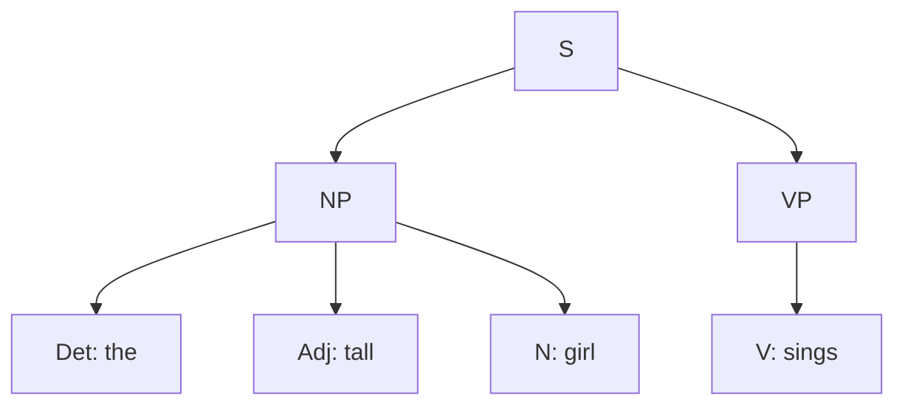
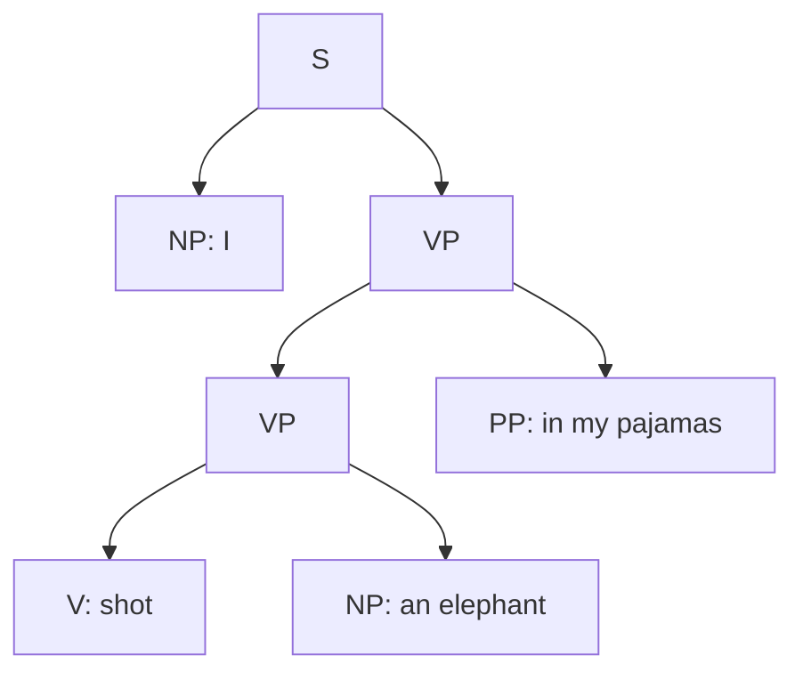
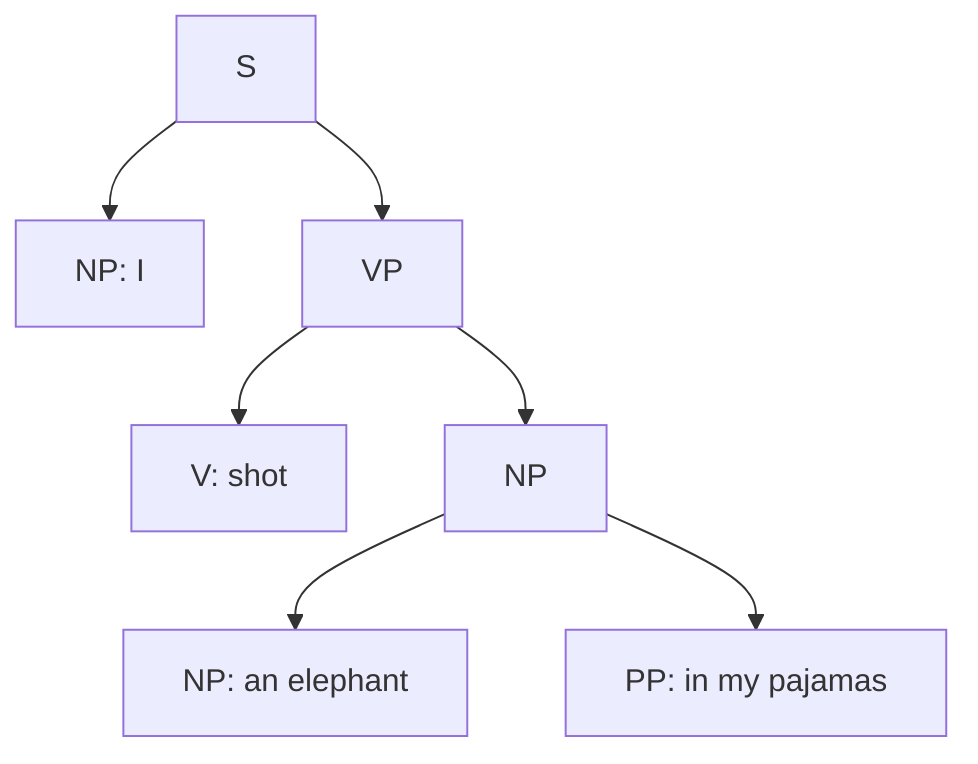
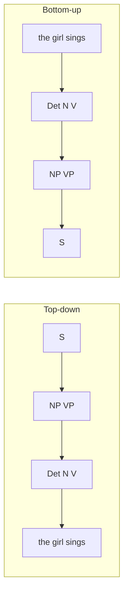
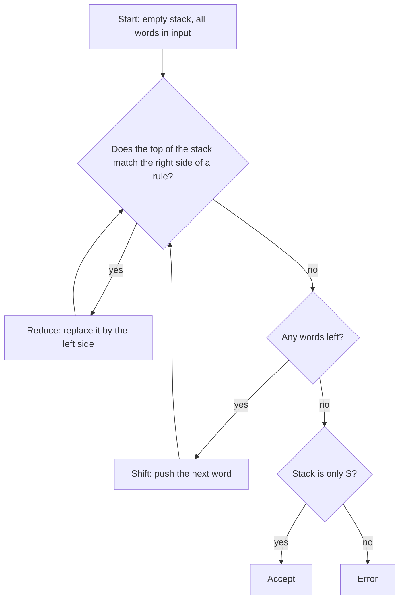
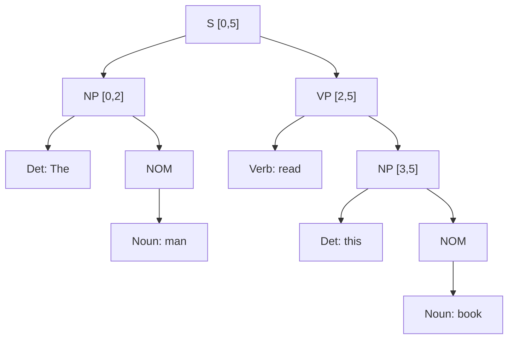

Before the new ideas, here are the old ones you need. If you already know them, skip to the next section.

## The basics first

- **Syntax** is the set of rules for how words are arranged into correct sentences. `The girl sings` is fine; `girl the sings` is not.
- A **part of speech (POS)** is the class of a word: noun (N), verb (V), determiner (Det, words like `the`, `a`, `this`), adjective (Adj), preposition (P). Tagging each word with its POS is the topic before this one.
- A **phrase** (or **constituent**) is a group of words that acts as one unit. In `The tall girl sings`, `The tall girl` is one unit (it can be replaced by `She`) and `sings` is another. <Cite id="cfg-parsing-wiki-const" />
- **Noun phrase (NP)** is a group built around a noun (`the tall girl`). **Verb phrase (VP)** is a group built around a verb (`read this book`). **Prepositional phrase (PP)** is a preposition plus an NP (`in my pajamas`).
- A **rewriting rule** says "this symbol can be replaced by that string of symbols", written with an arrow, for example `NP → Det N`.
- **Parsing** means finding the structure of a sentence. In NLP the result is usually a **parse tree**. <Cite id="cfg-parsing-wiki-parsetree" /> <Cite id="cfg-parsing-tp-syn" />

## Context-free grammar (CFG)

**What it is.** A context-free grammar describes a language with rewriting rules in which the left side is always a single symbol, so the rule can be used wherever that symbol appears, whatever is around it ("context-free"). It is the most widely used formal system for the grammar of English. This is syllabus <Syl m="3" />, section 3.4 (introduction to CFG). <Cite id="cfg-parsing-slp3-19" loc="§19.2" /> <Cite id="cfg-parsing-slp3-F" loc="§F.2" /> <Cite id="cfg-parsing-wiki-cfg" />

**Why it is needed.** A computer cannot list every correct sentence, because there are infinitely many. A short set of rules can generate all of them, and the same rules can be run backwards to check a sentence and find its structure. That structure is needed for meaning: question answering, translation and information extraction all depend on knowing who did what to whom.

**Everyday analogy.** A CFG is like a recipe book for sentences. `S → NP VP` says "a sentence is made from a noun phrase and a verb phrase". Each ingredient has its own recipe until you reach actual words.

<Box kind="definition">

A **context-free grammar** is a 4-tuple $G = (N, \Sigma, R, S)$:

- $N$: the **non-terminals** (phrase labels such as S, NP, VP and POS labels such as Det, N, V).
- $\Sigma$: the **terminals**, the actual words (`the`, `girl`).
- $R$: the **rules** (productions) of the form $A \rightarrow \alpha$, where $A$ is one non-terminal and $\alpha$ is a string of terminals and non-terminals.
- $S$: the **start symbol**, the label of a whole sentence.

</Box>

A small grammar for English (used in the examples below):

| Rule | Meaning |
|---|---|
| S → NP VP | a sentence is a noun phrase followed by a verb phrase |
| NP → Det N, NP → Det Adj N | a noun phrase can be a determiner and a noun, with an optional adjective |
| VP → V, VP → V NP | a verb phrase is a verb alone, or a verb and its object |
| Det → the, Adj → tall, N → girl, V → sings | the **lexicon**: rules that give the words |

**Derivation.** A **derivation** starts with S and keeps replacing one non-terminal by the right side of one of its rules until only words remain. In a **leftmost derivation** the leftmost non-terminal is always replaced first. A **parse tree** is the picture of a derivation: the root is S, every inner node is a non-terminal, its children are the right side of the rule used, and the leaves read left to right are the sentence. <Cite id="cfg-parsing-gfg-types" /> <Cite id="cfg-parsing-tp-syn" />

<Cite id="cfg-parsing-tp-syn" loc="diagram" />

The constituency tree drawn on TutorialsPoint (linked above) is the same idea: phrase labels inside, words at the leaves. A **treebank** is a corpus whose sentences have been parsed by hand into such trees; the Penn Treebank is the best known, and grammar rules can be read straight off its trees. <Cite id="cfg-parsing-slp3-19" loc="§19.3" /> <Cite id="pos-tagging-marcus1993" />

### Worked example: parse tree for a sentence

<Sum>

<Given>

Grammar: S → NP VP; NP → Det Adj N | Det N; VP → V | V NP; Det → "the"; Adj → "tall"; N → "girl"; V → "sings". Sentence: `The tall girl sings`.

</Given>

<Find>

a leftmost derivation and the parse tree.

</Find>

<Steps>

1. Start with S. Only one rule has S on the left: S ⇒ NP VP. *Reason: a sentence needs a subject NP and a VP.*
2. Expand the leftmost symbol NP. The sentence has three words before the verb, so use NP → Det Adj N: ⇒ Det Adj N VP. *Reason: the other rule, NP → Det N, gives only two words and would leave `tall` unused.*
3. Replace Det, Adj, N by the lexicon: ⇒ the Adj N VP ⇒ the tall N VP ⇒ the tall girl VP.
4. Expand VP. Nothing is left after `sings`, so use VP → V: ⇒ the tall girl V. *Reason: VP → V NP would need an object that is not in the sentence.*
5. Replace V: ⇒ the tall girl sings. Only words remain, so the derivation ends. The tree is the one in the figure above.

</Steps>

<Answer>

S ⇒ NP VP ⇒ Det Adj N VP ⇒ the Adj N VP ⇒ the tall N VP ⇒ the tall girl VP ⇒ the tall girl V ⇒ the tall girl sings. Tree: [S [NP [Det the] [Adj tall] [N girl]] [VP [V sings]]].

</Answer>

<Box kind="verify">

Count: the derivation has 7 arrows, so 7 rules were used (S → NP VP, NP → Det Adj N, VP → V and 4 lexical rules). The tree has 7 inner nodes with their children: S, NP, VP, Det, Adj, N, V, which is 7 as well. The leaves read `the tall girl sings`, the input. <PYQ id="2024-12-ce/q5b" />

</Box>

</Sum>

## Ambiguity: one sentence, many trees

**What it is.** A sentence is **structurally ambiguous** when the grammar gives it more than one parse tree. The classic case is **PP attachment**: in `I shot an elephant in my pajamas` the phrase `in my pajamas` can modify the shooting (I wore the pajamas) or the elephant (the elephant wore them). <Cite id="cfg-parsing-slp3-19" loc="§19.5" /> <Cite id="ambiguity-challenges-nltk-ch8" loc="§1.2" />

<Cite id="ambiguity-challenges-nltk-ch8" loc="§1.2" />

The number of trees grows very fast with sentence length, so a parser must not list all trees one by one. It stores shared parts in a table (CYK and chart parsing below), and a probabilistic grammar picks the most likely tree. <Cite id="cfg-parsing-slp3-19" loc="§19.5" /> <Cite id="ambiguity-challenges-nltk-ch8" loc="§4.4" />

## Parsing as search: top-down and bottom-up

**What it is.** A parser must find a tree whose root is S and whose leaves are exactly the input words. There are two natural directions to search. <Cite id="cfg-parsing-gfg-types" />

- **Top-down (goal-driven):** start with S, use rules to expand it into a tree, and check the leaves against the words. <Cite id="cfg-parsing-wiki-td" /> <Cite id="cfg-parsing-tp-td" />
- **Bottom-up (data-driven):** start with the words, look up their POS, and combine neighbouring symbols into bigger ones using rules backwards, until S covers everything. <Cite id="cfg-parsing-wiki-bu" /> <Cite id="cfg-parsing-gfg-bu" />

<Cite id="cfg-parsing-gfg-bu" loc="diagram" />

### Worked example: top-down and bottom-up on the same sentence

<Sum>

<Given>

The grammar of the previous example. Sentence: `The girl sings` (no adjective this time).

</Given>

<Find>

how a top-down and a bottom-up parser each reach S, and which wastes work.

</Find>

<Steps>

1. **Top-down, goal S.** Expand S → NP VP. New goals: NP, then VP.
2. **Top-down, goal NP.** Try the first rule NP → Det Adj N. Det matches `the`. The next goal is Adj but the next word is `girl`, which is not an adjective. This guess fails, so the parser **backtracks** (undoes it). *Reason: the parser predicted a word class without looking at the input.*
3. **Top-down, retry.** Try NP → Det N: Det = `the`, N = `girl`, both match. Then VP → V: V = `sings` matches. All goals are done and all words are used: success.
4. **Bottom-up, words to POS.** `the` is Det, `girl` is N, `sings` is V: the symbols are Det N V.
5. **Bottom-up, combine.** Det N matches the right side of NP → Det N, so replace it by NP. V matches VP → V, so replace it by VP. NP VP matches S → NP VP, so replace it by S. Only S remains, covering all words: success.

</Steps>

<Answer>

Both reach the same tree [S [NP [Det the] [N girl]] [VP [V sings]]]. Top-down made one wrong guess (NP → Det Adj N) and backtracked; bottom-up never tried an adjective because no adjective was in the input.

</Answer>

<Box kind="verify">

Both trees use the same 6 rules: S → NP VP, NP → Det N, VP → V, Det → the, N → girl, V → sings. Top-down also applied one wrong rule (NP → Det Adj N) and undid it; bottom-up used only the 6 rules of the tree. That one undone guess is the difference between the two. <PYQ id="2022-12-ce/q4c" />

</Box>

</Sum>

### Top-down versus bottom-up

| Point | Top-down | Bottom-up |
|---|---|---|
| Starts from | the start symbol S | the input words |
| Direction | S down to the words | words up to S |
| Driven by | the goal (grammar) | the data (words) |
| Uses rules | left to right (expand) | right to left (reduce) |
| Typical implementation | recursive descent | shift-reduce, CYK |
| Strength | never builds a phrase that cannot be part of a sentence | never predicts a word class that is not in the input |
| Weakness | many wrong predictions, backtracking, and an infinite loop on left-recursive rules such as NP → NP PP | builds phrases that can never lead to S (for example `book` as a noun in a sentence that needs a verb), and also re-does work |
| Ambiguous words | tries all rules for a symbol | tries all POS for a word |

Both can repeat the same sub-work after backtracking. A table of finished pieces (a chart) fixes this, and so does dynamic programming. A **left-corner** parser combines both: it predicts top-down but filters with the next word, bottom-up. <Cite id="ambiguity-challenges-nltk-ch8" loc="§4.1" /> <Cite id="cfg-parsing-slp3-19" loc="§19.6" />

**Conclusion.** Top-down is goal-directed and bottom-up is data-directed; practical parsers (CYK, Earley, chart) use a table so that no sub-parse is computed twice. <Cite id="cfg-parsing-wiki-earley" /> <Cite id="cfg-parsing-nltk-chart" />

## Shift-reduce parsing

**What it is.** A shift-reduce parser is a bottom-up parser that uses a **stack** and an **input buffer**. It reads the words left to right and repeats two moves until the stack holds only S. <Cite id="cfg-parsing-wiki-sr" /> <Cite id="cfg-parsing-gfg-sr" /> <Cite id="ambiguity-challenges-nltk-ch8" loc="§4.2" />

**Why it is needed.** It is simple and fast (one pass, no table), so it is the base of compilers and of many fast NLP parsers.

**How it works.** The four actions:

1. **Shift:** move the next word from the input onto the stack.
2. **Reduce:** if the top of the stack matches the right side of a rule, replace it by the left side. The matching part is called the **handle**.
3. **Accept:** the input is empty and the stack is just S.
4. **Error:** neither shift nor reduce is possible.

<Cite id="cfg-parsing-gfg-sr" loc="diagram" />

### Worked example: shift-reduce trace

<Sum>

<Given>

The grammar of the first example. Sentence: `The tall girl sings`.

</Given>

<Find>

the stack, input and action at every step.

</Find>

<Steps>

1. Each word is shifted and then reduced to its POS by the lexicon (Det → the and so on). Then phrase rules reduce the POS symbols. The full trace:

| Step | Stack | Input left | Action |
|---|---|---|---|
| 1 | (empty) | the tall girl sings | shift |
| 2 | the | tall girl sings | reduce Det → the |
| 3 | Det | tall girl sings | shift |
| 4 | Det tall | girl sings | reduce Adj → tall |
| 5 | Det Adj | girl sings | shift |
| 6 | Det Adj girl | sings | reduce N → girl |
| 7 | Det Adj N | sings | reduce NP → Det Adj N |
| 8 | NP | sings | shift |
| 9 | NP sings | (empty) | reduce V → sings |
| 10 | NP V | (empty) | reduce VP → V |
| 11 | NP VP | (empty) | reduce S → NP VP |
| 12 | S | (empty) | accept |

2. At step 10, `NP V` could also wait for an object (VP → V NP), but the input is empty, so only the reduction VP → V is possible. *Reason: no word is left to shift.*

</Steps>

<Answer>

Accepted in 12 steps: 4 shifts, 7 reduces and 1 accept. The reductions give the tree [S [NP [Det the] [Adj tall] [N girl]] [VP [V sings]]].

</Answer>

<Box kind="verify">

Counts: shifts 4 (one per word) + reduces 7 + accept 1 = 12 rows. The 7 reduces are exactly the 7 rules of the parse tree found earlier, so both methods agree. The stack never holds more than three symbols, at step 6. <PYQ id="2025-05-ce/q3b" />

</Box>

</Sum>

**Conflicts and limits.** Sometimes two actions are possible. A **shift-reduce conflict**: with `NP V` on the stack and more words left, should the parser reduce VP → V or shift the object? A **reduce-reduce conflict**: two different rules match the top of the stack. A basic shift-reduce parser makes one choice and **never backtracks**, so it may fail on a sentence that has a valid parse, and it returns at most one parse. Real parsers add a lookahead table (LR parsing) or a trained classifier to choose the action. <Cite id="ambiguity-challenges-nltk-ch8" loc="§4.2" /> <Cite id="cfg-parsing-wiki-sr" />

## Chomsky normal form and the CYK algorithm

**What it is.** A grammar is in **Chomsky normal form (CNF)** when every rule is either $A \rightarrow B\,C$ (two non-terminals) or $A \rightarrow a$ (one word). Every CFG can be converted to CNF with the same language. The **CYK (Cocke-Younger-Kasami) algorithm** is a bottom-up, dynamic-programming parser for CNF grammars. <Cite id="cfg-parsing-slp3-19" loc="§19.4" /> <Cite id="cfg-parsing-wiki-cnf" /> <Cite id="cfg-parsing-wiki-cyk" /> <Cite id="cfg-parsing-gfg-cyk" />

**Why it is needed.** Because every rule has two children, a span of words can be split into two parts in only a few ways. The table remembers every span already solved, so nothing is computed twice, and all parses are packed into one table even when there are thousands. Time is $O(n^3 \cdot |G|)$ for $n$ words and $|G|$ rules, space $O(n^2)$. <Cite id="cfg-parsing-slp3-19" loc="§19.6" />

**How it works.**

1. Convert the grammar to CNF. <Cite id="cfg-parsing-slp3-19" loc="§19.6.1" /> <Cite id="cfg-parsing-gfg-cnf" />
   - Rule with more than two symbols on the right: break it with a new symbol (`S → Aux NP VP` becomes `S → X1 VP` and `X1 → Aux NP`).
   - Unit rule $A \rightarrow B$: replace it by copying what $B$ can become (`VP → Verb` becomes `VP → book | include | read`).
2. Number the gaps between words $0, 1, \dots, n$. Cell $[i,j]$ holds every non-terminal that can produce the words from gap $i$ to gap $j$.
3. Fill the length-1 cells from the lexicon.
4. For longer spans, for each split point $k$ between $i$ and $j$, if $B$ is in $[i,k]$, $C$ is in $[k,j]$ and the rule $A \rightarrow B\,C$ exists, put $A$ in $[i,j]$.
5. The sentence is accepted if S is in $[0,n]$. Back-pointers recover the tree.

### Worked example: CYK on "The man read this book"

<Sum>

<Given>

Grammar: S → NP VP | Aux NP VP | VP; NP → Det NOM; NOM → Noun | Noun NOM; VP → Verb | Verb NP. Lexicon: Det → that, this, a, the; Noun → book, flight, meal, man; Verb → book, include, read; Aux → does. Sentence: `The man read this book`.

</Given>

<Find>

whether the sentence is accepted, and its parse tree, using CYK.

</Find>

<Steps>

1. **Convert to CNF.** Break `S → Aux NP VP` into `S → X1 VP` and `X1 → Aux NP`. Remove the unit rules: `NOM → Noun` becomes `NOM → book | flight | meal | man`; `VP → Verb` becomes `VP → book | include | read`; `S → VP` becomes `S → Verb NP | book | include | read` (S gets every right side that VP has). The CNF grammar is: S → NP VP | X1 VP | Verb NP | book | include | read; X1 → Aux NP; NP → Det NOM; NOM → Noun NOM | book | flight | meal | man; VP → Verb NP | book | include | read; plus the lexicon for Det, Noun, Verb, Aux. *Reason: CYK only works when every rule has two non-terminals or one word.*
2. **Number the gaps.** 0 The 1 man 2 read 3 this 4 book 5.
3. **Length-1 cells (lexicon).** [0,1] `the`: Det. [1,2] `man`: Noun, NOM. [2,3] `read`: Verb, VP, S. [3,4] `this`: Det. [4,5] `book`: Noun, NOM, Verb, VP, S.
4. **Length 2.** [0,2] The man: Det + NOM gives NP. [1,3] man read: Noun/NOM + Verb/VP/S has no rule, empty. [2,4] read this: nothing (Verb, VP or S followed by Det matches no rule), empty. [3,5] this book: Det + NOM gives NP.
5. **Length 3.** [0,3] The man read: NP in [0,2] + VP in [2,3] gives S (S → NP VP). [1,4] man read this: empty (no split works). [2,5] read this book: Verb in [2,3] + NP in [3,5] gives S (S → Verb NP) and VP (VP → Verb NP).
6. **Length 4.** [0,4] The man read this: empty (S + Det has no rule). [1,5] man read this book: empty (Noun/NOM + S/VP has no rule).
7. **Length 5.** [0,5]: split at 2: NP in [0,2] + VP in [2,5] gives S (S → NP VP). Splits at 1, 3, 4 give nothing. S is in the top cell, so the sentence is accepted.

The completed table (row = start gap $i$, column = end gap $j$):

| i \ j | 1 (The) | 2 (man) | 3 (read) | 4 (this) | 5 (book) |
|---|---|---|---|---|---|
| 0 | Det | NP | S | none | **S** |
| 1 | | Noun, NOM | none | none | none |
| 2 | | | Verb, VP, S | none | S, VP |
| 3 | | | | Det | NP |
| 4 | | | | | Noun, NOM, Verb, VP, S |

</Steps>

<Answer>

Accepted: S is in cell [0,5]. Parse: [S [NP [Det the] [NOM [Noun man]]] [VP [Verb read] [NP [Det this] [NOM [Noun book]]]]].

</Answer>

<Box kind="verify">

Rebuild the tree top-down with the original (not CNF) rules: S ⇒ NP VP ⇒ Det NOM VP ⇒ the NOM VP ⇒ the man VP ⇒ the man Verb NP ⇒ the man read NP ⇒ the man read Det NOM ⇒ the man read this NOM ⇒ the man read this book. Every step is a rule of the given grammar, and the words match. The other reading, S in [2,5] (`read this book` as an imperative sentence like `Book that flight`), is correctly not the whole sentence because `The man` is left over. <PYQ id="2023-05-ce/q5a" /> <PYQ id="2025-05-ce/q5a" />

</Box>

</Sum>

<Cite id="cfg-parsing-gfg-cyk" loc="diagram" />

The GeeksforGeeks page (linked above) draws the same triangle table for another grammar and the string `baaba`. Our table is the same idea for the exam sentence.

**Other table parsers.** The **Earley parser** works for any CFG (no CNF needed) in $O(n^3)$ and keeps unfinished rules in a chart. A **chart parser** stores all partial parses in one table so none is built twice. <Cite id="cfg-parsing-wiki-earley" /> <Cite id="cfg-parsing-nltk-chart" />

## Probabilistic context-free grammar (PCFG)

**What it is.** A **PCFG** is a CFG in which every rule has a probability. The probabilities of all rules with the same left side add up to 1. So $P(\text{NP} \to \text{Det N}) = 0.6$ means 60 percent of noun phrases are built that way. <Cite id="cfg-parsing-slp3-E" loc="§E.1" /> <Cite id="cfg-parsing-wiki-pcfg" /> <Cite id="text-preprocessing-fsnlp" />

**Why it is needed.** An ordinary CFG says only "this tree is allowed". Real sentences are ambiguous, and the grammar cannot say which tree is more likely. A PCFG ranks the trees, so the parser can return the most probable one. It can also give the probability of a whole sentence, so it works as a language model. <Cite id="cfg-parsing-slp3-E" loc="§E.1" />

**How it works.**

1. **Probability of a tree** = the product of the probabilities of all the rules used in it. This assumes each rule is chosen independently of the rest of the tree (the context-free assumption).
2. **Probability of a sentence** = the sum of the probabilities of all its trees.
3. **Best parse** = the tree with the highest probability. Probabilistic CKY finds it by keeping, in each cell, the best probability for each non-terminal. <Cite id="cfg-parsing-slp3-E" loc="§E.2" />
4. **Learning the probabilities.** Count rules in a treebank: $P(A \rightarrow \beta) = \dfrac{\text{Count}(A \rightarrow \beta)}{\text{Count}(A)}$. <Cite id="cfg-parsing-slp3-E" loc="§E.3" />

### Worked example: rule probabilities from a treebank

<Sum>

<Given>

A treebank has 100 noun phrases: 60 are Det N, 25 are Det Adj N, 15 are NP PP. It has 100 verb phrases: 20 are V, 50 are V NP, 30 are VP PP.

</Given>

<Find>

the PCFG probabilities of the NP and VP rules.

</Find>

<Steps>

1. NP rules, divide each count by the NP total 100: $P(\text{NP} \to \text{Det N}) = 60/100 = 0.60$; $P(\text{NP} \to \text{Det Adj N}) = 25/100 = 0.25$; $P(\text{NP} \to \text{NP PP}) = 15/100 = 0.15$. *Reason: relative frequency among all rules with NP on the left.*
2. VP rules, divide by 100: $P(\text{VP} \to \text{V}) = 0.20$; $P(\text{VP} \to \text{V NP}) = 0.50$; $P(\text{VP} \to \text{VP PP}) = 0.30$.

</Steps>

<Answer>

NP: 0.60, 0.25, 0.15. VP: 0.20, 0.50, 0.30.

</Answer>

<Box kind="verify">

Each left side must add to 1: NP $0.60 + 0.25 + 0.15 = 1.00$; VP $0.20 + 0.50 + 0.30 = 1.00$. <PYQ id="2023-12-ce/q5b" />

</Box>

</Sum>

### Worked example: choosing between two parse trees with a PCFG

This is the classic ambiguity example from Manning and Schütze, `astronomers saw stars with ears`. <Cite id="text-preprocessing-fsnlp" />

<Sum>

<Given>

Rules and probabilities: S → NP VP 1.0; PP → P NP 1.0; VP → V NP 0.7; VP → VP PP 0.3; NP → NP PP 0.4; NP → astronomers 0.1; NP → ears 0.18; NP → stars 0.18; NP → saw 0.04; NP → telescopes 0.1; P → with 1.0; V → saw 1.0. Sentence: `astronomers saw stars with ears`.

</Given>

<Find>

the probability of each parse tree, the best parse and the probability of the sentence.

</Find>

<Steps>

1. The sentence has two trees. Tree 1 attaches the PP to the noun phrase `stars` (the stars have the ears): VP → V NP, with the object NP → NP PP. Tree 2 attaches the PP to the verb phrase (the seeing is done with ears): VP → VP PP, with VP → V NP inside.
2. **Tree 1.** Rules used: S → NP VP (1.0), NP → astronomers (0.1), VP → V NP (0.7), V → saw (1.0), NP → NP PP (0.4), NP → stars (0.18), PP → P NP (1.0), P → with (1.0), NP → ears (0.18). Multiply: $1.0 \times 0.1 \times 0.7 \times 1.0 \times 0.4 \times 0.18 \times 1.0 \times 1.0 \times 0.18 = 0.0009072$.
3. **Tree 2.** Rules used: S → NP VP (1.0), NP → astronomers (0.1), VP → VP PP (0.3), VP → V NP (0.7), V → saw (1.0), NP → stars (0.18), PP → P NP (1.0), P → with (1.0), NP → ears (0.18). Multiply: $1.0 \times 0.1 \times 0.3 \times 0.7 \times 1.0 \times 0.18 \times 1.0 \times 1.0 \times 0.18 = 0.0006804$.
4. Pick the larger: $0.0009072 > 0.0006804$, so Tree 1 is the best parse.
5. Sentence probability is the sum over its trees: $0.0009072 + 0.0006804 = 0.0015876$.

</Steps>

<Answer>

$P(t_1) = 0.0009072$, $P(t_2) = 0.0006804$. The best parse is Tree 1 (PP attached to the noun phrase `stars`). $P(\text{sentence}) = 0.0015876$.

</Answer>

<Box kind="verify">

Recompute in stages. Tree 1: $0.1 \times 0.7 = 0.07$; $0.07 \times 0.4 = 0.028$; $0.028 \times 0.18 = 0.00504$; $0.00504 \times 0.18 = 0.0009072$. Tree 2: $0.1 \times 0.3 = 0.03$; $0.03 \times 0.7 = 0.021$; $0.021 \times 0.18 = 0.00378$; $0.00378 \times 0.18 = 0.0006804$. Also the NP rules add to 1: $0.4 + 0.1 + 0.18 + 0.18 + 0.04 + 0.1 = 1.0$, and the VP rules: $0.7 + 0.3 = 1.0$. <PYQ id="2023-12-ce/q5b" />

</Box>

</Sum>

**Advantages.** Resolves ambiguity by ranking; rules are learned from a treebank; gives a language model; probabilistic CKY keeps the cubic running time. **Disadvantages.** Rules are assumed independent (a noun phrase is expanded the same way as subject or object, though they differ); words are ignored (the same probability for `saw the man with the telescope` whatever the nouns are); short trees are favoured because every rule multiplies in a number below 1. Fixes are splitting non-terminals and lexicalized grammars. <Cite id="cfg-parsing-slp3-E" loc="§E.4" /> <Cite id="cfg-parsing-klein2003" /> <Cite id="cfg-parsing-collins2003" /> <Cite id="cfg-parsing-johnson1998" />

**Applications.** Parsing for question answering, machine translation and grammar checking; choosing between ambiguous parses; language modelling.

## Problems with plain CFGs

A CFG is a good first model, but English has patterns that a small set of context-free rules cannot capture neatly. The syllabus names three. <Cite id="cfg-parsing-slp3-F" loc="§F.3" />

### 1. Agreement

**What it is.** Words in a sentence must match in number, person and gender. The subject and verb agree: `She sings` but not `*She sing`; `These books` but not `*This books`. (A star marks an ungrammatical sentence.) Hindi also marks gender: `ladka jaata hai` but `ladki jaati hai`. <Cite id="cfg-parsing-wiki-agree" />

**The problem.** The rule `S → NP VP` accepts `She sing` and `These book`, because it does not look at number. To stop that, the grammar must be split: `S → NP-sg VP-sg`, `S → NP-pl VP-pl`, and the NP, N, Det, V rules too. With person, number and gender together the number of rules multiplies, and the grammar becomes huge and repeats itself.

**The fix.** Attach features (number, person) to symbols and require them to match (unification-based grammars). The rule stays one: `S → NP VP` with the condition that the NP and VP have the same number.

### 2. Subcategorization

**What it is.** Verbs differ in which phrases they take after them. This pattern is the verb's **subcategorization frame**. <Cite id="cfg-parsing-slp3-F" loc="§F.3.4" /> <Cite id="cfg-parsing-wiki-subcat" />

| Verb type | Frame | Good | Bad |
|---|---|---|---|
| Intransitive | V | `The girl sleeps` | `*The girl sleeps the book` |
| Transitive | V NP | `She reads a book` | `*She devours` |
| Ditransitive | V NP NP, V NP PP | `He gave her a pen` | `*He handed her` |
| Sentential complement | V S | `I think that she sings` | `*I think a book` |

**The problem.** With a single rule `VP → V NP`, every verb can take an object, so `*The girl sleeps the book` is accepted. The CFG has to split V into $V_{intrans}$, $V_{trans}$, $V_{ditrans}$ and write one VP rule for each, which again enlarges the grammar and must be done for every verb frame.

**The fix.** Store the frame of each verb in the lexicon and let the VP rule check it.

### 3. Movement

**What it is.** A phrase appears far from the place where it logically belongs. In `What did John buy?`, `what` is the object of `buy` but it comes at the front. In `Which book did you say she read?` the object `which book` is separated from `read` by several words (a long-distance dependency). Passives (`The book was read by Mary`) also move the object to the subject position. <Cite id="cfg-parsing-wiki-whmove" /> <Cite id="cfg-parsing-slp3-F" loc="§F.4" />

**The problem.** A context-free rule sees only its own children, so it cannot say that a gap later in the sentence is filled by `what` earlier. We would need separate rules for every position and length where the gap can occur, and the length is unlimited.

**The fix.** Use a **gap** (trace) and slash categories: `S/NP` means "a sentence that is missing an NP". The grammar rule `S → Wh-NP Aux NP VP/NP` then passes the missing NP down the tree until `buy` uses it.

**Conclusion.** All three problems come from one cause: a CFG rule is local and has no memory of features, verb type or distant words. The usual cure is richer grammars (features, slash categories) or statistical parsers. <Cite id="cfg-parsing-slp3-19" loc="§19.2" />

## Constituency versus dependency parsing

A **constituency parse** (everything so far) shows phrases inside phrases. A **dependency parse** links words directly: `sings` is the head and `girl` depends on it as subject; there are no phrase nodes. Modern libraries such as spaCy output dependency parses, while CFG and PCFG give constituency parses. <Cite id="cfg-parsing-tp-syn" />

| Point | Constituency (CFG) | Dependency |
|---|---|---|
| Unit | phrases (NP, VP) | words and links between them |
| Labels | phrase labels | relations such as subject, object |
| Output | tree with inner nodes | tree over the words only |
| Good for | grammar, phrase structure | relations, information extraction, free word order |

## Exam answers

<Box kind="exam">

**Compare top-down and bottom-up parsing with an example (10 marks):** one-line definition of each; the direction (S to words versus words to S); the example `the girl sings` with the wrong `NP → Det Adj N` guess and the backtrack; the comparison table (goal-driven versus data-driven, wasted predictions versus useless phrases, left recursion); a one-line conclusion. <PYQ id="2022-12-ce/q4c" />

**CYK parse of "The man read this book" (10 marks):** convert to CNF (break `Aux NP VP`, remove unit rules), number the gaps, fill the lexicon cells, fill by length with the split rule, show the table, S in [0,5], and draw the tree. <PYQ id="2023-05-ce/q5a" /> <PYQ id="2025-05-ce/q5a" />

**PCFG with an example (10 marks):** define PCFG (CFG plus rule probabilities adding to 1 per left side); why (ranking ambiguous parses); tree probability as a product; a two-tree example such as `astronomers saw stars with ears`; learning by counting; advantages and limits. <PYQ id="2023-12-ce/q5b" />

**Parse tree with given CFG (10 marks):** write the leftmost derivation rule by rule, then draw the tree with the labelled words at the leaves, and state that all rules are from the given grammar. <PYQ id="2024-12-ce/q5b" />

**Problems in CFG: agreement, subcategorization, movement (10 marks):** for each one give the definition, a good and a bad sentence, why a plain CFG fails, and the fix (features, frames, gaps). <PYQ id="2024-12/q5b" />

**Shift-reduce parser with example (10 marks):** define it (stack, input buffer, bottom-up), the four actions, the stack-input-action table for a short sentence, conflicts and the no-backtracking limit. <PYQ id="2025-05-ce/q3b" />

</Box>
