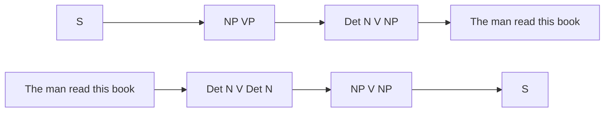
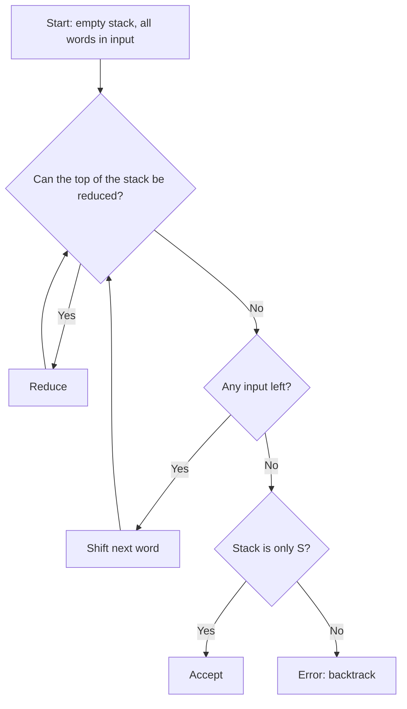
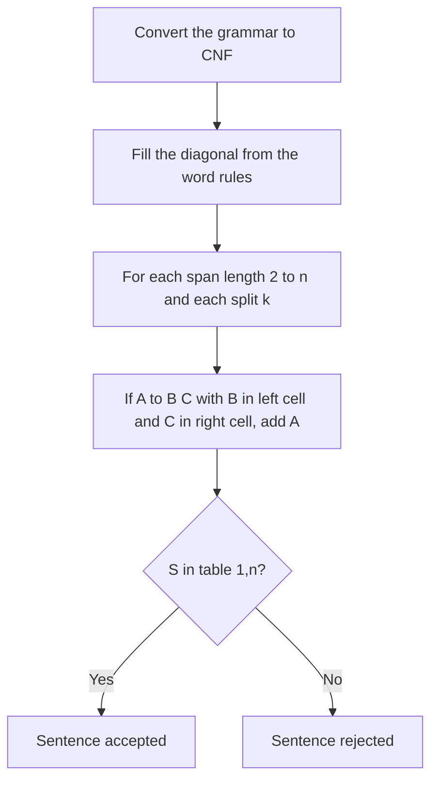
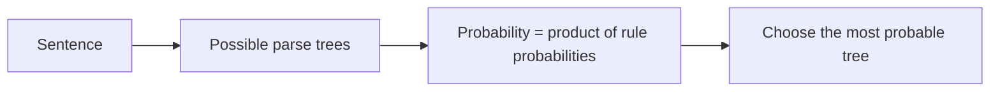
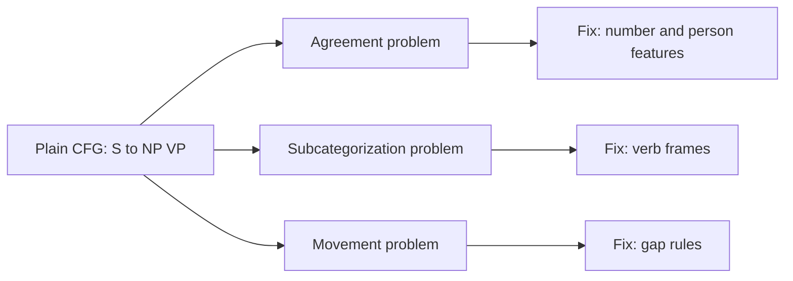

This note is syllabus <Syl m="3" />: syntax analysis with context-free grammar and parsing.

## The basics first

- A **grammar** is a set of rules for building sentences. A **context-free grammar (CFG)** has rules that rewrite one symbol into others, for example S → NP VP (a sentence is a noun phrase followed by a verb phrase). *(The class files give no separate definition of CFG; this is the standard idea.)*
- **Non-terminals** are symbols such as S, NP, VP; **terminals** are the actual words. The **start symbol** is S.
- A **parse tree** shows how the rules build the sentence. **Parsing** is finding that tree.

The class grammar is below: S → NP VP, NP → Det N | N, VP → V NP, Det → 'The' | 'this', N → 'man' | 'book', V → 'read'. <Cite id="class-nlp-pyq3" loc="p. 8" />

## Top-down and bottom-up parsing

| Point | Top-down parsing | Bottom-up parsing |
|---|---|---|
| Idea | First looks at the highest level of the parse tree and works down using the rules of the grammar | First looks at the lowest level of the parse tree and works up using the rules of the grammar |
| Aim | Tries to find the leftmost derivation of the input string | Tries to reduce the input string to the start symbol of the grammar |
| Direction | From the start symbol (top) to the leaf nodes (down) | From the leaf nodes (bottom) up to the start symbol |
| Derivation | Leftmost derivation | Rightmost derivation (in reverse) |
| Main decision | Which production rule to use to construct the string | When to use a production rule to reduce the string to the start symbol |
| Example | Recursive descent parser | Shift-reduce parser |

<Cite id="class-nlp-pyq3" loc="p. 6" />

**Example** with the class grammar S → NP VP, NP → Det N | N, VP → V NP, Det → The | this, N → man | book, V → read, and the sentence "The man read this book":

- **Top-down:** S ⇒ NP VP ⇒ Det N VP ⇒ The N VP ⇒ The man VP ⇒ The man V NP ⇒ The man read NP ⇒ The man read Det N ⇒ The man read this N ⇒ The man read this book.
- **Bottom-up:** The man read this book ⇒ Det N V Det N ⇒ NP V Det N ⇒ NP V NP ⇒ NP VP ⇒ S.

<PYQ id="2022-12-ce/q4c" />

## Shift-reduce parser

Bottom-up parsing tries to reduce the input string to the start symbol of the grammar (rightmost derivation, in reverse). The shift-reduce parser is the class example of a bottom-up parser. <Cite id="class-nlp-pyq3" loc="p. 6" />

*(The class files name the parser but give no steps; the trace below is the standard method.)*

**Parts:** a **stack**, an **input buffer** with the remaining words, and four actions:

1. **Shift:** move the next word from the input onto the stack.
2. **Reduce:** replace the right side of a rule on top of the stack by its left side.
3. **Accept:** the stack holds only S and the input is empty.
4. **Error / backtrack:** no action works; go back and try another choice.

**Example.** Grammar: S → NP VP, NP → Det N | N, VP → V NP, Det → The | this, N → man | book, V → read (the class grammar). Sentence: "The man read this book". <Cite id="class-nlp-pyq3" loc="p. 8" />

| Step | Stack | Remaining input | Action |
|---|---|---|---|
| 1 | | The man read this book | Shift |
| 2 | The | man read this book | Reduce Det → The |
| 3 | Det | man read this book | Shift |
| 4 | Det man | read this book | Reduce N → man |
| 5 | Det N | read this book | Reduce NP → Det N |
| 6 | NP | read this book | Shift |
| 7 | NP read | this book | Reduce V → read |
| 8 | NP V | this book | Shift |
| 9 | NP V this | book | Reduce Det → this |
| 10 | NP V Det | book | Shift |
| 11 | NP V Det book | | Reduce N → book |
| 12 | NP V Det N | | Reduce NP → Det N |
| 13 | NP V NP | | Reduce VP → V NP |
| 14 | NP VP | | Reduce S → NP VP |
| 15 | S | | Accept |

**Conflicts:** at step 5 the top symbol N could also be reduced alone by NP → N, leaving Det NP, which no rule can reduce. The parser must then backtrack or use a look-ahead. Choosing between actions is the main difficulty of shift-reduce parsing.

**Advantage:** simple, fast, works bottom-up from the words. **Disadvantage:** conflicts between actions.

<PYQ id="2025-05-ce/q3b" />

## CYK (CKY) algorithm

**Algorithm (as in class):** <Cite id="class-nlp-pyq3" loc="p. 8" />

1. Fill the diagonal $(i = j)$ using the productions that produce each word.
2. For spans of length $L = 2$ to $n$, for each cell $(i, j)$ with $j = i + L - 1$ and every split point $k$ ($i \le k < j$): if there is a production $A \to B\,C$ with $B$ in table$[i][k]$ and $C$ in table$[k+1][j]$, add $A$ to table$[i][j]$.
3. If $S$ is in table$[1][n]$, the grammar generates the string.

CYK works on a grammar in Chomsky Normal Form (every rule is $A \to B\,C$ or $A \to$ a word), so the grammar is first converted.

**Worked example on the class grammar** (this is the question the class answers). The class grammar has the unit rule NP → N, so first write NP → 'man' | 'book' as well, which keeps CNF. <Cite id="class-nlp-pyq3" loc="p. 8" />

<Sum>

<Given>

the class grammar and the sentence *The man read this book* (words 1 to 5).

</Given>

<Find>

whether S is in table$[1][5]$.

</Find>

<Steps>

1. **Diagonal:** The = Det; man = N, NP; read = V; this = Det; book = N, NP.
2. **Length 2:** The man = Det + N gives NP. man read = (N or NP) + V: no rule. read this = V + Det: no rule. this book = Det + N gives NP.
3. **Length 3:** The man read = NP + V: no rule, so empty. man read this: empty. read this book = V + NP gives VP.
4. **Length 4:** The man read this: empty. man read this book = man (NP) + read this book (VP) gives S, because NP is the bare noun *man*.
5. **Length 5:** The man read this book = The man (NP) + read this book (VP) gives S. (The split Det + man read this book fails.)

</Steps>

<Answer>

S is in table$[1][5]$, so the sentence is accepted. Parse: [S [NP [Det The] [N man]] [VP [V read] [NP [Det this] [N book]]]].

</Answer>

<Box kind="verify">

Read the tree top-down: S → NP VP; NP → Det N → The man; VP → V NP → read, then NP → Det N → this book. These are all rules of the class grammar and they give the five words in order. Note: the class table shows table[1][3] = VP, S through "NP V gives VP", but the rule is VP → V NP, so table[1][3] is empty; the final answer (accepted, same tree) is unchanged.

</Box>

</Sum>

| | The | man | read | this | book |
|---|---|---|---|---|---|
| **The** | Det | NP | · | · | **S** |
| **man** | | N, NP | · | · | S |
| **read** | | | V | · | VP |
| **this** | | | | Det | NP |
| **book** | | | | | N, NP |

(Row = start word, column = end word; `·` is empty. The cell man..book = S is a valid extra result of the unit rule NP → N.)

<PYQ id="2023-05-ce/q5a" /> <PYQ id="2025-05-ce/q5a" />

## Parse tree and derivation

A derivation starts from S and keeps rewriting until only words remain. For "The tall girl sings" with S → NP VP, NP → Det Adj N, VP → V: S ⇒ NP VP ⇒ Det Adj N VP ⇒ the tall girl VP ⇒ the tall girl sings. A top-down parse starts from the start symbol and works down. <Cite id="class-nlp-pyq3" loc="p. 6" />

<PYQ id="2024-12-ce/q5b" />

## Probabilistic CFG (PCFG)

*(Not in the class files; short standard note.)* A PCFG gives each rule a probability, and the probabilities of the rules with the same left side add to 1. The probability of a parse tree is the product of the probabilities of its rules. When a sentence has two trees, such as "I saw the man with the telescope" (the same ambiguity the class uses <Cite id="class-nlp-pyq4" loc="p. 6" />), the tree with the higher probability is chosen.

<PYQ id="2023-12-ce/q5b" />

## Problems of a plain CFG

*(The class question bank lists these three problems <Cite id="class-nlp-qb1" loc="Module 3" />; the class files give no notes, so this is the standard short version.)*

- **Agreement:** words must match in number and person: "He walks", not "He walk". A plain CFG accepts both, and separate singular and plural rules make the grammar huge. Fix: features that must match.
- **Subcategorization:** a verb allows only certain complements. *Sleep* takes no object, *eat* may take one, *give* takes two; "He sleeps a book" is wrong. Fix: verb types or frames.
- **Movement:** a phrase appears away from its normal place: in "What book did you read?" the object *book* is at the start, with a gap after *read*. Fix: gap (slash) rules.

<PYQ id="2024-12/q5b" /> <PYQ id="assignment-1/q3d" />

## Questions from past papers

- <PYQ id="2022-12-ce/q4c" /> top-down versus bottom-up (10 marks)
- <PYQ id="2023-05-ce/q5a" /> and <PYQ id="2025-05-ce/q5a" /> CYK on "The man read this book"
- <PYQ id="2024-12-ce/q5b" /> parse tree for "The tall girl sings"
- <PYQ id="2023-12-ce/q5b" /> PCFG; <PYQ id="2025-05-ce/q3b" /> shift-reduce parser
- <PYQ id="2024-12/q5b" /> and <PYQ id="assignment-1/q3d" /> agreement, subcategorization, movement
