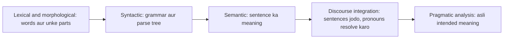
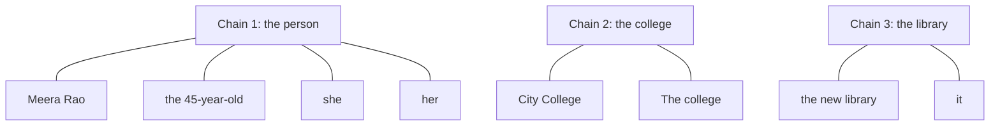
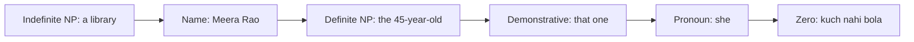
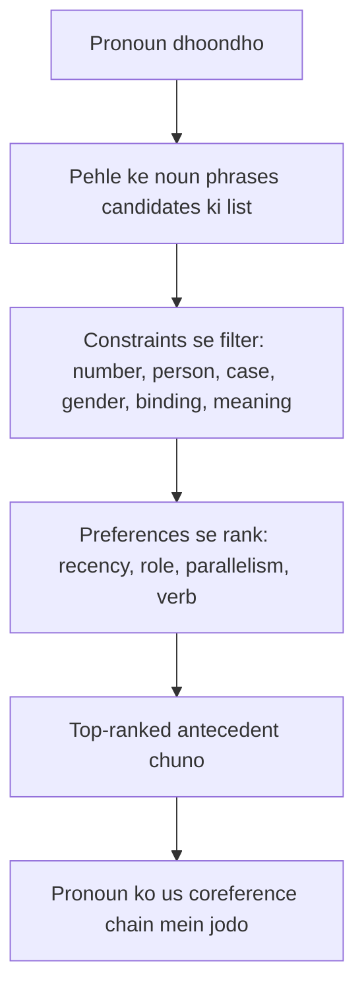

Naye ideas se pehle, wo purani baatein jo chahiye. Agar aapko pata hai, to agle section pe jao.

## Basics pehle

- **Sentence** ek poora statement hai. **Syntax** grammar hai, yaani words sentence mein kaise arrange hote hain. **Semantics** words aur sentence ka meaning hai.
- **Noun phrase (NP)** noun ke around bana words ka group hai jo kisi cheez ka naam batata hai: *Meera*, *the new library*, *a tall girl*.
- **Pronoun** chhota word hai jo noun phrase ki jagah aata hai: *she, he, it, they, him, her, this*.
- **Person** batata hai kaun bol raha hai: first person (*I, we*), second person (*you*), third person (*he, she, it, they*). **Number** batata hai ek (singular) ya kai (plural). **Gender** male (*he*), female (*she*) ya non-person (*it*) hai. **Case** wo form hai jo pronoun apne clause mein apne kaam ke hisaab se leta hai: *he* (subject), *him* (object), *his* (maalik).
- **Corpus** bahut saare text ka collection hai jisse NLP systems train aur test hote hain.

## Badi picture: sentences akele kyun nahi padhe jaate

**Ye kya hai.** Ye teen sentences padho: *Meera Rao opened the new library. She was proud of it. The college thanked her.* Har sentence akela aasaan hai. Lekin doosra sentence *she* aur *it* use karta hai, aur ise tabhi samajh sakte ho jab pehla yaad ho. Teesra *the college* use karta hai, jo pehle is naam se nahi aaya. Poora text isliye jud kar chalta hai kyunki baad ke sentences pehle wale ki taraf point karte hain. Ye peeche point karna syllabus <Syl m="5" />, section 5.1 "Discourse: Reference resolution, reference phenomena, syntactic and semantic constraints on coherence" ka dil hai. <Cite id="discourse-reference-slp3-coref" loc="§24.1" /> <Cite id="discourse-reference-wiki-discourse" />

**Ye kyun zaroori hai.** Zyadatar NLP tools (parsers, taggers) ek time pe ek sentence dekhte hain. Agar system sirf *She was proud of it* dekhe, to wo nahi bata sakta ki kaun proud hai aur kis cheez pe. Question answering, summarization, translation aur information extraction sab toot jaate hain agar pronouns apne nouns se na jude. <Cite id="discourse-reference-sukthanker2020" />

**Roz ki analogy.** Group chat socho. Jab koi likhta hai "he said no", to aap upar scroll karke dekhte ho ki kaunsa "he". Reference resolution wahi upar scroll karna hai, bas program karta hai.

<Box kind="definition">

**Discourse** connected sentences ka group hai (paragraph, conversation, poora document) jo milke alag-alag sentences se zyada matlab dete hain. **Reference resolution** wo task hai jisme har referring expression kis cheez ko point karta hai ye dhoondhte hain, aur ek hi cheez ko point karne wale saare expressions ko jodte hain.

</Box>

## Discourse aur pragmatic analysis

NLP ko aksar ek seedhi ki tarah samjhaya jaata hai, words se leke real duniya ke meaning tak. Aakhri do stages ek sentence se aage jaati hain. <Cite id="nlp-introduction-gfg-phases" loc="diagram" /> <Cite id="nlp-introduction-tp-nlp" />

**Discourse analysis (integration).** Sentence ka meaning uske aas-paas ke sentences pe depend karta hai. *Rahul went to the shop. He bought milk.* mein *He* pehle sentence ke baad hi samajh aata hai. To kaam ye hai ki har sentence ko pehle wali baat se jodo, mainly pronouns aur doosre references resolve karke, aur ye dekhke ki sentences ka aapas mein kya relation hai (coherence). <Cite id="discourse-reference-wiki-discourse" /> <Cite id="discourse-reference-slp3-disc" loc="§25.1" />

**Pragmatic analysis.** Pragmatics context mein meaning hai: speaker kya chahta hai, sirf words kya kehte hain wo nahi. *Can you pass the salt?* grammar se ability ke baare mein yes/no question hai, lekin pragmatically ye polite request hai. *It's cold in here* ka matlab "please window band karo" ho sakta hai. Ye samajhne ke liye system ko situation, speaker ka goal aur roz ki duniya ki knowledge chahiye. <Cite id="discourse-reference-wiki-pragmatics" />

| | Discourse analysis | Pragmatic analysis |
|---|---|---|
| Dekhta hai | text mein sentences ke beech links | real situation aur speaker ka intention |
| Typical question | *she* kisko refer kar raha hai? ye sentences kaise jude hain? | speaker asal mein kya kehna ya karna chahta hai? |
| Example | *Rahul went to the shop. He bought milk.* (He = Rahul) | *Can you pass the salt?* ka matlab "please pass it" |
| Main tools | reference resolution, coherence relations | world knowledge, context, speech acts |

<Box kind="exam">

**Define discourse and pragmatic analysis (5 marks):** dono ki one-line definition; discourse ke liye Rahul example aur pragmatics ke liye salt example; chhoti comparison table; ek line ki dono ek sentence se aage jaate hain aur syntax aur semantics ke upar baithte hain. Exam mein English mein likho: "Discourse analysis links sentences in a text, while pragmatic analysis interprets the speaker's intended meaning in context." <PYQ id="2024-12/q1c" />

</Box>

## Reference resolution: basic words

Chaar terms har answer mein aate hain. Ek running example ke saath seekho.

*Meera Rao, the principal of City College, opened the new library. The 45-year-old said she was proud of it. The college thanked her.*

- **Referring expression** wo phrase hai jo kisi cheez ko point karta hai: *Meera Rao*, *the 45-year-old*, *she*, *it*, *the college*, *her*.
- **Referent** wo asli cheez hai jise wo point karta hai: insaan Meera Rao, college, library.
- **Antecedent** wo pehle wala expression hai jis pe baad wala depend karta hai. *she* ka antecedent *Meera Rao* hai. Peeche point karne wala word (*she*) **anaphor** hai.
- **Coreference** tab hota hai jab do ya zyada expressions ek hi referent ko point karte hain. Aise expressions ka set **coreference chain** (ya cluster) hai. <Cite id="discourse-reference-wiki-coref" /> <Cite id="discourse-reference-slp3-coref" loc="§24.2" />

Dhyan do ki *the principal of City College* ki apni chain nahi hai. Ye **appositive** hai, naam ke bagal mein sirf describe karne ke liye lagaya gaya phrase, naya reference nahi. <Cite id="discourse-reference-slp3-coref" loc="§24.1.3" />

<Box kind="definition">

**Reference resolution (coreference resolution)** text ke wo saare expressions dhoondhne ka task hai jo ek hi real-world entity ko refer karte hain, aur unhe chains mein group karna. **Anaphora resolution** chhota kaam hai: har pronoun-jaise word ka antecedent dhoondhna. Dono terms aksar dheele dhang se ek hi cheez ke liye use hote hain. <Cite id="discourse-reference-sukthanker2020" /> <Cite id="discourse-reference-wiki-anaphora" />

</Box>

<Box kind="exam">

**What is reference resolution? (5 marks):** do line mein define karo, teen sentences wala example chains ke saath do, pieces ke naam batao (referring expression, referent, antecedent, anaphor), aur kyun zaroori hai (summarization, question answering, translation, information extraction). <PYQ id="2023-12-ce/q1e" /> <PYQ id="2024-12-ce/q1b" />

</Box>

## Referring expressions ke paanch types

English mein kisi cheez ko refer karne ke kuch gine-chune tareeke hain. Chuna gaya form listener ko batata hai ki wo us cheez ko kitna jaanta hai. <Cite id="discourse-reference-slp3-coref" loc="§24.1.1" />

| Type | Kaisa dikhta hai | Example | Typical use |
|---|---|---|---|
| Indefinite noun phrase | *a, an, some*, kabhi *this* | *Meera bought **a** beautiful goose.* | listener ke liye nayi cheez introduce karta hai |
| Definite noun phrase | *the* se shuru | *Then **the goose** escaped.* | wo cheez jo listener pehchaan sakta hai |
| Pronoun | *he, she, it, they, him, her* | ***It** escaped.* | wo cheez jo abhi bahut prominent hai |
| Demonstrative | *this, that, these, those* | ***That one** was tattered; **this one** was new.* | kai cheezon mein se ek pe ungli rakhna |
| Name | proper noun | ***Meera Rao** smiled.* | nayi ya purani cheezein, log, jagah, organizations |

1. **Indefinite noun phrases** aam taur pe conversation mein nayi cheez laate hain. English mein usual marker *a* ya *an* hai, aur *some* jaise words bhi chalte hain. <Cite id="discourse-reference-wiki-definite" />
2. **Definite noun phrases** (*the* ke saath) aisi cheez ko point karte hain jo listener pehchaan sakta hai. Ya to wo pehle mention hui thi (*a white stallion ... the stallion*), ya shared knowledge hai (*the New York Times*), ya description khud use unique bana deta hai (*the car keys*). News text mein bahut saare definite phrases anaphoric hote hi nahi, kyunki wo cheez pehli baar mention hoti hai. <Cite id="discourse-reference-wiki-definite" />
3. **Pronouns** unn cheezon ke liye hain jo discourse mein bahut prominent hain, aam taur pe ek-do sentence peeche mention hui. <Cite id="discourse-reference-wiki-pronoun" />
4. **Demonstratives** (*this, that*) akele aa sakte hain ya noun se pehle (*this ingredient*). Roz ki bolchaal mein *this* kabhi indefinite ki tarah bhi use hota hai, to type khud unclear ho sakta hai. <Cite id="discourse-reference-wiki-demonstrative" />
5. **Names** nayi ya purani cheezon ko refer kar sakte hain. Cheez aksar lambe naam aur role ke saath introduce hoti hai (*Meera Rao, the principal of City College*), aur jaise-jaise familiar hoti hai chhoti hoti jaati hai: *Ms. Rao*, phir *the 45-year-old*, phir *she*.

**Zero anaphora (kuch languages mein chhatha form).** Hindi, Japanese, Chinese aur Italian mein pronoun poora chhod diya ja sakta hai, aur listener khud bhar leta hai: Hindi *Rahul dukaan gaya. [ ] doodh khareeda* ("Rahul went to the shop. [He] bought milk"). Ye gap **zero anaphor** hai, aur isse ye detect karna bhi mushkil ho jaata hai ki reference hai. <Cite id="discourse-reference-wiki-zero" /> <Cite id="discourse-reference-slp3-coref" loc="§24.1.1" />

Is ordering ke peeche **information status** ka idea hai: cheez discourse ke liye nayi ho sakti hai, pehle se uske andar (old) ho sakti hai, ya jo wahan hai usse infer ho sakti hai. Nayi cheezon ko lambe, explicit phrases chahiye; purani, prominent cheezon ko pronouns milte hain. Ye tendency hai, strict rule nahi. <Cite id="discourse-reference-slp3-coref" loc="§24.1.2" />

<Box kind="exam">

**What are five types of referring expressions? Explain with examples (10 marks):** referring expression aur referent ki definition; indefinite NP, definite NP, pronoun, demonstrative aur name ki ek-ek row, apne example sentence aur kab use hota hai us line ke saath; zero anaphora ka mention; prominence ordering diagram; one-line conclusion. <PYQ id="2023-12-ce/q3b" />

</Box>

## Reference phenomena: anaphora, cataphora, deixis

Referring expressions alag-alag direction mein point kar sakte hain. Syllabus yahi **reference phenomena** kehta hai.

- **Anaphora** pehle kahi gayi cheez ko **peeche** point karta hai. *Rahul lost **his** keys.* (his = Rahul). Sabse common type. <Cite id="discourse-reference-wiki-anaphora" />
- **Cataphora** baad mein kahi jaane wali cheez ko **aage** point karta hai. *Before **she** left, **Priya** locked the door.* (she = Priya, jo baad mein aati hai). Kam common, style ke liye. <Cite id="discourse-reference-wiki-cataphora" />
- **Deixis** text ko nahi, asli situation ko point karta hai: *I, you, here, now, this one* (ungli rakhke bola). Listener ko dekhna padta hai kaun, kahan aur kab bol raha hai. Ye duniya ka reference hai, pehle wale word ka nahi. <Cite id="discourse-reference-wiki-deixis" />
- **Zero anaphora** bina kisi word ka anaphor hai (upar dekho).
- **Bound pronouns** quantifier ke andar variable ki tarah chalte hain: *Every dancer raised **her** arm* mein *her* koi ek khaas aurat nahi, balki har dancer baari-baari. Systems aksar inhe chhod dete hain. <Cite id="discourse-reference-slp3-coref" loc="§24.1.1" />

<Box kind="pitfall">

Anaphora aur coreference ek jaise nahi hain. *Every dancer raised her arm* mein *her* anaphor hai lekin kisi ek insaan se corefer nahi karta. *Priya went home. The doctor was tired.* mein dono phrases corefer kar sakte hain jabki koi doosre pe meaning ke liye depend nahi karta. Exam mein likho "closely related, often used interchangeably". <Cite id="discourse-reference-sukthanker2020" />

</Box>

## Reference resolution mushkil kyun hai

Teen tarah ke referents khaas taur pe tang karte hain. "Three types of referents that complicate reference resolution" ka yahi usual answer hai.

1. **Inferrables (bridging).** Cheez mention nahi hui, lekin reader world knowledge se infer kar leta hai. *I went to a superb restaurant yesterday. **The chef** had just opened it.* Kisi ne chef ka zikr nahi kiya, lekin restaurants mein chefs hote hain, to *the chef* restaurant se jud jaata hai. Doosra: *Mix flour, butter and water. Knead **the dough**.* (dough mixing ka result hai). System ko ye bridge karne ke liye world knowledge chahiye. <Cite id="discourse-reference-slp3-coref" loc="§24.1.2" />
2. **Discontinuous sets (split antecedents).** Plural pronoun do alag cheezon ko point karta hai jo kabhi saath mention nahi hui. *John has a Passat and Mary has a Mazda. **They** love driving.* Yahan *they* = John + Mary, jo do alag mentions hain, to koi ek pehla phrase antecedent nahi hai. System ko group banana padta hai.
3. **Generics.** Pronoun poori class ko point karta hai, kisi khaas cheez ko nahi. *I love mangoes. **They** are very tasty.* *They* ka matlab general mein mangoes hai, pehle mention hue kuch mangoes nahi. *In July in Mumbai **you** have to carry an umbrella* mein generic *you* hai. <Cite id="discourse-reference-slp3-coref" loc="§24.1.3" />

Kuch words references jaise dikhte hain par hote nahi, aur system ko inhe skip karna seekhna padta hai. <Cite id="discourse-reference-slp3-coref" loc="§24.1.3" />

| Look-alike | Example | Reference kyun nahi hai |
|---|---|---|
| Expletive (pleonastic) *it* | *It is raining.* *It surprised me that she left.* | *it* kisi ko point nahi karta; sirf subject ki jagah bharta hai |
| Appositive | *Rao, the principal of City College, spoke.* | phrase sirf Rao ko describe karta hai |
| Predicative NP | *United is a unit of UAL.* | *a unit of UAL* United ko describe karta hai, alag cheez nahi |
| Negated ya non-specific NP | *Janet doesn't have a car.* *It is a Toyota.* allowed nahi | *a car* aisi cheez nahi banata jise baad ke words point kar saken |

Mushkil ke aur sources: ek pronoun ke kai candidates ho sakte hain (*Rahul called Aman. He was late.*), *it* aur *this* jaise pronouns poore event ko point kar sakte hain (*Rahul failed. This upset him.*), aur kabhi answer ke liye real-world reasoning chahiye, jaisa neeche Winograd pairs dikhate hain.

<Box kind="exam">

**Three types of referents that complicate reference resolution (5 marks):** inferrables, discontinuous sets aur generics ke naam; har ka ek one-line example (the chef, John-and-Mary *they*, mangoes *they*); har ko kaunsi knowledge chahiye; ek line ki non-referring *it* aur appositives bhi skip karne padte hain. <PYQ id="2023-05-ce/q1c" />

</Box>

## Pronoun problem solve karna: constraints aur preferences

Pronoun ka antecedent dhoondhne ke liye system pehle saare pehle wale candidate noun phrases ki list banata hai, phir **hard constraints** se impossible wale hata deta hai, aur aakhir mein bache hue ko **soft preferences** se rank karta hai. <Cite id="discourse-reference-slp3-coref" loc="§24.1.4" />

### Syntactic aur semantic constraints (hard filters)

1. **Number agreement.** Singular pronoun ko singular antecedent chahiye, plural ko plural. *The chefs* *she* ka antecedent nahi ho sakta. Ye strong rule hai par absolute nahi: company grammar mein singular hoke bhi *they* se refer ho sakti hai (*IBM announced a product. They have worked on it for 20 years.*), aur singular *they* purana hai aur badh raha hai. <Cite id="discourse-reference-wiki-agreement" /> <Cite id="discourse-reference-slp3-coref" loc="§24.1.4" />
2. **Person agreement.** Third-person pronoun (*he, she, they*) ko third-person antecedent chahiye. *I* aur *you* speaker aur listener ko point karte hain. Quotation exception hai: *"I voted for Nader because he agreed with my values," she said* mein *I*, *my* aur *she* sab ek hi insaan hain. <Cite id="discourse-reference-slp3-coref" loc="§24.1.4" />
3. **Case agreement.** English pronouns apne clause mein apne kaam ke hisaab se form badalte hain: *he* (subject), *him* (object), *his* (maalik). Case antecedent ke case ke barabar hona zaroori nahi, lekin ye batata hai ki pronoun kaunsa kaam kar raha hai, aur isliye paas ke kaunse phrases ko wo refer kar sakta hai ya nahi. Subject pronoun *he* pichle sentence ke subject ya object noun ko stand-in kar sakta hai, lekin ek hi clause mein object pronoun *him* apne subject ko refer nahi kar sakta (neeche binding dekho). Zyada case wali languages mein (jaise Hindi *usne, usko*) case form seedha clue hai. <Cite id="discourse-reference-wiki-pronoun" />
4. **Gender agreement.** *He* ko male antecedent chahiye, *she* ko female, *it* ko non-person. Bahut languages mein har noun ka grammatical gender hota hai aur pronoun usse match karna chahiye. English mein gender sirf third-person singular pronouns mein hai, aur naam ka gender jaanne ke liye world knowledge lag sakti hai: *Maryam has a theorem. **She** is exciting* (she = Maryam), *Maryam has a theorem. **It** is exciting* (it = the theorem). <Cite id="discourse-reference-slp3-coref" loc="§24.1.4" />
5. **Syntactic (binding) constraints.** Grammar ek sentence ke andar pronoun ke refer karne par limit lagata hai. Reflexive (*himself, herself*) apne clause ke subject ko hi refer karna chahiye. Plain pronoun nahi kar sakta. *Janet bought **herself** a bottle* (herself = Janet). *Janet bought **her** a bottle* (her Janet ke alawa koi aur hai). <Cite id="discourse-reference-wiki-binding" /> <Cite id="discourse-reference-slp3-coref" loc="§24.1.4" />
6. **Selectional restrictions.** Verb sirf kuch tarah ke objects allow karta hai. *I ate the soup in my new bowl after cooking **it** for hours.* Candidates *the soup* aur *the bowl* hain, lekin *eat* ko khane layak cheez chahiye, aur cooking ko bhi food chahiye, to *it* = the soup. <Cite id="discourse-reference-slp3-coref" loc="§24.1.4" />

### Preferences (soft ranking)

Jab kai candidates bachte hain, log aur systems ye prefer karte hain:

1. **Recency.** Recent mentions zyada prominent hote hain. *The doctor found an old map in the captain's chest. Jim found an even older map on the shelf. **It** described an island.* *It* zyada likely Jim ka map hai, jo nazdeek hai. <Cite id="discourse-reference-slp3-coref" loc="§24.1.4" />
2. **Grammatical role.** Subject object se, aur object baaki phrases se zyada prefer hota hai. *Billy Bones went to the bar with Jim Hawkins. **He** called for rum.* (He = Billy, subject). Naam badal do to *He* = Jim. <Cite id="discourse-reference-slp3-coref" loc="§24.1.4" />
3. **Repeated mention.** Jo cheez kai sentences se topic hai, wahi pronoun ka matlab hone ke zyada chances hain.
4. **Parallelism.** Pronoun ko pehle sentence mein same grammatical role wala antecedent prefer hota hai. *Rahul gave Aman a book. Priya gave **him** a pen.* Dono sentences "someone gave X a thing" pattern ke hain, isliye *him* = Aman, jo pehle sentence mein bhi receiver tha.
5. **Verb semantics.** Kuch verbs ek participant ko zyada prominent bana dete hain. *John telephoned Bill. **He** lost the laptop* (He = John). *John criticized Bill. **He** lost the laptop* (He = Bill). Sirf pehla verb badla. <Cite id="discourse-reference-slp3-coref" loc="§24.1.4" />

Preferences tendencies hain. Ye aapas mein disagree kar sakti hain, aur isiliye simple rules mushkil cases mein fail hote hain. <Cite id="discourse-reference-lappin1994" />

<Box kind="exam">

**Illustrate the reference phenomena for solving the pronoun problem (10 marks):** problem ko do-sentence example se define karo; phenomena ki list (anaphora, cataphora, deixis, zero anaphora) ek-ek example ke saath; pipeline diagram banao; hard constraints (number, person, case, gender, binding, selectional) har ek mini example ke saath; preferences (recency, role, parallelism, verb); ek worked example (neeche); ek line limits pe. <PYQ id="2024-05-ce/q5a" />

**Explain syntactic and semantic constraints on coreference: 1) number agreement 2) person and case agreement (5 marks):** agreement ki definition; number rule *chefs / she* example aur *IBM they* exception ke saath; person rule I/you/he aur quotation exception ke saath; case he/him/his aur reflexive link ke saath; one-line conclusion ki ye constraints impossible candidates hatate hain par baaki mein se chunte nahi. <PYQ id="2025-05-ce/q1e" />

</Box>

### Worked example: constraints se filter karna

<Sum>

<Given>

Text: *Rahul met Priya at the station. He gave her a book.* Pronouns: *He* aur *her*. Pehle sentence ke candidates: Rahul (male, singular, person), Priya (female, singular, person), the station (non-person, singular).

</Given>

<Find>

*He* aur *her* ka antecedent.

</Find>

<Steps>

1. *He* ke features list karo: third person, singular, male. *her* ke: third person, singular, female (yahan object case). *Reason: agreement inhi features se hota hai.*
2. *He* ko har candidate se test karo. Rahul: person ok, number ok, gender male ok, to rehta hai. Priya: gender female, match nahi, hata. The station: non-person, male se match nahi, hata.
3. *her* test karo. Rahul: male, hata. Priya: female ok, rehta hai. The station: non-person, hata.
4. Binding check: *He* aur *her* ek hi clause mein hain (*He gave her a book*) aur non-reflexive hain, to *He* aur *her* ek hi insaan nahi ho sakte. Rahul aur Priya alag log hain, to ye sahi hai.

</Steps>

<Answer>

*He* = Rahul, *her* = Priya.

</Answer>

<Box kind="verify">

Har pronoun ke liye ek hi survivor bacha, to preference ranking ki zaroorat nahi padi. Wapas padho: *Rahul gave Priya a book.* Matlab banta hai, aur *him/her* do alag log hain jaisa binding maangti hai.

</Box>

</Sum>

### Worked example: simple salience scores se ranking

Jab constraints ke baad ek se zyada candidates bachte hain, program scores jod sakta hai. Lappin and Leass (1994) ne har candidate ko recent hone aur strong grammatical role ke points diye, aur har sentence ki doori pe points aadhe kiye. Neeche ke numbers illustrative hain, unke style ke scoring mein: current sentence mein hone ka 100, subject ka 80, direct object ka 50, har sentence peeche hone pe aadha. <Cite id="discourse-reference-lappin1994" />

<Sum>

<Given>

Text: *Rahul called Aman. He was late.* Pronoun: *He* (doosra sentence). Sentence 1 ke candidates: Rahul (subject), Aman (direct object). Dono male aur singular. Scores: recency 100, subject 80, object 50, ek baar aadha kyunki candidates ek sentence peeche hain.

</Given>

<Find>

*He* ka preferred antecedent.

</Find>

<Steps>

1. Dono candidates number aur gender pass karte hain, to constraints chun nahi sakte. *Reason: preference scores chahiye.*
2. Rahul aadha karne se pehle: recency 100 plus subject 80 = 180.
3. Aman aadha karne se pehle: recency 100 plus object 50 = 150.
4. Dono ko ek baar aadha karo, kyunki wo ek sentence peeche hain: Rahul $180 / 2 = 90$, Aman $150 / 2 = 75$.
5. Zyada score chuno: 90, 75 se bada hai.

</Steps>

<Answer>

*He* = Rahul (score 90 vs 75).

</Answer>

<Box kind="verify">

Doosre order mein recompute: pehle aadha karo, $100/2 = 50$ aur $80/2 = 40$, to Rahul $= 50 + 40 = 90$. Aman $= 50 + 25 = 75$. Wahi numbers. Dono candidates ka fark sirf role bonus (80 vs 50) hai, to Rahul $(80 - 50)/2 = 15$ se jeetta hai, aur $90 - 75 = 15$. Ye sirf preference hai: *Rahul criticized Aman. He was late.* mein log Aman chun sakte hain, jo scores pakad nahi paate.

</Box>

</Sum>

## Jab grammar kaafi nahi: Winograd schemas

Kuch pronouns sirf world knowledge se resolve hote hain. *The city council denied the demonstrators a permit because **they** feared violence.* Zyadatar log *they* ko council padhte hain. Ek word badlo: *... because **they** advocated violence*, to *they* demonstrators hain. Grammar dono mein same hai, sirf common sense decide karta hai ki kaun violence se darta hai aur kaun violence ki baat karta hai. Aise pairs **Winograd schemas** kehlaate hain aur ye test karne ke liye use hote hain ki systems mein sach mein understanding hai ya nahi. <Cite id="discourse-reference-slp3-coref" loc="§24.9" /> <Cite id="discourse-reference-wiki-winograd" />

## Coherence: sentences kyun jude lagte hain

Syllabus "constraints on coherence" bhi kehta hai. Text mein saare pronouns resolve hone ke baad bhi bakwaas ho sakta hai. **Coherence** ka matlab sentences milke sense banate hain: har sentence ka pichle se meaningful relation hai. **Cohesion** surface ka glue hai: pronouns, repeated words, *because* jaise linking words. <Cite id="discourse-reference-wiki-coherence" /> <Cite id="discourse-reference-slp3-disc" loc="§25.1" />

Common **coherence relations** (naam theories mein thoda alag hote hain): <Cite id="discourse-reference-slp3-disc" loc="§25.1" />

| Relation | Matlab | Example |
|---|---|---|
| Result | doosra sentence pehle ka result hai | *Rahul missed the bus. He was late for class.* |
| Explanation | doosra sentence kyun batata hai | *Rahul was late. He missed the bus.* |
| Elaboration | doosra zyada detail deta hai | *Rahul bought a gift. It was a red scarf.* |
| Contrast | dono alag hain | *Rahul likes tea. Aman likes coffee.* |

*Rahul missed the bus. He likes mangoes.* se compare karo. Grammar ok hai aur *He* clear hai, lekin koi relation nahi, to incoherent lagta hai. **Centering theory** (agla note, anaphora resolution) local coherence ko samjhati hai is se ki sentence mainly kis entity ke baare mein hai, aur ye bhi predict karti hai ki kaunsa pronoun chuna jaayega. <Cite id="discourse-reference-grosz1995" /> <Cite id="discourse-reference-slp3-disc" loc="§25.3" />

## Systems references kaise resolve karte hain

1. **Mention detection.** Har wo phrase dhoondho jo mention ho sakta hai: noun phrases, pronouns, named entities. Pehle generous raho, phir expletive *it*, appositives aur predicate nouns hata do. Expletive *it* ke early rules *It is Modal-adjective that S* jaise patterns use karte the. <Cite id="discourse-reference-slp3-coref" loc="§24.3" /> <Cite id="discourse-reference-lappin1994" />
2. **Mentions jodo.** Classic **mention-pair** model yes/no classifier hai. Har pronoun aur har pehle candidate ke liye wo jawab deta hai "same entity ya nahi?", features jaise number, gender, distance aur grammatical role se. Training data banane ka common tareeka: sabse nazdeek ka sahi antecedent positive example, aur beech ke saare mentions negative. <Cite id="discourse-reference-soon2001" /> <Cite id="discourse-reference-slp3-coref" loc="§24.4.1" />
3. **Neural span models.** Modern systems har chhote words ke span ko possible mention maante hain, score karte hain ki span mention hai ya nahi, aur har pehle span ka antecedent hone ka score, sab kuch data se seekhke, bina hand-made rules ke. <Cite id="discourse-reference-lee2017" /> <Cite id="discourse-reference-sukthanker2020" />
4. **Tools jo use kar sakte ho.** Stanford CoreNLP deterministic (rule-based), statistical aur neural coreference systems deta hai. spaCy ka experimental coreference component hai jo har chain ko span group mein rakhta hai. <Cite id="discourse-reference-corenlp-coref" /> <Cite id="discourse-reference-spacy-coref" />

### System ko score karna

System ki chains ko insaan ki gold chains se compare karte hain. Do common scores (Jurafsky and Martin, §24.8): **MUC** links (mention pairs) ginta hai; precision = sahi links / system ke banaye links, recall = sahi links / gold chains ke links. **B-cubed** har mention pe ginta hai: har mention ke liye precision = uski system chain mein sahi mentions / us chain ka size, recall = wahi count / gold chain ka size, phir average. <Cite id="discourse-reference-slp3-coref" loc="§24.8" />

<Sum>

<Given>

Gold chain: \{Meera, she, her, the 45-year-old\} (4 mentions). System ne do chains banayi: \{Meera, she\} aur \{her, the 45-year-old\}.

</Given>

<Find>

MUC precision, recall aur F1, aur B-cubed precision, recall aur F1.

</Find>

<Steps>

1. $n$ mentions ki chain mein links: $n - 1$. Gold ko $4 - 1 = 3$ links chahiye. System ne $1 + 1 = 2$ links banaye.
2. Dono system links (Meera-she, her-the 45-year-old) aise mentions jodte hain jo gold chain mein hain, to dono sahi hain. Sahi links $= 2$. *Reason: link tab sahi hai jab dono mentions ek hi gold chain mein hon.*
3. MUC precision $= 2 / 2 = 1$. MUC recall $= 2 / 3 \approx 0.667$.
4. MUC F1 $= 2PR/(P+R) = 2 \times 1 \times 0.667 / 1.667 = 0.8$.
5. B-cubed, 4 mentions mein se har ek ke liye: uski system chain mein 2 mentions hain, dono gold chain mein, to precision $= 2/2 = 1$. Gold chain mein 4 mentions hain, to recall $= 2/4 = 0.5$. Chaaron mentions ki values same, to average precision $1$, recall $0.5$.
6. B-cubed F1 $= 2 \times 1 \times 0.5 / 1.5 = 0.667$.

</Steps>

<Answer>

MUC: P = 1, R = 2/3, F1 = 0.8. B-cubed: P = 1, R = 0.5, F1 = 2/3.

</Answer>

<Box kind="verify">

F1 ko $2 / (1/P + 1/R)$ se check karo: MUC $= 2 / (1 + 1.5) = 2 / 2.5 = 0.8$. B-cubed $= 2 / (1 + 2) = 0.667$. Dono match. Sanity check: system ne kabhi galat mentions nahi jode, to precision 1 hi hona chahiye, aur usne gold chain tod di, to recall 1 se kam hona chahiye. Chain todne se B-cubed (0.5) MUC (0.667) se zyada recall girata hai.

</Box>

</Sum>

## Advantages, limits aur uses

| | Points |
|---|---|
| Kyun kaam ka hai | doosre tasks ko poora meaning deta hai: summarization, question answering, machine translation (*he* ya *she* chunna), information extraction, chatbots |
| Limits | world knowledge chahiye (Winograd), kai pronouns ka clear antecedent nahi hota, parsing aur mention detection ke errors aage tak failte hain, zero anaphora ya rich gender wali languages mushkil hain |
| Open problems | inferrables, split antecedents, generics, lambe documents, kam labelled data wali languages |

<Box kind="exam">

**Explain reference resolution in detail / Discuss the reference resolution problem in detail (10 marks):** "In simple words:" aur definition se shuru; running example teen chains ke saath; key terms (referring expression, referent, antecedent, anaphor); paanch referring expressions table mein; phenomena (anaphora, cataphora, zero anaphora, deixis); teen complicating referents (inferrables, discontinuous sets, generics) aur non-referring look-alikes; constraints aur preferences ek-ek example ke saath; method short mein (mention detection, phir pair linking, phir neural); ek line Winograd limit pe; conclusion. <PYQ id="2024-12/q4a" /> <PYQ id="2025-05/q1c" /> <PYQ id="2023-05-ce/q3b" /> <PYQ id="2024-12-ce/q1b" />

</Box>

**One-line conclusion.** Discourse analysis sentences ko jodta hai, aur reference resolution uska main tool hai: har mention dhoondho, agreement aur grammar rules todne wale candidates hatao, baaki ko recency aur role se rank karo, aur jab grammar decide na kar sake to world knowledge pe aao.
