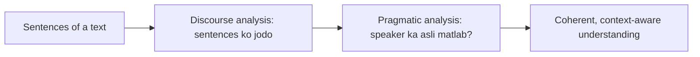
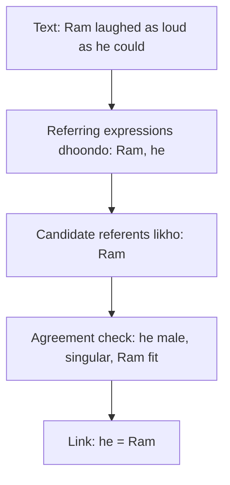
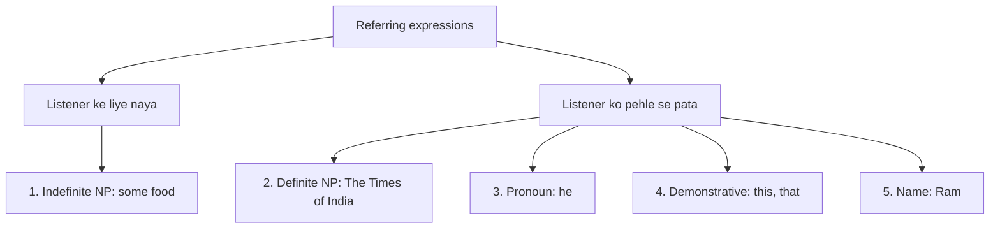

Naye ideas se pehle wo purani baatein jo chahiye. Agar aati hain to agle section pe jao.

## The basics first

- **Sentence** ek complete statement hai. **Syntax** uske words ke arrangement ka grammar hai. **Semantics** words aur sentence ka meaning hai.
- **Noun phrase (NP)** noun ke around bana word group hai jo kisi cheez ka naam leta hai: *Ram*, *the book*, *some food*.
- **Pronoun** wo word hai jo noun ki jagah use hota hai taaki repetition na ho: *he, she, it, they, this*. <Cite id="class-nlp-asol" loc="p. 5" />
- **Context** word ke aas-paas ki saari cheez hai: pehle ke sentences, kaun bol raha hai aur situation kya hai.

## Discourse and pragmatic analysis

**Discourse** connected sentences ka group hai. Ye padho: *Taylor went to the store. She bought groceries.* Har sentence akele easy hai, par *She* tabhi samajh aata hai jab pichla sentence dekho. Poore text ko samajhna, ek-ek sentence nahi, NLP ke last do levels ka kaam hai, jo is module (syllabus <Syl m="5" />) mein aate hain.

### Discourse Analysis

<Box kind="definition">

**Discourse Analysis** focuses on understanding how multiple sentences connect within a larger context. It ensures that the meaning of a text remains coherent and consistent across sentences and paragraphs. <Cite id="class-nlp-asol" loc="p. 1" />

</Box>

Ye kya karta hai (ye chaar points likho): <Cite id="class-nlp-asol" loc="p. 1" />

- Connects related sentences and ideas.
- Maintains contextual understanding across text.
- Helps interpret references and meanings correctly.
- Improves coherence in long or complex texts.

**Key aspects:** *Anaphora Resolution* pronouns jaise references ko pehchaan kar sahi subject se jodta hai. *Contextual References* ka matlab aas-paas ke context se words ya phrases samajhna.

**Examples:** "Taylor went to the store. She bought groceries." Yahan *She* matlab *Taylor*. "This is unfair!" Yahan *this* ka meaning aas-paas ke context pe depend karta hai.

### Pragmatic Analysis

<Box kind="definition">

**Pragmatic Analysis** focuses on understanding the intended meaning of words and sentences by considering context, tone, and speaker intention beyond the literal meaning. <Cite id="class-nlp-asol" loc="p. 1" />

</Box>

Ye kya karta hai: <Cite id="class-nlp-asol" loc="p. 1" />

- Understands implied meanings and intentions.
- Interprets context, tone and conversational meaning.
- Identifies figurative language such as idioms and metaphors.
- Helps machines understand human communication naturally.
- Supports sentiment analysis, chatbots and conversational AI.
- Improves context-aware and human-like responses.

**Key tasks:** *Understanding Intentions* kisi statement ya question ka asli purpose dhoondhta hai. *Figurative Meaning* idioms aur metaphors jaise non-literal expressions ko interpret karta hai.

**Examples:** "Can you pass the salt?" ek polite request hai, ability ka question nahi. "I'm falling for you." love express karta hai, sach mein girna nahi. "Hello! What time is it?" context ke hisaab se late hone ki chinta dikha sakta hai.

| | Discourse analysis | Pragmatic analysis |
|---|---|---|
| Looks at | sentences kaise jude hain | speaker ka matlab |
| Main tool | references jodna (anaphora resolution) | context, tone, speaker intention |
| Example | *She* = *Taylor* | "Can you pass the salt?" = request |

**Everyday analogy.** Discourse analysis film ka plot scenes ke beech follow karna hai. Pragmatic analysis ye samajhna hai ki jab dost bolta hai "Yahan thand hai", to wo chahta hai tum window band kar do.

Exam mein English mein likho: "Discourse Analysis focuses on understanding how multiple sentences connect within a larger context."

## What is reference resolution?

**Referring expression** wo word ya phrase hai jo kisi insaan, object ya idea ko point karta hai. Jis cheez ko wo point karta hai wo uska **referent** hai. Jab expression peeche ke kisi phrase ko point karta hai, to wo phrase **antecedent** kehlata hai. **Reference resolution** har referring expression ka referent (ya antecedent) dhoondhne ka kaam hai, taaki ek hi cheez ke saare mentions jud jaayein. "Ram laughed as loud as he could" mein *he* resolve karne pe *Ram* milta hai. <Cite id="class-nlp-asol" loc="p. 5" />

## The five types of referring expressions

Language alag-alag expressions use karti hai logon, objects ya ideas ko refer karne ke liye. Ye speaker aur listener ko batate hain ki kis cheez ki baat ho rahi hai. **Paanch main types** hain: Indefinite Noun Phrases, Definite Noun Phrases, Pronouns, Demonstratives aur Names. <Cite id="class-nlp-asol" loc="p. 4" />

| Type | Meaning | Example from the class |
|---|---|---|
| 1. Indefinite Noun Phrase | listener ke liye nayi cheez, pehle mention nahi hui; aam taur pe a, an ya some hota hai | "Ram had gone around one day to bring him **some food**." |
| 2. Definite Noun Phrase | indefinite ka ulta: pehle se known ya identify hone wali cheez; aam taur pe the hota hai | "I used to read **The Times of India**." |
| 3. Pronoun | noun ki jagah use hone wala word, repetition bachane ke liye; pehle mention hue noun ko refer karta hai, isliye definite reference hai | "Ram laughed as loud as **he** could." |
| 4. Demonstrative | specific cheezon ko point karta hai aur doori dikhata hai: this, that, these, those | "**This** is my book." "**That** is your car." |
| 5. Name | sabse simple aur direct form; person, place, organization ya cheez ko identify karta hai; context nahi chahiye | "**Ram** laughed as loud as he could." India, Microsoft, Taj Mahal bhi |

<Cite id="class-nlp-asol" loc="p. 4" /> <Cite id="class-nlp-asol" loc="p. 5" /> <Cite id="class-nlp-asol" loc="p. 6" />

- **Indefinite** phrases naya topic shuru karte hain ya aisi cheezon ke baare mein nayi information dete hain jo listener ko abhi nahi pata.
- **Definite** phrases tab use hote hain jab speaker aur listener dono cheez ko pehchaan sakte hain, isse baat clear rehti hai.
- **Pronouns** sentences ko smooth aur kam repetitive banate hain, par ye samajhne ke liye context pe depend karte hain ki kaun ya kya.
- **Demonstratives** paas ya door dikhate hain: *this* speaker ke paas, *that* door.
- **Names** precise identification dete hain aur pehle ke context pe depend nahi karte.

## Also asked in past papers (not in the class files)

Neeche ke parts class files mein nahi hain. Past papers mein puche gaye, isliye chhote aur standard rakhe hain.

**Anaphora aur cataphora.** *Anaphora* pehle kahi gayi cheez ka reference hai (*Ram came. He sat.*). *Cataphora* baad mein aane wali cheez ka reference hai (*When he came, Ram sat.*).

**Teen cases jo resolution mushkil banate hain.**

1. **Inferrables:** referent ka naam nahi liya, par guess ho sakta hai. "I bought a car. The engine is loud." Engine car ka hai.
2. **Discontinuous sets:** ek pronoun kai alag cheezon ko point karta hai. "Ram met Sita. They went home." *They* matlab Ram aur Sita saath mein.
3. **Generics:** pronoun ek poori kind ko mean karta hai, ek cheez ko nahi. "I saw bears. They are dangerous."

**Constraints on coreference.** Pronoun aur antecedent agree karne chahiye: *number* (singular ya plural), *person* (I, you, he) aur *case* (he subject form, him object form, his owner form), aur *gender* (he, she, it). "The chefs made lunch. She served it" galat hai, kyunki *She* singular hai aur *chefs* plural.

<Box kind="exam">

Asked as: define discourse and pragmatic analysis <PYQ id="2024-12/q1c" />, the five referring expressions <PYQ id="2023-12-ce/q3b" />, reference resolution in detail <PYQ id="2024-12/q4a" /> <PYQ id="2024-12-ce/q1b" /> <PYQ id="2025-05/q1c" /> <PYQ id="2023-05-ce/q3b" />, the three complicating referents <PYQ id="2023-05-ce/q1c" /> and agreement constraints <PYQ id="2025-05-ce/q1e" />.

</Box>
