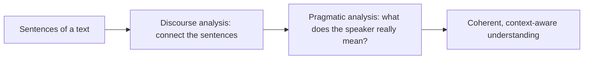
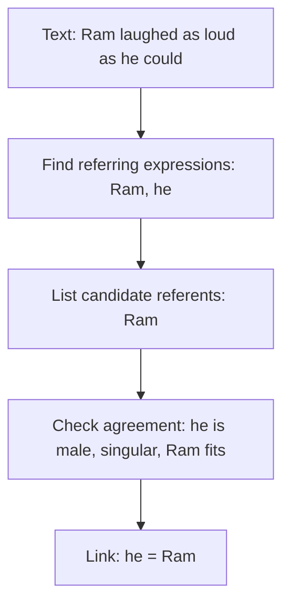
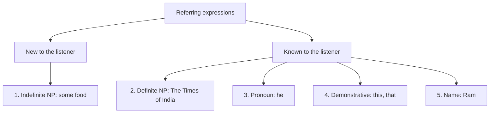

Before the new ideas, here are the old ones you need. If you already know them, skip to the next section.

## The basics first

- A **sentence** is one complete statement. **Syntax** is the grammar of how its words are arranged. **Semantics** is the meaning of the words and the sentence.
- A **noun phrase (NP)** is a group of words built around a noun that names something: *Ram*, *the book*, *some food*.
- A **pronoun** is a word used instead of a noun to avoid repetition: *he, she, it, they, this*. <Cite id="class-nlp-asol" loc="p. 5" />
- **Context** is everything around a word: the sentences before it, who is speaking and what the situation is.

## Discourse and pragmatic analysis

A **discourse** is a group of connected sentences. Read *Taylor went to the store. She bought groceries.* Each sentence is easy alone, but *She* can only be understood by looking at the sentence before it. Understanding a whole text, not one sentence at a time, is the job of the last two levels of NLP, which this module (syllabus <Syl m="5" />) covers.

### Discourse Analysis

<Box kind="definition">

**Discourse Analysis** focuses on understanding how multiple sentences connect within a larger context. It ensures that the meaning of a text remains coherent and consistent across sentences and paragraphs. <Cite id="class-nlp-asol" loc="p. 1" />

</Box>

What it does (write these four points): <Cite id="class-nlp-asol" loc="p. 1" />

- Connects related sentences and ideas.
- Maintains contextual understanding across text.
- Helps interpret references and meanings correctly.
- Improves coherence in long or complex texts.

**Key aspects:** *Anaphora Resolution* identifies references such as pronouns and links them to the correct subject. *Contextual References* means understanding words or phrases from the surrounding context.

**Examples:** "Taylor went to the store. She bought groceries." Here *She* refers to *Taylor*. "This is unfair!" The meaning of *this* depends on the surrounding context.

### Pragmatic Analysis

<Box kind="definition">

**Pragmatic Analysis** focuses on understanding the intended meaning of words and sentences by considering context, tone, and speaker intention beyond the literal meaning. <Cite id="class-nlp-asol" loc="p. 1" />

</Box>

What it does: <Cite id="class-nlp-asol" loc="p. 1" />

- Understands implied meanings and intentions.
- Interprets context, tone and conversational meaning.
- Identifies figurative language such as idioms and metaphors.
- Helps machines understand human communication naturally.
- Supports sentiment analysis, chatbots and conversational AI.
- Improves context-aware and human-like responses.

**Key tasks:** *Understanding Intentions* finds the actual purpose behind a statement or question. *Figurative Meaning* interprets non-literal expressions such as idioms and metaphors.

**Examples:** "Can you pass the salt?" is a polite request, not a question about ability. "I'm falling for you." expresses love, not literal falling. "Hello! What time is it?" may show concern about being late, depending on context.

| | Discourse analysis | Pragmatic analysis |
|---|---|---|
| Looks at | how sentences connect | what the speaker means |
| Main tool | linking references (anaphora resolution) | context, tone, speaker intention |
| Example | *She* = *Taylor* | "Can you pass the salt?" = a request |

**Everyday analogy.** Discourse analysis is following the plot of a film across scenes. Pragmatic analysis is understanding that when a friend says "It is cold here", he may want you to close the window.

## What is reference resolution?

A **referring expression** is a word or phrase used to point to a person, object or idea. The thing it points to is its **referent**. When the expression points back to an earlier phrase, that earlier phrase is the **antecedent**. **Reference resolution** is the job of finding the referent (or antecedent) of every referring expression, so that all mentions of the same thing are linked together. In "Ram laughed as loud as he could", resolving *he* gives *Ram*. <Cite id="class-nlp-asol" loc="p. 5" />

## The five types of referring expressions

Language uses different kinds of expressions to refer to people, objects or ideas. They help the speaker and listener identify what is being talked about. There are **five main types**: Indefinite Noun Phrases, Definite Noun Phrases, Pronouns, Demonstratives and Names. <Cite id="class-nlp-asol" loc="p. 4" />

| Type | Meaning | Example from the class |
|---|---|---|
| 1. Indefinite Noun Phrase | refers to something new to the listener, not mentioned before; usually has a, an or some | "Ram had gone around one day to bring him **some food**." |
| 2. Definite Noun Phrase | the opposite of indefinite: refers to something already known or identifiable; usually has the | "I used to read **The Times of India**." |
| 3. Pronoun | a word used instead of a noun to avoid repetition; refers back to a noun already mentioned, so it is a definite reference | "Ram laughed as loud as **he** could." |
| 4. Demonstrative | points to specific entities and shows distance: this, that, these, those | "**This** is my book." "**That** is your car." |
| 5. Name | the simplest and most direct form; identifies a person, place, organization or thing; needs no context | "**Ram** laughed as loud as he could." Also India, Microsoft, Taj Mahal |

<Cite id="class-nlp-asol" loc="p. 4" /> <Cite id="class-nlp-asol" loc="p. 5" /> <Cite id="class-nlp-asol" loc="p. 6" />

- **Indefinite** phrases start a new topic or add new information about things the listener does not know yet.
- **Definite** phrases are used when speaker and listener can both identify the thing, which keeps the talk clear.
- **Pronouns** make sentences smoother and less repetitive, but they depend on context to know who or what they mean.
- **Demonstratives** show nearness: *this* is near the speaker, *that* is far.
- **Names** give precise identification and do not depend on earlier context.

## Also asked in past papers (not in the class files)

The class files do not cover the parts below. They are kept short and standard, because past papers asked them.

**Anaphora and cataphora.** *Anaphora* is a reference to something said earlier (*Ram came. He sat.*). *Cataphora* is a reference to something said later (*When he came, Ram sat.*).

**Three cases that make resolution hard.**

1. **Inferrables:** the referent is not named but can be guessed. "I bought a car. The engine is loud." The engine belongs to the car.
2. **Discontinuous sets:** one pronoun points to several separate things. "Ram met Sita. They went home." *They* is Ram and Sita together.
3. **Generics:** the pronoun means a whole kind, not one thing. "I saw bears. They are dangerous."

**Constraints on coreference.** A pronoun and its antecedent must agree: *number* (singular or plural), *person* (I, you, he) and *case* (he is the subject form, him the object form, his the owner form), and also *gender* (he, she, it). "The chefs made lunch. She served it" is wrong, because *She* is singular and *chefs* is plural.

<Box kind="exam">

Asked as: define discourse and pragmatic analysis <PYQ id="2024-12/q1c" />, the five referring expressions <PYQ id="2023-12-ce/q3b" />, reference resolution in detail <PYQ id="2024-12/q4a" /> <PYQ id="2024-12-ce/q1b" /> <PYQ id="2025-05/q1c" /> <PYQ id="2023-05-ce/q3b" />, the three complicating referents <PYQ id="2023-05-ce/q1c" /> and agreement constraints <PYQ id="2025-05-ce/q1e" />.

</Box>
