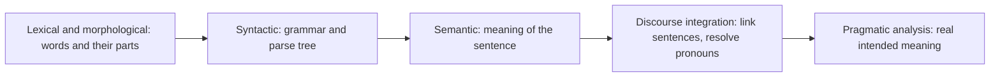
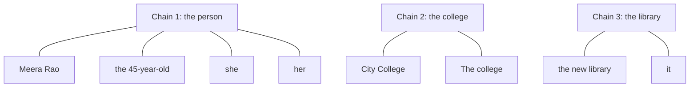
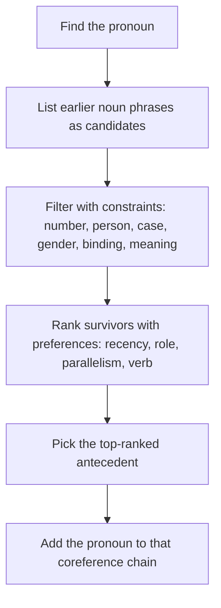

Before the new ideas, here are the old ones you need. If you already know them, skip to the next section.

## The basics first

- A **sentence** is one complete statement. **Syntax** is the grammar of how words are arranged in a sentence. **Semantics** is the meaning of the words and sentence.
- A **noun phrase (NP)** is a group of words built around a noun that names something: *Meera*, *the new library*, *a tall girl*.
- A **pronoun** is a short word that stands in for a noun phrase: *she, he, it, they, him, her, this*.
- **Person** says who is speaking: first person (*I, we*), second person (*you*), third person (*he, she, it, they*). **Number** says one (singular) or many (plural). **Gender** is male (*he*), female (*she*) or non-person (*it*). **Case** is the form a pronoun takes for its job in its own clause: *he* (subject), *him* (object), *his* (owner).
- A **corpus** is a large collection of text used to train and test NLP systems.

## The big picture: why sentences cannot be read alone

**What it is.** Read these three sentences: *Meera Rao opened the new library. She was proud of it. The college thanked her.* Each sentence on its own is easy. But the second one uses *she* and *it*, and you can only understand it by remembering the first. The third uses *the college*, which was never named before as such. The whole text hangs together because the later sentences point back to earlier ones. This pointing back is the heart of syllabus <Syl m="5" />, section 5.1 "Discourse: Reference resolution, reference phenomena, syntactic and semantic constraints on coherence". <Cite id="discourse-reference-slp3-coref" loc="§24.1" /> <Cite id="discourse-reference-wiki-discourse" />

**Why it is needed.** Most NLP tools (parsers, taggers) work on one sentence at a time. If a system sees only *She was proud of it*, it cannot say who is proud or of what. Question answering, summarization, translation and information extraction all break if the pronouns are not linked to their nouns. <Cite id="discourse-reference-sukthanker2020" />

**Everyday analogy.** Think of a group chat. When someone writes "he said no", you scroll up to find which "he" they mean. Reference resolution is that scrolling up, done by a program.

<Box kind="definition">

**Discourse** is a group of connected sentences (a paragraph, a conversation, a whole document) that together mean more than the separate sentences. **Reference resolution** is the task of finding what each referring expression points to, and linking all the expressions that point to the same thing.

</Box>

## Discourse and pragmatic analysis

NLP is often explained as a ladder of stages, from words up to meaning in the real world. The last two stages go beyond a single sentence. <Cite id="nlp-introduction-gfg-phases" loc="diagram" /> <Cite id="nlp-introduction-tp-nlp" />

**Discourse analysis (integration).** The meaning of a sentence depends on the sentences around it. In *Rahul went to the shop. He bought milk.* the word *He* only makes sense after the first sentence. So the job here is to connect each sentence to what came before, mainly by resolving pronouns and other references, and by seeing how sentences are related (coherence). <Cite id="discourse-reference-wiki-discourse" /> <Cite id="discourse-reference-slp3-disc" loc="§25.1" />

**Pragmatic analysis.** Pragmatics is meaning in context: what the speaker wants, not only what the words say. *Can you pass the salt?* is grammatically a yes/no question about ability, but pragmatically it is a polite request. *It's cold in here* may mean "please close the window". To get this, a system needs the situation, the speaker's goal and everyday world knowledge. <Cite id="discourse-reference-wiki-pragmatics" />

| | Discourse analysis | Pragmatic analysis |
|---|---|---|
| Looks at | links between sentences in a text | the real-world situation and the speaker's intention |
| Typical question | who does *she* refer to? how do these sentences connect? | what does the speaker really want to say or do? |
| Example | *Rahul went to the shop. He bought milk.* (He = Rahul) | *Can you pass the salt?* means "please pass it" |
| Main tools | reference resolution, coherence relations | world knowledge, context, speech acts |

<Box kind="exam">

**Define discourse and pragmatic analysis (5 marks):** one-line definition of each; the Rahul example for discourse and the salt example for pragmatics; the small comparison table; one line saying both go beyond a single sentence and sit on top of syntax and semantics. <PYQ id="2024-12/q1c" />

</Box>

## Reference resolution: the basic words

Four terms appear in every answer. Learn them with one running example.

*Meera Rao, the principal of City College, opened the new library. The 45-year-old said she was proud of it. The college thanked her.*

- A **referring expression** is a phrase that points to something: *Meera Rao*, *the 45-year-old*, *she*, *it*, *the college*, *her*.
- The **referent** is the real thing it points to: the person Meera Rao, the college, the library.
- The **antecedent** is the earlier expression that a later one depends on. For *she*, the antecedent is *Meera Rao*. The pointing-back word (*she*) is the **anaphor**.
- **Coreference** is when two or more expressions point to the same referent. A set of such expressions is a **coreference chain** (or cluster). <Cite id="discourse-reference-wiki-coref" /> <Cite id="discourse-reference-slp3-coref" loc="§24.2" />

Note that *the principal of City College* is not in a chain of its own. It is an **appositive**, a phrase glued next to a name only to describe it, and not a new reference. <Cite id="discourse-reference-slp3-coref" loc="§24.1.3" />

<Box kind="definition">

**Reference resolution (coreference resolution)** is the task of finding all the expressions in a text that refer to the same real-world entity and grouping them into chains. **Anaphora resolution** is the narrower job of finding the antecedent of each pronoun-like word. The two terms are often used loosely as the same thing. <Cite id="discourse-reference-sukthanker2020" /> <Cite id="discourse-reference-wiki-anaphora" />

</Box>

<Box kind="exam">

**What is reference resolution? (5 marks):** define it in two lines, give the three-sentence example with the chains, name the pieces (referring expression, referent, antecedent, anaphor), and say why it matters (summarization, question answering, translation, information extraction). <PYQ id="2023-12-ce/q1e" /> <PYQ id="2024-12-ce/q1b" />

</Box>

## Five types of referring expressions

English has a small set of ways to refer to something. The form chosen tells the listener how well they already know the thing. <Cite id="discourse-reference-slp3-coref" loc="§24.1.1" />

| Type | What it looks like | Example | Typical use |
|---|---|---|---|
| Indefinite noun phrase | *a, an, some*, sometimes *this* | *Meera bought **a** beautiful goose.* | introduces a thing that is new to the listener |
| Definite noun phrase | starts with *the* | *Then **the goose** escaped.* | a thing the listener can already identify |
| Pronoun | *he, she, it, they, him, her* | ***It** escaped.* | a thing that is very prominent right now |
| Demonstrative | *this, that, these, those* | ***That one** was tattered; **this one** was new.* | pointing at one of several things |
| Name | proper noun | ***Meera Rao** smiled.* | new or old things, people, places, organizations |

1. **Indefinite noun phrases** usually bring a new thing into the conversation. The usual marker in English is *a* or *an*, and words like *some* work too. <Cite id="discourse-reference-wiki-definite" />
2. **Definite noun phrases** (with *the*) point to something the listener can identify. Either it was mentioned before (*a white stallion ... the stallion*), or it is shared knowledge (*the New York Times*), or the description itself makes it unique (*the car keys*). Many definite phrases in news text are not anaphoric at all, because it is the first time the thing is mentioned. <Cite id="discourse-reference-wiki-definite" />
3. **Pronouns** are used for things that are extremely prominent in the discourse, usually mentioned one or two sentences back. <Cite id="discourse-reference-wiki-pronoun" />
4. **Demonstratives** (*this, that*) can stand alone or sit before a noun (*this ingredient*). Everyday speech sometimes uses *this* as an indefinite, so the type can itself be unclear. <Cite id="discourse-reference-wiki-demonstrative" />
5. **Names** can refer to new or old things. A thing is often introduced with a long name and a role (*Meera Rao, the principal of City College*), and then shortened as it becomes familiar: *Ms. Rao*, then *the 45-year-old*, then *she*.

```mermaid
%% caption: The referring expressions, ordered from most informative (new things) to least informative (very familiar things). The more familiar the thing, the shorter the expression. This follows the "information status" idea in Jurafsky and Martin.
flowchart LR
  A["Indefinite NP: a library"] --> B["Name: Meera Rao"]
  B --> C["Definite NP: the 45-year-old"]
  C --> D["Demonstrative: that one"]
  D --> E["Pronoun: she"]
  E --> F["Zero: nothing said"]
```

**Zero anaphora (a sixth form in some languages).** In Hindi, Japanese, Chinese and Italian the pronoun can be left out completely, and the listener fills it in: Hindi *Rahul dukaan gaya. [ ] doodh khareeda* ("Rahul went to the shop. [He] bought milk"). The gap is a **zero anaphor**, and it makes it harder even to detect that a reference exists. <Cite id="discourse-reference-wiki-zero" /> <Cite id="discourse-reference-slp3-coref" loc="§24.1.1" />

The idea behind the ordering is **information status**: a thing can be new to the discourse, already in it (old), or inferable from what is there. New things need long, explicit phrases; old, prominent things get pronouns. This is a tendency, not a strict rule. <Cite id="discourse-reference-slp3-coref" loc="§24.1.2" />

<Box kind="exam">

**What are five types of referring expressions? Explain with examples (10 marks):** a definition of referring expression and referent; one row each for indefinite NP, definite NP, pronoun, demonstrative and name with its own example sentence and a line on when it is used; a mention of zero anaphora; the prominence ordering diagram; a one-line conclusion. <PYQ id="2023-12-ce/q3b" />

</Box>

## Reference phenomena: anaphora, cataphora, deixis

Referring expressions can point in different directions. These are the **reference phenomena** the syllabus names.

- **Anaphora** points **back** to something said earlier. *Rahul lost **his** keys.* (his = Rahul). It is the most common type. <Cite id="discourse-reference-wiki-anaphora" />
- **Cataphora** points **forward** to something said later. *Before **she** left, **Priya** locked the door.* (she = Priya, who comes later). It is rarer and used for style. <Cite id="discourse-reference-wiki-cataphora" />
- **Deixis** points to the real situation instead of the text: *I, you, here, now, this one* (said while pointing). The listener must see who is talking, where and when. This is a reference to the world, not to an earlier word. <Cite id="discourse-reference-wiki-deixis" />
- **Zero anaphora** is an anaphor with no word at all (see above).
- **Bound pronouns** behave like variables inside a quantifier: in *Every dancer raised **her** arm*, *her* is not one particular woman but each dancer in turn. Systems usually leave these out. <Cite id="discourse-reference-slp3-coref" loc="§24.1.1" />

<Box kind="pitfall">

Anaphora and coreference are not the same. In *Every dancer raised her arm*, *her* is an anaphor but does not corefer with a single person. In *Priya went home. The doctor was tired.* the two phrases may corefer even though neither depends on the other for its meaning. Say "closely related, often used interchangeably" in the exam. <Cite id="discourse-reference-sukthanker2020" />

</Box>

## What makes reference resolution hard

Three kinds of referents are especially awkward. They are the usual answer to "three types of referents that complicate reference resolution".

1. **Inferrables (bridging).** The thing is not mentioned, but the reader can infer it from world knowledge. *I went to a superb restaurant yesterday. **The chef** had just opened it.* Nobody mentioned a chef, but restaurants have chefs, so *the chef* is linked to the restaurant. Another: *Mix flour, butter and water. Knead **the dough**.* (the dough is the result of mixing). A system needs world knowledge to bridge this. <Cite id="discourse-reference-slp3-coref" loc="§24.1.2" />
2. **Discontinuous sets (split antecedents).** A plural pronoun points to two separate things that were never mentioned together. *John has a Passat and Mary has a Mazda. **They** love driving.* Here *they* = John + Mary, which are two different mentions, so no single earlier phrase is the antecedent. The system must build the group.
3. **Generics.** The pronoun points to a whole class, not a particular thing. *I love mangoes. **They** are very tasty.* *They* means mangoes in general, not some mangoes mentioned earlier. *In July in Mumbai **you** have to carry an umbrella* uses a generic *you*. <Cite id="discourse-reference-slp3-coref" loc="§24.1.3" />

Some words look like references but are not, and a system must learn to skip them. <Cite id="discourse-reference-slp3-coref" loc="§24.1.3" />

| Look-alike | Example | Why it is not a reference |
|---|---|---|
| Expletive (pleonastic) *it* | *It is raining.* *It surprised me that she left.* | *it* points to nothing; it only fills the subject slot |
| Appositive | *Rao, the principal of City College, spoke.* | the phrase only describes Rao |
| Predicative NP | *United is a unit of UAL.* | *a unit of UAL* describes United, it is not another thing |
| Negated or non-specific NP | *Janet doesn't have a car.* *It is a Toyota.* is not allowed | *a car* never creates a thing that later words can point to |

Other sources of difficulty are that one pronoun may have several candidates (*Rahul called Aman. He was late.*), that pronouns like *it* and *this* can point to a whole event (*Rahul failed. This upset him.*), and that the answer sometimes needs real-world reasoning, shown by Winograd pairs below.

<Box kind="exam">

**Three types of referents that complicate reference resolution (5 marks):** name inferrables, discontinuous sets and generics; give one one-line example each (the chef, John-and-Mary *they*, mangoes *they*); say what knowledge each needs; end with a line that non-referring *it* and appositives must also be skipped. <PYQ id="2023-05-ce/q1c" />

</Box>

## Solving the pronoun problem: constraints and preferences

To find the antecedent of a pronoun, a system first lists all earlier candidate noun phrases, then removes the impossible ones using **hard constraints**, and finally ranks the rest using **soft preferences**. <Cite id="discourse-reference-slp3-coref" loc="§24.1.4" />

### Syntactic and semantic constraints (hard filters)

1. **Number agreement.** A singular pronoun needs a singular antecedent and a plural pronoun a plural one. *The chefs* cannot be the antecedent of *she*. This is a strong rule but not absolute: a company can be singular in grammar yet referred to as *they* (*IBM announced a product. They have worked on it for 20 years.*), and singular *they* is old and increasingly common. <Cite id="discourse-reference-wiki-agreement" /> <Cite id="discourse-reference-slp3-coref" loc="§24.1.4" />
2. **Person agreement.** A third-person pronoun (*he, she, they*) needs a third-person antecedent. *I* and *you* point to the speaker and listener. Quotation is an exception: in *"I voted for Nader because he agreed with my values," she said*, *I*, *my* and *she* all mean the same person. <Cite id="discourse-reference-slp3-coref" loc="§24.1.4" />
3. **Case agreement.** English pronouns change form with their job in their own clause: *he* (subject), *him* (object), *his* (owner). The case does not have to equal the antecedent's case, but it tells us which job the pronoun does, and so which nearby phrases it can or cannot refer to. A subject pronoun *he* can stand for a subject or an object noun in an earlier sentence, but an object pronoun like *him* inside the same clause as its subject cannot refer to that subject (see binding below). In languages with richer case systems (for example Hindi *usne, usko*), the case form is a direct clue. <Cite id="discourse-reference-wiki-pronoun" />
4. **Gender agreement.** *He* needs a male antecedent, *she* a female one, *it* a non-person. In many languages every noun has a grammatical gender and the pronoun must match it. English has gender only on third-person singular pronouns, and knowing the gender of a name may need world knowledge: *Maryam has a theorem. **She** is exciting* (she = Maryam), *Maryam has a theorem. **It** is exciting* (it = the theorem). <Cite id="discourse-reference-slp3-coref" loc="§24.1.4" />
5. **Syntactic (binding) constraints.** Grammar limits what a pronoun can refer to inside one sentence. A reflexive (*himself, herself*) must refer to the subject of its own clause. A plain pronoun cannot. *Janet bought **herself** a bottle* (herself = Janet). *Janet bought **her** a bottle* (her is someone other than Janet). <Cite id="discourse-reference-wiki-binding" /> <Cite id="discourse-reference-slp3-coref" loc="§24.1.4" />
6. **Selectional restrictions.** A verb allows only certain kinds of objects. *I ate the soup in my new bowl after cooking **it** for hours.* The candidates are *the soup* and *the bowl*, but *eat* needs something edible, and cooking also needs food, so *it* = the soup. <Cite id="discourse-reference-slp3-coref" loc="§24.1.4" />

### Preferences (soft ranking)

When several candidates survive, people and systems prefer:

1. **Recency.** Recent mentions are more prominent. *The doctor found an old map in the captain's chest. Jim found an even older map on the shelf. **It** described an island.* *It* more likely means Jim's map, the nearer one. <Cite id="discourse-reference-slp3-coref" loc="§24.1.4" />
2. **Grammatical role.** Subjects are preferred over objects, and objects over other phrases. *Billy Bones went to the bar with Jim Hawkins. **He** called for rum.* (He = Billy, the subject). Swap the names and *He* = Jim. <Cite id="discourse-reference-slp3-coref" loc="§24.1.4" />
3. **Repeated mention.** A thing that has been the topic for several sentences is likelier to be the one a pronoun means.
4. **Parallelism.** A pronoun prefers the antecedent in the same grammatical role in the earlier sentence: *Rahul gave Aman a book. Priya gave **him** a pen.* Both sentences have the pattern "someone gave X a thing", so *him* is matched to Aman, who held the same role (receiver) in the first sentence.
5. **Verb semantics.** Some verbs make one participant more prominent. *John telephoned Bill. **He** lost the laptop* (He = John). *John criticized Bill. **He** lost the laptop* (He = Bill). Only the first verb changed. <Cite id="discourse-reference-slp3-coref" loc="§24.1.4" />

Preferences are tendencies. They can disagree with each other, and that is why simple rules fail on hard cases. <Cite id="discourse-reference-lappin1994" />

<Box kind="exam">

**Illustrate the reference phenomena for solving the pronoun problem (10 marks):** define the problem with a two-sentence example; list the phenomena (anaphora, cataphora, deixis, zero anaphora) with one example each; draw the pipeline diagram; explain the hard constraints (number, person, case, gender, binding, selectional) each with a mini example; explain the preferences (recency, role, parallelism, verb); give one worked example (below); end with one line on limits. <PYQ id="2024-05-ce/q5a" />

**Explain syntactic and semantic constraints on coreference: 1) number agreement 2) person and case agreement (5 marks):** definition of agreement; number rule with the *chefs / she* example and the *IBM they* exception; person rule with I/you/he and the quotation exception; case with he/him/his and the reflexive link; a one-line conclusion that these remove impossible candidates but do not choose among the rest. <PYQ id="2025-05-ce/q1e" />

</Box>

### Worked example: filtering with constraints

<Sum>

<Given>

Text: *Rahul met Priya at the station. He gave her a book.* Pronouns: *He* and *her*. Candidates in the first sentence: Rahul (male, singular, person), Priya (female, singular, person), the station (non-person, singular).

</Given>

<Find>

the antecedent of *He* and of *her*.

</Find>

<Steps>

1. List the features of *He*: third person, singular, male. List those of *her*: third person, singular, female (here object case). *Reason: agreement uses these features.*
2. Test *He* against each candidate. Rahul: person ok, number ok, gender male ok, so it stays. Priya: gender female, no match, removed. The station: non-person, no match with male, removed.
3. Test *her*. Rahul: male, removed. Priya: female ok, stays. The station: non-person, removed.
4. Check binding: *He* and *her* are in the same clause (*He gave her a book*) and are non-reflexive, so *He* and *her* cannot be the same person. Rahul and Priya are different people, so this holds.

</Steps>

<Answer>

*He* = Rahul, *her* = Priya.

</Answer>

<Box kind="verify">

Each pronoun had exactly one survivor, so no preference ranking was needed. Read it back: *Rahul gave Priya a book.* It makes sense, and *him/her* are two different people as binding requires.

</Box>

</Sum>

### Worked example: ranking with simple salience scores

When constraints leave more than one candidate, a program can add up scores. Lappin and Leass (1994) gave each candidate points for being recent and for having a strong grammatical role, and halved the points for every sentence of distance. The numbers below are illustrative, using their style of scoring: 100 for being in the current sentence, 80 for subject, 50 for direct object, halved once for each sentence back. <Cite id="discourse-reference-lappin1994" />

<Sum>

<Given>

Text: *Rahul called Aman. He was late.* Pronoun: *He* (second sentence). Candidates from sentence 1: Rahul (subject), Aman (direct object). Both are male and singular. Scores: recency 100, subject 80, object 50, halved once because the candidates are one sentence back.

</Given>

<Find>

the preferred antecedent of *He*.

</Find>

<Steps>

1. Both candidates pass number and gender, so constraints cannot choose. *Reason: we need the preference scores.*
2. Rahul before halving: recency 100 plus subject 80 = 180.
3. Aman before halving: recency 100 plus object 50 = 150.
4. Halve both once, because they are one sentence back: Rahul $180 / 2 = 90$, Aman $150 / 2 = 75$.
5. Pick the higher score: 90 is greater than 75.

</Steps>

<Answer>

*He* = Rahul (score 90 against 75).

</Answer>

<Box kind="verify">

Recompute in another order: halve first, $100/2 = 50$ and $80/2 = 40$, so Rahul $= 50 + 40 = 90$. Aman $= 50 + 25 = 75$. Same numbers. The only difference between the two candidates is the role bonus (80 versus 50), so Rahul wins by $(80 - 50)/2 = 15$, and $90 - 75 = 15$. This is only a preference: with *Rahul criticized Aman. He was late.* people may choose Aman, which the scores do not capture.

</Box>

</Sum>

## When grammar is not enough: Winograd schemas

Some pronouns can only be resolved with world knowledge. *The city council denied the demonstrators a permit because **they** feared violence.* Most people read *they* as the council. Change one word: *... because **they** advocated violence*, and *they* is the demonstrators. Grammar is identical in both, and only common sense about who fears and who advocates violence decides. Such pairs are called **Winograd schemas** and are used as a test of whether systems have real understanding. <Cite id="discourse-reference-slp3-coref" loc="§24.9" /> <Cite id="discourse-reference-wiki-winograd" />

## Coherence: why the sentences hang together

The syllabus also says "constraints on coherence". A text can have all its pronouns resolved and still be nonsense. **Coherence** means the sentences make sense together: each one has a meaningful relation to the one before. **Cohesion** is the surface glue: pronouns, repeated words, linking words like *because*. <Cite id="discourse-reference-wiki-coherence" /> <Cite id="discourse-reference-slp3-disc" loc="§25.1" />

Common **coherence relations** (the names differ a little between theories): <Cite id="discourse-reference-slp3-disc" loc="§25.1" />

| Relation | Meaning | Example |
|---|---|---|
| Result | the second sentence is a result of the first | *Rahul missed the bus. He was late for class.* |
| Explanation | the second sentence says why | *Rahul was late. He missed the bus.* |
| Elaboration | the second gives more detail | *Rahul bought a gift. It was a red scarf.* |
| Contrast | the two differ | *Rahul likes tea. Aman likes coffee.* |

Compare *Rahul missed the bus. He likes mangoes.* Grammatically fine and *He* is clear, but there is no relation, so it feels incoherent. **Centering theory** (next note, anaphora resolution) explains local coherence through which entity a sentence is mostly about, and it also predicts which pronoun is chosen. <Cite id="discourse-reference-grosz1995" /> <Cite id="discourse-reference-slp3-disc" loc="§25.3" />

## How systems resolve references

1. **Mention detection.** Find every phrase that could be a mention: noun phrases, pronouns, named entities. Be generous at first, then remove expletive *it*, appositives and predicate nouns. Early rules for expletive *it* used patterns such as *It is Modal-adjective that S*. <Cite id="discourse-reference-slp3-coref" loc="§24.3" /> <Cite id="discourse-reference-lappin1994" />
2. **Link mentions.** The classic **mention-pair** model is a yes/no classifier. For each pronoun and each earlier candidate it answers "same entity or not?" using features such as number, gender, distance, and grammatical role. A common way to build training data is to take the closest true antecedent as a positive example and all mentions in between as negatives. <Cite id="discourse-reference-soon2001" /> <Cite id="discourse-reference-slp3-coref" loc="§24.4.1" />
3. **Neural span models.** Modern systems consider every short span of words as a possible mention, score how likely each span is a mention, and score how likely each earlier span is its antecedent, learning everything from data without hand-made rules. <Cite id="discourse-reference-lee2017" /> <Cite id="discourse-reference-sukthanker2020" />
4. **Tools you can use.** Stanford CoreNLP offers deterministic (rule-based), statistical and neural coreference systems. spaCy has an experimental coreference component that stores each chain as a span group. <Cite id="discourse-reference-corenlp-coref" /> <Cite id="discourse-reference-spacy-coref" />

### Scoring a system

A system's chains are compared with human gold chains. Two common scores (Jurafsky and Martin, §24.8): **MUC** counts links (pairs of mentions); precision is correct links divided by links the system made, and recall is correct links divided by links in the gold chains. **B-cubed** counts per mention: for each mention, precision is the correct mentions in its system chain divided by that chain's size, and recall is the same count divided by the gold chain's size, then averaged. <Cite id="discourse-reference-slp3-coref" loc="§24.8" />

<Sum>

<Given>

Gold chain: \{Meera, she, her, the 45-year-old\} (4 mentions). The system made two chains: \{Meera, she\} and \{her, the 45-year-old\}.

</Given>

<Find>

MUC precision, recall and F1, and B-cubed precision, recall and F1.

</Find>

<Steps>

1. Links in a chain of $n$ mentions: $n - 1$. Gold needs $4 - 1 = 3$ links. The system made $1 + 1 = 2$ links.
2. Both system links (Meera-she, her-the 45-year-old) join mentions that are in the gold chain, so both are correct. Correct links $= 2$. *Reason: a link is right if both mentions are in the same gold chain.*
3. MUC precision $= 2 / 2 = 1$. MUC recall $= 2 / 3 \approx 0.667$.
4. MUC F1 $= 2PR/(P+R) = 2 \times 1 \times 0.667 / 1.667 = 0.8$.
5. B-cubed, for each of the 4 mentions: its system chain has 2 mentions, both in the gold chain, so precision $= 2/2 = 1$. The gold chain has 4 mentions, so recall $= 2/4 = 0.5$. All four mentions have the same values, so the average is precision $1$, recall $0.5$.
6. B-cubed F1 $= 2 \times 1 \times 0.5 / 1.5 = 0.667$.

</Steps>

<Answer>

MUC: P = 1, R = 2/3, F1 = 0.8. B-cubed: P = 1, R = 0.5, F1 = 2/3.

</Answer>

<Box kind="verify">

Check F1 as $2 / (1/P + 1/R)$: MUC $= 2 / (1 + 1.5) = 2 / 2.5 = 0.8$. B-cubed $= 2 / (1 + 2) = 0.667$. Both agree. Sanity check: the system never joined wrong mentions, so precision must be 1, and it split the gold chain, so recall must be below 1. Splitting hurts recall more under B-cubed (0.5) than MUC (0.667).

</Box>

</Sum>

## Advantages, limits and uses

| | Points |
|---|---|
| Why it helps | gives other tasks the full meaning: summarization, question answering, machine translation (choosing *he* or *she*), information extraction, chatbots |
| Limits | needs world knowledge (Winograd), many pronouns have no clear antecedent, errors in parsing and mention detection spread forward, languages with zero anaphora or rich gender are harder |
| Open problems | inferrables, split antecedents, generics, long documents, languages with few labelled data |

<Box kind="exam">

**Explain reference resolution in detail / Discuss the reference resolution problem in detail (10 marks):** start with "In simple words:" and a definition; the running example with its three chains; the key terms (referring expression, referent, antecedent, anaphor); the five types of referring expressions in a table; the phenomena (anaphora, cataphora, zero anaphora, deixis); the three complicating referents (inferrables, discontinuous sets, generics) and the non-referring look-alikes; the constraints and preferences with one example each; the method in short (mention detection, then pair linking, then neural); one line on the Winograd limit; a conclusion. <PYQ id="2024-12/q4a" /> <PYQ id="2025-05/q1c" /> <PYQ id="2023-05-ce/q3b" /> <PYQ id="2024-12-ce/q1b" />

</Box>

**One-line conclusion.** Discourse analysis links sentences, and reference resolution is its main tool: find every mention, remove candidates that break the agreement and grammar rules, rank the rest by recency and role, and fall back on world knowledge when grammar cannot decide.
