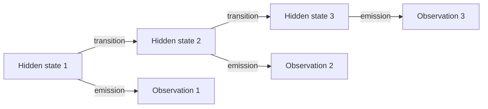
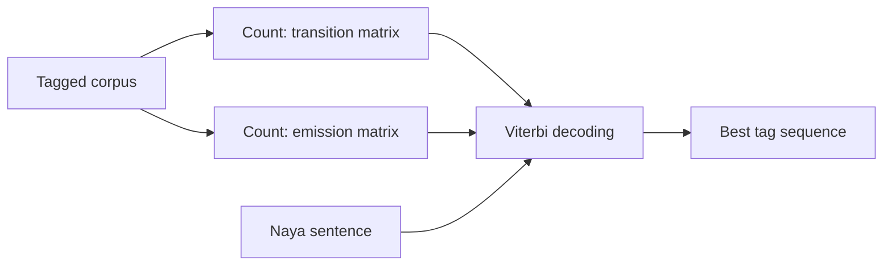
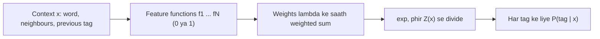
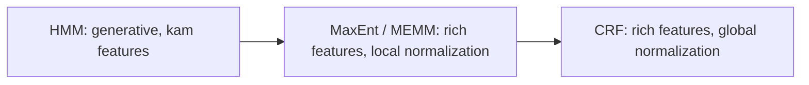

Ye note syllabus <Syl m="3" /> hai: tagging ke stochastic models, HMM aur Maximum Entropy, aur CRF. Word classes aur tag sets POS tagging ke note mein hain.

## Pehle basics

- **Sequence labelling:** sequence ke har item ko ek label dena, jaise har word ko ek tag. <Cite id="class-nlp-pyq3" loc="p. 8" />
- **Counts se probability:** agar koi cheez 10 mein se 3 baar hui, to uski probability 3/10 hai. Neeche ke models tagged corpus mein counting se seekhe jaate hain. <Cite id="class-nlp-pyq3" loc="p. 7" />
- **Generative aur discriminative:** generative model (HMM) words aur tags ki joint probability $P(x, y)$ model karta hai. Discriminative model (MaxEnt) seedhe $P(y \mid x)$ model karta hai: context diya ho to tag. <Cite id="class-nlp-pyq3" loc="p. 8" />

## Hidden Markov Model (HMM)

<Box kind="definition">

**Hidden Markov Model:** ek statistical model jo un systems ko samajhne ke liye use hota hai jinki asli states seedhe dikhti nahi, par hum unpar depend karne wale outcomes dekh sakte hain. <Cite id="class-nlp-pyq3" loc="p. 2" />

</Box>

**Analogy:** aap bahar dekh kar mausam nahi dekh sakte, par logon ko kuch karte dekhte ho (walk, shop, clean). Actions mausam ke clues hain. Model observed activities se hidden weather states ka sabse likely sequence nikalta hai. <Cite id="class-nlp-pyq3" loc="p. 2" />

*Figure par ek note:* ek state se nikalte arrows ka sum 1 hona chahiye. Rainy ka 1 hai (0.5, 0.2, 0.3), par figure mein Sunny ka 1.1 aur Cloudy ka 0.9 hai, isliye numbers ko illustration maanna. Class text self-loops ko "initial probabilities" bhi kehta hai; ye transition probabilities hain (usi mausam mein rehne ki chance). <Cite id="class-nlp-pyq3" loc="p. 2" />

**Class example ki emission probabilities** <Cite id="class-nlp-pyq3" loc="p. 3" />

| Weather | Walk | Shop | Clean |
|---|---|---|---|
| Rainy | 0.1 | 0.4 | 0.5 |
| Sunny | 0.6 | 0.3 | 0.1 |
| Cloudy | 0.3 | 0.5 | 0.2 |

### HMM ke components <Cite id="class-nlp-pyq3" loc="p. 3" />

1. **States:** wo underlying conditions ya steps jo seedhe nahi dikhte (tagging mein tags).
2. **Observations:** jo actual signals hum detect kar sakte hain (tagging mein words).
3. **Transition probabilities:** ek hidden state se doosri mein jaane ki likelihood, aam taur par matrix mein.
4. **Emission probabilities:** ek state se diye gaye observation ko produce karne ki likelihood.
5. **Initial state probabilities:** koi observation hone se pehle system ke kisi state se shuru hone ki likelihood.

### POS tagging ke liye HMM

Hidden states tags hain aur observations words. Dono tables tagged corpus mein counting se milte hain: <Cite id="class-nlp-pyq3" loc="p. 7" />

$$
P(t_j \mid t_i) = \frac{\text{Count}(t_i \to t_j)}{\text{Count}(t_i)}, \qquad P(\text{word} \mid \text{tag}) = \frac{\text{Count}(\text{word}, \text{tag})}{\text{Count}(\text{tag})}
$$

Phir **Viterbi algorithm** best tag sequence dhundhta hai. $\delta_t(j)$ time $t$ tak tag $j$ ke saath maximum probability hai, aur back-pointer pichhla tag yaad rakhta hai. End mein back-pointers follow karke tags padhte hain. <Cite id="class-nlp-pyq3" loc="p. 7" />

### Class example: "Justin will spot Will"

Class corpus neeche figure mein hai. <Cite id="class-nlp-pyq3" loc="p. 7" /> Class answer uniform start probabilities maanta hai, aur kisi tag ke saath na dekhe gaye word ki emission probability 0, aur Viterbi decoding.

Counting se: NNP 2, VBD 1, RB 1, MD 3, VB 3, DT 4, NN 3, PRP 1, NNS 1 (19 words). Class answer MD = 4, VB = 4, NN = 4, RB = 2 aur transition NNP to RB print karta hai; sahi counts ye hain aur NNP ke baad VBD (ek baar) aur MD (ek baar) aata hai.

| Transition | Count | Probability |
|---|---|---|
| NNP to MD | 1 | 1/2 |
| MD to VB | 2 | 2/3 |
| VB to DT | 3 | 3/3 = 1 |
| DT to NN | 3 | 3/4 |

Emissions: P(Justin | NNP) = 2/2 = 1, P(will | MD) = 2/3, P(spot | VB) = 3/3 = 1.

<Sum>

<Given>

upar ka corpus, 9 tags par uniform start probability $= 1/9$, sentence *Justin will spot Will*.

</Given>

<Find>

Viterbi path.

</Find>

<Steps>

1. **Justin:** ise sirf NNP emit karta hai. $\delta_1(\text{NNP}) = 1/9 \times 1 = 0.111$.
2. **will:** ise sirf MD emit karta hai. $\delta_2(\text{MD}) = 0.111 \times P(\text{MD} \mid \text{NNP}) \times P(\text{will} \mid \text{MD}) = 0.111 \times 1/2 \times 2/3 = 0.0370$.
3. **spot:** ise sirf VB emit karta hai. $\delta_3(\text{VB}) = 0.0370 \times 2/3 \times 1 = 0.0247$.
4. **Will:** is corpus mein *Will* sirf MD ke roop mein dikha. Par corpus mein VB ke baad MD kabhi nahi aata ($P(\text{MD} \mid \text{VB}) = 0$), isliye har tag ke liye $\delta_4 = 0$.

</Steps>

<Answer>

*spot* tak path NNP, MD, VB hai (probability 0.0247). In exact counts se aakhri word ki probability 0 aati hai, kyunki corpus chhota hai; class answer use uske ekmatra dekhe tag MD se tag karta hai: Justin/NNP will/MD spot/VB Will/MD. (Class table 0.0714 aur 0.0179 deti hai, jo uski apni matrices se nahi nikalte.)

</Answer>

<Box kind="verify">

MD ki transitions ki row: 2/3 + 1/3 (MD to PRP) = 1; VB row: 3/3 = 1; tag counts ka sum 19 = 3 + 5 + 5 + 6 words. $1/9 \times 1 \times 1/2 \times 2/3 \times 1 \times 2/3 \times 1$ multiply karne par $4/162 = 0.0247$ aata hai, wahi.

</Box>

</Sum>

### HMM ki limitations <Cite id="class-nlp-pyq3" loc="p. 5" />

1. **Strong independence assumption:** agla state sirf current state par depend karta hai, aur har observation sirf apni hidden state par.
2. **Limited context modelling:** ye door-door ke words ke beech ki dependencies nahi pakad sakta.
3. **Fixed number of states:** hidden states pehle se define karni padti hain, jo complex NLP tasks ke liye fit nahi ho sakti.
4. **Data sparsity problem:** transition aur emission probabilities sahi estimate karne ke liye bada labelled dataset chahiye.
5. **Stationarity assumption:** ye maanta hai ki probabilities constant rehti hain, jo natural language ke liye sach nahi.
6. **Handling of unseen words:** training data mein na aaye words (OOV problem) achhe se handle nahi hote.
7. **Limited expressive power:** HMM generative models hain aur discriminative models (CRFs, RNNs) jaise complex conditional relations model nahi kar sakte.
8. **Computational complexity:** vocabulary ya states zyaada hon to training aur decoding mein bahut time lagta hai.
9. **Inflexibility for feature inclusion:** grammar ya meaning jaisi extra information add karna mushkil hai.
10. **Inferior to modern models:** RNNs aur Transformers context ko bahut behtar samajhte hain aur zyaada accurate hain.

<PYQ id="2024-05-ce/q3a" /> <PYQ id="2025-05/q4a" /> <PYQ id="assignment-1/q3b" /> <PYQ id="2022-12-ce/q4a" /> <PYQ id="2023-05-ce/q4a" /> <PYQ id="2025-05-ce/q4a" /> <PYQ id="2023-12-ce/q3a" /> <PYQ id="2024-12-ce/q3a" />

## Maximum Entropy model (MaxEnt)

**Definition:** Maximum Entropy (MaxEnt) model, jise Multinomial Logistic Regression model bhi kehte hain, POS tagging ke liye widely use hone wala discriminative probabilistic framework hai. <Cite id="class-nlp-pyq3" loc="p. 8" />

**HMM versus MaxEnt:** HMM generative hai: wo words aur tags ki joint probability $P(x, y)$ model karta hai. MaxEnt seedhe conditional probability $P(y \mid x)$ model karta hai, yaani context $x$ diya ho to tag $y$ ki probability. <Cite id="class-nlp-pyq3" loc="p. 8" />

**Core idea (maximum entropy principle):** jo pata hai use model karo, aur jo nahi pata uske baare mein uniform uncertainty maano. Training data ke facts se constraints banate hain (jaise word *run* aksar verb hota hai). In constraints ko satisfy karne wali saari probability distributions mein se wo chunte hain jiski entropy maximum ho, yaani sabse uniform aur unbiased, taaki jo observe nahi kiya uske baare mein koi arbitrary assumption na ho. <Cite id="class-nlp-pyq3" loc="p. 8" /> <Cite id="class-nlp-pyq3" loc="p. 9" />

**Feature functions $f_i(x, y)$:** binary indicators (0 ya 1) jo check karte hain ki context par koi condition candidate tag ke liye sach hai ya nahi. Iski taakat ye hai ki ye rich, overlapping, non-independent features use kar sakta hai. <Cite id="class-nlp-pyq3" loc="p. 9" />

| Feature type | Example (sach hone par 1) |
|---|---|
| Current word | word "bank" hai aur tag NN hai |
| Previous tag | pichhla tag DT hai aur tag NN hai |
| Surrounding words | agla word "of" hai aur tag NN hai |
| Morphology | word "-ing" par khatam hota hai aur tag VBG hai |
| Capitalization | word capital se shuru hota hai aur tag NNP hai |

**Formula:**

$$
P(y \mid x) = \frac{1}{Z(x)} \exp\Big(\sum_{i=1}^{N} \lambda_i f_i(x, y)\Big), \qquad Z(x) = \sum_{y'} \exp\Big(\sum_{i=1}^{N} \lambda_i f_i(x, y')\Big)
$$

$\lambda_i$ feature $f_i$ ka seekha hua weight hai (positive tag ki chance badhata hai, negative ghatata hai) aur $Z(x)$ normalization factor hai jo saare tag probabilities ka sum 1 banata hai. <Cite id="class-nlp-pyq3" loc="p. 9" />

**Sequence tagging (MEMM):** poore sentence $W = (w_1, \ldots, w_n)$ ko tags $T = (t_1, \ldots, t_n)$ dene ke liye model ko step by step Maximum Entropy Markov Model ki tarah use karte hain:

$$
P(T \mid W) = \prod_{i=1}^{n} P(t_i \mid x_i)
$$

Context $x_i$ mein current aur aas-paas ke words aur pehle predict kiye tags $t_{i-1}, t_{i-2}$ hote hain. Best tag sequence Viterbi decoding se milta hai. <Cite id="class-nlp-pyq3" loc="p. 10" />

**Limitations** <Cite id="class-nlp-pyq3" loc="p. 10" />

1. **Label bias:** probabilities har step par locally ($Z(x_i)$) normalize hoti hain, poore sentence par nahi, isliye kam outgoing choices wale state se high-probability move haavi ho sakta hai, chahe poora sequence unlikely ho.
2. **Computational cost:** parameter estimation mein iterative optimization (L-BFGS, GIS, IIS) lagta hai, jo HMM ki counting se bhaari hai.

**Chhota example.** Tag TO ke baad word *run* ke liye: maan lo weights hain $\lambda = 2$ "word run hai aur tag VB hai" ke liye, $1.5$ "pichhla tag TO hai aur tag VB hai" ke liye, aur $1$ "word run hai aur tag NN hai" ke liye. Score(VB) $= 2 + 1.5 = 3.5$, score(NN) $= 1$. $P(\text{VB}) = e^{3.5} / (e^{3.5} + e^{1}) = 0.924$ aur $P(\text{NN}) = 0.076$. Numbers formula samjhane ke liye banaye gaye hain.

<PYQ id="2023-05-ce/q6b" /> <PYQ id="assignment-1/q3c" /> <PYQ id="2024-12-ce/q6b" /> <PYQ id="2025-05-ce/q1c" />

## Conditional Random Field (CRF)

*(Class files ise sirf ek line mein batati hain: "a probabilistic model that understands the sequence and context of words, which helps in making entity prediction more accurate". <Cite id="class-nlp-m6" loc="slide 39" /> <Cite id="class-nlp-asol" loc="p. 10" /> Baaki standard short explanation hai.)*

CRF poore sequence ke liye discriminative model hai: $P(Y \mid X) = \frac{1}{Z(X)} \exp\big(\sum_i \sum_k \lambda_k f_k(y_{i-1}, y_i, X, i)\big)$. MaxEnt ki tarah ye rich features use karta hai, par $Z(X)$ saare label sequences par jodta hai, isliye normalization global hai aur MEMM ki label bias problem khatam ho jaati hai. Ise iterative optimization se train karte hain aur Viterbi se decode, aur ye POS tagging aur named entity recognition mein use hota hai.

| Point | HMM | MaxEnt (MEMM) | CRF |
|---|---|---|---|
| Type | Generative | Discriminative | Discriminative |
| Rich features | No | Yes | Yes |
| Normalization | Joint model | Local | Global |
| Label bias | No | Yes | No |

<PYQ id="2023-12-ce/q6b" /> <PYQ id="2024-05-ce/q3b" />
