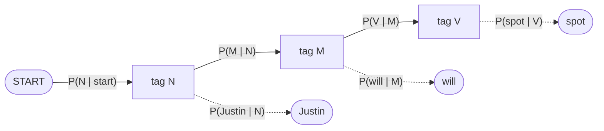
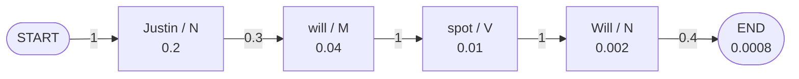
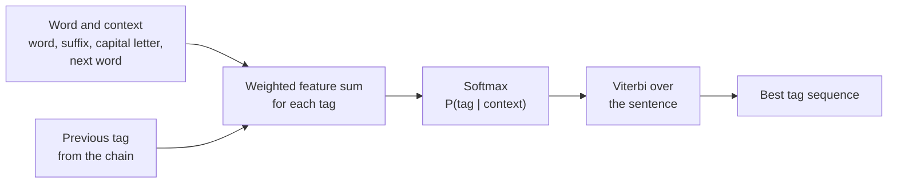
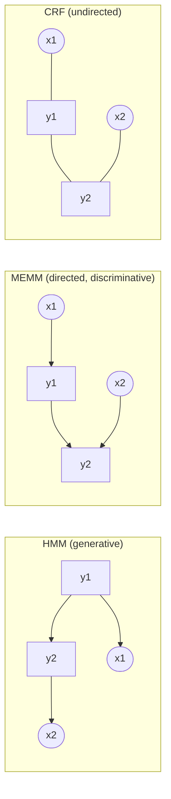

Naye ideas se pehle wo purane ideas jo tumhe chahiye. Agar pehle se aate hain to agle section pe jao.

## The basics first

- **Tag** (label) ek chhota naam hai jo word ki class batata hai. POS tagging mein tags noun (N), verb (V), determiner (DT) aadi hote hain. Named entity recognition mein tags batate hain ki word kisi person, place ya organisation ka part hai ya nahi.
- **Conditional probability** $P(B \mid A)$ matlab $B$ ki probability jab hume pehle se $A$ pata ho. $P(\text{runs} \mid \text{V})$ ka matlab: agar tag verb hai, to word *runs* kitna likely hai?
- **Corpus** text ka bada collection hai. **Tagged corpus** wo hai jisme kisi insaan ne har word ke saath sahi tag pehle se likh diya ho, jaise `the/DT dog/NN barks/V`. Neeche ke zyada tar models isi mein ginti karke seekhte hain.
- **Feature** word aur uske aas-paas ka ek chhota yes/no clue hai: "word -ing pe khatam hota hai", "word capital letter se shuru hota hai", "pichhla tag DT hai". Model har clue ko ek **weight** deta hai (ek number jo batata hai ki clue kitni strongly tag ki taraf point karta hai).
- **Generative versus discriminative.** Generative model seekhta hai ki data kaise banta hai, isliye wo $P(\text{words}, \text{tags})$ nikaal sakta hai. Discriminative model sirf wahi seekhta hai jo aakhir mein chahiye, $P(\text{tags} \mid \text{words})$, aur poori mehnat tags ko alag karne mein lagata hai. HMM generative hai. MaxEnt aur CRF discriminative hain.

## What is sequence labelling?

**What it is.** Sequence labelling input sequence ke har item ko ek label dene ka kaam hai. Input sentence $x_1 \dots x_n$ hai aur output same length ka tag sequence $y_1 \dots y_n$ hai. Ye syllabus <Syl m="3" />, sections 3.5 (Hidden Markov Model) aur 3.6 (Maximum Entropy and Conditional Random Field) hai. <Cite id="hmm-maxent-crf-slp3-ch18" loc="§18.4" /> <Cite id="hmm-maxent-crf-collins-hmm" loc="§2.1" />

**Ye poore sequence ka model kyun maangta hai.** Word ka sahi tag uske padosiyon pe depend karta hai. *Will can spot Will* mein pehla *Will* noun hai (naam) aur *can* modal verb hai. Agar hum har word ko akele "sabse common tag" se tag karein, to bahut galtiyan hoti hain. Hume poore sequence ka best tag sequence chahiye.

**Everyday analogy.** Ek fill-in-the-blank crossword socho. Har blank apne clue (word) se match karna chahiye, aur use cross karne wale letters (padosi tags) se bhi. Achha solver dono use karta hai.

<Box kind="definition">

**Sequence labelling:** word sequence $X$ ke liye tag sequence $\hat{Y} = \arg\max_Y P(Y \mid X)$ dhoondhna. Is note ke teen models is probability tak pahunchne ke teen tareeke hain: HMM (Bayes' rule aur ginti se), MaxEnt (har word ka log-linear classifier, Viterbi se joda hua) aur CRF (poore sequence pe log-linear model).

</Box>

## Part 1: Hidden Markov Model (HMM)

### What it is and why it is called hidden

**What it is.** **Markov chain** states ki chain hai jisme agla state sirf current state pe depend karta hai. **Hidden Markov Model** mein states tags hain, aur hum unhe dekh nahi sakte. Hume sirf wo words dikhte hain jo ve paida karte hain. Hume words se peeche jaakar sabse likely tags nikaalne hote hain. <Cite id="hmm-maxent-crf-slp3-appA" loc="§A.2" /> <Cite id="pos-tagging-wiki-hmm" />

**Ye kyun zaroori hai.** Ye "best tags dhoondho" ko ginti aur guna mein badal deta hai, jo computer tezi se karta hai, aur poore sentence ka ek best jawab deta hai.

### The parts of an HMM tagger

HMM tagger ke ye parts hote hain <Cite id="hmm-maxent-crf-slp3-ch18" loc="§18.4.3" />:

| Part | Name | Meaning | POS tagging example |
|---|---|---|---|
| $Q$ | states | hidden tags | N, V, M, DT |
| $O$ | observations | jo words hum dekhte hain | *Justin*, *will*, *spot* |
| $A$ | transition probabilities | $a_{ij} = P(\text{next tag} = j \mid \text{this tag} = i)$ | $P(\text{V} \mid \text{M})$ |
| $B$ | emission probabilities | $b_j(o) = P(\text{word} = o \mid \text{tag} = j)$ | $P(\text{will} \mid \text{M})$ |
| $\pi$ | start distribution | sentence kaise shuru hota hai; hum start marker `<s>` use karte hain, $P(\text{tag} \mid \texttt{<s>})$ ke saath | $P(\text{N} \mid \texttt{<s>})$ |

**Transition** ek tag se agle tag pe jaana hai. **Emission** ek tag ka word "paida" karna hai. *Hidden* ka matlab hai ki tag path diya nahi hota, usse guess karna padta hai.

<Cite id="hmm-maxent-crf-gfg-hmm-ml" loc="diagram" /> <Cite id="pos-tagging-wiki-hmm" loc="diagram" /> <Cite id="hmm-maxent-crf-slp3-ch18" loc="§18.4.2" />

### The two assumptions

1. **Markov assumption.** Tag sirf pichhle tag pe depend karta hai: $P(y_i \mid y_1 \dots y_{i-1}) \approx P(y_i \mid y_{i-1})$.
2. **Output independence.** Word sirf apne tag pe depend karta hai, padosi words ya tags pe nahi: $P(x_i \mid y_1 \dots y_n, x_1 \dots x_n) \approx P(x_i \mid y_i)$. <Cite id="hmm-maxent-crf-slp3-appA" loc="§A.2" />

### How the HMM tags a sentence

Hume $\arg\max_Y P(Y \mid X)$ chahiye. Bayes' rule ise aisi cheez bana deta hai jo hum gin sakte hain, aur word probability $P(X)$ har candidate ke liye same hai, isliye use hata dete hain:

$$\hat{Y} = \arg\max_{Y} P(X \mid Y)\,P(Y) \approx \arg\max_{Y} \prod_{i=1}^{n} \underbrace{P(x_i \mid y_i)}_{\text{emission}}\;\underbrace{P(y_i \mid y_{i-1})}_{\text{transition}}$$

<Cite id="hmm-maxent-crf-slp3-ch18" loc="§18.4.4" />

**Ginti se tables seekhna.** Tagged corpus ho to maximum-likelihood estimates seedhe ratios hain:

$$P(y_i \mid y_{i-1}) = \frac{C(y_{i-1}, y_i)}{C(y_{i-1})}, \qquad P(x_i \mid y_i) = \frac{C(y_i, x_i)}{C(y_i)}$$

Yahan $C(\cdot)$ corpus mein count hai. Sentence ka start `<s>` aur end `</s>` tags ki tarah treat hote hain taaki pehle aur aakhri word ko bhi transition probabilities mil sakein. <Cite id="hmm-maxent-crf-slp3-ch18" loc="§18.4.3" /> <Cite id="hmm-maxent-crf-collins-hmm" loc="§2.5.3" />

**Best sequence dhoondhna: Viterbi algorithm.** $n$ words aur $k$ tags ke sentence ke $k^n$ possible tag sequences hote hain, jo try karne ke liye bahut zyada hain. **Viterbi** dynamic-programming method hai jo har word position aur har tag ke liye sirf us par khatam hone wale kisi bhi path ka best score rakhta hai. Maan lo $v_t(j)$ word $t$ pe tag $j$ ka wo best score hai:

$$v_t(j) = \max_i \; v_{t-1}(i)\; a_{ij}\; b_j(o_t)$$

Words mein: har possible pichhla tag $i$ lo, uske best score ko transition $i \to j$ se guna karo, sabse best rakho, aur current word ke emission se guna karo. Ye yaad rakho ki kaun jeeta (**backpointer**). Aakhir mein end marker ke transition se guna karo, best final tag chuno aur backpointers follow karke peeche aao. Time $O(n k^2)$ hai. <Cite id="hmm-maxent-crf-slp3-ch18" loc="§18.4.5" /> <Cite id="hmm-maxent-crf-slp3-appA" loc="§A.4" /> <Cite id="pos-tagging-wiki-viterbi" />

$v_t(j)$ values ki table **trellis** (ya lattice) kehlati hai: har word ka ek column, har tag ki ek row.

**Baaki do HMM problems (poori jaankari ke liye).** *Likelihood*: is HMM mein ye word sequence kitna probable hai? Ye forward algorithm se hota hai, jo Viterbi hai bas max ki jagah sum ke saath (<Cite id="hmm-maxent-crf-slp3-appA" loc="§A.3" />). *Tagged corpus ke bina learning*: Baum-Welch (forward-backward) algorithm raw text se $A$ aur $B$ ko dobara estimate karta hai (<Cite id="hmm-maxent-crf-slp3-appA" loc="§A.5" /> <Cite id="hmm-maxent-crf-wiki-forward-backward" /> <Cite id="hmm-maxent-crf-wiki-baum-welch" />). POS tagging teesra problem, **decoding** (Viterbi), use karta hai, tagged corpus se ginti karne ke baad.

### Worked example 1: transition and emission tables, then Viterbi

Ye Mumbai University papers ka classic corpus hai. <PYQ id="2023-05-ce/q4a" /> <PYQ id="2025-05-ce/q4a" />

<Sum>

<Given>

Corpus (`<S>` aur `<E>` start aur end dikhate hain), N = noun (Martin, Justin, Will, Spot, Pat), M = modal verb (can, will), V = verb (watch, spot, pat). Words ko bilkul waise tag karte hain jaise question list karta hai, aur capital aur small letters alag words hain (*Will* noun hai, *will* modal hai; *Spot* noun hai, *spot* verb hai).

`<S> Martin Justin can watch Will <E>`
`<S> Spot will watch Martin <E>`
`<S> Will Justin spot Martin <E>`
`<S> Martin will pat Spot <E>`

</Given>

<Find>

transition matrix, emission matrix, aur "Justin will spot Will" ke best tags.

</Find>

<Steps>

1. Har word ko tag karo (ye tagged corpus hai):
   - `<S> Martin/N Justin/N can/M watch/V Will/N <E>`
   - `<S> Spot/N will/M watch/V Martin/N <E>`
   - `<S> Will/N Justin/N spot/V Martin/N <E>`
   - `<S> Martin/N will/M pat/V Spot/N <E>`
2. Tags gino. N $3 + 2 + 3 + 2 = 10$ baar aata hai, M $1 + 1 + 0 + 1 = 3$ baar, V $1 + 1 + 1 + 1 = 4$ baar. Ye 17 words hain, aur sentences mein $5 + 4 + 4 + 4 = 17$ words hain. *Reason: tag counts denominators hain.*
3. Har tag ke neeche words gino. N: Martin 4, Justin 2, Will 2, Spot 2, Pat 0 (total 10). M: can 1, will 2 (total 3). V: watch 2, spot 1, pat 1 (total 4). Tag count se divide karo, **emission matrix** $P(\text{word} \mid \text{tag})$ milta hai:

| Tag | Martin | Justin | Will | Spot | Pat | can | will | watch | spot | pat |
|---|---|---|---|---|---|---|---|---|---|---|
| N | 4/10 | 2/10 | 2/10 | 2/10 | 0 | 0 | 0 | 0 | 0 | 0 |
| M | 0 | 0 | 0 | 0 | 0 | 1/3 | 2/3 | 0 | 0 | 0 |
| V | 0 | 0 | 0 | 0 | 0 | 0 | 0 | 2/4 | 1/4 | 1/4 |

4. Tag-to-tag moves gino, `<S>` aur `<E>` ke saath. `<S>` se: N 4. N se: N 2 (*Martin Justin* aur *Will Justin*), M 3, V 1, `<E>` 4, yaani 10 moves. M se: V 3. V se: N 4. Har count ko us tag se nikalne wale total moves se divide karo (**transition matrix** $P(\text{next} \mid \text{this})$):

| From \ To | N | M | V | `<E>` |
|---|---|---|---|---|
| `<S>` | 4/4 = 1 | 0 | 0 | 0 |
| N | 2/10 = 0.2 | 3/10 = 0.3 | 1/10 = 0.1 | 4/10 = 0.4 |
| M | 0 | 0 | 3/3 = 1 | 0 |
| V | 4/4 = 1 | 0 | 0 | 0 |

5. Ab *Justin will spot Will* pe Viterbi chalao. Column 1 (*Justin*): $v_1(\text{N}) = P(\text{N} \mid \texttt{<S>}) \times P(\text{Justin} \mid \text{N}) = 1 \times 0.2 = 0.2$. M aur V *Justin* emit nahi kar sakte, isliye 0.
6. Column 2 (*will*): $v_2(\text{N}) = 0$ kyunki N sirf capital *Will* emit karta hai, small *will* nahi (isliye $P(\text{will} \mid \text{N}) = 0$). $v_2(\text{M}) = 0.2 \times P(\text{M} \mid \text{N}) \times P(\text{will} \mid \text{M}) = 0.2 \times 0.3 \times 2/3 = 0.04$. V *will* emit nahi kar sakta: 0.
7. Column 3 (*spot*, small letters): noun *Spot* capital se hai, isliye N aur M *spot* emit nahi kar sakte aur $v_3(\text{N}) = v_3(\text{M}) = 0$. Sirf V kar sakta hai: $v_3(\text{V}) = \max\big(v_2(\text{N}) \times 0.1,\; v_2(\text{M}) \times 1\big) \times \tfrac14 = \max(0,\; 0.04) \times 0.25 = 0.04 \times 0.25 = 0.01$, jo M se aaya.
8. Column 4 (*Will*): sirf N ise emit karta hai (0.2). $v_4(\text{N}) = v_3(\text{V}) \times P(\text{N} \mid \text{V}) \times P(\text{Will} \mid \text{N}) = 0.01 \times 1 \times 0.2 = 0.002$, jo V se aaya.
9. End: $P(\texttt{<E>} \mid \text{N}) = 0.4$ se guna karo: $0.002 \times 0.4 = 0.0008$.
10. Backpointers follow karo: N (`<S>` se) $\leftarrow$ M $\leftarrow$ V $\leftarrow$ N.

Trellis (us word pe us tag pe khatam hone wale kisi bhi path ka best score; 0 ka matlab impossible):

| Tag | Justin | will | spot | Will |
|---|---|---|---|---|
| N | 0.2 | 0 | 0 | 0.002 |
| M | 0 | 0.04 | 0 | 0 |
| V | 0 | 0 | 0.01 | 0 |

</Steps>

<Answer>

Justin/N will/M spot/V Will/N, probability $0.0008$ ke saath (end marker se pehle $0.002$).

</Answer>

<Box kind="verify">

Rows ka sum 1: `<S>` $1$; N $0.2 + 0.3 + 0.1 + 0.4 = 1$; M $1$; V $1$. Emission rows: N $0.4 + 0.2 + 0.2 + 0.2 = 1$; M $1/3 + 2/3 = 1$; V $2/4 + 1/4 + 1/4 = 1$. Moves ki ginti $4 + 10 + 3 + 4 = 21$ hai, jo $17$ words plus $4$ end markers ke barabar hai. Jeetne wala path ek product mein dobara nikalo: $1 \times 0.2 \times 0.3 \times \tfrac23 \times 1 \times \tfrac14 \times 1 \times 0.2 \times 0.4 = 0.0008$. Dono same hain. Koi aur tag path mein kahin zero aata hai (aisa word jo uska tag emit nahi kar sakta, ya aisa move jo kabhi dekha nahi), isliye yahi akela path hai jiski probability non-zero hai. <PYQ id="2023-05-ce/q4a" /> <PYQ id="2025-05-ce/q4a" />

</Box>

</Sum>

<Cite id="hmm-maxent-crf-slp3-ch18" loc="Fig. 18.11" />

### Worked example 2: a second corpus with DT, NN, V, P

<PYQ id="2023-12-ce/q3a" />

<Sum>

<Given>

`<s> the/DT students/NN pass/V the/DT test/NN </s>`
`<s> the/DT students/NN wait/V for/P the/DT result/NN </s>`
`<s> teachers/NN test/V students/NN </s>`

</Given>

<Find>

bigram HMM ki emission aur transition probabilities, aur "The students wait for the test" ke best tags (*The* ko *the* maano).

</Find>

<Steps>

1. Tags gino: DT 4 (the $\times$ 4), NN 6 (students 3, test 1, result 1, teachers 1), V 3 (pass, wait, test), P 1 (for). Total 14 words, aur sentences mein $5 + 6 + 3 = 14$ words hain.
2. **Emission probabilities** (tag ke neeche word ka count / tag ka count): P(the | DT) = 4/4 = 1. P(students | NN) = 3/6 = 1/2, P(test | NN) = 1/6, P(result | NN) = 1/6, P(teachers | NN) = 1/6. P(pass | V) = P(wait | V) = P(test | V) = 1/3. P(for | P) = 1.
3. Moves gino. `<s>` se: DT 2, NN 1. DT se: NN 4. NN se: V 3 (students-pass, students-wait, teachers-test), `</s>` 3. V se: DT 1 (pass-the), P 1 (wait-for), NN 1 (test-students). P se: DT 1. Har tag se nikalne wale total se divide karo:

| From \ To | DT | NN | V | P | `</s>` |
|---|---|---|---|---|---|
| `<s>` | 2/3 | 1/3 | 0 | 0 | 0 |
| DT | 0 | 4/4 = 1 | 0 | 0 | 0 |
| NN | 0 | 0 | 3/6 = 1/2 | 0 | 3/6 = 1/2 |
| V | 1/3 | 1/3 | 0 | 1/3 | 0 |
| P | 1/1 = 1 | 0 | 0 | 0 | 0 |

4. *the students wait for the test* ke liye Viterbi. Sirf wahi tags jo word emit kar sakte hain unka score non-zero hota hai, isliye trellis zyada tar zeros se bhara hai.
   - the: $v_1(\text{DT}) = \tfrac23 \times 1 = \tfrac23$.
   - students: $v_2(\text{NN}) = \tfrac23 \times 1 \times \tfrac12 = \tfrac13$.
   - wait: $v_3(\text{V}) = \tfrac13 \times \tfrac12 \times \tfrac13 = \tfrac1{18}$.
   - for: $v_4(\text{P}) = \tfrac1{18} \times \tfrac13 \times 1 = \tfrac1{54}$.
   - the: $v_5(\text{DT}) = \tfrac1{54} \times 1 \times 1 = \tfrac1{54}$.
   - test: NN ki tarah, $v_6(\text{NN}) = \tfrac1{54} \times 1 \times \tfrac16 = \tfrac1{324}$. V ki tarah, DT $\to$ V move ki probability 0 hai, isliye $v_6(\text{V}) = 0$.
   - end: $\tfrac1{324} \times P(\texttt{</s>} \mid \text{NN}) = \tfrac1{324} \times \tfrac12 = \tfrac1{648}$.

| Tag | the | students | wait | for | the | test |
|---|---|---|---|---|---|---|
| DT | 2/3 | 0 | 0 | 0 | 1/54 | 0 |
| NN | 0 | 1/3 | 0 | 0 | 0 | 1/324 |
| V | 0 | 0 | 1/18 | 0 | 0 | 0 |
| P | 0 | 0 | 0 | 1/54 | 0 | 0 |

</Steps>

<Answer>

the/DT students/NN wait/V for/P the/DT test/NN, probability $1/648 \approx 0.00154$.

</Answer>

<Box kind="verify">

Rows ka sum 1: `<s>` $2/3 + 1/3$; DT $1$; NN $1/2 + 1/2$; V $1/3 \times 3$; P $1$. Moves ka total $3 + 4 + 6 + 3 + 1 = 17 = 14$ words $+ 3$ sentences. Poora product ek line mein: $\tfrac23 \cdot 1 \cdot 1 \cdot \tfrac12 \cdot \tfrac12 \cdot \tfrac13 \cdot \tfrac13 \cdot 1 \cdot 1 \cdot 1 \cdot 1 \cdot \tfrac16 \cdot \tfrac12 = \tfrac{2}{1296} = \tfrac1{648}$. Tags wahi hain jo common sense kehta hai; sirf ek choice thi, *test* NN ya V, aur DT $\to$ V corpus mein kabhi nahi aaya. <PYQ id="2023-12-ce/q3a" />

</Box>

</Sum>

### Worked example 3: a corpus with adverbs

<PYQ id="2024-12-ce/q3a" />

<Sum>

<Given>

`<s> a/DT dog/NN chases/V a/DT cat/NN </s>`
`<s> the/DT dog/NN barks/V loudly/RB </s>`
`<s> a/DT cat/NN runs/V fast/RB </s>`

</Given>

<Find>

bigram HMM ki emission aur transition probabilities, aur "The cat chases the dog." ke best tags (ise lower-case karke *the cat chases the dog* maano, aur full stop chhod do kyunki corpus mein nahi hai).

</Find>

<Steps>

1. Tag counts: DT 4 (a 3, the 1), NN 4 (dog 2, cat 2), V 3 (chases, barks, runs), RB 2 (loudly, fast). Total 13 words $= 5 + 4 + 4$.
2. **Emission probabilities:** P(a | DT) = 3/4, P(the | DT) = 1/4. P(dog | NN) = P(cat | NN) = 2/4 = 1/2. P(chases | V) = P(barks | V) = P(runs | V) = 1/3. P(loudly | RB) = P(fast | RB) = 1/2.
3. Moves gino. `<s>` se: DT 3. DT se: NN 4. NN se: V 3, `</s>` 1. V se: DT 1 (chases-a), RB 2 (barks-loudly, runs-fast). RB se: `</s>` 2.

| From \ To | DT | NN | V | RB | `</s>` |
|---|---|---|---|---|---|
| `<s>` | 3/3 = 1 | 0 | 0 | 0 | 0 |
| DT | 0 | 4/4 = 1 | 0 | 0 | 0 |
| NN | 0 | 0 | 3/4 | 0 | 1/4 |
| V | 1/3 | 0 | 0 | 2/3 | 0 |
| RB | 0 | 0 | 0 | 0 | 2/2 = 1 |

4. *the cat chases the dog* ke liye Viterbi. Har word ko emit karne wala bas ek tag hai, isliye ek hi live path hai:
   - the: $v_1(\text{DT}) = 1 \times \tfrac14 = \tfrac14$.
   - cat: $v_2(\text{NN}) = \tfrac14 \times 1 \times \tfrac12 = \tfrac18$.
   - chases: $v_3(\text{V}) = \tfrac18 \times \tfrac34 \times \tfrac13 = \tfrac1{32}$.
   - the: $v_4(\text{DT}) = \tfrac1{32} \times \tfrac13 \times \tfrac14 = \tfrac1{384}$.
   - dog: $v_5(\text{NN}) = \tfrac1{384} \times 1 \times \tfrac12 = \tfrac1{768}$.
   - end: $\tfrac1{768} \times \tfrac14 = \tfrac1{3072}$.

| Tag | the | cat | chases | the | dog |
|---|---|---|---|---|---|
| DT | 1/4 | 0 | 0 | 1/384 | 0 |
| NN | 0 | 1/8 | 0 | 0 | 1/768 |
| V | 0 | 0 | 1/32 | 0 | 0 |
| RB | 0 | 0 | 0 | 0 | 0 |

</Steps>

<Answer>

the/DT cat/NN chases/V the/DT dog/NN, probability $1/3072 \approx 0.000326$.

</Answer>

<Box kind="verify">

Rows ka sum 1: DT emissions $3/4 + 1/4$; NN $1/2 + 1/2$; V $3 \times 1/3$; RB $1/2 + 1/2$; transitions NN $3/4 + 1/4$, V $1/3 + 2/3$. Moves ka total $3 + 4 + 4 + 3 + 2 = 16 = 13$ words $+ 3$ sentences. Ek product: $1 \cdot \tfrac14 \cdot 1 \cdot \tfrac12 \cdot \tfrac34 \cdot \tfrac13 \cdot \tfrac13 \cdot \tfrac14 \cdot 1 \cdot \tfrac12 \cdot \tfrac14 = \tfrac{9}{27648} = \tfrac1{3072}$. <PYQ id="2024-12-ce/q3a" />

</Box>

</Sum>

<Box kind="pitfall">

Start aur end markers mat bhoolo: pehle word ko $P(\text{tag} \mid \texttt{<s>})$ chahiye aur aakhri tag ko $P(\texttt{</s>} \mid \text{tag})$. Agar question end marker nahi deta, to ye likho aur use chhod do, jaise upar "end marker se pehle" wali value dikhayi hai. Aur capital aur small letters ko alag tabhi rakho jab question unhe alag tag karta ho (jaise worked example 1 mein).

</Box>

### Advantages and limitations of the HMM

**Advantages.** Simple, fast ($O(nk^2)$ decoding), ginti se train hota hai, poore sequence ka global best deta hai, aur baseline ki tarah kaam aata hai. Smoothing aur unknown words ke liye suffix-based guesses wala achha HMM tagger apne time mein strong tagger tha. <Cite id="pos-tagging-brants2000" /> <Cite id="hmm-maxent-crf-gfg-hmm-ml" />

**Limitations.** Jab paper "limitations of HMM" puchhe to ye points likho. <PYQ id="2022-12-ce/q4a" /> <PYQ id="2025-05-ce/q1c" />

1. **Extra clues add karna mushkil.** Model ke paas sirf do tables hain, $P(\text{tag} \mid \text{previous tag})$ aur $P(\text{word} \mid \text{tag})$. "Capital letter se shuru", "-ed pe khatam" ya "agla word *Street* hai" jaisa clue inhi mein se ek mein thoonsna padta hai, aur har naya clue maths ko aur complicated bana deta hai. <Cite id="hmm-maxent-crf-slp3-ch18" loc="§18.5" />
2. **Unknown words.** Training corpus mein na hone wale word ki emission probability har tag ke under 0 hoti hai, to poora path mar jaata hai jab tak koi special guess (jaise suffix se) na jodein. <Cite id="hmm-maxent-crf-slp3-ch18" loc="§18.5" /> <Cite id="hmm-maxent-crf-collins-hmm" loc="§2.7.1" />
3. **Strong independence assumptions.** Tag sirf ek pichhla tag dekhta hai, aur word sirf apna tag. Lambe patterns (do step peeche ka tag, agla word) ignore ho jaate hain. <Cite id="hmm-maxent-crf-slp3-appA" loc="§A.2" /> <Cite id="hmm-maxent-crf-gfg-hmm-ml" />
4. **Zero counts (sparse data).** Jo tag pairs ya word-tag pairs corpus mein kabhi nahi aaye unki probability 0 hoti hai aur smoothing chahiye (n-gram note dekho).
5. **Generative.** Ye joint $P(X, Y)$ model karta hai, jisme words kaise paida hote hain wo bhi shamil hai, jabki hume sirf $P(Y \mid X)$ chahiye. Mehnat galat cheez pe lagti hai, aur model seedha sahi tags chunne ke liye train nahi hota. <Cite id="hmm-maxent-crf-collins-crf" loc="§3" />
6. **Tagged corpus chahiye** achhe results ke liye (unsupervised Baum-Welch training slow hai aur kamzor tags deta hai).

## Part 2: Maximum Entropy (MaxEnt) model

### The idea

**What it is.** **Maximum Entropy** model ek probability model hai jo ek rule follow karta hai: *training data jo kuch batata hai sab se match karo, aur kuch aur assume mat karo.* **Entropy** naapti hai ki probability distribution kitna phaila hua ya "unsure" hai. Uniform distribution ki entropy sabse high hoti hai. To un saare distributions mein se jo hamare facts se match karte hain, hum sabse high entropy wala chunte hain, kyunki wo koi unproven guess nahi jodta. <Cite id="hmm-maxent-crf-berger1996" /> <Cite id="hmm-maxent-crf-wiki-maxent" />

**Everyday analogy.** Tumhe sirf itna bataya gaya hai ki ek die 5 ya 6 pe total probability 0.6 se girta hai. Sabse fair guess hai 5 aur 6 ko 0.3 each, aur bacha hua 0.4 baaki chaar faces mein barabar, 0.1 each. Tum extra patterns nahi banate jo data ne dikhaye nahi.

**Ye kyun zaroori hai.** HMM bahut saare overlapping clues nahi le sakta. MaxEnt word aur uske context ke kitne bhi clues le leta hai, chahe wo overlap karein, bina ye maane ki wo independent hain. <Cite id="hmm-maxent-crf-ratnaparkhi1996" />

### The model: a softmax of weighted features

Is rule se jo model niklta hai uska form simple hai (ye **multinomial logistic regression** ka hi model hai, isliye "MaxEnt classifier" aur "softmax regression" ek hi cheez ke do naam hain). Context $x$ wale word ke liye tag $y$ ki probability hai

$$P(y \mid x) = \frac{\exp\!\Big(\sum_{k} w_k\, f_k(x, y)\Big)}{\sum_{y'} \exp\!\Big(\sum_{k} w_k\, f_k(x, y')\Big)}$$

- $f_k(x, y)$ ek **feature function** hai: 1 agar clue tag $y$ ke saath hold karta hai, warna 0. Example: $f_1 = 1$ agar word *-ing* pe khatam hota hai aur tag VBG hai.
- $w_k$ us feature ka **weight** hai, data se seekha hua. Bada positive weight matlab clue tag ki taraf strongly point karta hai.
- Upar tag $y$ ke total score ka $\exp$ hai. Neeche wahi sab tags ke liye jodte hain, isliye probabilities ka sum 1 hota hai. Is normalising sum ko **partition function** $Z(x)$ kehte hain.

<Cite id="hmm-maxent-crf-slp3-ch4" loc="§4.7" /> <Cite id="hmm-maxent-crf-wiki-mlr" /> <Cite id="hmm-maxent-crf-collins-crf" loc="§2" /> <Cite id="hmm-maxent-crf-nltk-ch6" />

**Training.** Weights aise chune jaate hain ki har feature ke liye model ka expected count training data mein dekhe gaye count ke barabar ho (yahi "data se match karo" wala hissa hai). Ye gradient ascent ya iterative scaling jaise iterative methods se hota hai; regulariser weights ko chhota rakhta hai taaki overfitting na ho. <Cite id="hmm-maxent-crf-berger1996" /> <Cite id="hmm-maxent-crf-collins-crf" loc="§2" />

### MaxEnt for POS tagging (sequence labelling)

MaxEnt model ek time pe ek item label karta hai. Sequence ke liye use karne ke liye hum har decision ko pehle ke tags features ki tarah dekhne dete hain. Ye **Maximum Entropy Markov Model (MEMM)** hai: HMM ke do tables ki jagah ek hi log-linear model

$$P(y_i \mid y_{i-1}, x_1 \dots x_n, i) \propto \exp\Big(\sum_k w_k f_k(y_{i-1}, y_i, x, i)\Big), \qquad P(Y \mid X) = \prod_{i=1}^{n} P(y_i \mid y_{i-1}, X)$$

<Cite id="hmm-maxent-crf-collins-crf" loc="§3" /> <Cite id="hmm-maxent-crf-wiki-memm" />

**MaxEnt tagger ke steps** <Cite id="hmm-maxent-crf-ratnaparkhi1996" />:

1. Har word position ke liye **features chuno**: word khud, padosi words, prefix aur suffix letters, capital letter, number, pichhle ek ya do tags.
2. Tagged corpus pe **weights train karo**.
3. Upar ke softmax formula se word ke candidate tags ko **score karo**. Features poore sentence ko dekh sakte hain, jo HMM nahi kar sakta.
4. Poore sentence ko Viterbi se **decode karo**: table $\pi[i, y] = \max_{y'} \pi[i-1, y'] \times P(y \mid y', X)$, time $O(nk^2)$. Idea HMM jaisa hi hai, bas step ki probability softmax se aati hai. <Cite id="hmm-maxent-crf-collins-crf" loc="§3" />

<Cite id="hmm-maxent-crf-collins-crf" loc="§3" /> <Cite id="hmm-maxent-crf-ratnaparkhi1996" /> <Cite id="hmm-maxent-crf-nltk-ch6" />

### Worked example 4: one MaxEnt tag decision

<PYQ id="2023-05-ce/q6b" /> <PYQ id="2024-12-ce/q6b" />

<Sum>

<Given>

Sentence *Janet will back the bill*. Word *back* ko tag karna hai, jiska pichhla tag MD (modal) hai. Candidate tags: VB, NN, RB. Active features aur unke (trained) weights:

| Feature | Fires for tag | Weight |
|---|---|---|
| $f_1$: word = back | VB | 1.0 |
| $f_2$: previous tag = MD | VB | 2.0 |
| $f_3$: word = back | NN | 1.5 |
| $f_4$: previous tag = MD | NN | -1.0 |
| $f_5$: word = back | RB | 1.0 |

(Feature "previous tag = MD" RB ke liye fire nahi hota, isliye wahan 0 jodta hai. Ye numbers practice ke liye banaye gaye hain.)

</Given>

<Find>

$P(\text{VB} \mid x)$, $P(\text{NN} \mid x)$, $P(\text{RB} \mid x)$.

</Find>

<Steps>

1. Score = fire hone wale features ke weights ka sum. VB: $1.0 + 2.0 = 3.0$. NN: $1.5 - 1.0 = 0.5$. RB: $1.0$.
2. Exponentiate karo: $e^{3.0} = 20.086$, $e^{0.5} = 1.649$, $e^{1.0} = 2.718$.
3. Normaliser $Z = 20.086 + 1.649 + 2.718 = 24.453$.
4. Divide karo: $P(\text{VB}) = 20.086 / 24.453 = 0.8214$, $P(\text{NN}) = 1.649 / 24.453 = 0.0674$, $P(\text{RB}) = 2.718 / 24.453 = 0.1112$.

</Steps>

<Answer>

$P(\text{VB}) \approx 0.821$, $P(\text{NN}) \approx 0.067$, $P(\text{RB}) \approx 0.111$. Tagger **VB** chunta hai.

</Answer>

<Box kind="verify">

Teeno ka sum $0.8214 + 0.0674 + 0.1112 = 1.0000$. $P(\text{VB})$ ka doosra tareeka: upar aur neeche $e^{3}$ se divide karo, $1 / (1 + e^{0.5-3} + e^{1-3}) = 1/(1 + 0.0821 + 0.1353) = 1/1.2174 = 0.8214$. Same value. Pichhle tag (modal MD) ka clue hi choice ko verb ki taraf dhakelta hai, aur context use karne ka yahi point hai. <PYQ id="2023-05-ce/q6b" />

</Box>

</Sum>

### Worked example 5: why "maximum entropy"

<Sum>

<Given>

Word *flies* ke chaar tags ho sakte hain: NNS, VBZ, NN, VB. Training data se sirf ek fact pata hai: $P(\text{NNS}) + P(\text{VBZ}) = 0.6$ (-s pe khatam hone wale words).

</Given>

<Find>

is fact se match karne wala maximum entropy distribution, aur uski entropy ki tulna ek aur distribution se jo bhi is fact se match karta hai.

</Find>

<Steps>

1. Entropy $H = -\sum p \ln p$ hai. Ye tab sabse badi hoti hai jab probability jitna ho sake utni barabar phaili ho. Koi fact na ho to jawab $0.25$ each hota.
2. Fact ke hisaab se NNS + VBZ $= 0.6$, isliye NN + VB $= 0.4$. Har pair ko barabar baanto: NNS $=$ VBZ $= 0.3$, NN $=$ VB $= 0.2$.
3. Is choice ki entropy: $H = -(2 \times 0.3 \ln 0.3 + 2 \times 0.2 \ln 0.2) = 2 \times 0.3 \times 1.2040 + 2 \times 0.2 \times 1.6094 = 0.7224 + 0.6438 = 1.3662$ nats.
4. Ek aur distribution se tulna jo fact se match karta hai: NNS $= 0.5$, VBZ $= 0.1$, NN $=$ VB $= 0.2$. $H = -(0.5 \ln 0.5 + 0.1 \ln 0.1 + 2 \times 0.2 \ln 0.2) = 0.3466 + 0.2303 + 0.6438 = 1.2206$ nats.

</Steps>

<Answer>

Maximum entropy distribution NNS $=$ VBZ $= 0.3$, NN $=$ VB $= 0.2$ hai, $H = 1.366$ nats ke saath, jo lopsided choice ke $1.221$ se zyada hai, kyunki lopsided wala data se zyada claim karta hai. (Bina fact wala uniform distribution $\ln 4 = 1.386$ nats deta, jo absolute maximum hai.)

</Answer>

<Box kind="verify">

Dono candidates ka sum 1 hai aur fact maante hain: $0.3 + 0.3 = 0.6$ aur $0.5 + 0.1 = 0.6$. Winner ki entropy uniform value se zyada nahi ho sakti: $1.366 \le 1.386$. ✓ <Cite id="hmm-maxent-crf-wiki-maxent" />

</Box>

</Sum>

### Advantages and limitations of MaxEnt

**Advantages.** Koi bhi overlapping clues use ho sakte hain, isliye unknown words aasaan hote hain (suffix, capital letter aur shape features). Ye sahi tag dene ke liye train hota hai (discriminative) aur decode tez hai. MaxEnt tagger apne time ke best taggers mein tha. <Cite id="hmm-maxent-crf-ratnaparkhi1996" /> <Cite id="pos-tagging-toutanova2003" />

**Limitations.** <PYQ id="2025-05-ce/q1c" />

1. **Label bias.** Har step apna alag normalise hota hai: ek tag se nikalne wali probabilities ka sum 1 hota hai, words kuch bhi kahein. Jis tag ke few possible next tags hon wo apni lagbhag poori probability aage de deta hai, yaani wo observation ko "effectively ignore" kar deta hai. Baad ke words se galtiyan theek nahi ho paatin. CRFs ise hataane ke liye bane. <Cite id="hmm-maxent-crf-wiki-memm" /> <Cite id="hmm-maxent-crf-lafferty2001" />
2. **Training mein true pichhla tag** use hota hai, lekin test time pe pichhla tag sirf ek guess hota hai, isliye galtiyan jama ho sakti hain. <Cite id="hmm-maxent-crf-wiki-memm" />
3. **Features haath se chune jaate hain**, aur bada feature set training slow karta hai aur regularisation maangta hai.
4. **Generative nahi hai**, isliye unlabelled text use nahi kar sakta jaise HMM training kar sakti hai.
5. Plain per-word MaxEnt classifier (bina pichhle tag ke) padosi decisions ko ignore karta hai aur sentence mein consistent hone ke liye Viterbi ya MEMM chahiye.

## Part 3: Conditional Random Field (CRF)

### The idea

**What it is.** **Conditional Random Field** ek discriminative model hai jo poore input $X$ ke liye poore output tag sequence $Y$ ko probability deta hai. Aam use hone wala **linear-chain CRF** tags ki chain hai jisme har local feature current tag $y_i$, pichhla tag $y_{i-1}$, poora input sentence $X$ aur position $i$ dekh sakta hai. <Cite id="hmm-maxent-crf-lafferty2001" /> <Cite id="hmm-maxent-crf-slp3-ch18" loc="§18.5" /> <Cite id="hmm-maxent-crf-wiki-crf" />

**Ye kyun zaroori hai.** Ye har pichhle model ki achhi cheez rakhta hai: HMM ka poore sequence ka global view, aur MaxEnt ki kisi bhi feature use karne ki azaadi. Label bias hat jaata hai kyunki probabilities ek hi baar saare complete tag sequences pe normalise hoti hain, har step pe nahi. <Cite id="hmm-maxent-crf-sutton-mccallum" />

**Everyday analogy.** MEMM us judge jaisa hai jo har round ko score karke turant announce kar deta hai, aur pichhle rounds badal nahi sakta. CRF us judge jaisa hai jo saare rounds dekhta hai aur phir poori performance ko ek final score deta hai.

### The model

$$P(Y \mid X) = \frac{1}{Z(X)} \exp\Big(\sum_{k=1}^{K} w_k F_k(X, Y)\Big), \qquad F_k(X, Y) = \sum_{i=1}^{n} f_k(y_{i-1}, y_i, X, i)$$

$$Z(X) = \sum_{Y'} \exp\Big(\sum_k w_k F_k(X, Y')\Big)$$

- $f_k$ position $i$ pe **local feature** hai aur $F_k$ **global feature** hai: local feature ko sentence bhar mein jodkar.
- $w_k$ feature $k$ ka weight hai.
- $Z(X)$ **har possible** tag sequence ka score jodta hai, isliye $P(Y \mid X)$ complete sequences pe 1 banta hai. MEMM se poora fark yahi hai.

<Cite id="hmm-maxent-crf-slp3-ch18" loc="§18.5" /> <Cite id="hmm-maxent-crf-collins-crf" loc="§4" />

**CRF POS tagger ke features.** Examples: word identity ($x_i = \text{the}$ aur $y_i = \text{DET}$), tag pairs ($y_i = \text{VERB}$ aur $y_{i-1} = \text{AUX}$), padosi words, prefixes aur suffixes, **word shape** (capital letters X, small x, digits d), aur NER ke liye gazetteers (known names ki lists) aur padosi tags bhi. Designer feature **templates** chunta hai aur training data asli features banata hai. <Cite id="hmm-maxent-crf-slp3-ch18" loc="§18.5.1" /> <Cite id="hmm-maxent-crf-sklearn-crfsuite" />

**Inference aur training.** Features sirf padosi tags dekhte hain, isliye HMM ke wahi dynamic programs chalte hain: **Viterbi** best $Y$ dhoondhta hai, aur **forward-backward** algorithm $Z(X)$ aur training ko chahiye expected feature counts nikalta hai. Training sahi tag sequences ki log probability maximise karti hai (regularisation ke saath), gradient methods se. <Cite id="hmm-maxent-crf-slp3-ch18" loc="§18.5.3" /> <Cite id="hmm-maxent-crf-wiki-forward-backward" />

<Cite id="hmm-maxent-crf-sutton-mccallum" /> <Cite id="hmm-maxent-crf-wiki-crf" /> <Cite id="hmm-maxent-crf-collins-crf" loc="§4" />

### How a CRF labels a sequence

1. Feature templates **define karo** (word, shape, prefix, suffix, neighbours, tag pair).
2. Tagged corpus pe weights **train karo**, sahi sequences ki probability maximise karke.
3. Naye sentence ko **label karo**: Viterbi se wo $Y$ dhoondho jiska score $\sum_k w_k F_k(X, Y)$ sabse high ho. Denominator $Z(X)$ winner ko nahi badalta, isliye wo sirf training aur probabilities ke liye chahiye.

### Worked example 6: a tiny CRF by brute force

<PYQ id="2023-12-ce/q6b" /> <PYQ id="2024-05-ce/q3b" />

<Sum>

<Given>

Sentence *Birds sing*, tags N ya V. Feature weights pehle se in scores mein jod diye gaye hain:

| Part | Score |
|---|---|
| *Birds* as N / as V | 1.0 / 0.0 |
| *sing* as N / as V | 0.0 / 1.5 |
| transition N$\to$N / N$\to$V / V$\to$N / V$\to$V | 0.5 / 1.0 / 0.5 / -0.5 |

(Practice ke liye banaye numbers. Tag sequence ka score uske parts ka sum hai.)

</Given>

<Find>

chaaron tag sequences ke liye $P(Y \mid X)$, aur best sequence.

</Find>

<Steps>

1. Har sequence ka score = word 1 score + word 2 score + transition. NN: $1.0 + 0.0 + 0.5 = 1.5$. NV: $1.0 + 1.5 + 1.0 = 3.5$. VN: $0.0 + 0.0 + 0.5 = 0.5$. VV: $0.0 + 1.5 - 0.5 = 1.0$.
2. Exponentiate karo: $e^{1.5} = 4.482$, $e^{3.5} = 33.115$, $e^{0.5} = 1.649$, $e^{1.0} = 2.718$.
3. $Z = 4.482 + 33.115 + 1.649 + 2.718 = 41.964$.
4. Divide karo: NN $= 0.1068$, NV $= 0.7891$, VN $= 0.0393$, VV $= 0.0648$.

</Steps>

<Answer>

Best labelling **Birds/N sing/V** hai, $P = 0.789$ ke saath. Baaki: NN 0.107, VV 0.065, VN 0.039.

</Answer>

<Box kind="verify">

Chaaron probabilities ka sum $0.1068 + 0.7891 + 0.0393 + 0.0648 = 1.0000$. Viterbi $Z$ nikaale bina wahi winner deta hai: word 1 pe N $= 1.0$, V $= 0.0$; word 2 pe N $= \max(1.0 + 0.5,\, 0.0 + 0.5) + 0.0 = 1.5$ aur V $= \max(1.0 + 1.0,\, 0.0 - 0.5) + 1.5 = 3.5$, N se. Best $= 3.5$, path N phir V. ✓ Dhyan do ki $Z$ saare $2^2 = 4$ sequences pe sum karta hai. Lambe sentences ke liye ise forward algorithm se nikalte hain. <PYQ id="2023-12-ce/q6b" />

</Box>

</Sum>

### Advantages, limitations and uses of CRF

**Advantages.** Koi bhi overlapping features; inputs ke beech koi independence assumption nahi; label bias nahi; poore sequence ki ek global probability; tagging aur NER mein aam taur pe HMM aur MEMM se zyada accuracy. <Cite id="hmm-maxent-crf-lafferty2001" /> <Cite id="hmm-maxent-crf-sutton-mccallum" /> <Cite id="hmm-maxent-crf-av-crf" />

**Limitations.** Training ginti se slow hai (har step mein forward-backward chahiye); features haath se design karne padte hain; labelled corpus chahiye; aur linear-chain form sirf pichhla tag dekhta hai. Modern neural taggers aksar features khud seekhte hain, kabhi kabhi upar CRF layer ke saath. <Cite id="hmm-maxent-crf-slp3-ch18" loc="§18.5" />

**Applications.** POS tagging, named entity recognition, chunking (noun phrases dhoondhna), information extraction, aur dusre labelling tasks. Practical tools: sklearn-crfsuite aur NLTK ka CRF tagger. <Cite id="hmm-maxent-crf-sklearn-crfsuite" /> <Cite id="hmm-maxent-crf-nltk-crf" /> <Cite id="hmm-maxent-crf-nltk-hmm" />

## Comparison: HMM, MaxEnt (MEMM) and CRF

| Point | HMM | MaxEnt / MEMM | Linear-chain CRF |
|---|---|---|---|
| Type | generative, $P(X, Y)$ model karta hai | discriminative, $P(y_i \mid y_{i-1}, X)$ model karta hai | discriminative, $P(Y \mid X)$ model karta hai |
| Normalised | ginti se, words pe | har step pe | ek baar, poore sequence pe |
| Features | sirf pichhla tag aur apna word | koi bhi, overlapping | koi bhi, overlapping |
| Unknown words | extra tricks ke bina kamzor | suffix aur shape features se achha | suffix aur shape features se achha |
| Label bias | nahi | **haan** | nahi |
| Training | ginti (fast) | gradient methods, per step | forward-backward ke saath gradient methods (sabse slow) |
| Decoding | Viterbi | Viterbi | Viterbi |

<Cite id="hmm-maxent-crf-collins-crf" loc="§3" /> <Cite id="hmm-maxent-crf-slp3-ch18" loc="§18.5" /> <Cite id="hmm-maxent-crf-sutton-mccallum" />

**Conclusion.** HMM simple ginti wala baseline hai, MaxEnt rich features jodta hai lekin step-by-step decide karta hai, aur CRF rich features ke saath poore tag sequence ko score karta hai, isliye neural models se pehle ye standard statistical sequence labeller tha.

## What to write in the exam

<Box kind="exam">

**Explain hidden Markov model for POS based tagging (10 marks):** (1) tagging aur HMM define karo (hidden tags, visible words); (2) $Q$, $O$, $A$, $B$, $\pi$ aur do assumptions likho; (3) formula $\hat{Y} = \arg\max \prod P(x_i \mid y_i) P(y_i \mid y_{i-1})$; (4) ginti se tables seekhna; (5) recurrence $v_t(j)$ aur backpointers ke saath Viterbi; (6) labelled diagram aur chhota example; (7) advantages, limitations, conclusion. <PYQ id="2024-05-ce/q3a" /> <PYQ id="2025-05/q4a" />

**Compute transition and emission probabilities and decode with Viterbi (10 marks):** (1) corpus ko tag karo; (2) har tag aur tag ke neeche har word gino; (3) dono tables fractions mein likho aur check karo ki har row ka sum 1 hai; (4) har word ka ek column wala trellis banao aur zero cells mark karo; (5) har multiplication dikhao; (6) final tag sequence aur uski probability likho. Worked examples 1, 2 aur 3 dekho. <PYQ id="2023-05-ce/q4a" /> <PYQ id="2025-05-ce/q4a" /> <PYQ id="2023-12-ce/q3a" /> <PYQ id="2024-12-ce/q3a" />

**Limitations of HMM (and MaxEnt) for POS tagging (5 marks):** HMM: features add karna mushkil, unknown words, independence assumptions, zero counts, generative. MaxEnt: label bias, hand-made features, slow training, local decisions. End mein "CRF fixes these" likho. <PYQ id="2022-12-ce/q4a" /> <PYQ id="2025-05-ce/q1c" />

**Explain Maximum Entropy for POS tagging or sequence labelling (10 marks):** principle (data se match karne wali sabse high entropy), features aur weights ke saath softmax formula, feature examples, pichhle tag ke saath MEMM chain, Viterbi decoding, advantages, label bias, diagram. <PYQ id="2023-05-ce/q6b" /> <PYQ id="2024-12-ce/q6b" />

**Explain how a CRF is used for sequence labelling (10 marks):** kyun (HMM aur MEMM ki limits), poore sequence pe $Z(X)$ wala formula, local aur global features, feature examples, training aur Viterbi decoding, teen-graph diagram, advantages, applications (POS, NER). <PYQ id="2023-12-ce/q6b" /> <PYQ id="2024-05-ce/q3b" />

Exam mein English mein likho: "A CRF is a discriminative model that gives a probability to the whole tag sequence given the whole input, so it can use any features and avoids the label bias problem of MEMM."

</Box>
