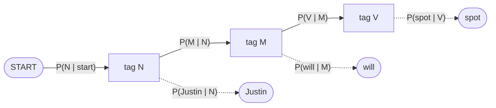
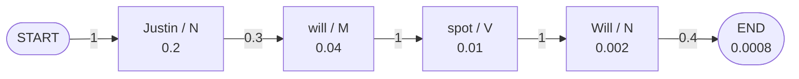
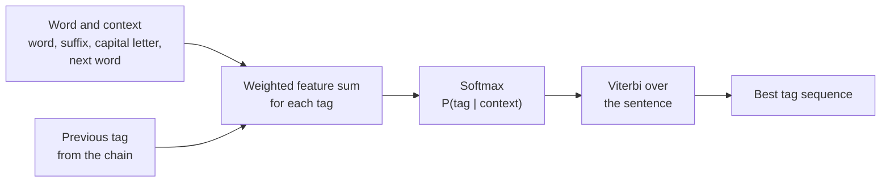
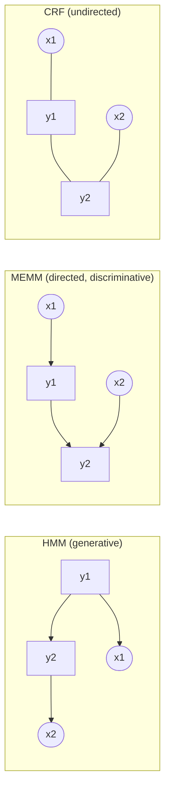

Before the new ideas, here are the old ones you need. If you already know them, skip to the next section.

## The basics first

- A **tag** (label) is a short name for the class of a word. In POS tagging the tags are noun (N), verb (V), determiner (DT) and so on. In named entity recognition the tags say whether a word is part of a person, place or organisation.
- **Conditional probability** $P(B \mid A)$ is the probability of $B$ when we already know $A$. $P(\text{runs} \mid \text{V})$ means: if the tag is verb, how likely is the word *runs*?
- A **corpus** is a large body of text. A **tagged corpus** is one where a person has already written the correct tag next to every word, for example `the/DT dog/NN barks/V`. Counting in a tagged corpus is how most models below learn.
- A **feature** is a small yes/no clue about a word and its surroundings: "the word ends in -ing", "the word starts with a capital letter", "the previous tag is DT". A model gives each clue a **weight** (a number that says how strongly the clue points to a tag).
- **Generative versus discriminative.** A generative model learns how the data is produced, so it can compute $P(\text{words}, \text{tags})$. A discriminative model learns only what we want in the end, $P(\text{tags} \mid \text{words})$, and spends all its effort on telling tags apart. HMM is generative. MaxEnt and CRF are discriminative.

## What is sequence labelling?

**What it is.** Sequence labelling is the task of giving one label to every item of an input sequence. The input is a sentence $x_1 \dots x_n$ and the output is a tag sequence $y_1 \dots y_n$ of the same length. This is syllabus <Syl m="3" />, sections 3.5 (Hidden Markov Model) and 3.6 (Maximum Entropy and Conditional Random Field). <Cite id="hmm-maxent-crf-slp3-ch18" loc="§18.4" /> <Cite id="hmm-maxent-crf-collins-hmm" loc="§2.1" />

**Why it needs a model for the whole sequence.** The right tag of a word depends on its neighbours. In *Will can spot Will*, the first *Will* is a noun (a name) and *can* is a modal verb. If we tag each word alone by "most common tag", we get many mistakes. We want the best tag sequence as a whole.

**Everyday analogy.** Think of a fill-in-the-blank crossword. Each blank must fit its own clue (the word), and it must also fit the letters that cross it (the neighbouring tags). A good solver uses both.

<Box kind="definition">

**Sequence labelling:** find the tag sequence $\hat{Y} = \arg\max_Y P(Y \mid X)$ for a word sequence $X$. The three models in this note are three ways to get this probability: HMM (through Bayes' rule and counting), MaxEnt (a per-word log-linear classifier, joined by Viterbi) and CRF (a log-linear model over the whole sequence).

</Box>

## Part 1: Hidden Markov Model (HMM)

### What it is and why it is called hidden

**What it is.** A **Markov chain** is a chain of states where the next state depends only on the current one. In a **Hidden Markov Model** the states are the tags, and we cannot see them. We see only the words they produce. We must work backward from the words to the most likely tags. <Cite id="hmm-maxent-crf-slp3-appA" loc="§A.2" /> <Cite id="pos-tagging-wiki-hmm" />

**Why it is needed.** It turns "find the best tags" into counting and multiplying, which a computer does fast, and it gives one best answer for the whole sentence.

### The parts of an HMM tagger

An HMM tagger has these parts <Cite id="hmm-maxent-crf-slp3-ch18" loc="§18.4.3" />:

| Part | Name | Meaning | POS tagging example |
|---|---|---|---|
| $Q$ | states | the hidden tags | N, V, M, DT |
| $O$ | observations | the words we see | *Justin*, *will*, *spot* |
| $A$ | transition probabilities | $a_{ij} = P(\text{next tag} = j \mid \text{this tag} = i)$ | $P(\text{V} \mid \text{M})$ |
| $B$ | emission probabilities | $b_j(o) = P(\text{word} = o \mid \text{tag} = j)$ | $P(\text{will} \mid \text{M})$ |
| $\pi$ | start distribution | how a sentence begins; we use a start marker `<s>` with $P(\text{tag} \mid \texttt{<s>})$ | $P(\text{N} \mid \texttt{<s>})$ |

A **transition** is a move from one tag to the next. An **emission** is a tag "producing" a word. The word *hidden* means the tag path is not given and has to be guessed.

<Cite id="hmm-maxent-crf-gfg-hmm-ml" loc="diagram" /> <Cite id="pos-tagging-wiki-hmm" loc="diagram" /> <Cite id="hmm-maxent-crf-slp3-ch18" loc="§18.4.2" />

### The two assumptions

1. **Markov assumption.** A tag depends only on the tag before it: $P(y_i \mid y_1 \dots y_{i-1}) \approx P(y_i \mid y_{i-1})$.
2. **Output independence.** A word depends only on its own tag, not on neighbouring words or tags: $P(x_i \mid y_1 \dots y_n, x_1 \dots x_n) \approx P(x_i \mid y_i)$. <Cite id="hmm-maxent-crf-slp3-appA" loc="§A.2" />

### How the HMM tags a sentence

We want $\arg\max_Y P(Y \mid X)$. Bayes' rule turns it into something we can count, and the word probability $P(X)$ is the same for every candidate, so we drop it:

$$\hat{Y} = \arg\max_{Y} P(X \mid Y)\,P(Y) \approx \arg\max_{Y} \prod_{i=1}^{n} \underbrace{P(x_i \mid y_i)}_{\text{emission}}\;\underbrace{P(y_i \mid y_{i-1})}_{\text{transition}}$$

<Cite id="hmm-maxent-crf-slp3-ch18" loc="§18.4.4" />

**Learning the tables by counting.** With a tagged corpus, maximum-likelihood estimates are plain ratios:

$$P(y_i \mid y_{i-1}) = \frac{C(y_{i-1}, y_i)}{C(y_{i-1})}, \qquad P(x_i \mid y_i) = \frac{C(y_i, x_i)}{C(y_i)}$$

Here $C(\cdot)$ is a count in the corpus. A sentence start `<s>` and end `</s>` are treated as tags so that the first and last words also get transition probabilities. <Cite id="hmm-maxent-crf-slp3-ch18" loc="§18.4.3" /> <Cite id="hmm-maxent-crf-collins-hmm" loc="§2.5.3" />

**Finding the best sequence: the Viterbi algorithm.** A sentence of $n$ words with $k$ tags has $k^n$ possible tag sequences, too many to try. **Viterbi** is a dynamic-programming method that keeps, for every word position and every tag, only the best score of any path that ends there. Let $v_t(j)$ be that best score at word $t$ for tag $j$:

$$v_t(j) = \max_i \; v_{t-1}(i)\; a_{ij}\; b_j(o_t)$$

In words: take each possible previous tag $i$, multiply its best score by the transition $i \to j$, keep the best one, and multiply by the emission of the current word. Remember which $i$ won (the **backpointer**). At the end, multiply by the transition into the end marker, pick the best final tag and follow the backpointers back. The time is $O(n k^2)$. <Cite id="hmm-maxent-crf-slp3-ch18" loc="§18.4.5" /> <Cite id="hmm-maxent-crf-slp3-appA" loc="§A.4" /> <Cite id="pos-tagging-wiki-viterbi" />

The table of $v_t(j)$ values is called the **trellis** (or lattice): one column per word, one row per tag.

**The other two HMM problems (for completeness).** *Likelihood*: how probable is this word sequence under the model? It is solved by the forward algorithm, which is Viterbi with sums instead of max (<Cite id="hmm-maxent-crf-slp3-appA" loc="§A.3" />). *Learning without a tagged corpus*: the Baum-Welch (forward-backward) algorithm re-estimates $A$ and $B$ from raw text (<Cite id="hmm-maxent-crf-slp3-appA" loc="§A.5" /> <Cite id="hmm-maxent-crf-wiki-forward-backward" /> <Cite id="hmm-maxent-crf-wiki-baum-welch" />). POS tagging uses the third problem, **decoding** (Viterbi), after counting from a tagged corpus.

### Worked example 1: transition and emission tables, then Viterbi

This is the classic corpus of the Mumbai University papers. <PYQ id="2023-05-ce/q4a" /> <PYQ id="2025-05-ce/q4a" />

<Sum>

<Given>

Corpus (`<S>` and `<E>` mark start and end), with N = noun (Martin, Justin, Will, Spot, Pat), M = modal verb (can, will), V = verb (watch, spot, pat). Words are tagged exactly as the question lists them, and capital and small letters are different words (*Will* is a noun, *will* is a modal; *Spot* is a noun, *spot* is a verb).

`<S> Martin Justin can watch Will <E>`
`<S> Spot will watch Martin <E>`
`<S> Will Justin spot Martin <E>`
`<S> Martin will pat Spot <E>`

</Given>

<Find>

the transition matrix, the emission matrix, and the best tags for "Justin will spot Will".

</Find>

<Steps>

1. Tag every word (this is the tagged corpus):
   - `<S> Martin/N Justin/N can/M watch/V Will/N <E>`
   - `<S> Spot/N will/M watch/V Martin/N <E>`
   - `<S> Will/N Justin/N spot/V Martin/N <E>`
   - `<S> Martin/N will/M pat/V Spot/N <E>`
2. Count the tags. N appears $3 + 2 + 3 + 2 = 10$ times, M appears $1 + 1 + 0 + 1 = 3$ times, V appears $1 + 1 + 1 + 1 = 4$ times. That is 17 words, and the sentences have $5 + 4 + 4 + 4 = 17$ words. *Reason: the tag counts are the denominators.*
3. Count the words under each tag. N: Martin 4, Justin 2, Will 2, Spot 2, Pat 0 (total 10). M: can 1, will 2 (total 3). V: watch 2, spot 1, pat 1 (total 4). Divide by the tag count to get the **emission matrix** $P(\text{word} \mid \text{tag})$:

| Tag | Martin | Justin | Will | Spot | Pat | can | will | watch | spot | pat |
|---|---|---|---|---|---|---|---|---|---|---|
| N | 4/10 | 2/10 | 2/10 | 2/10 | 0 | 0 | 0 | 0 | 0 | 0 |
| M | 0 | 0 | 0 | 0 | 0 | 1/3 | 2/3 | 0 | 0 | 0 |
| V | 0 | 0 | 0 | 0 | 0 | 0 | 0 | 2/4 | 1/4 | 1/4 |

4. Count the tag-to-tag moves, including `<S>` and `<E>`. From `<S>`: N 4. From N: N 2 (*Martin Justin* and *Will Justin*), M 3, V 1, `<E>` 4, which is 10 moves. From M: V 3. From V: N 4. Divide each count by the total moves out of that tag (the **transition matrix** $P(\text{next} \mid \text{this})$):

| From \ To | N | M | V | `<E>` |
|---|---|---|---|---|
| `<S>` | 4/4 = 1 | 0 | 0 | 0 |
| N | 2/10 = 0.2 | 3/10 = 0.3 | 1/10 = 0.1 | 4/10 = 0.4 |
| M | 0 | 0 | 3/3 = 1 | 0 |
| V | 4/4 = 1 | 0 | 0 | 0 |

5. Now run Viterbi on *Justin will spot Will*. Column 1 (*Justin*): $v_1(\text{N}) = P(\text{N} \mid \texttt{<S>}) \times P(\text{Justin} \mid \text{N}) = 1 \times 0.2 = 0.2$. M and V cannot emit *Justin*, so they are 0.
6. Column 2 (*will*): $v_2(\text{N}) = 0$ because N emits only the capital *Will*, not small *will* (so $P(\text{will} \mid \text{N}) = 0$). $v_2(\text{M}) = 0.2 \times P(\text{M} \mid \text{N}) \times P(\text{will} \mid \text{M}) = 0.2 \times 0.3 \times 2/3 = 0.04$. V cannot emit *will*: 0.
7. Column 3 (*spot*, small letters): the noun is *Spot* with a capital, so N and M cannot emit *spot* and $v_3(\text{N}) = v_3(\text{M}) = 0$. Only V can: $v_3(\text{V}) = \max\big(v_2(\text{N}) \times 0.1,\; v_2(\text{M}) \times 1\big) \times \tfrac14 = \max(0,\; 0.04) \times 0.25 = 0.04 \times 0.25 = 0.01$, coming from M.
8. Column 4 (*Will*): only N emits it (0.2). $v_4(\text{N}) = v_3(\text{V}) \times P(\text{N} \mid \text{V}) \times P(\text{Will} \mid \text{N}) = 0.01 \times 1 \times 0.2 = 0.002$, coming from V.
9. End: multiply by $P(\texttt{<E>} \mid \text{N}) = 0.4$: $0.002 \times 0.4 = 0.0008$.
10. Follow the backpointers: N (from `<S>`) $\leftarrow$ M $\leftarrow$ V $\leftarrow$ N.

The trellis (best score of any path ending in that tag at that word; 0 means impossible):

| Tag | Justin | will | spot | Will |
|---|---|---|---|---|
| N | 0.2 | 0 | 0 | 0.002 |
| M | 0 | 0.04 | 0 | 0 |
| V | 0 | 0 | 0.01 | 0 |

</Steps>

<Answer>

Justin/N will/M spot/V Will/N, with probability $0.0008$ (or $0.002$ before the end marker).

</Answer>

<Box kind="verify">

Rows add to 1: `<S>` $1$; N $0.2 + 0.3 + 0.1 + 0.4 = 1$; M $1$; V $1$. Emission rows: N $0.4 + 0.2 + 0.2 + 0.2 = 1$; M $1/3 + 2/3 = 1$; V $2/4 + 1/4 + 1/4 = 1$. The number of moves is $4 + 10 + 3 + 4 = 21$, which equals the $17$ words plus $4$ end markers. Recompute the winning path as one product: $1 \times 0.2 \times 0.3 \times \tfrac23 \times 1 \times \tfrac14 \times 1 \times 0.2 \times 0.4 = 0.0008$. Both are the same. Any other tag path has a zero somewhere (a word its tag cannot emit, or a move never seen), so this is the only path with non-zero probability. <PYQ id="2023-05-ce/q4a" /> <PYQ id="2025-05-ce/q4a" />

</Box>

</Sum>

<Cite id="hmm-maxent-crf-slp3-ch18" loc="Fig. 18.11" />

### Worked example 2: a second corpus with DT, NN, V, P

<PYQ id="2023-12-ce/q3a" />

<Sum>

<Given>

`<s> the/DT students/NN pass/V the/DT test/NN </s>`
`<s> the/DT students/NN wait/V for/P the/DT result/NN </s>`
`<s> teachers/NN test/V students/NN </s>`

</Given>

<Find>

the emission and transition probabilities of a bigram HMM, and the best tags for "The students wait for the test" (treat *The* as *the*).

</Find>

<Steps>

1. Count the tags: DT 4 (the $\times$ 4), NN 6 (students 3, test 1, result 1, teachers 1), V 3 (pass, wait, test), P 1 (for). Total 14 words, and the sentences have $5 + 6 + 3 = 14$ words.
2. **Emission probabilities** (count of word under tag / count of tag): P(the | DT) = 4/4 = 1. P(students | NN) = 3/6 = 1/2, P(test | NN) = 1/6, P(result | NN) = 1/6, P(teachers | NN) = 1/6. P(pass | V) = P(wait | V) = P(test | V) = 1/3. P(for | P) = 1.
3. Count the moves. From `<s>`: DT 2, NN 1. From DT: NN 4. From NN: V 3 (students-pass, students-wait, teachers-test), `</s>` 3. From V: DT 1 (pass-the), P 1 (wait-for), NN 1 (test-students). From P: DT 1. Divide by the total out of each tag:

| From \ To | DT | NN | V | P | `</s>` |
|---|---|---|---|---|---|
| `<s>` | 2/3 | 1/3 | 0 | 0 | 0 |
| DT | 0 | 4/4 = 1 | 0 | 0 | 0 |
| NN | 0 | 0 | 3/6 = 1/2 | 0 | 3/6 = 1/2 |
| V | 1/3 | 1/3 | 0 | 1/3 | 0 |
| P | 1/1 = 1 | 0 | 0 | 0 | 0 |

4. Viterbi for *the students wait for the test*. Only the tags that can emit a word have a non-zero score, so the trellis is mostly zeros.
   - the: $v_1(\text{DT}) = \tfrac23 \times 1 = \tfrac23$.
   - students: $v_2(\text{NN}) = \tfrac23 \times 1 \times \tfrac12 = \tfrac13$.
   - wait: $v_3(\text{V}) = \tfrac13 \times \tfrac12 \times \tfrac13 = \tfrac1{18}$.
   - for: $v_4(\text{P}) = \tfrac1{18} \times \tfrac13 \times 1 = \tfrac1{54}$.
   - the: $v_5(\text{DT}) = \tfrac1{54} \times 1 \times 1 = \tfrac1{54}$.
   - test: as NN, $v_6(\text{NN}) = \tfrac1{54} \times 1 \times \tfrac16 = \tfrac1{324}$. As V, the move DT $\to$ V has probability 0, so $v_6(\text{V}) = 0$.
   - end: $\tfrac1{324} \times P(\texttt{</s>} \mid \text{NN}) = \tfrac1{324} \times \tfrac12 = \tfrac1{648}$.

| Tag | the | students | wait | for | the | test |
|---|---|---|---|---|---|---|
| DT | 2/3 | 0 | 0 | 0 | 1/54 | 0 |
| NN | 0 | 1/3 | 0 | 0 | 0 | 1/324 |
| V | 0 | 0 | 1/18 | 0 | 0 | 0 |
| P | 0 | 0 | 0 | 1/54 | 0 | 0 |

</Steps>

<Answer>

the/DT students/NN wait/V for/P the/DT test/NN, with probability $1/648 \approx 0.00154$.

</Answer>

<Box kind="verify">

Rows add to 1: `<s>` $2/3 + 1/3$; DT $1$; NN $1/2 + 1/2$; V $1/3 \times 3$; P $1$. Moves total $3 + 4 + 6 + 3 + 1 = 17 = 14$ words $+ 3$ sentences. The whole product in one line: $\tfrac23 \cdot 1 \cdot 1 \cdot \tfrac12 \cdot \tfrac12 \cdot \tfrac13 \cdot \tfrac13 \cdot 1 \cdot 1 \cdot 1 \cdot 1 \cdot \tfrac16 \cdot \tfrac12 = \tfrac{2}{1296} = \tfrac1{648}$. The tags are also what common sense says; the only choice was *test* as NN or V, and DT $\to$ V never happened in the corpus. <PYQ id="2023-12-ce/q3a" />

</Box>

</Sum>

### Worked example 3: a corpus with adverbs

<PYQ id="2024-12-ce/q3a" />

<Sum>

<Given>

`<s> a/DT dog/NN chases/V a/DT cat/NN </s>`
`<s> the/DT dog/NN barks/V loudly/RB </s>`
`<s> a/DT cat/NN runs/V fast/RB </s>`

</Given>

<Find>

the emission and transition probabilities of a bigram HMM, and the best tags for "The cat chases the dog." (lower-case it to *the cat chases the dog*, and ignore the full stop because the corpus has none).

</Find>

<Steps>

1. Tag counts: DT 4 (a 3, the 1), NN 4 (dog 2, cat 2), V 3 (chases, barks, runs), RB 2 (loudly, fast). Total 13 words $= 5 + 4 + 4$.
2. **Emission probabilities:** P(a | DT) = 3/4, P(the | DT) = 1/4. P(dog | NN) = P(cat | NN) = 2/4 = 1/2. P(chases | V) = P(barks | V) = P(runs | V) = 1/3. P(loudly | RB) = P(fast | RB) = 1/2.
3. Count the moves. From `<s>`: DT 3. From DT: NN 4. From NN: V 3, `</s>` 1. From V: DT 1 (chases-a), RB 2 (barks-loudly, runs-fast). From RB: `</s>` 2.

| From \ To | DT | NN | V | RB | `</s>` |
|---|---|---|---|---|---|
| `<s>` | 3/3 = 1 | 0 | 0 | 0 | 0 |
| DT | 0 | 4/4 = 1 | 0 | 0 | 0 |
| NN | 0 | 0 | 3/4 | 0 | 1/4 |
| V | 1/3 | 0 | 0 | 2/3 | 0 |
| RB | 0 | 0 | 0 | 0 | 2/2 = 1 |

4. Viterbi for *the cat chases the dog*. Every word has just one tag that can emit it, so there is one live path:
   - the: $v_1(\text{DT}) = 1 \times \tfrac14 = \tfrac14$.
   - cat: $v_2(\text{NN}) = \tfrac14 \times 1 \times \tfrac12 = \tfrac18$.
   - chases: $v_3(\text{V}) = \tfrac18 \times \tfrac34 \times \tfrac13 = \tfrac1{32}$.
   - the: $v_4(\text{DT}) = \tfrac1{32} \times \tfrac13 \times \tfrac14 = \tfrac1{384}$.
   - dog: $v_5(\text{NN}) = \tfrac1{384} \times 1 \times \tfrac12 = \tfrac1{768}$.
   - end: $\tfrac1{768} \times \tfrac14 = \tfrac1{3072}$.

| Tag | the | cat | chases | the | dog |
|---|---|---|---|---|---|
| DT | 1/4 | 0 | 0 | 1/384 | 0 |
| NN | 0 | 1/8 | 0 | 0 | 1/768 |
| V | 0 | 0 | 1/32 | 0 | 0 |
| RB | 0 | 0 | 0 | 0 | 0 |

</Steps>

<Answer>

the/DT cat/NN chases/V the/DT dog/NN, with probability $1/3072 \approx 0.000326$.

</Answer>

<Box kind="verify">

Rows add to 1: DT emissions $3/4 + 1/4$; NN $1/2 + 1/2$; V $3 \times 1/3$; RB $1/2 + 1/2$; transitions NN $3/4 + 1/4$, V $1/3 + 2/3$. Moves total $3 + 4 + 4 + 3 + 2 = 16 = 13$ words $+ 3$ sentences. One product: $1 \cdot \tfrac14 \cdot 1 \cdot \tfrac12 \cdot \tfrac34 \cdot \tfrac13 \cdot \tfrac13 \cdot \tfrac14 \cdot 1 \cdot \tfrac12 \cdot \tfrac14 = \tfrac{9}{27648} = \tfrac1{3072}$. <PYQ id="2024-12-ce/q3a" />

</Box>

</Sum>

<Box kind="pitfall">

Do not forget the start and end markers: the first word needs $P(\text{tag} \mid \texttt{<s>})$ and the last tag needs $P(\texttt{</s>} \mid \text{tag})$. If the question gives no end marker, say so and leave it out, as shown by the "before the end marker" value above. Also keep capital and small letters apart only if the question tags them apart (as in worked example 1).

</Box>

### Advantages and limitations of the HMM

**Advantages.** Simple, fast ($O(nk^2)$ decoding), trained by counting, gives a global best sequence, and works as a baseline. A good HMM tagger with smoothing and suffix-based guesses for unknown words was a strong tagger in its day. <Cite id="pos-tagging-brants2000" /> <Cite id="hmm-maxent-crf-gfg-hmm-ml" />

**Limitations.** These are the points to write when a paper asks "limitations of HMM". <PYQ id="2022-12-ce/q4a" /> <PYQ id="2025-05-ce/q1c" />

1. **Hard to add extra clues.** The model only has two tables, $P(\text{tag} \mid \text{previous tag})$ and $P(\text{word} \mid \text{tag})$. A clue such as "starts with a capital letter", "ends in -ed" or "the next word is *Street*" must be squeezed into one of those, and each new clue makes the maths more complicated. <Cite id="hmm-maxent-crf-slp3-ch18" loc="§18.5" />
2. **Unknown words.** A word not in the training corpus has emission probability 0 under every tag, so the whole path dies unless we add a special guess (for example from the suffix). <Cite id="hmm-maxent-crf-slp3-ch18" loc="§18.5" /> <Cite id="hmm-maxent-crf-collins-hmm" loc="§2.7.1" />
3. **Strong independence assumptions.** A tag sees only the one tag before it, and a word sees only its own tag. Longer patterns (the tag two steps back, the word after) are ignored. <Cite id="hmm-maxent-crf-slp3-appA" loc="§A.2" /> <Cite id="hmm-maxent-crf-gfg-hmm-ml" />
4. **Zero counts (sparse data).** Tag pairs or word-tag pairs that never occurred in the corpus get probability 0 and need smoothing (see the n-gram note).
5. **Generative.** It models the joint $P(X, Y)$, including how words are produced, although we only need $P(Y \mid X)$. Effort goes to the wrong thing, and the model is not trained directly to pick the correct tags. <Cite id="hmm-maxent-crf-collins-crf" loc="§3" />
6. **Needs a tagged corpus** for good results (unsupervised Baum-Welch training is slower and gives weaker tags).

## Part 2: Maximum Entropy (MaxEnt) model

### The idea

**What it is.** A **Maximum Entropy** model is a probability model that follows one rule: *agree with everything the training data tells us, and assume nothing more.* **Entropy** measures how spread out or "unsure" a probability distribution is. A uniform distribution has the highest entropy. So among all distributions that fit the facts we have, we choose the one with the highest entropy, because it adds no unproven guess. <Cite id="hmm-maxent-crf-berger1996" /> <Cite id="hmm-maxent-crf-wiki-maxent" />

**Everyday analogy.** You are told only that a die lands on 5 or 6 with total probability 0.6. The fairest guess is 0.3 for each of 5 and 6, and the remaining 0.4 shared equally, 0.1 for each of the other four faces. You do not invent extra patterns that the data did not show.

**Why it is needed.** The HMM cannot take many overlapping clues. MaxEnt takes any number of clues about the word and its context, even if they overlap, without assuming they are independent. <Cite id="hmm-maxent-crf-ratnaparkhi1996" />

### The model: a softmax of weighted features

The model that results from this rule has a simple form (it is the same model as **multinomial logistic regression**, so "MaxEnt classifier" and "softmax regression" are two names for it). For a word with context $x$, the probability of tag $y$ is

$$P(y \mid x) = \frac{\exp\!\Big(\sum_{k} w_k\, f_k(x, y)\Big)}{\sum_{y'} \exp\!\Big(\sum_{k} w_k\, f_k(x, y')\Big)}$$

- $f_k(x, y)$ is a **feature function**: 1 if a clue holds together with tag $y$, else 0. Example: $f_1 = 1$ if the word ends in *-ing* and the tag is VBG.
- $w_k$ is the **weight** of that feature, learned from data. A big positive weight means the clue strongly points to the tag.
- The top is $\exp$ of the total score of tag $y$. The bottom adds the same for all tags, so the probabilities add to 1. This normalising sum is called the **partition function** $Z(x)$.

<Cite id="hmm-maxent-crf-slp3-ch4" loc="§4.7" /> <Cite id="hmm-maxent-crf-wiki-mlr" /> <Cite id="hmm-maxent-crf-collins-crf" loc="§2" /> <Cite id="hmm-maxent-crf-nltk-ch6" />

**Training.** The weights are chosen so that, for every feature, the model's expected count equals the count seen in the training data (this is exactly the "agree with the data" part). It is done by iterative methods such as gradient ascent or iterative scaling; a regulariser keeps weights small to avoid overfitting. <Cite id="hmm-maxent-crf-berger1996" /> <Cite id="hmm-maxent-crf-collins-crf" loc="§2" />

### MaxEnt for POS tagging (sequence labelling)

A MaxEnt model labels one item at a time. To use it for a sequence we let each decision look at the earlier tags as features. This is the **Maximum Entropy Markov Model (MEMM)**: the HMM's two tables are replaced by a single log-linear model

$$P(y_i \mid y_{i-1}, x_1 \dots x_n, i) \propto \exp\Big(\sum_k w_k f_k(y_{i-1}, y_i, x, i)\Big), \qquad P(Y \mid X) = \prod_{i=1}^{n} P(y_i \mid y_{i-1}, X)$$

<Cite id="hmm-maxent-crf-collins-crf" loc="§3" /> <Cite id="hmm-maxent-crf-wiki-memm" />

**Steps of a MaxEnt tagger** <Cite id="hmm-maxent-crf-ratnaparkhi1996" />:

1. **Choose features** for each word position: the word itself, neighbouring words, prefix and suffix letters, capital letter, number, the previous one or two tags.
2. **Train the weights** on a tagged corpus.
3. **Score** the candidate tags of a word with the softmax formula above. The features may look at the whole sentence, which an HMM cannot do.
4. **Decode** the whole sentence with Viterbi: the table $\pi[i, y] = \max_{y'} \pi[i-1, y'] \times P(y \mid y', X)$, in time $O(nk^2)$. The idea is the same as in the HMM, only the probability of a step comes from the softmax. <Cite id="hmm-maxent-crf-collins-crf" loc="§3" />

<Cite id="hmm-maxent-crf-collins-crf" loc="§3" /> <Cite id="hmm-maxent-crf-ratnaparkhi1996" /> <Cite id="hmm-maxent-crf-nltk-ch6" />

### Worked example 4: one MaxEnt tag decision

<PYQ id="2023-05-ce/q6b" /> <PYQ id="2024-12-ce/q6b" />

<Sum>

<Given>

Sentence *Janet will back the bill*. Tag the word *back*, whose previous tag is MD (modal). Candidate tags: VB, NN, RB. Active features and their (trained) weights:

| Feature | Fires for tag | Weight |
|---|---|---|
| $f_1$: word = back | VB | 1.0 |
| $f_2$: previous tag = MD | VB | 2.0 |
| $f_3$: word = back | NN | 1.5 |
| $f_4$: previous tag = MD | NN | -1.0 |
| $f_5$: word = back | RB | 1.0 |

(The feature "previous tag = MD" does not fire for RB, so it adds 0 there. These numbers are made up for practice.)

</Given>

<Find>

$P(\text{VB} \mid x)$, $P(\text{NN} \mid x)$, $P(\text{RB} \mid x)$.

</Find>

<Steps>

1. Score = sum of weights of the features that fire. VB: $1.0 + 2.0 = 3.0$. NN: $1.5 - 1.0 = 0.5$. RB: $1.0$.
2. Exponentiate: $e^{3.0} = 20.086$, $e^{0.5} = 1.649$, $e^{1.0} = 2.718$.
3. Normaliser $Z = 20.086 + 1.649 + 2.718 = 24.453$.
4. Divide: $P(\text{VB}) = 20.086 / 24.453 = 0.8214$, $P(\text{NN}) = 1.649 / 24.453 = 0.0674$, $P(\text{RB}) = 2.718 / 24.453 = 0.1112$.

</Steps>

<Answer>

$P(\text{VB}) \approx 0.821$, $P(\text{NN}) \approx 0.067$, $P(\text{RB}) \approx 0.111$. The tagger picks **VB**.

</Answer>

<Box kind="verify">

The three add to $0.8214 + 0.0674 + 0.1112 = 1.0000$. Another way to get $P(\text{VB})$: divide top and bottom by $e^{3}$, giving $1 / (1 + e^{0.5-3} + e^{1-3}) = 1/(1 + 0.0821 + 0.1353) = 1/1.2174 = 0.8214$. Same value. The previous-tag clue (modal MD) is what pushes the choice to a verb, which is the point of using context. <PYQ id="2023-05-ce/q6b" />

</Box>

</Sum>

### Worked example 5: why "maximum entropy"

<Sum>

<Given>

The word *flies* can take four tags: NNS, VBZ, NN, VB. The only fact from the training data is $P(\text{NNS}) + P(\text{VBZ}) = 0.6$ (words ending in -s).

</Given>

<Find>

the maximum entropy distribution that agrees with this fact, and its entropy compared with another distribution that also agrees.

</Find>

<Steps>

1. Entropy is $H = -\sum p \ln p$. It is largest when the probability is spread as evenly as possible. With no fact at all the answer would be $0.25$ each.
2. The fact forces NNS + VBZ $= 0.6$, so NN + VB $= 0.4$. Spread each pair evenly: NNS $= $ VBZ $= 0.3$, NN $=$ VB $= 0.2$.
3. Entropy of this choice: $H = -(2 \times 0.3 \ln 0.3 + 2 \times 0.2 \ln 0.2) = 2 \times 0.3 \times 1.2040 + 2 \times 0.2 \times 1.6094 = 0.7224 + 0.6438 = 1.3662$ nats.
4. Compare with another distribution that also fits the fact: NNS $= 0.5$, VBZ $= 0.1$, NN $= $ VB $= 0.2$. $H = -(0.5 \ln 0.5 + 0.1 \ln 0.1 + 2 \times 0.2 \ln 0.2) = 0.3466 + 0.2303 + 0.6438 = 1.2206$ nats.

</Steps>

<Answer>

The maximum entropy distribution is NNS $=$ VBZ $= 0.3$, NN $=$ VB $= 0.2$, with $H = 1.366$ nats, higher than $1.221$ for the lopsided choice, because the lopsided one claims more than the data says. (The no-fact uniform distribution would have $\ln 4 = 1.386$ nats, the absolute maximum.)

</Answer>

<Box kind="verify">

Both candidates add to 1 and obey the fact: $0.3 + 0.3 = 0.6$ and $0.5 + 0.1 = 0.6$. Entropy of the winner cannot exceed the uniform value: $1.366 \le 1.386$. ✓ <Cite id="hmm-maxent-crf-wiki-maxent" />

</Box>

</Sum>

### Advantages and limitations of MaxEnt

**Advantages.** Any overlapping clues can be used, so unknown words are easier (suffix, capital letter and shape features). It is trained to give the right tag (discriminative) and fast to decode. A MaxEnt tagger was among the best of its time. <Cite id="hmm-maxent-crf-ratnaparkhi1996" /> <Cite id="pos-tagging-toutanova2003" />

**Limitations.** <PYQ id="2025-05-ce/q1c" />

1. **Label bias.** Each step is normalised on its own: the probabilities leaving a tag add to 1 whatever the words say. A tag with few possible next tags passes on nearly all its probability, so it "effectively ignores" the observation. Errors cannot be corrected by later words. CRFs were designed to remove this. <Cite id="hmm-maxent-crf-wiki-memm" /> <Cite id="hmm-maxent-crf-lafferty2001" />
2. **Trained with the true previous tag** but at test time the previous tag is only a guess, so mistakes can pile up. <Cite id="hmm-maxent-crf-wiki-memm" />
3. **Features are chosen by hand**, and a big feature set makes training slow and needs regularisation.
4. **Not generative**, so it cannot use unlabelled text the way HMM training can.
5. A plain per-word MaxEnt classifier (no previous tag) ignores the neighbouring decisions and needs Viterbi or a MEMM to be consistent across a sentence.

## Part 3: Conditional Random Field (CRF)

### The idea

**What it is.** A **Conditional Random Field** is a discriminative model that gives a probability to a whole output tag sequence $Y$ given the whole input $X$. The commonly used **linear-chain CRF** has a chain of tags where each local feature may look at the current tag $y_i$, the previous tag $y_{i-1}$, the whole input sentence $X$ and the position $i$. <Cite id="hmm-maxent-crf-lafferty2001" /> <Cite id="hmm-maxent-crf-slp3-ch18" loc="§18.5" /> <Cite id="hmm-maxent-crf-wiki-crf" />

**Why it is needed.** It keeps what is good in each earlier model: the HMM's global view of the whole sequence, and MaxEnt's freedom to use any features. It removes label bias because the probabilities are normalised once over all complete tag sequences, not once per step. <Cite id="hmm-maxent-crf-sutton-mccallum" />

**Everyday analogy.** A MEMM is like a judge who scores each round of a contest and announces it at once, and cannot change earlier rounds. A CRF is like a judge who sees all rounds and then gives one final score to the whole performance.

### The model

$$P(Y \mid X) = \frac{1}{Z(X)} \exp\Big(\sum_{k=1}^{K} w_k F_k(X, Y)\Big), \qquad F_k(X, Y) = \sum_{i=1}^{n} f_k(y_{i-1}, y_i, X, i)$$

$$Z(X) = \sum_{Y'} \exp\Big(\sum_k w_k F_k(X, Y')\Big)$$

- $f_k$ is a **local feature** at position $i$ and $F_k$ is the **global feature**: the local feature added over the sentence.
- $w_k$ is the weight of feature $k$.
- $Z(X)$ adds the score of **every possible** tag sequence, so $P(Y \mid X)$ sums to 1 over complete sequences. This is the whole difference from the MEMM.

<Cite id="hmm-maxent-crf-slp3-ch18" loc="§18.5" /> <Cite id="hmm-maxent-crf-collins-crf" loc="§4" />

**Features in a CRF POS tagger.** Examples: word identity ($x_i = \text{the}$ and $y_i = \text{DET}$), tag pairs ($y_i = \text{VERB}$ and $y_{i-1} = \text{AUX}$), neighbouring words, prefixes and suffixes, **word shape** (capital letters to X, small to x, digits to d), and for NER also gazetteers (lists of known names) and neighbouring tags. The designer picks feature **templates** and the training data produces the actual features. <Cite id="hmm-maxent-crf-slp3-ch18" loc="§18.5.1" /> <Cite id="hmm-maxent-crf-sklearn-crfsuite" />

**Inference and training.** Because features only look at neighbouring tags, the same dynamic programs as the HMM work: **Viterbi** finds the best $Y$, and the **forward-backward** algorithm computes $Z(X)$ and the expected feature counts that training needs. Training maximises the log probability of the correct tag sequences (with regularisation), by gradient methods. <Cite id="hmm-maxent-crf-slp3-ch18" loc="§18.5.3" /> <Cite id="hmm-maxent-crf-wiki-forward-backward" />

<Cite id="hmm-maxent-crf-sutton-mccallum" /> <Cite id="hmm-maxent-crf-wiki-crf" /> <Cite id="hmm-maxent-crf-collins-crf" loc="§4" />

### How a CRF labels a sequence

1. **Define** feature templates (word, shape, prefix, suffix, neighbours, tag pair).
2. **Train** weights on a tagged corpus, maximising the probability of the correct sequences.
3. **Label** a new sentence by finding the $Y$ with the highest score $\sum_k w_k F_k(X, Y)$ using Viterbi. The denominator $Z(X)$ does not change the winner, so it is needed only for training and for probabilities.

### Worked example 6: a tiny CRF by brute force

<PYQ id="2023-12-ce/q6b" /> <PYQ id="2024-05-ce/q3b" />

<Sum>

<Given>

Sentence *Birds sing* with tags N or V. The feature weights have already been added into these scores:

| Part | Score |
|---|---|
| *Birds* as N / as V | 1.0 / 0.0 |
| *sing* as N / as V | 0.0 / 1.5 |
| transition N$\to$N / N$\to$V / V$\to$N / V$\to$V | 0.5 / 1.0 / 0.5 / -0.5 |

(Made-up numbers for practice. The score of a tag sequence is the sum of its parts.)

</Given>

<Find>

$P(Y \mid X)$ for all four tag sequences and the best sequence.

</Find>

<Steps>

1. Score each sequence = word 1 score + word 2 score + transition. NN: $1.0 + 0.0 + 0.5 = 1.5$. NV: $1.0 + 1.5 + 1.0 = 3.5$. VN: $0.0 + 0.0 + 0.5 = 0.5$. VV: $0.0 + 1.5 - 0.5 = 1.0$.
2. Exponentiate: $e^{1.5} = 4.482$, $e^{3.5} = 33.115$, $e^{0.5} = 1.649$, $e^{1.0} = 2.718$.
3. $Z = 4.482 + 33.115 + 1.649 + 2.718 = 41.964$.
4. Divide: NN $= 0.1068$, NV $= 0.7891$, VN $= 0.0393$, VV $= 0.0648$.

</Steps>

<Answer>

The best labelling is **Birds/N sing/V** with $P = 0.789$. The others: NN 0.107, VV 0.065, VN 0.039.

</Answer>

<Box kind="verify">

The four probabilities add to $0.1068 + 0.7891 + 0.0393 + 0.0648 = 1.0000$. Viterbi gives the same winner without computing $Z$: at word 1, N $= 1.0$, V $= 0.0$; at word 2, N $= \max(1.0 + 0.5,\, 0.0 + 0.5) + 0.0 = 1.5$ and V $= \max(1.0 + 1.0,\, 0.0 - 0.5) + 1.5 = 3.5$, from N. Best $= 3.5$, path N then V. ✓ Note how $Z$ sums over all $2^2 = 4$ sequences. For long sentences it is computed with the forward algorithm instead. <PYQ id="2023-12-ce/q6b" />

</Box>

</Sum>

### Advantages, limitations and uses of CRF

**Advantages.** Any overlapping features; no independence assumptions between the inputs; no label bias; a single global probability for the whole sequence; usually higher accuracy than HMM and MEMM on tagging and NER. <Cite id="hmm-maxent-crf-lafferty2001" /> <Cite id="hmm-maxent-crf-sutton-mccallum" /> <Cite id="hmm-maxent-crf-av-crf" />

**Limitations.** Training is slower than counting (it needs forward-backward in every step); features must be designed by hand; needs a labelled corpus; and the linear-chain form sees only the previous tag. Modern neural taggers often learn the features automatically, sometimes with a CRF layer on top. <Cite id="hmm-maxent-crf-slp3-ch18" loc="§18.5" />

**Applications.** POS tagging, named entity recognition, chunking (finding noun phrases), information extraction, and other labelling tasks. Practical tools: sklearn-crfsuite and NLTK's CRF tagger. <Cite id="hmm-maxent-crf-sklearn-crfsuite" /> <Cite id="hmm-maxent-crf-nltk-crf" /> <Cite id="hmm-maxent-crf-nltk-hmm" />

## Comparison: HMM, MaxEnt (MEMM) and CRF

| Point | HMM | MaxEnt / MEMM | Linear-chain CRF |
|---|---|---|---|
| Type | generative, models $P(X, Y)$ | discriminative, models $P(y_i \mid y_{i-1}, X)$ | discriminative, models $P(Y \mid X)$ |
| Normalised | by counting, over words | at each step | once, over the whole sequence |
| Features | only previous tag and own word | any, overlapping | any, overlapping |
| Unknown words | poor without extra tricks | good with suffix and shape features | good with suffix and shape features |
| Label bias | no | **yes** | no |
| Training | counting (fast) | gradient methods, per step | gradient methods with forward-backward (slowest) |
| Decoding | Viterbi | Viterbi | Viterbi |

<Cite id="hmm-maxent-crf-collins-crf" loc="§3" /> <Cite id="hmm-maxent-crf-slp3-ch18" loc="§18.5" /> <Cite id="hmm-maxent-crf-sutton-mccallum" />

**Conclusion.** HMM is the simple counting baseline, MaxEnt adds rich features but decides step by step, and the CRF scores the whole tag sequence with rich features, which is why it is the standard statistical sequence labeller before neural models.

## What to write in the exam

<Box kind="exam">

**Explain hidden Markov model for POS based tagging (10 marks):** (1) define tagging and the HMM (hidden tags, visible words); (2) list $Q$, $O$, $A$, $B$, $\pi$ and the two assumptions; (3) the formula $\hat{Y} = \arg\max \prod P(x_i \mid y_i) P(y_i \mid y_{i-1})$; (4) learning the tables by counting; (5) Viterbi with the recurrence $v_t(j)$ and backpointers; (6) a labelled diagram and a tiny example; (7) advantages, limitations, conclusion. <PYQ id="2024-05-ce/q3a" /> <PYQ id="2025-05/q4a" />

**Compute transition and emission probabilities and decode with Viterbi (10 marks):** (1) tag the corpus; (2) count each tag and each word under the tag; (3) write both tables with fractions and check each row adds to 1; (4) draw the trellis with one column per word and mark zero cells; (5) show every multiplication; (6) write the final tag sequence and its probability. See worked examples 1, 2 and 3. <PYQ id="2023-05-ce/q4a" /> <PYQ id="2025-05-ce/q4a" /> <PYQ id="2023-12-ce/q3a" /> <PYQ id="2024-12-ce/q3a" />

**Limitations of HMM (and MaxEnt) for POS tagging (5 marks):** HMM: hard to add features, unknown words, independence assumptions, zero counts, generative. MaxEnt: label bias, hand-made features, slow training, local decisions. End with "CRF fixes these". <PYQ id="2022-12-ce/q4a" /> <PYQ id="2025-05-ce/q1c" />

**Explain Maximum Entropy for POS tagging or sequence labelling (10 marks):** the principle (highest entropy that fits the data), the softmax formula with features and weights, feature examples, MEMM chain with the previous tag, Viterbi decoding, advantages, label bias, diagram. <PYQ id="2023-05-ce/q6b" /> <PYQ id="2024-12-ce/q6b" />

**Explain how a CRF is used for sequence labelling (10 marks):** why (HMM and MEMM limits), the formula with $Z(X)$ over the whole sequence, local and global features, feature examples, training and Viterbi decoding, the three-graph diagram, advantages, applications (POS, NER). <PYQ id="2023-12-ce/q6b" /> <PYQ id="2024-05-ce/q3b" />

</Box>
