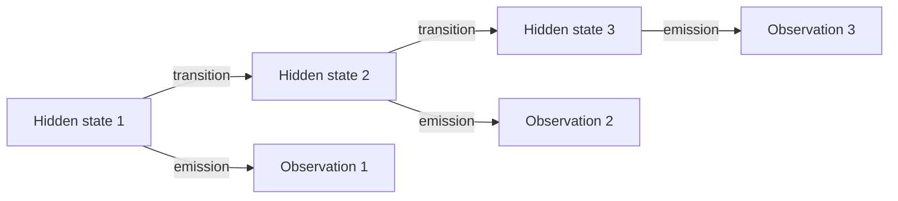
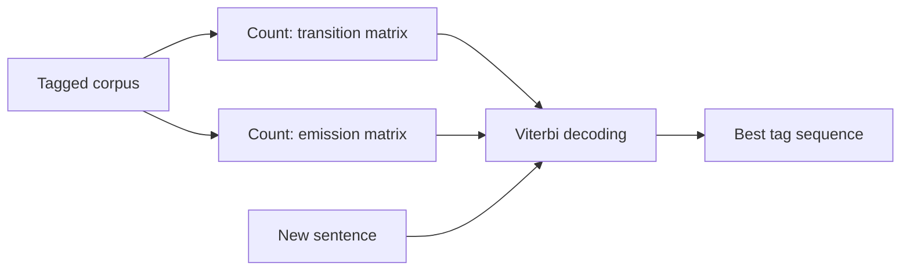
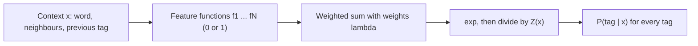
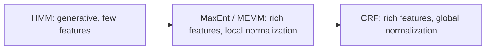

This note is syllabus <Syl m="3" />: the stochastic models for tagging, HMM and Maximum Entropy, and the CRF. The word classes and tag sets are in the POS tagging note.

## The basics first

- **Sequence labelling:** give one label to every item of a sequence, for example one tag to every word. <Cite id="class-nlp-pyq3" loc="p. 8" />
- **Probability from counts:** if a thing happened 3 times out of 10, its probability is 3/10. The models below are learned by counting in a tagged corpus. <Cite id="class-nlp-pyq3" loc="p. 7" />
- **Generative and discriminative:** a generative model (HMM) models the joint probability $P(x, y)$ of words and tags. A discriminative model (MaxEnt) models $P(y \mid x)$ directly: the tag given the context. <Cite id="class-nlp-pyq3" loc="p. 8" />

## Hidden Markov Model (HMM)

<Box kind="definition">

**Hidden Markov Model:** a statistical model used to understand systems where the actual states are not directly visible, but we can see outcomes that depend on those hidden states. <Cite id="class-nlp-pyq3" loc="p. 2" />

</Box>

**Analogy:** you cannot look outside to see the weather, but you watch what people do (walk, shop, clean). The actions are clues about the weather. The model finds the most likely sequence of hidden weather states from the observed activities. <Cite id="class-nlp-pyq3" loc="p. 2" />

*A note on the figure:* arrows leaving a state should add to 1. Rainy adds to 1 (0.5, 0.2, 0.3), but in the figure Sunny adds to 1.1 and Cloudy to 0.9, so take the numbers as an illustration. The class text also calls the self-loops "initial probabilities"; they are transition probabilities (the chance of staying in the same weather). <Cite id="class-nlp-pyq3" loc="p. 2" />

**Emission probabilities in the class example** <Cite id="class-nlp-pyq3" loc="p. 3" />

| Weather | Walk | Shop | Clean |
|---|---|---|---|
| Rainy | 0.1 | 0.4 | 0.5 |
| Sunny | 0.6 | 0.3 | 0.1 |
| Cloudy | 0.3 | 0.5 | 0.2 |

### Components of an HMM <Cite id="class-nlp-pyq3" loc="p. 3" />

1. **States:** the underlying conditions or steps we cannot see directly (in tagging, the tags).
2. **Observations:** the actual signals we can detect (in tagging, the words).
3. **Transition probabilities:** how likely it is to move from one hidden state to another, usually arranged in a matrix.
4. **Emission probabilities:** how likely a state is to produce a given observation.
5. **Initial state probabilities:** how likely the system is to start in a particular state before any observations.

### HMM for POS tagging

The hidden states are the tags and the observations are the words. The two tables are found by counting in a tagged corpus: <Cite id="class-nlp-pyq3" loc="p. 7" />

$$
P(t_j \mid t_i) = \frac{\text{Count}(t_i \to t_j)}{\text{Count}(t_i)}, \qquad P(\text{word} \mid \text{tag}) = \frac{\text{Count}(\text{word}, \text{tag})}{\text{Count}(\text{tag})}
$$

The **Viterbi algorithm** then finds the best tag sequence. $\delta_t(j)$ is the maximum probability up to time $t$ with tag $j$, and a back-pointer remembers the previous tag. At the end, follow the back-pointers to read the tags. <Cite id="class-nlp-pyq3" loc="p. 7" />

### Class example: "Justin will spot Will"

The class corpus is the one in the figure below. <Cite id="class-nlp-pyq3" loc="p. 7" /> The class answer assumes uniform start probabilities, an emission probability of 0 for a word not seen with a tag, and Viterbi decoding.

Counting gives: NNP 2, VBD 1, RB 1, MD 3, VB 3, DT 4, NN 3, PRP 1, NNS 1 (19 words). The class answer prints MD = 4, VB = 4, NN = 4, RB = 2 and the transition NNP to RB; the correct counts are these and NNP is followed by VBD (once) and MD (once).

| Transition | Count | Probability |
|---|---|---|
| NNP to MD | 1 | 1/2 |
| MD to VB | 2 | 2/3 |
| VB to DT | 3 | 3/3 = 1 |
| DT to NN | 3 | 3/4 |

Emissions: P(Justin | NNP) = 2/2 = 1, P(will | MD) = 2/3, P(spot | VB) = 3/3 = 1.

<Sum>

<Given>

the corpus above, uniform start probability over the 9 tags $= 1/9$, sentence *Justin will spot Will*.

</Given>

<Find>

the Viterbi path.

</Find>

<Steps>

1. **Justin:** only NNP emits it. $\delta_1(\text{NNP}) = 1/9 \times 1 = 0.111$.
2. **will:** only MD emits it. $\delta_2(\text{MD}) = 0.111 \times P(\text{MD} \mid \text{NNP}) \times P(\text{will} \mid \text{MD}) = 0.111 \times 1/2 \times 2/3 = 0.0370$.
3. **spot:** only VB emits it. $\delta_3(\text{VB}) = 0.0370 \times 2/3 \times 1 = 0.0247$.
4. **Will:** in this corpus *Will* was seen only as MD. But VB is never followed by MD in the corpus ($P(\text{MD} \mid \text{VB}) = 0$), so $\delta_4 = 0$ for every tag.

</Steps>

<Answer>

The path up to *spot* is NNP, MD, VB (probability 0.0247). With these exact counts the last word gets probability 0, because the corpus is tiny; the class answer tags it by its only seen tag, MD: Justin/NNP will/MD spot/VB Will/MD. (The class table gives 0.0714 and 0.0179, which do not follow from its own matrices.)

</Answer>

<Box kind="verify">

Row of MD transitions: 2/3 + 1/3 (MD to PRP) = 1; VB row: 3/3 = 1; the tag counts add to 19 = 3 + 5 + 5 + 6 words. Multiplying $1/9 \times 1 \times 1/2 \times 2/3 \times 1 \times 2/3 \times 1$ gives $4/162 = 0.0247$, the same.

</Box>

</Sum>

### Limitations of the HMM <Cite id="class-nlp-pyq3" loc="p. 5" />

1. **Strong independence assumption:** the next state depends only on the current state, and each observation depends only on its own hidden state.
2. **Limited context modelling:** it cannot capture long-range dependencies between distant words.
3. **Fixed number of states:** the hidden states must be defined in advance, which may not fit complex NLP tasks.
4. **Data sparsity problem:** it needs large labelled datasets to estimate transition and emission probabilities well.
5. **Stationarity assumption:** it assumes the probabilities stay constant, which is not true for natural language.
6. **Handling of unseen words:** words not in the training data (the OOV problem) are not handled well.
7. **Limited expressive power:** HMMs are generative models and cannot model complex conditional relationships like discriminative models (CRFs, RNNs).
8. **Computational complexity:** training and decoding take a long time when the vocabulary or the number of states is large.
9. **Inflexibility for feature inclusion:** it is hard to add extra information like grammar or meaning.
10. **Inferior to modern models:** RNNs and Transformers understand context much better and are more accurate.

<PYQ id="2024-05-ce/q3a" /> <PYQ id="2025-05/q4a" /> <PYQ id="assignment-1/q3b" /> <PYQ id="2022-12-ce/q4a" /> <PYQ id="2023-05-ce/q4a" /> <PYQ id="2025-05-ce/q4a" /> <PYQ id="2023-12-ce/q3a" /> <PYQ id="2024-12-ce/q3a" />

## Maximum Entropy model (MaxEnt)

**Definition:** the Maximum Entropy (MaxEnt) model, also known as a Multinomial Logistic Regression model, is a discriminative probabilistic framework widely used for POS tagging. <Cite id="class-nlp-pyq3" loc="p. 8" />

**HMM versus MaxEnt:** an HMM is generative: it models the joint probability $P(x, y)$ of words and tags. MaxEnt directly models the conditional probability $P(y \mid x)$ of a tag $y$ given the context $x$. <Cite id="class-nlp-pyq3" loc="p. 8" />

**Core idea (maximum entropy principle):** model what is known, and assume uniform uncertainty about what is unknown. We set constraints from facts seen in training data (for example, the word *run* is often a verb). Out of all probability distributions that satisfy these constraints, we choose the one with maximum entropy, the most uniform and unbiased one, so no arbitrary assumption is made about what we have not observed. <Cite id="class-nlp-pyq3" loc="p. 8" /> <Cite id="class-nlp-pyq3" loc="p. 9" />

**Feature functions $f_i(x, y)$:** binary indicators (0 or 1) that check whether a condition on the context holds for a candidate tag. Its power is that it can use rich, overlapping, non-independent features. <Cite id="class-nlp-pyq3" loc="p. 9" />

| Feature type | Example (equals 1 when true) |
|---|---|
| Current word | word is "bank" and tag is NN |
| Previous tag | previous tag is DT and tag is NN |
| Surrounding words | next word is "of" and tag is NN |
| Morphology | word ends with "-ing" and tag is VBG |
| Capitalization | word is capitalized and tag is NNP |

**Formula:**

$$
P(y \mid x) = \frac{1}{Z(x)} \exp\Big(\sum_{i=1}^{N} \lambda_i f_i(x, y)\Big), \qquad Z(x) = \sum_{y'} \exp\Big(\sum_{i=1}^{N} \lambda_i f_i(x, y')\Big)
$$

$\lambda_i$ is the learned weight of feature $f_i$ (positive raises the chance of the tag, negative lowers it) and $Z(x)$ is the normalization factor that makes all tag probabilities add up to 1. <Cite id="class-nlp-pyq3" loc="p. 9" />

**Sequence tagging (MEMM):** to tag a whole sentence $W = (w_1, \ldots, w_n)$ with tags $T = (t_1, \ldots, t_n)$, the model is used step by step as a Maximum Entropy Markov Model:

$$
P(T \mid W) = \prod_{i=1}^{n} P(t_i \mid x_i)
$$

The context $x_i$ has the current and surrounding words and the previously predicted tags $t_{i-1}, t_{i-2}$. The best tag sequence is found with Viterbi decoding. <Cite id="class-nlp-pyq3" loc="p. 10" />

**Limitations** <Cite id="class-nlp-pyq3" loc="p. 10" />

1. **Label bias:** probabilities are normalized locally at each step ($Z(x_i)$) instead of over the whole sentence, so a high-probability move from a state with few outgoing choices can dominate even when the whole sequence is unlikely.
2. **Computational cost:** parameter estimation needs iterative optimization (L-BFGS, GIS, IIS), heavier than the counting of an HMM.

**Tiny example.** For the word *run* after the tag TO: suppose the weights are $\lambda = 2$ for "word is run and tag is VB", $1.5$ for "previous tag is TO and tag is VB", and $1$ for "word is run and tag is NN". Score(VB) $= 2 + 1.5 = 3.5$, score(NN) $= 1$. $P(\text{VB}) = e^{3.5} / (e^{3.5} + e^{1}) = 0.924$ and $P(\text{NN}) = 0.076$. The numbers are made up to show the formula.

<PYQ id="2023-05-ce/q6b" /> <PYQ id="assignment-1/q3c" /> <PYQ id="2024-12-ce/q6b" /> <PYQ id="2025-05-ce/q1c" />

## Conditional Random Field (CRF)

*(The class files describe it only in one line: "a probabilistic model that understands the sequence and context of words, which helps in making entity prediction more accurate". <Cite id="class-nlp-m6" loc="slide 39" /> <Cite id="class-nlp-asol" loc="p. 10" /> The rest is the standard short explanation.)*

A CRF is a discriminative model for a whole sequence: $P(Y \mid X) = \frac{1}{Z(X)} \exp\big(\sum_i \sum_k \lambda_k f_k(y_{i-1}, y_i, X, i)\big)$. Like MaxEnt it uses rich features, but $Z(X)$ adds over all label sequences, so the normalization is global and the label bias problem of MEMM goes away. It is trained by iterative optimization and decoded with Viterbi, and is used for POS tagging and named entity recognition.

| Point | HMM | MaxEnt (MEMM) | CRF |
|---|---|---|---|
| Type | Generative | Discriminative | Discriminative |
| Rich features | No | Yes | Yes |
| Normalization | Joint model | Local | Global |
| Label bias | No | Yes | No |

<PYQ id="2023-12-ce/q6b" /> <PYQ id="2024-05-ce/q3b" />
