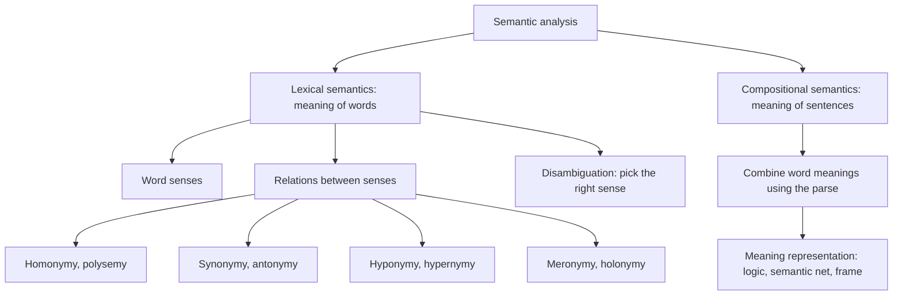
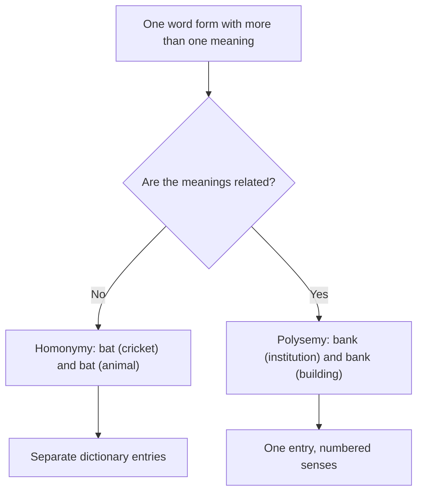
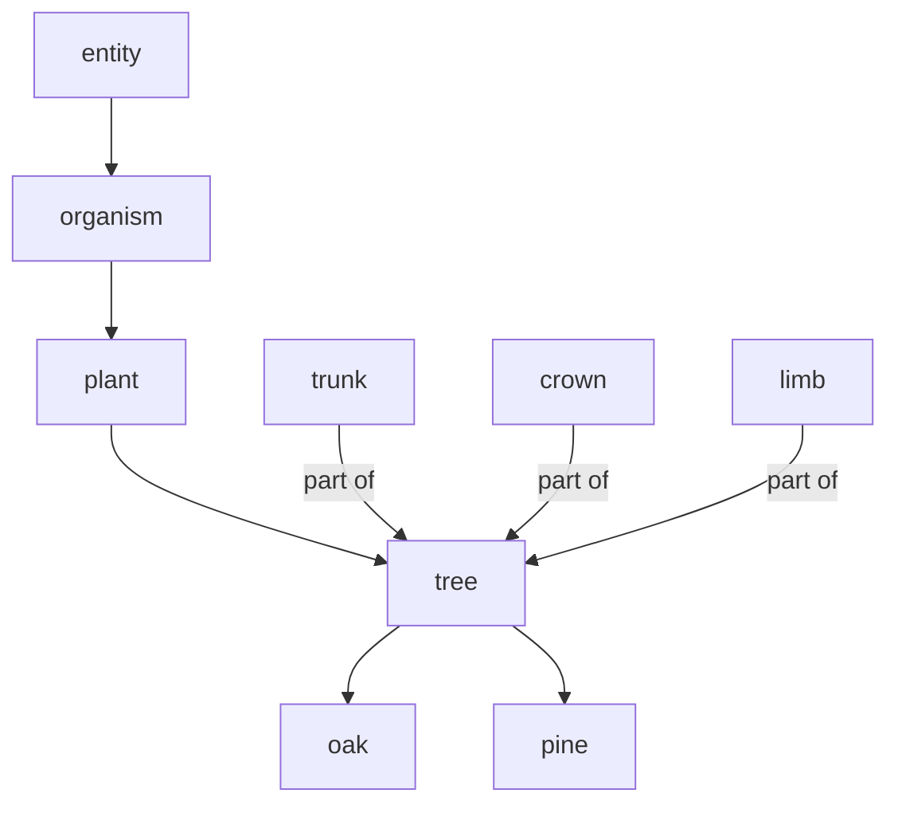
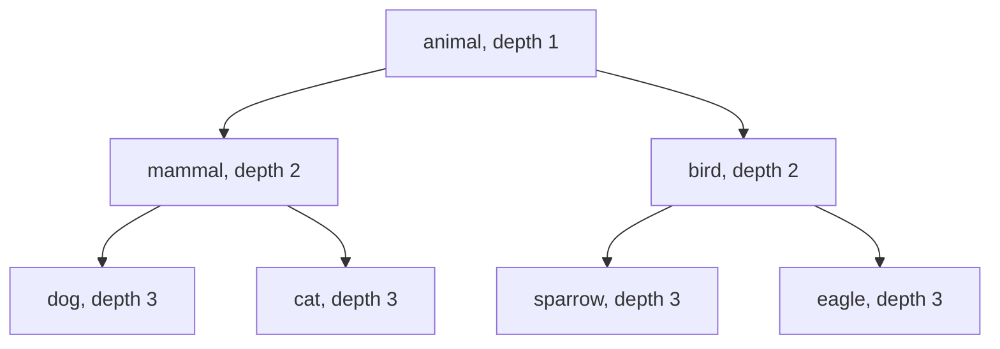

Ye note syllabus <Syl m="4" /> hai: 4.1 introduction aur meaning representation, 4.2 lexical semantics, 4.3 corpus study, 4.4 WordNet aur BabelNet jaisi dictionaries, 4.5 lexemes aur unke senses ke beech relations, 4.6 semantic ambiguity. Word sense disambiguation (4.7 se 4.9) ka alag note hai.

## Pehle basics

- **Word form** text mein likha hua actual string hai: *runs*, *ran*. **Lexeme** un sab forms ke peeche ka abstract dictionary word hai; lexeme RUN mein *run, runs, ran, running* aate hain. <Cite id="lexical-semantics-wiki-lexeme" />
- **Lemma** (citation form) wo ek form hai jo lexeme ki taraf se chuna jaata hai, dictionary ka headword. *Ran* ka lemma *run* hai. <Syl m="2" /> "lemmatization" dekho.
- **Sense** word ka ek meaning hota hai. Word *bank* ke kai senses hain, isliye dictionary mein uski kai entries hoti hain.
- **Lexicon** ek language (ya program) ke saare words aur unke meanings ka collection hai.
- **Syntax** sentence ke form (grammar) ki baat hai. **Semantics** uske meaning ki. Sentence grammatical ho kar bhi meaningless ho sakta hai: *Colourless green ideas sleep furiously.*

## Semantic analysis: badi tasveer

**Ye kya hai.** Semantic analysis NLP ka wo step hai jo text ka meaning nikalta hai. Pehle ke steps (lexical analysis, parsing) sirf words aur grammar dekhte hain; semantic analysis poochta hai "ye actually kya keh raha hai?" Wo text se exact, dictionary-level meaning nikaalne ki koshish karta hai. <Cite id="lexical-semantics-tp-semantic" /> <Cite id="lexical-semantics-gfg-semantic" />

**Ye kyun zaroori hai.** Parse tree computer ko ye nahi batata ki "river bank" mein *bank* paise rakhne ki jagah nahi hai. Search, question answering, translation, chatbots aur summarisation ko meaning chahiye, sirf grammar nahi. *Students love GeeksforGeeks* aur *GeeksforGeeks loves Students* dekho: words same, meaning alag, isliye word meaning aur word order dono matter karte hain. <Cite id="lexical-semantics-gfg-semantic" />

**Roz ki analogy.** Sentence padhna recipe padhne jaisa hai. Syntax check karta hai ki sentence sahi bana hai. Semantics check karta hai ki "add a cup of salt" aisi cheez hai jo sach mein pak sakti hai, aur "cup" measuring cup hai, trophy nahi.

<Box kind="definition">

**Semantic analysis** words, phrases aur sentences ka context mein meaning nikaalne ka process hai. Iske do parts hain:

1. **Lexical semantics:** individual words ka meaning aur word meanings ke beech relations.
2. **Compositional semantics:** grammar follow karte hue words ke meanings milkar phrase ya sentence ka meaning kaise banate hain.

</Box>



GeeksforGeeks page ke structure se redraw kiya, jo semantic analysis ko lexical aur compositional parts mein baantta hai. <Cite id="lexical-semantics-gfg-semantic" loc="diagram" /> <Cite id="lexical-semantics-av-semantic" />

<Box kind="exam">

**Describe semantic analysis in NLP (5 marks):** definition, do parts (lexical aur compositional), main tasks (word sense disambiguation, relationship extraction), lexical relations ek ek line mein, meaning representation (FOPL, semantic net, frame) ek example ke saath, aur do applications (chatbots, question answering) likho. Upar wala chhota diagram bana do. <PYQ id="2024-05-ce/q1d" />

</Box>

## Meaning representation (4.1)

**Ye kya hai.** Meaning representation ek formal, machine-readable structure hai jo sentence ka meaning store karta hai. Ye language ko language ke bahar ki cheezon se jodta hai aur same meaning wale sentences ko ek unambiguous (canonical) form deta hai. <Cite id="lexical-semantics-tp-semantic" />

Building blocks hain **entities** (ek particular person ya cheez, *Delhi*), **concepts** (general categories, *city*), **relations** (unke beech links, *Delhi is a city*) aur **predicates** (verb structures, *eats*). <Cite id="lexical-semantics-gfg-semantic" />

| Approach | Idea | Tiny example |
|---|---|---|
| First-order predicate logic (FOPL) | Predicates, variables aur quantifiers | *Maya eats an apple*: $\exists x\,(\text{Apple}(x) \land \text{Eats}(\text{Maya}, x))$ |
| Semantic net | Graph: nodes concepts hain, edges is-a aur has-part jaisi relations | canary --is-a--> bird --has-part--> wings |
| Frame | Ek situation ka record, slots aur values ke saath | EATING: eater = Maya, food = apple |

<Cite id="lexical-semantics-slp3-appH" /> <Cite id="lexical-semantics-wiki-semnet" /> Study sites aur approaches bhi batati hain: conceptual dependency, case grammar aur conceptual graphs. <Cite id="lexical-semantics-gfg-semantic" />

## Lexical semantics (4.2)

<Box kind="definition">

**Lexical semantics** word meanings ki study hai: words apna meaning kaise structure karte hain, ek word ke senses aapas mein kaise related hain, aur words dusre words se kaise related hain. Iski units lexical items hain: words, sub-words, affixes, compound words aur phrases. <Cite id="lexical-semantics-wiki-lexsem" /> <Cite id="lexical-semantics-av-semantic" />

</Box>

Lexical semantic analysis teen steps mein chalta hai: lexical items ko **classify** karo (noun, verb, ...), unhe **decompose** karo (jaise *unhappy* = un + happy), aur unke meanings ko **compare** karo ki kya same hai aur kya alag. <Cite id="lexical-semantics-av-semantic" />

### Worked example: ek sentence ka lexical semantic analysis

Sentence: *The bank approved the loan.*

| Word | Lemma | Class | Possible senses (examples) | Context se chuna hua sense |
|---|---|---|---|---|
| The | the | determiner | chunne ko kuch nahi (function word) | zaroorat nahi |
| bank | bank | noun | (1) paise rakhne wali institution; (2) nadi ke kinare ki dhalaan | (1), kyunki *approved* aur *loan* paise ke words hain |
| approved | approve | verb | (1) officially agree karna; (2) achha samajhna | (1) officially agree karna, kyunki subject ek institution hai |
| loan | loan | noun | (1) udhaar diya hua paisa jo wapas karna hai; (2) udhaar dene ka kaam | (1) udhaar diya hua paisa |

Steps simple words mein: sentence ko words mein todo, lemma aur class nikalo, har content word ke senses likho, aas-paas ke words se fit hone wala sense chuno (ye word sense disambiguation hai, uska alag note dekho), aur phir chune hue senses ko relate karo: *bank* (1) *approve* ka agent hai, aur *loan* wo hai jo approve hua. Meaning ab $\text{Approve}(\text{Bank}_1, \text{Loan}_1)$ likha ja sakta hai. <Cite id="lexical-semantics-gfg-nltk-semantic" /> <Cite id="lexical-semantics-slp3-appI" />

<Box kind="exam">

**Demonstrate lexical semantic analysis using an example (10 marks):** definition likho, phir teen steps (classify, decompose, compare), phir upar jaisi table wala worked sentence senses aur chune hue sense ke saath, phir use hui relations (*bank* ke liye homonymy, WordNet se hyponymy aur synonymy), phir chhota diagram aur ek line ka conclusion. <PYQ id="2024-05-ce/q4b" />

</Box>

## Lexemes aur unke senses ke beech relations (4.5)

Kisi word ka meaning akela nahi hota. Wo chhoti si relations ke set se dusre words se jura hota hai. Do relations **ek word form ke kai meanings** ki baat karti hain (homonymy, polysemy); baaki **do alag words** ki (synonymy, antonymy, hyponymy aur hypernymy, meronymy aur holonymy).

| Relation | Simple matlab | Example |
|---|---|---|
| Homonymy | Same form, **unrelated** meanings | *bat* (cricket bat / udne wala animal) |
| Polysemy | Same form, **related** meanings | *bank* (institution / uski building) |
| Synonymy | Alag words, **same ya similar** meaning | *begin*, *start* |
| Antonymy | **Opposite** meaning | *hot*, *cold* |
| Hyponymy / hypernymy | **Kind-of** (specific / general) | *dog* / *animal* |
| Meronymy / holonymy | **Part-of** (part / whole) | *wheel* / *car* |

### Homonymy aur polysemy

**Homonymy.** Words jo same spell ya pronounce hote hain par unke meanings alag aur unrelated hote hain. Ye aksar alag origin se ittefaq se aate hain. *Bat* (cricket bat) aur *bat* (udne wala jaanwar) homonyms hain. Iske do sub-kinds hain: **homographs** (same spelling, sound alag ho sakti hai: *row* a boat, *row* of seats) aur **homophones** (same sound, spelling alag ho sakti hai: *see* aur *sea*). Jo word dono ho wo strict homonym hai, jaise *stalk* (paudhe ka) aur *stalk* (peecha karna). <Cite id="lexical-semantics-wiki-homonym" /> <Cite id="lexical-semantics-tp-semantic" />

**Polysemy.** Ek word ke do ya zyada **related** meanings jo ek common origin se bade. *Bank* financial institution ho sakta hai, wo building jisme wo hai, aur verb "to rely on". River ka *mouth* aur insaan ka *mouth* shape aur kaam se related hain. <Cite id="lexical-semantics-av-semantic" /> <Cite id="lexical-semantics-wiki-homonym" /> <Cite id="ambiguity-challenges-wiki-polysemy" />

**Dono mein fark kaise karein.** Poochho "kya meanings aise jude hain jo bolne wala mehsoos kar sake?" aur word ka origin (etymology) dekho. Line aksar subjective hoti hai; dictionaries homonyms ko alag entries deti hain aur polysemes ko ek entry mein numbered senses. <Cite id="lexical-semantics-wiki-homonym" /> <Cite id="lexical-semantics-slp3-appI" />



<Box kind="pitfall">

Homonymy aur polysemy dono "ek form, kai meanings" hain. Har case ko homonymy mat bolo. Test ye hai ki meanings **related** hain ya nahi. Aur *bank* (river) versus *bank* (money) standard homonym example hai, jabki *bank* (money) versus *bank* (building) polysemy hai. Likhte waqt batao ki kaun si pair le rahe ho.

</Box>

### Synonymy

Alag words jinka meaning same ya bahut close ho: *begin, start, commence*; *big, large*. Usual test **substitution** hai: agar ek word dusre ki jagah sentence mein daalne par meaning na badle to wo synonyms hain. Perfect synonyms rare hote hain kyunki words formality (*feline*, *cat* se zyada formal hai), connotation aur use ki jagah mein alag hote hain: *long* aur *extended* "long time" mein chalte hain, par "extended family" mein nahi. Sirf similar meaning wale words **near-synonyms** hain. Synonymy asal mein **senses** ke beech relation hai, poore words ke beech nahi. <Cite id="lexical-semantics-wiki-synonym" /> <Cite id="lexical-semantics-slp3-appI" />

### Antonymy

Opposite meaning wale words. Aam taur par teen kisam batayi jaati hain. <Cite id="lexical-semantics-wiki-antonym" />

| Kind | Meaning | Examples |
|---|---|---|
| Gradable | Scale ke do ends; beech ki values hoti hain | hot / cold, heavy / light |
| Complementary | Bas ek sach hota hai; beech mein kuch nahi | alive / dead, occupied / vacant |
| Relational (converse) | Same relationship doosri taraf se dekhi gayi | teacher / pupil, buy / sell |

Study sites par aur examples hain *life/death*, *rich/poor* aur *author/writer* (ye aakhri synonym pair hai, antonym nahi). <Cite id="lexical-semantics-av-semantic" /> <Cite id="lexical-semantics-tp-semantic" />

### Hyponymy aur hypernymy

**Hyponymy** "is-a-kind-of" relation hai. Specific word **hyponym** hai; general word **hypernym** (supertype ya umbrella term bhi kehte hain). *Dog*, *animal* ka hyponym hai; *animal*, *dog* ka hypernym hai. Computer science mein ise **is-a** link kehte hain. <Cite id="lexical-semantics-wiki-hyponymy" />

- **Transitive:** violet purple ki kind hai, purple colour ki kind hai, to violet colour ki kind hai.
- **Co-hyponyms** ek hypernym share karte hain: *hammer* aur *knife* dono tools hain.
- **Test:** "X is a kind of Y" sahi sunai dena chahiye. "A dog is a kind of animal" chalta hai; "a wheel is a kind of car" nahi (wo meronymy hai).

<Cite id="lexical-semantics-wiki-hyponymy" /> Study sites ka example: *colour*, *blue, yellow, green* ka hypernym hai. <Cite id="lexical-semantics-av-semantic" />

### Meronymy aur holonymy

**Meronymy** **part-of** relation hai. Part **meronym** hai, whole **holonym**. *Finger*, *hand* ka meronym hai; *engine*, *car* ka meronym hai; *car*, *wheel* ka holonym hai. Ek hi whole ke parts (tree ke leaves, branches, trunk aur roots) **co-meronyms** hain. Ise hypernymy se mat milao: *tree*, *leaf* ka holonym hai (leaf tree ka part hai) par *oak* ka hypernym (oak ek kind ka tree hai). <Cite id="lexical-semantics-wiki-meronymy" />

WordNet part-whole links ko teen kisam mein baantta hai: **part** (tree ka trunk), **substance** (tree ka heartwood) aur **member** (tree forest ka member hai). <Cite id="lexical-semantics-nltk-ch2" />



GeeksforGeeks synsets page par hypernyms aur hyponyms ki inheritance-tree picture se redraw kiya; tree ke parts (trunk, crown, limb) wahi part meronyms hain jo NLTK WordNet synset tree.n.01 ke liye deta hai. <Cite id="lexical-semantics-gfg-synsets" loc="diagram" /> <Cite id="lexical-semantics-nltk-ch2" />

### Relations ka comparison

| Pair | Same form? | Same meaning? | Direction |
|---|---|---|---|
| Homonymy | haan | nahi, unrelated | koi nahi |
| Polysemy | haan | nahi, par related | koi nahi |
| Synonymy | nahi | haan, ya lagbhag | dono taraf |
| Antonymy | nahi | opposite | dono taraf |
| Hyponymy / hypernymy | nahi | specific / general | ek taraf, is-a |
| Meronymy / holonymy | nahi | part / whole | ek taraf, part-of |

<Box kind="exam">

**Relationships between word meanings (5 ya 10 marks):** har relation ko ek line mein define karo, ek example do aur hyponymy aur meronymy ke liye batao kaun sa word kaun sa hai (hyponym specific word hai, holonym whole hai). 10 marks ke liye homonymy-versus-polysemy test, antonyms ki teen kisam aur chhoti table add karo. Question versions: Homonymy, Polysemy, Synonymy, Antonymy <PYQ id="2022-12-ce/q1e" />; Hyponymy, Hypernymy, Meronymy, Holonymy <PYQ id="2023-12-ce/q1d" />; saatho <PYQ id="2024-12/q3a" />.

</Box>

## Corpus study (4.3)

**Ye kya hai.** **Corpus** (plural corpora) real text ya speech ka bada, organised collection hai. **Corpus linguistics** language ko ye count karke aur dekh kar padhti hai ki logon ne asal mein kya likha ya bola, na ki rule book kya kehti hai. <Cite id="lexical-semantics-wiki-corpus" />

**Meaning ke liye ye kyun zaroori hai.** Word ke senses, aur kaun se words ek jaise behave karte hain, ye word ke saathiyon mein dikhta hai. Dictionary banane wale corpora se senses aur examples dhundte hain: *American Heritage Dictionary* (1969) corpus linguistics se bani pehli dictionary thi, aur Collins COBUILD Bank of English se bani. <Cite id="lexical-semantics-wiki-corpus" />

**Example corpus.** Brown Corpus mein lagbhag ek million words American English ke hain, 1961 ke, 500 text samples se, kai genres mein, aur ye linguistic research ke liye bana pehla computerised corpus tha. NLTK ye aur dusre corpora saath deta hai. <Cite id="lexical-semantics-wiki-corpus" /> <Cite id="lexical-semantics-nltk-ch2" />

**Corpus meaning kaise deta hai.** Target word ke paas kaun se words aate hain, ginti karo. Similar neighbours wale words ka meaning similar hota hai (*dog* aur *cat* dono *pet* aur *fur* ke paas aate hain; *car* *road* ke paas). Ye idea har word ko counts ka vector bana deta hai, jise cosine similarity se compare kiya ja sakta hai (Example 3 dekho). Modern embeddings isi ka dense version hain. <Cite id="lexical-semantics-slp3-ch5" /> <Cite id="text-preprocessing-fsnlp" />

## Dictionaries: WordNet aur BabelNet (4.4)

### WordNet

<Box kind="definition">

**WordNet** English ka bada lexical database hai, jo Princeton mein bana. Ye nouns, verbs, adjectives aur adverbs ko cognitive synonyms ke sets mein group karta hai jinhe **synsets** kehte hain, har ek ke saath chhota definition (gloss) aur example sentences, aur synsets ko semantic relations se jodta hai. Ye dictionary aur thesaurus ko ek network mein jodne jaisa hai. <Cite id="lexical-semantics-wiki-wordnet" /> <Cite id="lexical-semantics-gfg-synsets" />

</Box>

- **Synset** ek concept hota hai. Polysemous word ka har sense alag synset mein hota hai. NLTK mein `car.n.01` wo synset hai jiske lemmas *car, auto, automobile, machine, motorcar* hain; uska definition "a motor vehicle with four wheels; usually propelled by an internal combustion engine" hai. Word *car* kul paanch synsets mein hai, matlab uske paanch senses hain. <Cite id="lexical-semantics-nltk-ch2" />
- Naam `car.n.01` is tarah padho: word *car*, part of speech noun (`n`), pehla sense (`01`).
- Function words (prepositions, determiners) isme nahi hain. <Cite id="lexical-semantics-wiki-wordnet" />
- BSD-style licence ke tahat free download hai. Wikipedia ke infobox mein lagbhag 161,705 words aur 120,630 synsets hain (uske database section mein counts alag hain, isliye size ko lagbhag 150,000 words aur 120,000 synsets maano). Project ab active development mein nahi hai; Open English WordNet jaise community projects ise aage chalate hain. <Cite id="lexical-semantics-wiki-wordnet" />

| Relation | Kiske beech | Meaning | Example |
|---|---|---|---|
| Synonymy | synset ke words | same concept | car, automobile |
| Hypernym / hyponym | noun synsets (verbs bhi) | general / specific | motor vehicle / car |
| Meronym / holonym | noun synsets | part / whole | trunk / tree |
| Antonym | word senses (lemmas) | opposite | supply / demand |
| Entailment | verbs | ek karna doosre ko imply karta hai | eat entails chew, swallow |
| Troponym | verbs | karne ka ek particular tareeka | whisper, speak karne ka ek tareeka |

<Cite id="lexical-semantics-wiki-wordnet" /> <Cite id="lexical-semantics-nltk-ch2" /> Antonymy **lemmas** ke beech store hoti hai, synsets ke beech nahi, kyunki wo particular words ko jodti hai, isliye NLTK mein `.antonyms()` lemma par call karte hain. <Cite id="lexical-semantics-nltk-wordnet-howto" />

NLTK ka real output (dog synset): hypernyms `canine.n.02` aur `domestic_animal.n.01` hain; `corgi.n.01` aur `dalmatian.n.02` jaise breeds hyponyms hain. `motorcar` synset ka hypernym `motor_vehicle.n.01` hai, aur saare noun paths root `entity.n.01` par khatam hote hain. <Cite id="lexical-semantics-nltk-wordnet-howto" /> <Cite id="lexical-semantics-nltk-ch2" />

```python
from nltk.corpus import wordnet as wn
wn.synsets("car")                      # five synsets
wn.synset("car.n.01").lemma_names()    # ['car', 'auto', 'automobile', 'machine', 'motorcar']
wn.synset("dog.n.01").hypernyms()      # [canine.n.02, domestic_animal.n.01]
wn.synset("tree.n.01").part_meronyms() # trunk, crown, limb, ...
```

<Cite id="lexical-semantics-nltk-ch2" /> <Cite id="lexical-semantics-gfg-synonyms" />

### BabelNet

**BabelNet** ek multilingual semantic network aur encyclopedic dictionary hai, Sapienza University of Rome se (Roberto Navigli ka group). Ye Wikipedia ko WordNet se automatically link karke bana, aur chhoti languages ke gaps machine translation se bhare gaye. WordNet ki tarah isme synsets hain, par Babel synset mein kai languages ke words hote hain, definitions WordNet aur Wikipedia se, aur extra content Wiktionary, Wikidata, FrameNet aur VerbNet se. Version 5.3 (December 2023) lagbhag 600 languages aur lagbhag 23 million synsets cover karta hai. Uses: multilingual word sense disambiguation, entity linking, semantic relatedness. <Cite id="lexical-semantics-wiki-babelnet" />

| | WordNet | BabelNet |
|---|---|---|
| Languages | English (doosri languages alag projects se) | lagbhag 600 |
| Kaise bana | Lexicographers ne haath se | WordNet, Wikipedia aur aur sources ka automatic merge |
| Unit | Synset | Babel synset (kai languages ke words) |
| Coverage | Sirf words (nouns, verbs, adjectives, adverbs) | Words aur named entities (log, jagah) |
| Typical use | English sense aur similarity ka kaam | Multilingual kaam, entity linking |

<Cite id="lexical-semantics-wiki-wordnet" /> <Cite id="lexical-semantics-wiki-babelnet" />

<Box kind="exam">

**Explain WordNet / study of dictionaries (5 marks):** definition, `car.n.01` example ke saath synsets, relation table (hypernym, hyponym, meronym, holonym, antonym), ek use (word sense disambiguation, similarity), phir BabelNet do line mein (multilingual, WordNet plus Wikipedia). Hierarchy diagram add karo.

</Box>

## Do meanings kitne close hain, ye naapna

WordNet is-a links ka tree hai, isliye meaning ki closeness ko tree dekh kar number bana sakte hain. Hum chhota tree lete hain taaki har number haath se check ho sake.



<Cite id="lexical-semantics-gfg-path" loc="diagram" />

**Path similarity.** Do synsets ke beech shortest path ke edges ginti karo; chhota path matlab zyada close.

$$
\text{path\_sim}(a,b) = \frac{1}{1 + \text{shortest path length}}
$$

Score 0 aur 1 ke beech hota hai; 1 ka matlab same synset. <Cite id="lexical-semantics-gfg-path" />

**Wu-Palmer similarity.** **Least common subsumer (LCS)** dhundo: sabse neecha word jo dono ka hypernym ho. Phir uski depth ko dono words ki depths se compare karo.

$$
\text{wup}(a,b) = \frac{2 \times \text{depth}(\text{LCS})}{\text{depth}(a) + \text{depth}(b)}
$$

Yahan depth root ko 1 gintee hai, isliye score kabhi 0 nahi hota. Ise Wu aur Palmer ne 1994 mein propose kiya. <Cite id="lexical-semantics-gfg-wup" /> <Cite id="lexical-semantics-wupalmer1994" />

### Example 1: path similarity

<Sum>

<Given>

Upar wala tree. Pairs: (dog, cat), (dog, sparrow), (dog, mammal).

</Given>

<Find>

har pair ki path similarity.

</Find>

<Steps>

1. dog aur cat: path dog, mammal, cat hai. Yani 2 edges. *Reason: path length edges ki ginti hai, nodes ki nahi.*
2. $\text{path\_sim} = 1/(1+2) = 1/3 = 0.333$.
3. dog aur sparrow: path dog, mammal, animal, bird, sparrow hai. Yani 4 edges, to $1/(1+4) = 1/5 = 0.2$.
4. dog aur mammal: 1 edge, to $1/(1+1) = 1/2 = 0.5$.

</Steps>

<Answer>

path_sim(dog, cat) = 0.333; path_sim(dog, sparrow) = 0.2; path_sim(dog, mammal) = 0.5

</Answer>

<Box kind="verify">

Ulta check karo: $1/0.333 = 3$, minus 1 se 2 edges; $1/0.2 = 5$, minus 1 se 4 edges; $1/0.5 = 2$, minus 1 se 1 edge. Chhote path ka score bada aaya, jaisa hona chahiye. NLTK ke whale example par same formula 3 edges ke path ke liye path_sim = 0.25 deta hai ($1/(1+3)$), wahi value jo NLTK right_whale aur minke_whale ke liye print karta hai. <Cite id="lexical-semantics-nltk-ch2" />

</Box>

</Sum>

### Example 2: Wu-Palmer similarity

<Sum>

<Given>

Wahi tree, root *animal* depth 1 par. Pairs: (dog, cat), (dog, sparrow), (dog, mammal).

</Given>

<Find>

har pair ki Wu-Palmer similarity.

</Find>

<Steps>

1. dog aur cat: unka lowest common hypernym (LCS) *mammal* hai, depth 2. Depths: dog 3, cat 3. *Reason: LCS dono ka sabse paas wala shared ancestor hai.*
2. $\text{wup} = 2 \times 2 / (3+3) = 4/6 = 0.667$.
3. dog aur sparrow: LCS *animal* hai, depth 1. $\text{wup} = 2 \times 1/(3+3) = 2/6 = 0.333$.
4. dog aur mammal: LCS khud *mammal* hai (word apna khud ka ancestor hota hai), depth 2. Depths: dog 3, mammal 2. $\text{wup} = 2 \times 2/(3+2) = 4/5 = 0.8$.

</Steps>

<Answer>

wup(dog, cat) = 0.667; wup(dog, sparrow) = 0.333; wup(dog, mammal) = 0.8

</Answer>

<Box kind="verify">

Same word do baar, jaise (dog, dog): LCS dog hai, depth 3, to $2 \times 3/(3+3) = 1$, maximum. Saare scores 0 aur 1 ke beech hain. Ranking path similarity se match karti hai (dog-mammal sabse close, phir dog-cat, phir dog-sparrow). Dono measures yahan numbers mein alag hain, order mein nahi.

</Box>

</Sum>

### Example 3: corpus se cosine similarity

Corpus har word ko paas ke context words ki counts ka vector deta hai. Do words similar hote hain jab unke vectors ek hi direction mein point karte hain. Vectors $u$ aur $v$ ke beech angle ka cosine hai

$$
\cos(u,v) = \frac{u \cdot v}{|u|\,|v|}
$$

jahan $u \cdot v$ matching numbers ke products ka sum hai aur $|u|$ squares ke sum ka square root hai. <Cite id="lexical-semantics-slp3-ch5" />

<Sum>

<Given>

Har word teen context words ke paas kitni baar aaya, order (pet, fur, road): dog = (3, 4, 0), cat = (4, 3, 0), car = (0, 1, 5).

</Given>

<Find>

cos(dog, cat) aur cos(dog, car).

</Find>

<Steps>

1. Lengths: $|\text{dog}| = \sqrt{9+16+0} = 5$; $|\text{cat}| = \sqrt{16+9+0} = 5$; $|\text{car}| = \sqrt{0+1+25} = \sqrt{26} = 5.099$.
2. dog . cat $= 3\times4 + 4\times3 + 0\times0 = 24$. To $\cos(\text{dog},\text{cat}) = 24/(5 \times 5) = 24/25 = 0.96$.
3. dog . car $= 3\times0 + 4\times1 + 0\times5 = 4$. To $\cos(\text{dog},\text{car}) = 4/(5 \times 5.099) = 4/25.495 = 0.157$.

</Steps>

<Answer>

cos(dog, cat) = 0.96 aur cos(dog, car) = 0.157, yani dog, car se kahin zyada cat ke close hai.

</Answer>

<Box kind="verify">

dog . cat ko doosre order mein dobara nikalo: $4\times3 + 3\times4 = 24$, same. Non-negative count vectors ka cosine 0 aur 1 ke beech hota hai: 0.96, 1 ke paas hai (lagbhag same direction) aur 0.157, 0 ke paas (lagbhag unrelated). Answer idea se match karta hai: dog aur cat *pet* aur *fur* contexts share karte hain, car nahi.

</Box>

</Sum>

## Semantic ambiguity (4.6)

**Semantic (lexical) ambiguity** ka matlab ek word ya sentence ke ek se zyada possible meanings hain. Ye seedha homonymy aur polysemy se aati hai: *bank*, *bat*, *bark*, *rock* (patthar ya music). Sentence *I went to the bank* tab tak ambiguous hai jab tak context na bataye kaun sa bank. Context se sahi sense chunna **word sense disambiguation (WSD)** hai, jo Lesk's algorithm aur supervised methods ke saath apne note mein hai. <Cite id="lexical-semantics-gfg-semantic" /> <Cite id="lexical-semantics-slp3-appI" />

## Advantages aur limits

- **Achha:** WordNet aur corpora programs ko word meaning ka structured, free store dete hain; hypernym aur part-of jaisi relations search, translation, question answering aur similarity mein kaam aati hain.
- **Limits:** haath se bane resources naye words aur slang miss karte hain aur banne mein saalon lagte hain; WordNet ke senses kabhi kabhi itne fine hote hain ki program unhe alag nahi kar paata; words ke alag domains mein alag meanings hote hain; homonymy versus polysemy kuch had tak judgement call hai; zyaadatar resources English ko doosri languages se kahin behtar cover karte hain (BabelNet madad karta hai). <Cite id="lexical-semantics-wiki-wordnet" /> <Cite id="lexical-semantics-wiki-babelnet" /> <Cite id="lexical-semantics-wiki-homonym" />

## Conclusion

Lexical semantics words ke meaning aur unke beech relations ka jaal describe karti hai: same form alag meanings (homonymy, polysemy), same meaning alag forms (synonymy), opposites (antonymy), kind-of (hyponymy) aur part-of (meronymy). WordNet aur BabelNet in relations ko store karte hain; corpora aur similarity measures inhe numbers mein badalte hain. Ye pieces milkar system ko ambiguous word ka sahi sense chunne dete hain.
