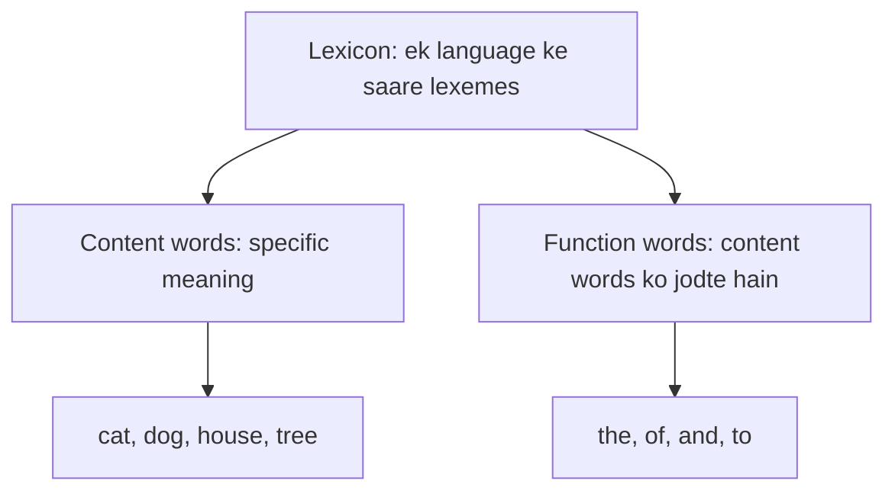
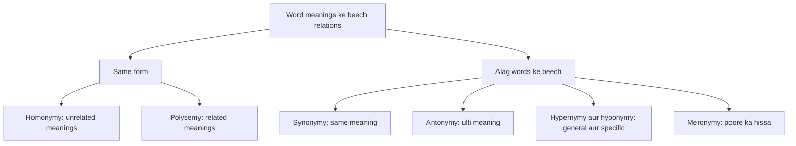
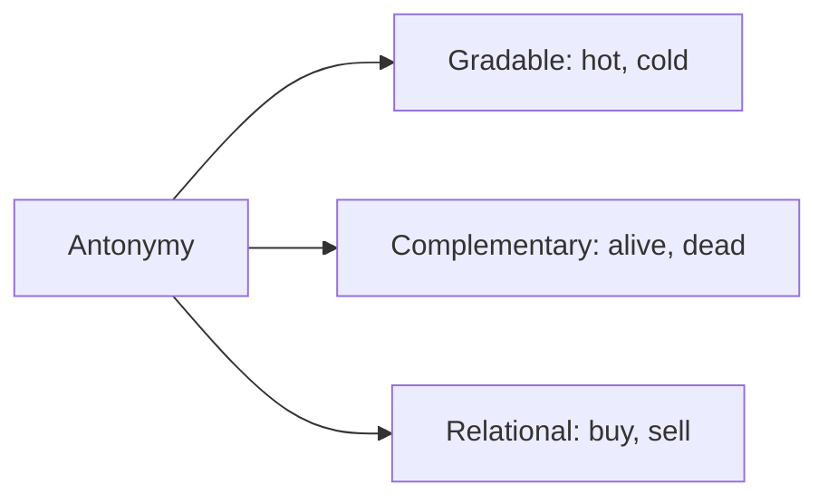
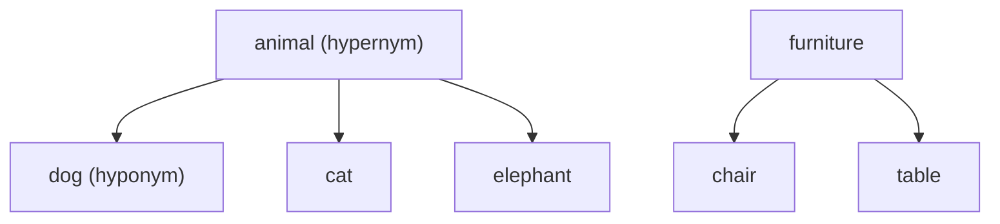
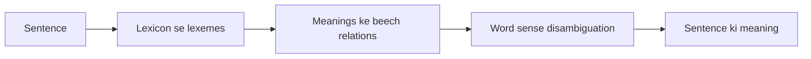
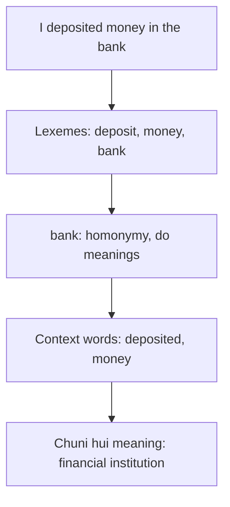

Ye note syllabus <Syl m="4" /> hai: lexical semantics aur word meanings ke beech relations. Sentence mein word ki sahi meaning chunna word sense disambiguation ke note mein hai.

## Pehle basics

- **Semantics** meaning ki padhai hai; **syntax** sentence ke form (grammar) ki baat hai.
- **Lexeme** ek single word ya phrase hai jiski specific meaning hoti hai aur jo kai contexts mein use ho sakta hai. Jaise "cat" ek lexeme hai: iska matlab ek chhota furry mammal hai aur ye "I saw a cat outside" aur "The cat is sitting on the mat" mein aata hai. <Cite id="class-nlp-pyq4" loc="p. 9" />
- **Lexicon** ek language ke saare lexemes ka poora collection hai, jaise English lexicon (cat, dog, house, tree aadi). <Cite id="class-nlp-pyq4" loc="p. 9" />

<Box kind="definition">

**Lexeme:** ek single word ya phrase jiski specific meaning hoti hai aur jo kai contexts mein use ho sakta hai. **Lexicon:** ek language ke saare lexemes ka poora collection. <Cite id="class-nlp-pyq4" loc="p. 9" />

</Box>

Lexemes do main types ke hote hain. **Content words** ki specific meaning hoti hai (cat, dog, house, tree). **Function words** content words ko jodne mein madad karte hain (the, of, and, to). Lexicon badalta rehta hai: naye lexemes judte hain aur purane use se bahar ho sakte hain. Jaise "tweet" pehle chidiya ke chehchahane wala verb tha, aur ab chhote message ke liye noun ban gaya. <Cite id="class-nlp-pyq4" loc="p. 9" />

## Lexical relations

Lexical relations language ke words (lexemes) ke beech ke semantic aur formal connections hain. <Cite id="class-nlp-pyq4" loc="p. 10" />

1. **Homonymy:** ek hi word form (spelling, sound, ya dono) ki do ya zyaada bilkul unrelated meanings hoti hain. *Example:* bank (financial institution) versus bank (nadi ka kinara). <Cite id="class-nlp-pyq4" loc="p. 2" />

2. **Polysemy:** ek hi lexeme ki kai meanings hoti hain jo logically ya historically ek doosre se related hain. *Example:* word *head* ka matlab body ka hissa, ya incharge person (head of school), ya page ya table ka top ho sakta hai. <Cite id="class-nlp-pyq4" loc="p. 2" />

3. **Synonymy:** do ya zyaada lexemes ki meaning milti-julti ya lagbhag same hoti hai. Sachche absolute synonyms (har context mein badle ja sakne wale) kam hote hain kyunki tone ya connotation mein chhota farak hota hai. *Example:* smart aur intelligent; big aur large. <Cite id="class-nlp-pyq4" loc="p. 1" />

4. **Antonymy:** wo lexemes jinki meaning ulti hoti hai. Ye aam taur par teen sub-types mein baanta jaata hai: <Cite id="class-nlp-pyq4" loc="p. 1" />
   - **Gradable antonyms:** ek continuous spectrum par opposites jinki comparison ho sakti hai, jaise hot aur cold (cheez garm ya thandi ho sakti hai).
   - **Complementary antonyms:** binary opposites jinke beech kuch nahi hota, ek doosre ko exclude karta hai, jaise alive aur dead.
   - **Relational antonyms:** opposites jo ek hi reciprocal relationship ko ulte sides se batate hain, jaise buy aur sell, ya teacher aur student.

5. **Hypernymy:** hyponymy ka ulta. Ek general, broader lexeme specific lexemes ki meaning ko cover karta hai; upar wala term hypernym ("superordinate" term) kehlata hai. *Example:* animal, dog, cat aur elephant ka hypernym hai; furniture, chair aur table ka hypernym hai. <Cite id="class-nlp-pyq4" loc="p. 2" />

6. **Hyponymy:** ek hierarchical ("inclusion") relationship jisme ek specific lexeme ki meaning ek zyaada general lexeme ki meaning ke andar aati hai. General term hypernym hai aur specific term hyponym. *Example:* dog, animal ka hyponym hai, aur rose, flower ka hyponym. <Cite id="class-nlp-pyq4" loc="p. 1" />

7. **Meronymy:** lexemes ke beech part-whole relationship: ek word us object ka ek hissa batata hai jo doosra word batata hai. *Example:* wheel, car ka meronym hai; page, book ka meronym hai. <Cite id="class-nlp-pyq4" loc="p. 1" />

**Holonymy** (meronymy ka ulta): car, wheel ka holonym hai. (Class answer mein naam nahi hai; ye meronymy ki aam jodi hai.)

| Relation | Idea | Example |
|---|---|---|
| Homonymy | Same form, unrelated meanings | bank (money) and bank (river) |
| Polysemy | One word, related meanings | head (body, boss, top of page) |
| Synonymy | Same or very close meaning | smart and intelligent |
| Antonymy | Opposite meaning | hot and cold; buy and sell |
| Hypernymy | General word above | animal above dog |
| Hyponymy | Specific word below | dog below animal |
| Meronymy | Part of a whole | wheel of a car |

**Homonymy versus polysemy:** homonymy mein meanings unrelated hoti hain (do banks); polysemy mein related (*head* ke alag uses).

<PYQ id="2022-12-ce/q1e" /> <PYQ id="2023-12-ce/q1d" /> <PYQ id="2024-12/q3a" /> <PYQ id="assignment-2/q4a" />

## Semantic analysis

*(Class files semantics ko lexicon aur uski relations ke through padhati hain; ye chhota note standard idea hai.)* Semantic analysis NLP ka wo step hai jo words aur sentences ki meaning nikalta hai, sirf grammar nahi. Iska word-level part lexical semantics hai, jo upar bataya. Steps: lexicon mein lexemes aur unki meanings dhundho; unke beech relations use karo; context se ambiguous word ki sahi meaning chuno (word sense disambiguation <Cite id="class-nlp-pyq4" loc="p. 5" />); aur word meanings ko jodkar sentence ki meaning banao.

<PYQ id="2024-05-ce/q1d" />

## Ek sentence ka lexical analysis

**Example:** "I deposited money in the bank."

1. **Lexemes dhundho:** I, deposited (deposit), money, in, the, bank. *Money* aur *bank* content words hain; *in* aur *the* function words.
2. **Lexicon mein meanings dekho:** *bank* ki do unrelated meanings hain (financial institution, nadi ka kinara), isliye ye homonymy hai. <Cite id="class-nlp-pyq4" loc="p. 2" />
3. **Context use karo:** *deposited* aur *money* financial institution ki taraf ishaara karte hain; ye word sense disambiguation hai, jo Lesk's algorithm dictionary overlap se karta hai. <Cite id="class-nlp-pyq4" loc="p. 4" />

<PYQ id="2024-05-ce/q4b" />

## Past papers aur class assignment ke questions

- <PYQ id="2022-12-ce/q1e" /> homonymy, polysemy, synonymy, antonymy (5 marks)
- <PYQ id="2023-12-ce/q1d" /> hyponymy, hypernymy, meronymy, holonymy (5 marks)
- <PYQ id="2024-12/q3a" /> aur <PYQ id="assignment-2/q4a" /> saaton relations (10 marks)
- <PYQ id="2024-05-ce/q1d" /> semantic analysis; <PYQ id="2024-05-ce/q4b" /> example ke saath lexical semantic analysis
