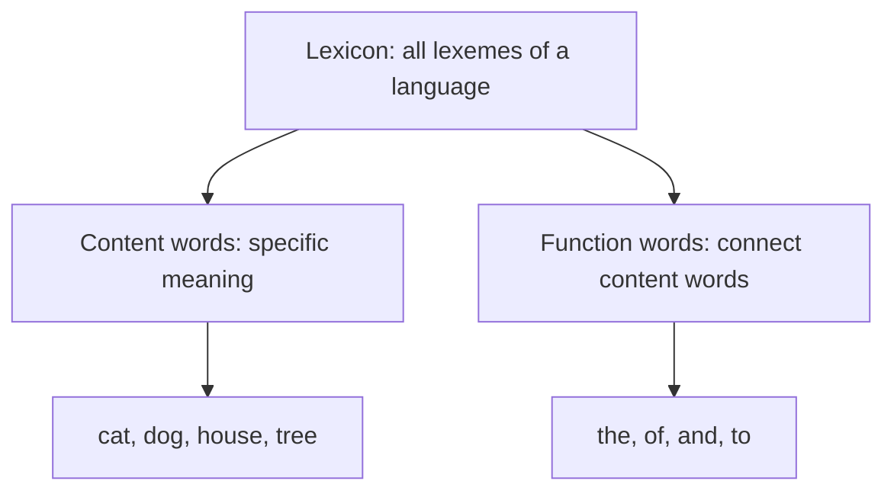
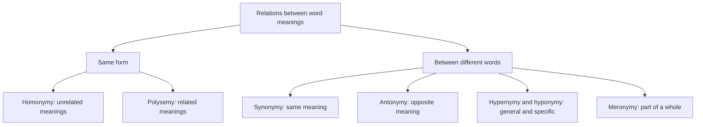
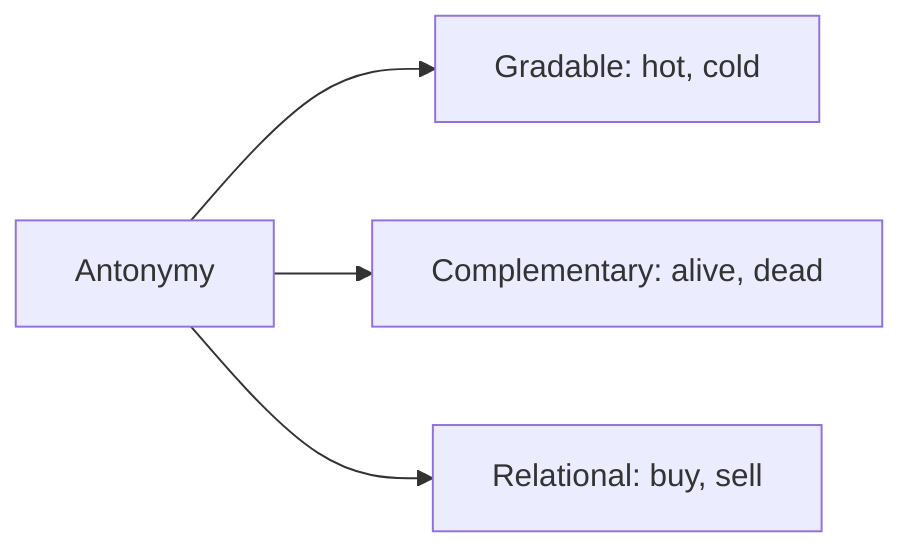
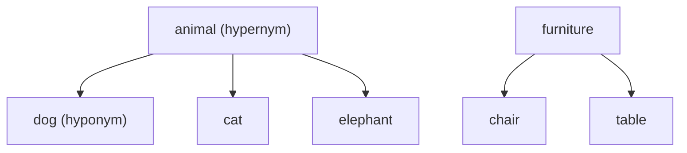
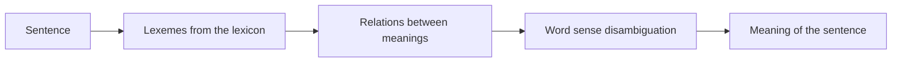
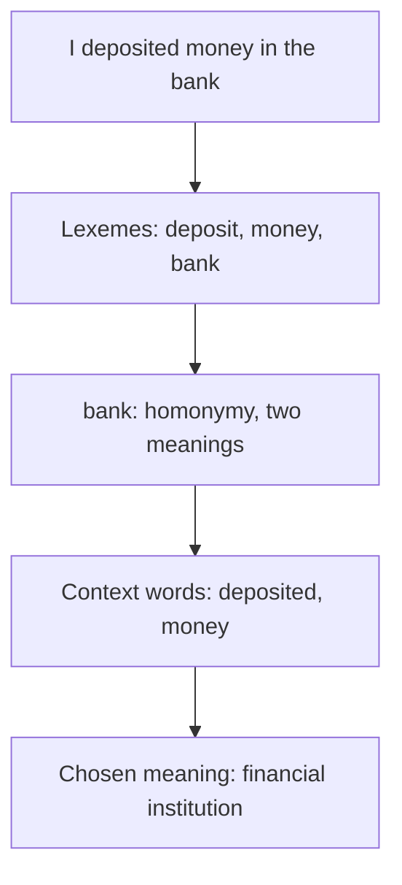

This note is syllabus <Syl m="4" />: lexical semantics and the relations between word meanings. Choosing the right meaning of a word in a sentence is in the word sense disambiguation note.

## The basics first

- **Semantics** is the study of meaning; **syntax** is about the form (grammar) of a sentence.
- A **lexeme** is a single word or phrase that has a specific meaning and can be used in a variety of contexts. For example, "cat" is a lexeme: it means a small furry mammal and appears in "I saw a cat outside" and "The cat is sitting on the mat". <Cite id="class-nlp-pyq4" loc="p. 9" />
- A **lexicon** is the entire collection of lexemes in a language, such as the English lexicon (cat, dog, house, tree and so on). <Cite id="class-nlp-pyq4" loc="p. 9" />

<Box kind="definition">

**Lexeme:** a single word or phrase that has a specific meaning and can be used in a variety of contexts. **Lexicon:** the entire collection of lexemes in a language. <Cite id="class-nlp-pyq4" loc="p. 9" />

</Box>

Lexemes are of two main types. **Content words** have a specific meaning (cat, dog, house, tree). **Function words** help to connect content words together (the, of, and, to). The lexicon is constantly changing: new lexemes are added and old ones can fall out of use. For example, "tweet" was a verb meaning to chirp like a bird, and has since been adopted as a noun for a short message. <Cite id="class-nlp-pyq4" loc="p. 9" />

## Lexical relations

Lexical relations are the semantic and formal connections that hold between words (lexemes) in a language. <Cite id="class-nlp-pyq4" loc="p. 10" />

1. **Homonymy:** a single word form (spelling, sound, or both) has two or more completely unrelated meanings. *Example:* bank (financial institution) versus bank (river side). <Cite id="class-nlp-pyq4" loc="p. 2" />

2. **Polysemy:** a single lexeme has multiple meanings that are logically or historically related to one another. *Example:* the word *head* can mean the part of the body, a person in charge (head of school), or the top of a page or table. <Cite id="class-nlp-pyq4" loc="p. 2" />

3. **Synonymy:** two or more lexemes share very similar or nearly identical meanings. True absolute synonyms (interchangeable in every context) are rare because of subtle differences in tone or connotation. *Example:* smart and intelligent; big and large. <Cite id="class-nlp-pyq4" loc="p. 1" />

4. **Antonymy:** lexemes that have opposite meanings. It is typically split into three sub-types: <Cite id="class-nlp-pyq4" loc="p. 1" />
   - **Gradable antonyms:** opposites on a continuous spectrum that allow comparison, for example hot and cold (something can be warmer or cooler).
   - **Complementary antonyms:** binary opposites with no middle ground, where one excludes the other, for example alive and dead.
   - **Relational antonyms:** opposites that describe the same reciprocal relationship from opposite sides, for example buy and sell, or teacher and student.

5. **Hypernymy:** the inverse of hyponymy. A general, broader lexeme encompasses the meaning of more specific lexemes; the overarching term is the hypernym (a "superordinate" term). *Example:* animal is the hypernym of dog, cat and elephant; furniture is the hypernym of chair and table. <Cite id="class-nlp-pyq4" loc="p. 2" />

6. **Hyponymy:** a hierarchical ("inclusion") relationship where the meaning of a specific lexeme is included within the meaning of a more general lexeme. The general term is the hypernym and the specific term is the hyponym. *Example:* dog is a hyponym of animal, and rose is a hyponym of flower. <Cite id="class-nlp-pyq4" loc="p. 1" />

7. **Meronymy:** a part-whole relationship between lexemes: one word denotes a constituent part of the object denoted by another word. *Example:* wheel is a meronym of car; page is a meronym of book. <Cite id="class-nlp-pyq4" loc="p. 1" />

**Holonymy** (the reverse of meronymy): car is the holonym of wheel. (Not named in the class answer; it is the usual pair of meronymy.)

| Relation | Idea | Example |
|---|---|---|
| Homonymy | Same form, unrelated meanings | bank (money) and bank (river) |
| Polysemy | One word, related meanings | head (body, boss, top of page) |
| Synonymy | Same or very close meaning | smart and intelligent |
| Antonymy | Opposite meaning | hot and cold; buy and sell |
| Hypernymy | General word above | animal above dog |
| Hyponymy | Specific word below | dog below animal |
| Meronymy | Part of a whole | wheel of a car |

**Homonymy versus polysemy:** in homonymy the meanings are unrelated (the two banks); in polysemy they are related (the different uses of *head*).

<PYQ id="2022-12-ce/q1e" /> <PYQ id="2023-12-ce/q1d" /> <PYQ id="2024-12/q3a" /> <PYQ id="assignment-2/q4a" />

## Semantic analysis

*(The class files treat semantics through the lexicon and its relations; this short note is the standard idea.)* Semantic analysis is the step of NLP that finds the meaning of words and sentences, not only their grammar. Its word-level part is lexical semantics, described above. The steps are: find the lexemes and their meanings in the lexicon; use the relations between them; choose the right meaning of an ambiguous word from its context (word sense disambiguation <Cite id="class-nlp-pyq4" loc="p. 5" />); and combine the word meanings into the meaning of the sentence.

<PYQ id="2024-05-ce/q1d" />

## A lexical analysis of a sentence

**Example:** "I deposited money in the bank."

1. **Find the lexemes:** I, deposited (deposit), money, in, the, bank. *Money* and *bank* are content words; *in* and *the* are function words.
2. **Look up the meanings in the lexicon:** *bank* has two unrelated meanings (financial institution, river side), so it is homonymy. <Cite id="class-nlp-pyq4" loc="p. 2" />
3. **Use the context:** *deposited* and *money* point to the financial institution; this is word sense disambiguation, which Lesk's algorithm does by dictionary overlap. <Cite id="class-nlp-pyq4" loc="p. 4" />

<PYQ id="2024-05-ce/q4b" />

## Questions from past papers and the class assignment

- <PYQ id="2022-12-ce/q1e" /> homonymy, polysemy, synonymy, antonymy (5 marks)
- <PYQ id="2023-12-ce/q1d" /> hyponymy, hypernymy, meronymy, holonymy (5 marks)
- <PYQ id="2024-12/q3a" /> and <PYQ id="assignment-2/q4a" /> all seven relations (10 marks)
- <PYQ id="2024-05-ce/q1d" /> semantic analysis; <PYQ id="2024-05-ce/q4b" /> lexical semantic analysis with an example
