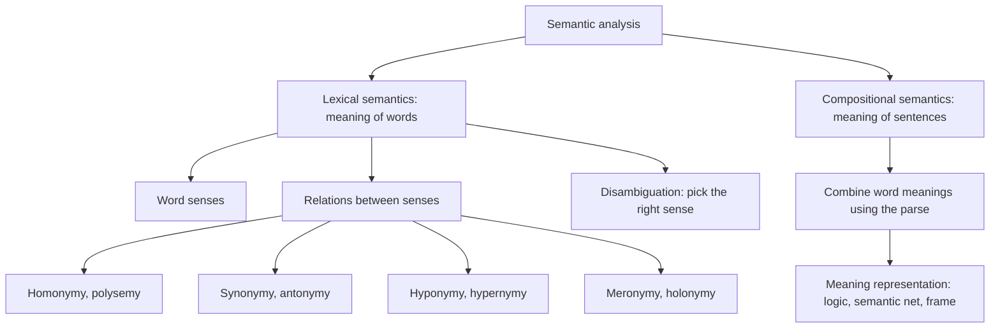
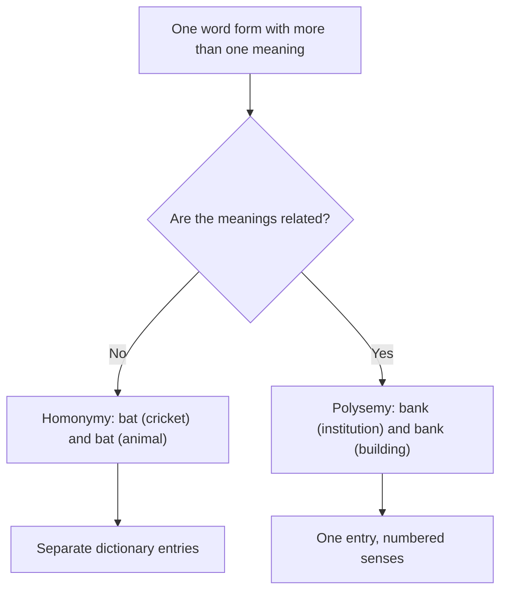
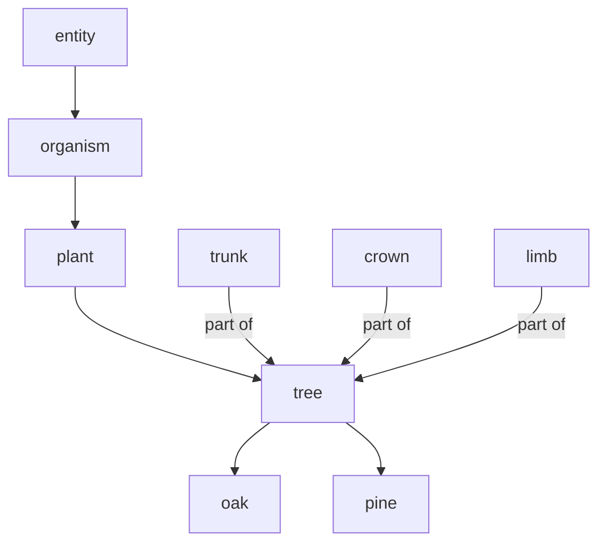
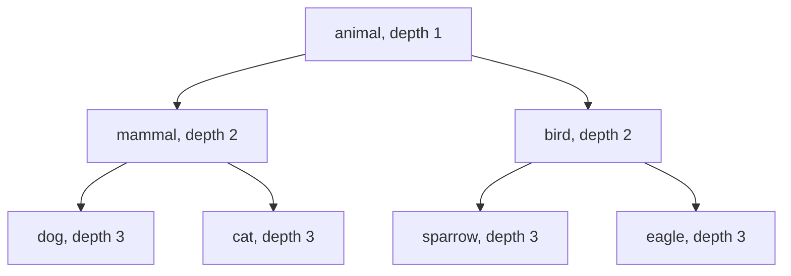

This note is syllabus <Syl m="4" />: 4.1 introduction and meaning representation, 4.2 lexical semantics, 4.3 corpus study, 4.4 dictionaries such as WordNet and BabelNet, 4.5 relations among lexemes and their senses, 4.6 semantic ambiguity. Word sense disambiguation (4.7 to 4.9) has its own note.

## The basics first

- A **word form** is the actual string in the text: *runs*, *ran*. A **lexeme** is the abstract dictionary word behind all its forms; the lexeme RUN covers *run, runs, ran, running*. <Cite id="lexical-semantics-wiki-lexeme" />
- The **lemma** (citation form) is the one form chosen to stand for the lexeme, the headword in a dictionary. *Ran* has the lemma *run*. See <Syl m="2" /> "lemmatization".
- A **sense** is one meaning of a word. The word *bank* has several senses, so it has several entries in a dictionary.
- The **lexicon** is the collection of all the words of a language (or of a program) with their meanings.
- **Syntax** is about the form of a sentence (grammar). **Semantics** is about its meaning. A sentence can be grammatical and still meaningless: *Colourless green ideas sleep furiously.*

## Semantic analysis: the big picture

**What it is.** Semantic analysis is the NLP step that finds the meaning of text. Earlier steps (lexical analysis, parsing) only look at words and grammar; semantic analysis asks "what does this actually say?" It tries to draw the exact, dictionary-level meaning from the text. <Cite id="lexical-semantics-tp-semantic" /> <Cite id="lexical-semantics-gfg-semantic" />

**Why it is needed.** A parse tree does not tell the computer that *bank* in "river bank" is not a place to keep money. Search, question answering, translation, chatbots and summarisation all need meaning, not just grammar. Compare *Students love GeeksforGeeks* and *GeeksforGeeks loves Students*: the same words, a different meaning, so both word meaning and word order matter. <Cite id="lexical-semantics-gfg-semantic" />

**Everyday analogy.** Reading a sentence is like reading a recipe. Syntax checks that the sentence is built correctly. Semantics checks that "add a cup of salt" is something you can actually cook with, and that "cup" means a measuring cup, not a trophy.

<Box kind="definition">

**Semantic analysis** is the process of finding the meaning of words, phrases and sentences in context. It has two parts:

1. **Lexical semantics:** the meaning of individual words and the relations between word meanings.
2. **Compositional semantics:** how the meanings of words combine, following the grammar, into the meaning of a phrase or sentence.

</Box>



Redrawn from the structure on the GeeksforGeeks page, which splits semantic analysis into lexical and compositional parts. <Cite id="lexical-semantics-gfg-semantic" loc="diagram" /> <Cite id="lexical-semantics-av-semantic" />

<Box kind="exam">

**Describe semantic analysis in NLP (5 marks):** give the definition, the two parts (lexical and compositional), the main tasks (word sense disambiguation, relationship extraction), the lexical relations in one line each, meaning representation (FOPL, semantic net, frame) with one example, and two applications (chatbots, question answering). Draw the small diagram above. <PYQ id="2024-05-ce/q1d" />

</Box>

## Meaning representation (4.1)

**What it is.** A meaning representation is a formal, machine-readable structure that stores the meaning of a sentence. It links language to things outside language and gives one unambiguous (canonical) form for sentences that mean the same. <Cite id="lexical-semantics-tp-semantic" />

The building blocks are **entities** (a particular person or thing, *Delhi*), **concepts** (general categories, *city*), **relations** (links between them, *Delhi is a city*) and **predicates** (verb structures, *eats*). <Cite id="lexical-semantics-gfg-semantic" />

| Approach | Idea | Tiny example |
|---|---|---|
| First-order predicate logic (FOPL) | Predicates, variables and quantifiers | *Maya eats an apple*: $\exists x\,(\text{Apple}(x) \land \text{Eats}(\text{Maya}, x))$ |
| Semantic net | Graph: nodes are concepts, edges are relations such as is-a and has-part | canary --is-a--> bird --has-part--> wings |
| Frame | A record with slots and values for one situation | EATING: eater = Maya, food = apple |

<Cite id="lexical-semantics-slp3-appH" /> <Cite id="lexical-semantics-wiki-semnet" /> Other approaches the study sites list are conceptual dependency, case grammar and conceptual graphs. <Cite id="lexical-semantics-gfg-semantic" />

## Lexical semantics (4.2)

<Box kind="definition">

**Lexical semantics** is the study of word meanings: how words structure their meaning, how the senses of a word relate to each other, and how words relate to other words. Its units are lexical items: words, sub-words, affixes, compound words and phrases. <Cite id="lexical-semantics-wiki-lexsem" /> <Cite id="lexical-semantics-av-semantic" />

</Box>

Lexical semantic analysis works in three steps: **classify** the lexical items (noun, verb, ...), **decompose** them (for example *unhappy* = un + happy), and **compare** their meanings to find what is the same and what is different. <Cite id="lexical-semantics-av-semantic" />

### Worked example: lexical semantic analysis of one sentence

Sentence: *The bank approved the loan.*

| Word | Lemma | Class | Possible senses (examples) | Sense chosen from context |
|---|---|---|---|---|
| The | the | determiner | none to choose (function word) | not needed |
| bank | bank | noun | (1) institution that keeps money; (2) sloping land beside a river | (1), because *approved* and *loan* are money words |
| approved | approve | verb | (1) officially agree to; (2) think well of | (1) officially agree to, because the subject is an institution |
| loan | loan | noun | (1) money lent that must be repaid; (2) the act of lending | (1) money lent |

Steps in words: split into words, find lemma and class, list the senses of each content word, pick the sense that fits the neighbouring words (this is word sense disambiguation, see its own note), and then relate the chosen senses: *bank* (1) is the agent of *approve*, and *loan* is what is approved. The meaning can then be written as $\text{Approve}(\text{Bank}_1, \text{Loan}_1)$. <Cite id="lexical-semantics-gfg-nltk-semantic" /> <Cite id="lexical-semantics-slp3-appI" />

<Box kind="exam">

**Demonstrate lexical semantic analysis using an example (10 marks):** write the definition, then the three steps (classify, decompose, compare), then a worked sentence like the table above with senses and the chosen sense, then the relations used (homonymy for *bank*, hyponymy and synonymy from WordNet), then a short diagram and a one-line conclusion. <PYQ id="2024-05-ce/q4b" />

</Box>

## Relations among lexemes and their senses (4.5)

The meaning of a word is not isolated. It is connected to other words by a small set of relations. Two of them are about **one word form with several meanings** (homonymy, polysemy); the others are about **two different words** (synonymy, antonymy, hyponymy and hypernymy, meronymy and holonymy).

| Relation | Plain meaning | Example |
|---|---|---|
| Homonymy | Same form, **unrelated** meanings | *bat* (cricket bat / flying mammal) |
| Polysemy | Same form, **related** meanings | *bank* (institution / its building) |
| Synonymy | Different words, **same or similar** meaning | *begin*, *start* |
| Antonymy | **Opposite** meaning | *hot*, *cold* |
| Hyponymy / hypernymy | **Kind-of** (specific / general) | *dog* / *animal* |
| Meronymy / holonymy | **Part-of** (part / whole) | *wheel* / *car* |

### Homonymy and polysemy

**Homonymy.** Words that are spelled or pronounced the same but have different, unrelated meanings. They usually come from different origins by accident. *Bat* (a cricket bat) and *bat* (a flying animal) are homonyms. There are two sub-kinds: **homographs** (same spelling, maybe different sound: *row* a boat, *row* of seats) and **homophones** (same sound, maybe different spelling: *see* and *sea*). A word that is both is a strict homonym, such as *stalk* (of a plant) and *stalk* (to follow). <Cite id="lexical-semantics-wiki-homonym" /> <Cite id="lexical-semantics-tp-semantic" />

**Polysemy.** One word with two or more **related** meanings that grew from a common origin. *Bank* can be the financial institution, the building in which it sits, and the verb "to rely on". *Mouth* of a river and *mouth* of a person are related by shape and function. <Cite id="lexical-semantics-av-semantic" /> <Cite id="lexical-semantics-wiki-homonym" /> <Cite id="ambiguity-challenges-wiki-polysemy" />

**How to tell them apart.** Ask "are the meanings connected in a way a speaker can feel?" and check the word origin (etymology). The line is often subjective; dictionaries give homonyms separate entries and polysemes one entry with numbered senses. <Cite id="lexical-semantics-wiki-homonym" /> <Cite id="lexical-semantics-slp3-appI" />



<Box kind="pitfall">

Homonymy and polysemy are both "one form, many meanings". Do not call every case homonymy. The test is whether the meanings are **related**. Also, *bank* (river) versus *bank* (money) is the standard homonym example, while *bank* (money) versus *bank* (building) is polysemy. Say which pair you mean.

</Box>

### Synonymy

Different words with the same or very close meaning: *begin, start, commence*; *big, large*. The usual test is **substitution**: if one word can replace the other in a sentence without changing the meaning, they are synonyms. Perfect synonyms are rare because words differ in formality (*feline* is more formal than *cat*), connotation and where they can be used: *long* and *extended* work in "long time", but not in "extended family". Words with only similar meaning are **near-synonyms**. Synonymy is really a relation between **senses**, not whole words. <Cite id="lexical-semantics-wiki-synonym" /> <Cite id="lexical-semantics-slp3-appI" />

### Antonymy

Words with opposite meanings. Three kinds are usually named. <Cite id="lexical-semantics-wiki-antonym" />

| Kind | Meaning | Examples |
|---|---|---|
| Gradable | Two ends of a scale; middle values exist | hot / cold, heavy / light |
| Complementary | Exactly one is true; nothing in between | alive / dead, occupied / vacant |
| Relational (converse) | Same relationship seen from the other side | teacher / pupil, buy / sell |

Other examples on study sites are *life/death*, *rich/poor* and *author/writer* (that last one is a synonym pair, not an antonym pair). <Cite id="lexical-semantics-av-semantic" /> <Cite id="lexical-semantics-tp-semantic" />

### Hyponymy and hypernymy

**Hyponymy** is the "is-a-kind-of" relation. The specific word is the **hyponym**; the general word is the **hypernym** (also called the supertype or umbrella term). *Dog* is a hyponym of *animal*; *animal* is a hypernym of *dog*. In computer science this is the **is-a** link. <Cite id="lexical-semantics-wiki-hyponymy" />

- **Transitive:** violet is a kind of purple, purple is a kind of colour, so violet is a kind of colour.
- **Co-hyponyms** share a hypernym: *hammer* and *knife* are both tools.
- **Test:** "X is a kind of Y" must sound right. "A dog is a kind of animal" works; "a wheel is a kind of car" does not (that is meronymy).

<Cite id="lexical-semantics-wiki-hyponymy" /> Example from the study sites: *colour* is the hypernym of *blue, yellow, green*. <Cite id="lexical-semantics-av-semantic" />

### Meronymy and holonymy

**Meronymy** is the **part-of** relation. The part is the **meronym**, the whole is the **holonym**. *Finger* is a meronym of *hand*; *engine* is a meronym of *car*; *car* is a holonym of *wheel*. Parts of the same whole (leaves, branches, trunk and roots of a tree) are **co-meronyms**. Do not mix it up with hypernymy: *tree* is a holonym of *leaf* (a leaf is part of a tree) but a hypernym of *oak* (an oak is a kind of tree). <Cite id="lexical-semantics-wiki-meronymy" />

WordNet separates three kinds of part-whole link: **part** (trunk of a tree), **substance** (heartwood of a tree) and **member** (a tree is a member of a forest). <Cite id="lexical-semantics-nltk-ch2" />



Redrawn from the inheritance-tree picture of hypernyms and hyponyms on the GeeksforGeeks synsets page; the tree parts (trunk, crown, limb) are the part meronyms that NLTK returns for the WordNet synset tree.n.01. <Cite id="lexical-semantics-gfg-synsets" loc="diagram" /> <Cite id="lexical-semantics-nltk-ch2" />

### Comparison of the relations

| Pair | Same form? | Same meaning? | Direction |
|---|---|---|---|
| Homonymy | yes | no, unrelated | none |
| Polysemy | yes | no, but related | none |
| Synonymy | no | yes, or nearly | both ways |
| Antonymy | no | opposite | both ways |
| Hyponymy / hypernymy | no | specific / general | one way, is-a |
| Meronymy / holonymy | no | part / whole | one way, part-of |

<Box kind="exam">

**Relationships between word meanings (5 or 10 marks):** define each relation in one line, give one example and, for hyponymy and meronymy, say which word is which (hyponym is the specific word, holonym is the whole). For 10 marks add the homonymy-versus-polysemy test, the three kinds of antonyms, and a small table. Question versions: Homonymy, Polysemy, Synonymy, Antonymy <PYQ id="2022-12-ce/q1e" />; Hyponymy, Hypernymy, Meronymy, Holonymy <PYQ id="2023-12-ce/q1d" />; all seven <PYQ id="2024-12/q3a" />.

</Box>

## Corpus study (4.3)

**What it is.** A **corpus** (plural corpora) is a large, organised collection of real text or speech. **Corpus linguistics** studies language by counting and examining what people actually wrote or said, not what a rule book says. <Cite id="lexical-semantics-wiki-corpus" />

**Why it is needed for meaning.** The senses of a word, and which words behave alike, are visible in the company a word keeps. Dictionary makers use corpora to find senses and examples: the *American Heritage Dictionary* (1969) was the first dictionary compiled with corpus linguistics, and Collins COBUILD was built from the Bank of English. <Cite id="lexical-semantics-wiki-corpus" />

**Example corpus.** The Brown Corpus holds about one million words of American English from 1961, taken from 500 text samples in many genres, and was the first computerised corpus built for linguistic research. NLTK ships it and other corpora. <Cite id="lexical-semantics-wiki-corpus" /> <Cite id="lexical-semantics-nltk-ch2" />

**How a corpus gives meaning.** Count which words appear near a target word. Words with similar neighbours have similar meanings (*dog* and *cat* both appear near *pet* and *fur*; *car* appears near *road*). This idea turns every word into a vector of counts, which can be compared with cosine similarity (see Example 3). Modern embeddings are a dense version of it. <Cite id="lexical-semantics-slp3-ch5" /> <Cite id="text-preprocessing-fsnlp" />

## Dictionaries: WordNet and BabelNet (4.4)

### WordNet

<Box kind="definition">

**WordNet** is a large lexical database of English, built at Princeton. It groups nouns, verbs, adjectives and adverbs into sets of cognitive synonyms called **synsets**, each with a short definition (gloss) and example sentences, and links the synsets by semantic relations. It is like a dictionary and a thesaurus joined into one network. <Cite id="lexical-semantics-wiki-wordnet" /> <Cite id="lexical-semantics-gfg-synsets" />

</Box>

- A **synset** is one concept. Each sense of a polysemous word sits in a different synset. In NLTK, `car.n.01` is the synset with lemmas *car, auto, automobile, machine, motorcar*; its definition is "a motor vehicle with four wheels; usually propelled by an internal combustion engine". The word *car* belongs to five synsets in all, so it has five senses. <Cite id="lexical-semantics-nltk-ch2" />
- The name `car.n.01` reads: word *car*, part of speech noun (`n`), first sense (`01`).
- Function words (prepositions, determiners) are not included. <Cite id="lexical-semantics-wiki-wordnet" />
- It is free to download under a BSD-style licence. Wikipedia lists about 161,705 words and 120,630 synsets in its infobox (its database section gives different counts, so treat the size as roughly 150,000 words and 120,000 synsets). The project is no longer in active development; community projects such as Open English WordNet continue it. <Cite id="lexical-semantics-wiki-wordnet" />

| Relation | Between | Meaning | Example |
|---|---|---|---|
| Synonymy | words in a synset | same concept | car, automobile |
| Hypernym / hyponym | noun synsets (also verbs) | general / specific | motor vehicle / car |
| Meronym / holonym | noun synsets | part / whole | trunk / tree |
| Antonym | word senses (lemmas) | opposite | supply / demand |
| Entailment | verbs | doing one implies the other | eat entails chew, swallow |
| Troponym | verbs | a particular way of doing | whisper is a way to speak |

<Cite id="lexical-semantics-wiki-wordnet" /> <Cite id="lexical-semantics-nltk-ch2" /> Antonymy is stored between **lemmas**, not synsets, because it links particular words, so in NLTK you call `.antonyms()` on a lemma. <Cite id="lexical-semantics-nltk-wordnet-howto" />

Real output from NLTK (the dog synset): hypernyms are `canine.n.02` and `domestic_animal.n.01`; breeds such as `corgi.n.01` and `dalmatian.n.02` are hyponyms. The `motorcar` synset has the hypernym `motor_vehicle.n.01`, and all noun paths end at the root `entity.n.01`. <Cite id="lexical-semantics-nltk-wordnet-howto" /> <Cite id="lexical-semantics-nltk-ch2" />

```python
from nltk.corpus import wordnet as wn
wn.synsets("car")                      # five synsets
wn.synset("car.n.01").lemma_names()    # ['car', 'auto', 'automobile', 'machine', 'motorcar']
wn.synset("dog.n.01").hypernyms()      # [canine.n.02, domestic_animal.n.01]
wn.synset("tree.n.01").part_meronyms() # trunk, crown, limb, ...
```

<Cite id="lexical-semantics-nltk-ch2" /> <Cite id="lexical-semantics-gfg-synonyms" />

### BabelNet

**BabelNet** is a multilingual semantic network and encyclopedic dictionary from the Sapienza University of Rome (Roberto Navigli's group). It was built by automatically linking Wikipedia to WordNet, and filling gaps in smaller languages with machine translation. Like WordNet it has synsets, but a Babel synset holds words from many languages, with definitions from WordNet and Wikipedia and extra content from Wiktionary, Wikidata, FrameNet and VerbNet. Version 5.3 (December 2023) covers about 600 languages and nearly 23 million synsets. Uses: multilingual word sense disambiguation, entity linking, semantic relatedness. <Cite id="lexical-semantics-wiki-babelnet" />

| | WordNet | BabelNet |
|---|---|---|
| Languages | English (other languages through separate projects) | about 600 |
| Built from | Hand-built by lexicographers | Automatic merge of WordNet, Wikipedia and more |
| Unit | Synset | Babel synset (words from many languages) |
| Coverage | Words only (nouns, verbs, adjectives, adverbs) | Words and named entities (people, places) |
| Typical use | English sense and similarity work | Multilingual work, entity linking |

<Cite id="lexical-semantics-wiki-wordnet" /> <Cite id="lexical-semantics-wiki-babelnet" />

<Box kind="exam">

**Explain WordNet / study of dictionaries (5 marks):** definition, synsets with the `car.n.01` example, the relation table (hypernym, hyponym, meronym, holonym, antonym), one use (word sense disambiguation, similarity), then BabelNet in two lines (multilingual, WordNet plus Wikipedia). Add the hierarchy diagram.

</Box>

## Measuring how close two meanings are

Because WordNet is a tree of is-a links, closeness of meaning can be turned into a number by looking at the tree. We use a small tree so every number can be checked by hand.



<Cite id="lexical-semantics-gfg-path" loc="diagram" />

**Path similarity.** Count the edges on the shortest path between the two synsets; shorter means closer.

$$
\text{path\_sim}(a,b) = \frac{1}{1 + \text{shortest path length}}
$$

The score is between 0 and 1; 1 means the same synset. <Cite id="lexical-semantics-gfg-path" />

**Wu-Palmer similarity.** Find the **least common subsumer (LCS)**: the lowest word that is a hypernym of both. Then compare its depth with the depths of the two words.

$$
\text{wup}(a,b) = \frac{2 \times \text{depth}(\text{LCS})}{\text{depth}(a) + \text{depth}(b)}
$$

Here depth counts the root as 1, so the score is never 0. It was proposed by Wu and Palmer in 1994. <Cite id="lexical-semantics-gfg-wup" /> <Cite id="lexical-semantics-wupalmer1994" />

### Example 1: path similarity

<Sum>

<Given>

The tree above. Pairs: (dog, cat), (dog, sparrow), (dog, mammal).

</Given>

<Find>

the path similarity of each pair.

</Find>

<Steps>

1. dog and cat: the path is dog, mammal, cat. That is 2 edges. *Reason: path length is the number of edges, not the number of nodes.*
2. $\text{path\_sim} = 1/(1+2) = 1/3 = 0.333$.
3. dog and sparrow: the path is dog, mammal, animal, bird, sparrow. That is 4 edges, so $1/(1+4) = 1/5 = 0.2$.
4. dog and mammal: 1 edge, so $1/(1+1) = 1/2 = 0.5$.

</Steps>

<Answer>

path_sim(dog, cat) = 0.333; path_sim(dog, sparrow) = 0.2; path_sim(dog, mammal) = 0.5

</Answer>

<Box kind="verify">

Check by working backwards: $1/0.333 = 3$, minus 1 gives 2 edges; $1/0.2 = 5$, minus 1 gives 4 edges; $1/0.5 = 2$, minus 1 gives 1 edge. Shorter path gave the bigger score, as it should. The same formula on NLTK's whale example gives path_sim = 0.25 for a path of 3 edges ($1/(1+3)$), the value NLTK prints for right_whale and minke_whale. <Cite id="lexical-semantics-nltk-ch2" />

</Box>

</Sum>

### Example 2: Wu-Palmer similarity

<Sum>

<Given>

The same tree with the root *animal* at depth 1. Pairs: (dog, cat), (dog, sparrow), (dog, mammal).

</Given>

<Find>

the Wu-Palmer similarity of each pair.

</Find>

<Steps>

1. dog and cat: their lowest common hypernym (LCS) is *mammal*, depth 2. Depths: dog 3, cat 3. *Reason: the LCS is the nearest ancestor shared by both.*
2. $\text{wup} = 2 \times 2 / (3+3) = 4/6 = 0.667$.
3. dog and sparrow: the LCS is *animal*, depth 1. $\text{wup} = 2 \times 1/(3+3) = 2/6 = 0.333$.
4. dog and mammal: the LCS is *mammal* itself (a word is its own ancestor), depth 2. Depths: dog 3, mammal 2. $\text{wup} = 2 \times 2/(3+2) = 4/5 = 0.8$.

</Steps>

<Answer>

wup(dog, cat) = 0.667; wup(dog, sparrow) = 0.333; wup(dog, mammal) = 0.8

</Answer>

<Box kind="verify">

Same word twice, for example (dog, dog): LCS is dog, depth 3, so $2 \times 3/(3+3) = 1$, the maximum. All scores lie between 0 and 1. The ranking agrees with path similarity (dog-mammal closest, then dog-cat, then dog-sparrow). The two measures differ in the numbers, not the order, here.

</Box>

</Sum>

### Example 3: cosine similarity from a corpus

A corpus gives each word a vector of counts of nearby context words. Two words are similar when their vectors point the same way. The cosine of the angle between vectors $u$ and $v$ is

$$
\cos(u,v) = \frac{u \cdot v}{|u|\,|v|}
$$

where $u \cdot v$ is the sum of products of matching numbers and $|u|$ is the square root of the sum of squares. <Cite id="lexical-semantics-slp3-ch5" />

<Sum>

<Given>

Counts of how often each word appeared near three context words, in the order (pet, fur, road): dog = (3, 4, 0), cat = (4, 3, 0), car = (0, 1, 5).

</Given>

<Find>

cos(dog, cat) and cos(dog, car).

</Find>

<Steps>

1. Lengths: $|\text{dog}| = \sqrt{9+16+0} = 5$; $|\text{cat}| = \sqrt{16+9+0} = 5$; $|\text{car}| = \sqrt{0+1+25} = \sqrt{26} = 5.099$.
2. dog . cat $= 3\times4 + 4\times3 + 0\times0 = 24$. So $\cos(\text{dog},\text{cat}) = 24/(5 \times 5) = 24/25 = 0.96$.
3. dog . car $= 3\times0 + 4\times1 + 0\times5 = 4$. So $\cos(\text{dog},\text{car}) = 4/(5 \times 5.099) = 4/25.495 = 0.157$.

</Steps>

<Answer>

cos(dog, cat) = 0.96 and cos(dog, car) = 0.157, so dog is far closer to cat than to car.

</Answer>

<Box kind="verify">

Recompute dog . cat in the other order: $4\times3 + 3\times4 = 24$, the same. The cosine of non-negative count vectors lies between 0 and 1: 0.96 is near 1 (almost same direction) and 0.157 is near 0 (almost unrelated). The answer matches the idea: dog and cat share the contexts *pet* and *fur*, car does not.

</Box>

</Sum>

## Semantic ambiguity (4.6)

**Semantic (lexical) ambiguity** means one word or sentence has more than one possible meaning. It comes straight from homonymy and polysemy: *bank*, *bat*, *bark*, *rock* (stone or music). The sentence *I went to the bank* is ambiguous until context tells us which bank. Choosing the right sense from context is **word sense disambiguation (WSD)**, covered in its own note with Lesk's algorithm and supervised methods. <Cite id="lexical-semantics-gfg-semantic" /> <Cite id="lexical-semantics-slp3-appI" />

## Advantages and limits

- **Good:** WordNet and corpora give programs a structured, free store of word meaning; relations like hypernym and part-of support search, translation, question answering and similarity.
- **Limits:** hand-built resources miss new words and slang and need years of work; WordNet senses are sometimes too fine for a program to separate; words have different meanings in different domains; homonymy versus polysemy is partly a judgement call; most resources cover English far better than other languages (BabelNet helps). <Cite id="lexical-semantics-wiki-wordnet" /> <Cite id="lexical-semantics-wiki-babelnet" /> <Cite id="lexical-semantics-wiki-homonym" />

## Conclusion

Lexical semantics describes the meaning of words and the web of relations between them: same form with different meanings (homonymy, polysemy), same meaning with different forms (synonymy), opposites (antonymy), kind-of (hyponymy) and part-of (meronymy). WordNet and BabelNet store these relations; corpora and similarity measures turn them into numbers. These pieces together let a system pick the correct sense of an ambiguous word.
