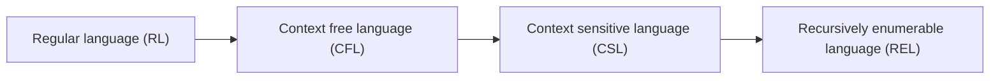
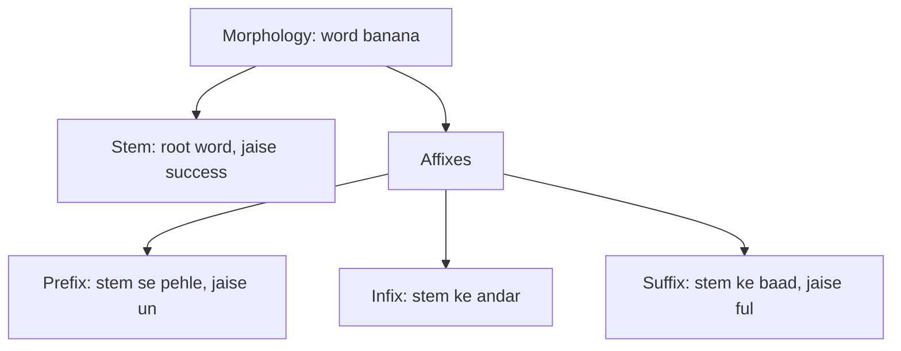
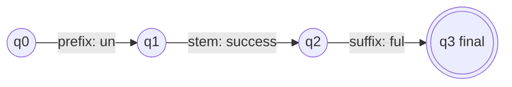
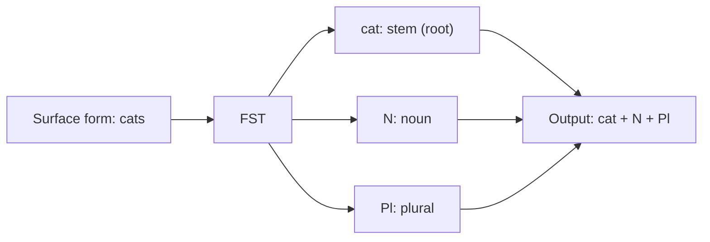
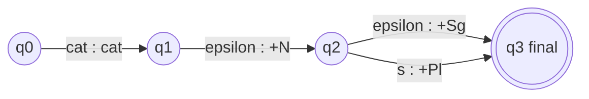
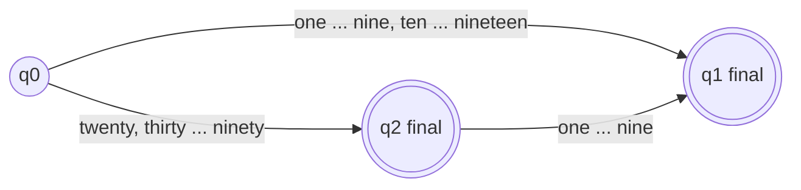

Naye ideas se pehle wo purani baatein jo chahiye. Agar aapko pata hai to seedha agle section par jao.

## Basics pehle

- **Word** chhote meaningful parts se bana hota hai. **Morphology** padhti hai ki kaise.
- Main part **stem** (root word) hai. Uske saath jude chhote parts **affixes** hain. <Cite id="class-nlp-m2" loc="p. 4" />
- **Automaton** ek simple machine hai jisme kuch states hote hain, jo input ek symbol ek baar mein padhti hai aur aakhir mein yes ya no bolti hai.

## Computational theory, languages aur regular expressions

Class Module 2 theory se shuru karti hai. Computational theory (C.T.) teen cheezein padhti hai: **Language** (L), **Automata** (A) aur **Grammar** (G). <Cite id="class-nlp-m2" loc="p. 1" />

**Language operands** <Cite id="class-nlp-m2" loc="p. 1" />

| Term | Matlab | Example |
|---|---|---|
| Symbols | Single characters | a, b, c, d ya 0, 1, 2, 3 |
| Alphabet | Inputs ka finite set | \{a, b, c\} ya \{0, 1, 2\} |
| String | Alphabet symbols ka collection | aa, bb |
| Language | Strings ka collection | \{aa, ab, ba, bb\} |

**Regular expression ke operations** <Cite id="class-nlp-m2" loc="p. 2" />

| Symbol | Naam | Matlab |
|---|---|---|
| Sigma | Input alphabet | Finite set, jaise Sigma = \{a, b\} ya \{0, 1\} |
| epsilon | Empty string | Language \{epsilon\} |
| phi | Empty set | \{ \} |
| + ya union | Union | a + b matlab either a ya b, yaani \{a, b\} |
| . | Concatenation | a . b se \{ab\} milta hai |
| star aur plus | Kleene closure (Kleene star) | `a+` se \{a, aa, aaa, ...\}; `a*` se \{epsilon, a, aa, aaa, ...\} |

**Class ka example.** L = Sigma = \{a, b\} par exactly length 2 wali saari strings ka set. Language \{aa, ab, ba, bb\} hai. Regular expression aa + ab + ba + bb hai, jo (a+b)(a+b) bhi likha ja sakta hai. <Cite id="class-nlp-m2" loc="p. 3" />

**Star se savdhan.** Star apne se theek pehle wale single letter par lagta hai: `ab*` matlab a ke baad koi bhi sankhya mein b, yaani language \{a, ab, abb, ...\}. Language \{epsilon, ab, abab, ...\} `(ab)*` ki hai, jo table ka `(a.b)*` hai. Table mein `(a+b)*` ki list sirf shuruaat hai; asli language mein infinite strings hoti hain.

## Finite state automaton (FSA)

<Box kind="definition">

**FSA / FSM:** it comprises a finite set of states (Q) which accepts a finite set of inputs (Sigma). <Cite id="class-nlp-m2" loc="p. 4" />

</Box>

FSA ke parts ye hain. <Cite id="class-nlp-m2" loc="p. 4" />

| Part | Naam | Matlab |
|---|---|---|
| Q | States | States ka finite set |
| Sigma | Inputs | Input symbols ka finite set |
| delta | Transition function | delta: Q x Sigma to Q (ek state se, ek symbol par, ek state mein jao) |
| q0 | Start state | Jahan se padhna shuru hota hai |
| F | Final states | Machine yahan khatam ho to accept karti hai |

Transition diagram mein har state ek circle hai, har arrow ek transition hai jis par input likha hota hai, start state mein ek arrow aata hai, aur final state double circle se draw hota hai. Machine ka jawab yes ya no (accept ya reject) hota hai.

## FSA ke saath morphology

Morphology mein FSA words ko create (make) karne ke liye use hota hai. Word = **stem** (root word) + **affixes** (prefix, infix, suffix). <Cite id="class-nlp-m2" loc="p. 4" />

Teacher stem se word banane ke har tareeke ke liye ek chhota FSA draw karte hain. <Cite id="class-nlp-m2" loc="p. 5" />

| Stem | Prefix ke saath | Suffix ke saath | Dono ke saath |
|---|---|---|---|
| success | unsuccess | successful | unsuccessful |
| friend | unfriend | friendly | unfriendly |
| do | undo | doable | undoable |
| break | unbreak | breakable | unbreakable |
| install | preinstall | installment | preinstallment |
| cipher | decipher | ciphered | deciphered |

<Cite id="class-nlp-m2" loc="p. 5" /> <Cite id="class-nlp-m2" loc="p. 6" /> <Cite id="class-nlp-m2" loc="p. 7" />

Beech ke kuch forms (unsuccess, unbreak) roz ki English ke words nahi hain. Wo sirf dikhate hain ki automaton states mein kaise chalta hai; poore words (unsuccessful, unbreakable) hi asli hain.

## Affixes aur unke types

<Box kind="definition">

**Affix:** a bound morpheme added to the root or stem of a word to alter its meaning, create a new word, or change its grammatical function. <Cite id="class-nlp-pyq2" loc="p. 3" />

</Box>

Position ke hisaab se types: <Cite id="class-nlp-pyq2" loc="p. 3" />

| Type | Kahan judta hai | Example |
|---|---|---|
| Prefix | Root word ki shuruaat mein | unhappy mein un- meaning ko opposite bana deta hai |
| Suffix | Root word ke end mein | walked mein -ed, happiness mein -ness |
| Infix | Root word ke andar directly daala jaata hai | English mein rare ya nahi hota, doosri languages mein milta hai |

## Inflectional aur derivational morphology

<Box kind="definition">

**Inflectional morphology** is the study of the processes, including affixation and vowel change, that distinguish word forms in certain grammatical categories. **Derivational morphology** is concerned with forming new lexemes, that is, words that differ either in syntactic category (part of speech) or in meaning from their bases. <Cite id="class-nlp-pyq2" loc="p. 3" /> <Cite id="class-nlp-pyq2" loc="p. 4" />

</Box>

| Point | Inflectional | Derivational |
|---|---|---|
| Kya karti hai | Maujood words mein changes | Naye words ka creation |
| Result | Wahi word, alag form | Alag word, aksar alag part of speech ya meaning |
| Categories | Number, tense, person, case, gender | Part of speech ya meaning |
| Examples | School se schools, walk se walked, man se men, go se going, dog se dogs, call se called, short se shorter aur shortest | paint (verb) + er se painter (noun, jo paint karta hai) |

English ke inflectional affixes: nouns par plural -s (dog, dogs), verbs par past tense -ed (call, called), third person singular -s, present participle -ing, aur short adjectives par comparative aur superlative ke liye -er aur -est. <Cite id="class-nlp-pyq2" loc="p. 3" />

FSA drawings se: success + ful aur friend + ly (noun se adjective), aur install + ment (verb se noun) derivational hain. <Cite id="class-nlp-m2" loc="p. 5" /> <Cite id="class-nlp-m2" loc="p. 7" />

## Morphological analysis mein FSA ka role

Finite State Automata (FSA) morphemes se valid words banane ke rules ko represent karke morphological analysis mein important role nibhate hain. States word formation ke alag stages dikhate hain, jabki transitions possible stems, prefixes, suffixes aur grammatical features dikhate hain. Automaton check karta hai ki morphemes ki di gayi sequence valid word banati hai ya nahi. <Cite id="class-nlp-pyq2" loc="p. 6" />

Example: word "cats" ka structure cat + Noun + Plural hai. <Cite id="class-nlp-pyq2" loc="p. 6" />

**Role:** <Cite id="class-nlp-pyq2" loc="p. 6" />

- Valid morphological rules aur word structures represent karta hai.
- Stems, affixes aur grammatical features pehchaanne mein madad karta hai.
- Check karta hai ki word valid morphological patterns follow karta hai ya nahi.
- Morphological analysis aur word generation support karta hai.
- Ek efficient rule-based approach deta hai, khaaskar rich inflection wali languages ke liye.

## Morphological analysis ka output

Morphological analysis word ka root ya stem aur uske grammatical features (noun, verb, singular, plural, tense) dhundta hai. Output **lemma (root) + morphological tags** hota hai. <Cite id="class-nlp-pyq2" loc="p. 9" />

| Word type | Input word | Output |
|---|---|---|
| Regular verb | walked | walk + V + Past |
| Irregular verb | went | go + V + Past |
| Singular noun | cat | cat + N + Sg |
| Plural noun | cats | cat + N + Pl |

Went se go kyun: surface form went alag hai, par uska lemma go hai. Isiliye irregular forms ko morphological analyser mein lexical information (dictionary) chahiye. <Cite id="class-nlp-pyq2" loc="p. 9" />

## Finite state transducer (FST)

<Box kind="definition">

**FST:** an extension of a finite state automaton that maps input sequences to output sequences. FSA sirf input accept ya reject karta hai; FST use transform karta hai. <Cite id="class-nlp-pyq2" loc="p. 9" />

</Box>

FST ki har transition par ek input symbol aur ek output symbol likha hota hai. FST ko $T = (Q, \Sigma, \Gamma, q_0, F)$ define kiya jaata hai, jahan $Q$ states ka finite set, $\Sigma$ input alphabet, $\Gamma$ output alphabet, $q_0 \in Q$ initial state aur $F \subseteq Q$ final states ka set hai. <Cite id="class-nlp-pyq2" loc="p. 9" /> <Cite id="class-nlp-pyq2" loc="p. 10" />

**Morphological parsing mein FST ka role.** Ye word ke surface form ko uske morphological representation se map karta hai (root ya stem aur noun, verb, singular, plural, tense wagairah): Surface word, phir FST, phir morphological analysis. <Cite id="class-nlp-pyq2" loc="p. 10" />

## Exams mein puchhe gaye par class files mein na wale designs

Ye teen standard hain; inhe chhota rakha gaya hai aur class ke FSAs ke style mein.

**Nouns aur verbs ke liye FSA (stem plus ending).**

| Word class | Path | Accept karta hai |
|---|---|---|
| Noun | q0, phir noun stem se q1 (final), phir plural -s se q2 (final) | cat, cats |
| Verb | q0, phir verb stem se q1 (final), phir -s, -ed ya -ing se q2 (final) | walk, walks, walked, walking |

Irregular forms (went, mice) ending rule se handle nahi hote; wo dictionary mein store hote hain.

**Regular aur plural nouns ke liye FST.** Har arc input:output likha hai, aur epsilon matlab koi symbol nahi.

To cat se cat + N + Sg milta hai aur cats se cat + N + Pl. Mice jaise irregular plural ke liye ek extra arc mice padhta hai aur mouse +N +Pl likhta hai.

**English numbers 1 se 99 ke liye FSA.**

Ye seven, thirteen, twenty aur forty two accept karta hai, aur twenty thirteen reject karta hai.

## Ye kahan puchha gaya

| Agar question kehta hai | Kya likhna hai | Kab aaya |
|---|---|---|
| "Role of FSA in morphological analysis" | Class ka answer, cats FSA, roles ki list | <PYQ id="2022-12-ce/q2a" /> <PYQ id="assignment-1/q2f" /> |
| "Output of morphological analysis for regular verb, irregular verb, singular noun, plural noun, and role of FST" | Chaar-row table, phir FST definition aur role | <PYQ id="2023-05-ce/q2b" /> <PYQ id="2025-05-ce/q1b" /> |
| "Define affixes, types of affixes" | Definition aur prefix, suffix, infix | <PYQ id="2022-12-ce/q1b" /> <PYQ id="2025-05/q1a" /> |
| "Inflectional and derivational morphology" | Definitions, comparison table, examples | <PYQ id="2024-05-ce/q2a" /> <PYQ id="2025-05/q2b" /> <PYQ id="2025-05-ce/q1a" /> |
| "FSA for nouns and verbs; FSA for numbers 1 to 99" | Upar ke do designs | <PYQ id="2023-12-ce/q2a" /> |
| "Design FST for regular and plural nouns" | Upar ka FST | <PYQ id="2024-12-ce/q2a" /> |

## Quick revision

- Language strings ka collection hai; alphabet inputs ka finite set. Regular expression operations: union (+), concatenation (.), Kleene star (`a*` matlab epsilon, a, aa, ...).
- FSA tuples: Q, Sigma, delta, q0, F. Ye accept ya reject karta hai.
- Morphology = stem + affixes (prefix, infix, suffix). Examples: unsuccessful, unfriendly, undoable, deciphered.
- Inflectional: same word ka naya form (school se schools). Derivational: naya word (paint se painter).
- FST surface ko analysis se map karta hai: cats se cat + N + Pl, went se go + V + Past.

**Conclusion.** FSA check karta hai ki stem aur affixes milkar valid word banate hain, aur FST aage jaakar word ko jaisa likha hai aur uske stem-plus-tags analysis ke beech convert karta hai. <Cite id="class-nlp-pyq2" loc="p. 6" />
