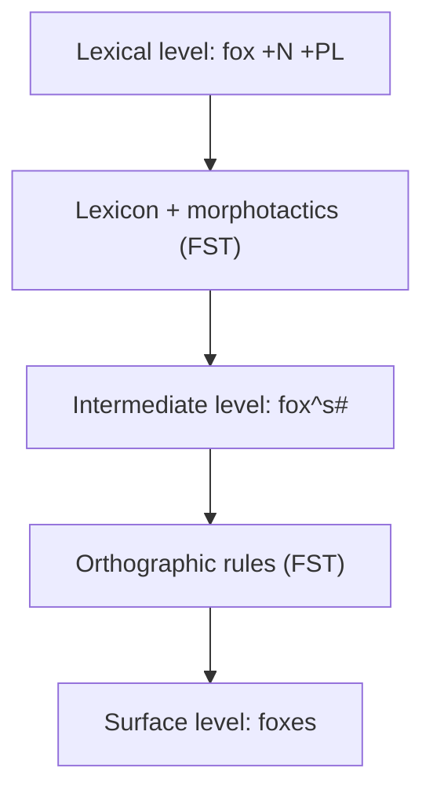
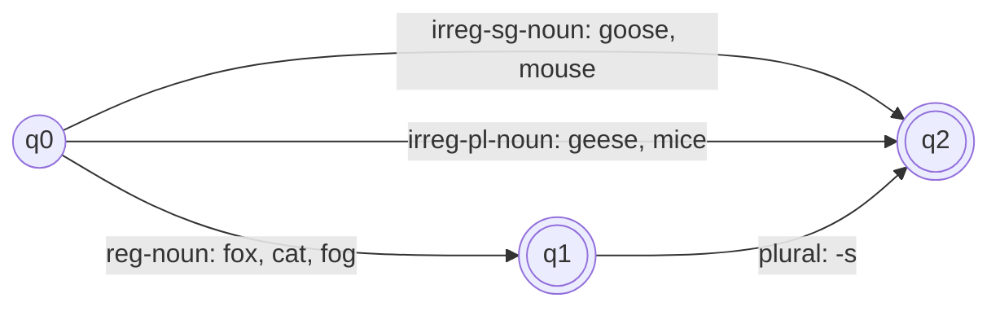
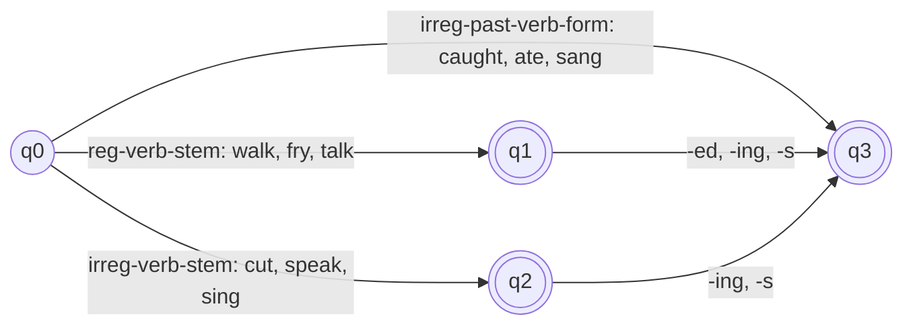
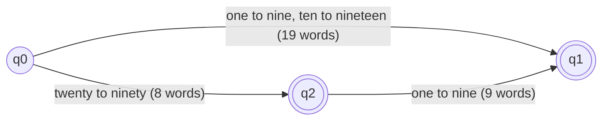
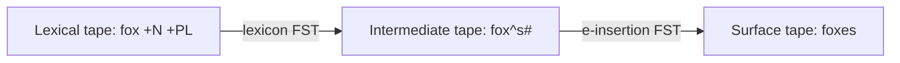
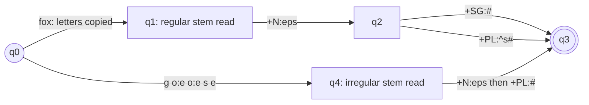

Naye concepts se pehle purane concepts yaad kar lete hain. Agar aapko pata hai, to seedha next section pe jao.

## Pehle basics

- **Word** wo unit hai jo hum spaces ke beech likhte hain, jaise `cats`. **Word form** word ka ek particular shape hai, jaise `cat` ya `cats`.
- **Morpheme** word ka sabse chhota part hai jisme meaning hoti hai. `cats` mein do hain: `cat` (janwar) aur `-s` (ek se zyada). <Cite id="morphology-fst-wiki-morpheme" />
- **Stem** (ya root) main morpheme hai jo word ko uski basic meaning deta hai. **Affix** ek chhota morpheme hai jo stem ke saath judta hai aur meaning ya grammatical detail add karta hai. <Cite id="morphology-fst-wiki-stem" /> <Cite id="morphology-fst-wiki-affix" />
- **Free morpheme** akela word ban sakta hai (`cat`, `walk`). **Bound morpheme** akela nahi reh sakta (`-s`, `-ing`, `un-`). <Cite id="morphology-fst-wiki-bound" />
- **Lexicon** system ki dictionary hai: stems aur affixes ki list, har ek ke baare mein thodi information ke saath (jaise "fox ek noun stem hai").
- **State machine** ek simple machine hai jo hamesha kuch **states** mein se exactly ek mein hoti hai, aur input symbol padhne pe doosri state mein jaati hai. **Finite state automaton (FSA)** aisi machine hai jisme ek start state aur kuch final (accepting) states hoti hain. <Cite id="morphology-fst-wiki-fsm" />
- **Tape** bas wo string hai jo machine padhti (input) ya likhti (output) hai, ek symbol ek baar mein.

## Morphology kya hai

**Ye kya hai.** Morphology ye study hai ki words chhote meaning-wale units, yaani morphemes, se kaise bante hain. NLP mein **morphological analysis** (ise morphological parsing bhi kehte hain) ka kaam hai word ko uske morphemes mein todna aur unko naam dena. <Cite id="morphology-fst-jm-ch3-notes" loc="slides 2-3" /> <Cite id="nlp-introduction-wiki-morph" /> <Cite id="morphology-fst-gfg-morph" /> Ye syllabus <Syl m="2" />, sections 2.2 aur 2.3 hai.

**Ye kyun zaroori hai.**

1. **Dictionary har word form list nahi kar sakti.** Language naye forms banati rehti hai (`googled`, `selfies`). Har verb ke liye `walk`, `walks`, `walked`, `walking` list karna space waste karta hai aur naye words phir bhi miss ho jaate hain. Morphological analyser stem ek baar aur rules ek baar store karta hai. <Cite id="morphology-fst-jm-ch3-notes" loc="slide 2" />
2. **Search aur stemming.** `foxes` search karne pe `fox` bhi milna chahiye. Iske liye stem chahiye.
3. **Machine translation aur spell checking** ko word ke andar chhupa tense, number aur part of speech jaanna padta hai. <Cite id="morphology-fst-wiki-parsing" />
4. **Hindi, Marathi, Turkish aur Finnish jaisi languages** word ke ending mein bahut information daal deti hain, isliye unhe English se bhi zyada morphology chahiye.

**Rozmarra ki analogy.** Word ek Lego model jaisa hai. Stem base block hai aur affixes chhote pieces hain jo click karke lagte hain. Morphological analysis model ko kholkar har piece ko naam dena hai. Morphological generation pieces ki list se model dobara banana hai.

<Box kind="definition">

**Morphology** words ke internal structure ki study hai: wo morphemes (stems aur affixes) se kaise bante hain. **Morphological analysis** `cats` jaise word ko leta hai aur uska stem aur features deta hai, `cat +N +PL`.

</Box>

## Affixes aur unke types

**Definition.** **Affix** ek bound morpheme hai jo stem ke saath judkar naya word ya word ka naya form banata hai. <Cite id="morphology-fst-wiki-affix" /> Ye main meaning nahi leta, meaning mein kuch add karta hai.

**Affixes ke types** (affix ki position type decide karti hai):

| Type | Kahan lagta hai | Example | Kya hota hai |
|---|---|---|---|
| Prefix | Stem se pehle | `un-` + `happy` = `unhappy`; `re-` + `write` = `rewrite` | Meaning badalta hai (yahan negative). |
| Suffix | Stem ke baad | `walk` + `-ed` = `walked`; `kind` + `-ness` = `kindness` | Tense, number ya word class badalta hai. |
| Infix | Stem ke andar | Tagalog `hingi` (borrow) se `humingi`, `-um-` andar daala | English mein lagbhag koi true infix nahi. <Cite id="morphology-fst-wiki-infix" /> |
| Circumfix | Stem ke charo taraf: ek part pehle, ek baad mein | German `sag-en` (to say) se `ge-sag-t` (said) | Do pieces milke ek affix banate hain. <Cite id="morphology-fst-wiki-circumfix" /> |

<Cite id="morphology-fst-jm-ch3-notes" loc="slide 3" />

**Aur kuch points, ek-ek line mein.**

- Prefixes aur suffixes ko **concatenative** morphology kehte hain kyunki pieces bas ek ke baad ek jod diye jaate hain. Arabic aur Hebrew jaisi languages mein **non-concatenative** (root-and-pattern) morphology bhi hoti hai, jahan vowels ka pattern root ke around fit hota hai. <Cite id="morphology-fst-jm-ch3-notes" loc="slide 4" />
- Affixes ko kaam ke hisaab se bhi baanta jaata hai: **inflectional** affixes (`-s`, `-ed`, `-ing`) aur **derivational** affixes (`un-`, `-ness`, `-ation`), jo aage hain. <Cite id="morphology-fst-wiki-affix" />
- Ek hi affix apna shape badal sakta hai (`-s` ya `-es`; `-ed` teen tareeke se bola jaata hai). Inhe **allomorphs** kehte hain. <Cite id="morphology-fst-wiki-allomorph" />

**Exam answer (5 marks):** affix ki ek line mein definition likho, chaar rows wali table ek-ek example ke saath banao, aur inflectional vs derivational affixes pe ek line add karo. <PYQ id="2022-12-ce/q1b" /> <PYQ id="2025-05/q1a" />

## Inflectional aur derivational morphology

Syllabus pehle wale ko "reflectional" morphology likhta hai; standard word **inflectional** hai.

**Inflectional morphology.** Inflection word ka form badalta hai taaki koi grammatical detail dikhe, jaise number, tense, person ya possession, lekin word wahi part of speech rehta hai aur uski core meaning nahi badalti. <Cite id="morphology-fst-wiki-inflection" /> English mein sirf nouns, verbs aur kabhi-kabhi adjectives inflect hote hain, aur affixes bahut kam hain. <Cite id="morphology-fst-jm-ch3-notes" loc="slide 5" />

- Noun: plural `-s` (`cat`, `cats`; `box`, `boxes`) aur possessive `'s` (`llama's`).
- Regular verb: `walk`, `walks` (3rd person singular), `walking` (present participle), `walked` (past aur past participle).
- Irregular forms: `mouse`, `mice`; `eat`, `ate`, `eaten`. <Cite id="morphology-fst-wiki-irregular" /> <Cite id="morphology-fst-wiki-plurals" />

**Derivational morphology.** Derivation maujooda word se **naya word** banata hai, aam taur pe prefix ya suffix lagakar. Naye word ka part of speech aksar alag hota hai aur nayi meaning ka andaza lagana mushkil ho sakta hai. <Cite id="morphology-fst-wiki-derivation" />

- Verb se noun: `computerize` se `computerization` (`-ation`), `kill` se `killer` (`-er`), `appoint` se `appointee` (`-ee`).
- Adjective se noun: `fuzzy` se `fuzziness` (`-ness`).
- Noun se adjective: `computation` se `computational` (`-al`), `clue` se `clueless` (`-less`).
- Verb se adjective: `embrace` se `embraceable` (`-able`). <Cite id="morphology-fst-jm-ch3-notes" loc="slide 8" />

Derivation inflection se **kam regular** hai. Suffix `-ation` `computerize` pe lag sakta hai lekin har verb pe nahi (`eatation` word nahi hai), aur milte-julte suffixes ki meaning alag hoti hai (`sincerity` bilkul `sincereness` nahi hai). Isliye derivation ke automata bade aur banane mein mushkil hote hain. <Cite id="morphology-fst-jm-ch3-notes" loc="slide 9" />

| Point | Inflectional morphology | Derivational morphology |
|---|---|---|
| Purpose | Grammatical detail dikhata hai (number, tense, person, case) | Naya word banata hai |
| Part of speech | Aam taur pe wahi rehta hai (`walk` se `walked`, dono verbs) | Aksar badalta hai (`happy` adjective se `happiness` noun) |
| Meaning | Core meaning wahi rehti hai | Nayi meaning, kabhi samajhna mushkil |
| Example | `cat` se `cats`, `play` se `played` | `play` se `player`, `able` se `unable` |
| Kitne affixes | Chhota, closed set (English mein lagbhag 8) | Bada, open set |
| Word mein jagah | Aakhir mein: saare derivational affixes ke baad (`nation-al-iz-ation-s`) | Stem ke paas, inflection se pehle |
| Productivity | Bahut regular, class ke lagbhag har word pe lagta hai | Kam regular, kuch hi words pe lagta hai |
| Dictionary mein result | Wahi dictionary entry (lemma) | Alag dictionary entry |

<Cite id="morphology-fst-wiki-inflection" /> <Cite id="morphology-fst-wiki-derivation" /> <Cite id="morphology-fst-jm-ch3-notes" loc="slides 4-9" />

("Lagbhag 8" English ke inflectional suffixes ki usual textbook ginti hai: plural, possessive, 3rd person singular, past, past participle, present participle, comparative `-er`, superlative `-est`.)

<Box kind="exam">

**Illustrate inflectional and derivational morphology with an example (10 marks):** dono ki definition likho, upar wali table do, aur ek word dono se guzaaro. Example: `nation` + `-al` = `national` (derivation: noun se adjective), phir `national` + `-ize` = `nationalize` (derivation: adjective se verb), phir `nationalize` + `-s` = `nationalizes` (inflection: sirf person badla, ab bhi verb hai). Likho ki word mein order stem, derivation, phir inflection hota hai. <PYQ id="2024-05-ce/q2a" /> <PYQ id="2025-05/q2b" /> <PYQ id="2025-05-ce/q1a" />

</Box>

**Words banane ke aur tareeke (ek-ek line).** *Compounding* do words jodta hai (`black` + `board` = `blackboard`). *Cliticization* ek chhota unstressed word doosre se jodta hai (`I'm`, `llama's`). <Cite id="morphology-fst-wiki-morpheme" />

## Morphological analysis ka output kaisa dikhta hai

**Analyser kya return karta hai.** Har word ke liye wo **stem** (jise lemma, yaani dictionary form bhi kehte hain) aur uske grammatical features ke **tags** ki list deta hai. <Cite id="morphology-fst-jm-ch3-notes" loc="slide 10" /> <Cite id="morphology-fst-wiki-lemma" />

Common tags: `+N` noun, `+V` verb, `+SG` singular, `+PL` plural, `+PAST` past tense, `+PAST-PART` past participle, `+PRES-PART` present participle (`-ing` form), `+3SG` third person singular present (verb ka `-s` form). Alag books mein tag names thode alag hote hain, isliye apne answer mein tag name ek baar likh do.

| Word ka kind | Input (surface form) | Morphological analysis ka output |
|---|---|---|
| Singular noun | `cat` | `cat +N +SG` |
| Singular noun | `goose` | `goose +N +SG` |
| Plural noun (regular) | `cats` | `cat +N +PL` |
| Plural noun (spelling change) | `cities` | `city +N +PL` |
| Plural noun (irregular) | `geese` | `goose +N +PL` |
| Plural noun (irregular) | `mice` | `mouse +N +PL` |
| Regular verb | `walks` | `walk +V +3SG` |
| Regular verb | `walking` | `walk +V +PRES-PART` |
| Regular verb | `walked` | `walk +V +PAST` ya `walk +V +PAST-PART` |
| Irregular verb | `caught` | `catch +V +PAST` ya `catch +V +PAST-PART` |
| Irregular verb | `sang` | `sing +V +PAST` |
| Irregular verb | `eaten` | `eat +V +PAST-PART` |

Tags aur pehle examples (`cats`, `cities`, `geese`, `goose`, `caught`) textbook table ko follow karte hain; baaki rows wahi pattern use karti hain. <Cite id="morphology-fst-jm-ch3-notes" loc="slide 10" />

Do points yaad rakho:

- **Regular** words rule follow karte hain (`walk` + `-ed`), isliye ek rule sabko handle karta hai. **Irregular** words (`caught`, `geese`) lexicon mein store karne padte hain, kyunki koi rule unhe predict nahi karta.
- **Ambiguity:** ek surface word ke ek se zyada analysis ho sakte hain. `foxes` `fox +N +PL` (plural noun) ya `fox +V +3SG` (he foxes us) ho sakta hai, aur `caught` past tense ya past participle ho sakta hai. Isliye analyser list return kar sakta hai. <Cite id="morphology-fst-jm-ch3-notes" loc="slide 29" />

<Box kind="exam">

**Show the output of morphological analysis for a regular verb, an irregular verb, a singular noun and a plural noun (5 marks):** upar wali table likho, har kind ki ek row, tags ek baar define karo, aur ek line likho ki regular forms rules se aate hain aur irregular forms lexicon se. <PYQ id="2025-05-ce/q1b" /> <PYQ id="2023-05-ce/q2b" />

</Box>

## Morphological parser ko kya chahiye

Morphological parser banane ke liye teen parts chahiye. <Cite id="morphology-fst-jm-ch3-notes" loc="slide 11" />

1. **Lexicon:** stems aur affixes ki list, basic information ke saath (noun stem, verb stem, plural suffix). Simple lexicon har word list karega jo impossible hai, isliye computational lexicon sirf stems aur affixes list karta hai.
2. **Morphotactics:** **ordering** ka model: kaun si morpheme class kiske baad aa sakti hai. Example: English plural morpheme noun ke baad aata hai, kabhi pehle nahi, isliye `catss` aur `scat` ("plural cat" ke roop mein) nahi bante. Morphotactics model karne ka usual tareeka finite state automaton hai.
3. **Orthographic (spelling) rules:** jab do morphemes milte hain to spelling badalti hai. Example: `city` + `-s` se `cities` (y badal ke ie), `fox` + `-s` se `foxes` (e add hota hai).

<Cite id="morphology-fst-gfg-morph" loc="diagram" /> <Cite id="morphology-fst-jm-ch3-notes" loc="slide 28" />

Picture mein `^` morpheme boundary dikhata hai aur `#` word ka end. Dono helper symbols hain jo sirf beech wali tape pe hote hain aur aakhir mein hata diye jaate hain.

## Finite state automata (FSA)

**Ye kya hai.** Finite state automaton (finite automaton, FSA, FSM) ek simple mathematical machine hai jisme finite number of states hoti hain. Ye input string ko symbol-by-symbol padhta hai, state se state mein jaata hai, aur string khatam hone pe agar final state mein hai to **accept** karta hai, warna **reject**. <Cite id="morphology-fst-wiki-fsm" /> <Cite id="morphology-fst-gfg-fa" />

**Formal definition.** FSA ek 5-tuple $(Q, \Sigma, \delta, q_0, F)$ hai:

- $Q$ states ka finite set hai.
- $\Sigma$ alphabet hai, input symbols ka set.
- $\delta$ transition function hai: state aur symbol ke liye next state deta hai.
- $q_0 \in Q$ start state hai.
- $F \subseteq Q$ final (accepting) states ka set hai. <Cite id="morphology-fst-tp-word" />

**Types.** **Deterministic** FSA (DFA) mein har state ke paas har symbol ke liye zyada se zyada ek move hota hai, isliye path fixed hota hai. **Non-deterministic** FSA (NFA) mein ek state ke paas ek hi symbol ke liye kai moves ho sakte hain. Dono bilkul same languages accept karte hain, aur har NFA ko DFA mein convert kar sakte hain. <Cite id="morphology-fst-wiki-dfa" />

**Regular expressions se link.** FSA jo strings ke sets accept kar sakta hai unhe regular languages kehte hain. Regular expressions, regular grammars aur finite automata same regular languages ko describe karne ke teen equivalent tareeke hain. <Cite id="morphology-fst-wiki-reglang" /> <Cite id="morphology-fst-tp-word" /> (Regular expressions text preprocessing ke note mein hain.)

### Morphological analysis mein FSA ka role

1. **Morphotactics.** FSA likhta hai ki kaun se morpheme orders legal hain (stem, phir suffix).
2. **Morphological recognition.** Ek string di gayi, yes ya no batao: kya ye legitimate English word hai? Hum har sub-lexicon (ek class ke stems ki list) ko automaton mein plug karte hain aur string chalate hain. <Cite id="morphology-fst-jm-ch3-notes" loc="slide 17" />
3. **Efficiency.** Ek chhota automaton hazaaron words ko represent karta hai, aur word check karne mein time uski length ke proportional lagta hai.
4. **Limit.** FSA sirf yes ya no batata hai. Ye stem aur tags output nahi karta, aur spelling theek nahi karta. Uske liye FST chahiye, jo aage hai.

### English nouns ke liye FSA

Neeche ke automaton mein lexicon ke teen groups hain: regular nouns (`fox`, `cat`), irregular singular nouns (`goose`, `mouse`) aur irregular plural nouns (`geese`, `mice`). Sirf regular nouns plural suffix `-s` lete hain. <Cite id="morphology-fst-jm-ch3-notes" loc="slide 12" />

<Cite id="morphology-fst-jm-ch3-notes" loc="diagram" /> <Cite id="morphology-fst-gfg-morph" loc="diagram" />

### English verbs ke liye FSA

<Cite id="morphology-fst-jm-ch3-notes" loc="slide 13" /> <Cite id="morphology-fst-gfg-morph" loc="diagram" />

Ye textbook figure ka simplified version hai: textbook past `-ed`, past participle `-ed`, `-ing` aur `-s` ke liye alag arrows banata hai; yahan unka ek hi label hai.

### Worked example 1: noun FSA chalana

<Sum>

<Given>

Upar wala noun FSA. Input strings morphemes ki sequence ke roop mein likhi hain: (a) `fox` `-s`, (b) `geese`, (c) `geese` `-s`, (d) `-s` `fox`.

</Given>

<Find>

har string accept hoti hai ya nahi.

</Find>

<Steps>

1. (a) q0 se start. `fox` reg-noun hai, to q1 pe jao. `-s` (plural) padho: q1 se q2. String khatam hui aur q2 final hai. *Reason: accept tabhi jab hum final state mein khatam karein.*
2. (b) q0 se start. `geese` irreg-pl-noun hai, to q2 pe jao. String khatam aur q2 final hai.
3. (c) q0, phir `geese` se q2. Ab `-s` padho: q2 se koi outgoing arrow nahi. Machine atak gayi, to reject. *Reason: irregular plural pehle se plural hai, isliye doosra plural allowed nahi.*
4. (d) q0 pe pehla symbol `-s` hai, lekin q0 ke paas `-s` ka arrow nahi. Reject. *Reason: suffix pehle nahi aa sakta.*

</Steps>

<Answer>

(a) accepted, (b) accepted, (c) rejected, (d) rejected.

</Answer>

<Box kind="verify">

Morphotactic rule se cross-check karo: "plural suffix ek baar aata hai, regular noun stem ke baad": (a) rule follow karta hai, (c) rule todta hai (irregular plural ke baad suffix), (d) rule todta hai (stem se pehle suffix). Accepted strings bilkul wahi hain jo rule se match karti hain, aur (b) mein koi suffix hi nahi hai.

</Box>

</Sum>

Dhyan do ki automaton morpheme string `fox` `-s` ko accept kar leta hai lekin ye nahi bata sakta ki uski spelling `foxes` hai. Wo spelling ka kaam orthographic rules ka hai.

### Worked example 2: English numbers 1 se 99 ka FSA design karna

**Idea.** Number words ko teen lists mein baanto: units (`one` se `nine`, 9 words), teens (`ten` se `nineteen`, 10 words) aur tens (`twenty`, `thirty`, `forty`, `fifty`, `sixty`, `seventy`, `eighty`, `ninety`, 8 words). Units aur teens akele bole ja sakte hain. Tens word akela ya uske baad unit ke saath bola ja sakta hai. Input symbols poore words hain, isliye `forty-two` ko `forty` phir `two` padha jaata hai.

<Cite id="morphology-fst-gfg-fa" loc="diagram" />

<Sum>

<Given>

Upar wala teen-state FSA: start q0, final states q1 aur q2. Input strings: (a) `forty two`, (b) `seventeen`, (c) `twenty ten`, (d) `ninety`, (e) `twelve twelve`.

</Given>

<Find>

har string accept hoti hai ya nahi, aur automaton total kitni alag strings accept karta hai.

</Find>

<Steps>

1. (a) `forty` q0 ko q2 pe le jaata hai (tens word). `two` q2 ko q1 pe le jaata hai (unit). String q1 mein khatam hui, jo final hai: accept.
2. (b) `seventeen` teens list mein hai, to q0 se q1. Final: accept.
3. (c) `twenty` q0 se q2. `ten` teen word hai, lekin q2 ke paas sirf units ka arrow hai, to machine atak gayi: reject. *Reason: `twenty-ten` English number nahi hai.*
4. (d) `ninety` q0 se q2, jo final hai: accept.
5. (e) `twelve` q0 se q1. q1 ke paas koi outgoing arrow nahi, to doosra `twelve` padha nahi ja sakta: reject.
6. Accepted strings ko unke path se gino. Units ya teens seedha q0 se q1: $9 + 10 = 19$ strings. Sirf tens word, q2 mein khatam: $8$ strings. Tens word phir unit, q1 mein khatam: $8 \times 9 = 72$ strings.
7. Jodo: $19 + 8 + 72 = 99$.

</Steps>

<Answer>

(a) accept, (b) accept, (c) reject, (d) accept, (e) reject. Automaton exactly 99 strings accept karta hai.

</Answer>

<Box kind="verify">

1 se 99 tak 99 numbers hain. Doosre tareeke se gino: 1 se 9 mein 9 numbers; 10 se 19 mein 10 numbers; aathon tens (20, 30, ..., 90) mein se har ek 10 numbers deta hai (khud ten aur ten plus 1 se 9), to $8 \times 10 = 80$. Total $9 + 10 + 80 = 99$. Dono counts 99 dete hain, isliye FSA 1 se 99 ka har number accept karta hai aur aur kuch nahi.

</Box>

</Sum>

**"FSA for nouns and verbs plus numbers 1-99" ka exam answer (10 marks):** (1) FSA aur uske 5 parts define karo; (2) noun FSA banao aur ek line mein walk-through do; (3) verb FSA banao; (4) number FSA banao word lists aur 19 + 8 + 72 count ke saath; (5) limit likho (sirf yes ya no). <PYQ id="2023-12-ce/q2a" />

## Finite state transducers (FST)

**Ye kya hai.** Finite state transducer ek finite automaton hai jisme **do tapes** hoti hain, input tape aur output tape. Har arrow pe ek pair `i:o` hota hai, matlab "`i` padho, `o` likho". FSA decide karta hai kaun si strings language mein hain; FST ek string ko doosri string se relate karta hai. <Cite id="morphology-fst-wiki-fst" /> <Cite id="morphology-fst-jm-ch3-notes" loc="slide 19" />

**Ye kyun zaroori hai.** FSA keh sakta hai "haan, `fox` ke baad `-s` legal noun hai", lekin analysis `fox +N +PL` ya spelling `foxes` nahi de sakta. Hume aisi machine chahiye jo ek string ko doosri string mein **convert** kare. Wo machine FST hai.

**Rozmarra ki analogy.** FSA ek gatekeeper hai jo sirf "allowed" ya "not allowed" bolta hai. FST ek translator hai jo ek string sunta hai aur doosri bolta hai.

**Formal definition.** FST ek 5-tuple $(Q, \Sigma, q_0, F, \delta)$ hai jahan $Q$ states ka set hai, $\Sigma$ pairs `i:o` ka set hai (ek input symbol aur ek output symbol, koi bhi empty string $\varepsilon$ ho sakta hai), $q_0$ start state, $F$ final states, aur $\delta(q, i{:}o)$ next state deta hai. Ye Mealy machine ka extension hai, jo padhte waqt output bhi likhti hai. <Cite id="morphology-fst-jm-ch3-notes" loc="slide 21" /> <Cite id="morphology-fst-wiki-mealy" /> <Cite id="morphology-fst-gfg-mealy" />

**FST ko dekhne ke chaar tareeke.** <Cite id="morphology-fst-jm-ch3-notes" loc="slide 20" />

1. **Recogniser:** strings ka pair leta hai aur accept ya reject batata hai.
2. **Generator:** language ke strings ke pairs produce karta hai.
3. **Translator (transducer):** ek string padhta hai aur doosri likhta hai. (Morphology ise aise hi use karti hai.)
4. **Set relater:** do strings ke sets ke beech relation compute karta hai.

**Useful properties.** FSAs regular languages describe karte hain; FSTs **regular relations** (strings ke pairs ke sets) describe karte hain. FSTs **union**, **inversion** aur **composition** ke under closed hain. <Cite id="morphology-fst-jm-ch3-notes" loc="slides 22-23" />

- **Inversion:** agar $T$ $I$ ko $O$ pe map karta hai to inverse $T^{-1}$ $O$ ko $I$ pe map karta hai. To ek transducer jo parser ke roop mein bana (`cats` se `cat +N +PL`) use bina extra kaam ke ulta karke generator bana sakte hain (`cat +N +PL` se `cats`).
- **Composition:** series mein chalne wale do transducers ko ek se replace kar sakte hain: $(T_1 \circ T_2)(s) = T_2(T_1(s))$. To lexicon FST aur spelling-rule FST ko ek machine mein jod sakte hain.

| Point | FSA | FST |
|---|---|---|
| Tapes | Ek (input) | Do (input aur output) |
| Arrow label | Ek symbol: `s` | Ek pair: `i:o` |
| Kya define karta hai | Ek language (strings ka set) | Ek relation (strings ke pairs ka set) |
| Output | Accept ya reject | Accept ya reject aur ek output string |
| Morphology mein use | Morphotactics, word recognition | Parsing (analysis) aur generation, spelling rules |
| Equivalent to | Regular expression | Regular relation, Mealy machine |

<Cite id="morphology-fst-wiki-fst" /> <Cite id="morphology-fst-jm-ch3-notes" loc="slides 19-22" />

## FST se morphological parsing: two-level morphology

**Do levels.** Two-level morphology (Koskenniemi, 1983) mein word ko do levels pe describe karte hain. **Lexical level** tags ke saath morphemes ka concatenation hai (`cat +N +PL`). **Surface level** asli spelling hai (`cats`). FST dono ke beech kisi bhi direction mein map karta hai. <Cite id="morphology-fst-jm-ch3-notes" loc="slide 18" /> Kaplan aur Kay ne dikhaya ki spelling aur sound rewrite rules ko finite-state transducers mein compile kar sakte hain. <Cite id="morphology-fst-kaplan-kay" />

Practice mein ek teesra, **intermediate** level use hota hai: morphemes boundary markers ke saath pehle se jude hue (`fox^s#`). Lexicon FST lexical se intermediate jaata hai; spelling-rule FST intermediate se surface. <Cite id="morphology-fst-jm-ch3-notes" loc="slides 25-26" />

<Cite id="morphology-fst-jm-ch3-notes" loc="diagram" /> <Cite id="morphology-fst-wiki-parsing" loc="diagram" />

### Regular aur irregular plural nouns ke liye FST

Number inflection ka transducer, jise textbook mein $T_{num}$ kehte hain, teen kind ke stems pe kaam karta hai. Har arrow `lexical:intermediate` padha jaata hai. <Cite id="morphology-fst-jm-ch3-notes" loc="slide 23" />

- **Regular noun stem** (`fox`, `cat`, `fog`): letters ko jaisa hai waisa copy karo (`f:f o:o x:x`). Phir `+N:ε` (noun tag kuch nahi likhta), aur ya to `+SG:#` (singular: bas word khatam) ya `+PL:^s#` (plural: boundary, `s` aur end marker likho).
- **Irregular singular noun** (`goose`, `sheep`, `mouse`): letters copy karo, phir `+N:ε` aur `+SG:#`.
- **Irregular plural noun** (`geese`, `mice`): lexical side pe singular stem hota hai aur arrows letters badalte hain: `goose` se `geese` ke liye `g o:e o:e s e`, aur `mouse` se `mice` ke liye `m o:i u:ε s:c e`. Phir `+N:ε` aur `+PL:#`, `-s` ke bina.

<Cite id="morphology-fst-jm-ch3-notes" loc="diagram" /> <Cite id="morphology-fst-wiki-fst" loc="diagram" />

(Diagram mein `eps` empty string $\varepsilon$ ke liye hai. State q3 final hai.)

**Exam answer: "Design an FST for regular and plural nouns" (10 marks).** FST define karo, lexicon classes list karo (regular, irregular singular, irregular plural), upar wala diagram banao, har arrow ek line mein samjhao, phir e-insertion rule aur ek traced example (neeche) add karo. <PYQ id="2024-12-ce/q2a" />

### Orthographic (spelling) rules

Jab morphemes milte hain to spelling aksar badalti hai. Har rule ek chhota FST hai jo intermediate string leta hai aur thodi badli hui string deta hai. <Cite id="morphology-fst-jm-ch3-notes" loc="slide 26" />

| Rule | Kya kehta hai | Example |
|---|---|---|
| Consonant doubling | Ek-letter consonant `-ing` ya `-ed` se pehle double hota hai | `beg` se `begging` |
| E deletion | Silent `e` `-ing` ya `-ed` se pehle hat jaata hai | `make` se `making` |
| E insertion | `s`, `z`, `x`, `ch`, `sh` ke baad `-s` se pehle `e` add hota hai | `watch` se `watches`, `fox` se `foxes` |
| Y replacement | `-y` `-s` se pehle `-ie` ban jaata hai, aur `-ed` se pehle `-i` | `try` se `tries`, `tried` |
| K insertion | Vowel + `c` pe khatam hone wale verbs `k` add karte hain | `panic` se `panicked` |

E-insertion rule aise likha jaata hai: $\varepsilon \rightarrow e \;/\; \{x, s, z\}\,\hat{}\;\_\;s\#$. Isse aise padho: "`e` insert karo (kuch nahi se `e`) jab wo `x`, `s` ya `z` ke baad, phir morpheme boundary `^`, aur `s#` se pehle ho." Rule `a → b / c _ d` ka matlab hai "a ko b likho c aur d ke beech." <Cite id="morphology-fst-jm-ch3-notes" loc="slide 27" />

Ek rule ka transducer sirf us rule ka constraint batata hai aur baaki har symbol ko jaisa hai waisa guzarne deta hai.

### Worked example 3: foxes, cats aur cities generate karna

<Sum>

<Given>

Lexical inputs: (a) `fox +N +PL`, (b) `cat +N +PL`, (c) `city +N +PL`. Lexicon FST use karo (stem letters copy, `+N:ε`, `+PL:^s#`), phir spelling rules e-insertion aur y-replacement, phir `^` aur `#` hata do.

</Given>

<Find>

har ka surface form.

</Find>

<Steps>

1. (a) ke liye lexicon FST: `fox` copy, `+N` kuch nahi likhta, `+PL` `^s#` likhta hai. Intermediate: `fox^s#`. *Reason: plural ko boundary marker, phir `s`, phir end marker ke roop mein likha jaata hai.*
2. (a) ke liye spelling rule: `^` se pehle ka letter `x` hai aur next morpheme `s#` hai, to e-insertion `^` aur `s` ke beech `e` likhta hai: `fox^es#`. `^` aur `#` hatao: `foxes`.
3. (b): intermediate `cat^s#`. `^` se pehle ka letter `t` hai, jo `s`, `x` ya `z` nahi hai, to e-insertion fire nahi hota. `^` aur `#` hatao: `cats`.
4. (c): intermediate `city^s#`. Y-replacement `^s` se pehle ke `y` ko `ie` bana deta hai: `citie^s#`. Markers hatao: `cities`. *Reason: plural `-s` se pehle `-y` badal ke `-ie` ho jaata hai.*

</Steps>

<Answer>

(a) `foxes`, (b) `cats`, (c) `cities`.

</Answer>

<Box kind="verify">

Ek case ko ulta chalao (inversion): `foxes` ka stem `fox` hai, to inserted `e` hatane se `fox^s#` milta hai, jise lexicon FST `fox +N +PL` padhta hai. Letter counts bhi match karte hain: `fox` (3) + `es` (2) = `foxes` mein 5 letters; `cat` (3) + `s` (1) = `cats` mein 4 letters; `cit` (3) + `ies` (3) = `cities` mein 6 letters.

</Box>

</Sum>

### Worked example 4: irregular plurals, letter by letter

<Sum>

<Given>

`goose` ke liye irregular-plural arrows `g o:e o:e s e`, aur `mouse` ke liye `m o:i u:ε s:c e`. Har pair `lexical:surface` hai; akela likha letter matlab dono taraf wahi letter.

</Given>

<Find>

har lexical stem ke liye bani surface string.

</Find>

<Steps>

1. `goose`, pair by pair: `g:g`, `o:e`, `o:e`, `s:s`, `e:e`. Output letters: g, e, e, s, e.
2. Jodo: `geese`.
3. `mouse`, pair by pair: `m:m`, `o:i`, `u:ε`, `s:c`, `e:e`. Output letters: m, i, (kuch nahi), c, e.
4. Jodo: `mice`. *Reason: `u:ε` `u` ko delete karta hai, isliye paanch input letters se output mein chaar letters aate hain.*

</Steps>

<Answer>

`goose +N +PL` se `geese`, aur `mouse +N +PL` se `mice`.

</Answer>

<Box kind="verify">

Letters gino: `goose` mein 5 letters, 5 pairs, 5 output letters, aur `geese` mein 5 letters. `mouse` mein 5 letters, 5 pairs, lekin ek output empty hai, to 4 output letters, aur `mice` mein 4 letters. Pairs ulte padhne (inversion) se `geese` se `goose` aur `mice` se `mouse` milta hai.

</Box>

</Sum>

### Morphological parsing mein FST ka role, example ke saath

**Parsing** (analysis) ke liye hum machines ulti chalate hain: surface word se lexical analysis tak.

1. Input `foxes`.
2. Spelling-rule FST (inverted): `foxes` `fox^s#` ho sakta hai (`e` insert hua tha), ya `foxe^s#`, ya bina suffix ke `foxes#`. Kai guesses.
3. Lexicon FST (inverted): `fox^s#` stem `fox` + plural `^s#` se match karta hai, aur `fox +N +PL` deta hai. Baaki guesses (`foxe`) lexicon mein nahi hain, to hata diye jaate hain.
4. Output: `fox +N +PL`. `fox` verb bhi hai, to analyser `fox +V +3SG` bhi return karta hai. <Cite id="morphology-fst-jm-ch3-notes" loc="slides 28-29" />

To FST paanch kaam karta hai: **analyse** karta hai (word se stem aur tags), **generate** karta hai (stem aur tags se word), **spelling rules lagata hai**, lexicon ke saath **lookup** ki tarah kaam karta hai, aur **fast** hai kyunki saare rules composition se ek machine mein compile ho jaate hain. <Cite id="morphology-fst-wiki-parsing" /> Foma aur Xerox tools jaise real toolkits aise machines rule files se compile karte hain. <Cite id="morphology-fst-foma" />

<Box kind="exam">

**Explain the role of FST in morphological parsing with an example (10 marks):** (1) FST aur surface vs lexical level define karo; (2) teen-tape diagram banao; (3) lexicon FST aur ek spelling rule dikhao; (4) `cats` se `cat +N +PL` aur `foxes` se `fox +N +PL` trace karo; (5) advantages aur limits do. <PYQ id="2023-05-ce/q2b" />

</Box>

**Exam answer: "Explain the role of FSA in morphological analysis" (10 marks).** Upar FSA wala section use karo: morphotactics, recognition, noun aur verb automata, aur limit ki FSA sirf yes ya no deta hai. <PYQ id="2022-12-ce/q2a" />

## Advantages, limits aur applications

**Finite-state approach ke advantages.**

- Fast (time word ki length ke saath badhta hai) aur memory mein chhota.
- Bidirectional: wahi machine analyse aur generate karti hai (inversion).
- Modular: lexicon aur har spelling rule alag machines hain, composition se jude hue.
- Rule based hai, isliye kam training data wali languages ke liye kaam karta hai. <Cite id="morphology-fst-wiki-parsing" />

**Limitations.**

- Lexicon aur rules haath se likhne padte hain, jo dheema kaam hai, aur har irregular word list karna padta hai.
- Naye, unseen stems ko handle nahi karta jab tak guessing rules add na hon.
- Ambiguity (`foxes`) return hoti hai, solve nahi hoti. Sahi analysis chunne ke liye sentence context chahiye (part-of-speech tagging).
- Derivational morphology ko model karna inflection se mushkil hai. <Cite id="morphology-fst-jm-ch3-notes" loc="slide 14" />
- Non-concatenative morphology (Arabic roots aur patterns) ko extra techniques chahiye.
- Neural models ne un languages ke liye hand-built FSTs kam kar diye hain jinke paas bahut training data hai, halaki morphologically rich, low-resource languages ke liye ye ab bhi use hote hain. <Cite id="morphology-fst-wiki-parsing" />

**Applications.** Search aur stemming, spell checking, machine translation, text-to-speech, part-of-speech tagging aur lemmatization. <Cite id="morphology-fst-wiki-parsing" /> <Cite id="morphology-fst-jm-ch3-notes" loc="slide 2" />

## Related methods: stemming aur lemmatization

FST-based analyser ko lexicon chahiye. **Stemmers** bina lexicon ke thoda kaccha kaam karte hain: **Porter stemmer** simple rewrite rules ka cascade hai (jaise `ATIONAL` se `ATE`, to `relational` se `relate`) aur ise lexicon-free FST ki tarah dekha ja sakta hai. Ye suffixes kaat deta hai, isliye result real word hona zaroori nahi. <Cite id="morphology-fst-jm-ch3-notes" loc="slide 30" /> <Cite id="text-preprocessing-porter1980" /> <Cite id="text-preprocessing-nltk-porter" /> **Lemmatizer** lexicon use karke asli dictionary form (lemma) deta hai, jaise `caught` se `catch`, jo stemmer nahi kar sakta. <Cite id="morphology-fst-wiki-lemma" /> <Cite id="text-preprocessing-nltk-wordnet" /> <Cite id="text-preprocessing-gfg-lem" />

| Point | Morphological analysis (FST) | Stemming | Lemmatization |
|---|---|---|---|
| Output | Stem plus tags (`cat +N +PL`) | Ek stem (`cat`, kabhi word nahi) | Dictionary word (`cat`) |
| Lexicon use karta hai | Haan | Nahi (sirf rules) | Haan |
| Irregular words handle karta hai | Haan (`geese` se `goose`) | Aam taur pe nahi | Haan |
| Speed | Fast | Sabse fast | Fast |

Stemmer aur uske sums Porter stemmer ke note mein hain; tokenization aur edit distance text preprocessing ke note mein hain. Words ko tag karne ke NLTK tools NLTK book mein hain. <Cite id="morphology-fst-nltk5" />

<Box kind="key">

Yaad rakhne ka tareeka: **FSA yes ya no bolta hai. FST translate karta hai.** Morphology ko teen cheezein chahiye: lexicon, morphotactics (FSA), spelling rules (FST). Inflection word class wahi rakhta hai, derivation aksar badal deta hai.

</Box>

**Conclusion.** Morphology word ko stem aur affixes mein todti hai. Inflection aur derivation words banane ke do tareeke hain. Finite automaton check karta hai ki pieces legal order mein hain, aur finite state transducer surface word ko uske analysis mein aur wapas badalta hai, lexicon aur spelling rules ko ek machine mein jodkar.
