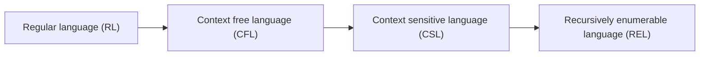
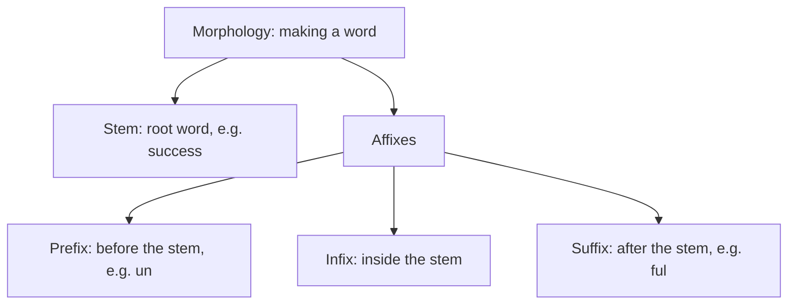
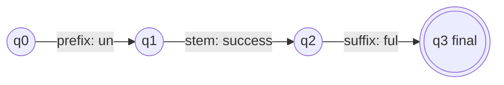
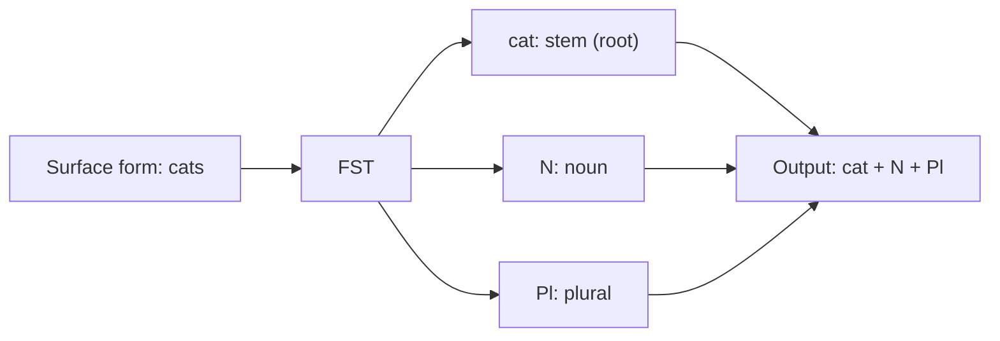
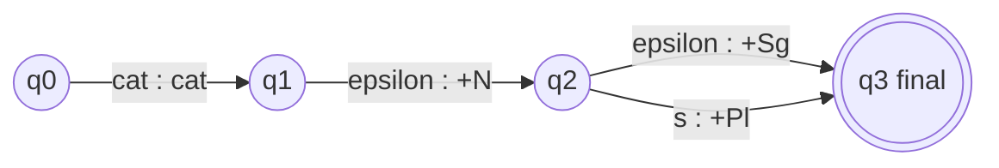
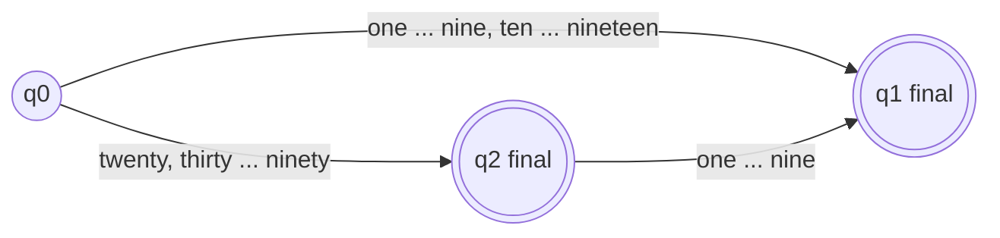

Before the new ideas, here are the old ones you need. If you already know them, skip to the next section.

## The basics first

- A **word** is built from smaller meaningful parts. **Morphology** is the study of how.
- The main part is the **stem** (root word). Small parts added to it are **affixes**. <Cite id="class-nlp-m2" loc="p. 4" />
- An **automaton** is a simple machine with a few states that reads input one symbol at a time and ends up saying yes or no.

## Computational theory, languages and regular expressions

The class begins Module 2 with the theory. Computational theory (C.T.) studies three things: **Language** (L), **Automata** (A) and **Grammar** (G). <Cite id="class-nlp-m2" loc="p. 1" />

**Language operands** <Cite id="class-nlp-m2" loc="p. 1" />

| Term | Meaning | Example |
|---|---|---|
| Symbols | Single characters | a, b, c, d or 0, 1, 2, 3 |
| Alphabet | A finite set of inputs | \{a, b, c\} or \{0, 1, 2\} |
| String | A collection of alphabet symbols | aa, bb |
| Language | A collection of strings | \{aa, ab, ba, bb\} |

**Operations of a regular expression** <Cite id="class-nlp-m2" loc="p. 2" />

| Symbol | Name | Meaning |
|---|---|---|
| Sigma | Input alphabet | A finite set, e.g. Sigma = \{a, b\} or \{0, 1\} |
| epsilon | Empty string | The language \{epsilon\} |
| phi | Empty set | \{ \} |
| + or union | Union | a + b means either a or b, giving \{a, b\} |
| . | Concatenation | a . b gives \{ab\} |
| star and plus | Kleene closure (Kleene star) | `a+` gives \{a, aa, aaa, ...\}; `a*` gives \{epsilon, a, aa, aaa, ...\} |

**Example from the class.** L = the set of all strings of length exactly 2 over Sigma = \{a, b\}. The language is \{aa, ab, ba, bb\}. The regular expression is aa + ab + ba + bb, which can be written (a+b)(a+b). <Cite id="class-nlp-m2" loc="p. 3" />

**Careful with a star.** The star applies to the single letter just before it: `ab*` means a followed by any number of b's, the language \{a, ab, abb, ...\}. The language \{epsilon, ab, abab, ...\} belongs to `(ab)*`, which is the table's `(a.b)*`. The list for `(a+b)*` in the table is only a start; the real language has infinitely many strings.

## Finite state automaton (FSA)

<Box kind="definition">

**FSA / FSM:** it comprises a finite set of states (Q) which accepts a finite set of inputs (Sigma). <Cite id="class-nlp-m2" loc="p. 4" />

</Box>

An FSA has these parts. <Cite id="class-nlp-m2" loc="p. 4" />

| Part | Name | Meaning |
|---|---|---|
| Q | States | Finite set of states |
| Sigma | Inputs | Finite set of input symbols |
| delta | Transition function | delta: Q x Sigma to Q (from a state, on a symbol, go to a state) |
| q0 | Start state | Where reading begins |
| F | Final states | The machine accepts if it ends here |

In a transition diagram each state is a circle, each arrow is a transition labelled with the input, the start state has an arrow coming in, and a final state is drawn as a double circle. The machine's answer is yes or no (accept or reject).

## Morphology with an FSA

In morphology the FSA is used for creating (making) words. A word is a **stem** (root word) plus **affixes** (prefix, infix, suffix). <Cite id="class-nlp-m2" loc="p. 4" />

The teacher draws one small FSA for every way of building a word from a stem. <Cite id="class-nlp-m2" loc="p. 5" />

| Stem | With prefix | With suffix | With both |
|---|---|---|---|
| success | unsuccess | successful | unsuccessful |
| friend | unfriend | friendly | unfriendly |
| do | undo | doable | undoable |
| break | unbreak | breakable | unbreakable |
| install | preinstall | installment | preinstallment |
| cipher | decipher | ciphered | deciphered |

<Cite id="class-nlp-m2" loc="p. 5" /> <Cite id="class-nlp-m2" loc="p. 6" /> <Cite id="class-nlp-m2" loc="p. 7" />

Some of the middle forms (unsuccess, unbreak) are not everyday English words. They only show how the automaton moves through states; the full words (unsuccessful, unbreakable) are the real ones.

## Affixes and their types

<Box kind="definition">

**Affix:** a bound morpheme added to the root or stem of a word to alter its meaning, create a new word, or change its grammatical function. <Cite id="class-nlp-pyq2" loc="p. 3" />

</Box>

Types by position: <Cite id="class-nlp-pyq2" loc="p. 3" />

| Type | Where it attaches | Example |
|---|---|---|
| Prefix | The beginning of a root word | un- in unhappy changes the meaning to its opposite |
| Suffix | The end of a root word | -ed in walked, -ness in happiness |
| Infix | Inserted directly inside a root word | Rare or non-existent in English, found in other languages |

## Inflectional and derivational morphology

<Box kind="definition">

**Inflectional morphology** is the study of the processes, including affixation and vowel change, that distinguish word forms in certain grammatical categories. **Derivational morphology** is concerned with forming new lexemes, that is, words that differ either in syntactic category (part of speech) or in meaning from their bases. <Cite id="class-nlp-pyq2" loc="p. 3" /> <Cite id="class-nlp-pyq2" loc="p. 4" />

</Box>

| Point | Inflectional | Derivational |
|---|---|---|
| Deals with | Changes made to existing words | The creation of new words |
| Result | A different form of the same word | A separate word, often a different part of speech or meaning |
| Categories | Number, tense, person, case, gender | Part of speech or meaning |
| Examples | School to schools, walk to walked, man to men, go to going, dog to dogs, call to called, short to shorter and shortest | paint (verb) + er gives painter (noun, someone who paints) |

Inflectional affixes in English: the plural -s on nouns (dog, dogs), the past tense -ed on verbs (call, called), the third person singular -s, the present participle -ing, and -er and -est on short adjectives for comparative and superlative. <Cite id="class-nlp-pyq2" loc="p. 3" />

From the FSA drawings: success + ful and friend + ly (noun to adjective), and install + ment (verb to noun) are derivational. <Cite id="class-nlp-m2" loc="p. 5" /> <Cite id="class-nlp-m2" loc="p. 7" />

## Role of the FSA in morphological analysis

Finite State Automata (FSA) play an important role in morphological analysis by representing the rules for forming valid words from their morphemes. The states represent different stages of word formation, while transitions represent the possible stems, prefixes, suffixes and grammatical features. The automaton checks whether a given sequence of morphemes forms a valid word. <Cite id="class-nlp-pyq2" loc="p. 6" />

Example: the word "cats" has the structure cat + Noun + Plural. <Cite id="class-nlp-pyq2" loc="p. 6" />

**Role:** <Cite id="class-nlp-pyq2" loc="p. 6" />

- Represents valid morphological rules and word structures.
- Helps identify stems, affixes and grammatical features.
- Checks whether a word follows valid morphological patterns.
- Supports morphological analysis and word generation.
- Gives an efficient rule-based approach, especially for languages with rich inflection.

## Output of morphological analysis

Morphological analysis finds the root or stem of a word and its grammatical features (noun, verb, singular, plural, tense). The output is the **lemma (root) + morphological tags**. <Cite id="class-nlp-pyq2" loc="p. 9" />

| Word type | Input word | Output |
|---|---|---|
| Regular verb | walked | walk + V + Past |
| Irregular verb | went | go + V + Past |
| Singular noun | cat | cat + N + Sg |
| Plural noun | cats | cat + N + Pl |

Why went gives go: the surface form went is different, but its lemma is go. This is why irregular forms need lexical information (a dictionary) in a morphological analyser. <Cite id="class-nlp-pyq2" loc="p. 9" />

## Finite state transducer (FST)

<Box kind="definition">

**FST:** an extension of a finite state automaton that maps input sequences to output sequences. An FSA only accepts or rejects an input; an FST transforms it. <Cite id="class-nlp-pyq2" loc="p. 9" />

</Box>

Each transition of an FST is labelled with an input symbol and an output symbol. An FST is defined as $T = (Q, \Sigma, \Gamma, q_0, F)$, where $Q$ is a finite set of states, $\Sigma$ the input alphabet, $\Gamma$ the output alphabet, $q_0 \in Q$ the initial state and $F \subseteq Q$ the set of final states. <Cite id="class-nlp-pyq2" loc="p. 9" /> <Cite id="class-nlp-pyq2" loc="p. 10" />

**Role of the FST in morphological parsing.** It maps the surface form of a word to its morphological representation (the root or stem plus noun, verb, singular, plural, tense and so on): Surface word, then FST, then morphological analysis. <Cite id="class-nlp-pyq2" loc="p. 10" />

## Designs asked in exams but not in the class files

These three are standard; they are kept short and in the same style as the class FSAs.

**FSA for nouns and verbs (stem plus ending).**

| Word class | Path | Accepts |
|---|---|---|
| Noun | q0, then noun stem to q1 (final), then plural -s to q2 (final) | cat, cats |
| Verb | q0, then verb stem to q1 (final), then -s, -ed or -ing to q2 (final) | walk, walks, walked, walking |

Irregular forms (went, mice) are not handled by the ending rule; they are stored in a dictionary.

**FST for regular and plural nouns.** Each arc is written input:output, and epsilon means no symbol.

So cat gives cat + N + Sg and cats gives cat + N + Pl. For an irregular plural like mice, one extra arc reads mice and writes mouse +N +Pl.

**FSA for the English numbers 1 to 99.**

It accepts seven, thirteen, twenty and forty two, and rejects twenty thirteen.

## Where this was asked

| If the question says | What to write | Seen as |
|---|---|---|
| "Role of FSA in morphological analysis" | The class answer, the cats FSA, the list of roles | <PYQ id="2022-12-ce/q2a" /> <PYQ id="assignment-1/q2f" /> |
| "Output of morphological analysis for regular verb, irregular verb, singular noun, plural noun, and role of FST" | The four-row table, then FST definition and role | <PYQ id="2023-05-ce/q2b" /> <PYQ id="2025-05-ce/q1b" /> |
| "Define affixes, types of affixes" | Definition and prefix, suffix, infix | <PYQ id="2022-12-ce/q1b" /> <PYQ id="2025-05/q1a" /> |
| "Inflectional and derivational morphology" | Definitions, comparison table, examples | <PYQ id="2024-05-ce/q2a" /> <PYQ id="2025-05/q2b" /> <PYQ id="2025-05-ce/q1a" /> |
| "FSA for nouns and verbs; FSA for numbers 1 to 99" | The two designs above | <PYQ id="2023-12-ce/q2a" /> |
| "Design FST for regular and plural nouns" | The FST above | <PYQ id="2024-12-ce/q2a" /> |

## Quick revision

- Language is a collection of strings; alphabet is a finite set of inputs. Regular expression operations: union (+), concatenation (.), Kleene star (`a*` is epsilon, a, aa, ...).
- FSA tuples: Q, Sigma, delta, q0, F. It accepts or rejects.
- Morphology = stem + affixes (prefix, infix, suffix). Examples: unsuccessful, unfriendly, undoable, deciphered.
- Inflectional: new form of the same word (school to schools). Derivational: new word (paint to painter).
- FST maps surface to analysis: cats to cat + N + Pl, went to go + V + Past.

**Conclusion.** An FSA checks that stem and affixes combine into a valid word, and an FST goes further by converting between the word as written and its stem-plus-tags analysis. <Cite id="class-nlp-pyq2" loc="p. 6" />
