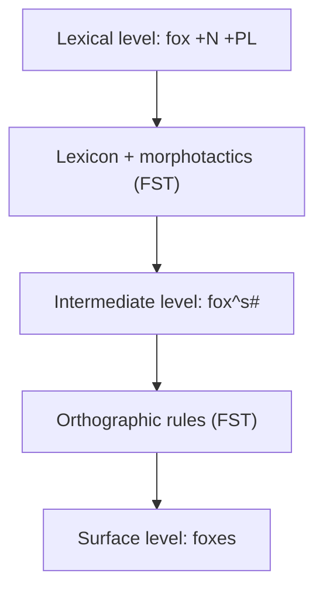
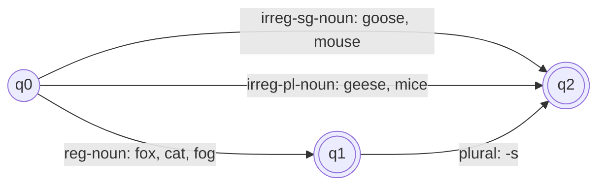
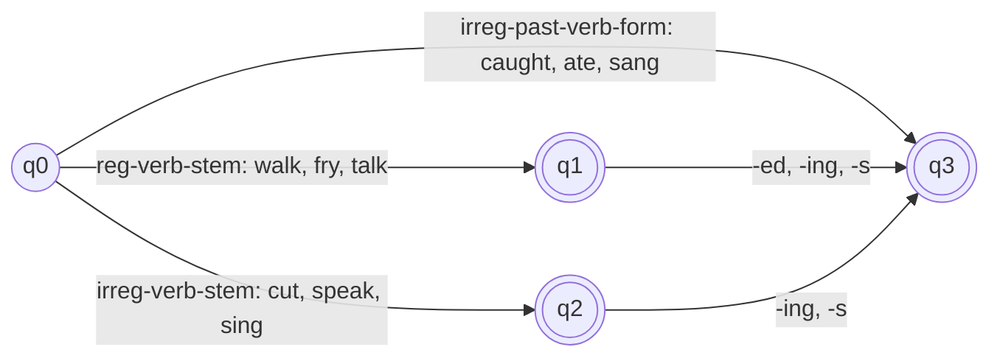
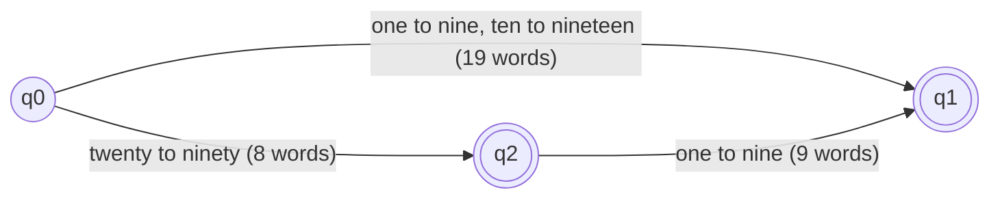
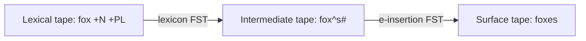
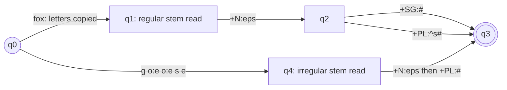

Before the new ideas, here are the old ones you need. If you already know them, skip to the next section.

## The basics first

- A **word** is a unit we write between spaces, such as `cats`. A **word form** is one particular shape of a word, such as `cat` or `cats`.
- A **morpheme** is the smallest part of a word that carries a meaning. `cats` has two: `cat` (the animal) and `-s` (more than one). <Cite id="morphology-fst-wiki-morpheme" />
- A **stem** (or root) is the main morpheme that gives the word its basic meaning. An **affix** is a small morpheme that is attached to a stem to add a meaning or a grammatical detail. <Cite id="morphology-fst-wiki-stem" /> <Cite id="morphology-fst-wiki-affix" />
- A **free morpheme** can stand alone as a word (`cat`, `walk`). A **bound morpheme** cannot (`-s`, `-ing`, `un-`). <Cite id="morphology-fst-wiki-bound" />
- A **lexicon** is the dictionary of a system: its list of stems and affixes with some information about each (for example "fox is a noun stem").
- A **state machine** is a simple machine that is always in exactly one of a few **states**, and moves to another state when it reads an input symbol. A **finite state automaton (FSA)** is such a machine with a start state and some final (accepting) states. <Cite id="morphology-fst-wiki-fsm" />
- A **tape** is just the string that the machine reads (input) or writes (output), one symbol at a time.

## What is morphology

**What it is.** Morphology is the study of how words are built from smaller meaning-bearing units, the morphemes. In NLP, **morphological analysis** (also called morphological parsing) is the task of splitting a word into its morphemes and naming them. <Cite id="morphology-fst-jm-ch3-notes" loc="slides 2-3" /> <Cite id="nlp-introduction-wiki-morph" /> <Cite id="morphology-fst-gfg-morph" /> It is syllabus <Syl m="2" />, sections 2.2 and 2.3.

**Why it is needed.**

1. **A dictionary cannot list every word form.** A language keeps forming new ones (`googled`, `selfies`). Listing `walk`, `walks`, `walked`, `walking` for every verb wastes space and still misses new words. A morphological analyser stores the stem once and the rules once. <Cite id="morphology-fst-jm-ch3-notes" loc="slide 2" />
2. **Search and stemming.** A search for `foxes` should also find `fox`. This needs the stem.
3. **Machine translation and spell checking** need to know the tense, number and part of speech hidden inside a word. <Cite id="morphology-fst-wiki-parsing" />
4. **Languages like Hindi, Marathi, Turkish and Finnish** pack a lot of information into word endings, so they need morphology even more than English.

**Everyday analogy.** A word is like a Lego model. The stem is the base block and the affixes are small pieces that click on. Morphological analysis is taking the model apart and naming every piece. Morphological generation is building it again from the list of pieces.

<Box kind="definition">

**Morphology** is the study of the internal structure of words: how they are built from morphemes (stems and affixes). **Morphological analysis** takes a word such as `cats` and outputs its stem and features, `cat +N +PL`.

</Box>

## Affixes and their types

**Definition.** An **affix** is a bound morpheme that is attached to a stem to form a new word or a new form of the word. <Cite id="morphology-fst-wiki-affix" /> It does not carry the main meaning, it adds to it.

**Types of affixes** (the position of the affix decides the type):

| Type | Where it goes | Example | What happens |
|---|---|---|---|
| Prefix | Before the stem | `un-` + `happy` = `unhappy`; `re-` + `write` = `rewrite` | Changes the meaning (here, makes it negative). |
| Suffix | After the stem | `walk` + `-ed` = `walked`; `kind` + `-ness` = `kindness` | Changes the tense, number or word class. |
| Infix | Inside the stem | Tagalog `hingi` (borrow) becomes `humingi`, with `-um-` inserted | English has almost no true infixes. <Cite id="morphology-fst-wiki-infix" /> |
| Circumfix | Around the stem: one part before, one after | German `sag-en` (to say) becomes `ge-sag-t` (said) | Two pieces together make one affix. <Cite id="morphology-fst-wiki-circumfix" /> |

<Cite id="morphology-fst-jm-ch3-notes" loc="slide 3" />

**More points worth one line each.**

- Prefixes and suffixes are called **concatenative** morphology because the pieces are just joined one after another. Languages such as Arabic and Hebrew also use **non-concatenative** (root-and-pattern) morphology, where a pattern of vowels is fitted around a root. <Cite id="morphology-fst-jm-ch3-notes" loc="slide 4" />
- Affixes are also divided by job into **inflectional** affixes (`-s`, `-ed`, `-ing`) and **derivational** affixes (`un-`, `-ness`, `-ation`), covered next. <Cite id="morphology-fst-wiki-affix" />
- The same affix can change its shape (`-s` or `-es`; `-ed` pronounced three ways). These variants are called **allomorphs**. <Cite id="morphology-fst-wiki-allomorph" />

**Exam answer (5 marks):** define affix in one line, draw the four-row table with one example each, and add one line on inflectional versus derivational affixes. <PYQ id="2022-12-ce/q1b" /> <PYQ id="2025-05/q1a" />

## Inflectional and derivational morphology

The syllabus calls the first one "reflectional" morphology; the standard word is **inflectional**.

**Inflectional morphology.** Inflection changes a word's form to show a grammatical detail such as number, tense, person or possession, but the word stays the same part of speech and keeps its core meaning. <Cite id="morphology-fst-wiki-inflection" /> In English only nouns, verbs and sometimes adjectives are inflected, and there are very few affixes. <Cite id="morphology-fst-jm-ch3-notes" loc="slide 5" />

- Noun: plural `-s` (`cat`, `cats`; `box`, `boxes`) and possessive `'s` (`llama's`).
- Regular verb: `walk`, `walks` (3rd person singular), `walking` (present participle), `walked` (past and past participle).
- Irregular forms: `mouse`, `mice`; `eat`, `ate`, `eaten`. <Cite id="morphology-fst-wiki-irregular" /> <Cite id="morphology-fst-wiki-plurals" />

**Derivational morphology.** Derivation builds a **new word** from an existing one, usually by adding a prefix or suffix. The new word often has a different part of speech and a new meaning that can be hard to predict. <Cite id="morphology-fst-wiki-derivation" />

- Verb to noun: `computerize` to `computerization` (`-ation`), `kill` to `killer` (`-er`), `appoint` to `appointee` (`-ee`).
- Adjective to noun: `fuzzy` to `fuzziness` (`-ness`).
- Noun to adjective: `computation` to `computational` (`-al`), `clue` to `clueless` (`-less`).
- Verb to adjective: `embrace` to `embraceable` (`-able`). <Cite id="morphology-fst-jm-ch3-notes" loc="slide 8" />

Derivation is **less regular** than inflection. The suffix `-ation` can go on `computerize` but not on every verb (`eatation` is not a word), and similar suffixes differ in meaning (`sincerity` is not quite `sincereness`). So automata for derivation are larger and harder to build. <Cite id="morphology-fst-jm-ch3-notes" loc="slide 9" />

| Point | Inflectional morphology | Derivational morphology |
|---|---|---|
| Purpose | Shows grammatical detail (number, tense, person, case) | Creates a new word |
| Part of speech | Usually stays the same (`walk` to `walked`, both verbs) | Often changes (`happy` adjective to `happiness` noun) |
| Meaning | Core meaning stays | New meaning, sometimes hard to predict |
| Example | `cat` to `cats`, `play` to `played` | `play` to `player`, `able` to `unable` |
| How many affixes | Small, closed set (about 8 in English) | Large, open set |
| Where it sits in a word | Last: after all derivational affixes (`nation-al-iz-ation-s`) | Close to the stem, before inflection |
| Productivity | Very regular, applies to almost every word of the class | Less regular, applies to some words only |
| Result in dictionary | Same dictionary entry (lemma) | A separate dictionary entry |

<Cite id="morphology-fst-wiki-inflection" /> <Cite id="morphology-fst-wiki-derivation" /> <Cite id="morphology-fst-jm-ch3-notes" loc="slides 4-9" />

(The count "about 8" is the usual textbook count of English inflectional suffixes: plural, possessive, 3rd person singular, past, past participle, present participle, comparative `-er`, superlative `-est`.)

<Box kind="exam">

**Illustrate inflectional and derivational morphology with an example (10 marks):** define both, give the table above, and work one word through both. Example: `nation` + `-al` = `national` (derivation: noun to adjective), then `national` + `-ize` = `nationalize` (derivation: adjective to verb), then `nationalize` + `-s` = `nationalizes` (inflection: only the person changes, still a verb). Say that the order in a word is stem, derivation, then inflection. <PYQ id="2024-05-ce/q2a" /> <PYQ id="2025-05/q2b" /> <PYQ id="2025-05-ce/q1a" />

</Box>

**Other ways words are made (one line each).** *Compounding* joins two words (`black` + `board` = `blackboard`). *Cliticization* attaches a small unstressed word to another (`I'm`, `llama's`). <Cite id="morphology-fst-wiki-morpheme" />

## What the output of morphological analysis looks like

**What the analyser returns.** For each word it returns the **stem** (also called the lemma, the dictionary form) and a list of **tags** for its grammatical features. <Cite id="morphology-fst-jm-ch3-notes" loc="slide 10" /> <Cite id="morphology-fst-wiki-lemma" />

Common tags: `+N` noun, `+V` verb, `+SG` singular, `+PL` plural, `+PAST` past tense, `+PAST-PART` past participle, `+PRES-PART` present participle (the `-ing` form), `+3SG` third person singular present (the `-s` form of a verb). Different books use slightly different tag names, so write the tag name once in your answer.

| Kind of word | Input (surface form) | Output of morphological analysis |
|---|---|---|
| Singular noun | `cat` | `cat +N +SG` |
| Singular noun | `goose` | `goose +N +SG` |
| Plural noun (regular) | `cats` | `cat +N +PL` |
| Plural noun (spelling change) | `cities` | `city +N +PL` |
| Plural noun (irregular) | `geese` | `goose +N +PL` |
| Plural noun (irregular) | `mice` | `mouse +N +PL` |
| Regular verb | `walks` | `walk +V +3SG` |
| Regular verb | `walking` | `walk +V +PRES-PART` |
| Regular verb | `walked` | `walk +V +PAST` or `walk +V +PAST-PART` |
| Irregular verb | `caught` | `catch +V +PAST` or `catch +V +PAST-PART` |
| Irregular verb | `sang` | `sing +V +PAST` |
| Irregular verb | `eaten` | `eat +V +PAST-PART` |

The tags and the first examples (`cats`, `cities`, `geese`, `goose`, `caught`) follow the textbook table; the other rows apply the same pattern. <Cite id="morphology-fst-jm-ch3-notes" loc="slide 10" />

Two points to remember:

- **Regular** words follow a rule (`walk` + `-ed`), so a rule handles them all. **Irregular** words (`caught`, `geese`) have to be stored in the lexicon, because no rule predicts them.
- **Ambiguity:** one surface word can have more than one analysis. `foxes` can be `fox +N +PL` (the plural noun) or `fox +V +3SG` (he foxes us), and `caught` can be past tense or past participle. So the analyser may return a list. <Cite id="morphology-fst-jm-ch3-notes" loc="slide 29" />

<Box kind="exam">

**Show the output of morphological analysis for a regular verb, an irregular verb, a singular noun and a plural noun (5 marks):** write the table above with one row per kind, define the tags once, and add one line saying regular forms come from rules while irregular forms come from the lexicon. <PYQ id="2025-05-ce/q1b" /> <PYQ id="2023-05-ce/q2b" />

</Box>

## What a morphological parser needs

To build a morphological parser you need three parts. <Cite id="morphology-fst-jm-ch3-notes" loc="slide 11" />

1. **Lexicon:** the list of stems and affixes, with basic information (noun stem, verb stem, plural suffix). A simple lexicon would list every word, which is impossible, so a computational lexicon lists stems and affixes only.
2. **Morphotactics:** the model of **ordering**: which morpheme classes may follow which. Example: the English plural morpheme comes after the noun, never before it, so `catss` and `scat` (as "plural cat") are not built. The usual way to model morphotactics is a finite state automaton.
3. **Orthographic (spelling) rules:** the spelling changes when two morphemes meet. Example: `city` + `-s` becomes `cities` (y changes to ie), `fox` + `-s` becomes `foxes` (an e is added).

<Cite id="morphology-fst-gfg-morph" loc="diagram" /> <Cite id="morphology-fst-jm-ch3-notes" loc="slide 28" />

In the picture, `^` marks a morpheme boundary and `#` marks the end of the word. Both are helper symbols that exist only on the middle tape and are removed at the end.

## Finite state automata (FSA)

**What it is.** A finite state automaton (finite automaton, FSA, FSM) is a simple mathematical machine with a finite number of states. It reads an input string symbol by symbol, moves from state to state, and when the string ends it **accepts** if it is in a final state, otherwise it **rejects**. <Cite id="morphology-fst-wiki-fsm" /> <Cite id="morphology-fst-gfg-fa" />

**Formal definition.** An FSA is a 5-tuple $(Q, \Sigma, \delta, q_0, F)$:

- $Q$ is the finite set of states.
- $\Sigma$ is the alphabet, the set of input symbols.
- $\delta$ is the transition function: for a state and a symbol it gives the next state.
- $q_0 \in Q$ is the start state.
- $F \subseteq Q$ is the set of final (accepting) states. <Cite id="morphology-fst-tp-word" />

**Types.** In a **deterministic** FSA (DFA) every state has at most one move for each symbol, so the path is fixed. In a **non-deterministic** FSA (NFA) a state may have several moves for the same symbol. Both accept exactly the same languages, and any NFA can be converted into a DFA. <Cite id="morphology-fst-wiki-dfa" />

**The link with regular expressions.** The sets of strings that an FSA can accept are called regular languages. Regular expressions, regular grammars and finite automata are three equivalent ways of describing the same regular languages. <Cite id="morphology-fst-wiki-reglang" /> <Cite id="morphology-fst-tp-word" /> (Regular expressions are in the note on text preprocessing.)

### Role of the FSA in morphological analysis

1. **Morphotactics.** The FSA writes down which morpheme orders are legal (stem, then suffix).
2. **Morphological recognition.** Given a string, say yes or no: is this a legitimate English word? We plug each sub-lexicon (list of stems of one class) into the automaton and run the string through. <Cite id="morphology-fst-jm-ch3-notes" loc="slide 17" />
3. **Efficiency.** One small automaton stands for thousands of words, and checking a word takes time proportional to its length.
4. **Limit.** An FSA only says yes or no. It does not output the stem and the tags, and it does not fix spelling. For that we need the FST, covered next.

### FSA for English nouns

The automaton below has three groups of stems in the lexicon: regular nouns (`fox`, `cat`), irregular singular nouns (`goose`, `mouse`) and irregular plural nouns (`geese`, `mice`). Only regular nouns take the plural suffix `-s`. <Cite id="morphology-fst-jm-ch3-notes" loc="slide 12" />

<Cite id="morphology-fst-jm-ch3-notes" loc="diagram" /> <Cite id="morphology-fst-gfg-morph" loc="diagram" />

### FSA for English verbs

<Cite id="morphology-fst-jm-ch3-notes" loc="slide 13" /> <Cite id="morphology-fst-gfg-morph" loc="diagram" />

This is a simplified version of the textbook figure: the textbook draws separate arrows for past `-ed`, past participle `-ed`, `-ing` and `-s`; here they share one label.

### Worked example 1: running the noun FSA

<Sum>

<Given>

The noun FSA above. Input strings are written as a sequence of morphemes: (a) `fox` `-s`, (b) `geese`, (c) `geese` `-s`, (d) `-s` `fox`.

</Given>

<Find>

whether each string is accepted.

</Find>

<Steps>

1. (a) Start at q0. `fox` is a reg-noun, so go to q1. Read `-s` (plural): go from q1 to q2. The string has ended and q2 is final. *Reason: accept only if we end in a final state.*
2. (b) Start at q0. `geese` is an irreg-pl-noun, so go to q2. The string has ended and q2 is final.
3. (c) q0, then `geese` takes us to q2. Now read `-s`: q2 has no outgoing arrow. The machine is stuck, so reject. *Reason: an irregular plural already is a plural, so a second plural is not allowed.*
4. (d) At q0 the first symbol is `-s`, but q0 has no arrow for `-s`. Reject. *Reason: a suffix cannot come first.*

</Steps>

<Answer>

(a) accepted, (b) accepted, (c) rejected, (d) rejected.

</Answer>

<Box kind="verify">

Cross-check with the morphotactic rule "a plural suffix comes once, after a regular noun stem": (a) follows it, (c) breaks it (suffix after an irregular plural), (d) breaks it (suffix before the stem). The accepted strings are exactly the ones that match the rule, and (b) has no suffix at all.

</Box>

</Sum>

Notice that the automaton accepts the morpheme string `fox` `-s` but cannot say that it is spelled `foxes`. That spelling job belongs to the orthographic rules.

### Worked example 2: designing an FSA for English numbers 1 to 99

**Idea.** Split the number words into three lists: units (`one` to `nine`, 9 words), teens (`ten` to `nineteen`, 10 words) and tens (`twenty`, `thirty`, `forty`, `fifty`, `sixty`, `seventy`, `eighty`, `ninety`, 8 words). Units and teens can be said alone. A tens word can be said alone or followed by a unit. The input symbols are whole words, so `forty-two` is read as `forty` then `two`.

<Cite id="morphology-fst-gfg-fa" loc="diagram" />

<Sum>

<Given>

The three-state FSA above: start q0, final states q1 and q2. Input strings: (a) `forty two`, (b) `seventeen`, (c) `twenty ten`, (d) `ninety`, (e) `twelve twelve`.

</Given>

<Find>

whether each string is accepted, and how many different strings the automaton accepts in total.

</Find>

<Steps>

1. (a) `forty` takes q0 to q2 (a tens word). `two` takes q2 to q1 (a unit). The string ended in q1, which is final: accept.
2. (b) `seventeen` is in the teens list, so q0 goes to q1. Final: accept.
3. (c) `twenty` takes q0 to q2. `ten` is a teen word, but q2 only has an arrow for units, so the machine is stuck: reject. *Reason: `twenty-ten` is not an English number.*
4. (d) `ninety` takes q0 to q2, which is final: accept.
5. (e) `twelve` takes q0 to q1. q1 has no outgoing arrows, so the second `twelve` cannot be read: reject.
6. Count the accepted strings by the path they take. Units or teens straight from q0 to q1: $9 + 10 = 19$ strings. A tens word alone, ending in q2: $8$ strings. A tens word then a unit, ending in q1: $8 \times 9 = 72$ strings.
7. Add them: $19 + 8 + 72 = 99$.

</Steps>

<Answer>

(a) accept, (b) accept, (c) reject, (d) accept, (e) reject. The automaton accepts exactly 99 strings.

</Answer>

<Box kind="verify">

The numbers 1 to 99 are 99 numbers. Count them another way: 1 to 9 is 9 numbers; 10 to 19 is 10 numbers; each of the eight tens (20, 30, ..., 90) gives 10 numbers (the ten itself and ten plus 1 to 9), so $8 \times 10 = 80$. Total $9 + 10 + 80 = 99$. Both counts give 99, so the FSA accepts every number from 1 to 99 and nothing else.

</Box>

</Sum>

**Exam answer for "FSA for nouns and verbs plus numbers 1-99" (10 marks):** (1) define FSA and its 5 parts; (2) draw the noun FSA with a one-line walk-through; (3) draw the verb FSA; (4) draw the number FSA with the word lists and its 19 + 8 + 72 count; (5) say the limit (yes or no only). <PYQ id="2023-12-ce/q2a" />

## Finite state transducers (FST)

**What it is.** A finite state transducer is a finite automaton with **two tapes**, an input tape and an output tape. Each arrow carries a pair `i:o`, meaning "read `i`, write `o`". An FSA decides which strings are in a language; an FST relates a string to another string. <Cite id="morphology-fst-wiki-fst" /> <Cite id="morphology-fst-jm-ch3-notes" loc="slide 19" />

**Why it is needed.** The FSA can say "yes, `fox` followed by `-s` is a legal noun" but cannot give the analysis `fox +N +PL` or the spelling `foxes`. We want a machine that **converts** one string into another. That machine is the FST.

**Everyday analogy.** An FSA is a gatekeeper who only says "allowed" or "not allowed". An FST is a translator who listens to one string and speaks another.

**Formal definition.** An FST is a 5-tuple $(Q, \Sigma, q_0, F, \delta)$ where $Q$ is the set of states, $\Sigma$ is a set of pairs `i:o` (an input symbol and an output symbol, either may be the empty string $\varepsilon$), $q_0$ is the start state, $F$ the final states, and $\delta(q, i{:}o)$ gives the next state. It extends the Mealy machine, which also writes an output while reading. <Cite id="morphology-fst-jm-ch3-notes" loc="slide 21" /> <Cite id="morphology-fst-wiki-mealy" /> <Cite id="morphology-fst-gfg-mealy" />

**Four ways to see an FST.** <Cite id="morphology-fst-jm-ch3-notes" loc="slide 20" />

1. **Recogniser:** takes a pair of strings and says accept or reject.
2. **Generator:** produces pairs of strings of the language.
3. **Translator (transducer):** reads one string and writes another. (This is how morphology uses it.)
4. **Set relater:** computes a relation between two sets of strings.

**Useful properties.** FSAs describe regular languages; FSTs describe **regular relations** (sets of pairs of strings). FSTs are closed under **union**, **inversion** and **composition**. <Cite id="morphology-fst-jm-ch3-notes" loc="slides 22-23" />

- **Inversion:** if $T$ maps $I$ to $O$ then the inverse $T^{-1}$ maps $O$ to $I$. So one transducer built as a parser (`cats` to `cat +N +PL`) can be turned around into a generator (`cat +N +PL` to `cats`) at no cost.
- **Composition:** two transducers run in series can be replaced by one: $(T_1 \circ T_2)(s) = T_2(T_1(s))$. So the lexicon FST and the spelling-rule FST can be joined into one machine.

| Point | FSA | FST |
|---|---|---|
| Tapes | One (input) | Two (input and output) |
| Arrow label | One symbol: `s` | A pair: `i:o` |
| What it defines | A language (set of strings) | A relation (set of pairs of strings) |
| Output | Accept or reject | Accept or reject and an output string |
| Use in morphology | Morphotactics, word recognition | Parsing (analysis) and generation, spelling rules |
| Equivalent to | Regular expression | Regular relation, Mealy machine |

<Cite id="morphology-fst-wiki-fst" /> <Cite id="morphology-fst-jm-ch3-notes" loc="slides 19-22" />

## Morphological parsing with an FST: two-level morphology

**Two levels.** In two-level morphology (Koskenniemi, 1983), a word is described at two levels. The **lexical level** is the concatenation of the morphemes with their tags (`cat +N +PL`). The **surface level** is the real spelling (`cats`). An FST maps between the two, in either direction. <Cite id="morphology-fst-jm-ch3-notes" loc="slide 18" /> Kaplan and Kay showed that spelling and sound rewrite rules can be compiled into finite-state transducers. <Cite id="morphology-fst-kaplan-kay" />

In practice a third, **intermediate** level is used: the morphemes already joined with boundary markers (`fox^s#`). The lexicon FST goes lexical to intermediate; the spelling-rule FST goes intermediate to surface. <Cite id="morphology-fst-jm-ch3-notes" loc="slides 25-26" />

<Cite id="morphology-fst-jm-ch3-notes" loc="diagram" /> <Cite id="morphology-fst-wiki-parsing" loc="diagram" />

### FST for regular and irregular plural nouns

The transducer for number inflection, called $T_{num}$ in the textbook, works on three kinds of stems. Each arrow is read as `lexical:intermediate`. <Cite id="morphology-fst-jm-ch3-notes" loc="slide 23" />

- **Regular noun stem** (`fox`, `cat`, `fog`): copy the letters unchanged (`f:f o:o x:x`). Then `+N:ε` (the noun tag writes nothing), and either `+SG:#` (singular: just end the word) or `+PL:^s#` (plural: write a boundary, `s`, and the end marker).
- **Irregular singular noun** (`goose`, `sheep`, `mouse`): copy the letters, then `+N:ε` and `+SG:#`.
- **Irregular plural noun** (`geese`, `mice`): the lexical side holds the singular stem and the arrows change the letters: `g o:e o:e s e` for `goose` to `geese`, and `m o:i u:ε s:c e` for `mouse` to `mice`. Then `+N:ε` and `+PL:#`, with no `-s`.

<Cite id="morphology-fst-jm-ch3-notes" loc="diagram" /> <Cite id="morphology-fst-wiki-fst" loc="diagram" />

(In the diagram `eps` stands for the empty string $\varepsilon$. State q3 is final.)

**Exam answer: "Design an FST for regular and plural nouns" (10 marks).** Define FST, list the lexicon classes (regular, irregular singular, irregular plural), draw the diagram above, explain each arrow in one line, then add the e-insertion rule and one traced example (below). <PYQ id="2024-12-ce/q2a" />

### Orthographic (spelling) rules

When morphemes meet, the spelling often changes. Each rule is a small FST that takes the intermediate string and gives a slightly changed one. <Cite id="morphology-fst-jm-ch3-notes" loc="slide 26" />

| Rule | What it says | Example |
|---|---|---|
| Consonant doubling | One-letter consonant is doubled before `-ing` or `-ed` | `beg` to `begging` |
| E deletion | Silent `e` is dropped before `-ing` or `-ed` | `make` to `making` |
| E insertion | `e` is added after `s`, `z`, `x`, `ch`, `sh` before `-s` | `watch` to `watches`, `fox` to `foxes` |
| Y replacement | `-y` becomes `-ie` before `-s`, and `-i` before `-ed` | `try` to `tries`, `tried` |
| K insertion | Verbs ending in vowel + `c` add `k` | `panic` to `panicked` |

The e-insertion rule is written as $\varepsilon \rightarrow e \;/\; \{x, s, z\}\,\hat{}\;\_\;s\#$. Read it as: "insert `e` (change nothing into `e`) when it sits after an `x`, `s` or `z`, then a morpheme boundary `^`, and before `s#`." A rule `a → b / c _ d` means "rewrite a as b between c and d". <Cite id="morphology-fst-jm-ch3-notes" loc="slide 27" />

A transducer for one rule only states the constraint for that rule and lets every other symbol pass through unchanged.

### Worked example 3: generating foxes, cats and cities

<Sum>

<Given>

Lexical inputs: (a) `fox +N +PL`, (b) `cat +N +PL`, (c) `city +N +PL`. Use the lexicon FST (stem letters copied, `+N:ε`, `+PL:^s#`), then the spelling rules e-insertion and y-replacement, then remove `^` and `#`.

</Given>

<Find>

the surface form of each.

</Find>

<Steps>

1. Lexicon FST for (a): copy `fox`, `+N` writes nothing, `+PL` writes `^s#`. Intermediate: `fox^s#`. *Reason: the plural is written as a boundary marker, then `s`, then the end marker.*
2. Spelling rule for (a): the letter before `^` is `x` and the next morpheme is `s#`, so e-insertion writes an `e` between `^` and `s`: `fox^es#`. Remove `^` and `#`: `foxes`.
3. (b): intermediate `cat^s#`. The letter before `^` is `t`, which is not `s`, `x` or `z`, so e-insertion does not fire. Remove `^` and `#`: `cats`.
4. (c): intermediate `city^s#`. Y-replacement turns the `y` before `^s` into `ie`: `citie^s#`. Remove the markers: `cities`. *Reason: `-y` changes to `-ie` before the plural `-s`.*

</Steps>

<Answer>

(a) `foxes`, (b) `cats`, (c) `cities`.

</Answer>

<Box kind="verify">

Run it backwards (inversion) on one case: `foxes` has the stem `fox`, so removing the inserted `e` gives `fox^s#`, which the lexicon FST reads as `fox +N +PL`. Letter counts also match: `fox` (3) + `es` (2) = 5 letters in `foxes`; `cat` (3) + `s` (1) = 4 letters in `cats`; `cit` (3) + `ies` (3) = 6 letters in `cities`.

</Box>

</Sum>

### Worked example 4: irregular plurals, letter by letter

<Sum>

<Given>

The irregular-plural arrows `g o:e o:e s e` for `goose`, and `m o:i u:ε s:c e` for `mouse`. Each pair is `lexical:surface`; a letter written alone means the same letter on both sides.

</Given>

<Find>

the surface string produced for each lexical stem.

</Find>

<Steps>

1. `goose`, pair by pair: `g:g`, `o:e`, `o:e`, `s:s`, `e:e`. The output letters are g, e, e, s, e.
2. Join them: `geese`.
3. `mouse`, pair by pair: `m:m`, `o:i`, `u:ε`, `s:c`, `e:e`. The output letters are m, i, (nothing), c, e.
4. Join them: `mice`. *Reason: `u:ε` deletes the `u`, so the output has four letters from five input letters.*

</Steps>

<Answer>

`goose +N +PL` gives `geese`, and `mouse +N +PL` gives `mice`.

</Answer>

<Box kind="verify">

Count letters: `goose` has 5 letters, 5 pairs, 5 output letters, and `geese` has 5 letters. `mouse` has 5 letters, 5 pairs, but one output is empty, so 4 output letters, and `mice` has 4 letters. Reading the pairs backwards (inversion) gives `geese` to `goose` and `mice` to `mouse`.

</Box>

</Sum>

### Role of the FST in morphological parsing, with an example

For **parsing** (analysis) we run the machines backwards: from the surface word to the lexical analysis.

1. Input `foxes`.
2. Spelling-rule FST (inverted): `foxes` could be `fox^s#` (the `e` was inserted), or `foxe^s#`, or `foxes#` with no suffix. Several guesses.
3. Lexicon FST (inverted): `fox^s#` matches stem `fox` + plural `^s#`, giving `fox +N +PL`. The other guesses (`foxe`) are not in the lexicon, so they are dropped.
4. Output: `fox +N +PL`. `fox` is also a verb, so the analyser also returns `fox +V +3SG`. <Cite id="morphology-fst-jm-ch3-notes" loc="slides 28-29" />

So the FST does five jobs: it **analyses** (word to stem and tags), **generates** (stem and tags to word), **applies spelling rules**, **works as lookup** with the lexicon, and is **fast** because all rules are compiled into one machine by composition. <Cite id="morphology-fst-wiki-parsing" /> Real toolkits such as foma and the Xerox tools compile such machines from rule files. <Cite id="morphology-fst-foma" />

<Box kind="exam">

**Explain the role of FST in morphological parsing with an example (10 marks):** (1) define FST and surface versus lexical level; (2) draw the three-tape diagram; (3) show the lexicon FST and one spelling rule; (4) trace `cats` to `cat +N +PL` and `foxes` to `fox +N +PL`; (5) give advantages and limits. <PYQ id="2023-05-ce/q2b" />

</Box>

**Exam answer: "Explain the role of FSA in morphological analysis" (10 marks).** Use the section on FSA above: morphotactics, recognition, the noun and verb automata, and the limit that an FSA gives only yes or no. <PYQ id="2022-12-ce/q2a" />

## Advantages, limits and applications

**Advantages of the finite-state approach.**

- Fast (time grows with word length) and small in memory.
- Bidirectional: the same machine analyses and generates (inversion).
- Modular: lexicon and each spelling rule are separate machines, joined by composition.
- Rule based, so it works for languages with little training data. <Cite id="morphology-fst-wiki-parsing" />

**Limitations.**

- The lexicon and rules are written by hand, which is slow work, and every irregular word must be listed.
- It does not cope with new, unseen stems unless guessing rules are added.
- Ambiguity (`foxes`) is returned, not solved. Choosing the right analysis needs the sentence context (part-of-speech tagging).
- Derivational morphology is harder to model than inflection. <Cite id="morphology-fst-jm-ch3-notes" loc="slide 14" />
- Non-concatenative morphology (Arabic roots and patterns) needs extra techniques.
- Neural models have made hand-built FSTs less common for languages with plenty of training data, although they are still used for morphologically rich, low-resource languages. <Cite id="morphology-fst-wiki-parsing" />

**Applications.** Search and stemming, spell checking, machine translation, text-to-speech, part-of-speech tagging and lemmatization. <Cite id="morphology-fst-wiki-parsing" /> <Cite id="morphology-fst-jm-ch3-notes" loc="slide 2" />

## Related methods: stemming and lemmatization

An FST-based analyser needs a lexicon. **Stemmers** do a cruder job without one: the **Porter stemmer** is a cascade of simple rewrite rules (for example `ATIONAL` to `ATE`, so `relational` becomes `relate`) and can be seen as a lexicon-free FST. It cuts suffixes, so the result need not be a real word. <Cite id="morphology-fst-jm-ch3-notes" loc="slide 30" /> <Cite id="text-preprocessing-porter1980" /> <Cite id="text-preprocessing-nltk-porter" /> A **lemmatizer** returns the real dictionary form (lemma) using a lexicon, for example `caught` to `catch`, which a stemmer cannot do. <Cite id="morphology-fst-wiki-lemma" /> <Cite id="text-preprocessing-nltk-wordnet" /> <Cite id="text-preprocessing-gfg-lem" />

| Point | Morphological analysis (FST) | Stemming | Lemmatization |
|---|---|---|---|
| Output | Stem plus tags (`cat +N +PL`) | A stem (`cat`, sometimes not a word) | A dictionary word (`cat`) |
| Uses a lexicon | Yes | No (rules only) | Yes |
| Handles irregular words | Yes (`geese` to `goose`) | Usually no | Yes |
| Speed | Fast | Fastest | Fast |

The stemmer and the sums for it are in the Porter stemmer note; tokenization and edit distance are in the text preprocessing note. Dictionary NLTK tools for tagging words are in the NLTK book. <Cite id="morphology-fst-nltk5" />

<Box kind="key">

Memory aid: **FSA says yes or no. FST translates.** Morphology needs three things: lexicon, morphotactics (FSA), spelling rules (FST). Inflection keeps the word class, derivation often changes it.

</Box>

**Conclusion.** Morphology splits a word into stem and affixes. Inflection and derivation are the two ways words are formed. A finite automaton checks that the pieces are in a legal order, and a finite state transducer turns the surface word into its analysis and back, using a lexicon and spelling rules joined into one machine.
