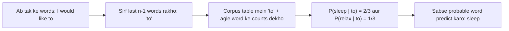
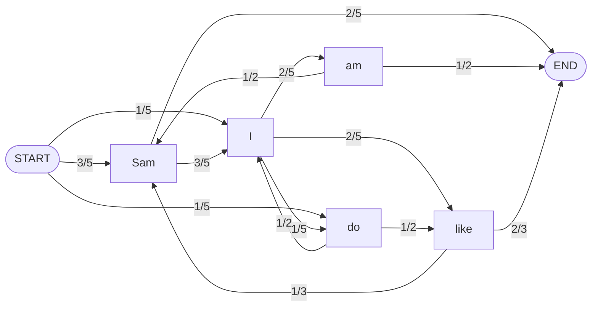
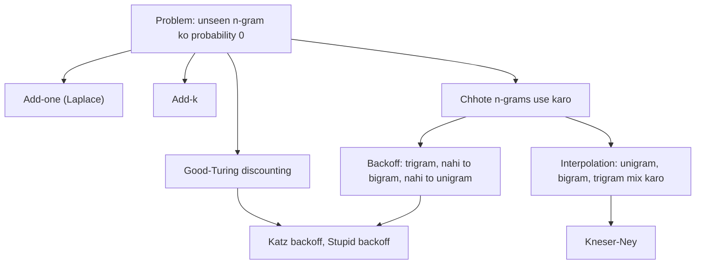

Naye ideas se pehle, ye purane ideas chahiye honge. Agar pehle se aate hain, to agle section pe jao.

## Pehle basics

- **Corpus** (plural **corpora**) bahut bada text collection hai jisse model seekhta hai, jaise news articles ya books. **Word instance** (token) har baar word ka aana hai; **word type** alag-alag word hai. "to be or not to be" mein 6 instances aur 4 types hain.
- **Probability** 0 se 1 ke beech ka number hai jo batata hai ki kuch kitna likely hai. $P(\text{rain}) = 0.3$ ka matlab "10 mein se 3 baar".
- **Conditional probability** $P(B \mid A)$ matlab $B$ ki probability jab hume pata hai ki $A$ ho chuka hai. Example: $P(\text{sleep} \mid \text{to})$ ye chance hai ki agla word *sleep* ho jab uske pehle ka word *to* hai.
- **Chain rule.** Kai cheezon ki saath mein probability ek-ek karke banti hai: $P(A, B, C) = P(A)\,P(B \mid A)\,P(C \mid A, B)$.
- **Count** $c(\cdot)$ ka matlab corpus mein kisi cheez ke aane ki ginti.

## Language model kya hai?

**Ye kya hai.** **Language model (LM)** aisa model hai jo word sequence ko, ya pichhle words diye hue agle word ko, probability deta hai. Ye batata hai ki "I like to sleep" ek English sentence ke roop mein "sleep to like I" se zyada likely hai. Ye syllabus <Syl m="2" />, section 2.3 hai (n-grams, unigram aur bigram language models, corpora, probability of a word sequence). <Cite id="ngram-language-models-slp3-ch3" loc="§3" /> <Cite id="ngram-language-models-wiki-lm" />

**Ye kyun zaroori hai.** Bahut saare tasks mein kai possible texts mein se ek chunna padta hai: speaker ne kaunsa word bola, kaunsa translation natural lagta hai, yahan kaunsi spelling fit hoti hai. Language model har candidate ko score deta hai aur hum sabse achha chunte hain.

**Roz ki analogy.** Phone pe type karte waqt jab wo agla word suggest karta hai, wo aapke last ek-do words se andaza lagata hai. N-gram model bilkul yahi karta hai, bahut saare text ke counts se.

<Box kind="definition">

**N-gram** $n$ lagataar words ka sequence hai. **N-gram language model** pichhle $n-1$ words se ek word ki probability nikalta hai, corpus ke counts use karke.

| n | Name | "I like to sleep" se example |
|---|---|---|
| 1 | unigram | I, like, to, sleep |
| 2 | bigram | I like, like to, to sleep |
| 3 | trigram | I like to, like to sleep |

</Box>

<Cite id="ngram-language-models-av-lm" loc="diagram" /> <Cite id="ngram-language-models-slp3-ch3" loc="§3.1" />

## Idea: chain rule aur Markov assumption

Poore sentence $w_1 w_2 \dots w_n$ ki probability nikalne ke liye chain rule use karte hain:

$$P(w_1 \dots w_n) = P(w_1)\,P(w_2 \mid w_1)\,P(w_3 \mid w_1 w_2) \cdots P(w_n \mid w_1 \dots w_{n-1})$$

Aakhri factor ko poori history chahiye, aur lambi history corpus mein lagbhag kabhi exactly repeat nahi hoti, isliye hum ise gin nahi sakte. **Markov assumption** ye theek karta hai: agla word sirf last kuch words pe depend karta hai. Bigram model mein hum ek word ki history rakhte hain:

$$P(w_n \mid w_1 \dots w_{n-1}) \approx P(w_n \mid w_{n-1})$$

Trigram model mein do words: $P(w_n \mid w_{n-2} w_{n-1})$. Aam taur pe n-gram model $n-1$ words rakhta hai. $n-1$ words ki history wale model ko $(n-1)$th-order Markov model kehte hain. <Cite id="ngram-language-models-slp3-ch3" loc="§3.1.1" /> <Cite id="ngram-language-models-wiki-markov" />

To bigram model mein sentence probability bigram probabilities ka product hai:

$$P(w_1 \dots w_n) \approx \prod_{k=1}^{n} P(w_k \mid w_{k-1})$$

## Probabilities kaise estimate karte hain (maximum likelihood)

Corpus mein ginti karo. Bigram ke liye $w_{n-1}$ ke baad $w_n$ ki probability wo fraction hai jitni baar $w_{n-1}$ ke baad $w_n$ aaya:

$$P(w_n \mid w_{n-1}) = \frac{c(w_{n-1}\,w_n)}{c(w_{n-1})}$$

Ye **maximum likelihood estimate (MLE)** hai: ye training corpus ko jitna ho sake utna probable banata hai. Unigram model mein $P(w) = c(w) / N$, jahan $N$ words ki total ginti hai. Trigram mein $P(w_n \mid w_{n-2} w_{n-1}) = c(w_{n-2} w_{n-1} w_n) / c(w_{n-2} w_{n-1})$. <Cite id="ngram-language-models-slp3-ch3" loc="§3.1.2" />

Do practical baatein:

- **Sentence markers.** Har sentence ke start mein `<s>` aur end mein `</s>` lagao. Isse pehle word ki bhi history (`<s>`) hoti hai, aur `</s>` se poore sentences ki probabilities ka sum 1 banta hai. `<s>` ko history word ginte hain, lekin predict hone wala word kabhi nahi.
- **Case.** Aam taur pe pehle sab lower case kar dete hain, taaki `Sleep` aur `sleep` ek hi word rahe. Exam mein ye likh do.
- **Logs use karo.** Bahut saare chhote numbers multiply karne se computer pe underflow hota hai, isliye real systems log probabilities jodte hain. Haath se calculation mein simple product theek hai.

### Worked example: bigrams list karo, probabilities nikalo aur word predict karo

<Sum>

<Given>

Corpus (teen sentences, lower-case):

`<s> i tell you to sleep and rest </s>`
`<s> i would like to sleep for an hour </s>`
`<s> sleep helps one to relax </s>`

</Given>

<Find>

saare bigrams, unki conditional probabilities, aur "to" ke baad ka predicted word.

</Find>

<Steps>

1. Har sentence ke bigrams likho, har word ko agle word ke saath jodkar. Sentence 1 ke 8 hain: `<s> i`, `i tell`, `tell you`, `you to`, `to sleep`, `sleep and`, `and rest`, `rest </s>`. Sentence 2 ke 9: `<s> i`, `i would`, `would like`, `like to`, `to sleep`, `sleep for`, `for an`, `an hour`, `hour </s>`. Sentence 3 ke 6: `<s> sleep`, `sleep helps`, `helps one`, `one to`, `to relax`, `relax </s>`. *Reason: $m$ words wale sentence ke, dono markers ke saath, $m+1$ bigrams hote hain.* Total $8 + 9 + 6 = 23$ bigram instances.
2. Do bigrams repeat hote hain (`<s> i` do baar, `to sleep` do baar), isliye alag-alag bigrams $23 - 2 = 21$ hain.
3. History words ke counts: $c(\langle s\rangle) = 3$, $c(\text{i}) = 2$, $c(\text{sleep}) = 3$, $c(\text{to}) = 3$. Baaki har word ek baar aata hai.
4. $P(w_n \mid w_{n-1}) = c(w_{n-1} w_n) / c(w_{n-1})$ lagao:

| History | Next word | Count | Probability |
|---|---|---|---|
| `<s>` | i | 2 | 2/3 |
| `<s>` | sleep | 1 | 1/3 |
| i | tell | 1 | 1/2 |
| i | would | 1 | 1/2 |
| sleep | and | 1 | 1/3 |
| sleep | for | 1 | 1/3 |
| sleep | helps | 1 | 1/3 |
| to | sleep | 2 | 2/3 |
| to | relax | 1 | 1/3 |
| baaki har word (tell, you, and, rest, would, like, for, an, hour, helps, one, relax) | uska ek hi next word | 1 | 1/1 = 1 |

5. "to" ke baad: `to sleep` 2 baar aur `to relax` 1 baar, $c(\text{to}) = 3$ mein se. To $P(\text{sleep} \mid \text{to}) = 2/3$ aur $P(\text{relax} \mid \text{to}) = 1/3$.

</Steps>

<Answer>

23 bigram instances (21 alag-alag). "to" ke baad model **sleep** predict karta hai probability $2/3$ ke saath (relax ko $1/3$ milta hai).

</Answer>

<Box kind="verify">

Har history word ke next words ki probabilities ka sum 1 hona chahiye. `to` ke liye: $2/3 + 1/3 = 1$. `<s>` ke liye: $2/3 + 1/3 = 1$. `sleep` ke liye: $3 \times 1/3 = 1$. `i` ke liye: $1/2 + 1/2 = 1$. Counts bhi match karte hain: `<s>`, `i`, `sleep`, `to` ke history counts $3 + 2 + 3 + 3 = 11$ hain, aur 12 single-count words jodne par $11 + 12 = 23$ bigram instances. <PYQ id="2022-12-ce/q3a" />

</Box>

</Sum>

### Worked example: bigram model se best next word aur best sentence

<Sum>

<Given>

Training corpus:

`<s> I am Sam </s>`
`<s> Sam I am </s>`
`<s> Sam I like </s>`
`<s> Sam I do like </s>`
`<s> do I like Sam </s>`

</Given>

<Find>

(1) in sequences ke liye sabse probable next word: (a) `<s> Sam`, (b) `<s> Sam I do`, (c) `<s> Sam I am Sam`, (d) `<s> do I like`; (2) (e) `<s> Sam I do I like </s>`, (f) `<s> Sam I am </s>`, (g) `<s> I do like Sam I am </s>` mein se kaunsa sabse probable hai.

</Find>

<Steps>

1. History words ke counts: `<s>` 5, `I` 5, `Sam` 5, `am` 2, `like` 3, `do` 2.
2. Bigram counts: `<s> I` 1, `<s> Sam` 3, `<s> do` 1; `I am` 2, `I like` 2, `I do` 1; `am Sam` 1, `am </s>` 1; `Sam </s>` 2, `Sam I` 3; `like </s>` 2, `like Sam` 1; `do like` 1, `do I` 1.
3. History count se divide karo. `Sam` ke baad: `I` $3/5$, `</s>` $2/5$. `I` ke baad: `am` $2/5$, `like` $2/5$, `do` $1/5$. `am` ke baad: `Sam` $1/2$, `</s>` $1/2$. `like` ke baad: `</s>` $2/3$, `Sam` $1/3$. `do` ke baad: `like` $1/2$, `I` $1/2$. `<s>` ke baad: `Sam` $3/5$, `I` $1/5$, `do` $1/5$.
4. Part 1. (a) `Sam` ke baad best word **I** ($3/5$). (b) `do` ke baad **like** aur **I** mein tie hai, dono $1/2$. (c) `Sam` ke baad phir best **I** ($3/5$). (d) `like` ke baad best **`</s>`** ($2/3$).
5. Part 2, sentence ke raaste pe bigram probabilities multiply karo.
   - (e) $P(\text{Sam} \mid \langle s\rangle) \cdot P(\text{I} \mid \text{Sam}) \cdot P(\text{do} \mid \text{I}) \cdot P(\text{I} \mid \text{do}) \cdot P(\text{like} \mid \text{I}) \cdot P(\langle /s\rangle \mid \text{like}) = \frac35 \cdot \frac35 \cdot \frac15 \cdot \frac12 \cdot \frac25 \cdot \frac23 = \frac{6}{625} = 0.0096$.
   - (f) $\frac35 \cdot \frac35 \cdot \frac25 \cdot \frac12 = \frac{9}{125} = 0.072$.
   - (g) $P(\text{I} \mid \langle s\rangle) \cdot P(\text{do} \mid \text{I}) \cdot P(\text{like} \mid \text{do}) \cdot P(\text{Sam} \mid \text{like}) \cdot P(\text{I} \mid \text{Sam}) \cdot P(\text{am} \mid \text{I}) \cdot P(\langle /s\rangle \mid \text{am}) = \frac15 \cdot \frac15 \cdot \frac12 \cdot \frac13 \cdot \frac35 \cdot \frac25 \cdot \frac12 = \frac{1}{1250} = 0.0008$.

</Steps>

<Answer>

(a) I, (b) like ya I (tie), (c) I, (d) `</s>`. Sentence (f) `<s> Sam I am </s>` sabse achha hai, $0.072$ ke saath; phir (e) $0.0096$; phir (g) $0.0008$.

</Answer>

<Box kind="verify">

History counts check karo: chhe counts ka sum $5 + 5 + 5 + 2 + 3 + 2 = 22$ hai, yaani predict hone wale words (27 tokens minus 5 `<s>`). Har history ke next-word probabilities ka sum 1 hai, jaise `I` ke baad: $2/5 + 2/5 + 1/5 = 1$. (f) ko dusre tareeke se recompute karo: $0.6 \times 0.6 \times 0.4 \times 0.5 = 0.072$. Sentence (g) sabse kam hai kyunki `<s> I`, `do like` aur `like Sam` rare hain aur sentence lamba hai. <PYQ id="2025-05-ce/q2a" />

</Box>

</Sum>

Wahi recipe is model ko picture ki tarah bhi deti hai. Har arrow ek bigram probability hai, aur sentence START se END tak ka ek walk hai. Raaste ke numbers multiply karne se sentence probability milti hai.

<Cite id="ngram-language-models-slp3-ch3" loc="§3.1" /> <Cite id="ngram-language-models-wiki-markov" loc="diagram" />

### Worked example: dusra corpus, "like" aur "Sam"

<Sum>

<Given>

Corpus (lower-case, isliye `Do` aur `do` ek hi word hain):

`<s> i am sam </s>`
`<s> i like college </s>`
`<s> do sam like college </s>`
`<s> sam i am </s>`
`<s> do i like sam </s>`
`<s> do i like college </s>`
`<s> i do like sam </s>`

</Given>

<Find>

saare bigrams, unki conditional probabilities, aur (i) like (ii) Sam ke baad ka predicted word.

</Find>

<Steps>

1. Sentence ke hisaab se bigrams list karo (4, 4, 5, 4, 5, 5, 5, yaani 32 instances). 17 alag-alag ye hain: `<s> i`, `<s> do`, `<s> sam`, `i am`, `i like`, `i do`, `am sam`, `am </s>`, `sam </s>`, `sam like`, `sam i`, `like college`, `like sam`, `college </s>`, `do sam`, `do i`, `do like`.
2. History words ke counts: `<s>` 7, `i` 6, `do` 4, `sam` 5, `like` 5, `am` 2, `college` 3.
3. Bigrams gino aur divide karo:

| History | Next word: count / history count = probability |
|---|---|
| `<s>` | i: 3/7, do: 3/7, sam: 1/7 |
| i | am: 2/6 = 1/3, like: 3/6 = 1/2, do: 1/6 |
| do | sam: 1/4, i: 2/4 = 1/2, like: 1/4 |
| am | sam: 1/2, `</s>`: 1/2 |
| sam | `</s>`: 3/5, like: 1/5, i: 1/5 |
| like | college: 3/5, sam: 2/5 |
| college | `</s>`: 3/3 = 1 |

4. (i) `like` ke baad `college` ki probability sabse zyada hai, $3/5$. (ii) `sam` ke baad `</s>` ki probability sabse zyada hai, $3/5$.

</Steps>

<Answer>

(i) like ke baad **college** aata hai ($3/5$; sam ko $2/5$). (ii) Sam ke baad **`</s>`**, yaani sentence ka end ($3/5$; like aur I ko $1/5$ each).

</Answer>

<Box kind="verify">

Rows ka sum 1: `<s>` $3/7 + 3/7 + 1/7 = 1$; `i` $1/3 + 1/2 + 1/6 = 1$; `do` $1/4 + 1/2 + 1/4 = 1$; `sam` $3/5 + 1/5 + 1/5 = 1$; `like` $3/5 + 2/5 = 1$. History counts ka sum $7 + 6 + 4 + 5 + 5 + 2 + 3 = 32$ hai, jo bigram instances ki ginti hai. <PYQ id="2025-05/q5a" />

</Box>

</Sum>

<Box kind="pitfall">

Agar exam lower-case karne ko nahi kehta, to `Do` aur `do` ko alag bhi rakh sakte ho. Phir ye likh do; `<s> Do` aur `do` ke counts badal jaate hain, lekin `like` aur `Sam` ke answers yahan wahi rehte hain.

</Box>

### Worked example: unigram versus bigram

**Unigram** model history ignore karta hai: $P(w) = c(w)/N$, aur sentence probability uske words ki probabilities ka product hai. Ye kamzor hai kyunki ise word order se matlab nahi.

<Sum>

<Given>

Upar wala `I am Sam` corpus (5 sentences, 22 words predict karne ke liye agar `</s>` gino aur `<s>` chhodo). Sentence: `Sam I am </s>`.

</Given>

<Find>

unigram model mein sentence probability, aur bigram value $0.072$ se compare.

</Find>

<Steps>

1. Unigram counts: I 5, am 2, Sam 5, like 3, do 2, `</s>` 5. Total $22$.
2. $P(\text{Sam}) = 5/22$, $P(\text{I}) = 5/22$, $P(\text{am}) = 2/22$, $P(\langle /s\rangle) = 5/22$.
3. Multiply: $\dfrac{5 \cdot 5 \cdot 2 \cdot 5}{22^4} = \dfrac{250}{234256} \approx 0.00107$.
4. Compare: $0.072 / 0.00107 \approx 67$.

</Steps>

<Answer>

Unigram: lagbhag $0.00107$. Bigram model same sentence ko lagbhag 67 guna zyada probability deta hai, kyunki use pata hai ki Sam ke baad I aata hai aur I ke baad am.

</Answer>

<Box kind="verify">

Chhe unigram probabilities ka sum 1 hai: $(5 + 2 + 5 + 3 + 2 + 5)/22 = 22/22$. Aur $22^2 = 484$, $484^2 = 234256$. <Cite id="ngram-language-models-slp3-ch3" loc="§3.1" />

</Box>

</Sum>

## Corpora: counts kahan se aate hain

Language model utna hi achha hota hai jitne achhe text se wo seekha hai. Corpus vocabulary, style aur topics tay karta hai jo model jaanta hai.

| Corpus | Ye kya hai |
|---|---|
| **Brown Corpus** | Pehla bada computer-readable English corpus: lagbhag ek million words, 15 genres ke 500 samples, 1961 mein Brown University mein bana. <Cite id="ngram-language-models-wiki-brown" /> |
| **NLTK corpora** | Practice ke liye ready texts: Brown, Reuters news, Gutenberg books, Penn Treebank sample. <Cite id="ngram-language-models-nltk-book2" loc="Ch. 2" /> |
| **Web-scale text** | Web aur scanned books ke arbon words; Google ne web n-gram counts publish kiye aur translation mein use kiye. <Cite id="ngram-language-models-brants2007" /> |

Corpora ke baare mein teen baatein:

1. **Zipf's law.** Kuch words (the, of, and) bahut common hain aur zyadatar words rare. Word ki frequency lagbhag $1/\text{rank}$ ke proportional hoti hai. Isliye bahut bada corpus bhi kai valid word sequences miss karta hai, aur smoothing chahiye. <Cite id="ngram-language-models-wiki-zipf" />
2. **Domain match.** News pe trained model tweets ya medical notes pe kharab hota hai. Us text jaisa data pe train karo jis pe test karoge.
3. **Training, dev aur test sets.** Corpus ko **training set** (n-grams ginne ke liye), **development (dev) set** (smoothing value jaisi settings tune karne ke liye) aur **test set** (sirf ek baar, end mein quality batane ke liye) mein baanto. Test set pe kabhi train ya tune mat karo, warna score asli se achha dikhta hai. Aam split lagbhag 80%, 10% aur 10% hai. <Cite id="ngram-language-models-slp3-ch3" loc="§3.2" />

**Unknown words.** Test sentence mein aisa word aa sakta hai jo training mein kabhi nahi aaya. Aam fix: ek vocabulary chuno (jaise wo words jo kam se kam do baar dikhe), training data mein baaki har word ko `<UNK>` se badlo, aur `<UNK>` ko kisi bhi aur word ki tarah gino. <Cite id="ngram-language-models-slp3-ch3" loc="§3.2" />

## Sampling: model ne kya seekha ye dekhna

N-gram model se text generate kar sakte hain: pehla word `<s>` ke baad ki probability se chuno, phir `</s>` aane tak bigram probabilities se agla word chunte jao. Bigrams ke saath output locally sensible hota hai lekin bhatakta hai; trigrams ya 4-grams ke saath wo training text ke phrases copy karta hai. Shannon ne 1948 mein haath se yahi karke dikhaya tha ki higher-order models zyada English jaise dikhte hain. <Cite id="ngram-language-models-shannon1948" /> <Cite id="ngram-language-models-slp3-ch3" loc="§3.4" />

## Zero problem aur smoothing

Bade corpus mein bhi kai valid n-grams miss ho jaate hain. Agar test sentence mein ek bigram training mein kabhi nahi aaya, to MLE use probability $0$ deta hai, aur poore sentence ka product $0$ ho jaata hai. Perplexity bhi undefined ho jaati hai (zero se divide). **Smoothing** (ya **discounting**) un n-grams se thodi probability leti hai jo hum ne dekhe, aur unhe deti hai jo nahi dekhe. <Cite id="ngram-language-models-slp3-ch3" loc="§3.6" /> <Cite id="ngram-language-models-chen-goodman1996" />

<Cite id="ngram-language-models-av-lm" loc="diagram" /> <Cite id="ngram-language-models-wiki-additive" />

### Add-one (Laplace) smoothing

Maan lo har possible bigram asli se ek baar zyada dikha. Upar 1 jodo aur neeche $V$ (vocabulary size, yaani alag-alag words ki ginti jo aage aa sakte hain) jodo, taaki probabilities ka sum 1 rahe:

$$P_{\text{add-1}}(w_n \mid w_{n-1}) = \frac{c(w_{n-1} w_n) + 1}{c(w_{n-1}) + V}$$

<Sum>

<Given>

`I am Sam` corpus (5 sentences). Next words ki vocabulary: I, am, Sam, like, do, `</s>`, to $V = 6$. Counts: $c(\text{I}) = 5$, $c(\text{I am}) = 2$, $c(\text{I do}) = 1$, $c(\text{like}) = 3$, $c(\text{like I}) = 0$, $c(\langle s\rangle) = 5$, $c(\langle s\rangle\text{ Sam}) = 3$, $c(\text{Sam}) = 5$, $c(\text{Sam I}) = 3$, $c(\text{am}) = 2$, $c(\text{am }\langle /s\rangle) = 1$.

</Given>

<Find>

add-one probabilities $P(\text{am} \mid \text{I})$, $P(\text{I} \mid \text{like})$ (kabhi nahi dikha), aur sentence `<s> Sam I am </s>` ki add-one probability.

</Find>

<Steps>

1. $P(\text{am} \mid \text{I}) = (2 + 1)/(5 + 6) = 3/11 \approx 0.273$ (smoothing se pehle $2/5 = 0.4$ thi).
2. $P(\text{I} \mid \text{like}) = (0 + 1)/(3 + 6) = 1/9 \approx 0.111$ (smoothing se pehle $0$ thi).
3. Sentence: $P(\text{Sam} \mid \langle s\rangle) = (3+1)/(5+6) = 4/11$; $P(\text{I} \mid \text{Sam}) = (3+1)/(5+6) = 4/11$; $P(\text{am} \mid \text{I}) = 3/11$; $P(\langle /s\rangle \mid \text{am}) = (1+1)/(2+6) = 1/4$.
4. Multiply: $\dfrac{4}{11} \cdot \dfrac{4}{11} \cdot \dfrac{3}{11} \cdot \dfrac{1}{4} = \dfrac{48}{5324} = \dfrac{12}{1331} \approx 0.00902$.

</Steps>

<Answer>

$P(\text{am} \mid \text{I}) = 3/11$, $P(\text{I} \mid \text{like}) = 1/9$, aur sentence ko $12/1331 \approx 0.009$ milta hai (smoothing ke bina $0.072$ tha).

</Answer>

<Box kind="verify">

`I` ke baad ki chhe smoothed probabilities ka sum 1 hona chahiye: am $3/11$, like $3/11$, do $2/11$, aur teen unseen words (I, Sam, `</s>`) $1/11$ each: $3 + 3 + 2 + 1 + 1 + 1 = 11$, to $11/11 = 1$. Sentence probability $0.072$ se $0.009$ ho gayi kyunki add-one bahut saari probability unseen bigrams ko shift kar deta hai. <Cite id="ngram-language-models-slp3-ch3" loc="§3.6.1" />

</Box>

</Sum>

Add-one simple hai lekin jab $V$ bada ho to unseen events ko zyada probability deta hai, isliye n-grams ke liye kam use hota hai (text classification mein use hota hai). **Add-k smoothing** 1 ki jagah chhota number $k$ jodta hai (jaise 0.5 ya 0.05): $P = (c(w_{n-1}w_n) + k)/(c(w_{n-1}) + kV)$, aur $k$ dev set pe chuna jaata hai. <Cite id="ngram-language-models-slp3-ch3" loc="§3.6.2" />

### Good-Turing discounting

**Ye kya hai.** Good-Turing un cheezon ko use karta hai jo hum ne **ek baar** dekhi, taaki andaza lage ki **unseen** cheezon ko kitni probability milni chahiye. Idea: agli cheez bilkul nayi hone ka chance lagbhag utna hai jitna fraction un cheezon ka hai jo sirf ek baar dikhi. Ise Alan Turing aur I. J. Good ne doosre vishwa yudh ke dauran banaya aur Good ne 1953 mein publish kiya. <Cite id="ngram-language-models-wiki-gt" /> <Cite id="ngram-language-models-gale-sampson1995" />

$N_c$ ka matlab **kitni alag-alag cheezein theek $c$ baar dikhi** aur $N$ ka matlab dekhi gayi cheezon ki total ginti. Phir:

- Poore unseen group ki probability: $P_{\text{unseen}} = N_1 / N$.
- $c$ baar dikhi cheezon ka naya (adjusted) count: $c^* = (c+1)\,\dfrac{N_{c+1}}{N_c}$, aur aisi ek cheez ki probability $c^*/N$.

<Sum>

<Given>

Ek machhuare ne 18 machhliyan pakdi: 10 carp, 3 perch, 2 whitefish, 1 trout, 1 salmon, 1 eel. (Classic textbook-style example; counts diye hue hain, kisi asli source se nahi.) Maan lo 2 aur species hain jo kabhi nahi pakdi gayi.

</Given>

<Find>

probability ki agli machhli nayi species ki ho, aur agli machhli trout hone ki Good-Turing probability.

</Find>

<Steps>

1. $N = 18$. Frequency of frequencies: $N_1 = 3$ (trout, salmon, eel), $N_2 = 1$ (whitefish), $N_3 = 1$ (perch), $N_{10} = 1$ (carp).
2. Unseen: $P_{\text{unseen}} = N_1/N = 3/18 = 1/6$. *Reason: 18 mein se 3 pakad pehli baar dikhi, isliye agli pakad ka lagbhag 6 mein se 1 baar nayi hogi.*
3. 2 unseen species mein baanto: $\tfrac{1}{6} / 2 = 1/12$ each. (Wahi jo $c_0^* = 1 \cdot N_1/N_0 = 3/2$ aur $1.5/18 = 1/12$.)
4. Trout ek baar dikhi: $c^* = 2 \cdot N_2/N_1 = 2 \cdot 1/3 = 2/3$.
5. $P_{GT}(\text{trout}) = c^*/N = (2/3)/18 = 1/27 \approx 0.037$.

</Steps>

<Answer>

Nayi species: kul $1/6 \approx 0.167$ (2 unseen species ko $1/12$ each). Trout: $1/27 \approx 0.037$, jo uske raw share $1/18 \approx 0.056$ se kam hai.

</Answer>

<Box kind="verify">

Trout ka count 1 se kaatkar $2/3$ kiya gaya, yaani seen items discount hue aur bachi hui probability unseen species ko gayi. $c^*$ dobara nikalo: $2 \times 1 \div 3 = 0.667$, phir $0.667 \div 18 = 0.0370$ aur $1 \div 27 = 0.0370$. <Cite id="ngram-language-models-wiki-gt" />

</Box>

</Sum>

<Box kind="pitfall">

Jab $N_{c+1} = 0$ ho to formula toot jaata hai. Fish example mein $N_4 = 0$, isliye perch (3 baar dikhi) ke liye $c^* = 0$ aata hai, jo galat hai. Real systems Good-Turing sirf chhote counts pe lagate hain (jaise $c \le 5$) aur pehle $N_c$ values ko smooth karte hain, jaisa Gale aur Sampson batate hain. <Cite id="ngram-language-models-gale-sampson1995" />

</Box>

### Interpolation aur backoff

Ek aur idea: jab trigram miss ho, chhota n-gram use karo.

- **Interpolation** hamesha saare orders mix karta hai: $\hat P(w_n \mid w_{n-2} w_{n-1}) = \lambda_1 P(w_n) + \lambda_2 P(w_n \mid w_{n-1}) + \lambda_3 P(w_n \mid w_{n-2} w_{n-1})$, jahan $\lambda$ weights ka sum 1 hai aur dev set pe chune jaate hain. <Cite id="ngram-language-models-slp3-ch3" loc="§3.6.3" />
- **Backoff** trigram use karta hai agar uska count zero se zyada hai; warna bigram pe, phir unigram pe jaata hai. **Katz backoff** seen n-grams se thodi probability kaat leta hai (discounting, aksar Good-Turing se) taaki backed-off words ko sahi hissa mile. <Cite id="ngram-language-models-wiki-katz" />
- **Stupid backoff** (Brants et al., 2007) discounting chhod deta hai: agar n-gram miss hai to seedha chhote order ka score ek fixed number (jaise 0.4) se multiply karke use karta hai. Scores asli probabilities nahi hote, lekin web-size data pe bahut fast hai aur achha chalta hai. <Cite id="ngram-language-models-brants2007" /> <Cite id="ngram-language-models-slp3-ch3" loc="§3.6.4" />
- **Kneser-Ney smoothing** classic methods mein sabse achha hai. Ye word se poochta hai "tum kitne alag contexts mein aaye?" na ki "kitni baar aaye?". Example: *Francisco* frequent hai, lekin lagbhag hamesha *San* ke baad, isliye naye word ki tarah use kam probability milni chahiye. <Cite id="ngram-language-models-wiki-kn" /> <Cite id="ngram-language-models-chen-goodman1996" />

## Language model ko evaluate karna: perplexity

Model evaluate karne ke do tareeke hain. **Extrinsic**: use real task (speech recognition, translation) mein lagao aur task ka score naapo, jo accurate hai lekin slow. **Intrinsic**: held-out test set pe naapo, jo quick hai. Aam intrinsic measure **perplexity** hai. <Cite id="ngram-language-models-slp3-ch3" loc="§3.3" />

<Box kind="definition">

Test set $W = w_1 w_2 \dots w_N$ pe language model ki **perplexity (PP)** test set ki inverse probability hai, words ki ginti se normalise ki hui:

$$PP(W) = P(w_1 w_2 \dots w_N)^{-1/N} = \sqrt[N]{\frac{1}{P(w_1 \dots w_N)}}$$

Bigram model ke liye, $PP(W) = \sqrt[N]{\prod_{i=1}^{N} \dfrac{1}{P(w_i \mid w_{i-1})}}$. **Kam perplexity matlab behtar model.** Yahan $N$ predict hue words ginta hai, `</s>` ke saath.

</Box>

**Simple words mein.** Perplexity model ka "average confusion" hai: har step pe model kitne barabar likely words mein se chun raha hai, wahi number, yaani **weighted average branching factor**. Jo model hamesha agla word jaanta hai uski perplexity 1 hai. Jo $V$ words mein se uniformly chunta hai uski perplexity $V$ hai. Power mein minus sign ki wajah se, test text ki zyada probability se kam perplexity milti hai. <Cite id="ngram-language-models-slp3-ch3" loc="§3.3.1" /> <Cite id="ngram-language-models-wiki-perplexity" />

**Entropy se link.** Perplexity $2^{H}$ hai, jahan $H$ test text pe model ki **cross-entropy** hai (har word ke liye average bits). J&M §3.7 dekho. <Cite id="ngram-language-models-slp3-ch3" loc="§3.7" /> <Cite id="ngram-language-models-gfg-perplexity" />

<Sum>

<Given>

`I am Sam` corpus ka bigram model. Sentence (f) `<s> Sam I am </s>` ki probability $0.072 = 9/125$ hai, aur sentence (g) `<s> I do like Sam I am </s>` ki $1/1250$.

</Given>

<Find>

dono sentences ki perplexity.

</Find>

<Steps>

1. Predicted words $N$ gino (`<s>` chhodo, `</s>` gino). Sentence (f): Sam, I, am, `</s>` to $N = 4$. Sentence (g): I, do, like, Sam, I, am, `</s>` to $N = 7$.
2. (f): $PP = (9/125)^{-1/4} = (125/9)^{1/4} = 13.889^{1/4}$. Square root: $3.727$; phir square root: $1.931$.
3. (g): $PP = 1250^{1/7}$. $\ln 1250 = 7.131$; 7 se divide: $1.0187$; $e^{1.0187} \approx 2.77$.

</Steps>

<Answer>

$PP(f) \approx 1.93$ aur $PP(g) \approx 2.77$. Sentence (f) model ko behtar fit hota hai, kyunki uski probability zyada thi.

</Answer>

<Box kind="verify">

Wapas power lagao: $1.931^4 = (1.931^2)^2 = 3.729^2 = 13.9$, aur $1/13.9 = 0.072$, sentence probability. (g) ke liye: $2.77^7 \approx 1250$. Ek aur check: jo model 10 digits mein se random ek chunta hai uski $N$ digits ke liye $P = 10^{-N}$ hai, to $PP = (10^{-N})^{-1/N} = 10$, jo 10 barabar choices ke liye expected hai. <PYQ id="2022-12-ce/q1f" /> <PYQ id="2025-05/q6b" />

</Box>

</Sum>

**Dhyan rakho.** Perplexities tabhi compare ho sakti hain jab models ki vocabulary aur test set same ho. Rare words ko `<UNK>` banane se perplexity kam dikhti hai, jo asli gain nahi hai. Kam perplexity ka matlab ye guarantee nahi ki real task mein result behtar hoga. <Cite id="ngram-language-models-gfg-perplexity" />

## N-gram models ke applications

- **Spelling correction.** Real-word errors (their / there) pakadna aur context se candidate corrections mein se chunna.
- **Speech recognition.** Ek jaisi awaaz wale words mein se chunna ("recognise speech" ya "wreck a nice beach").
- **Machine translation.** Wo target sentence chunna jo fluent lage. <Cite id="ngram-language-models-brants2007" />
- Phones aur search boxes mein **text prediction aur autocomplete**, aur **text generation**.
- **OCR aur handwriting recognition**, **POS tagging** aur **parsing**, **language identification**, aur **information retrieval**. <Cite id="ngram-language-models-av-lm" />

### N-gram model se spelling correction

Sirf dictionary *real-word errors* nahi pakad sakti: "come hear now" mein sab real words hain, lekin galat hai. Plan: (1) shak wala word dhoondo; (2) spelling mein paas ke **candidates** banao (edit distance ek ya do, preprocessing note dekho); (3) har candidate ko **context mein** language model se score karo; (4) best chuno. Classic noisy-channel version language model $P(w)$ ko is chance se multiply karta hai ki likhne wale ne $w$ chaha lekin $x$ type kiya, $P(x \mid w)$. <Cite id="ngram-language-models-kernighan1990" /> <Cite id="ngram-language-models-wiki-spell" /> <Cite id="ngram-language-models-gfg-spellcheck" />

<Sum>

<Given>

Type kiya text: "come hear now". Beech ke word ke candidates: *here* aur *hear*. Corpus ke assumed counts (practice ke liye banaye hue): $c(\text{come}) = 100$, $c(\text{come here}) = 40$, $c(\text{come hear}) = 1$, $c(\text{here}) = 2000$, $c(\text{here now}) = 60$, $c(\text{hear}) = 500$, $c(\text{hear now}) = 5$.

</Given>

<Find>

bigram model se behtar candidate.

</Find>

<Steps>

1. Score = $P(\text{word} \mid \text{come}) \times P(\text{now} \mid \text{word})$. *Reason: beech ka word pehle wale aur baad wale dono words se juda hai.*
2. *here*: $P(\text{here} \mid \text{come}) = 40/100 = 0.4$; $P(\text{now} \mid \text{here}) = 60/2000 = 0.03$; score $= 0.4 \times 0.03 = 0.012$.
3. *hear*: $P(\text{hear} \mid \text{come}) = 1/100 = 0.01$; $P(\text{now} \mid \text{hear}) = 5/500 = 0.01$; score $= 0.01 \times 0.01 = 0.0001$.
4. Compare: $0.012 / 0.0001 = 120$.

</Steps>

<Answer>

"hear" ko **here** mein sudharo: model ke hisaab se "come here now" "come hear now" se 120 guna zyada probable hai.

</Answer>

<Box kind="verify">

Fractions se recompute: here $= \frac{40}{100} \cdot \frac{60}{2000} = \frac{2400}{200000} = 0.012$; hear $= \frac{1}{100} \cdot \frac{5}{500} = \frac{5}{50000} = 0.0001$. Choice saaf hai. Real system mein channel probability $P(x \mid w)$ bhi multiply hoti. <PYQ id="2023-05-ce/q1b" />

</Box>

</Sum>

## N-gram models ki limits

- **Chhoti memory.** Sirf $n-1$ words dikhte hain. "The computer which I just put into the machine room on the fifth floor crashed" mein verb *crashed* *computer* ka hai, jo trigram window se bahut door hai.
- **Sparsity.** Zyadatar lambe n-grams kabhi aate hi nahi, isliye smoothing hamesha chahiye, aur possible n-grams $V^n$ ki tarah badhte hain, to tables bahut bade ho jaate hain.
- **Meaning nahi.** Model ko pata nahi ki *cat* aur *dog* similar hain, to ek ke baare mein seekha hua doosre ko nahi milta.
- **Domain se bandha.** Wo apne training text ka style repeat karta hai.

Neural language models (Bengio et al., 2003, aur baad ke RNNs aur Transformers) aakhri do baatein word vectors seekhkar theek karte hain, aur modern large language models ki buniyaad hain. N-grams ek fast, simple baseline ki tarah abhi bhi popular hain. <Cite id="ngram-language-models-bengio2003" /> <Cite id="ngram-language-models-brown1992" />

| | Unigram | Bigram | Trigram |
|---|---|---|---|
| History | koi nahi | 1 word | 2 words |
| Formula | $c(w)/N$ | $c(w_{n-1}w_n)/c(w_{n-1})$ | $c(w_{n-2}w_{n-1}w_n)/c(w_{n-2}w_{n-1})$ |
| Word order pakadta hai | nahi | thoda | zyada |
| Zero-count problem | chhoti | badi | sabse badi |
| Table size | $V$ | $V^2$ | $V^3$ |

## Exam mein kaise likho

<Box kind="exam">

**Explain the N-gram language model and its application (10 marks):** (1) language model aur n-gram define karo; (2) chain rule aur Markov assumption likho; (3) bigram formula $c(w_{n-1}w_n)/c(w_{n-1})$ chhote worked example ke saath do; (4) `<s>`, `</s>` aur training aur test sets ka zikr karo; (5) smoothing ek-do line mein (add-one, backoff); (6) applications: speech recognition, spelling correction, translation, autocomplete; (7) limits aur ek line ka conclusion. <PYQ id="2024-12-ce/q4b" /> <PYQ id="2024-12/q2a" /> <PYQ id="2025-05-ce/q2a" />

**Explain perplexity (5 marks):** definition, formula $P(W)^{-1/N}$, "lower is better", branching-factor meaning, aur ek line ka example. <PYQ id="2022-12-ce/q1f" /> <PYQ id="2025-05/q6b" />

**Explain Good-Turing discounting (5 marks):** zero counts ki problem, idea (ek baar dikhi cheezon se unseen ka andaza), $P_{\text{unseen}} = N_1/N$, $c^* = (c+1)N_{c+1}/N_c$, chhota example aur limit jab $N_{c+1} = 0$. <PYQ id="2023-12-ce/q1b" />

**Spelling correction with N-grams (5 marks):** real-word error problem, edit distance se candidate generation, language model se scoring, aur example "come here now" versus "come hear now". <PYQ id="2023-05-ce/q1b" />

**Bigram sums (5 ya 10 marks):** unigram aur bigram counts list karo, probability table likho, phir sentence ke raaste pe multiply karo. Hamesha check dikhao ki har row ka sum 1 hai. <PYQ id="2022-12-ce/q3a" /> <PYQ id="2025-05/q5a" />

</Box>

**Ek line mein:** n-gram model har word ko last $n-1$ words se predict karta hai corpus counts use karke, unseen words ke liye smoothing chahiye, aur perplexity se judge hota hai. Exam mein English mein likho: "An n-gram model predicts each word from the previous n-1 words using corpus counts." <Cite id="ngram-language-models-slp3-ch3" /> <Cite id="text-preprocessing-fsnlp" /> <Cite id="ngram-language-models-wiki-ngram" /> <Cite id="ngram-language-models-gfg-ngram" /> <Cite id="ngram-language-models-nltk-lm" />
