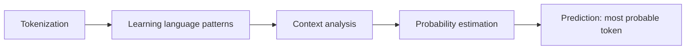
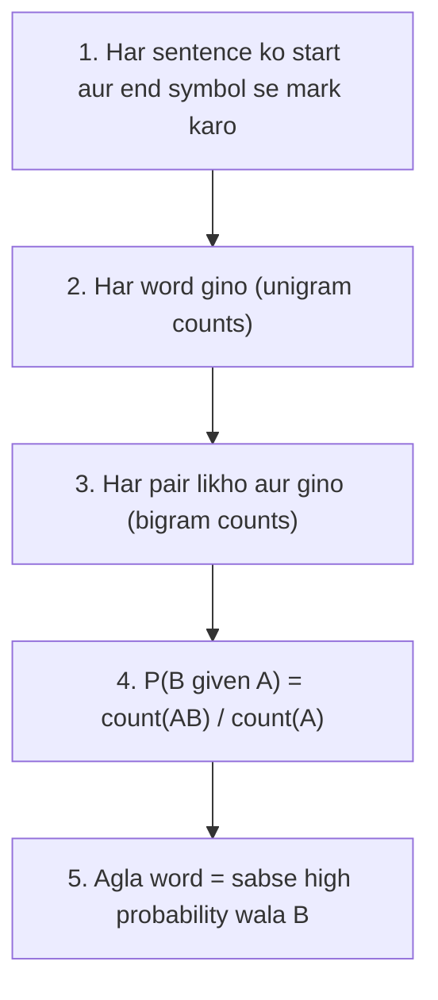
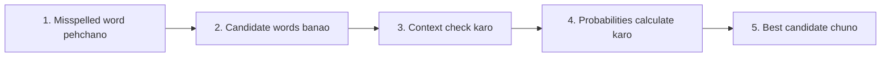

Naye ideas se pehle wo purani baatein jo chahiye. Agar aapko pata hai to seedha agle section par jao.

## Basics pehle

- **Corpus** text ka wo collection hai jisse hum seekhte hain. <Cite id="class-nlp-m2" loc="p. 8" />
- `<s>` sentence ka **start symbol** hai aur `</s>` **end symbol**. Inhe isliye lagate hain ki sentence ke pehle aur aakhri word ki baat kar sakein. <Cite id="class-nlp-m2" loc="p. 8" />
- **Conditional probability** P(B given A) matlab A ke abhi hone par B ka chance. Words ke liye: A ke theek baad B aane ka kitna chance hai?
- **Count(A)** matlab A corpus mein kitni baar aaya.

## Language model kya hai?

<Box kind="definition">

**Language model:** a statistical or machine learning model that is used to predict the next word in a sequence given the previous words. <Cite id="class-nlp-pyq2" loc="p. 1" /> Language models learn patterns in language and assign probabilities to word or token sequences, allowing them to predict the next token, complete sequences and estimate how likely a sequence is. <Cite id="class-nlp-m6" loc="slide 40" />

</Box>

Mathematically, language model words ki sequence ki probability $P(w_1, w_2, \dots, w_n)$ estimate karta hai. Next-token prediction ke liye wo $P(w_t \mid w_1, w_2, \dots, w_{t-1})$ estimate karta hai, jahan $w_t$ pichhle tokens se predict kiya gaya agla token hai. <Cite id="class-nlp-m6" loc="slide 41" />

**Ye kaise kaam karta hai** (paanch steps). <Cite id="class-nlp-m6" loc="slide 42" />

Class example: input "She went to the", predictions market 0.45, school 0.30, office 0.15, hospital 0.06, park 0.04. <Cite id="class-nlp-m6" loc="slide 42" />

Ye syllabus <Syl m="2" /> hai.

## N-gram kya hai?

<Box kind="definition">

**N-gram** is a continuous sequence of n words in a text. <Cite id="class-nlp-m2" loc="p. 8" /> N ki value N-gram ka order hai.

</Box>

- **Unigram** (1-gram): single words. Unigram model ek time par ek word dekhta hai.
- **Bigram** (2-gram): consecutive words ke pairs. Ye pichhla ek word use karta hai.
- **Trigram** (3-gram): consecutive words ke triplets. Ye pichhle do words use karta hai.

<Cite id="class-nlp-pyq2" loc="p. 1" /> <Cite id="class-nlp-m6" loc="slide 43" />

Example: "I want to drink" diya ho to trigram model pichhle do words "want to" se agla word predict karta hai. <Cite id="class-nlp-m6" loc="slide 43" />

## Bigram probability

Bigram mein A pichhla word hai aur B agla word. <Cite id="class-nlp-m2" loc="p. 9" />

<Box kind="definition">

$$
P(B \mid A) = \frac{\text{count}(AB)}{\text{count}(A)}
$$

count(AB) **bigram** count hai (A ke baad B) aur count(A) A ka **unigram** count. <Cite id="class-nlp-m2" loc="p. 9" />

</Box>

Shabdon mein: A jitni baar aaya, usme se kitni baar uske baad B aaya?

### Worked example 1: dog aur cat corpus (class)

Corpus: "The dog barks. The cat sleeps. The dog runs. The cat jumps." Isme 12 words aur 7 alag words hain. <Cite id="class-nlp-m2" loc="p. 8" />

| Bigram | count(AB) | count(A) | P(B given A) |
|---|---|---|---|
| The dog | 2 | 4 | 0.5 |
| The cat | 2 | 4 | 0.5 |
| dog barks | 1 | 2 | 0.5 |
| dog runs | 1 | 2 | 0.5 |
| cat sleeps | 1 | 2 | 0.5 |
| cat jumps | 1 | 2 | 0.5 |

<Cite id="class-nlp-m2" loc="p. 9" />

(Teacher ki yahan ki table sentence markers chhod deti hai, isliye start symbol ki row nahi hai.)

### Worked example 2: Sam corpus (class question)

<Sum>

<Given>

Corpus (7 sentences, har ek mein `<s>` aur `</s>`): I am Sam; I like college; Do Sam like college; Sam I am; Do I like Sam; Do I like college; I do like Sam. (Class ki tarah "Do" aur "do" alag words gine gaye hain.) <Cite id="class-nlp-m2" loc="p. 10" />

</Given>

<Find>

saare bigrams, conditional probabilities, aur **like** aur **Sam** ke liye predicted next word.

</Find>

<Steps>

1. **Unigram counts:** `<s>` 7, I 6, am 2, Sam 5, like 5, college 3, Do 3, do 1, `</s>` 7. Kul 39 tokens.
2. **Bigram counts** (17 alag bigrams, kul 32: 39 tokens minus 7 sentences): `<s> I` 3, `<s> Do` 3, `<s> Sam` 1, I am 2, I like 3, I do 1, am Sam 1, am `</s>` 1, Sam `</s>` 3, Sam like 1, Sam I 1, like college 3, like Sam 2, college `</s>` 3, Do Sam 1, Do I 2, do like 1.
3. **like ke baad:** P(college given like) = 3/5 = 0.6 aur P(Sam given like) = 2/5 = 0.4.
4. **Sam ke baad:** P(`</s>` given Sam) = 3/5 = 0.6, P(like given Sam) = 1/5 = 0.2 aur P(I given Sam) = 1/5 = 0.2.
5. **Predict:** sabse high probability jeetti hai.

</Steps>

<Answer>

**like** ke baad model **college** predict karta hai (0.6, jabki Sam ki 0.4). **Sam** ke baad wo sentence ka end **`</s>`** predict karta hai (0.6).

</Answer>

<Box kind="verify">

Ek word ke baad ki probabilities ka sum 1 hona chahiye: like ke baad 3/5 + 2/5 = 1; Sam ke baad 3/5 + 1/5 + 1/5 = 1. Bigram total 3+3+1+2+3+1+1+3+1+1+3+2+3+1+2+1+1 = 32, jo 39 tokens minus 7 sentences se match karta hai.

</Box>

</Sum>

### Worked example 3: I tell you to sleep (class question)

<Sum>

<Given>

Corpus: `<s>` I tell you to sleep and rest `</s>`; `<s>` I would like to sleep for an hour `</s>`; `<s>` Sleep helps one to relax `</s>`. <Cite id="class-nlp-pyq2" loc="p. 7" />

</Given>

<Find>

bigrams, probabilities aur **to** ke baad ka agla word.

</Find>

<Steps>

1. Kul 26 tokens aur 3 sentences, isliye 23 bigrams. Word to 3 baar aaya hai.
2. to ke baad sentence 1 mein sleep, sentence 2 mein sleep aur sentence 3 mein relax aaya.
3. count(to sleep) = 2, count(to relax) = 1.
4. P(sleep given to) = 2/3 = 0.667 aur P(relax given to) = 1/3 = 0.333.

</Steps>

<Answer>

**to** ke baad agla word **sleep** hai (probability 2/3 = 0.667).

</Answer>

<Box kind="verify">

2/3 + 1/3 = 1. Ye typed class solution se match karta hai, jo bhi 23 bigrams ginta hai aur sleep 0.667 aur relax 0.333 deta hai. (Handwritten notes mein sleep ki probability 1/3 likhi hai, jo galat hai: sleep to ke baad do baar aaya.)

</Box>

</Sum>

Class corpus "she reads a book, he reads a book, she reads a magazine, he likes a book" bhi solve karti hai: a ke baad book ki 3/4 = 0.75 aur magazine ki 1/4 = 0.25, isliye a ke baad agla word book hai; he ke baad reads aur likes dono 1/2. <Cite id="class-nlp-m2" loc="p. 13" /> <Cite id="class-nlp-m2" loc="p. 15" />

## Poore sentence ki probability

Class agla word poochti hai. Jab exam poochhe ki kaun sa sentence behtar hai, to bigram model sentence ke `<s>` se `</s>` tak ke bigram probabilities ko multiply karta hai. Ye step standard hai aur class files mein worked nahi hai. Jis sentence ka product bada ho wo behtar hai. Jis product mein count 0 wala bigram ho wo 0 ho jaata hai.

## Smoothing

N-gram models ki ek problem ye hai ki unseen sequence ko probability zero mil sakti hai. Smoothing techniques probability estimates ko adjust karti hain taaki unseen ya rare sequences ko bhi thodi si probability mil sake. Class ye naam batati hai: **add-one (Laplace) smoothing, add-k smoothing, Good-Turing smoothing aur Kneser-Ney smoothing.** <Cite id="class-nlp-m6" loc="slide 44" />

N-gram models simple aur efficient hain, par unka fixed context long-range dependencies pakadne ki unki ability ko limit karta hai, aur jab koi word sequence corpus mein rare ya absent ho to data sparsity ki problem aati hai. <Cite id="class-nlp-m6" loc="slide 43" />

**Good-Turing discounting** (class naam batati hai par formula nahi deti, isliye ye standard idea hai). Jo words c baar dikhe unhe kam count $c^* = (c+1)\,N_{c+1}/N_c$ diya jaata hai, jahan $N_c$ un alag words ki sankhya hai jo exactly c baar dikhe. Bachi hui probability, $N_1/N$ (N tokens ki sankhya), unseen words mein baanti jaati hai. Example: agar 3 words ek baar, 1 word do baar, 1 word teen baar dikhe (N = 8), to ek baar dikhe word ko $c^* = 2 \times 1/3 = 0.67$ milta hai aur unseen words ko milkar $3/8 = 0.375$.

## Perplexity

<Box kind="definition">

**Perplexity** is a measurement of uncertainty in the predictions of a language model. It indicates how surprised a model is by the actual outcomes. The lower the perplexity, the better the model at predicting the next word. <Cite id="class-nlp-pyq2" loc="p. 5" />

</Box>

N words ki sequence ke liye:

$$
\text{Perplexity}(P) = 2^{-\frac{1}{N}\sum_{i=1}^{N}\log_2 P(w_i \mid w_1, \dots, w_{i-1})}
$$

Ye words ki unke context ke diye jaane par average negative log-likelihood ka exponential hai. <Cite id="class-nlp-pyq2" loc="p. 5" />

- **Perplexity 1:** ideal score; model har baar agla word perfectly predict karta hai.
- **Perplexity 1 se upar:** thodi uncertainty; jitni zyada, model utna kam confident. Perplexity 10 matlab model utna uncertain hai jaise 10 barabar possible agle words mein se chun raha ho.

Aakhri line ka check: agar N words mein se har ek ki probability 1/10 ho, to product $10^{-N}$ hai aur perplexity $(10^{-N})^{-1/N} = 10$.

## N-gram model se spelling correction

N-gram model galat word ke pehle ya baad ke words se sahi word chunta hai. <Cite id="class-nlp-pyq2" loc="p. 8" />

Example: "I want to go to skul". Candidates: school, stool, skill. Bigram "to school" ki probability high hai, "to stool" aur "to skill" ki kam, isliye **school** chuna jaata hai. <Cite id="class-nlp-pyq2" loc="p. 8" />

## N-grams ke uses

<Cite id="class-nlp-pyq2" loc="p. 1" />

- **Context aur semantics pakadna:** ye dikhate hain ki words sentence mein saath kaise kaam karte hain.
- **Language models behtar banana:** translation systems aur voice assistants guess karte hain ki aage kya aayega.
- **Text prediction:** predictive typing agla word suggest karti hai.
- **Information retrieval:** word patterns se documents dhundna aur rank karna.
- **Spelling correction** (upar).

## Ye kahan puchha gaya

| Agar question kehta hai | Kya likhna hai | Kab aaya |
|---|---|---|
| "What is a language model? Write a note on the N-gram model" | Definition, formulas, unigram/bigram/trigram, uses | <PYQ id="2024-12/q2a" /> <PYQ id="assignment-1/q2a" /> <PYQ id="2024-12-ce/q4b" /> |
| "List all possible bigrams, compute probabilities and predict the next word" (Sam corpus) | Upar ka Sam sum | <PYQ id="2025-05/q5a" /> <PYQ id="assignment-1/q2c" /> |
| Wahi, corpus "I tell you to sleep ..." ke liye | Upar ka Sum 3 | <PYQ id="2022-12-ce/q3a" /> <PYQ id="assignment-1/q2e" /> |
| Wahi, four students corpus ke liye | Naye corpus par wahi method | <PYQ id="assignment-1/q2d" /> |
| "Bigram and n-gram with formula, phir sentences compare karo" | Formula, bigram table, probabilities ka product | <PYQ id="2025-05-ce/q2a" /> |
| "Perplexity of a language model" | Definition, formula, 1 aur 1 se upar ka matlab | <PYQ id="2022-12-ce/q1f" /> <PYQ id="2025-05/q6b" /> |
| "N-gram in spelling correction" | Paanch steps aur skul example | <PYQ id="2023-05-ce/q1b" /> |
| "Good-Turing discounting" | Idea, formula aur chhota example | <PYQ id="2023-12-ce/q1b" /> |

## Quick revision

- Language model: agla word predict karta hai aur word sequences ko probabilities deta hai.
- N-gram: n words ki continuous sequence. Unigram 1, bigram 2, trigram 3.
- $P(B \mid A) = \text{count}(AB) / \text{count}(A)$.
- Steps: `<s>` aur `</s>` lagao, unigrams gino, bigrams gino, divide karo, sabse high chuno.
- Sam corpus: like ke baad college 0.6; Sam ke baad `</s>` 0.6. to ke baad (sleep corpus): sleep 2/3.
- Smoothing zero probabilities theek karti hai: add-one, add-k, Good-Turing, Kneser-Ney.
- Perplexity: kam better hai; 1 perfect hai.

**Conclusion.** N-gram model corpus mein word pairs kitni baar aate hain ye gintakar agla word predict karta hai, aur sabse high conditional probability prediction deti hai. <Cite id="class-nlp-m2" loc="p. 9" />
