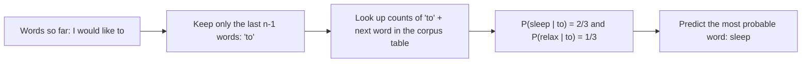
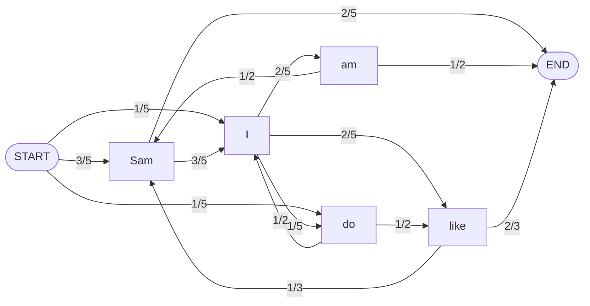
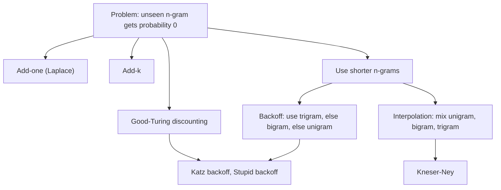

Before the new ideas, here are the old ones you need. If you already know them, skip to the next section.

## The basics first

- A **corpus** (plural **corpora**) is a large collection of text used to learn from, for example news articles or books. A **word instance** (token) is every occurrence of a word; a **word type** is a different word. "to be or not to be" has 6 instances and 4 types.
- **Probability** is a number from 0 to 1 that says how likely something is. $P(\text{rain}) = 0.3$ means "3 out of 10 times".
- **Conditional probability** $P(B \mid A)$ is the probability of $B$ when we already know $A$ happened. Example: $P(\text{sleep} \mid \text{to})$ is the chance that the next word is *sleep* when the word before it is *to*.
- **Chain rule.** The probability of several things together is built one at a time: $P(A, B, C) = P(A)\,P(B \mid A)\,P(C \mid A, B)$.
- A **count** $c(\cdot)$ is how many times something appears in the corpus.

## What is a language model?

**What it is.** A **language model (LM)** is a model that gives a probability to a sequence of words, or to the next word given the words before it. It tells us that "I like to sleep" is a more likely English sentence than "sleep to like I". This is syllabus <Syl m="2" />, section 2.3 (n-grams, unigram and bigram language models, corpora, probability of a word sequence). <Cite id="ngram-language-models-slp3-ch3" loc="§3" /> <Cite id="ngram-language-models-wiki-lm" />

**Why it is needed.** Many tasks need to choose between several possible texts: which word did the speaker say, which translation sounds natural, which spelling fits here. A language model gives each candidate a score, and we pick the best one.

**Everyday analogy.** When you type on your phone and it suggests the next word, it is guessing from the last word or two you typed. An n-gram model does exactly that, using counts from a large amount of text.

<Box kind="definition">

An **n-gram** is a sequence of $n$ consecutive words. An **n-gram language model** estimates the probability of a word from the previous $n-1$ words, using counts from a corpus.

| n | Name | Example from "I like to sleep" |
|---|---|---|
| 1 | unigram | I, like, to, sleep |
| 2 | bigram | I like, like to, to sleep |
| 3 | trigram | I like to, like to sleep |

</Box>

<Cite id="ngram-language-models-av-lm" loc="diagram" /> <Cite id="ngram-language-models-slp3-ch3" loc="§3.1" />

## The idea: chain rule and Markov assumption

To find the probability of a whole sentence $w_1 w_2 \dots w_n$ we use the chain rule:

$$P(w_1 \dots w_n) = P(w_1)\,P(w_2 \mid w_1)\,P(w_3 \mid w_1 w_2) \cdots P(w_n \mid w_1 \dots w_{n-1})$$

The last factor needs the whole history, and almost no long history ever repeats exactly in a corpus, so we cannot count it. The **Markov assumption** fixes this: the next word depends only on the last few words. For a bigram model we keep one word of history:

$$P(w_n \mid w_1 \dots w_{n-1}) \approx P(w_n \mid w_{n-1})$$

For a trigram model we keep two words: $P(w_n \mid w_{n-2} w_{n-1})$. In general an n-gram model keeps $n-1$ words. A model with a history of $n-1$ words is called an $(n-1)$th-order Markov model. <Cite id="ngram-language-models-slp3-ch3" loc="§3.1.1" /> <Cite id="ngram-language-models-wiki-markov" />

So the sentence probability under a bigram model is a product of bigram probabilities:

$$P(w_1 \dots w_n) \approx \prod_{k=1}^{n} P(w_k \mid w_{k-1})$$

## How to estimate the probabilities (maximum likelihood)

Count in the corpus. For a bigram, the probability of $w_n$ after $w_{n-1}$ is the fraction of times $w_{n-1}$ was followed by $w_n$:

$$P(w_n \mid w_{n-1}) = \frac{c(w_{n-1}\,w_n)}{c(w_{n-1})}$$

This is the **maximum likelihood estimate (MLE)**: it makes the training corpus as probable as possible. For a unigram model, $P(w) = c(w) / N$, where $N$ is the number of words. For a trigram, $P(w_n \mid w_{n-2} w_{n-1}) = c(w_{n-2} w_{n-1} w_n) / c(w_{n-2} w_{n-1})$. <Cite id="ngram-language-models-slp3-ch3" loc="§3.1.2" />

Two practical details:

- **Sentence markers.** Add `<s>` at the start and `</s>` at the end of every sentence. The first word then has a history (`<s>`), and `</s>` lets the model give probabilities to whole sentences that sum to 1. Count `<s>` as a history word but never as a word to be predicted.
- **Case.** Usually we fold everything to lower case first, so `Sleep` and `sleep` are one word. Say so in the exam.
- **Use logs.** Multiplying many small numbers underflows on a computer, so real systems add log probabilities instead. In a hand calculation the plain product is fine.

### Worked example: list bigrams, find probabilities and predict a word

<Sum>

<Given>

Corpus (three sentences, lower-cased):

`<s> i tell you to sleep and rest </s>`
`<s> i would like to sleep for an hour </s>`
`<s> sleep helps one to relax </s>`

</Given>

<Find>

all bigrams, their conditional probabilities, and the predicted next word after "to".

</Find>

<Steps>

1. Write the bigrams of each sentence by pairing each word with the next. Sentence 1 has 8: `<s> i`, `i tell`, `tell you`, `you to`, `to sleep`, `sleep and`, `and rest`, `rest </s>`. Sentence 2 has 9: `<s> i`, `i would`, `would like`, `like to`, `to sleep`, `sleep for`, `for an`, `an hour`, `hour </s>`. Sentence 3 has 6: `<s> sleep`, `sleep helps`, `helps one`, `one to`, `to relax`, `relax </s>`. *Reason: a sentence of $m$ words with both markers has $m+1$ bigrams.* Total $8 + 9 + 6 = 23$ bigram instances.
2. Two bigrams repeat (`<s> i` twice, `to sleep` twice), so there are $23 - 2 = 21$ different bigrams.
3. Count the history words: $c(\langle s\rangle) = 3$, $c(\text{i}) = 2$, $c(\text{sleep}) = 3$, $c(\text{to}) = 3$. Every other word occurs once.
4. Apply $P(w_n \mid w_{n-1}) = c(w_{n-1} w_n) / c(w_{n-1})$:

| History | Next word | Count | Probability |
|---|---|---|---|
| `<s>` | i | 2 | 2/3 |
| `<s>` | sleep | 1 | 1/3 |
| i | tell | 1 | 1/2 |
| i | would | 1 | 1/2 |
| sleep | and | 1 | 1/3 |
| sleep | for | 1 | 1/3 |
| sleep | helps | 1 | 1/3 |
| to | sleep | 2 | 2/3 |
| to | relax | 1 | 1/3 |
| each other word (tell, you, and, rest, would, like, for, an, hour, helps, one, relax) | its only next word | 1 | 1/1 = 1 |

5. After "to": `to sleep` appears 2 times and `to relax` 1 time out of $c(\text{to}) = 3$. So $P(\text{sleep} \mid \text{to}) = 2/3$ and $P(\text{relax} \mid \text{to}) = 1/3$.

</Steps>

<Answer>

23 bigram instances (21 different). After "to" the model predicts **sleep** with probability $2/3$ (relax gets $1/3$).

</Answer>

<Box kind="verify">

For every history word the probabilities of its next words must add to 1. For `to`: $2/3 + 1/3 = 1$. For `<s>`: $2/3 + 1/3 = 1$. For `sleep`: $3 \times 1/3 = 1$. For `i`: $1/2 + 1/2 = 1$. Also the counts add up: the history counts of `<s>`, `i`, `sleep`, `to` are $3 + 2 + 3 + 3 = 11$, plus the 12 single-count words give $11 + 12 = 23$ bigram instances. <PYQ id="2022-12-ce/q3a" />

</Box>

</Sum>

### Worked example: best next word and best sentence with a bigram model

<Sum>

<Given>

Training corpus:

`<s> I am Sam </s>`
`<s> Sam I am </s>`
`<s> Sam I like </s>`
`<s> Sam I do like </s>`
`<s> do I like Sam </s>`

</Given>

<Find>

(1) the most probable next word for: (a) `<s> Sam`, (b) `<s> Sam I do`, (c) `<s> Sam I am Sam`, (d) `<s> do I like`; (2) which of (e) `<s> Sam I do I like </s>`, (f) `<s> Sam I am </s>`, (g) `<s> I do like Sam I am </s>` is most probable.

</Find>

<Steps>

1. Count the history words: `<s>` 5, `I` 5, `Sam` 5, `am` 2, `like` 3, `do` 2.
2. Count the bigrams: `<s> I` 1, `<s> Sam` 3, `<s> do` 1; `I am` 2, `I like` 2, `I do` 1; `am Sam` 1, `am </s>` 1; `Sam </s>` 2, `Sam I` 3; `like </s>` 2, `like Sam` 1; `do like` 1, `do I` 1.
3. Divide by the history count. After `Sam`: `I` $3/5$, `</s>` $2/5$. After `I`: `am` $2/5$, `like` $2/5$, `do` $1/5$. After `am`: `Sam` $1/2$, `</s>` $1/2$. After `like`: `</s>` $2/3$, `Sam` $1/3$. After `do`: `like` $1/2$, `I` $1/2$. After `<s>`: `Sam` $3/5$, `I` $1/5$, `do` $1/5$.
4. Part 1. (a) After `Sam` the best word is **I** ($3/5$). (b) After `do` there is a tie between **like** and **I**, each $1/2$. (c) After `Sam` again the best is **I** ($3/5$). (d) After `like` the best is **`</s>`** ($2/3$).
5. Part 2, multiply the bigram probabilities along each sentence.
   - (e) $P(\text{Sam} \mid \langle s\rangle) \cdot P(\text{I} \mid \text{Sam}) \cdot P(\text{do} \mid \text{I}) \cdot P(\text{I} \mid \text{do}) \cdot P(\text{like} \mid \text{I}) \cdot P(\langle /s\rangle \mid \text{like}) = \frac35 \cdot \frac35 \cdot \frac15 \cdot \frac12 \cdot \frac25 \cdot \frac23 = \frac{6}{625} = 0.0096$.
   - (f) $\frac35 \cdot \frac35 \cdot \frac25 \cdot \frac12 = \frac{9}{125} = 0.072$.
   - (g) $P(\text{I} \mid \langle s\rangle) \cdot P(\text{do} \mid \text{I}) \cdot P(\text{like} \mid \text{do}) \cdot P(\text{Sam} \mid \text{like}) \cdot P(\text{I} \mid \text{Sam}) \cdot P(\text{am} \mid \text{I}) \cdot P(\langle /s\rangle \mid \text{am}) = \frac15 \cdot \frac15 \cdot \frac12 \cdot \frac13 \cdot \frac35 \cdot \frac25 \cdot \frac12 = \frac{1}{1250} = 0.0008$.

</Steps>

<Answer>

(a) I, (b) like or I (tie), (c) I, (d) `</s>`. Sentence (f) `<s> Sam I am </s>` is the best with $0.072$; then (e) $0.0096$; then (g) $0.0008$.

</Answer>

<Box kind="verify">

Check the history counts: the six counts add to $5 + 5 + 5 + 2 + 3 + 2 = 22$, the number of predicted words (27 tokens minus the 5 `<s>`). Each history's next-word probabilities add to 1, for example after `I`: $2/5 + 2/5 + 1/5 = 1$. Recompute (f) another way: $0.6 \times 0.6 \times 0.4 \times 0.5 = 0.072$. Sentence (g) is lowest because `<s> I` and `do like` and `like Sam` are rare and the sentence is longer. <PYQ id="2025-05-ce/q2a" />

</Box>

</Sum>

The same recipe gives this model as a picture. Each arrow is a bigram probability, and a sentence is a walk from START to END. Multiplying the numbers on the path gives the sentence probability.

<Cite id="ngram-language-models-slp3-ch3" loc="§3.1" /> <Cite id="ngram-language-models-wiki-markov" loc="diagram" />

### Worked example: a second corpus, "like" and "Sam"

<Sum>

<Given>

Corpus (lower-cased, so `Do` and `do` are the same word):

`<s> i am sam </s>`
`<s> i like college </s>`
`<s> do sam like college </s>`
`<s> sam i am </s>`
`<s> do i like sam </s>`
`<s> do i like college </s>`
`<s> i do like sam </s>`

</Given>

<Find>

all bigrams, their conditional probabilities, and the predicted next word after (i) like and (ii) Sam.

</Find>

<Steps>

1. List the bigrams sentence by sentence (4, 4, 5, 4, 5, 5, 5, so 32 instances). The 17 different ones are: `<s> i`, `<s> do`, `<s> sam`, `i am`, `i like`, `i do`, `am sam`, `am </s>`, `sam </s>`, `sam like`, `sam i`, `like college`, `like sam`, `college </s>`, `do sam`, `do i`, `do like`.
2. Count history words: `<s>` 7, `i` 6, `do` 4, `sam` 5, `like` 5, `am` 2, `college` 3.
3. Count the bigrams and divide:

| History | Next word: count / history count = probability |
|---|---|
| `<s>` | i: 3/7, do: 3/7, sam: 1/7 |
| i | am: 2/6 = 1/3, like: 3/6 = 1/2, do: 1/6 |
| do | sam: 1/4, i: 2/4 = 1/2, like: 1/4 |
| am | sam: 1/2, `</s>`: 1/2 |
| sam | `</s>`: 3/5, like: 1/5, i: 1/5 |
| like | college: 3/5, sam: 2/5 |
| college | `</s>`: 3/3 = 1 |

4. (i) After `like`, `college` has the highest probability, $3/5$. (ii) After `sam`, `</s>` has the highest probability, $3/5$.

</Steps>

<Answer>

(i) like is followed by **college** ($3/5$; sam gets $2/5$). (ii) Sam is followed by **`</s>`**, the end of the sentence ($3/5$; like and I get $1/5$ each).

</Answer>

<Box kind="verify">

Rows add to 1: `<s>` $3/7 + 3/7 + 1/7 = 1$; `i` $1/3 + 1/2 + 1/6 = 1$; `do` $1/4 + 1/2 + 1/4 = 1$; `sam` $3/5 + 1/5 + 1/5 = 1$; `like` $3/5 + 2/5 = 1$. The history counts add to $7 + 6 + 4 + 5 + 5 + 2 + 3 = 32$, the number of bigram instances. <PYQ id="2025-05/q5a" />

</Box>

</Sum>

<Box kind="pitfall">

If the exam does not tell you to lower-case, you may keep `Do` and `do` apart. Then say so, and the counts for `<s> Do` and `do` change, but the answers for `like` and `Sam` stay the same here.

</Box>

### Worked example: unigram versus bigram

A **unigram** model ignores the history: $P(w) = c(w)/N$, and a sentence probability is the product of its word probabilities. It is weak because word order does not matter to it.

<Sum>

<Given>

The `I am Sam` corpus above (5 sentences, 22 words to predict if we count `</s>` and skip `<s>`). Sentence: `Sam I am </s>`.

</Given>

<Find>

the sentence probability under a unigram model, and how it compares with the bigram value $0.072$.

</Find>

<Steps>

1. Unigram counts: I 5, am 2, Sam 5, like 3, do 2, `</s>` 5. Their total is $22$.
2. $P(\text{Sam}) = 5/22$, $P(\text{I}) = 5/22$, $P(\text{am}) = 2/22$, $P(\langle /s\rangle) = 5/22$.
3. Multiply: $\dfrac{5 \cdot 5 \cdot 2 \cdot 5}{22^4} = \dfrac{250}{234256} \approx 0.00107$.
4. Compare: $0.072 / 0.00107 \approx 67$.

</Steps>

<Answer>

Unigram: about $0.00107$. The bigram model gives the same sentence about 67 times more probability, because it knows that I follows Sam and am follows I.

</Answer>

<Box kind="verify">

The six unigram probabilities add to 1: $(5 + 2 + 5 + 3 + 2 + 5)/22 = 22/22$. And $22^2 = 484$, $484^2 = 234256$. <Cite id="ngram-language-models-slp3-ch3" loc="§3.1" />

</Box>

</Sum>

## Corpora: where the counts come from

A language model is only as good as the text it learned from. The corpus decides the vocabulary, the style and the topics the model knows.

| Corpus | What it is |
|---|---|
| **Brown Corpus** | The first large computer-readable English corpus: about one million words from 500 samples in 15 genres, collected at Brown University in 1961. <Cite id="ngram-language-models-wiki-brown" /> |
| **NLTK corpora** | Ready-to-use texts for practice: Brown, Reuters news, Gutenberg books, Penn Treebank sample. <Cite id="ngram-language-models-nltk-book2" loc="Ch. 2" /> |
| **Web-scale text** | Billions of words from the web and scanned books; Google published web n-gram counts and used them in translation. <Cite id="ngram-language-models-brants2007" /> |

Three points about corpora:

1. **Zipf's law.** A few words (the, of, and) are extremely common and most words are rare. The frequency of a word is roughly proportional to $1/\text{rank}$. So even a huge corpus misses many valid word sequences, which is why smoothing is needed. <Cite id="ngram-language-models-wiki-zipf" />
2. **Domain match.** A model trained on news is poor at tweets or medical notes. Train on text similar to what you will test on.
3. **Training, dev and test sets.** Split the corpus into a **training set** (to count n-grams), a **development (dev) set** (to tune settings such as the smoothing value) and a **test set** (used once, at the end, to report quality). Never train or tune on the test set, or the score looks better than it is. A common split is about 80%, 10% and 10%. <Cite id="ngram-language-models-slp3-ch3" loc="§3.2" />

**Unknown words.** A test sentence can contain a word that never appeared in training. Common fix: choose a vocabulary (for example words seen at least twice), replace every other word in the training data with `<UNK>`, and count `<UNK>` like any other word. <Cite id="ngram-language-models-slp3-ch3" loc="§3.2" />

## Sampling: seeing what a model learned

We can generate text from an n-gram model: pick the first word by its probability after `<s>`, then keep picking the next word using the bigram probabilities until `</s>`. With bigrams the output is locally sensible but wanders; with trigrams or 4-grams it copies phrases from the training text. Shannon already did this by hand in 1948 to show that higher-order models look more like English. <Cite id="ngram-language-models-shannon1948" /> <Cite id="ngram-language-models-slp3-ch3" loc="§3.4" />

## The zero problem and smoothing

Even a large corpus misses many valid n-grams. If a test sentence has one bigram that never occurred in training, MLE gives it probability $0$, and the product for the whole sentence becomes $0$. Also, the perplexity would be undefined (division by zero). **Smoothing** (or **discounting**) takes a little probability from the n-grams we saw and gives it to the ones we did not. <Cite id="ngram-language-models-slp3-ch3" loc="§3.6" /> <Cite id="ngram-language-models-chen-goodman1996" />

<Cite id="ngram-language-models-av-lm" loc="diagram" /> <Cite id="ngram-language-models-wiki-additive" />

### Add-one (Laplace) smoothing

Pretend every possible bigram was seen once more than it really was. Add 1 to the top and add $V$ (the vocabulary size, the number of different words that can come next) to the bottom, so that the probabilities still add to 1:

$$P_{\text{add-1}}(w_n \mid w_{n-1}) = \frac{c(w_{n-1} w_n) + 1}{c(w_{n-1}) + V}$$

<Sum>

<Given>

The `I am Sam` corpus (5 sentences). Vocabulary of possible next words: I, am, Sam, like, do, `</s>`, so $V = 6$. Counts: $c(\text{I}) = 5$, $c(\text{I am}) = 2$, $c(\text{I do}) = 1$, $c(\text{like}) = 3$, $c(\text{like I}) = 0$, $c(\langle s\rangle) = 5$, $c(\langle s\rangle\text{ Sam}) = 3$, $c(\text{Sam}) = 5$, $c(\text{Sam I}) = 3$, $c(\text{am}) = 2$, $c(\text{am }\langle /s\rangle) = 1$.

</Given>

<Find>

the add-one probabilities $P(\text{am} \mid \text{I})$, $P(\text{I} \mid \text{like})$ (never seen), and the add-one probability of the sentence `<s> Sam I am </s>`.

</Find>

<Steps>

1. $P(\text{am} \mid \text{I}) = (2 + 1)/(5 + 6) = 3/11 \approx 0.273$ (before smoothing it was $2/5 = 0.4$).
2. $P(\text{I} \mid \text{like}) = (0 + 1)/(3 + 6) = 1/9 \approx 0.111$ (before smoothing it was $0$).
3. Sentence: $P(\text{Sam} \mid \langle s\rangle) = (3+1)/(5+6) = 4/11$; $P(\text{I} \mid \text{Sam}) = (3+1)/(5+6) = 4/11$; $P(\text{am} \mid \text{I}) = 3/11$; $P(\langle /s\rangle \mid \text{am}) = (1+1)/(2+6) = 1/4$.
4. Multiply: $\dfrac{4}{11} \cdot \dfrac{4}{11} \cdot \dfrac{3}{11} \cdot \dfrac{1}{4} = \dfrac{48}{5324} = \dfrac{12}{1331} \approx 0.00902$.

</Steps>

<Answer>

$P(\text{am} \mid \text{I}) = 3/11$, $P(\text{I} \mid \text{like}) = 1/9$, and the sentence gets $12/1331 \approx 0.009$ (it was $0.072$ without smoothing).

</Answer>

<Box kind="verify">

All six smoothed probabilities after `I` must add to 1: am $3/11$, like $3/11$, do $2/11$, and the three unseen words (I, Sam, `</s>`) $1/11$ each: $3 + 3 + 2 + 1 + 1 + 1 = 11$, so $11/11 = 1$. The sentence probability fell from $0.072$ to $0.009$ because add-one moves a lot of probability to unseen bigrams. <Cite id="ngram-language-models-slp3-ch3" loc="§3.6.1" />

</Box>

</Sum>

Add-one is simple but gives too much probability to unseen events when $V$ is large, so it is rarely used for n-grams (it is used in text classification). **Add-k smoothing** adds a smaller number $k$ (for example 0.5 or 0.05) instead of 1: $P = (c(w_{n-1}w_n) + k)/(c(w_{n-1}) + kV)$, and $k$ is chosen on the dev set. <Cite id="ngram-language-models-slp3-ch3" loc="§3.6.2" />

### Good-Turing discounting

**What it is.** Good-Turing uses the words we saw **once** to estimate how much probability the **unseen** words deserve. Idea: the chance that the next thing is brand new is about the fraction of things we have seen only once. It was devised by Alan Turing and I. J. Good during the Second World War and published by Good in 1953. <Cite id="ngram-language-models-wiki-gt" /> <Cite id="ngram-language-models-gale-sampson1995" />

Let $N_c$ be the **number of different items seen exactly $c$ times** and $N$ the total number of items seen. Then:

- Probability of the whole unseen group: $P_{\text{unseen}} = N_1 / N$.
- A new (adjusted) count for items seen $c$ times: $c^* = (c+1)\,\dfrac{N_{c+1}}{N_c}$, and the probability of one such item is $c^*/N$.

<Sum>

<Given>

A fisherman caught 18 fish: 10 carp, 3 perch, 2 whitefish, 1 trout, 1 salmon, 1 eel. (A classic textbook-style example; the counts are given, not from a real source.) Assume 2 more species exist that were never caught.

</Given>

<Find>

the probability that the next fish is of a new species, and the Good-Turing probability of the next fish being a trout.

</Find>

<Steps>

1. $N = 18$. Frequency of frequencies: $N_1 = 3$ (trout, salmon, eel), $N_2 = 1$ (whitefish), $N_3 = 1$ (perch), $N_{10} = 1$ (carp).
2. Unseen: $P_{\text{unseen}} = N_1/N = 3/18 = 1/6$. *Reason: 3 of the 18 catches were first sightings, so about 1 in 6 next catches will be new.*
3. Share it between the 2 unseen species: $\tfrac{1}{6} / 2 = 1/12$ each. (The same as $c_0^* = 1 \cdot N_1/N_0 = 3/2$ and $1.5/18 = 1/12$.)
4. Trout was seen once: $c^* = 2 \cdot N_2/N_1 = 2 \cdot 1/3 = 2/3$.
5. $P_{GT}(\text{trout}) = c^*/N = (2/3)/18 = 1/27 \approx 0.037$.

</Steps>

<Answer>

New species: $1/6 \approx 0.167$ in total ($1/12$ each for 2 unseen species). Trout: $1/27 \approx 0.037$, lower than its raw share $1/18 \approx 0.056$.

</Answer>

<Box kind="verify">

Trout's count was cut from 1 to $2/3$, so seen items are discounted and the freed probability goes to unseen species. Recompute $c^*$: $2 \times 1 \div 3 = 0.667$, then $0.667 \div 18 = 0.0370$ and $1 \div 27 = 0.0370$. <Cite id="ngram-language-models-wiki-gt" />

</Box>

</Sum>

<Box kind="pitfall">

The formula breaks when $N_{c+1} = 0$. In the fish example $N_4 = 0$, so $c^* = 0$ for perch (seen 3 times), which is silly. Real systems apply Good-Turing only to small counts (for example $c \le 5$) and first smooth the $N_c$ values, as Gale and Sampson describe. <Cite id="ngram-language-models-gale-sampson1995" />

</Box>

### Interpolation and backoff

Another idea: when the trigram is missing, use the shorter n-gram.

- **Interpolation** always mixes all orders: $\hat P(w_n \mid w_{n-2} w_{n-1}) = \lambda_1 P(w_n) + \lambda_2 P(w_n \mid w_{n-1}) + \lambda_3 P(w_n \mid w_{n-2} w_{n-1})$, with the $\lambda$ weights adding to 1 and chosen on the dev set. <Cite id="ngram-language-models-slp3-ch3" loc="§3.6.3" />
- **Backoff** uses the trigram if its count is above zero; otherwise it backs off to the bigram, then the unigram. **Katz backoff** takes away some probability from seen n-grams (discounting, often with Good-Turing) so the backed-off words get a correct share. <Cite id="ngram-language-models-wiki-katz" />
- **Stupid backoff** (Brants et al., 2007) skips the discounting: if the n-gram is missing it just uses the shorter score multiplied by a fixed number such as 0.4. The scores are not true probabilities, but it is very fast on web-size data and works well. <Cite id="ngram-language-models-brants2007" /> <Cite id="ngram-language-models-slp3-ch3" loc="§3.6.4" />
- **Kneser-Ney smoothing** is the best of the classic methods. It asks of a word "in how many different contexts have you appeared?" instead of "how often?". Example: *Francisco* is frequent, but almost always after *San*, so as a fresh word it should get a low probability. <Cite id="ngram-language-models-wiki-kn" /> <Cite id="ngram-language-models-chen-goodman1996" />

## Evaluating a language model: perplexity

There are two ways to evaluate a model. **Extrinsic**: plug it into a real task (speech recognition, translation) and measure the task score, which is accurate but slow. **Intrinsic**: measure on a held-out test set, which is quick. The usual intrinsic measure is **perplexity**. <Cite id="ngram-language-models-slp3-ch3" loc="§3.3" />

<Box kind="definition">

**Perplexity (PP)** of a language model on a test set $W = w_1 w_2 \dots w_N$ is the inverse probability of the test set, normalised by the number of words:

$$PP(W) = P(w_1 w_2 \dots w_N)^{-1/N} = \sqrt[N]{\frac{1}{P(w_1 \dots w_N)}}$$

For a bigram model, $PP(W) = \sqrt[N]{\prod_{i=1}^{N} \dfrac{1}{P(w_i \mid w_{i-1})}}$. **Lower perplexity means a better model.** Here $N$ counts the predicted words, including `</s>`.

</Box>

**In words.** Perplexity is the model's "average confusion": it is the number of equally likely words the model thinks it is choosing from at each step, the **weighted average branching factor**. A model that always knows the next word has perplexity 1. A model that picks uniformly from $V$ words has perplexity $V$. Because of the minus sign in the power, a higher probability for the test text gives a lower perplexity. <Cite id="ngram-language-models-slp3-ch3" loc="§3.3.1" /> <Cite id="ngram-language-models-wiki-perplexity" />

**Link to entropy.** Perplexity is $2^{H}$, where $H$ is the **cross-entropy** (average number of bits needed per word) of the model on the test text. See J&M §3.7. <Cite id="ngram-language-models-slp3-ch3" loc="§3.7" /> <Cite id="ngram-language-models-gfg-perplexity" />

<Sum>

<Given>

The bigram model from the `I am Sam` corpus. Sentence (f) `<s> Sam I am </s>` has probability $0.072 = 9/125$, and sentence (g) `<s> I do like Sam I am </s>` has probability $1/1250$.

</Given>

<Find>

the perplexity of each sentence.

</Find>

<Steps>

1. Count the predicted words $N$ (exclude `<s>`, include `</s>`). Sentence (f): Sam, I, am, `</s>` so $N = 4$. Sentence (g): I, do, like, Sam, I, am, `</s>` so $N = 7$.
2. (f): $PP = (9/125)^{-1/4} = (125/9)^{1/4} = 13.889^{1/4}$. Square root: $3.727$; square root again: $1.931$.
3. (g): $PP = 1250^{1/7}$. $\ln 1250 = 7.131$; divide by 7: $1.0187$; $e^{1.0187} \approx 2.77$.

</Steps>

<Answer>

$PP(f) \approx 1.93$ and $PP(g) \approx 2.77$. Sentence (f) is the better fit to the model, as its probability was higher.

</Answer>

<Box kind="verify">

Raise back to the power: $1.931^4 = (1.931^2)^2 = 3.729^2 = 13.9$, and $1/13.9 = 0.072$, the sentence probability. For (g): $2.77^7 \approx 1250$. Another check: a model that picks 1 of 10 digits at random has $P = 10^{-N}$ for $N$ digits, so $PP = (10^{-N})^{-1/N} = 10$, as expected for 10 equally likely choices. <PYQ id="2022-12-ce/q1f" /> <PYQ id="2025-05/q6b" />

</Box>

</Sum>

**Caution.** Perplexities can only be compared when the models use the same vocabulary and the same test set. Mapping rare words to `<UNK>` makes perplexity look lower, which is not a real gain. Lower perplexity does not guarantee a better result in the real task. <Cite id="ngram-language-models-gfg-perplexity" />

## Applications of n-gram models

- **Spelling correction.** Detect and fix real-word errors (their / there) and choose between candidate corrections by context.
- **Speech recognition.** Choose between words that sound alike ("recognise speech" or "wreck a nice beach").
- **Machine translation.** Prefer the target sentence that sounds fluent. <Cite id="ngram-language-models-brants2007" />
- **Text prediction and autocomplete** on phones and search boxes, and **text generation**.
- **OCR and handwriting recognition**, **POS tagging** and **parsing**, **language identification**, and **information retrieval**. <Cite id="ngram-language-models-av-lm" />

### Spelling correction with an n-gram model

A dictionary alone cannot catch *real-word errors*: "come hear now" has only real words, but is wrong. The plan: (1) find the suspicious word; (2) make **candidates** that are close in spelling (edit distance one or two, see the preprocessing note); (3) score each candidate **in context** with the language model; (4) choose the best. The classic noisy-channel version multiplies the language model $P(w)$ by the chance that the writer typed $x$ when meaning $w$, $P(x \mid w)$. <Cite id="ngram-language-models-kernighan1990" /> <Cite id="ngram-language-models-wiki-spell" /> <Cite id="ngram-language-models-gfg-spellcheck" />

<Sum>

<Given>

Typed text: "come hear now". Candidates for the middle word: *here* and *hear*. Assumed counts from a corpus (made up for practice): $c(\text{come}) = 100$, $c(\text{come here}) = 40$, $c(\text{come hear}) = 1$, $c(\text{here}) = 2000$, $c(\text{here now}) = 60$, $c(\text{hear}) = 500$, $c(\text{hear now}) = 5$.

</Given>

<Find>

the better candidate using a bigram model.

</Find>

<Steps>

1. Score = $P(\text{word} \mid \text{come}) \times P(\text{now} \mid \text{word})$. *Reason: the middle word is linked to the word before and the word after.*
2. *here*: $P(\text{here} \mid \text{come}) = 40/100 = 0.4$; $P(\text{now} \mid \text{here}) = 60/2000 = 0.03$; score $= 0.4 \times 0.03 = 0.012$.
3. *hear*: $P(\text{hear} \mid \text{come}) = 1/100 = 0.01$; $P(\text{now} \mid \text{hear}) = 5/500 = 0.01$; score $= 0.01 \times 0.01 = 0.0001$.
4. Compare: $0.012 / 0.0001 = 120$.

</Steps>

<Answer>

Correct "hear" to **here**: "come here now" is 120 times more probable than "come hear now" under the model.

</Answer>

<Box kind="verify">

Recompute with fractions: here $= \frac{40}{100} \cdot \frac{60}{2000} = \frac{2400}{200000} = 0.012$; hear $= \frac{1}{100} \cdot \frac{5}{500} = \frac{5}{50000} = 0.0001$. The choice is clear. In a real system the channel probability $P(x \mid w)$ would also be multiplied in. <PYQ id="2023-05-ce/q1b" />

</Box>

</Sum>

## Limits of n-gram models

- **Short memory.** Only $n-1$ words are visible. In "The computer which I just put into the machine room on the fifth floor crashed", the verb *crashed* belongs to *computer*, far outside a trigram window.
- **Sparsity.** Most long n-grams never occur, so smoothing is always needed, and the number of possible n-grams grows as $V^n$, so the tables become huge.
- **No meaning.** The model does not know that *cat* and *dog* are similar, so what it learns about one is not shared with the other.
- **Domain-bound.** It repeats the style of its training text.

Neural language models (Bengio et al., 2003, and later RNNs and Transformers) fix the last two points by learning word vectors, and are the base of modern large language models. N-grams stay popular as a fast, simple baseline. <Cite id="ngram-language-models-bengio2003" /> <Cite id="ngram-language-models-brown1992" />

| | Unigram | Bigram | Trigram |
|---|---|---|---|
| History used | none | 1 word | 2 words |
| Formula | $c(w)/N$ | $c(w_{n-1}w_n)/c(w_{n-1})$ | $c(w_{n-2}w_{n-1}w_n)/c(w_{n-2}w_{n-1})$ |
| Captures word order | no | a little | more |
| Zero-count problem | small | bigger | biggest |
| Table size | $V$ | $V^2$ | $V^3$ |

## How to answer in the exam

<Box kind="exam">

**Explain the N-gram language model and its application (10 marks):** (1) define a language model and an n-gram; (2) write the chain rule and the Markov assumption; (3) give the bigram formula $c(w_{n-1}w_n)/c(w_{n-1})$ with a tiny worked example; (4) mention `<s>`, `</s>` and training and test sets; (5) smoothing in one or two lines (add-one, backoff); (6) applications: speech recognition, spelling correction, translation, autocomplete; (7) limits and a one-line conclusion. <PYQ id="2024-12-ce/q4b" /> <PYQ id="2024-12/q2a" /> <PYQ id="2025-05-ce/q2a" />

**Explain perplexity (5 marks):** definition, the formula $P(W)^{-1/N}$, "lower is better", the branching-factor meaning, and a one-line example. <PYQ id="2022-12-ce/q1f" /> <PYQ id="2025-05/q6b" />

**Explain Good-Turing discounting (5 marks):** the problem of zero counts, the idea (use items seen once to estimate the unseen), $P_{\text{unseen}} = N_1/N$, $c^* = (c+1)N_{c+1}/N_c$, a tiny example and the limit when $N_{c+1} = 0$. <PYQ id="2023-12-ce/q1b" />

**Spelling correction with N-grams (5 marks):** the real-word error problem, candidate generation by edit distance, scoring with the language model, and the example "come here now" versus "come hear now". <PYQ id="2023-05-ce/q1b" />

**Bigram sums (5 or 10 marks):** list the unigram and bigram counts, write the probability table, then multiply along the sentence. Always show the check that each row adds to 1. <PYQ id="2022-12-ce/q3a" /> <PYQ id="2025-05/q5a" />

</Box>

**In one line:** an n-gram model predicts each word from the last $n-1$ words using corpus counts, needs smoothing for words it has not seen, and is judged by perplexity. <Cite id="ngram-language-models-slp3-ch3" /> <Cite id="text-preprocessing-fsnlp" /> <Cite id="ngram-language-models-wiki-ngram" /> <Cite id="ngram-language-models-gfg-ngram" /> <Cite id="ngram-language-models-nltk-lm" />
