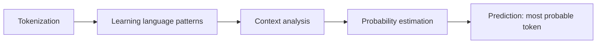
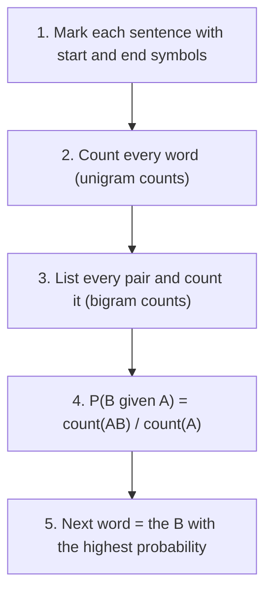
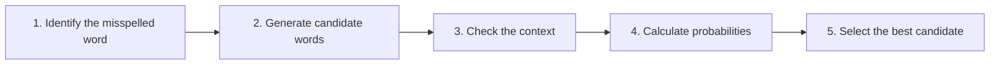

Before the new ideas, here are the old ones you need. If you already know them, skip to the next section.

## The basics first

- A **corpus** is the body of text we learn from. <Cite id="class-nlp-m2" loc="p. 8" />
- `<s>` is the **start symbol** of a sentence and `</s>` is the **end symbol**. They are added so that we can talk about the first and the last word of a sentence. <Cite id="class-nlp-m2" loc="p. 8" />
- A **conditional probability** P(B given A) is the chance of B when A has just happened. For words: how likely is B to come right after A?
- **Count(A)** is how many times A appears in the corpus.

## What is a language model?

<Box kind="definition">

**Language model:** a statistical or machine learning model that is used to predict the next word in a sequence given the previous words. <Cite id="class-nlp-pyq2" loc="p. 1" /> Language models learn patterns in language and assign probabilities to word or token sequences, allowing them to predict the next token, complete sequences and estimate how likely a sequence is. <Cite id="class-nlp-m6" loc="slide 40" />

</Box>

Mathematically, a language model estimates the probability of a sequence of words $P(w_1, w_2, \dots, w_n)$. For next-token prediction it estimates $P(w_t \mid w_1, w_2, \dots, w_{t-1})$, where $w_t$ is the next token predicted from the preceding tokens. <Cite id="class-nlp-m6" loc="slide 41" />

**How it works** (five steps). <Cite id="class-nlp-m6" loc="slide 42" />

Class example: input "She went to the", predictions market 0.45, school 0.30, office 0.15, hospital 0.06, park 0.04. <Cite id="class-nlp-m6" loc="slide 42" />

This is syllabus <Syl m="2" />.

## What is an N-gram?

<Box kind="definition">

**N-gram** is a continuous sequence of n words in a text. <Cite id="class-nlp-m2" loc="p. 8" /> The value of N is the order of the N-gram.

</Box>

- **Unigram** (1-gram): single words. A unigram model considers one word at a time.
- **Bigram** (2-gram): pairs of consecutive words. It uses the previous one word.
- **Trigram** (3-gram): triplets of consecutive words. It uses the previous two words.

<Cite id="class-nlp-pyq2" loc="p. 1" /> <Cite id="class-nlp-m6" loc="slide 43" />

Example: given "I want to drink", a trigram model uses the previous two words "want to" to predict the next word. <Cite id="class-nlp-m6" loc="slide 43" />

## The bigram probability

For a bigram, A is the previous word and B is the next word. <Cite id="class-nlp-m2" loc="p. 9" />

<Box kind="definition">

$$
P(B \mid A) = \frac{\text{count}(AB)}{\text{count}(A)}
$$

count(AB) is the **bigram** count (A followed by B) and count(A) is the **unigram** count of A. <Cite id="class-nlp-m2" loc="p. 9" />

</Box>

In words: out of all the times A appeared, how often was it followed by B?

### Worked example 1: the dog and cat corpus (class)

Corpus: "The dog barks. The cat sleeps. The dog runs. The cat jumps." There are 12 words and 7 different words. <Cite id="class-nlp-m2" loc="p. 8" />

| Bigram | count(AB) | count(A) | P(B given A) |
|---|---|---|---|
| The dog | 2 | 4 | 0.5 |
| The cat | 2 | 4 | 0.5 |
| dog barks | 1 | 2 | 0.5 |
| dog runs | 1 | 2 | 0.5 |
| cat sleeps | 1 | 2 | 0.5 |
| cat jumps | 1 | 2 | 0.5 |

<Cite id="class-nlp-m2" loc="p. 9" />

(The teacher's table here leaves out the sentence markers, so there is no row for the start symbol.)

### Worked example 2: the Sam corpus (class question)

<Sum>

<Given>

Corpus (7 sentences, each with `<s>` and `</s>`): I am Sam; I like college; Do Sam like college; Sam I am; Do I like Sam; Do I like college; I do like Sam. (As in the class, "Do" and "do" are counted as different words.) <Cite id="class-nlp-m2" loc="p. 10" />

</Given>

<Find>

all bigrams, the conditional probabilities, and the predicted next word for **like** and for **Sam**.

</Find>

<Steps>

1. **Unigram counts:** `<s>` 7, I 6, am 2, Sam 5, like 5, college 3, Do 3, do 1, `</s>` 7. Total 39 tokens.
2. **Bigram counts** (17 different bigrams, 32 in all: 39 tokens minus 7 sentences): `<s> I` 3, `<s> Do` 3, `<s> Sam` 1, I am 2, I like 3, I do 1, am Sam 1, am `</s>` 1, Sam `</s>` 3, Sam like 1, Sam I 1, like college 3, like Sam 2, college `</s>` 3, Do Sam 1, Do I 2, do like 1.
3. **After like:** P(college given like) = 3/5 = 0.6 and P(Sam given like) = 2/5 = 0.4.
4. **After Sam:** P(`</s>` given Sam) = 3/5 = 0.6, P(like given Sam) = 1/5 = 0.2 and P(I given Sam) = 1/5 = 0.2.
5. **Predict:** the highest probability wins.

</Steps>

<Answer>

After **like** the model predicts **college** (0.6 against 0.4 for Sam). After **Sam** it predicts the end of the sentence **`</s>`** (0.6).

</Answer>

<Box kind="verify">

The probabilities after one word must add to 1: after like 3/5 + 2/5 = 1; after Sam 3/5 + 1/5 + 1/5 = 1. The bigram total 3+3+1+2+3+1+1+3+1+1+3+2+3+1+2+1+1 = 32 matches 39 tokens minus 7 sentences.

</Box>

</Sum>

### Worked example 3: I tell you to sleep (class question)

<Sum>

<Given>

Corpus: `<s>` I tell you to sleep and rest `</s>`; `<s>` I would like to sleep for an hour `</s>`; `<s>` Sleep helps one to relax `</s>`. <Cite id="class-nlp-pyq2" loc="p. 7" />

</Given>

<Find>

the bigrams, the probabilities and the next word after **to**.

</Find>

<Steps>

1. There are 26 tokens and 3 sentences, so 23 bigrams. The word to appears 3 times.
2. to is followed by sleep in sentence 1, by sleep in sentence 2 and by relax in sentence 3.
3. count(to sleep) = 2, count(to relax) = 1.
4. P(sleep given to) = 2/3 = 0.667 and P(relax given to) = 1/3 = 0.333.

</Steps>

<Answer>

The next word after **to** is **sleep** (probability 2/3 = 0.667).

</Answer>

<Box kind="verify">

2/3 + 1/3 = 1. This agrees with the typed class solution, which also counts the 23 bigrams and gets sleep 0.667 and relax 0.333. (The handwritten notes write the probability of sleep as 1/3, which is wrong: sleep follows to twice.)

</Box>

</Sum>

The class also works the corpus "she reads a book, he reads a book, she reads a magazine, he likes a book": after a, book has 3/4 = 0.75 and magazine 1/4 = 0.25, so the next word after a is book; after he, reads and likes are both 1/2. <Cite id="class-nlp-m2" loc="p. 13" /> <Cite id="class-nlp-m2" loc="p. 15" />

## Probability of a whole sentence

The class asks for the next word. When an exam asks which sentence is better, a bigram model multiplies the bigram probabilities of the sentence from `<s>` to `</s>`. This step is standard and is not worked in the class files. The sentence with the larger product is the better one. A product that contains a bigram with count 0 becomes 0.

## Smoothing

A problem with n-gram models is that an unseen sequence may receive a probability of zero. Smoothing techniques adjust the probability estimates so that unseen or rare sequences can still receive a small probability. The class names: **add-one (Laplace) smoothing, add-k smoothing, Good-Turing smoothing and Kneser-Ney smoothing.** <Cite id="class-nlp-m6" loc="slide 44" />

N-gram models are simple and efficient, but their fixed context limits their ability to capture long-range dependencies, and they suffer from data sparsity when a word sequence is rare or absent from the corpus. <Cite id="class-nlp-m6" loc="slide 43" />

**Good-Turing discounting** (the class names it but gives no formula, so this is the standard idea). Words seen c times are given a lower count $c^* = (c+1)\,N_{c+1}/N_c$, where $N_c$ is the number of different words seen exactly c times. The freed probability, $N_1/N$ (N is the number of tokens), is shared among unseen words. Example: if 3 words are seen once, 1 word twice, 1 word three times (N = 8), then a word seen once gets $c^* = 2 \times 1/3 = 0.67$ and the unseen words together get $3/8 = 0.375$.

## Perplexity

<Box kind="definition">

**Perplexity** is a measurement of uncertainty in the predictions of a language model. It indicates how surprised a model is by the actual outcomes. The lower the perplexity, the better the model at predicting the next word. <Cite id="class-nlp-pyq2" loc="p. 5" />

</Box>

For a sequence of N words:

$$
\text{Perplexity}(P) = 2^{-\frac{1}{N}\sum_{i=1}^{N}\log_2 P(w_i \mid w_1, \dots, w_{i-1})}
$$

This is the exponential of the average negative log-likelihood of the words given their context. <Cite id="class-nlp-pyq2" loc="p. 5" />

- **Perplexity of 1:** the ideal score; the model predicts the next word perfectly every time.
- **Perplexity above 1:** some uncertainty; the higher it is, the less confident the model. Perplexity 10 means the model is as uncertain as if it were choosing between 10 equally possible next words.

Check of that last line: if each of the N words has probability 1/10, the product is $10^{-N}$ and the perplexity is $(10^{-N})^{-1/N} = 10$.

## Spelling correction with an N-gram model

An N-gram model uses the words before or after a wrong word to choose the right one. <Cite id="class-nlp-pyq2" loc="p. 8" />

Example: "I want to go to skul". Candidates: school, stool, skill. The bigram "to school" has a high probability, "to stool" and "to skill" lower ones, so **school** is chosen. <Cite id="class-nlp-pyq2" loc="p. 8" />

## Uses of N-grams

<Cite id="class-nlp-pyq2" loc="p. 1" />

- **Capturing context and semantics:** they show how words work together in a sentence.
- **Improving language models:** translation systems and voice assistants guess what comes next.
- **Enhancing text prediction:** predictive typing suggests the next word.
- **Information retrieval:** finding and ranking documents by word patterns.
- **Spelling correction** (above).

## Where this was asked

| If the question says | What to write | Seen as |
|---|---|---|
| "What is a language model? Write a note on the N-gram model" | Definition, formulas, unigram/bigram/trigram, uses | <PYQ id="2024-12/q2a" /> <PYQ id="assignment-1/q2a" /> <PYQ id="2024-12-ce/q4b" /> |
| "List all possible bigrams, compute probabilities and predict the next word" (Sam corpus) | The Sam sum above | <PYQ id="2025-05/q5a" /> <PYQ id="assignment-1/q2c" /> |
| Same, for the corpus "I tell you to sleep ..." | Sum 3 above | <PYQ id="2022-12-ce/q3a" /> <PYQ id="assignment-1/q2e" /> |
| Same, for the four students corpus | The same method on a new corpus | <PYQ id="assignment-1/q2d" /> |
| "Bigram and n-gram with formula, then compare sentences" | Formula, bigram table, product of probabilities | <PYQ id="2025-05-ce/q2a" /> |
| "Perplexity of a language model" | Definition, formula, meaning of 1 and above 1 | <PYQ id="2022-12-ce/q1f" /> <PYQ id="2025-05/q6b" /> |
| "N-gram in spelling correction" | The five steps and the skul example | <PYQ id="2023-05-ce/q1b" /> |
| "Good-Turing discounting" | The idea, formula and small example | <PYQ id="2023-12-ce/q1b" /> |

## Quick revision

- Language model: predicts the next word and gives probabilities to word sequences.
- N-gram: a continuous sequence of n words. Unigram 1, bigram 2, trigram 3.
- $P(B \mid A) = \text{count}(AB) / \text{count}(A)$.
- Steps: add `<s>` and `</s>`, count unigrams, count bigrams, divide, pick the highest.
- Sam corpus: after like, college 0.6; after Sam, `</s>` 0.6. After to (sleep corpus): sleep 2/3.
- Smoothing fixes zero probabilities: add-one, add-k, Good-Turing, Kneser-Ney.
- Perplexity: lower is better; 1 is perfect.

**Conclusion.** An N-gram model predicts the next word by counting how often word pairs occur in a corpus, and the highest conditional probability gives the prediction. <Cite id="class-nlp-m2" loc="p. 9" />
