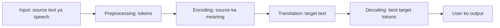
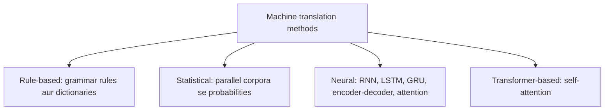
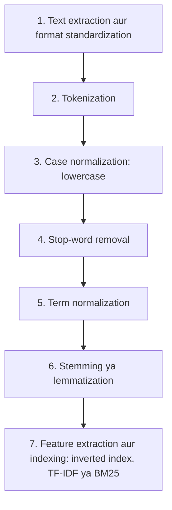
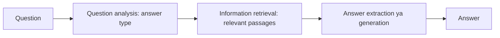
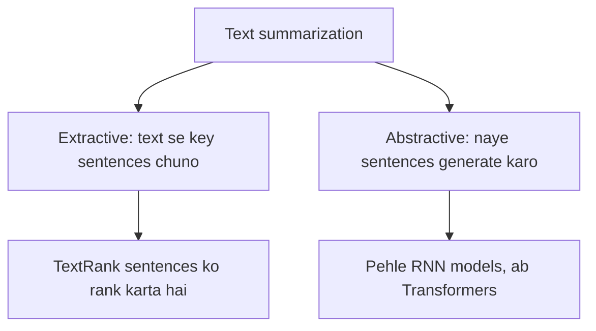
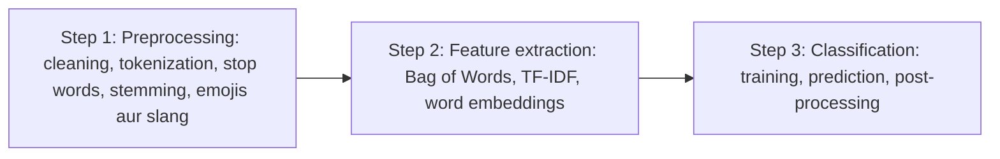
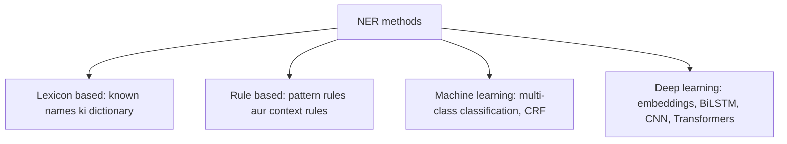
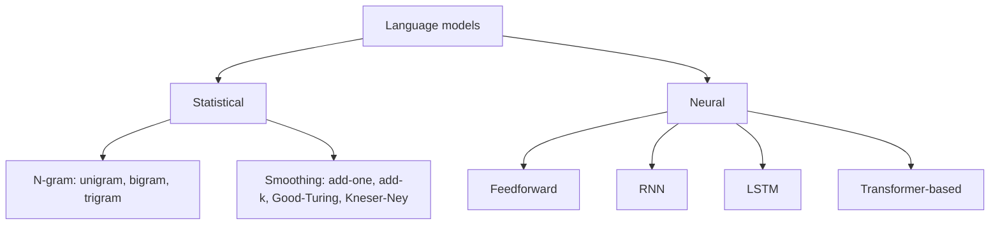

Naye ideas se pehle wo purani baatein jo chahiye. Agar aati hain to agle section pe jao.

## The basics first

- **Token** text ki ek chhoti unit hai, aam taur pe ek word. **Tokenization** text ko tokens mein todta hai. <Cite id="class-nlp-m6" loc="slide 2" />
- **Corpus** text ka bada collection hai. **Parallel corpus** texts aur unke translations ka saath-saath collection hai. <Cite id="class-nlp-m6" loc="slide 4" />
- **Classifier** wo program hai jo input ko kuch fixed classes mein se ek mein daalta hai, jaise spam ya not spam. <Cite id="class-nlp-m6" loc="slide 18" />
- **Training** ka matlab model ko bahut saare labelled examples dikhana taaki wo pattern seekh le.

Ye module syllabus <Syl m="6" /> hai: NLP ki applications aur models of language. Class slides mein aath topics hain, is order mein.

## 1. Machine translation

<Box kind="definition">

**Machine Translation (MT)** is the use of Natural Language Processing (NLP) to automatically translate text or speech from one language to another. It enables fast and scalable translation across different languages without requiring manual translation for every sentence. <Cite id="class-nlp-m6" loc="slide 1" />

</Box>

Modern systems mainly **Neural Machine Translation (NMT)** use karte hain, jo bade multilingual data se linguistic patterns aur context seekhta hai. <Cite id="class-nlp-m6" loc="slide 2" />

### Working

1. **Input:** system source language mein text ya speech leta hai.
2. **Preprocessing:** input clean hota hai aur tokens jaisi chhoti units mein bantta hai.
3. **Encoding:** neural model source sentence ko aise form mein represent karta hai jo uska meaning aur context pakde.
4. **Translation:** model target language mein matching text generate karta hai.
5. **Decoding:** system target-language tokens ka sabse suitable sequence chunta hai.
6. **Output:** generated translation user ko dikhaya jaata hai.

Modern Transformer-based systems mein attention mechanisms model ko translation ka har hissa banate waqt source sentence ke relevant parts pe focus karne mein madad karte hain. <Cite id="class-nlp-m6" loc="slide 2" />

### Methods

**1. Rule-Based Machine Translation (RBMT)** manually banaye grammar rules, bilingual dictionaries aur linguistic information se text translate karta hai. System source sentence ka structure analyze karta hai aur predefined rules lagakar target-language sentence banata hai. Common techniques: grammar rules, bilingual dictionaries, morphological analysis aur transfer rules. <Cite id="class-nlp-m6" loc="slide 3" />

**2. Statistical Machine Translation (SMT)** translated text ke bade collections, yaani parallel corpora, pe trained statistical models use karta hai. Sirf haath se likhe rules pe depend hone ki jagah system alag-alag translations ki probability estimate karta hai aur sabse likely output chunta hai. Common models: IBM translation models, language models aur phrase-based translation models. <Cite id="class-nlp-m6" loc="slide 4" />

**3. Neural Machine Translation (NMT)** deep neural networks se multilingual data mein translation patterns seekhta hai aur source sentence ke context ke hisaab se translation banata hai. Explicit rules ya statistical probabilities pe depend karne wale traditional approaches ke ulta, NMT translation representations seedha training data se seekhta hai. <Cite id="class-nlp-m6" loc="slide 5" />

| Architecture | Kya karta hai |
|---|---|
| RNN | input sequence ko step by step process karta hai; early neural translation mein use hua |
| LSTM | RNN variant jo sentences mein long-range dependencies better handle karta hai |
| GRU | simpler recurrent architecture jo sequential dependencies model kar sakta hai |
| Encoder-Decoder | ek network source sentence encode karta hai, doosra target sentence generate karta hai |
| Attention | decoder ko translation ke waqt source ke relevant parts pe focus karne deta hai |
| Transformer | tokens ke beech relationships ke liye self-attention; kai modern NMT systems ka dominant architecture |

Modern NMT systems aam taur pe Transformer-based architectures use karte hain kyunki ye long-range relationships efficiently pakadte hain aur training mein sequences parallel process karte hain. <Cite id="class-nlp-m6" loc="slide 5" />

**4. Transformer-Based Machine Translation** words ke beech relationships samajhne aur context ke hisaab se translation banane ke liye self-attention use karta hai: **self-attention** poore sentence ke words ke relationships pakadta hai, **parallel processing** training mein input sequences efficiently handle karta hai, aur **context-aware translation** zyada accurate output ke liye bada sentence context use karta hai. <Cite id="class-nlp-m6" loc="slide 6" />

### Evaluation

Translation ko automatic metrics aur humans dono se judge kar sakte hain: <Cite id="class-nlp-m6" loc="slide 6" />

- **BLEU:** machine translation ki reference translations se similarity naapta hai.
- **ROUGE:** generated aur reference text ko overlapping sequences ke base pe compare karta hai.
- **METEOR:** word matches aur stemming, synonyms jaise linguistic variations ko consider karta hai.
- **Human evaluation:** reviewers fluency, accuracy aur meaning dekhte hain.

Koi ek metric translation quality poori tarah nahi pakadta, isliye kai evaluation methods use ho sakte hain.

### Applications, advantages and limitations

**Applications:** website aur app localization, business communication, travel aur communication, education, customer support (multilingual chatbots), media aur entertainment (subtitles, captions). <Cite id="class-nlp-m6" loc="slide 7" />

| Advantages | Limitations |
|---|---|
| Fast: bahut content jaldi translate | Context errors: ek word ke alag context mein alag meaning |
| Scalable: kai languages, bada volume | Cultural differences: idioms, humor translate nahi hote |
| Consistent: repeated content pe same patterns | Kuch languages ka data kam: performance kharab |
| Available 24/7 | Domain-specific errors: medical, legal, technical ko human review chahiye |
| Routine content ke liye cost-effective | Lack of human judgment: tone, intention, nuance |

<Cite id="class-nlp-m6" loc="slide 8" />

## 2. Information retrieval

<Box kind="definition">

**Information Retrieval (IR)** helps to find relevant information from large collections of documents. It can be defined as a software program that deals with the organization, storage, retrieval and evaluation of information from documents. <Cite id="class-nlp-m6" loc="slide 9" />

</Box>

**Everyday analogy.** IR "smart librarian jaisa hai jo seedha answer nahi deta par batata hai sahi book kahan milegi". IR system documents scan karta hai aur query se match hone wale nikaalta hai. Wo query ko documents se **matching function** se compare karta hai, jo har document ko **retrieval status value (RSV)** deta hai; results usi se rank hote hain. Documents ko **descriptors** se represent karte hain, yaani vocabulary V ke sabse important keywords. <Cite id="class-nlp-m6" loc="slide 9" />

**1. User side (search process)** <Cite id="class-nlp-m6" loc="slide 11" />

- **Problem identification:** student ko machine learning ke baare mein seekhna hai.
- **Representation:** need keywords ki query ban jaati hai, "machine learning basics".
- **Query:** query IR system ko submit hoti hai.
- **Feedback:** results dekhkar user search refine karta hai.

**2. System side (retrieval process)** <Cite id="class-nlp-m6" loc="slide 12" />

- **Acquisition:** system documents (web pages, books, papers) collect aur store karta hai. Web crawlers data collect karte hain. <Cite id="class-nlp-m6" loc="slide 14" />
- **Representation:** har document analyze hokar keywords (terms) se represent hota hai. Machine learning wale document ko AI, deep learning, algorithms, models tag milte hain.
- **File organization:** documents index hokar store hote hain taaki jaldi mil sakein. Do types: **sequential** (document by document) aur **inverted** (har term ke neeche records ki list). <Cite id="class-nlp-m6" loc="slide 14" />
- **Matching:** query ko stored documents se matching function se compare karke relevance se rank karte hain.
- **Retrieved object:** sabse relevant documents, best pehle, return hote hain.

**3. Interaction between user and system.** User results dekhta hai aur feedback de sakta hai; system updated query process karke behtar results laata hai. <Cite id="class-nlp-m6" loc="slide 13" />

### Text processing steps for IR

Indexing se pehle raw text ko clean, standard form mein badalte hain jo **inverted index** ke liye suitable ho, taaki query terms document terms se jaldi match ho. <Cite id="class-nlp-asol" loc="p. 11" />

1. **Document text extraction and format standardization:** HTML, PDF ya DOCX se raw text nikaalo; noise (HTML tags, metadata, control characters) hatao; character encoding ek karo (aam taur pe UTF-8).
2. **Tokenization:** text ko tokens mein todo, whitespace aur punctuation delimiters se. Mushkil cases: compound aur hyphenated words, aur Chinese ya Thai jaisi languages jahan space nahi hota.
3. **Case normalization:** lowercase karo, taaki "Information", "information" aur "INFORMATION" ek term ban jaayein.
4. **Stop-word removal:** the, is, a, and, in jaise high-frequency words hatao jinka meaning kam hota hai. Isse index chhota hota hai aur noise hat'ta hai. Modern systems minimal lists use karte hain, taaki "to be or not to be" jaise phrases bache rahein.
5. **Term normalization:** variations ko ek form mein mapao: punctuation aur special characters hatao, aur U.S.A., USA aur United States ko same banao.
6. **Stemming or lemmatization:** stemming rules se word ke ends kaatta hai (Porter's stemmer); fast hai par non-words de sakta hai: retrieval, retrieved, retrieving se "retriev". Lemmatization vocabulary aur morphology se dictionary form deta hai: better se good, mice se mouse.
7. **Feature extraction and indexing:** inverted index banao (har term ke saath un documents ki list jinme wo hai) aur TF-IDF ya BM25 jaisi weighting lagao, jo term kitna frequent aur kitna rare hai us pe based hai, taaki results rank ho sakein.

<Cite id="class-nlp-asol" loc="p. 11" /> <Cite id="class-nlp-asol" loc="p. 12" />

## 3. Question answering

<Box kind="definition">

A **Question Answering (QA) system** in NLP is an artificial intelligence program that automatically answers human-language questions with precise facts or short passages instead of returning a long list of whole documents. <Cite id="class-nlp-m6" loc="slide 15" />

</Box>

**Core architecture and workflow.** Standard QA pipeline ke sequential stages: <Cite id="class-nlp-m6" loc="slide 15" /> <Cite id="class-nlp-m6" loc="slide 16" />

1. **Question analysis / processing:** question ko tokenize karta hai, stop words hatata hai, part-of-speech (POS) tagging karta hai aur expected answer type pehchaanta hai (person, location, date ya definition, who, what, when jaise words se).
2. **Information retrieval (IR):** document store, knowledge graph ya vector database mein relevant passages ya facts search karta hai.
3. **Answer extraction / generation:** deep learning ya Transformer models (BERT ya generative LLMs) se retrieved context mein se exact answer pinpoint ya synthesize karta hai.

**Main types of QA systems:** <Cite id="class-nlp-m6" loc="slide 16" />

- **Extractive QA:** diye gaye source document se exact text span nikaalta hai, start aur end character indices compute karke.
- **Generative (abstractive) QA:** large language models se retrieved data ya internal parameters ke base pe fluent answer likhta hai.
- **Open-domain versus closed-domain:** open-domain systems unrestricted web data (Wikipedia, virtual assistants) se broad questions ke answer dete hain; closed-domain systems ek narrow subject (medical ya legal) aur specialized vocabulary pe focus karte hain.

## 4. Text categorization

<Box kind="definition">

**Categorization** (text classification) is the process of assigning predefined categories or labels to text data. It is a core task used in spam detection, sentiment analysis, topic labeling, news categorization and intent detection. <Cite id="class-nlp-m6" loc="slide 18" />

</Box>

Text classification raw text ko structured information banata hai, ye predict karke ki text kis class ka hai. General workflow: text preprocessing, feature extraction ya representation, model building, prediction aur evaluation.

**Text classification ke methods:** <Cite id="class-nlp-m6" loc="slide 19" /> <Cite id="class-nlp-m6" loc="slide 20" />

1. **Traditional machine learning:** Naive Bayes, Support Vector Machines (SVM), Logistic Regression, Decision Trees, Random Forest aur k-Nearest Neighbors. Inhe text ko numbers mein badalne ke liye feature extraction chahiye.
2. **Deep learning:** RNNs aur CNNs jaise neural networks, jo word dependencies aur context pakadte hain.
3. **Transformer-based models (state of the art):** BERT jaise models self-attention aur contextual embeddings use karte hain aur task ke liye fine-tune hote hain. Computationally expensive hain par pehle ke methods se behtar.
4. **Zero-shot aur few-shot classification:** zero-shot text ko aise labels mein bantta hai jo training mein nahi dekhe; few-shot ko sirf thoda labelled data chahiye. GPT aur BART ye possible banate hain.

**Text classification pipeline** (example input "I love this movie!"): input text, data preprocessing, vectorization (TF-IDF, Bag-of-Words), model training (Naive Bayes jaisa classifier patterns seekhta hai), prediction ("Positive Sentiment" ya "Negative Sentiment") aur evaluation metrics (accuracy, precision, recall, F1-score). <Cite id="class-nlp-m6" loc="slide 22" />

## 5. Summarization

<Box kind="definition">

**Summarization** is a key technique in NLP that uses algorithms to reduce large texts while preserving essential information. By extracting key concepts and maintaining the original meaning, these systems help industries such as banking, law and healthcare make faster decisions and retrieve information faster. <Cite id="class-nlp-m6" loc="slide 23" /> <Cite id="class-nlp-asol" loc="p. 12" />

</Box>

Do primary types hain: extractive aur abstractive.

- **Extractive summarization** original text ke key passages chunkar aur jodkar summary banata hai. Ye models naya content nahi banate, sirf sabse important sentences nikaalte hain, aur goal meaning bacha ke text chhota karna hai. **TextRank** algorithm widely use hota hai: wo sentences ko relevance aur importance se rank karke concise summary banata hai. <Cite id="class-nlp-m6" loc="slide 24" />
- **Abstractive summarization** key ideas batane ke liye bilkul naye sentences generate karta hai. Wo information ko zyada concise aur coherent tareeke se rephrase karta hai, aksar aise naye words ke saath jo original mein nahi the. Ye Transformer models ke saath prominent hua; pehle recurrent neural networks (RNNs) pe based models use hote the. <Cite id="class-nlp-m6" loc="slide 25" />

TextRank kaise kaam karta hai ye class files mein nahi dikhaya. Short mein: text ko sentences mein todo, similar sentences ko graph mein jodo, har sentence ko score do ki wo kitna well connected hai, aur top-scoring sentences original order mein rakho.

## 6. Sentiment analysis

<Box kind="definition">

**Sentiment Analysis** is an NLP technique used to identify emotions, opinions and attitudes expressed in textual data. It helps classify text as positive, negative or neutral, for better understanding of customer feedback and public opinion. <Cite id="class-nlp-m6" loc="slide 26" />

</Box>

Ye text se emotional tone aur opinions pehchaanta hai aur machine learning aur deep learning se bade volume ka text analyze karta hai.

**Types:** <Cite id="class-nlp-m6" loc="slide 27" /> <Cite id="class-nlp-m6" loc="slide 28" />

1. **Fine-grained:** sentiment ko kai levels pe rate karta hai (very positive se very negative), aksar 1 se 5 stars, jaise product review ratings.
2. **Emotion detection:** joy, sadness, anger, fear ya excitement jaisi specific emotions pehchaanta hai.
3. **Aspect-based:** specific features dekhta hai; phone review mein battery, screen, camera aur performance alag-alag analyze hote hain.
4. **Multilingual:** kai languages ke text pe kaam karta hai; grammar aur cultural differences ki wajah se challenging par global use ke liye zaroori.
5. **Intent-based:** text ke peeche ka intention dhoondhta hai, jaise discounts ya offers mention karne wale reviews se purchase intent.

**Approaches:**

| Approach | Kaise kaam karta hai | Pros | Cons |
|---|---|---|---|
| Rule-based | predefined lexicons aur rules; positive aur negative words ginta hai | easy, interpretable, training nahi; "not bad" jaisi kuch negation handle | scale mushkil, accuracy limited, lexicon update chahiye |
| Machine learning | TF-IDF ya Bag-of-Words features pe Naive Bayes, SVM, Random Forest | bada data aur complex patterns | bada labelled data, naye domain ke liye retraining |
| Neural / deep learning | RNN, LSTM, GRU, Transformers | high accuracy, context pakadta hai | computationally expensive, bahut data chahiye |
| Hybrid | lexicon rules se quick first label, ML ya deep learning se refine | behtar accuracy, adaptable | implement karna complex |

<Cite id="class-nlp-m6" loc="slide 29" /> <Cite id="class-nlp-m6" loc="slide 30" /> <Cite id="class-nlp-m6" loc="slide 31" /> <Cite id="class-nlp-m6" loc="slide 32" />

**Working (teen steps):** <Cite id="class-nlp-m6" loc="slide 33" /> <Cite id="class-nlp-m6" loc="slide 34" />

## 7. Named entity recognition

<Box kind="definition">

**Named Entity Recognition (NER)** in NLP focuses on identifying and categorizing important information, known as entities, in text. These entities can be names of people, places, organizations, dates and so on. It helps transform unstructured text into structured information, which helps tasks like text summarization, knowledge graph creation and question answering. <Cite id="class-nlp-m6" loc="slide 35" />

</Box>

**Common entity types:** person names (Albert Einstein), organizations (GeeksforGeeks), locations (Paris), dates aur times (5th May 2025), quantities aur percentages (50%, 100 dollars). NER ambiguity aas-paas ke words, sentence structure aur overall context se handle karta hai: "Amazon is expanding rapidly" (organization) vs "The Amazon is the largest rainforest" (location). <Cite id="class-nlp-m6" loc="slide 36" />

**Working:** <Cite id="class-nlp-m6" loc="slide 37" />

1. **Analyzing the text:** wo words ya phrases dhoondho jo entities ho sakte hain.
2. **Finding sentence boundaries:** punctuation aur capitalization se meaning aur context rakho.
3. **Tokenizing and POS tagging:** tokens mein todo aur har token ka grammatical role tag karo, jo entities ke clues deta hai.
4. **Entity detection and classification:** jo tokens known patterns se match karte hain wo pehchaane jaate hain aur Person, Organization, Location jaisi categories mein jaate hain.
5. **Model training and refinement:** models labelled data se seekhte hain aur time ke saath behtar hote hain.
6. **Adapting to new contexts:** well-trained model nayi languages, styles aur unseen entity types pe generalize karta hai.

**Methods:** <Cite id="class-nlp-m6" loc="slide 38" /> <Cite id="class-nlp-m6" loc="slide 39" />

- **Lexicon-based:** text ko known entity names ki dictionary se check karta hai. Kam use hota hai, kyunki dictionary ko lagataar update karna padta hai.
- **Rule-based:** patterns (words ka form) aur context (aas-paas ke words) pe based predefined rules.
- **Machine learning-based:** multi-class classification labelled data pe classifier train karta hai; **Conditional Random Field (CRF)** ek probabilistic model hai jo words ka sequence aur context samajhta hai, isliye entity predictions zyada accurate.
- **Deep learning-based:** word embeddings (meaning pakadne wale dense vectors) aur BiLSTM, CNN, Transformers jaise neural networks; bade aur alag-alag data pe high accuracy.

## 8. Language models

<Box kind="definition">

**Language models** learn patterns in language and assign probabilities to word or token sequences, allowing them to predict the next token, complete sequences and estimate how likely a sequence is. <Cite id="class-nlp-m6" loc="slide 40" />

</Box>

(Slide title mein "Linguistic Model" likha hai; content language models ka hai.)

Mathematically, language model words ke sequence ki probability estimate karta hai $P(w_1, w_2, \ldots, w_n)$, jahan $w_1, \ldots, w_n$ sequence ke words ya tokens hain. Next-token prediction ke liye wo $P(w_t \mid w_1, w_2, \ldots, w_{t-1})$ estimate karta hai, jahan $w_t$ pehle ke tokens se predict hone wala next token hai. <Cite id="class-nlp-m6" loc="slide 41" />

**Working:** <Cite id="class-nlp-m6" loc="slide 42" />

1. **Tokenization:** input ko words, subwords ya dusre tokens mein todo.
2. **Learning language patterns:** text pe train karo taaki tokens ke relationships aur statistics seekhe.
3. **Context analysis:** available context se possible tokens ki probability estimate karo.
4. **Probability estimation:** possible next tokens ya sequences ko probabilities do.
5. **Prediction:** sabse probable token, ya decoding strategy se chuna token, sequence ko aage badhata hai.

Input "She went to the" ke liye slide ye deti hai: market 0.45, school 0.30, office 0.15, hospital 0.06, park 0.04.

<Sum>

<Given>

Class example: "She went to the" ke baad probabilities market 0.45, school 0.30, office 0.15, hospital 0.06, park 0.04.

</Given>

<Find>

ye valid probability distribution hai ya nahi, aur sabse likely next word.

</Find>

<Steps>

1. Probabilities jodo: $0.45 + 0.30 + 0.15 + 0.06 + 0.04 = 1.00$. *Reason: saare choices ki probabilities ka sum 1 hona chahiye.*
2. Har value 0 aur 1 ke beech hai, isliye distribution valid hai.
3. Sabse badi value 0.45 hai, isliye sabse likely next word "market" hai.

</Steps>

<Answer>

valid distribution; most likely word: market (0.45).

</Answer>

<Box kind="verify">

List mein paanch words hain, aur 0.45 + 0.30 = 0.75, 0.75 + 0.15 = 0.90, 0.90 + 0.06 = 0.96, 0.96 + 0.04 = 1.00. Greedy picking hamesha top word leti hai; decoding strategy kabhi variety ke liye neeche wala word bhi chun sakti hai.

</Box>

</Sum>

### Statistical language models

Statistical models training corpus ki counts se sequence ki probability estimate karte hain. <Cite id="class-nlp-m6" loc="slide 43" />

- **N-gram language model:** fixed number of preceding words se word predict karta hai. **Unigram** ek word ek baar mein dekhta hai, **bigram** pichla ek word use karta hai aur **trigram** pichle do words. Jaise "I want to drink" ke baad ka word predict karne ke liye trigram model sirf pichle do words, "to drink", use karta hai. N-gram models simple aur efficient hain, par fixed context long-range dependencies nahi pakad paata, aur jab kuch word sequences corpus mein rare ya absent hon to **data sparsity** hoti hai.
- **Smoothing:** unseen sequence ko probability zero mil sakti hai. Smoothing estimates adjust karti hai taaki unseen ya rare sequences ko bhi chhoti probability mile. Common methods: add-one (Laplace) smoothing, add-$k$ smoothing, Good-Turing smoothing aur Kneser-Ney smoothing. <Cite id="class-nlp-m6" loc="slide 44" />

### Neural language models

Neural language models neural networks se words ki distributed representations seekhte aur probabilities estimate karte hain. N-gram models ke ulta wo zyada complex relationships seekhte hain aur har possible n-gram ki counts store nahi karte. <Cite id="class-nlp-m6" loc="slide 44" />

1. **Feedforward:** fixed number of preceding words ko vectors bana ke network layers se next word predict karta hai. Continuous word representations seekhta hai, par fixed context phir bhi long-range dependencies ko limit karta hai. <Cite id="class-nlp-m6" loc="slide 45" />
2. **RNN:** sequence ko step by step process karta hai, hidden state ke saath jo pehle ke tokens ki information carry karti hai. Basic RNNs ko vanishing-gradient problem ki wajah se long-range dependencies mein dikkat hoti hai. <Cite id="class-nlp-m6" loc="slide 46" />
3. **LSTM:** long-term dependencies ke liye bana RNN. Gating decide karti hai ki kaun si information rakhni, update karni ya hatani hai, isliye wo kai steps tak relevant information rakhta hai, vanishing-gradient effect kam karta hai, door-door ke words ki dependencies pakadta hai aur next word predict karta hai. <Cite id="class-nlp-m6" loc="slide 46" />
4. **Transformer-based:** tokens ke beech relationships ke liye attention use karta hai aur training mein kai tokens parallel process karta hai. Uses: autoregressive modelling (next token predict), masked language modelling (masked tokens predict) aur sequence-to-sequence modelling (ek sequence se dusra generate, jaise translation). <Cite id="class-nlp-m6" loc="slide 47" />

## Also asked in past papers (not in the class files)

**Information retrieval versus information extraction.** Class files sirf IR define karti hain. Information extraction (IE) text se hi structured facts nikaalne ka kaam hai; named entity recognition ek IE step hai, kyunki wo unstructured text ko structured information banata hai. <Cite id="class-nlp-m6" loc="slide 35" />

| Point | Information retrieval | Information extraction |
|---|---|---|
| Output | documents ki ranked list | structured facts (entities, dates, relations) |
| Question answered | "kaun se documents relevant hain?" | "is text mein kaun se facts hain?" |
| Input | query aur documents ka collection | ek text |
| Typical tools | indexing, matching, ranking (RSV) | NER, rules, machine learning |
| Example | search engine | news se names aur dates ki table bharna |

<Box kind="exam">

Asked as: machine translation <PYQ id="2024-05-ce/q6a" /> <PYQ id="2025-05/q5b" /> <PYQ id="2024-12/q6c" /> <PYQ id="2023-05-ce/q1d" />, rule-based MT <PYQ id="2022-12-ce/q1d" /> <PYQ id="2024-12-ce/q1c" />, statistical MT <PYQ id="2023-12-ce/q1c" />, information retrieval <PYQ id="2024-05-ce/q6b" />, text processing for IR <PYQ id="2022-12-ce/q4b" />, IR versus IE <PYQ id="2023-05-ce/q6a" /> <PYQ id="2024-12/q1b" /> <PYQ id="2025-05/q1b" />, question answering <PYQ id="2023-12-ce/q6a" /> <PYQ id="2025-05-ce/q6b" /> <PYQ id="2024-12/q6d" />, summarization <PYQ id="2022-12-ce/q6a" /> <PYQ id="2024-12-ce/q6a" /> <PYQ id="2024-12/q6a" /> and named entity recognition <PYQ id="2024-12/q6b" />.

</Box>
