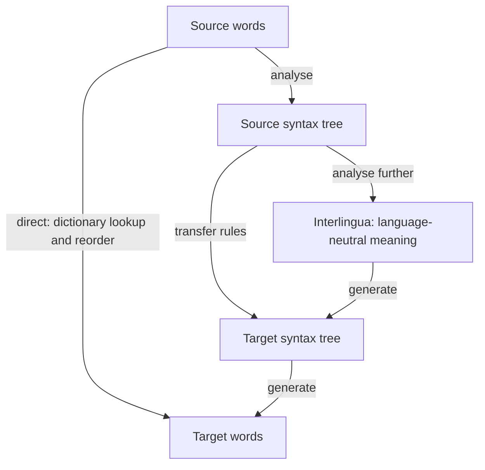
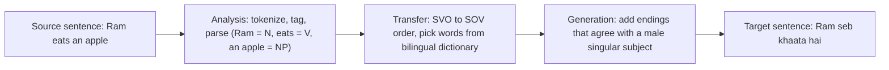
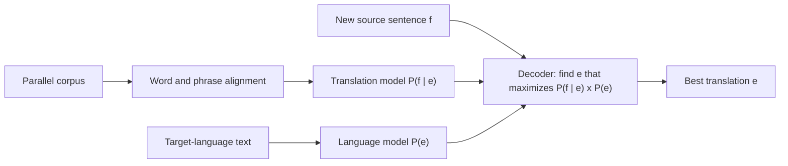
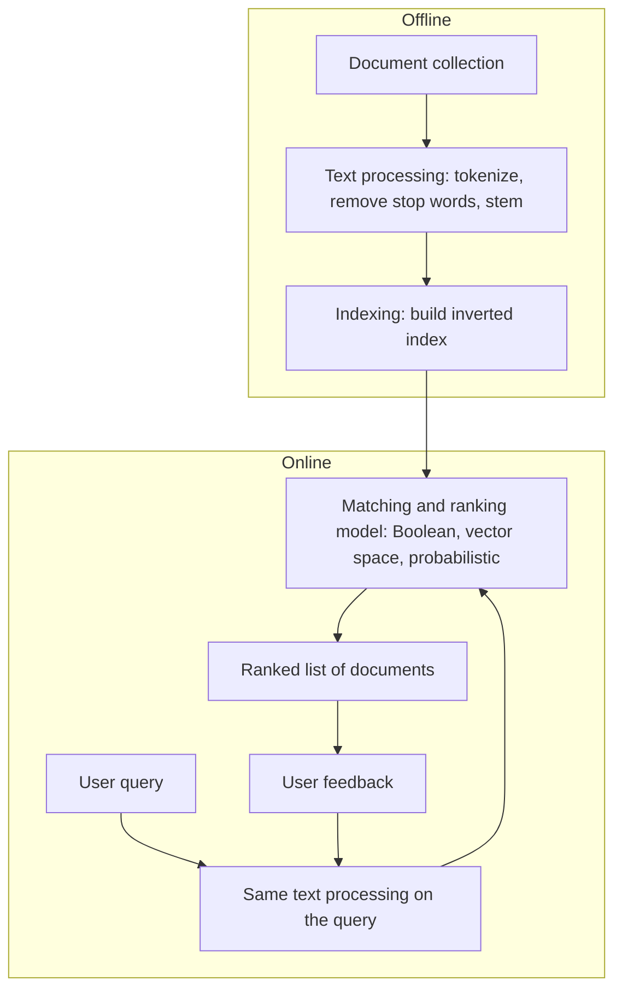
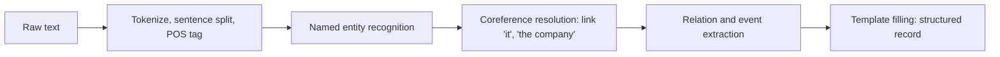
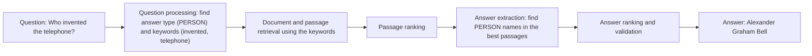
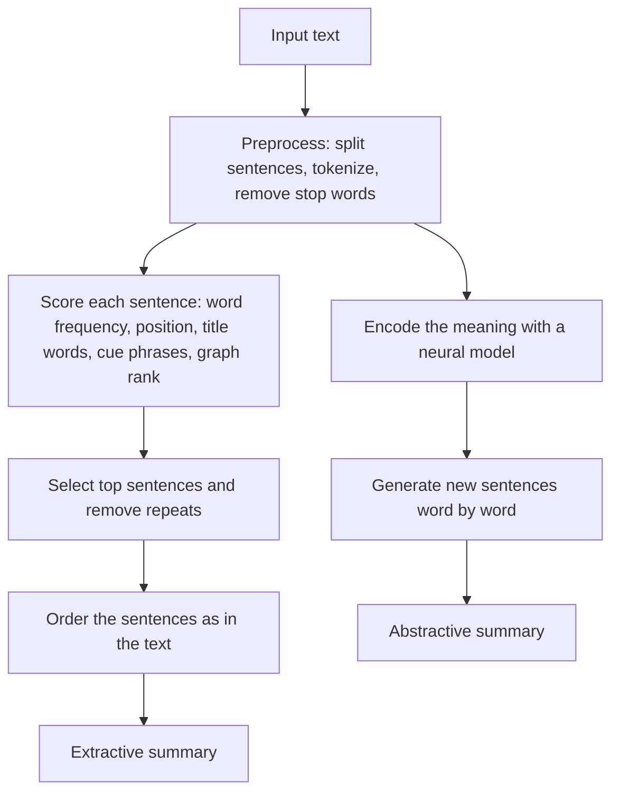

Naye ideas se pehle wo purani baatein jo tumhe chahiye. Agar already pata hain to agle section pe jao.

## The basics first

- **Corpus** text ka bada collection hota hai. **Parallel corpus** wahi text do languages mein hota hai, sentence by sentence (jaise English aur Hindi).
- **Token** text split karne ke baad ek word (ya word ka piece) hai. **Stop word** bahut common word hai jaise *the*, *is*, *on*, jo search ke liye kam matlab rakhta hai. **Stemming** word ko uski root tak kaat deti hai (*chasing* se *chase*).
- **Language model** sentence ko probability deta hai, taaki fluent sentence aur jumbled sentence mein farak kar sake. N-gram model chhote word sequences ginta hai.
- **Precision** aur **recall** wo do tareeke hain jinse us system ko score karte hain jo answers ka set return karta hai (neeche ek sum ke saath samjhaya hai).
- **Structured data** table mein hota hai jisme fixed columns hote hain (name, city, date). **Unstructured data** plain text hai. Duniya ki zyada tar information unstructured hai, isliye neeche ki applications chahiye.

## The big picture: what NLP is used for

**What it is.** Is subject ke pichhle notes ne tools banaye: tokenization, morphology, n-gram models, tagging, parsing, meaning aur discourse. Ye module (syllabus <Syl m="6" />, section 6.1) un tools ko **applications** mein jodta hai: poore systems jo asli user ki madad karte hain. Syllabus machine translation, information retrieval, question answering, text categorization, summarization, sentiment analysis aur named entity recognition ka naam leta hai, "preferably for Indian regional languages". Sections 6.2 se 6.5 phir language ke chaar models batate hain. <Cite id="nlp-applications-slp3-13" /> <Cite id="nlp-applications-slp3-11" /> <Cite id="nlp-applications-slp3-21" />

**Why it is needed.** Logon ke banaye text ko koi poora padh nahi sakta: web pages, news, reviews, mail, kai languages ke documents. Applications us dher ko kaam ki cheez bana deti hain: translation, sahi documents ki chhoti list, seedha answer, summary, mood score, facts ki table.

| Application | Input | Output | Typical example |
|---|---|---|---|
| Machine translation | Text in language A | Text in language B | English to Hindi translation |
| Information retrieval | A query and many documents | Ranked list of documents | Web search |
| Information extraction | Free text | Structured facts (a table) | Who bought which company, when |
| Question answering | A question | A short answer | "Who invented the telephone?" |
| Text categorization | A document | A label | Spam or not spam |
| Summarization | A long text | A short text | News headline summary |
| Sentiment analysis | A review or post | Positive, negative or neutral | Product review rating |
| Named entity recognition | A sentence | Marked names and their types | Find people and places |

<Cite id="nlp-introduction-av-apps" />

## Machine translation (MT)

**What it is.** **Machine translation** computer se text (ya speech) ko **source language** se **target language** mein translate karna hai, meaning same rakhte hue. <Cite id="nlp-applications-slp3-13" />

**Why it is hard.** Languages kai tareeke se alag hoti hain, isliye word-by-word replace karna fail hota hai:

- **Word order.** English subject-verb-object (SVO) hai: *Ram eats an apple*. Hindi subject-object-verb (SOV) hai: *Ram seb khaata hai* (Ram apple eats).
- **Ambiguity.** *Bank* river bank bhi ho sakta hai aur money bank bhi; target language mein do alag words chahiye ho sakte hain.
- **Idioms.** *It is raining cats and dogs* ka matlab ye nahi ki aasman se janwar gir rahe hain.
- **Agreement aur morphology.** Hindi verbs subject ke gender aur number ke saath badalte hain; English verbs zyada tar nahi badalte.
- **Kuch languages ke liye kam data.** Kai Indian languages ke paas English-French se bahut kam parallel text hai.

### Approaches to machine translation

<Cite id="nlp-applications-gfg-mt" loc="diagram" /> <Cite id="nlp-applications-wiki-rbmt" />

Exams mein puchhe jaane wale MT approaches teen families mein aate hain.

| Family | Idea | Knowledge comes from |
|---|---|---|
| Rule-based (RBMT) | Linguists dictionaries aur grammar rules likhte hain | Human experts |
| Corpus-based: example-based (EBMT) and statistical (SMT) | Parallel corpus se learn karo | Data |
| Neural (NMT) | Ek neural network end to end translate karna seekhta hai | Data |

### 1. Rule-based machine translation (RBMT)

**Definition.** RBMT hand-written linguistic knowledge lagakar translate karta hai: bilingual dictionary, morphological rules, source language ke grammar rules aur wo rules jo source structures ko target structures se map karte hain. <Cite id="nlp-applications-wiki-rbmt" /> <Cite id="nlp-applications-gfg-mt" />

**RBMT ke teen kinds.**

1. **Direct (dictionary-based).** Har source word ko bilingual dictionary mein dhoondho, phir kuch rules se reorder karo. Banana tez, quality kharab, kyunki grammar ignore hoti hai.
2. **Transfer.** Teen steps: (a) **analysis**: source sentence ko tree mein parse karo; (b) **transfer**: rules lagao jo source tree ko target tree banate hain (jaise Hindi ke liye verb ko end mein le jao); (c) **generation**: sahi endings ke saath target words banao. Har language pair ke liye alag transfer rules chahiye.
3. **Interlingua.** Source ko language-neutral meaning (**interlingua**) mein analyse karo, phir usse target generate karo. $n$ languages ke liye $n(n-1)$ transfer modules ki jagah $2n$ modules chahiye (har language ka ek analyser aur ek generator). 5 languages ke liye ye 10 hai, 20 ke against. Lekin perfect neutral meaning representation design karna bahut mushkil hai.

<Cite id="nlp-applications-gfg-mt" loc="diagram" />

**Advantages.** Predictable aur explainable; parallel corpus nahi chahiye; error rule edit karke theek ho sakta hai; narrow domains mein kaam karta hai.

**Disadvantages.** Rules aur dictionaries likhne mein saalon ka expert kaam lagta hai; rules brittle hain aur idioms aur unusual sentences miss karte hain; har language pair ko naya kaam chahiye.

Exam mein English mein likho: "Rule-based MT translates using hand-written dictionaries and grammar rules in three steps: analysis, transfer and generation."

### 2. Statistical machine translation (SMT)

**Definition.** SMT wo target sentence chunta hai jo source sentence ko dekhte hue sabse probable ho, parallel corpus se seekhi probabilities use karke. <Cite id="nlp-applications-ibm1993" />

**The idea (noisy channel).** Socho Hindi sentence $f$ asal mein English sentence $e$ hai jo noisy channel se guzarte hue bigad gaya. Hume wo $e$ chahiye jisne $f$ ko sabse zyada probably banaya. Bayes' rule deta hai:

$$\hat{e} = \arg\max_{e} P(e \mid f) = \arg\max_{e} \; P(f \mid e)\, P(e)$$

Simple words mein: wo English sentence chuno jo ek saath do cheezon pe best score kare.

- $P(e)$ **language model** hai: kya $e$ fluent English hai? (Badi English-only corpus se learn hota hai, jaise pichhle note ke n-gram models se.)
- $P(f \mid e)$ **translation model** hai: agar English $e$ hota to ye Hindi kitni likely hai? (Parallel corpus se learn hota hai, ye dekh kar ki kaunse words aur phrases line up hote hain, jise **alignment** kehte hain.)
- **Decoder** possible $e$ ki badi space mein best product dhoondhta hai.

<Cite id="nlp-applications-gfg-mt" loc="diagram" /> <Cite id="nlp-applications-slp3-13" />

Original IBM models (Models 1 se 5) sentence pairs se word alignments seekhte hain; modern SMT ek baar mein poore **phrases** translate karta hai, jo chhote idioms aur local word order ko behtar sambhalta hai. <Cite id="nlp-applications-ibm1993" />

### Worked example: choose the best translation with the noisy channel

<Sum>

<Given>

Source (French-like) sentence $f$ = "le chien". Teen English candidates in model scores ke saath:

| Candidate $e$ | $P(f \mid e)$ | $P(e)$ |
|---|---|---|
| A: the dog | 0.20 | 0.010 |
| B: the hound | 0.05 | 0.004 |
| C: dog the | 0.20 | 0.0002 |

</Given>

<Find>

best translation $\hat{e}$.

</Find>

<Steps>

1. Har candidate ko $P(f \mid e) \times P(e)$ se score karo. *Reason: noisy channel rule adequacy ko fluency se multiply karta hai.*
2. A: $0.20 \times 0.010 = 0.0020$.
3. B: $0.05 \times 0.004 = 0.00020$.
4. C: $0.20 \times 0.0002 = 0.000040$.
5. Compare karo: $0.0020 > 0.00020 > 0.000040$.

</Steps>

<Answer>

$\hat{e}$ = "the dog" (score 0.0020).

</Answer>

<Box kind="verify">

C ka translation score A jaisa hi hai par language-model score 50 guna chhota hai ($0.010 / 0.0002 = 50$), isliye uska score 50 guna kam hona chahiye: $0.0020 / 50 = 0.00004$, jo step 4 se match karta hai. B isliye haarta hai ki uska translation model 4 guna kamzor aur language model 2.5 guna kamzor hai: $4 \times 2.5 = 10$ guna kam, aur $0.0020 / 10 = 0.00020$, jo step 3 se match karta hai.

</Box>

</Sum>

**Advantages of SMT.** Data se seekhta hai, rules nahi likhne; language model ki wajah se output fluent; jis bhi language pair ke paas parallel corpus ho uske liye ek hi method chalta hai.

**Disadvantages.** Bada parallel corpus chahiye; long-distance reordering aur rich morphology mein kamzor; kai alag parts banane aur tune karne padte hain; ek single error theek karna mushkil.

### 3. Example-based MT (EBMT)

EBMT bahut saare translated example pairs store karta hai. Translate karne ke liye naye sentence se milte-julte stored examples dhoondhta hai, matching parts nikaalta hai aur unke translations ko jodta hai. Ye rules aur statistics ke beech mein hai. <Cite id="nlp-applications-gfg-mt" />

### 4. Neural machine translation (NMT)

Ek neural network jisme **encoder** source sentence ko numbers mein padhta hai aur **decoder** target sentence word by word likhta hai. **Attention** decoder ko har output word ke liye source ke wo words dekhne deta hai jo important hain; isne wo problem solve ki ki ek fixed-size vector lambe sentence ko hold nahi kar sakta. Baad mein Transformer ne recurrent layers hata kar sirf attention rakha. <Cite id="nlp-applications-bahdanau" /> <Cite id="nlp-applications-slp3-13" />

NMT ek end-to-end model ki tarah train hota hai, aam taur pe sabse fluent output deta hai, aur aaj ke online translators yahi use karte hain. Uski kamzoriyan: bada data chahiye, rare words, kabhi-kabhi banaya hua output aur kam explainability.

### Comparison

| Point | Rule-based | Statistical | Neural |
|---|---|---|---|
| Knowledge from | Human-written rules | Parallel corpus + probabilities | Parallel corpus + neural network |
| Components | Dictionary, parser, transfer, generator | Language model, translation model, decoder | One encoder-decoder network |
| Needs parallel data | No | Yes, a lot | Yes, a lot |
| Fluency | Often stiff | Good | Best |
| Explainable | Yes | Partly | Hardly |
| Effort for a new language pair | Very high (rules) | Moderate (data) | Moderate (data); one model can cover many pairs |

### Evaluating MT: BLEU

Humans **adequacy** (kya meaning bacha?) aur **fluency** (kya ye achhi target-language text hai?) judge karte hain. Ye dheema hai, isliye automatic score **BLEU** system output (**candidate**) ko ek ya zyada human **reference** translations se compare karta hai. Wo **modified n-gram precision** use karta hai (ek n-gram reference mein jitni baar aata hai utni hi baar count hota hai) aur bahut chhote outputs ko saza dene ke liye **brevity penalty**. <Cite id="nlp-applications-bleu" /> <Cite id="nlp-applications-gfg-bleu" />

$$\text{BP} = \begin{cases} 1 & c > r \\ e^{\,1 - r/c} & c \le r \end{cases} \qquad \text{BLEU} = \text{BP}\cdot \exp\!\Big(\sum_{n=1}^{N} w_n \ln p_n\Big)$$

Yahan $c$ candidate length hai, $r$ reference length, $p_n$ modified $n$-gram precision aur $w_n = 1/N$.

### Worked example: BLEU with unigrams and bigrams

<Sum>

<Given>

Candidate: "the cat sat on the mat". Reference: "the cat is on the mat". $N = 2$ lo (unigrams aur bigrams), $w_1 = w_2 = 1/2$.

</Given>

<Find>

candidate ka BLEU-2.

</Find>

<Steps>

1. Unigram counts. Candidate words: the (2), cat (1), sat (1), on (1), mat (1). Reference words: the (2), cat (1), is (1), on (1), mat (1). *Reason: har word ko reference mein jitni baar aata hai utni hi baar credit milta hai (clipping).*
2. Clipped matches: the min(2,2) = 2, cat 1, sat 0, on 1, mat 1, yaani candidate ke 6 words mein se 5. To $p_1 = 5/6$.
3. Bigrams. Candidate: the cat, cat sat, sat on, on the, the mat (5 bigrams). Reference: the cat, cat is, is on, on the, the mat.
4. Matching bigrams: the cat, on the, the mat = 3. To $p_2 = 3/5$.
5. Lengths barabar hain ($c = r = 6$), to $c > r$ false hai par $r/c = 1$ aur $\text{BP} = e^{1-1} = 1$.
6. $\text{BLEU} = 1 \times \exp\big(\tfrac12 \ln \tfrac56 + \tfrac12 \ln \tfrac35\big) = \sqrt{\tfrac56 \times \tfrac35} = \sqrt{0.5}$.

</Steps>

<Answer>

BLEU-2 $= \sqrt{0.5} \approx 0.707$

</Answer>

<Box kind="verify">

Product dobara nikaalo: $\tfrac56 \times \tfrac35 = \tfrac{15}{30} = 0.5$, aur $0.707^2 = 0.4998 \approx 0.5$. Score dono precisions ($0.6$ aur $0.833$) ke beech mein hai, jaisa geometric mean ko hona chahiye.

</Box>

</Sum>

Agar candidate chhota ho to brevity penalty lagti hai. 4-word candidate aur 6-word reference ke liye $\text{BP} = e^{1 - 6/4} = e^{-0.5} \approx 0.607$, to perfect precision ke saath bhi score sirf 0.607 hoga. Check: $\ln 0.607 = -0.5$.

### Machine translation for Indian languages

Syllabus kehta hai "preferably for Indian regional languages". Aam mushkilein: SOV word order aur sentence ke andar free word order; rich morphology (words ke kai forms); kai scripts; kam parallel text; aur code-mixing jaise Hinglish. Closely related languages ke beech translate karna (jaise Hindi aur Marathi, jinki script aur grammar kaafi milti hai) English to Hindi se aasan hai. Shared multilingual neural model low-resource languages ki madad karta hai, rich languages se seekh kar. <Cite id="nlp-applications-slp3-13" />

**Exam questions on MT.** <PYQ id="2022-12-ce/q1d" /> <PYQ id="2024-12-ce/q1c" /> <PYQ id="2023-05-ce/q1d" /> <PYQ id="2023-12-ce/q1c" /> <PYQ id="2024-05-ce/q6a" /> <PYQ id="2024-12/q6c" /> <PYQ id="2025-05/q5b" />

## Information retrieval (IR)

**What it is.** **Information retrieval** ek badi collection mein se wo documents dhoondhna hai jo user ki **information need** poori karein, jise user **query** ki tarah batata hai. System documents ki **ranked list** return karta hai; user phir unhe padhta hai. Web search engines aur library catalogues IR systems hain. <Cite id="nlp-applications-gfg-ir" /> <Cite id="nlp-applications-slp3-11" />

**Why it is needed.** Koi bhi million documents padhke teen kaam ke documents nahi dhoondh sakta. System ko matching karni hai aur best ko pehle rakhna hai. IR database query se alag hai: database exact, structured sawal ka jawab deta hai aur exact records return karta hai, jabki IR free text, vague queries aur relevance ki degrees se deal karta hai.

### Architecture of an IR system

<Cite id="nlp-applications-tp-ir" loc="diagram" /> <Cite id="nlp-applications-gfg-ir" />

### Steps of text processing for IR

Wahi pipeline har document aur har query pe lagti hai, taaki words match ho sakein.

1. **Tokenization.** Text ko words mein todo. "The cats are chasing the mice." banta hai The, cats, are, chasing, the, mice.
2. **Normalization.** Lower-case, punctuation hatao, numbers aur accents sambhalo. *The* aur *the* ek term ban jaate hain.
3. **Stop-word removal.** Bahut common words hatao jo documents ko alag karne mein madad nahi karte (the, are, on). Isse index chhota aur search tez hota hai. (Phrase search jaise "to be or not to be" ko nuksan ho sakta hai, isliye kuch systems inhe rakhte hain.)
4. **Stemming ya lemmatization.** Words ko common form mein laao taaki *cats* aur *cat* match karein. Stemming (jaise Porter stemmer) rules se endings kaat deti hai; lemmatization dictionary use karke asli words deti hai.
5. **Indexing.** **Inverted index** banao: har term ke liye ek list (posting list) un documents ki jinme wo aata hai, aksar counts aur positions ke saath. Term lookup phir tez hota hai, kitaab ke piche ke index ki tarah.
6. **Term weighting.** Har document ke har term ko weight do, aksar tf-idf, jo batata hai wo kitna important hai.

<Cite id="nlp-applications-tp-ir" /> <Cite id="text-preprocessing-porter1980" />

### Worked example: text processing of a sentence

<Sum>

<Given>

Text: "The cats are chasing the mice."

</Given>

<Find>

tokenization, normalization, stop-word removal aur Porter stemming ke baad index terms.

</Find>

<Steps>

1. Tokenize aur lower-case: the, cats, are, chasing, the, mice. *Reason: pehle split karo, phir case barabar karo.*
2. Stop words (the, are) hatao: cats, chasing, mice. *Reason: ye documents ko alag batane mein madad nahi karte.*
3. Porter stemming. *cats*: step 1a plural *s* hatata hai to *cat*. *chasing*: step 1b *ing* hatata hai (stem *chas* mein vowel hai), bachta hai *chas*; stem consonant-vowel-consonant hai, to cleanup *e* wapas jodta hai aur *chase* milta hai. *mice*: koi suffix rule nahi lagta, to *mice* hi rehta hai.
4. Index terms: cat, chase, mice.

</Steps>

<Answer>

cat, chase, mice

</Answer>

<Box kind="verify">

*chasing* pe Porter rules dobara chalao: NLTK Porter stemmer *chase* return karta hai, aur jis stem ne *ing* chhoda aur consonant-vowel-consonant (c-h-a-s) pe khatam hua, use *e* wapas milta hai (jaise *hoping* se *hope*). Lemmatizer *mice* ko *mouse* bana deta; Porter irregular plurals nahi sambhalta, jo ek jaani-maani kamzori hai.

</Box>

</Sum>

### Retrieval models

| Model | How a document matches a query | Strength | Weakness |
|---|---|---|---|
| **Boolean** | Query terms pe AND, OR, NOT use karti hai; document match karta hai ya nahi | Simple, exact, fast | No ranking; achhi queries likhna mushkil |
| **Vector space** | Query aur documents term weights ke vectors hain; cosine similarity se rank | Ranked results, partial match | Terms ko independent maanta hai; synonyms miss |
| **Probabilistic** | Document ke relevant hone ki estimated probability se rank | Principled ranking | Relevance estimates chahiye |

<Cite id="nlp-applications-tp-ir" /> <Cite id="nlp-applications-slp3-11" />

### Worked example: Boolean retrieval with an inverted index

<Sum>

<Given>

Teen documents: D1 "the cat sat on the mat", D2 "the dog sat on the log", D3 "the cat chased the dog". Stop words *the* aur *on* hatao. Query: cat AND dog.

</Given>

<Find>

inverted index aur match karne wale documents.

</Find>

<Steps>

1. Stop-word removal ke baad: D1 = cat sat mat; D2 = dog sat log; D3 = cat chased dog.
2. Inverted index banao (term: documents): cat: D1, D3; chased: D3; dog: D2, D3; log: D2; mat: D1; sat: D1, D2. *Reason: har term ke liye wo sab documents likho jahan wo aata hai.*
3. cat ki posting list = \{D1, D3\}. dog ki posting list = \{D2, D3\}.
4. AND ka matlab intersection: \{D1, D3\} $\cap$ \{D2, D3\} = \{D3\}.

</Steps>

<Answer>

"cat AND dog" sirf D3 se match karta hai.

</Answer>

<Box kind="verify">

Documents padh kar check karo: sirf D3 ("the cat chased the dog") mein dono words hain. Saath hi cat OR dog se \{D1, D2, D3\} aur cat AND NOT dog se \{D1\} milta hai, dono text se consistent.

</Box>

</Sum>

### tf-idf weighting and ranking

Jo word document mein bahut baar aata hai (high **term frequency**, tf) wo shayad usi topic ka hai, par jo word lagbhag har document mein aata hai (jaise *the*) wo kuch nahi batata. **Inverse document frequency** (idf) common terms ka weight kam karta hai:

$$\text{idf}(t) = \log_{10}\frac{N}{\text{df}(t)}, \qquad w_{t,d} = \text{tf}_{t,d} \times \text{idf}(t)$$

$N$ documents ki sankhya hai aur $\text{df}(t)$ un documents ki sankhya jinme $t$ hai. Query ke liye document ka score query terms pe $w_{t,d}$ ka sum hai. <Cite id="nlp-applications-wiki-tfidf" /> <Cite id="nlp-applications-slp3-11" />

<Sum>

<Given>

Wahi teen documents (stop-word removal ke baad) aur query "cat mat". tf ke liye raw counts aur $\log_{10}$ use karo.

</Given>

<Find>

har document ka score aur ranking.

</Find>

<Steps>

1. $N = 3$. *cat* D1 aur D3 mein hai, to $\text{df} = 2$. *mat* sirf D1 mein hai, to $\text{df} = 1$.
2. $\text{idf}(\text{cat}) = \log_{10}(3/2) = 0.1761$. $\text{idf}(\text{mat}) = \log_{10}3 = 0.4771$. *Reason: rare word zyada count hota hai.*
3. D1 mein cat ek baar aur mat ek baar: $1 \times 0.1761 + 1 \times 0.4771 = 0.6532$.
4. D2 mein dono terms nahi: score $0$.
5. D3 mein cat ek baar: $1 \times 0.1761 = 0.1761$.
6. Bade se chhote ke order mein sort karo.

</Steps>

<Answer>

Ranking: D1 (0.6532), D3 (0.1761), D2 (0).

</Answer>

<Box kind="verify">

D1 ke liye dusra tareeka: $\log_{10}(3/2) + \log_{10}3 = \log_{10}(4.5) = 0.6532$. Rare term *mat* akela ($0.4771$) common term *cat* ($0.1761$) se zyada worth hai, jaisa hona chahiye.

</Box>

</Sum>

### Cosine similarity

Raw dot products lambe documents ko favour karte hain, isliye vector space model query vector aur document vector ke beech ke **angle** ko compare karta hai. Vectors $\mathbf{q}$ aur $\mathbf{d}$ ke liye:

$$\cos(\mathbf{q}, \mathbf{d}) = \frac{\mathbf{q}\cdot\mathbf{d}}{|\mathbf{q}|\,|\mathbf{d}|}$$

Same direction ke liye value 1 hai aur koi shared term na ho to 0. <Cite id="nlp-applications-tp-ir" /> <Cite id="nlp-applications-wiki-tfidf" />

<Sum>

<Given>

Term order (cat, sat, mat) aur raw counts. Query "cat sat" = (1, 1, 0). D1 = (1, 1, 1), D2 = (0, 1, 0), D3 = (1, 0, 0).

</Given>

<Find>

query ke saath har document ki cosine similarity.

</Find>

<Steps>

1. $|\mathbf{q}| = \sqrt{1^2 + 1^2 + 0^2} = \sqrt2 = 1.4142$.
2. D1: dot product $= 1\cdot1 + 1\cdot1 + 0\cdot1 = 2$; $|\mathbf{d}_1| = \sqrt3 = 1.7321$; cosine $= 2 / (1.4142 \times 1.7321) = 2/2.4495 = 0.8165$.
3. D2: dot $= 1$; $|\mathbf{d}_2| = 1$; cosine $= 1 / 1.4142 = 0.7071$.
4. D3: dot $= 1$; $|\mathbf{d}_3| = 1$; cosine $= 0.7071$.

</Steps>

<Answer>

D1 = 0.8165 (best); D2 = D3 = 0.7071.

</Answer>

<Box kind="verify">

D1 mein dono query words hain, to wo sabse close hona chahiye. Saath hi $2/\sqrt6 = 0.8165$, aur D2 ka angle $45^\circ$ hai kyunki wo query ke do barabar parts mein se theek ek share karta hai ($\cos 45^\circ = 0.7071$).

</Box>

</Sum>

### Evaluating IR: precision, recall and F-measure

**Relevant** documents wo hain jo sach mein need ka jawab dete hain, aur **retrieved** wo jo system ne return kiye.

$$\text{Precision} = \frac{|\text{relevant} \cap \text{retrieved}|}{|\text{retrieved}|}, \quad \text{Recall} = \frac{|\text{relevant} \cap \text{retrieved}|}{|\text{relevant}|}, \quad F_1 = \frac{2PR}{P + R}$$

Precision poochta hai "jo maine return kiya usme kitna achha hai?". Recall poochta hai "jo kuch achha tha usme se kitna mila?". Dono ek dusre ke against kheechte hain: sab kuch return karne se recall perfect aur precision kharab. $F_1$ unka harmonic mean hai. <Cite id="nlp-applications-wiki-pr" /> <Cite id="nlp-applications-slp3-11" />

<Sum>

<Given>

Ek search 10 documents return karti hai. Unme se 6 relevant hain. Collection mein kul 8 relevant documents hain.

</Given>

<Find>

precision, recall aur $F_1$.

</Find>

<Steps>

1. Relevant retrieved $= 6$. Retrieved $= 10$. Collection mein relevant $= 8$.
2. Precision $= 6 / 10 = 0.60$. *Reason: return kiye documents mein se achhon ka hissa.*
3. Recall $= 6 / 8 = 0.75$. *Reason: achhe documents mein se mile hue ka hissa.*
4. $F_1 = 2 \times 0.60 \times 0.75 / (0.60 + 0.75) = 0.90 / 1.35 = 0.667$.

</Steps>

<Answer>

$P = 0.60$, $R = 0.75$, $F_1 \approx 0.667$

</Answer>

<Box kind="verify">

$F_1$ ye bhi hai: $2\,\text{TP} / (2\,\text{TP} + \text{FP} + \text{FN})$ jahan TP $= 6$, FP $= 10 - 6 = 4$, FN $= 8 - 6 = 2$: $12 / (12 + 4 + 2) = 12/18 = 0.667$. Ye $P$ aur $R$ ke beech mein hai, chhote wale ke paas, jaisa harmonic mean mein hota hai.

</Box>

</Sum>

**Advantages of IR systems.** Bade collections pe fast; free-text queries sambhalta hai; ranking best ko pehle rakhti hai. **Limitations.** Synonyms aur alag phrasing keyword matching ko nuksan pahunchate hain (*car* versus *automobile*); user ko phir bhi documents padhne padte hain; word order aur meaning zyada tar ignore hote hain.

**Exam questions on IR.** <PYQ id="2022-12-ce/q4b" /> <PYQ id="2024-05-ce/q6b" />

## Information extraction (IE) and the difference from IR

**What it is.** **Information extraction** unstructured text se automatically **structured facts** nikaalta hai: kisne kya kiya, kisko, kahan aur kab. Result ek database row ya bhara hua template hota hai, document nahi. <Cite id="nlp-applications-slp3-21" /> <Cite id="nlp-applications-gfg-ie" />

**Example.** "Tata Motors bought Jaguar Land Rover in 2008" sentence se IE system banata hai: `Buyer = Tata Motors`, `Company bought = Jaguar Land Rover`, `Year = 2008`.

<Cite id="nlp-applications-gfg-ie" /> <Cite id="nlp-applications-slp3-21" />

**Main IE tasks.**

- **Named entity recognition** names aur types dhoondhta hai (person, place, organization, date).
- **Coreference resolution** ek hi cheez ke alag words ko jodta hai (*Tata Motors*, *the company*, *it*), jaise anaphora note mein.
- **Relation extraction** entities ke beech ke links dhoondhta hai (*Tata Motors* owns *Jaguar Land Rover*).
- **Event extraction** aur **template filling** kisi event ke who, what, where, when ko ek form mein collect karte hain.

**Methods.** Hand-written patterns (regular expressions, gazetteers), supervised sequence labelling (HMM, CRF, neural networks) aur haal mein pre-trained language models. <Cite id="nlp-applications-slp3-21" />

### Information retrieval versus information extraction

| Point | Information retrieval | Information extraction |
|---|---|---|
| Goal | Query ke relevant documents dhoondhna | Documents ke andar ke facts dhoondhna |
| Input | A query plus a large collection | Text (often documents already retrieved) |
| Output | A ranked list of documents | Structured records, templates or a table |
| Main techniques | Indexing, tf-idf, vector space, ranking | NER, relation extraction, patterns, sequence labelling |
| Depth of language analysis | Shallow: bag of words | Deeper: syntax, entities, relations |
| Domain dependence | Mostly domain independent | Needs a defined target (the template) and often domain training |
| Who reads the text | User returned documents padhta hai | System padhta hai, user table padhta hai |
| Evaluation | Precision, recall, ranking measures | Precision, recall, F1 on extracted items |
| Example | A web search for "Tata Motors acquisitions" | Building a table of company, target, year |

Exam mein English mein likho: "IR returns relevant documents for a query, whereas IE extracts structured facts from the text."

**In one line.** IR batata hai *kahan* padhna hai; IE batata hai *usme kya likha hai*. Ye aksar chain mein chalte hain: IR documents dhoondhta hai, phir IE unse facts nikaalta hai. <Cite id="nlp-applications-slp3-21" /> <Cite id="nlp-applications-slp3-11" />

**Exam questions on IE and IR versus IE.** <PYQ id="2023-05-ce/q6a" /> <PYQ id="2024-12/q1b" /> <PYQ id="2025-05/q1b" />

## Question answering (QA)

**What it is.** **Question answering system** natural language mein sawal leta hai aur documents ki list ki jagah chhota, seedha answer return karta hai. <Cite id="ambiguity-challenges-wiki-qa" /> <Cite id="nlp-applications-slp3-11" />

**Why it is needed.** "Who invented the telephone?" poochne wale ko naam chahiye, padhne ke liye das pages nahi. QA voice assistants, customer-service bots aur search engines ke answer boxes ke peeche hai.

**Types of questions and systems.**

- **Factoid** questions ka answer chhota fact hota hai (who, when, where, how many). **Non-factoid** questions ko explanation chahiye (why, how, opinions).
- **Closed-domain** systems ek topic pe answer dete hain (kisi bank ka FAQ). **Open-domain** systems kisi bhi cheez pe.
- **Extractive** systems source se answer text chunte hain. **Generative** systems answer naye words mein likhte hain.

### Three approaches

| Approach | Where the answer comes from | Idea | Weakness |
|---|---|---|---|
| IR-based (text-based) | A large text collection | Passages retrieve karo, phir answer span chuno ya padho | Answer kahin likha hona chahiye |
| Knowledge-based | A structured knowledge base (a database or knowledge graph) | Question ko logical ya database query mein badlo aur chalao | Knowledge base mein jo hai wahi tak seemit; har question parse karna mushkil |
| Hybrid | Both | Text aur knowledge bases ka evidence milao aur answers rank karo (jaise IBM Watson mein) | Banana complex |

<Cite id="nlp-applications-slp3-11" /> <Cite id="ambiguity-challenges-wiki-qa" />

### Architecture and algorithm of an IR-based QA system

<Cite id="nlp-applications-slp3-11" />

**The algorithm in steps.**

1. **Question processing.** (a) Question ko wh-word aur head noun se classify karke **expected answer type** nikaalo (who se PERSON, when se DATE, where se LOCATION, how many se NUMBER). (b) **Query banao**: stop words aur question word hatao, content keywords rakho, aur chaho to synonyms jodo.
2. **Document retrieval.** Query IR engine ko bhejo aur top documents lo.
3. **Passage retrieval and ranking.** Documents ko passages mein todo aur wo rakho jinme query words sabse zyada aur paas-paas hain.
4. **Answer extraction.** Har passage mein wo strings dhoondho jo expected answer type se match karti hain (named entity recognizer se) ya neural reader se answer span ka start aur end mark karwao.
5. **Answer ranking and validation.** Candidates ko query words se closeness, passages mein kitni baar aaye aur reader ke confidence se score karo. Top answer return karo, ya confidence kam ho to "no answer".

**Example.** Passage: "The telephone was invented by Alexander Graham Bell in 1876." Expected type PERSON hai, to sirf *Alexander Graham Bell* naam match karta hai; date 1876 ka type galat hai, wo skip hota hai.

SQuAD jaise datasets (Wikipedia paragraphs pe questions, answer ek span) pe train hue neural readers ne extractive QA ko accurate banaya. <Cite id="nlp-applications-squad" />

**Evaluation.** Exact match (kya answer string reference jaisi hi hai?), token-level F1, aur ranked answer lists ke liye **mean reciprocal rank (MRR)**: har question ke liye pehle sahi answer ke rank ka $1/\text{rank}$ lo ($0$ agar koi nahi), phir average.

<Sum>

<Given>

Ek QA system 3 questions ke liye ranked answer lists return karta hai. Pehla sahi answer question 1 ke liye rank 1 pe, question 2 ke liye rank 2 pe aur question 3 ke liye rank 4 pe hai.

</Given>

<Find>

mean reciprocal rank.

</Find>

<Steps>

1. Reciprocal ranks: $1/1 = 1$, $1/2 = 0.5$, $1/4 = 0.25$. *Reason: pehle mila sahi answer zyada kamata hai.*
2. Jodo: $1 + 0.5 + 0.25 = 1.75$.
3. Questions ki sankhya se bhaag do: $1.75 / 3 = 0.5833$.

</Steps>

<Answer>

MRR $\approx 0.583$

</Answer>

<Box kind="verify">

Agar teeno rank 1 pe hote to MRR 1 hota; agar teeno rank 4 pe hote to 0.25. Humari value $0.583$ in dono ke beech mein hai, aur $0.5833 \times 3 = 1.75$ step 2 se match karta hai.

</Box>

</Sum>

**Advantages.** Seedhe answers; padhne ka time bachta hai. **Limitations.** Questions ambiguous ho sakte hain; answer kai sentences mein bikhra ho sakta hai; galat passages confident galat answers dete hain; reasoning wale questions mushkil.

**Exam questions on QA.** <PYQ id="2023-12-ce/q6a" /> <PYQ id="2024-12/q6d" /> <PYQ id="2025-05-ce/q6b" />

## Text summarization

**What it is.** **Text summarization** ek ya zyada texts ka chhota version banati hai jo sabse important information rakhta hai. <Cite id="nlp-applications-gfg-summ" />

**Why it is needed.** Information overload: news, reports, legal aur medical papers poore padhne ke liye bahut lambe hain. Summary reader ko jaldi decide karne deti hai ya padhne ki jagah le leti hai.

**Types.**

| Basis | Types |
|---|---|
| Method | **Extractive**: sabse important sentences jaise hain waise copy karo. **Abstractive**: text samjho aur naye sentences likho. |
| Number of inputs | Single-document or multi-document |
| Purpose | Generic (text kya kehta hai) or query-focused (mere sawal ke baare mein kya kehta hai) |
| Reader's need | Indicative (batata hai text kis baare mein hai) or informative (text ki jagah leta hai) |

### Steps of a summarization system

<Cite id="nlp-applications-gfg-summ" />

1. **Preprocess** text (sentence splitting, tokenization, stop-word removal).
2. **Content selection:** kya important hai ye dhoondho. Extractive systems sentences ko features se score karte hain jaise word frequency, sentence position (news story ka pehla sentence aksar key hota hai), title ke words aur cue phrases ("in conclusion"). **TextRank** sentences ko graph ke nodes maanta hai jo similarity se jude hain aur unhe PageRank ki tarah rank karta hai. <Cite id="nlp-applications-av-textrank" />
3. **Select and order.** Top sentences rakho, jo sentences ek dusre ko repeat karte hain unhe hatao, aur baaki ko sahi order mein lagao.
4. **Realize the summary.** Extractive systems chune hue sentences output karte hain (kabhi halka edit karke). Abstractive systems, ab aam taur pe neural encoder-decoder ya Transformer models, naye sentences generate karte hain. <Cite id="nlp-applications-gfg-summ" />

### Worked example: extractive scoring by word frequency

<Sum>

<Given>

Teen sentences, stop words pehle hi hata diye (sirf content words):
S1: heavy rain flooded city. S2: rain closed city schools city offices. S3: officials praised quick rescue.

</Given>

<Find>

best sentence, har sentence ko poore text mein uske words ki average frequency se score karke.

</Find>

<Steps>

1. Poore text mein content words gino: heavy 1, rain 2, flooded 1, city 3, closed 1, schools 1, offices 1, officials 1, praised 1, quick 1, rescue 1. *Reason: frequent words ko main topic maana jaata hai.* Total $= 14$ words.
2. S1 mein 4 words: $1 + 2 + 1 + 3 = 7$, average $7/4 = 1.75$.
3. S2 mein 6 words: $2 + 1 + 3 + 1 + 3 + 1 = 11$ (rain 2, closed 1, city 3, schools 1, city 3, offices 1), average $11/6 = 1.83$.
4. S3 mein 4 words, har ki frequency 1: sum $4$, average $1.0$.
5. Rank: S2 (1.83), S1 (1.75), S3 (1.0). Top wala chuno, ya lambi summary ke liye top do original order mein.

</Steps>

<Answer>

Best sentence: S2. Do-sentence summary: S1 phir S2.

</Answer>

<Box kind="verify">

Word counts jud jaate hain: sentences mein $4 + 6 + 4 = 14$ words, aur frequency list mein $1+2+1+3+1+1+1+1+1+1+1 = 14$. S3 mein koi topic word (rain, city) dusron ke saath share nahi hota, to uska score sabse kam hona chahiye, aur hai.

</Box>

</Sum>

### Evaluating summaries: ROUGE

**ROUGE** system summary ko human reference summaries se overlapping n-grams gin kar compare karta hai. **ROUGE-N recall** overlap ko reference ke n-grams ki sankhya se bhaag deta hai; precision system summary ke n-grams se bhaag deta hai. <Cite id="nlp-applications-rouge" /> <Cite id="nlp-applications-gfg-bleu" />

<Sum>

<Given>

Reference summary: "police arrested the thief" (4 words). System summary: "the thief was arrested by police" (6 words).

</Given>

<Find>

ROUGE-1 aur ROUGE-2 precision, recall aur F1.

</Find>

<Steps>

1. Unigram overlap: police, arrested, the, thief sab system summary mein hain, to overlap $= 4$. Recall $= 4/4 = 1.0$. Precision $= 4/6 = 0.667$. $F_1 = 2 \times 4 / (4 + 6) = 0.8$.
2. Reference bigrams: police arrested, arrested the, the thief (3). System bigrams: the thief, thief was, was arrested, arrested by, by police (5).
3. Bigram overlap: sirf "the thief", to overlap $= 1$.
4. ROUGE-2 recall $= 1/3 = 0.333$. Precision $= 1/5 = 0.2$. $F_1 = 2 \times 1 / (3 + 5) = 0.25$.

</Steps>

<Answer>

ROUGE-1: $R = 1.0$, $P = 0.667$, $F_1 = 0.8$. ROUGE-2: $R = 0.333$, $P = 0.2$, $F_1 = 0.25$.

</Answer>

<Box kind="verify">

ROUGE-2 ke liye $F_1$ ko formula $2PR/(P+R)$ se check karo: $2 \times 0.2 \times 0.333 / 0.533 = 0.133 / 0.533 = 0.25$. ROUGE-2 ROUGE-1 se kam hai kyunki dono summaries mein word order alag hai, jo bigrams notice karte hain aur unigrams nahi.

</Box>

</Sum>

**Advantages and limits.** Extractive summaries hamesha grammatical aur text ke prati faithful hoti hain par choppy ho sakti hain aur bekar phrases rakh sakti hain. Abstractive summaries behtar padhti hain aur chhoti ho sakti hain, par aisi baatein keh sakti hain jo text mein thi hi nahi. ROUGE word overlap ko reward karta hai, isliye alag words mein likhi achhi summary ka score kam aata hai. <Cite id="nlp-applications-gfg-summ" />

**Exam questions on summarization.** <PYQ id="2022-12-ce/q6a" /> <PYQ id="2024-12-ce/q6a" /> <PYQ id="2024-12/q6a" />

## Named entity recognition (NER) and resolution

**What it is.** **Named entity recognition** text mein names dhoondhta hai aur har ko type ka label deta hai: person (PER), organization (ORG), location (LOC), date, money, aur aise hi. **Named entity resolution** (entity linking ya disambiguation bhi kehte hain) ek kadam aage jaata hai aur decide karta hai ki naam asli duniya ki kaunsi cheez ko refer karta hai. <Cite id="nlp-applications-gfg-ner" /> <Cite id="nlp-applications-conll03" /> <Cite id="nlp-applications-slp3-21" />

**Why it is needed.** NER information extraction, question answering, search aur news analysis ka pehla step hai. "Who invented the telephone?" ka answer dene ke liye system ko *Alexander Graham Bell* ko PERSON pehchanna hoga.

**Example.** "Sachin Tendulkar joined Mumbai Indians in Mumbai" banta hai: [Sachin Tendulkar]PER joined [Mumbai Indians]ORG in [Mumbai]LOC. Dhyan do ki wahi word *Mumbai* organization ke naam ka hissa bhi hai aur location bhi, to context decide karta hai.

**Treated as sequence labelling.** Har token ko **BIO** tag milta hai: B (entity shuru hoti hai), I (entity ke andar), O (kisi entity ke bahar).

| Token | Sachin | Tendulkar | joined | Mumbai | Indians | in | Mumbai |
|---|---|---|---|---|---|---|---|
| Tag | B-PER | I-PER | O | B-ORG | I-ORG | O | B-LOC |

**Approaches.**

1. **Rule-based:** capitalization patterns, regular expressions aur **gazetteers** (jaane-pehchane names ki lists). Explain karna aasan par naye names miss.
2. **Statistical sequence models:** HMM, maximum entropy aur CRF, features ke saath jaise word, uski capitalization, suffix, aas-paas ke words aur POS tags (HMM, MaxEnt aur CRF note dekho).
3. **Neural models:** BiLSTM-CRF aur BERT jaise Transformer models, jo aaj sabse achhi accuracy dete hain. <Cite id="nlp-applications-gfg-ner" />

**Resolution (linking).** Recognition ke baad, *Apple* company bhi ho sakta hai aur fruit bhi, aur *Mumbai* city bhi aur cricket team bhi. System aas-paas ke words aur knowledge base dekhkar sahi entry chunta hai, aur ek hi entity ki alag spellings ko bhi milata hai (*Tendulkar*, *Sachin*).

**Challenges.** Type ki ambiguity (*Washington* person, city ya state); naye names jo kisi list mein nahi; spelling variants; aur Indian languages mein capital letters nahi (Devanagari mein upper case nahi hota, to ek strong English clue missing hai), kai transliteration spellings aur kam labelled data.

<Sum>

<Given>

Ek test sentence set mein 5 asli entities hain. System 6 entities mark karta hai, aur unme se 4 bilkul sahi hain (span aur type dono sahi).

</Given>

<Find>

NER system ka precision, recall aur F1.

</Find>

<Steps>

1. Correct $= 4$, predicted $= 6$, gold (asli) $= 5$.
2. Precision $= 4/6 = 0.667$. *Reason: mark ki hui entities mein se sahi ka hissa.*
3. Recall $= 4/5 = 0.80$. *Reason: asli entities mein se mile hue ka hissa.*
4. $F_1 = 2PR/(P+R) = 2 \times 0.667 \times 0.80 / 1.467 = 0.727$.

</Steps>

<Answer>

$P = 0.667$, $R = 0.80$, $F_1 \approx 0.727$

</Answer>

<Box kind="verify">

$F_1 = 2\,\text{TP}/(\text{predicted} + \text{gold}) = 8/11 = 0.727$ use karo. Ye step 4 se match karta hai.

</Box>

</Sum>

**Exam questions on NER.** <PYQ id="2024-12/q6b" />

## Sentiment analysis

**What it is.** **Sentiment analysis** (opinion mining) text mein attitude dhoondhti hai: positive, negative ya neutral, kabhi score ya emotion bhi. <Cite id="ambiguity-challenges-wiki-sentiment" /> <Cite id="nlp-applications-pang2002" />

**Why it is needed.** Companies hazaaron reviews aur posts padhti hain ye jaanne ke liye ki customers kya feel karte hain; sentiment product feedback, brand monitoring, politics aur finance mein use hota hai.

**Levels.** Document level (poora review), sentence level, aur **aspect level** ("the camera is great but the battery is poor": camera ke liye positive, battery ke liye negative).

**Approaches.**

1. **Lexicon-based:** polarity scores wale words ki list (*good* +2, *bad* −2); text ke words ke scores jodo aur negation sambhalo (*not good* sign ulta kar deta hai). Training nahi chahiye par context miss.
2. **Machine learning:** text ko words ya tf-idf se represent karo aur labelled reviews pe Naive Bayes, maximum entropy ya SVM train karo. Pang, Lee aur Vaithyanathan ne movie reviews pe inhe compare kiya aur paaya ki ye simple keyword counting ko haraate hain. <Cite id="nlp-applications-pang2002" />
3. **Deep learning:** pre-trained Transformer models jo labelled text pe fine-tune hote hain.

**Challenges.** Negation (*not bad* halka positive hai), sarcasm ("great, another delay"), wo words jinka sentiment domain pe depend karta hai (*unpredictable* thriller ke liye achha, car ke liye bura), aur Indian users ke liye code-mixed text jaise "movie bakwaas thi".

<Sum>

<Given>

Word scores: great +3, good +2, boring −2, bad −2. Negation word (*not*) agle sentiment word ka sign ulta kar deta hai. Sentence 1: "the movie was great but the ending was boring". Sentence 2: "the food was not good".

</Given>

<Find>

har sentence ka sentiment score aur label.

</Find>

<Steps>

1. Sentence 1: scored words chuno: great $+3$, boring $-2$. Sum $= +3 - 2 = +1$. Positive (halka).
2. Sentence 2: scored word *good* $+2$ hai, par wo *not* ke baad aata hai, to ulta karke $-2$. Sum $= -2$. Negative.

</Steps>

<Answer>

Sentence 1: $+1$, positive (weak). Sentence 2: $-2$, negative.

</Answer>

<Box kind="verify">

Negation handling ke bina sentence 2 ka score $+2$ aata aur wo positive label hota, jo galat hai. Sentence 1 mein tareef aur shikayat mili hui hai, to zero ke paas chhota score samajh mein aata hai.

</Box>

</Sum>

## Text categorization

**What it is.** **Text categorization** (classification) document ko ek ya zyada pehle se tay classes mein daalti hai jaise spam ya not spam, sports ya politics, ya text ki language. Sentiment analysis iska special case hai jisme classes positive aur negative hain. <Cite id="hmm-maxent-crf-slp3-ch4" />

**Steps.** (1) Labelled documents collect karo. (2) Preprocess: tokenize, lower-case, stop words hatao, stem. (3) Har document ko features mein badlo, jaise word counts ya tf-idf weights. (4) Labelled examples pe classifier train karo jaise Naive Bayes, logistic regression ya SVM. (5) Unseen documents pe test karo aur har class ke liye precision, recall aur $F_1$ naapo. (6) Model se naye documents ko label karo.

**Example.** Ek mail filter "win a free prize now" padhta hai. *free* aur *prize* jaise words training mein spam mein frequent the, to classifier ise spam label karta hai.

**Difference from IR.** Categorization documents ko pehle se tay fixed classes mein daalti hai; IR har baar nayi query ke liye documents rank karta hai.

## Models of language (syllabus 6.2 to 6.5)

**What it is.** **Model of language** ek simplified description hai ki language kaise bani hai ya kaise kaam karti hai. Alag fields language ko alag side se padhte hain, isliye alag models hain. Syllabus chaar batata hai, phir wo features poochta hai jo modern models mein common hain. Ye sections sirf theory hain; koi calculation nahi puchhi jaati.

| Model | Question it asks | Main idea | Example |
|---|---|---|---|
| Linguistic (6.2) | Wo kaunse rules hain jo sentence ko well formed banate hain? | Language sounds, words, structures aur meanings pe rules ka system hai | Grammar rules, parse trees |
| Neurolinguistic (6.3) | Brain language ko kaise store, samajhta aur produce karta hai? | Language brain areas aur networks se juda hai | Broca's and Wernicke's areas |
| Psycholinguistic (6.4) | Padhte ya bolte waqt mind step by step kya karta hai? | Processing mein time lagta hai aur memory aur expectation uska asar daalte hain | Garden-path sentences |
| Functional (6.5) | Language kis kaam ke liye use hoti hai? | Form function ko follow karta hai: language is baat se banti hai ki speakers kya karna chahte hain | Inform, ask ya persuade karne ke liye words chunna |

<Cite id="nlp-applications-wiki-generative" /> <Cite id="nlp-applications-wiki-neuroling" /> <Cite id="nlp-applications-wiki-psycholing" /> <Cite id="nlp-applications-wiki-functional" />

### Linguistic modelling

**Linguistic model** language ko formal rules se describe karta hai. Sabse jaana-maana idea **generative grammar** (Noam Chomsky) hai: rules ka finite set jo language ka har well-formed sentence generate kar sake aur koi aur nahi. Isse hume parsing note ke context-free grammars aur parse trees milte hain, aur pehle note ke levels (morphology, syntax, semantics, pragmatics). NLP mein aisa model sentence analyse karne ke liye use hota hai, jaise S $\to$ NP VP. Iski strength ye hai ki precise aur explainable hai; kamzori ye ki asli, messy text hand-written rules ko tod deta hai, isliye rules ko ab aksar probabilities ke saath milaya jaata hai. <Cite id="nlp-applications-wiki-generative" />

### Neurolinguistic models

**Neurolinguistics** padhti hai ki brain language ko kaise handle karta hai. Evidence brain damage wale patients se aata hai (ek area mein stroke se ek language skill kharab hoti hai: **aphasia**) aur fMRI aur EEG jaise brain scans se. Classically, **Broca's area** (left frontal lobe) speech aur grammar produce karne se juda hai, aur **Wernicke's area** (left temporal lobe) speech samajhne se; modern views zor dete hain ki kai regions network ki tarah saath kaam karte hain. Artificial neural networks pehle isi idea se inspire hue the ki bahut saari simple units network mein judi hain. NLP isse ideas leta hai, direct algorithms nahi. <Cite id="nlp-applications-wiki-neuroling" />

### Psycholinguistic models

**Psycholinguistics** padhti hai ki log language ko time ke saath asal mein kaise process karte hain: sounds ya letters se word kaise pehchana jaata hai (**lexical access**), sentence aate hue kaise parse hota hai, aur memory kya hold karne deti hai aur kya nahi. Experiments reading time aur eye movements naapte hain. Ek famous clue **garden-path sentence** hai, "The horse raced past the barn fell": reader pehle *raced* ko main verb maanta hai, *fell* pe dead end aata hai aur use dobara parse karna padta hai. Ye dikhata hai ki insaan word by word parse karte hain, jaldi guess lagate hain aur use repair karte hain. Aise findings NLP ke incremental parsers aur probabilistic models ko guide karte hain, jo bhi likely readings ko pehle prefer karte hain. <Cite id="nlp-applications-wiki-psycholing" />

### Functional models

**Functional models** kehte hain ki language ka structure sabse achhe se is baat se samjha jaata hai ki wo kis kaam ke liye use hoti hai: information dene, poochne, order dene, relationships banane aur text organize karne ke liye. Sabse jaana-maana **systemic functional linguistics** (M. A. K. Halliday) hai, jo dekhti hai ki situation ke hisaab se speaker language ke options mein se kya chunta hai. NLP ke liye ye view un tasks ko support karta hai jahan purpose aur context matter karte hain, jaise dialogue acts, text generation aur discourse analysis. <Cite id="nlp-applications-wiki-functional" />

### Common features of modern models of language

Syllabus "common features of modern models of language" pe khatam hota hai. Wo unhe list nahi karta, to yahan un themes ka chhota summary hai jo aaj ke models share karte hain, exam answer ki tarah:

1. **Data-driven aur probabilistic.** Ye sirf hand-written rules pe nirbhar rehne ki jagah badi corpora se patterns seekhte hain, aur choices ko probabilities dete hain (n-gram, HMM aur neural models ki tarah).
2. **Context ka use.** Word ka meaning aur best analysis uske aas-paas ke words aur situation pe depend karta hai.
3. **Learned representations.** Words aur sentences numbers ke vectors ki tarah store hote hain jo use se seekhe gaye hain.
4. **Ambiguity aur uncertainty sambhalte hain** ek ko rule se chunne ki jagah kai readings ko rank karke.
5. **Knowledge ke levels milate hain** (sound ya spelling, words, grammar, meaning, discourse aur purpose), unhe alag-alag treat karne ki jagah.
6. **Data pe evaluate hote hain** perplexity, accuracy, BLEU aur ROUGE jaise measures se, aur human behaviour ke against test ke liye khule hain.
7. **Brain aur mind se inspired, par unke jaise nahi**: wo neurolinguistics aur psycholinguistics se ideas udhaar lete hain.

## Exam answer plans

**Rule-based machine translation (5 marks):** definition; teen kinds (direct, transfer, interlingua); analysis, transfer aur generation diagram Ram example ke saath; advantages aur disadvantages. <PYQ id="2022-12-ce/q1d" /> <PYQ id="2024-12-ce/q1c" />

**MT approaches / MT in detail (5 to 10 marks):** MT mushkil kyun hai; teen families; Vauquois-style diagram; RBMT, SMT (noisy channel formula aur pipeline), EBMT, NMT (encoder, decoder, attention); comparison table; BLEU ek line mein; Indian-language ki mushkilein. <PYQ id="2023-05-ce/q1d" /> <PYQ id="2024-05-ce/q6a" /> <PYQ id="2024-12/q6c" /> <PYQ id="2025-05/q5b" />

**Statistical MT (5 marks):** noisy channel idea; $\hat{e} = \arg\max P(f \mid e)P(e)$; language model, translation model, decoder; training aur decoding diagram; advantages aur disadvantages. <PYQ id="2023-12-ce/q1c" />

**Steps of text processing for IR (5 marks):** tokenization, normalization, stop-word removal, stemming, indexing, weighting, "cats chasing mice" example ke saath. <PYQ id="2022-12-ce/q4b" />

**Information retrieval system (10 marks):** definition; architecture diagram; text processing; Boolean, vector space aur probabilistic models; tf-idf aur cosine; precision aur recall; advantages aur limits. <PYQ id="2024-05-ce/q6b" />

**IR versus IE (5 to 10 marks):** dono ki ek-line definition; comparison table; "where to read versus what it says" line; IR then IE chain. <PYQ id="2023-05-ce/q6a" /> <PYQ id="2024-12/q1b" /> <PYQ id="2025-05/q1b" />

**Question answering system (5 to 10 marks):** definition; questions aur systems ke types; teen approaches; pipeline diagram aur telephone example ke saath paanch algorithm steps; evaluation. <PYQ id="2023-12-ce/q6a" /> <PYQ id="2024-12/q6d" /> <PYQ id="2025-05-ce/q6b" />

**Text summarization (5 to 10 marks):** definition; extractive versus abstractive; pipeline; sentence features aur TextRank; ROUGE; advantages aur limits. <PYQ id="2022-12-ce/q6a" /> <PYQ id="2024-12-ce/q6a" /> <PYQ id="2024-12/q6a" />

**Named entity resolution (5 marks):** recognition aur resolution ki definition; entity types; BIO tagging example; approaches; challenges. <PYQ id="2024-12/q6b" />
