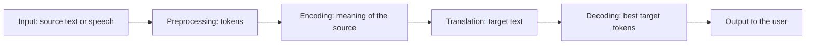
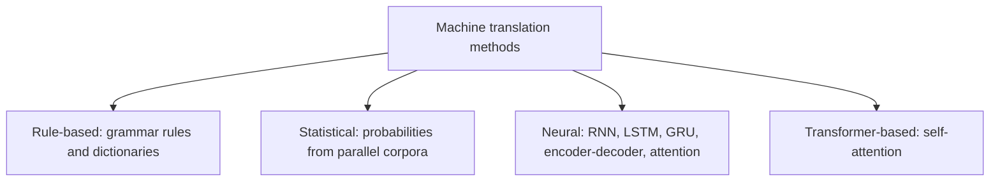
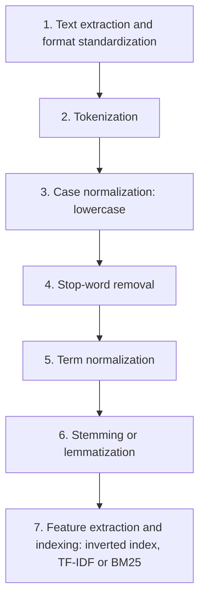
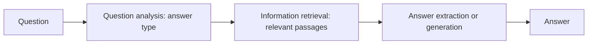
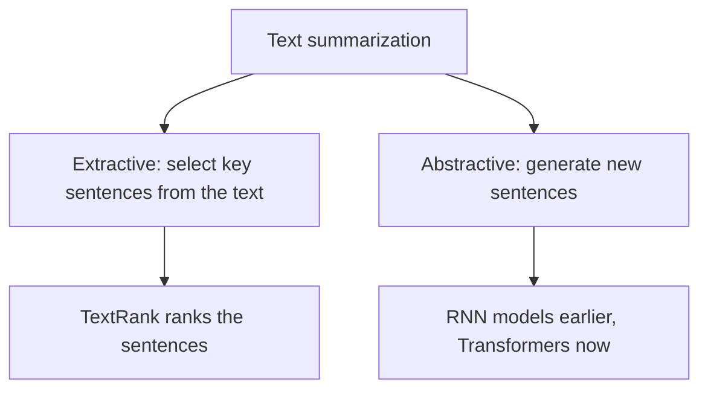
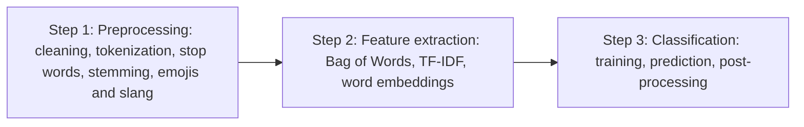
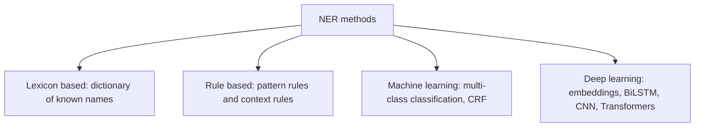
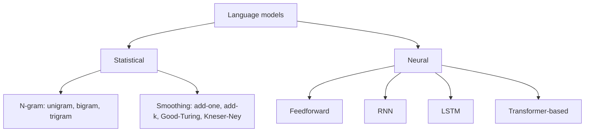

Before the new ideas, here are the old ones you need. If you already know them, skip to the next section.

## The basics first

- A **token** is one small unit of text, usually a word. **Tokenization** splits text into tokens. <Cite id="class-nlp-m6" loc="slide 2" />
- A **corpus** is a large collection of text. A **parallel corpus** is a collection of texts with their translations side by side. <Cite id="class-nlp-m6" loc="slide 4" />
- A **classifier** is a program that puts an input into one of a few fixed classes, such as spam or not spam. <Cite id="class-nlp-m6" loc="slide 18" />
- **Training** means showing a model many labelled examples so that it learns the pattern.

This module is syllabus <Syl m="6" />: applications of NLP and models of language. The class slides cover eight topics, in this order.

## 1. Machine translation

<Box kind="definition">

**Machine Translation (MT)** is the use of Natural Language Processing (NLP) to automatically translate text or speech from one language to another. It enables fast and scalable translation across different languages without requiring manual translation for every sentence. <Cite id="class-nlp-m6" loc="slide 1" />

</Box>

Modern systems primarily use **Neural Machine Translation (NMT)**, which learns linguistic patterns and context from large amounts of multilingual data. <Cite id="class-nlp-m6" loc="slide 2" />

### Working

1. **Input:** the system receives text or speech in the source language.
2. **Preprocessing:** the input is cleaned and divided into smaller units such as tokens.
3. **Encoding:** a neural model represents the source sentence in a form that captures its meaning and context.
4. **Translation:** the model generates the corresponding text in the target language.
5. **Decoding:** the system selects the most suitable sequence of target-language tokens.
6. **Output:** the generated translation is presented to the user.

In modern Transformer-based systems, attention mechanisms help the model focus on relevant parts of the source sentence while generating each part of the translation. <Cite id="class-nlp-m6" loc="slide 2" />

### Methods

**1. Rule-Based Machine Translation (RBMT)** uses manually created grammar rules, bilingual dictionaries and linguistic information to translate text. The system analyzes the structure of the source sentence and applies predefined rules to generate the target-language sentence. Common techniques: grammar rules, bilingual dictionaries, morphological analysis and transfer rules. <Cite id="class-nlp-m6" loc="slide 3" />

**2. Statistical Machine Translation (SMT)** uses statistical models trained on large collections of translated text, called parallel corpora. Instead of relying mainly on manually written rules, the system estimates the probability of different translations and selects the most likely output. Common models and techniques: IBM translation models, language models and phrase-based translation models. <Cite id="class-nlp-m6" loc="slide 4" />

**3. Neural Machine Translation (NMT)** uses deep neural networks to learn translation patterns from multilingual data and generate translations based on the context of the source sentence. Unlike traditional approaches that rely heavily on explicit rules or statistical probabilities, NMT learns translation representations directly from training data. <Cite id="class-nlp-m6" loc="slide 5" />

| Architecture | What it does |
|---|---|
| RNN | processes the input sequence step by step; used in early neural translation systems |
| LSTM | an RNN variant designed to better handle long-range dependencies in sentences |
| GRU | a simpler recurrent architecture that can also model sequential dependencies |
| Encoder-Decoder | uses one neural network to encode the source sentence and another to generate the target sentence |
| Attention | lets the decoder focus on relevant parts of the source sentence during translation |
| Transformer | uses self-attention to model relationships between tokens; the dominant architecture in many modern NMT systems |

Modern NMT systems commonly use Transformer-based architectures because they can capture long-range relationships efficiently and process sequences in parallel during training. <Cite id="class-nlp-m6" loc="slide 5" />

**4. Transformer-Based Machine Translation** relies on self-attention to understand relationships between words and generate translations based on context: **self-attention** captures relationships between words across the sentence, **parallel processing** handles input sequences efficiently during training, and **context-aware translation** uses broader sentence context for more accurate output. <Cite id="class-nlp-m6" loc="slide 6" />

### Evaluation

Translation can be judged by automatic metrics and by humans: <Cite id="class-nlp-m6" loc="slide 6" />

- **BLEU:** measures the similarity between a machine-generated translation and reference translations.
- **ROUGE:** compares generated and reference text based on overlapping sequences.
- **METEOR:** considers word matches and linguistic variations such as stemming and synonyms.
- **Human evaluation:** reviewers assess fluency, accuracy and meaning.

No single metric completely captures translation quality, so multiple evaluation methods may be used.

### Applications, advantages and limitations

**Applications:** website and app localization, business communication, travel and communication, education, customer support (multilingual chatbots), media and entertainment (subtitles, captions). <Cite id="class-nlp-m6" loc="slide 7" />

| Advantages | Limitations |
|---|---|
| Fast: translates large amounts of content quickly | Context errors: a word may have different meanings in different contexts |
| Scalable: many languages and large volumes | Cultural differences: idioms, humor and references may not translate |
| Consistent: same patterns across repeated content | Limited data for some languages: poor performance |
| Available 24/7 | Domain-specific errors: medical, legal and technical text needs human review |
| Cost-effective for routine content | Lack of human judgment: tone, intention and nuance |

<Cite id="class-nlp-m6" loc="slide 8" />

## 2. Information retrieval

<Box kind="definition">

**Information Retrieval (IR)** helps to find relevant information from large collections of documents. It can be defined as a software program that deals with the organization, storage, retrieval and evaluation of information from documents. <Cite id="class-nlp-m6" loc="slide 9" />

</Box>

**Everyday analogy.** IR is "like a smart librarian who doesn't give you direct answers but tells you where to find the right book". The IR system scans the documents and pulls out those that match your query. It compares the query with the documents using a **matching function**, which gives each document a **retrieval status value (RSV)**; the results are ranked by it. Documents are represented by **descriptors**, the most important keywords from the vocabulary V. <Cite id="class-nlp-m6" loc="slide 9" />

**1. User side (search process)** <Cite id="class-nlp-m6" loc="slide 11" />

- **Problem identification:** a student wants to learn about machine learning.
- **Representation:** the need becomes a query of keywords, "machine learning basics".
- **Query:** the query is submitted to the IR system.
- **Feedback:** the user refines the search after seeing the results.

**2. System side (retrieval process)** <Cite id="class-nlp-m6" loc="slide 12" />

- **Acquisition:** the system collects and stores documents (web pages, books, papers). Web crawlers collect the data. <Cite id="class-nlp-m6" loc="slide 14" />
- **Representation:** each document is analyzed and represented by keywords (terms). A document on machine learning is tagged AI, deep learning, algorithms, models.
- **File organization:** documents are indexed and stored so they are found quickly. Two types: **sequential** (document by document) and **inverted** (a list of records under each term). <Cite id="class-nlp-m6" loc="slide 14" />
- **Matching:** the query is compared with stored documents by a matching function that ranks them by relevance.
- **Retrieved object:** the most relevant documents are returned, best first.

**3. Interaction between user and system.** The user reviews the results and may give feedback; the system processes the updated query and retrieves better results. <Cite id="class-nlp-m6" loc="slide 13" />

### Text processing steps for IR

Before indexing, raw text is turned into a clean, standard form suitable for an **inverted index**, so that query terms match document terms quickly. <Cite id="class-nlp-asol" loc="p. 11" />

1. **Document text extraction and format standardization:** extract raw text from HTML, PDF or DOCX; remove noise (HTML tags, metadata, control characters); unify the character encoding (usually UTF-8).
2. **Tokenization:** break the text into tokens, using whitespace and punctuation as delimiters. Hard cases: compound and hyphenated words, and languages like Chinese or Thai with no spaces.
3. **Case normalization:** convert to lowercase, so "Information", "information" and "INFORMATION" become one term.
4. **Stop-word removal:** drop high-frequency words such as the, is, a, and, in that carry little meaning. This shrinks the index and removes noise. Modern systems use minimal lists, to keep phrases like "to be or not to be".
5. **Term normalization:** map variations to one form: remove punctuation and special characters, and make U.S.A., USA and United States the same.
6. **Stemming or lemmatization:** stemming chops word ends by rules (Porter's stemmer); it is fast but may give non-words: retrieval, retrieved, retrieving become "retriev". Lemmatization uses vocabulary and morphology to give the dictionary form: better becomes good, mice becomes mouse.
7. **Feature extraction and indexing:** build an inverted index (each term maps to the documents that contain it) and apply weighting such as TF-IDF or BM25, based on how frequent and how rare a term is, to rank results.

<Cite id="class-nlp-asol" loc="p. 11" /> <Cite id="class-nlp-asol" loc="p. 12" />

## 3. Question answering

<Box kind="definition">

A **Question Answering (QA) system** in NLP is an artificial intelligence program that automatically answers human-language questions with precise facts or short passages instead of returning a long list of whole documents. <Cite id="class-nlp-m6" loc="slide 15" />

</Box>

**Core architecture and workflow.** A standard QA pipeline has sequential stages: <Cite id="class-nlp-m6" loc="slide 15" /> <Cite id="class-nlp-m6" loc="slide 16" />

1. **Question analysis / processing:** tokenizes the question, removes stop words, does part-of-speech (POS) tagging and identifies the expected answer type (person, location, date or definition, using words like who, what, when).
2. **Information retrieval (IR):** searches a document store, knowledge graph or vector database for relevant passages or facts.
3. **Answer extraction / generation:** uses deep learning or Transformer models (like BERT or generative LLMs) to pinpoint or synthesize the exact answer from the retrieved context.

**Main types of QA systems:** <Cite id="class-nlp-m6" loc="slide 16" />

- **Extractive QA:** pulls the exact text span from a given source document, computing start and end character indices.
- **Generative (abstractive) QA:** uses large language models to write a fluent answer from retrieved data or internal parameters.
- **Open-domain versus closed-domain:** open-domain systems answer broad questions from unrestricted web data (Wikipedia, virtual assistants); closed-domain systems focus on a narrow subject with specialized vocabulary (medical or legal).

## 4. Text categorization

<Box kind="definition">

**Categorization** (text classification) is the process of assigning predefined categories or labels to text data. It is a core task used in spam detection, sentiment analysis, topic labeling, news categorization and intent detection. <Cite id="class-nlp-m6" loc="slide 18" />

</Box>

Text classification takes raw text and turns it into structured information by predicting which class the text belongs to. The general workflow: text preprocessing, feature extraction or representation, model building, prediction and evaluation.

**Methods used for text classification:** <Cite id="class-nlp-m6" loc="slide 19" /> <Cite id="class-nlp-m6" loc="slide 20" />

1. **Traditional machine learning:** Naive Bayes, Support Vector Machines (SVM), Logistic Regression, Decision Trees, Random Forest and k-Nearest Neighbors. These need feature extraction to turn text into numbers.
2. **Deep learning:** neural networks such as RNNs and CNNs, which capture word dependencies and context.
3. **Transformer-based models (state of the art):** models like BERT use self-attention and contextual embeddings and are fine-tuned for a task. They are computationally expensive but outperform earlier methods.
4. **Zero-shot and few-shot classification:** zero-shot sorts text into labels not seen in training; few-shot needs only a small amount of labelled data. GPT and BART enable these.

**Text classification pipeline** (example input "I love this movie!"): input text, data preprocessing, vectorization (TF-IDF, Bag-of-Words), model training (a classifier like Naive Bayes learns the patterns), prediction ("Positive Sentiment" or "Negative Sentiment") and evaluation metrics (accuracy, precision, recall, F1-score). <Cite id="class-nlp-m6" loc="slide 22" />

## 5. Summarization

<Box kind="definition">

**Summarization** is a key technique in NLP that uses algorithms to reduce large texts while preserving essential information. By extracting key concepts and maintaining the original meaning, these systems help industries such as banking, law and healthcare make faster decisions and retrieve information faster. <Cite id="class-nlp-m6" loc="slide 23" /> <Cite id="class-nlp-asol" loc="p. 12" />

</Box>

There are two primary types: extractive and abstractive.

- **Extractive summarization** automatically generates summaries by selecting and combining key passages from the original text. These models extract the most important sentences without creating new content, and the goal is to preserve the meaning while condensing it. The **TextRank** algorithm is widely used: it ranks sentences by their relevance and importance and builds a concise summary. <Cite id="class-nlp-m6" loc="slide 24" />
- **Abstractive summarization** generates entirely new sentences to convey the key ideas. It rephrases information in a more concise and coherent manner, often with new vocabulary that was not in the original. It gained prominence with Transformer models; earlier, models based on recurrent neural networks (RNNs) were used. <Cite id="class-nlp-m6" loc="slide 25" />

How TextRank works is not shown in the class files. In short: split the text into sentences, join similar sentences in a graph, score each sentence by how well connected it is, and keep the top-scoring ones in their original order.

## 6. Sentiment analysis

<Box kind="definition">

**Sentiment Analysis** is an NLP technique used to identify emotions, opinions and attitudes expressed in textual data. It helps classify text as positive, negative or neutral, for better understanding of customer feedback and public opinion. <Cite id="class-nlp-m6" loc="slide 26" />

</Box>

It detects emotional tone and opinions from text and analyzes large volumes of text using machine learning and deep learning.

**Types:** <Cite id="class-nlp-m6" loc="slide 27" /> <Cite id="class-nlp-m6" loc="slide 28" />

1. **Fine-grained:** rates sentiment on several levels (very positive to very negative), often as 1 to 5 stars, like product review ratings.
2. **Emotion detection:** finds specific emotions such as joy, sadness, anger, fear or excitement.
3. **Aspect-based:** looks at specific features; for a phone review, battery, screen, camera and performance are analyzed separately.
4. **Multilingual:** works on text in many languages; challenging because of grammar and cultural differences but essential for global use.
5. **Intent-based:** finds the intention behind the text, such as purchase intent from reviews that mention discounts or offers.

**Approaches:**

| Approach | How it works | Pros | Cons |
|---|---|---|---|
| Rule-based | predefined lexicons and rules; counts positive and negative words | easy, interpretable, no training; handles some negation like "not bad" | hard to scale, limited accuracy, lexicon needs updates |
| Machine learning | Naive Bayes, SVM, Random Forest on TF-IDF or Bag-of-Words features | handles large data and complex patterns | needs large labelled data, retraining for new domains |
| Neural / deep learning | RNN, LSTM, GRU, Transformers | high accuracy, captures context | computationally expensive, needs much data |
| Hybrid | lexicon rules for a quick first label, ML or deep learning to refine | better accuracy, adaptable | complex to implement |

<Cite id="class-nlp-m6" loc="slide 29" /> <Cite id="class-nlp-m6" loc="slide 30" /> <Cite id="class-nlp-m6" loc="slide 31" /> <Cite id="class-nlp-m6" loc="slide 32" />

**Working (three steps):** <Cite id="class-nlp-m6" loc="slide 33" /> <Cite id="class-nlp-m6" loc="slide 34" />

## 7. Named entity recognition

<Box kind="definition">

**Named Entity Recognition (NER)** in NLP focuses on identifying and categorizing important information, known as entities, in text. These entities can be names of people, places, organizations, dates and so on. It helps transform unstructured text into structured information, which helps tasks like text summarization, knowledge graph creation and question answering. <Cite id="class-nlp-m6" loc="slide 35" />

</Box>

**Common entity types:** person names (Albert Einstein), organizations (GeeksforGeeks), locations (Paris), dates and times (5th May 2025), quantities and percentages (50%, 100 dollars). NER handles ambiguity by using the surrounding words, the sentence structure and the overall context: "Amazon is expanding rapidly" (organization) against "The Amazon is the largest rainforest" (location). <Cite id="class-nlp-m6" loc="slide 36" />

**Working:** <Cite id="class-nlp-m6" loc="slide 37" />

1. **Analyzing the text:** find words or phrases that could be entities.
2. **Finding sentence boundaries:** use punctuation and capitalization to keep meaning and context.
3. **Tokenizing and POS tagging:** split into tokens and tag each with its grammatical role, which gives clues for entities.
4. **Entity detection and classification:** tokens that match known patterns are recognized and put into categories such as Person, Organization, Location.
5. **Model training and refinement:** models learn from labelled data and improve over time.
6. **Adapting to new contexts:** a well-trained model generalizes to new languages, styles and unseen entity types.

**Methods:** <Cite id="class-nlp-m6" loc="slide 38" /> <Cite id="class-nlp-m6" loc="slide 39" />

- **Lexicon-based:** checks the text against a dictionary of known entity names. Not commonly used, because the dictionary needs constant updating.
- **Rule-based:** predefined rules based on patterns (the form of words) and context (the surrounding words).
- **Machine learning-based:** multi-class classification trains a classifier on labelled data; a **Conditional Random Field (CRF)** is a probabilistic model that understands the sequence and context of words, so its entity predictions are more accurate.
- **Deep learning-based:** word embeddings (dense vectors that capture meaning) with neural networks such as BiLSTM, CNN and Transformers; high accuracy on large, varied data.

## 8. Language models

<Box kind="definition">

**Language models** learn patterns in language and assign probabilities to word or token sequences, allowing them to predict the next token, complete sequences and estimate how likely a sequence is. <Cite id="class-nlp-m6" loc="slide 40" />

</Box>

(The slide title spells it "Linguistic Model"; the content is about language models.)

Mathematically, a language model estimates the probability of a sequence of words $P(w_1, w_2, \ldots, w_n)$, where $w_1, \ldots, w_n$ are the words or tokens. For next-token prediction it estimates $P(w_t \mid w_1, w_2, \ldots, w_{t-1})$, where $w_t$ is the next token predicted from the preceding tokens. <Cite id="class-nlp-m6" loc="slide 41" />

**Working:** <Cite id="class-nlp-m6" loc="slide 42" />

1. **Tokenization:** split the input into words, subwords or other tokens.
2. **Learning language patterns:** train on text to learn relationships and statistics between tokens.
3. **Context analysis:** use the available context to estimate the probability of possible tokens.
4. **Probability estimation:** give probabilities to possible next tokens or sequences.
5. **Prediction:** the most probable token, or one chosen by a decoding strategy, continues the sequence.

For the input "She went to the", the slide gives market 0.45, school 0.30, office 0.15, hospital 0.06, park 0.04.

<Sum>

<Given>

The class example: after "She went to the" the probabilities are market 0.45, school 0.30, office 0.15, hospital 0.06, park 0.04.

</Given>

<Find>

whether these form a valid probability distribution, and the most likely next word.

</Find>

<Steps>

1. Add the probabilities: $0.45 + 0.30 + 0.15 + 0.06 + 0.04 = 1.00$. *Reason: probabilities over all choices must add to 1.*
2. Every value is between 0 and 1, so the distribution is valid.
3. The highest value is 0.45, so the most likely next word is "market".

</Steps>

<Answer>

valid distribution; most likely word: market (0.45).

</Answer>

<Box kind="verify">

The list has five words, and 0.45 + 0.30 = 0.75, 0.75 + 0.15 = 0.90, 0.90 + 0.06 = 0.96, 0.96 + 0.04 = 1.00. Greedy picking always takes the top word; a decoding strategy may sometimes pick a lower one for variety.

</Box>

</Sum>

### Statistical language models

Statistical models estimate the probability of a sequence from counts in a training corpus. <Cite id="class-nlp-m6" loc="slide 43" />

- **N-gram language model:** predicts a word using a fixed number of preceding words. **Unigram** considers one word at a time, **bigram** uses the previous one word and **trigram** uses the previous two words. For example, to predict the word after "I want to drink", a trigram model uses only the previous two words, "to drink". N-gram models are simple and efficient, but the fixed context cannot capture long-range dependencies, and **data sparsity** arises when some word sequences are rare or absent in the corpus.
- **Smoothing:** an unseen sequence may get probability zero. Smoothing adjusts the estimates so unseen or rare sequences still get a small probability. Common methods: add-one (Laplace) smoothing, add-$k$ smoothing, Good-Turing smoothing and Kneser-Ney smoothing. <Cite id="class-nlp-m6" loc="slide 44" />

### Neural language models

Neural language models use neural networks to learn distributed representations of words and estimate probabilities. Unlike n-gram models they learn more complex relationships and do not store counts for every possible n-gram. <Cite id="class-nlp-m6" loc="slide 44" />

1. **Feedforward:** uses a fixed number of preceding words as vectors through network layers to predict the next word. It learns continuous word representations, but the fixed context still limits long-range dependencies. <Cite id="class-nlp-m6" loc="slide 45" />
2. **RNN:** processes the sequence step by step with a hidden state that carries information from earlier tokens. Basic RNNs struggle with long-range dependencies because of the vanishing-gradient problem. <Cite id="class-nlp-m6" loc="slide 46" />
3. **LSTM:** an RNN designed for long-term dependencies. Gating controls which information is retained, updated or discarded, so it keeps relevant information over many steps, reduces the vanishing-gradient effect, captures far-apart dependencies and predicts the next word. <Cite id="class-nlp-m6" loc="slide 46" />
4. **Transformer-based:** uses attention to model relationships between tokens and processes many tokens in parallel during training. Uses: autoregressive modelling (predict the next token), masked language modelling (predict masked tokens) and sequence-to-sequence modelling (generate one sequence from another, as in translation). <Cite id="class-nlp-m6" loc="slide 47" />

## Also asked in past papers (not in the class files)

**Information retrieval versus information extraction.** The class files define IR only. Information extraction (IE) is the task of pulling structured facts out of the text itself; named entity recognition is one IE step, since it turns unstructured text into structured information. <Cite id="class-nlp-m6" loc="slide 35" />

| Point | Information retrieval | Information extraction |
|---|---|---|
| Output | a ranked list of documents | structured facts (entities, dates, relations) |
| Question answered | "which documents are relevant?" | "what facts does this text state?" |
| Input | a query and a collection of documents | a text |
| Typical tools | indexing, matching, ranking (RSV) | NER, rules, machine learning |
| Example | a search engine | filling a table of names and dates from news |

<Box kind="exam">

Asked as: machine translation <PYQ id="2024-05-ce/q6a" /> <PYQ id="2025-05/q5b" /> <PYQ id="2024-12/q6c" /> <PYQ id="2023-05-ce/q1d" />, rule-based MT <PYQ id="2022-12-ce/q1d" /> <PYQ id="2024-12-ce/q1c" />, statistical MT <PYQ id="2023-12-ce/q1c" />, information retrieval <PYQ id="2024-05-ce/q6b" />, text processing for IR <PYQ id="2022-12-ce/q4b" />, IR versus IE <PYQ id="2023-05-ce/q6a" /> <PYQ id="2024-12/q1b" /> <PYQ id="2025-05/q1b" />, question answering <PYQ id="2023-12-ce/q6a" /> <PYQ id="2025-05-ce/q6b" /> <PYQ id="2024-12/q6d" />, summarization <PYQ id="2022-12-ce/q6a" /> <PYQ id="2024-12-ce/q6a" /> <PYQ id="2024-12/q6a" /> and named entity recognition <PYQ id="2024-12/q6b" />.

</Box>
