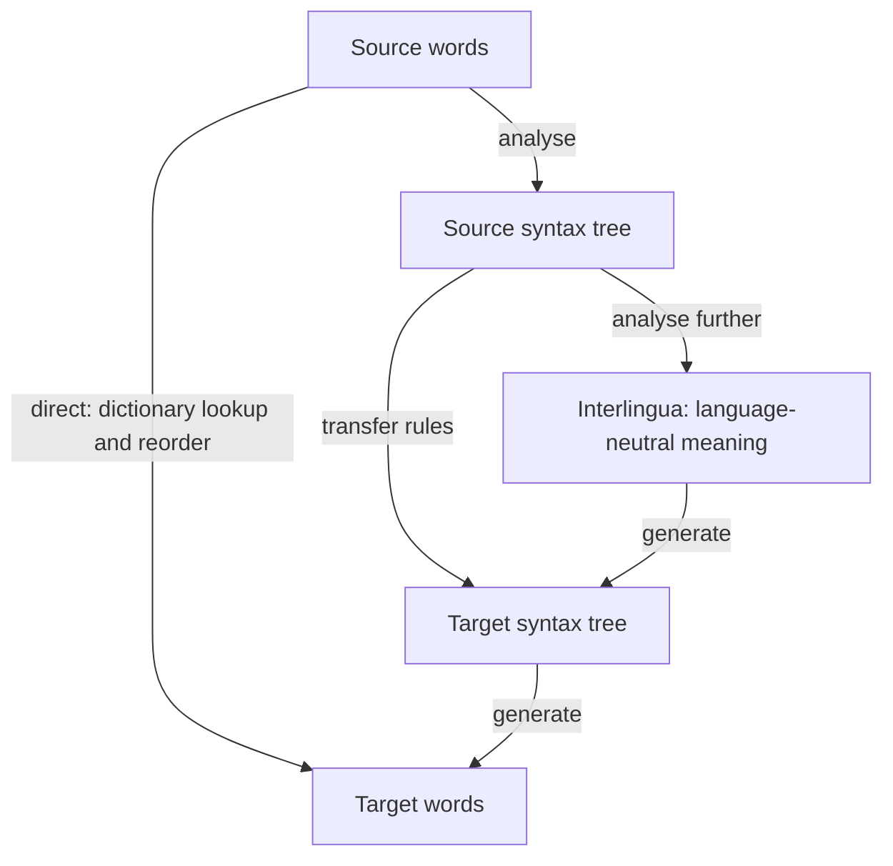
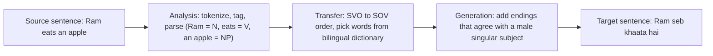
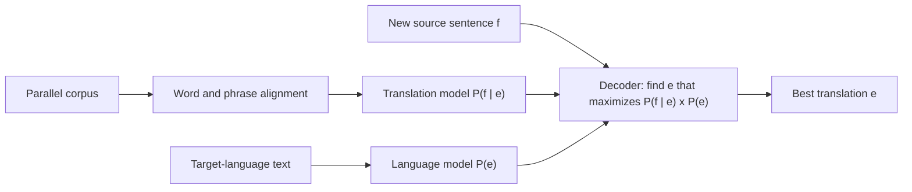
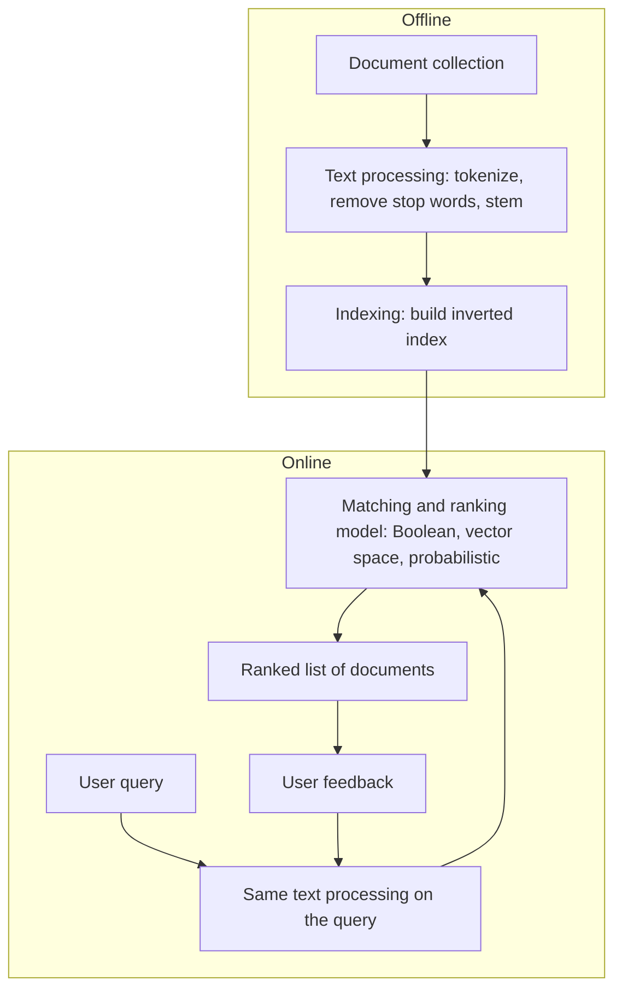
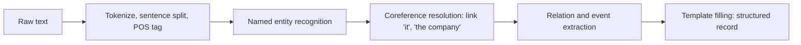
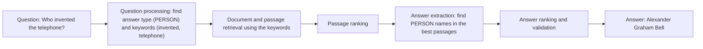
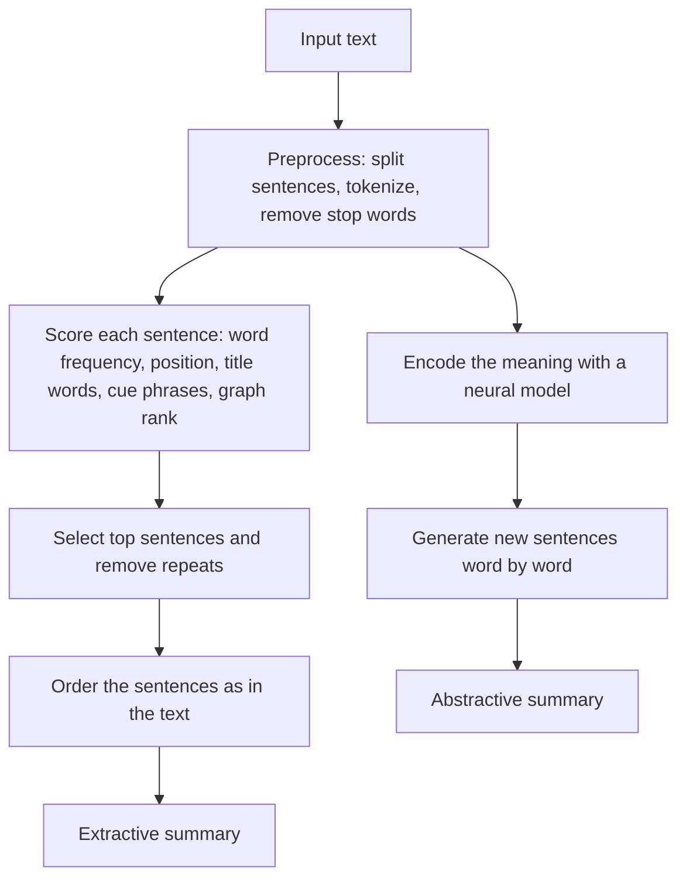

Before the new ideas, here are the old ones you need. If you already know them, skip to the next section.

## The basics first

- A **corpus** is a large collection of text. A **parallel corpus** is the same text in two languages, sentence by sentence (for example English and Hindi).
- A **token** is a word (or piece of a word) after splitting the text. A **stop word** is a very common word such as *the*, *is*, *on* that carries little meaning for search. **Stemming** cuts a word to its root (*chasing* becomes *chase*).
- A **language model** gives a probability to a sentence, so it can tell a fluent sentence from a jumbled one. An n-gram model counts short word sequences.
- **Precision** and **recall** are two ways to score a system that returns a set of answers (explained with a sum below).
- **Structured data** is data in a table with fixed columns (name, city, date). **Unstructured data** is plain text. Most of the world's information is unstructured, which is why we need the applications below.

## The big picture: what NLP is used for

**What it is.** The earlier notes of this subject built the tools: tokenization, morphology, n-gram models, tagging, parsing, meaning and discourse. This module (syllabus <Syl m="6" />, section 6.1) puts those tools together into **applications**: complete systems that help a real user. The syllabus names machine translation, information retrieval, question answering, text categorization, summarization, sentiment analysis and named entity recognition, "preferably for Indian regional languages". Sections 6.2 to 6.5 then describe four models of language. <Cite id="nlp-applications-slp3-13" /> <Cite id="nlp-applications-slp3-11" /> <Cite id="nlp-applications-slp3-21" />

**Why it is needed.** People produce more text than anyone can read: web pages, news, reviews, mail, documents in many languages. Applications turn that pile into something useful: a translation, a short list of the right documents, a direct answer, a summary, a mood score, a table of facts.

| Application | Input | Output | Typical example |
|---|---|---|---|
| Machine translation | Text in language A | Text in language B | English to Hindi translation |
| Information retrieval | A query and many documents | Ranked list of documents | Web search |
| Information extraction | Free text | Structured facts (a table) | Who bought which company, when |
| Question answering | A question | A short answer | "Who invented the telephone?" |
| Text categorization | A document | A label | Spam or not spam |
| Summarization | A long text | A short text | News headline summary |
| Sentiment analysis | A review or post | Positive, negative or neutral | Product review rating |
| Named entity recognition | A sentence | Marked names and their types | Find people and places |

<Cite id="nlp-introduction-av-apps" />

## Machine translation (MT)

**What it is.** **Machine translation** is the use of a computer to translate text (or speech) from a **source language** into a **target language** while keeping the meaning. <Cite id="nlp-applications-slp3-13" />

**Why it is hard.** Languages differ in many ways, so word-by-word replacement fails:

- **Word order.** English is subject-verb-object (SVO): *Ram eats an apple*. Hindi is subject-object-verb (SOV): *Ram seb khaata hai* (Ram apple eats).
- **Ambiguity.** *Bank* can be a river bank or a money bank; the target language may need two different words.
- **Idioms.** *It is raining cats and dogs* does not mean animals fall from the sky.
- **Agreement and morphology.** Hindi verbs change with the gender and number of the subject; English verbs mostly do not.
- **Little data for some languages.** Many Indian languages have far less parallel text than English-French.

### Approaches to machine translation

<Cite id="nlp-applications-gfg-mt" loc="diagram" /> <Cite id="nlp-applications-wiki-rbmt" />

The MT approaches asked about in exams fall in three families.

| Family | Idea | Knowledge comes from |
|---|---|---|
| Rule-based (RBMT) | Linguists write dictionaries and grammar rules | Human experts |
| Corpus-based: example-based (EBMT) and statistical (SMT) | Learn from a parallel corpus | Data |
| Neural (NMT) | One neural network learns to translate end to end | Data |

### 1. Rule-based machine translation (RBMT)

**Definition.** RBMT translates by applying hand-written linguistic knowledge: a bilingual dictionary, morphological rules, grammar rules for the source language and rules that map source structures to target structures. <Cite id="nlp-applications-wiki-rbmt" /> <Cite id="nlp-applications-gfg-mt" />

**Three kinds of RBMT.**

1. **Direct (dictionary-based).** Look up each source word in a bilingual dictionary, then reorder with a few rules. Fast to build, poor quality, because it ignores grammar.
2. **Transfer.** Three steps: (a) **analysis**: parse the source sentence into a tree; (b) **transfer**: apply rules that turn the source tree into a target tree (for example, move the verb to the end for Hindi); (c) **generation**: produce the target words with the right endings. A separate set of transfer rules is needed for every language pair.
3. **Interlingua.** Analyse the source into a language-neutral meaning (the **interlingua**), then generate the target from it. For $n$ languages this needs $2n$ modules (one analyser and one generator per language) instead of $n(n-1)$ transfer modules. For 5 languages that is 10 against 20. But a perfect neutral meaning representation is very hard to design.

<Cite id="nlp-applications-gfg-mt" loc="diagram" />

**Advantages.** Predictable and explainable; no parallel corpus needed; errors can be fixed by editing a rule; works for narrow domains.

**Disadvantages.** Writing rules and dictionaries takes years of expert work; the rules are brittle and miss idioms and unusual sentences; every language pair needs new work.

### 2. Statistical machine translation (SMT)

**Definition.** SMT chooses the target sentence that is most probable given the source sentence, using probabilities learned from a parallel corpus. <Cite id="nlp-applications-ibm1993" />

**The idea (noisy channel).** Imagine the Hindi sentence $f$ is an English sentence $e$ that was garbled while passing through a noisy channel. We want the $e$ that most likely produced $f$. Bayes' rule gives:

$$\hat{e} = \arg\max_{e} P(e \mid f) = \arg\max_{e} \; P(f \mid e)\, P(e)$$

In words: pick the English sentence that scores best on two things at once.

- $P(e)$ is the **language model**: is $e$ fluent English? (Learned from a large English-only corpus, for example with the n-gram models of the earlier note.)
- $P(f \mid e)$ is the **translation model**: if the English were $e$, how likely is this Hindi? (Learned from the parallel corpus by finding which words and phrases line up, called **alignment**.)
- The **decoder** searches the huge space of possible $e$ for the best product.

<Cite id="nlp-applications-gfg-mt" loc="diagram" /> <Cite id="nlp-applications-slp3-13" />

The original IBM models (Models 1 to 5) learn word alignments from sentence pairs; modern SMT translates whole **phrases** at a time, which handles short idioms and local word order better. <Cite id="nlp-applications-ibm1993" />

### Worked example: choose the best translation with the noisy channel

<Sum>

<Given>

Source (French-like) sentence $f$ = "le chien". Three English candidates with these model scores:

| Candidate $e$ | $P(f \mid e)$ | $P(e)$ |
|---|---|---|
| A: the dog | 0.20 | 0.010 |
| B: the hound | 0.05 | 0.004 |
| C: dog the | 0.20 | 0.0002 |

</Given>

<Find>

the best translation $\hat{e}$.

</Find>

<Steps>

1. Score each candidate with $P(f \mid e) \times P(e)$. *Reason: the noisy channel rule multiplies adequacy by fluency.*
2. A: $0.20 \times 0.010 = 0.0020$.
3. B: $0.05 \times 0.004 = 0.00020$.
4. C: $0.20 \times 0.0002 = 0.000040$.
5. Compare: $0.0020 > 0.00020 > 0.000040$.

</Steps>

<Answer>

$\hat{e}$ = "the dog" (score 0.0020).

</Answer>

<Box kind="verify">

C has the same translation score as A but a 50 times smaller language-model score ($0.010 / 0.0002 = 50$), so it must score 50 times lower: $0.0020 / 50 = 0.00004$, which matches step 4. B loses because its translation model is 4 times weaker and its language model 2.5 times weaker: $4 \times 2.5 = 10$ times lower, and $0.0020 / 10 = 0.00020$, which matches step 3.

</Box>

</Sum>

**Advantages of SMT.** Learns from data, so no rules to write; fluent output because of the language model; one method works for any language pair that has a parallel corpus.

**Disadvantages.** Needs a large parallel corpus; poor with long-distance reordering and rich morphology; many separate parts to build and tune; hard to fix a single error.

### 3. Example-based MT (EBMT)

EBMT stores many translated example pairs. To translate, it finds stored examples similar to the new sentence, picks out the matching parts and recombines their translations. It sits between rules and statistics. <Cite id="nlp-applications-gfg-mt" />

### 4. Neural machine translation (NMT)

A neural network with an **encoder** that reads the source sentence into numbers and a **decoder** that writes the target sentence word by word. **Attention** lets the decoder look back at the source words that matter for each output word, which fixed the problem that one fixed-size vector cannot hold a long sentence. The Transformer later replaced the recurrent layers with attention only. <Cite id="nlp-applications-bahdanau" /> <Cite id="nlp-applications-slp3-13" />

NMT is trained as one end-to-end model, usually gives the most fluent output, and is what current online translators use. Its weak points are the need for large data, rare words, occasional made-up output and low explainability.

### Comparison

| Point | Rule-based | Statistical | Neural |
|---|---|---|---|
| Knowledge from | Human-written rules | Parallel corpus + probabilities | Parallel corpus + neural network |
| Components | Dictionary, parser, transfer, generator | Language model, translation model, decoder | One encoder-decoder network |
| Needs parallel data | No | Yes, a lot | Yes, a lot |
| Fluency | Often stiff | Good | Best |
| Explainable | Yes | Partly | Hardly |
| Effort for a new language pair | Very high (rules) | Moderate (data) | Moderate (data); one model can cover many pairs |

### Evaluating MT: BLEU

Humans judge **adequacy** (is the meaning kept?) and **fluency** (is it good target-language text?). Because that is slow, the automatic score **BLEU** compares the system output (the **candidate**) with one or more human **reference** translations. It uses **modified n-gram precision** (an n-gram can be counted only as often as it occurs in the reference) and a **brevity penalty** to punish outputs that are too short. <Cite id="nlp-applications-bleu" /> <Cite id="nlp-applications-gfg-bleu" />

$$\text{BP} = \begin{cases} 1 & c > r \\ e^{\,1 - r/c} & c \le r \end{cases} \qquad \text{BLEU} = \text{BP}\cdot \exp\!\Big(\sum_{n=1}^{N} w_n \ln p_n\Big)$$

Here $c$ is the candidate length, $r$ the reference length, $p_n$ the modified $n$-gram precision and $w_n = 1/N$.

### Worked example: BLEU with unigrams and bigrams

<Sum>

<Given>

Candidate: "the cat sat on the mat". Reference: "the cat is on the mat". Use $N = 2$ (unigrams and bigrams), $w_1 = w_2 = 1/2$.

</Given>

<Find>

BLEU-2 for the candidate.

</Find>

<Steps>

1. Unigram counts. Candidate words: the (2), cat (1), sat (1), on (1), mat (1). Reference words: the (2), cat (1), is (1), on (1), mat (1). *Reason: each word is credited at most as many times as it occurs in the reference (clipping).*
2. Clipped matches: the min(2,2) = 2, cat 1, sat 0, on 1, mat 1, giving 5 of the candidate's 6 words. So $p_1 = 5/6$.
3. Bigrams. Candidate: the cat, cat sat, sat on, on the, the mat (5 bigrams). Reference: the cat, cat is, is on, on the, the mat.
4. Matching bigrams: the cat, on the, the mat = 3. So $p_2 = 3/5$.
5. Lengths are equal ($c = r = 6$), so $c > r$ is false but $r/c = 1$ and $\text{BP} = e^{1-1} = 1$.
6. $\text{BLEU} = 1 \times \exp\big(\tfrac12 \ln \tfrac56 + \tfrac12 \ln \tfrac35\big) = \sqrt{\tfrac56 \times \tfrac35} = \sqrt{0.5}$.

</Steps>

<Answer>

BLEU-2 $= \sqrt{0.5} \approx 0.707$

</Answer>

<Box kind="verify">

Recompute the product: $\tfrac56 \times \tfrac35 = \tfrac{15}{30} = 0.5$, and $0.707^2 = 0.4998 \approx 0.5$. The score lies between the two precisions ($0.6$ and $0.833$), as a geometric mean must.

</Box>

</Sum>

If the candidate were shorter, the brevity penalty bites. For a 4-word candidate against a 6-word reference, $\text{BP} = e^{1 - 6/4} = e^{-0.5} \approx 0.607$, so even perfect precision scores only 0.607. Check: $\ln 0.607 = -0.5$.

### Machine translation for Indian languages

The syllabus says "preferably for Indian regional languages". The usual difficulties are: SOV word order and free word order inside the sentence; rich morphology (many word forms); several scripts; little parallel text; and code-mixing such as Hinglish. Translating between closely related languages (for example Hindi and Marathi, which share a script and much grammar) is easier than English to Hindi. Using a shared multilingual neural model helps low-resource languages by borrowing from the rich ones. <Cite id="nlp-applications-slp3-13" />

**Exam questions on MT.** <PYQ id="2022-12-ce/q1d" /> <PYQ id="2024-12-ce/q1c" /> <PYQ id="2023-05-ce/q1d" /> <PYQ id="2023-12-ce/q1c" /> <PYQ id="2024-05-ce/q6a" /> <PYQ id="2024-12/q6c" /> <PYQ id="2025-05/q5b" />

## Information retrieval (IR)

**What it is.** **Information retrieval** is finding the documents in a large collection that satisfy a user's **information need**, which the user states as a **query**. The system returns a **ranked list** of documents; the user then reads them. Web search engines and library catalogues are IR systems. <Cite id="nlp-applications-gfg-ir" /> <Cite id="nlp-applications-slp3-11" />

**Why it is needed.** Nobody can read a million documents to find the three that matter. The system has to do the matching and put the best first. IR differs from a database query: a database answers an exact, structured question and returns exact records, while IR deals with free text, vague queries and degrees of relevance.

### Architecture of an IR system

<Cite id="nlp-applications-tp-ir" loc="diagram" /> <Cite id="nlp-applications-gfg-ir" />

### Steps of text processing for IR

The same pipeline is applied to every document and to every query, so that words match.

1. **Tokenization.** Split text into words. "The cats are chasing the mice." becomes The, cats, are, chasing, the, mice.
2. **Normalization.** Lower-case, remove punctuation, handle numbers and accents. *The* and *the* become one term.
3. **Stop-word removal.** Delete very common words that do not help to separate documents (the, are, on). This shrinks the index and speeds up search. (Phrase search such as "to be or not to be" can suffer, so some systems keep them.)
4. **Stemming or lemmatization.** Reduce words to a common form so *cats* matches *cat*. Stemming (for example the Porter stemmer) chops endings by rules; lemmatization uses a dictionary and gives real words.
5. **Indexing.** Build an **inverted index**: for every term, a list (posting list) of the documents that contain it, often with counts and positions. Looking a term up is then fast, like the index at the back of a book.
6. **Term weighting.** Give each term in each document a weight, most often tf-idf, to say how important it is.

<Cite id="nlp-applications-tp-ir" /> <Cite id="text-preprocessing-porter1980" />

### Worked example: text processing of a sentence

<Sum>

<Given>

Text: "The cats are chasing the mice."

</Given>

<Find>

the index terms after tokenization, normalization, stop-word removal and Porter stemming.

</Find>

<Steps>

1. Tokenize and lower-case: the, cats, are, chasing, the, mice. *Reason: split first, then make the case equal.*
2. Remove stop words (the, are): cats, chasing, mice. *Reason: they do not help to tell documents apart.*
3. Porter stemming. *cats*: step 1a removes the plural *s* to give *cat*. *chasing*: step 1b removes *ing* (the stem *chas* has a vowel), leaving *chas*; the stem is consonant-vowel-consonant, so the cleanup adds back *e* to give *chase*. *mice*: no suffix rule applies, so it stays *mice*.
4. Index terms: cat, chase, mice.

</Steps>

<Answer>

cat, chase, mice

</Answer>

<Box kind="verify">

Rerun the Porter rules on *chasing*: the NLTK Porter stemmer returns *chase*, and a stem that dropped *ing* and ended in consonant-vowel-consonant (c-h-a-s) does get an *e* back (as in *hoping* to *hope*). A lemmatizer would turn *mice* into *mouse*; Porter does not handle irregular plurals, which is a known weakness.

</Box>

</Sum>

### Retrieval models

| Model | How a document matches a query | Strength | Weakness |
|---|---|---|---|
| **Boolean** | Query uses AND, OR, NOT on terms; a document matches or does not | Simple, exact, fast | No ranking; hard to write good queries |
| **Vector space** | Query and documents are vectors of term weights; rank by cosine similarity | Ranked results, partial match | Assumes terms are independent; misses synonyms |
| **Probabilistic** | Rank by the estimated probability that the document is relevant | Principled ranking | Needs relevance estimates |

<Cite id="nlp-applications-tp-ir" /> <Cite id="nlp-applications-slp3-11" />

### Worked example: Boolean retrieval with an inverted index

<Sum>

<Given>

Three documents: D1 "the cat sat on the mat", D2 "the dog sat on the log", D3 "the cat chased the dog". Remove the stop words *the* and *on*. Query: cat AND dog.

</Given>

<Find>

the inverted index and the documents that match.

</Find>

<Steps>

1. After stop-word removal: D1 = cat sat mat; D2 = dog sat log; D3 = cat chased dog.
2. Build the inverted index (term: documents): cat: D1, D3; chased: D3; dog: D2, D3; log: D2; mat: D1; sat: D1, D2. *Reason: for each term list every document where it occurs.*
3. Posting list of cat = \{D1, D3\}. Posting list of dog = \{D2, D3\}.
4. AND means intersection: \{D1, D3\} $\cap$ \{D2, D3\} = \{D3\}.

</Steps>

<Answer>

Only D3 matches "cat AND dog".

</Answer>

<Box kind="verify">

Check by reading the documents: only D3 ("the cat chased the dog") contains both words. Also cat OR dog gives \{D1, D2, D3\} and cat AND NOT dog gives \{D1\}, both consistent with the text.

</Box>

</Sum>

### tf-idf weighting and ranking

A word that appears often in a document (high **term frequency**, tf) is probably about that topic, but a word that appears in nearly every document (like *the*) tells us nothing. **Inverse document frequency** (idf) lowers the weight of common terms:

$$\text{idf}(t) = \log_{10}\frac{N}{\text{df}(t)}, \qquad w_{t,d} = \text{tf}_{t,d} \times \text{idf}(t)$$

$N$ is the number of documents and $\text{df}(t)$ is the number of documents containing $t$. A document's score for a query is the sum of $w_{t,d}$ over the query terms. <Cite id="nlp-applications-wiki-tfidf" /> <Cite id="nlp-applications-slp3-11" />

<Sum>

<Given>

The same three documents (after stop-word removal) and the query "cat mat". Use raw counts for tf and $\log_{10}$.

</Given>

<Find>

the score of each document and the ranking.

</Find>

<Steps>

1. $N = 3$. *cat* appears in D1 and D3, so $\text{df} = 2$. *mat* appears only in D1, so $\text{df} = 1$.
2. $\text{idf}(\text{cat}) = \log_{10}(3/2) = 0.1761$. $\text{idf}(\text{mat}) = \log_{10}3 = 0.4771$. *Reason: the rarer word counts more.*
3. D1 has cat once and mat once: $1 \times 0.1761 + 1 \times 0.4771 = 0.6532$.
4. D2 has neither term: score $0$.
5. D3 has cat once: $1 \times 0.1761 = 0.1761$.
6. Sort from highest to lowest.

</Steps>

<Answer>

Ranking: D1 (0.6532), D3 (0.1761), D2 (0).

</Answer>

<Box kind="verify">

Another way for D1: $\log_{10}(3/2) + \log_{10}3 = \log_{10}(4.5) = 0.6532$. The rare term *mat* alone ($0.4771$) is worth more than the common term *cat* ($0.1761$), as intended.

</Box>

</Sum>

### Cosine similarity

Raw dot products favour long documents, so the vector space model compares the **angle** between the query vector and the document vector. For vectors $\mathbf{q}$ and $\mathbf{d}$:

$$\cos(\mathbf{q}, \mathbf{d}) = \frac{\mathbf{q}\cdot\mathbf{d}}{|\mathbf{q}|\,|\mathbf{d}|}$$

The value is 1 for identical direction and 0 for no shared terms. <Cite id="nlp-applications-tp-ir" /> <Cite id="nlp-applications-wiki-tfidf" />

<Sum>

<Given>

Use term order (cat, sat, mat) and raw counts. Query "cat sat" = (1, 1, 0). D1 = (1, 1, 1), D2 = (0, 1, 0), D3 = (1, 0, 0).

</Given>

<Find>

the cosine similarity of each document with the query.

</Find>

<Steps>

1. $|\mathbf{q}| = \sqrt{1^2 + 1^2 + 0^2} = \sqrt2 = 1.4142$.
2. D1: dot product $= 1\cdot1 + 1\cdot1 + 0\cdot1 = 2$; $|\mathbf{d}_1| = \sqrt3 = 1.7321$; cosine $= 2 / (1.4142 \times 1.7321) = 2/2.4495 = 0.8165$.
3. D2: dot $= 1$; $|\mathbf{d}_2| = 1$; cosine $= 1 / 1.4142 = 0.7071$.
4. D3: dot $= 1$; $|\mathbf{d}_3| = 1$; cosine $= 0.7071$.

</Steps>

<Answer>

D1 = 0.8165 (best); D2 = D3 = 0.7071.

</Answer>

<Box kind="verify">

D1 contains both query words, so it must be closest. Also $2/\sqrt6 = 0.8165$, and the angle for D2 is $45^\circ$ because it shares exactly one of the query's two equal parts ($\cos 45^\circ = 0.7071$).

</Box>

</Sum>

### Evaluating IR: precision, recall and F-measure

Let **relevant** documents be the ones that truly answer the need, and **retrieved** the ones the system returned.

$$\text{Precision} = \frac{|\text{relevant} \cap \text{retrieved}|}{|\text{retrieved}|}, \quad \text{Recall} = \frac{|\text{relevant} \cap \text{retrieved}|}{|\text{relevant}|}, \quad F_1 = \frac{2PR}{P + R}$$

Precision asks "of what I returned, how much is good?". Recall asks "of everything good, how much did I find?". They pull against each other: returning everything gives perfect recall and poor precision. $F_1$ is their harmonic mean. <Cite id="nlp-applications-wiki-pr" /> <Cite id="nlp-applications-slp3-11" />

<Sum>

<Given>

A search returns 10 documents. 6 of them are relevant. The collection has 8 relevant documents in all.

</Given>

<Find>

precision, recall and $F_1$.

</Find>

<Steps>

1. Relevant retrieved $= 6$. Retrieved $= 10$. Relevant in collection $= 8$.
2. Precision $= 6 / 10 = 0.60$. *Reason: the share of returned documents that are good.*
3. Recall $= 6 / 8 = 0.75$. *Reason: the share of good documents that were found.*
4. $F_1 = 2 \times 0.60 \times 0.75 / (0.60 + 0.75) = 0.90 / 1.35 = 0.667$.

</Steps>

<Answer>

$P = 0.60$, $R = 0.75$, $F_1 \approx 0.667$

</Answer>

<Box kind="verify">

$F_1$ also equals $2\,\text{TP} / (2\,\text{TP} + \text{FP} + \text{FN})$ with TP $= 6$, FP $= 10 - 6 = 4$, FN $= 8 - 6 = 2$: $12 / (12 + 4 + 2) = 12/18 = 0.667$. It lies between $P$ and $R$, nearer the smaller one, as a harmonic mean does.

</Box>

</Sum>

**Advantages of IR systems.** Fast on huge collections; handles free-text queries; ranking puts the best first. **Limitations.** Synonyms and different phrasing hurt keyword matching (*car* versus *automobile*); the user still has to read the documents; word order and meaning are mostly ignored.

**Exam questions on IR.** <PYQ id="2022-12-ce/q4b" /> <PYQ id="2024-05-ce/q6b" />

## Information extraction (IE) and the difference from IR

**What it is.** **Information extraction** automatically pulls **structured facts** out of unstructured text: who did what to whom, where and when. The result is a database row or a filled template, not a document. <Cite id="nlp-applications-slp3-21" /> <Cite id="nlp-applications-gfg-ie" />

**Example.** From the sentence "Tata Motors bought Jaguar Land Rover in 2008" an IE system produces: `Buyer = Tata Motors`, `Company bought = Jaguar Land Rover`, `Year = 2008`.

<Cite id="nlp-applications-gfg-ie" /> <Cite id="nlp-applications-slp3-21" />

**Main IE tasks.**

- **Named entity recognition** finds names and types (person, place, organization, date).
- **Coreference resolution** links different words for the same thing (*Tata Motors*, *the company*, *it*), as in the anaphora note.
- **Relation extraction** finds links between entities (*Tata Motors* owns *Jaguar Land Rover*).
- **Event extraction** and **template filling** collect the who, what, where and when of an event into a form.

**Methods.** Hand-written patterns (regular expressions, gazetteers), supervised sequence labelling (HMM, CRF, neural networks) and, more recently, pre-trained language models. <Cite id="nlp-applications-slp3-21" />

### Information retrieval versus information extraction

| Point | Information retrieval | Information extraction |
|---|---|---|
| Goal | Find the documents that are relevant to a query | Find the facts inside the documents |
| Input | A query plus a large collection | Text (often documents already retrieved) |
| Output | A ranked list of documents | Structured records, templates or a table |
| Main techniques | Indexing, tf-idf, vector space, ranking | NER, relation extraction, patterns, sequence labelling |
| Depth of language analysis | Shallow: bag of words | Deeper: syntax, entities, relations |
| Domain dependence | Mostly domain independent | Needs a defined target (the template) and often domain training |
| Who reads the text | The user reads the returned documents | The system reads, the user reads the table |
| Evaluation | Precision, recall, ranking measures | Precision, recall, F1 on extracted items |
| Example | A web search for "Tata Motors acquisitions" | Building a table of company, target, year |

**In one line.** IR tells you *where* to read; IE tells you *what it says*. They are often chained: IR finds the documents, then IE extracts the facts from them. <Cite id="nlp-applications-slp3-21" /> <Cite id="nlp-applications-slp3-11" />

**Exam questions on IE and IR versus IE.** <PYQ id="2023-05-ce/q6a" /> <PYQ id="2024-12/q1b" /> <PYQ id="2025-05/q1b" />

## Question answering (QA)

**What it is.** A **question answering system** takes a question in natural language and returns a short, direct answer instead of a list of documents. <Cite id="ambiguity-challenges-wiki-qa" /> <Cite id="nlp-applications-slp3-11" />

**Why it is needed.** A person asking "Who invented the telephone?" wants a name, not ten pages to read. QA is behind voice assistants, customer-service bots and the answer boxes of search engines.

**Types of questions and systems.**

- **Factoid** questions have a short fact as the answer (who, when, where, how many). **Non-factoid** questions need an explanation (why, how, opinions).
- **Closed-domain** systems answer questions on one topic (a bank's FAQ). **Open-domain** systems answer about anything.
- **Extractive** systems select the answer text from a source. **Generative** systems write the answer in new words.

### Three approaches

| Approach | Where the answer comes from | Idea | Weakness |
|---|---|---|---|
| IR-based (text-based) | A large text collection | Retrieve passages, then pick or read out the answer span | Needs the answer to be written somewhere |
| Knowledge-based | A structured knowledge base (a database or knowledge graph) | Convert the question to a logical or database query and run it | Limited to what the knowledge base holds; hard to parse every question |
| Hybrid | Both | Combine evidence from text and knowledge bases and rank the answers (as in IBM Watson) | Complex to build |

<Cite id="nlp-applications-slp3-11" /> <Cite id="ambiguity-challenges-wiki-qa" />

### Architecture and algorithm of an IR-based QA system

<Cite id="nlp-applications-slp3-11" />

**The algorithm in steps.**

1. **Question processing.** (a) Classify the question by its wh-word and head noun to get the **expected answer type** (who gives PERSON, when gives DATE, where gives LOCATION, how many gives NUMBER). (b) **Formulate a query**: drop stop words and the question word, keep the content keywords, and optionally add synonyms.
2. **Document retrieval.** Send the query to an IR engine and take the top documents.
3. **Passage retrieval and ranking.** Split documents into passages and keep the ones with the most query words close together.
4. **Answer extraction.** In each passage, find the strings that match the expected answer type (using a named entity recognizer) or let a neural reader mark the start and end of the answer span.
5. **Answer ranking and validation.** Score candidates by closeness to the query words, how often they occur across passages and the reader's confidence. Return the top answer, or "no answer" if confidence is low.

**Example.** Passage: "The telephone was invented by Alexander Graham Bell in 1876." The expected type is PERSON, so the only matching name is *Alexander Graham Bell*; the date 1876 has the wrong type and is skipped.

Neural readers trained on datasets such as SQuAD (questions on Wikipedia paragraphs, answer is a span) made extractive QA accurate. <Cite id="nlp-applications-squad" />

**Evaluation.** Exact match (is the answer string identical to the reference?), token-level F1, and for ranked answer lists the **mean reciprocal rank (MRR)**: for each question, take $1/\text{rank}$ of the first correct answer ($0$ if none), then average.

<Sum>

<Given>

A QA system returns ranked answer lists for 3 questions. The first correct answer is at rank 1 for question 1, rank 2 for question 2 and rank 4 for question 3.

</Given>

<Find>

the mean reciprocal rank.

</Find>

<Steps>

1. Reciprocal ranks: $1/1 = 1$, $1/2 = 0.5$, $1/4 = 0.25$. *Reason: an earlier correct answer earns more.*
2. Add them: $1 + 0.5 + 0.25 = 1.75$.
3. Divide by the number of questions: $1.75 / 3 = 0.5833$.

</Steps>

<Answer>

MRR $\approx 0.583$

</Answer>

<Box kind="verify">

If all three were rank 1 the MRR would be 1; if all were rank 4 it would be 0.25. Our value $0.583$ lies between them, and $0.5833 \times 3 = 1.75$ matches step 2.

</Box>

</Sum>

**Advantages.** Direct answers; saves reading time. **Limitations.** Questions can be ambiguous; answers may be spread over several sentences; wrong passages give confident wrong answers; reasoning questions are hard.

**Exam questions on QA.** <PYQ id="2023-12-ce/q6a" /> <PYQ id="2024-12/q6d" /> <PYQ id="2025-05-ce/q6b" />

## Text summarization

**What it is.** **Text summarization** produces a shorter version of one or more texts that keeps the most important information. <Cite id="nlp-applications-gfg-summ" />

**Why it is needed.** Information overload: news, reports, legal and medical papers are too long to read in full. A summary lets a reader decide quickly or replaces the reading.

**Types.**

| Basis | Types |
|---|---|
| Method | **Extractive**: copy the most important sentences as they are. **Abstractive**: understand the text and write new sentences. |
| Number of inputs | Single-document or multi-document |
| Purpose | Generic (what the text says) or query-focused (what it says about my question) |
| Reader's need | Indicative (tells what the text is about) or informative (replaces the text) |

### Steps of a summarization system

<Cite id="nlp-applications-gfg-summ" />

1. **Preprocess** the text (sentence splitting, tokenization, stop-word removal).
2. **Content selection:** find what is important. Extractive systems score sentences with features such as word frequency, sentence position (the first sentence of a news story is often key), words from the title and cue phrases ("in conclusion"). **TextRank** treats sentences as nodes of a graph linked by similarity and ranks them like PageRank. <Cite id="nlp-applications-av-textrank" />
3. **Select and order.** Keep the top sentences, drop sentences that repeat each other, and put the rest in a sensible order.
4. **Realize the summary.** Extractive systems output the chosen sentences (sometimes lightly edited). Abstractive systems, now usually neural encoder-decoder or Transformer models, generate fresh sentences. <Cite id="nlp-applications-gfg-summ" />

### Worked example: extractive scoring by word frequency

<Sum>

<Given>

Three sentences, with stop words already removed (content words only):
S1: heavy rain flooded city. S2: rain closed city schools city offices. S3: officials praised quick rescue.

</Given>

<Find>

the best sentence, scoring each sentence by the average frequency of its words in the whole text.

</Find>

<Steps>

1. Count content words in the whole text: heavy 1, rain 2, flooded 1, city 3, closed 1, schools 1, offices 1, officials 1, praised 1, quick 1, rescue 1. *Reason: frequent words are taken as the main topic.* Total $= 14$ words.
2. S1 has 4 words: $1 + 2 + 1 + 3 = 7$, average $7/4 = 1.75$.
3. S2 has 6 words: $2 + 1 + 3 + 1 + 3 + 1 = 11$ (rain 2, closed 1, city 3, schools 1, city 3, offices 1), average $11/6 = 1.83$.
4. S3 has 4 words, each with frequency 1: sum $4$, average $1.0$.
5. Rank: S2 (1.83), S1 (1.75), S3 (1.0). Pick the top one, or the top two in original order for a longer summary.

</Steps>

<Answer>

Best sentence: S2. A two-sentence summary: S1 then S2.

</Answer>

<Box kind="verify">

The word counts add up: $4 + 6 + 4 = 14$ words in the sentences, and $1+2+1+3+1+1+1+1+1+1+1 = 14$ in the frequency list. S3 shares no topic word (rain, city) with the others, so it should score lowest, and it does.

</Box>

</Sum>

### Evaluating summaries: ROUGE

**ROUGE** compares a system summary with human reference summaries by counting overlapping n-grams. **ROUGE-N recall** is the overlap divided by the number of n-grams in the reference; precision divides by the number in the system summary. <Cite id="nlp-applications-rouge" /> <Cite id="nlp-applications-gfg-bleu" />

<Sum>

<Given>

Reference summary: "police arrested the thief" (4 words). System summary: "the thief was arrested by police" (6 words).

</Given>

<Find>

ROUGE-1 and ROUGE-2 precision, recall and F1.

</Find>

<Steps>

1. Unigram overlap: police, arrested, the, thief are all in the system summary, so overlap $= 4$. Recall $= 4/4 = 1.0$. Precision $= 4/6 = 0.667$. $F_1 = 2 \times 4 / (4 + 6) = 0.8$.
2. Reference bigrams: police arrested, arrested the, the thief (3). System bigrams: the thief, thief was, was arrested, arrested by, by police (5).
3. Bigram overlap: only "the thief", so overlap $= 1$.
4. ROUGE-2 recall $= 1/3 = 0.333$. Precision $= 1/5 = 0.2$. $F_1 = 2 \times 1 / (3 + 5) = 0.25$.

</Steps>

<Answer>

ROUGE-1: $R = 1.0$, $P = 0.667$, $F_1 = 0.8$. ROUGE-2: $R = 0.333$, $P = 0.2$, $F_1 = 0.25$.

</Answer>

<Box kind="verify">

Check $F_1$ with the formula $2PR/(P+R)$ for ROUGE-2: $2 \times 0.2 \times 0.333 / 0.533 = 0.133 / 0.533 = 0.25$. ROUGE-2 is lower than ROUGE-1 because the word order in the two summaries is different, which bigrams notice and unigrams do not.

</Box>

</Sum>

**Advantages and limits.** Extractive summaries are always grammatical and faithful to the text but can be choppy and may leave in unneeded phrases. Abstractive summaries read better and can be shorter, but may state things that the text never said. ROUGE rewards word overlap, so a good summary in different words scores low. <Cite id="nlp-applications-gfg-summ" />

**Exam questions on summarization.** <PYQ id="2022-12-ce/q6a" /> <PYQ id="2024-12-ce/q6a" /> <PYQ id="2024-12/q6a" />

## Named entity recognition (NER) and resolution

**What it is.** **Named entity recognition** finds the names in text and labels each with a type: person (PER), organization (ORG), location (LOC), date, money, and so on. **Named entity resolution** (also called entity linking or disambiguation) goes one step further and decides which real-world thing a name refers to. <Cite id="nlp-applications-gfg-ner" /> <Cite id="nlp-applications-conll03" /> <Cite id="nlp-applications-slp3-21" />

**Why it is needed.** NER is the first step of information extraction, question answering, search and news analysis. To answer "Who invented the telephone?" the system must recognize *Alexander Graham Bell* as a PERSON.

**Example.** "Sachin Tendulkar joined Mumbai Indians in Mumbai" becomes: [Sachin Tendulkar]PER joined [Mumbai Indians]ORG in [Mumbai]LOC. Note that the same word *Mumbai* is part of an organization name and also a location, so context decides.

**Treated as sequence labelling.** Each token gets a **BIO** tag: B (begins an entity), I (inside an entity), O (outside any entity).

| Token | Sachin | Tendulkar | joined | Mumbai | Indians | in | Mumbai |
|---|---|---|---|---|---|---|---|
| Tag | B-PER | I-PER | O | B-ORG | I-ORG | O | B-LOC |

**Approaches.**

1. **Rule-based:** capitalization patterns, regular expressions and **gazetteers** (lists of known names). Easy to explain but misses new names.
2. **Statistical sequence models:** HMM, maximum entropy and CRF, using features such as the word, its capitalization, suffix, neighbouring words and POS tags (see the HMM, MaxEnt and CRF note).
3. **Neural models:** BiLSTM-CRF and Transformer models such as BERT, which give the best accuracy today. <Cite id="nlp-applications-gfg-ner" />

**Resolution (linking).** After recognition, *Apple* may be the company or the fruit, and *Mumbai* the city or a cricket team. The system looks at the surrounding words and a knowledge base to pick the right entry, and also merges different spellings of one entity (*Tendulkar*, *Sachin*).

**Challenges.** Ambiguity of the type (*Washington* a person, a city or a state); new names not in any list; spelling variants; and in Indian languages, no capital letters (Devanagari has no upper case, so a strong English clue is missing), many transliteration spellings and little labelled data.

<Sum>

<Given>

A test sentence set has 5 real entities. The system marks 6 entities, and 4 of them are exactly right (correct span and correct type).

</Given>

<Find>

precision, recall and F1 of the NER system.

</Find>

<Steps>

1. Correct $= 4$, predicted $= 6$, gold (real) $= 5$.
2. Precision $= 4/6 = 0.667$. *Reason: the share of marked entities that are right.*
3. Recall $= 4/5 = 0.80$. *Reason: the share of real entities that were found.*
4. $F_1 = 2PR/(P+R) = 2 \times 0.667 \times 0.80 / 1.467 = 0.727$.

</Steps>

<Answer>

$P = 0.667$, $R = 0.80$, $F_1 \approx 0.727$

</Answer>

<Box kind="verify">

Use $F_1 = 2\,\text{TP}/(\text{predicted} + \text{gold}) = 8/11 = 0.727$. This matches step 4.

</Box>

</Sum>

**Exam questions on NER.** <PYQ id="2024-12/q6b" />

## Sentiment analysis

**What it is.** **Sentiment analysis** (opinion mining) finds the attitude in a text: positive, negative or neutral, sometimes also a score or an emotion. <Cite id="ambiguity-challenges-wiki-sentiment" /> <Cite id="nlp-applications-pang2002" />

**Why it is needed.** Companies read thousands of reviews and posts to know what customers feel; sentiment is used for product feedback, brand monitoring, politics and finance.

**Levels.** Document level (the whole review), sentence level, and **aspect level** ("the camera is great but the battery is poor": positive for camera, negative for battery).

**Approaches.**

1. **Lexicon-based:** a list of words with polarity scores (*good* +2, *bad* −2); add the scores of the words in the text and handle negation (*not good* flips the sign). Needs no training but misses context.
2. **Machine learning:** represent the text with words or tf-idf and train Naive Bayes, maximum entropy or SVM on labelled reviews. Pang, Lee and Vaithyanathan compared these on movie reviews and found they beat simple keyword counting. <Cite id="nlp-applications-pang2002" />
3. **Deep learning:** pre-trained Transformer models fine-tuned on labelled text.

**Challenges.** Negation (*not bad* is mildly positive), sarcasm ("great, another delay"), words whose sentiment depends on the domain (*unpredictable* is good for a thriller, bad for a car), and, for Indian users, code-mixed text like "movie bakwaas thi".

<Sum>

<Given>

Word scores: great +3, good +2, boring −2, bad −2. A negation word (*not*) flips the sign of the next sentiment word. Sentence 1: "the movie was great but the ending was boring". Sentence 2: "the food was not good".

</Given>

<Find>

the sentiment score and label of each sentence.

</Find>

<Steps>

1. Sentence 1: pick the scored words: great $+3$, boring $-2$. Sum $= +3 - 2 = +1$. Positive (slightly).
2. Sentence 2: the scored word is *good* $+2$, but it follows *not*, so flip it to $-2$. Sum $= -2$. Negative.

</Steps>

<Answer>

Sentence 1: $+1$, positive (weak). Sentence 2: $-2$, negative.

</Answer>

<Box kind="verify">

Without negation handling, sentence 2 would score $+2$ and be labelled positive, which is wrong. Sentence 1 mixes praise and complaint, so a small score near zero is sensible.

</Box>

</Sum>

## Text categorization

**What it is.** **Text categorization** (classification) assigns a document to one or more predefined classes such as spam or not spam, sports or politics, or the language of the text. Sentiment analysis is a special case with the classes positive and negative. <Cite id="hmm-maxent-crf-slp3-ch4" />

**Steps.** (1) Collect labelled documents. (2) Preprocess: tokenize, lower-case, remove stop words, stem. (3) Turn each document into features, for example word counts or tf-idf weights. (4) Train a classifier such as Naive Bayes, logistic regression or an SVM on the labelled examples. (5) Test on unseen documents and measure precision, recall and $F_1$ for each class. (6) Use the model to label new documents.

**Example.** A mail filter reads "win a free prize now". Words such as *free* and *prize* were frequent in spam in training, so the classifier labels it spam.

**Difference from IR.** Categorization sorts documents into fixed classes that were decided in advance; IR ranks documents for a new query each time.

## Models of language (syllabus 6.2 to 6.5)

**What it is.** A **model of language** is a simplified description of how language is built or how it works. Different fields study language from different sides, so there are different models. The syllabus lists four, and then asks for the features that modern models share. These sections are theory only; no calculations are asked.

| Model | Question it asks | Main idea | Example |
|---|---|---|---|
| Linguistic (6.2) | What are the rules that make a sentence well formed? | Language is a system of rules over sounds, words, structures and meanings | Grammar rules, parse trees |
| Neurolinguistic (6.3) | How does the brain store, understand and produce language? | Language is tied to brain areas and networks | Broca's and Wernicke's areas |
| Psycholinguistic (6.4) | What does the mind do, step by step, while we read or speak? | Processing takes time and is shaped by memory and expectation | Garden-path sentences |
| Functional (6.5) | What is language used for? | Form follows function: language is shaped by what speakers want to do | Choosing words to inform, ask or persuade |

<Cite id="nlp-applications-wiki-generative" /> <Cite id="nlp-applications-wiki-neuroling" /> <Cite id="nlp-applications-wiki-psycholing" /> <Cite id="nlp-applications-wiki-functional" />

### Linguistic modelling

A **linguistic model** describes language with formal rules. The best known idea is **generative grammar** (Noam Chomsky): a finite set of rules that can generate every well-formed sentence of a language and none of the others. It gives us the context-free grammars and parse trees of the parsing note, and the levels of the first note (morphology, syntax, semantics, pragmatics). In NLP such a model is used to analyse a sentence, for example S $\to$ NP VP. Its strength is that it is precise and explainable; its weakness is that real, messy text breaks hand-written rules, so rules are now often combined with probabilities. <Cite id="nlp-applications-wiki-generative" />

### Neurolinguistic models

**Neurolinguistics** studies how the brain handles language. Evidence comes from patients with brain damage (a stroke in one area harms one language skill: **aphasia**) and from brain scans such as fMRI and EEG. Classically, **Broca's area** (left frontal lobe) is linked to producing speech and grammar, and **Wernicke's area** (left temporal lobe) to understanding speech; modern views stress that many regions work together as a network. Artificial neural networks were first inspired by this idea of many simple units connected in a network. NLP draws on it for ideas, not for direct algorithms. <Cite id="nlp-applications-wiki-neuroling" />

### Psycholinguistic models

**Psycholinguistics** studies how people actually process language in time: how a word is recognized from sounds or letters (**lexical access**), how a sentence is parsed as it arrives, and how memory limits what we can hold. Experiments measure reading time and eye movements. A famous clue is the **garden-path sentence**, "The horse raced past the barn fell": readers first take *raced* as the main verb, hit a dead end at *fell* and must re-parse. This shows that humans parse word by word, make early guesses and repair them. Such findings guide incremental parsers and probabilistic models in NLP, which also prefer likely readings first. <Cite id="nlp-applications-wiki-psycholing" />

### Functional models

**Functional models** of language say that the structure of language is best explained by what it is used for: to give information, ask, command, build relationships and organize a text. The best known is **systemic functional linguistics** (M. A. K. Halliday), which looks at what a speaker chooses from the options the language offers, depending on the situation. For NLP this view supports tasks in which purpose and context matter, such as dialogue acts, text generation and discourse analysis. <Cite id="nlp-applications-wiki-functional" />

### Common features of modern models of language

The syllabus ends with the "common features of modern models of language". It does not list them, so here is a short summary of the themes that today's models share, as an exam answer:

1. **Data-driven and probabilistic.** They learn patterns from large corpora instead of relying only on hand-written rules, and they give probabilities to choices (as in n-gram, HMM and neural models).
2. **Use of context.** The meaning and the best analysis of a word depend on the words around it and on the situation.
3. **Learned representations.** Words and sentences are stored as vectors of numbers learned from use.
4. **Handle ambiguity and uncertainty** by ranking several readings instead of choosing one by rule.
5. **Combine levels of knowledge** (sound or spelling, words, grammar, meaning, discourse and purpose) instead of treating them in isolation.
6. **Evaluated on data** with measures such as perplexity, accuracy, BLEU and ROUGE, and are open to testing against human behaviour.
7. **Inspired by, but not identical to, the brain and the mind**: they borrow ideas from neurolinguistics and psycholinguistics.

## Exam answer plans

**Rule-based machine translation (5 marks):** definition; the three kinds (direct, transfer, interlingua); the analysis, transfer and generation diagram with the Ram example; advantages and disadvantages. <PYQ id="2022-12-ce/q1d" /> <PYQ id="2024-12-ce/q1c" />

**MT approaches / MT in detail (5 to 10 marks):** why MT is hard; the three families; the Vauquois-style diagram; RBMT, SMT (noisy channel formula and the pipeline), EBMT, NMT (encoder, decoder, attention); the comparison table; BLEU in one line; the Indian-language difficulties. <PYQ id="2023-05-ce/q1d" /> <PYQ id="2024-05-ce/q6a" /> <PYQ id="2024-12/q6c" /> <PYQ id="2025-05/q5b" />

**Statistical MT (5 marks):** the noisy channel idea; $\hat{e} = \arg\max P(f \mid e)P(e)$; language model, translation model, decoder; the training and decoding diagram; advantages and disadvantages. <PYQ id="2023-12-ce/q1c" />

**Steps of text processing for IR (5 marks):** tokenization, normalization, stop-word removal, stemming, indexing, weighting, with the "cats chasing mice" example. <PYQ id="2022-12-ce/q4b" />

**Information retrieval system (10 marks):** definition; the architecture diagram; text processing; the Boolean, vector space and probabilistic models; tf-idf and cosine; precision and recall; advantages and limits. <PYQ id="2024-05-ce/q6b" />

**IR versus IE (5 to 10 marks):** one-line definition of each; the comparison table; the "where to read versus what it says" line; the IR then IE chain. <PYQ id="2023-05-ce/q6a" /> <PYQ id="2024-12/q1b" /> <PYQ id="2025-05/q1b" />

**Question answering system (5 to 10 marks):** definition; types of questions and systems; the three approaches; the pipeline diagram and the five algorithm steps with the telephone example; evaluation. <PYQ id="2023-12-ce/q6a" /> <PYQ id="2024-12/q6d" /> <PYQ id="2025-05-ce/q6b" />

**Text summarization (5 to 10 marks):** definition; extractive versus abstractive; the pipeline; sentence features and TextRank; ROUGE; advantages and limits. <PYQ id="2022-12-ce/q6a" /> <PYQ id="2024-12-ce/q6a" /> <PYQ id="2024-12/q6a" />

**Named entity resolution (5 marks):** definition of recognition and resolution; entity types; BIO tagging example; approaches; challenges. <PYQ id="2024-12/q6b" />
