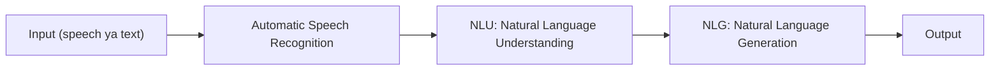
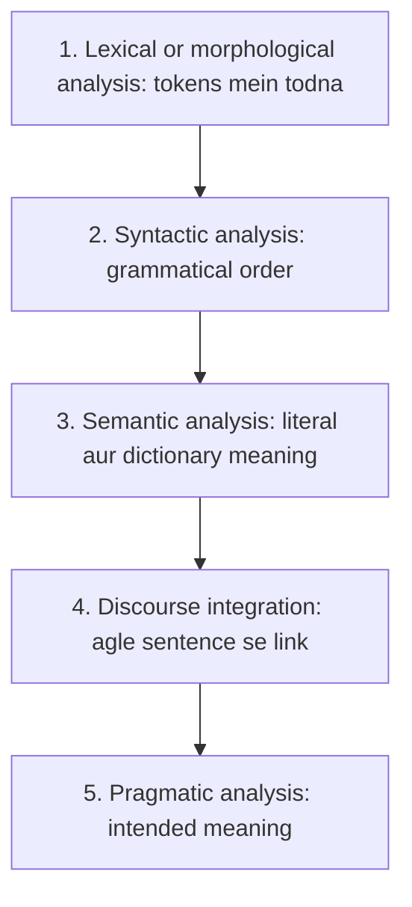
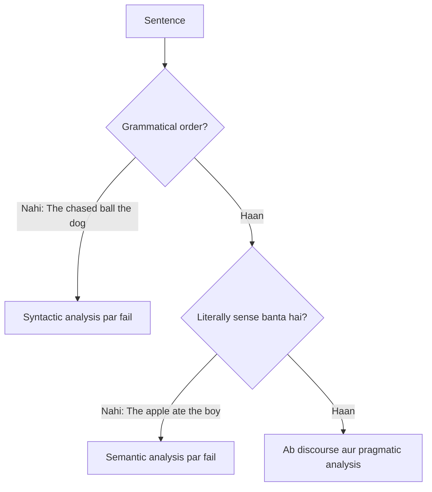

Naye ideas se pehle wo purani baatein jo chahiye. Agar aapko pata hai to seedha agle section par jao.

## Basics pehle

- **Sentence** words ki string hai. **Word** language ki ek meaningful unit hai. Computer inhe samajhta nahi; wo sirf characters store karta hai.
- **Token** sentence ko kaatne ke baad bana ek piece hai (zyadatar ek word). <Cite id="class-nlp-m1" loc="p. 1" />
- **Grammar** words ko sahi order mein rakhne ke rules hain. **Meaning** wo hai jo sentence duniya ke baare mein batata hai.

## NLP kya hai?

<Box kind="definition">

**Natural Language Processing (NLP)** is a branch of AI that focuses on interaction between computers and humans. <Cite id="class-nlp-m1" loc="p. 1" />

</Box>

Simple shabdon mein: hum computer se apni language (English, Hindi) mein baat karte hain aur wo samajhkar usi language mein jawab deta hai. Class ke examples: **Alexa, Siri aur ChatGPT**. <Cite id="class-nlp-m1" loc="p. 1" />

Ye syllabus <Syl m="1" /> hai.

## NLP process (generic NLP system)

Teacher process ko blocks ki ek line ki tarah draw karte hain. <Cite id="class-nlp-m1" loc="p. 1" />

- **Automatic Speech Recognition** bole hue words ko text mein badalta hai.
- **NLU (Natural Language Understanding)** text ka matlab samajhta hai.
- **NLG (Natural Language Generation)** jawab human language mein likhta hai.

Rozmarra ka example: aap Alexa se poochte ho "weather kaisa hai?". Alexa pehle aapki awaz sunti hai (speech recognition), phir samajhti hai ki aapko weather chahiye (NLU), phir ek sentence mein jawab bolti hai (NLG).

## NLP ke stages

Class paanch stages batati hai aur ise important mark karti hai. <Cite id="class-nlp-m1" loc="p. 1" />

### 1) Lexical or morphological analysis

It divides the sentence into chunks or tokens. <Cite id="class-nlp-m1" loc="p. 1" />

Example: "The cat is running" ban jaata hai tokens **The | cat | is | running**. Word ko chhote parts mein todna (running = run + ing) morphological hissa hai (dekho <Syl m="2" />).

### 2) Syntactic analysis

Grammar aur structure check hote hain: kya words grammatically proper order mein hain? <Cite id="class-nlp-m1" loc="p. 2" />

- "The chased ball the dog" galat hai.
- "The dog chased the ball" sahi hai. Order subject, verb, object hai (teacher "sub-verb-sub" likhte hain aur ye sequence check karne ko kehte hain).

### 3) Semantic analysis

Ye literal aur dictionary meaning dekhta hai. <Cite id="class-nlp-m1" loc="p. 2" />

- "The apple ate the boy" galat hai: apple kha nahi sakta.
- "The boy ate the apple" sahi hai.

Dhyan do: "The apple ate the boy" grammatically bilkul sahi hai. Ye syntax stage pass kar leta hai aur sirf meaning stage par fail hota hai. Isiliye ek se zyada stage chahiye.

### 4) Discourse integration

Ye batata hai ki ek sentence agle sentence se kaise related hai. <Cite id="class-nlp-m1" loc="p. 2" /> Discourse analysis related sentences ko jodta hai taaki text mein meaning consistent rahe; ek key kaam **anaphora resolution** hai, yaani pronoun ko sahi noun se link karna. <Cite id="class-nlp-asol" loc="p. 1" />

Example: "John wants to read a book. He picked it up." Yahan "He" matlab John aur "it" matlab book.

### 5) Pragmatic analysis

Ye **intended meaning** nikalta hai. <Cite id="class-nlp-m1" loc="p. 2" /> Pragmatic analysis literal meaning ke aage, context, tone aur speaker kya chahta hai wo dekhta hai. <Cite id="class-nlp-asol" loc="p. 1" />

- "I want to buy apple": fruit ya phone? Situation hi batayegi.
- "It's freezing out here": machine temperature bata sakti hai, ya use poochna chahiye "can I turn on the heater?" (asli intention ek request hai).

## Paancho stages ek table mein

| Stage | Kaun sa sawal | Teacher ka example |
|---|---|---|
| Lexical or morphological | Tokens kaun se hain? | The cat is running ban jaata hai The, cat, is, running |
| Syntactic | Kya order grammatical hai? | The dog chased the ball sahi hai |
| Semantic | Kya literally sense banta hai? | The apple ate the boy galat hai |
| Discourse integration | Ye kis pehle word ko refer karta hai? | John wants to read a book. He picked it up. |
| Pragmatic | Speaker asal mein kya chahta hai? | It's freezing out here |

**Exam answer (stages of NLP).** Paanchon names order mein likho, har ek ki ek line definition aur ek example, aur process line draw karo (input, ASR, NLU, NLG, output).

## Ye kahan puchha gaya

| Agar question kehta hai | Kya likhna hai | Kab aaya |
|---|---|---|
| "What is NLP? Discuss the stages with an example" | Definition, process diagram, examples ke saath paanch stages | <PYQ id="2024-12/q3b" /> <PYQ id="assignment-1/q1a" /> |
| "Explain the different stages of NLP with a suitable example" | Paanch stages, har ek ka ek example | <PYQ id="2022-12-ce/q2b" /> |
| "Explain the various stages of NLP" (5 marks) | Paanch stages short mein | <PYQ id="2023-05-ce/q1e" /> |
| "Stages of NLP and a generic NLP system" | Paanch stages aur input, ASR, NLU, NLG, output process | <PYQ id="2025-05-ce/q2b" /> |

## Quick revision

- NLP is a branch of AI that focuses on interaction between computers and humans.
- Process: input, Automatic Speech Recognition, NLU, NLG, output.
- Paanch stages: lexical or morphological, syntactic, semantic, discourse integration, pragmatic.
- Lexical: tokens mein todna. Syntactic: grammatical order. Semantic: literal aur dictionary meaning. Discourse: agle sentence se relation. Pragmatic: intended meaning.
- Yaad rakhne wale examples: The cat is running, The dog chased the ball, The apple ate the boy, John wants to read a book. He picked it up, I want to buy apple, It's freezing out here.

**Conclusion.** Sentence step by step samjha jaata hai: pehle words, phir grammar, phir meaning, phir sentences ke beech links, aur aakhir mein speaker asal mein kya chahta hai. <Cite id="class-nlp-m1" loc="p. 1" />
