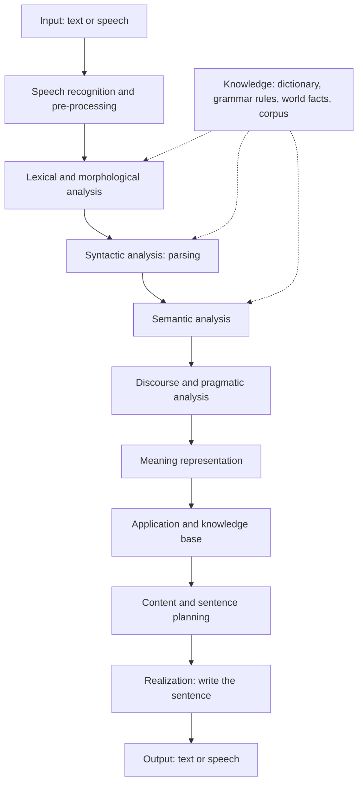
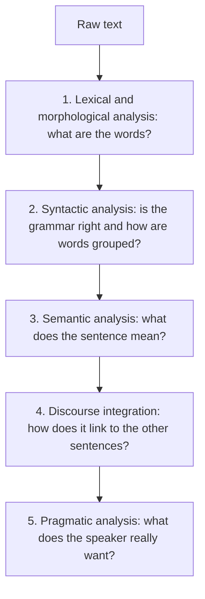
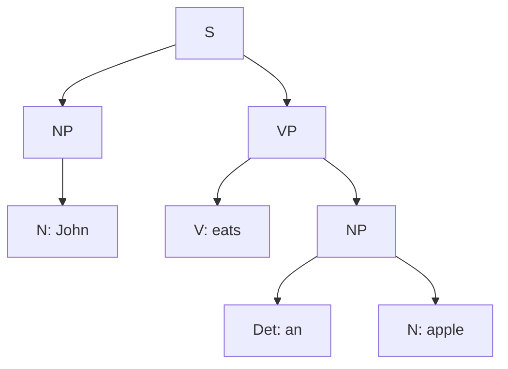

Naye ideas se pehle wo purani baatein jo aapko chahiye. Agar aapko pata hai to seedha agle section pe jao.

## Pehle basics

- **Natural language** wo language hai jo log roz bolte aur likhte hain, jaise English, Hindi ya Marathi. Ye apne aap time ke saath bani hai aur exceptions se bhari hai.
- **Formal (artificial) language** wo language hai jo exact rules ke saath design hui hai, jaise C, Java ya SQL. Compiler ise bina kisi doubt ke padh leta hai.
- **Word** meaning ki ek unit hai jo spaces ke beech likhte hain. **Sentence** words ka group hai jo ek poori baat batata hai. **Text** ya **document** sentences ka collection hai.
- **Grammar** sahi sentences banane ke rules ka set hai. **Meaning** (semantics) ye hai ki sentence duniya ke baare mein kya kehta hai.
- **Corpus** (plural corpora) real text ka bada collection hai jo language systems ko study ya train karne ke liye use hota hai.
- **Linguistics** language ki scientific study hai. **Computational linguistics** computer se ye study karti hai. NLP engineering side hai: aise programs banana jo language ke saath kaam karein.

## NLP kya hai

**Ye kya hai.** Natural Language Processing (NLP) computer science aur artificial intelligence ka field hai jo computer ko human language, likhi hui ya boli hui, samajhne, interpret karne aur banane layak banata hai. <Cite id="nlp-introduction-wiki-nlp" /> <Cite id="nlp-introduction-gfg-nlp" /> <Cite id="nlp-introduction-ibm-nlp" /> Ye syllabus <Syl m="1" /> hai.

Iske do halves hain:

- **Natural Language Understanding (NLU):** text padhna ya speech sunna aur use aisi meaning mein badalna jo computer use kar sake. Example: "Book a train to Pune tomorrow" se action (book), cheez (train ticket), jagah (Pune) aur date (tomorrow) nikaalna.
- **Natural Language Generation (NLG):** data ya meaning se text ya speech banana. Example: number 32 aur word "Pune" ko "It is 32 degrees in Pune today." mein badalna. <Cite id="nlp-introduction-wiki-nlp" />

**Roz ki analogy.** NLU wo clerk hai jo aapka letter padhke samajhta hai ki aap kya chahte ho. NLG wahi clerk hai jab wo reply likhta hai. NLP poora office hai.

<Box kind="definition">

**NLP** AI ka area hai jo aise programs banata hai jo human language samajh sakein (NLU) aur bana sakein (NLG), taaki log aur computers natural language mein communicate kar sakein.

</Box>

## Origin and history of NLP

**History kyun zaroori hai.** Har period ne alag idea try kiya, aur har ek ek khaas tareeke se fail hua jisse agla idea aaya. Order pata ho to "origin and history" ke sawaal ka jawab kuch lines mein likh sakte ho.

```mermaid
%% caption: NLP ki chhoti timeline. Left se right padho: hand-written rules se, data se seekhi statistics tak, phir word meaning seekhne wale neural networks, phir Transformers aur large language models.
flowchart LR
  A["1950 Turing test"] --> B["1954 Georgetown-IBM translation demo"]
  B --> C["1957 Chomsky: Syntactic Structures"]
  C --> D["1966 ELIZA released, ALPAC report cuts funding"]
  D --> E["Late 1980s: statistical methods"]
  E --> F["2013 word2vec word vectors"]
  F --> G["2017 Transformer"]
  G --> H["2018 BERT, then large language models"]
```

<Cite id="nlp-introduction-wiki-hist" />

| Period | What happened | Idea behind it |
|---|---|---|
| 1950 | Alan Turing ne "imitation game" propose kiya, jo ab Turing test kehlata hai: agar judge text conversation mein machine aur insaan mein farak nahi bata sake, to machine pass hai. <Cite id="nlp-introduction-wiki-turing" /> | Intelligence ko language se test kar sakte hain. |
| 1954 | Georgetown-IBM experiment ne sixty se zyada Russian sentences ko automatically English mein translate kiya, sirf lagbhag 250 vocabulary items aur 6 grammar rules se. Banane walon ne kaha ki 3 se 5 saal mein problem solve ho jaayegi; nahi hui. <Cite id="nlp-introduction-wiki-georgetown" /> | Dictionary plus rules se translation. |
| 1957 | Noam Chomsky ki *Syntactic Structures* ne grammar ka rule-based model diya. <Cite id="nlp-introduction-wiki-hist" /> | Grammar ko formal rules se describe kar sakte hain. |
| 1960s | ELIZA, jo MIT mein Joseph Weizenbaum ne likha (1966 mein release), keyword matching aur user ke hi words ko rearrange karke psychotherapist ki nakal karta tha. Isme samajh ka illusion tha, asli samajh nahi. <Cite id="nlp-introduction-wiki-eliza" /> | Surface words pe pattern matching. |
| 1966 | ALPAC report ne kaha ki machine translation research expectations se kam nikli; US funding bahut kam kar di gayi. <Cite id="nlp-introduction-wiki-alpac" /> | Mushkil problems ko language ka gehra knowledge chahiye. |
| 1970s to 1980s | Chhoti, limited worlds mein chalne wale systems (jaise SHRDLU, jo blocks world ke baare mein baat karta tha) aur hand-written grammars. <Cite id="nlp-introduction-wiki-hist" /> | Gehri samajh, lekin sirf chhote domains mein. |
| Late 1980s to 2000s | Machine learning aur statistics ne hand-written rules ki jagah li; part-of-speech tagging ke liye hidden Markov models ek early example hain. <Cite id="nlp-introduction-wiki-nlp" /> | Rules likhne ke bajaye bade corpora se patterns seekho. |
| 2013 | word2vec ne bahut saare text se word vectors (numbers) seekhe, taaki milte-julte words ke vectors bhi milte-julte hon. <Cite id="nlp-introduction-w2v" /> | Meaning ek vector space mein position hai. |
| 2017 | Transformer architecture ("Attention Is All You Need") poore sentence ko attention se process karta hai, ek-ek word padhne ke bajaye. <Cite id="nlp-introduction-transformer" /> | Sab words ek saath dekho aur seekho kaun se important hain. |
| 2018 onwards | BERT ne dikhaya ki ek bada pre-trained model kai tasks ke liye fine-tune ho sakta hai. <Cite id="nlp-introduction-bert" /> Phir large language models aaye, aur ChatGPT 2022 mein release hua. <Cite id="nlp-introduction-wiki-llm" /> <Cite id="nlp-introduction-wiki-hist" /> | Ek bada model, bahut text pe trained, har kaam ke liye. |

<Box kind="key">

Teen bade approaches hain: **symbolic** (hand-written rules aur dictionaries), **statistical** (corpora se seekho) aur **neural** (neural networks se data se seekho, lagbhag 2015 se zyada tar statistical ko replace kar rahe hain). <Cite id="nlp-introduction-wiki-nlp" />

</Box>

## The need for NLP

**Ye kyun zaroori hai.** Computers tables aur numbers mein achhe hain, lekin insaan jo kuch jaanta aur bolta hai uska zyada tar hissa **unstructured text aur speech** mein hai: emails, books, news, reviews, social media aur phone calls. NLP us gap ka bridge hai. <Cite id="nlp-introduction-ibm-nlp" /> <Cite id="nlp-introduction-gfg-nlp" />

1. **Bahut zyada text.** Koi insaan lakhon reviews ya documents nahi padh sakta. NLP unhe search, sort aur summarize kar sakta hai.
2. **Natural interface.** Log machine se apni language mein sawaal poochna chahte hain, type karke ya bolke, command language seekhne ke bajaye.
3. **Kai languages.** Akele India mein kai languages hain. Translation aur cross-language search ke liye machines ko inhe handle karna padta hai.
4. **Routine kaam ka automation.** Spam filtering, support chatbots, form filling aur resume screening time bachate hain. <Cite id="nlp-introduction-av-apps" />
5. **Chhupi hui information nikaalna.** Plain text se opinions (sentiment), logon aur jagahon ke naam, aur trends nikaale ja sakte hain.
6. **Logon ki madad.** Voice assistants, speech to text aur grammar checkers un logon ki madad karte hain jo dekh nahi sakte, type nahi kar sakte, ya language seekh rahe hain.

(Applications ki poori list aur language kyun mushkil hai, ye agle topic <Syl m="1" /> "Ambiguity, challenges and applications" mein hai.)

## Generic NLP system

**Ye kya hai.** Generic NLP system wo common block diagram hai jo zyada tar language applications follow karti hain: input lo, use samjho, application ko meaning pe kaam karne do, phir language mein reply banao. Sabse jaani-maani textbook picture NLTK book mein spoken dialogue system ki pipeline hai: speech input recognize hota hai, parse hota hai aur interpret hota hai, application action leti hai, aur response plan hota hai, realize hota hai aur bola jaata hai, har stage ko linguistic knowledge sources support karte hain. <Cite id="nlp-introduction-nltk1" loc="§5.5" />

**Ye kaise kaam karta hai, step by step.**

1. **Input.** Typed text, ya speech jo pehle speech recognition se text banti hai.
2. **Pre-processing.** Text saaf karo: sentences aur words mein todo (tokenization), lower-case karo, extra symbols hatao, words ko base form mein lao. <Cite id="nlp-introduction-ibm-nlp" />
3. **Analysis (NLU wala half).** Word forms, grammar structure, meaning, aur sentence conversation mein kaise fit hota hai, ye pata karo. Ye agle section ke levels hain.
4. **Meaning representation.** Result aise form mein store hota hai jo program use kar sake, jaise label, slots ka set (action, place, date) ya logic formula.
5. **Application / task.** Program asli kaam karta hai: train dhundhna, translate, answer, classify, summarize. Ye **knowledge base** ya database use karta hai.
6. **Generation (NLG wala half).** Decide karo kya kehna hai, words aur sentence structure chuno, aur sentence sahi likho.
7. **Output.** Screen pe text, ya speech synthesizer se bani speech.

<Cite id="nlp-introduction-nltk1" loc="diagram" /> <Cite id="nlp-introduction-gfg-nlp" />

**Example.** User bolta hai: "Which train goes to Pune tomorrow?" Speech text mein recognize hoti hai, stages intent "find train", place "Pune", date "tomorrow" nikaalte hain, application timetable query karti hai, aur generator reply deta hai "The 7:15 Deccan Express leaves tomorrow."

**Advantages.** Stages mein split karne se har part simple, testable aur replaceable rehta hai (parser badal sakte ho bina generator ko chhue). **Limitation.** Errors pipeline mein aage badhte hain: shuru mein ek galat word har agle stage ko galat kar deta hai. Modern neural systems aksar kai stages ek hi model mein mila dete hain, lekin language samajhne aur samjhane ke liye stages ab bhi sabse achha tareeka hain. <Cite id="nlp-introduction-wiki-nlp" />

## Levels (stages) of NLP

**Ye kya hai.** Ek sentence samajhne ke liye NLP system levels se guzarta hai, har level alag sawaal ka jawab deta hai. Zyada tar study sites paanch phases batati hain: lexical aur morphological analysis, syntactic analysis, semantic analysis, discourse integration aur pragmatic analysis. <Cite id="nlp-introduction-gfg-phases" /> <Cite id="nlp-introduction-tp-nlp" /> (Kuch textbooks speech ke liye phonology bhi jodti hain; written text ke liye ise chhod dete hain.)

**Roz ki analogy.** Letter padhna: pehle words pehchante ho, phir check karte ho ki sentence grammar se theek hai, phir samajhte ho wo kya keh raha hai, phir pichhle sentences se jodte ho, aur aakhir mein sochte ho ki likhne wala asal mein aapse kya chahta hai.

<Cite id="nlp-introduction-gfg-phases" loc="diagram" />

### 1. Lexical and morphological analysis

**Lexical analysis** text ko **tokens** (words, numbers, punctuation) mein todti hai aur har token ko dictionary (lexicon) mein dekhkar uska part of speech nikaalti hai. **Morphological analysis** **word ka structure** study karti hai: word ke sabse chhote meaningful parts **morphemes** kehlate hain. "Independently" mein chaar morphemes hain: in-, depend, -ent, -ly. <Cite id="nlp-introduction-wiki-morph" /> Base form nikaalna **stemming** ya **lemmatization** kehlata hai, jaise "ate" se "eat". Ye stage "U.K." jaise tokens bhi handle karta hai, jise spaCy ek hi token rakhta hai. <Cite id="nlp-introduction-spacy" />

Example: "The boy ate an apple." ke tokens: The / boy / ate / an / apple / "."

### 2. Syntactic analysis (parsing)

**Syntax** ye hai ki words kaise milkar phrases aur sentences banate hain. <Cite id="nlp-introduction-wiki-syntax" /> Syntactic analysis words ko grammar rules se check karti hai aur ek **parse tree** banati hai jo structure dikhata hai. "Apple eats a John" jaisa sentence is stage mein tabhi allowed hai jab word order grammar mein fit ho; "John eats an apple" sahi hai aur neeche wala tree banata hai.

Syntax batata hai ki sentence **well formed** hai ya nahi, ye nahi ki uska matlab banta hai ya nahi.

### 3. Semantic analysis

**Semantics** meaning ki study hai. Ye stage words ka meaning (sahi sense chunna, jise word sense disambiguation kehte hain) aur poore sentence ka meaning nikaalta hai: **who did what to whom**. <Cite id="nlp-introduction-wiki-nlp" /> <Cite id="nlp-introduction-nltk1" loc="§5.1" /> Ye aise sentences reject karta hai jo grammatical hain lekin meaningless: "Apple eats a John" ya Chomsky ka "Colorless green ideas sleep furiously". <Cite id="nlp-introduction-gfg-phases" />

Example: "The boy ate an apple" banta hai ate(agent = boy, thing eaten = apple).

### 4. Discourse integration (discourse analysis)

**Discourse** matlab jude hue sentences ka group, jaise paragraph ya conversation. **Discourse analysis** pata karti hai ki ek sentence apne pehle aur baad ke sentences pe kaise depend karta hai. Iske main kaam hain pronouns aur doosre references resolve karna (**anaphora resolution**) aur ye dekhna ki sentences milkar coherent text kaise banate hain. <Cite id="nlp-introduction-gfg-phases" /> <Cite id="nlp-introduction-nltk1" loc="§5.2" />

Example: "Taylor went to the store. She bought groceries." "She" ko Taylor se jodna hoga. <Cite id="nlp-introduction-gfg-phases" /> "The thieves stole the paintings. They were sold" mein "They" paintings ke liye hai, thieves ke liye nahi. <Cite id="nlp-introduction-nltk1" loc="§5.2" />

### 5. Pragmatic analysis

**Pragmatics** ye study hai ki context meaning mein kya jodta hai. <Cite id="nlp-introduction-wiki-prag" /> **Pragmatic analysis** sentence ka **intended meaning**, tone aur figurative use nikaalti hai, jo literal meaning se alag ho sakta hai, situation aur duniya ke knowledge ka use karke. <Cite id="nlp-introduction-gfg-phases" />

Example: "Can you pass the salt?" literally ability ke baare mein sawaal hai, lekin asal mein ye polite **request** hai. <Cite id="nlp-introduction-gfg-phases" /> <Cite id="nlp-introduction-wiki-prag" /> Aur cases: "It's cold in here" ka matlab "please close the window" ho sakta hai, aur "Great, another Monday!" sarcasm ho sakta hai.

<Box kind="exam">

**5 marks ke liye definition (Discourse and Pragmatic analysis):** "Discourse analysis studies how sentences are connected in a text or conversation, for example by linking a pronoun like 'she' to the person named earlier. Pragmatic analysis finds the intended meaning of an utterance from context and world knowledge, for example reading 'Can you pass the salt?' as a request and not as a question about ability." <PYQ id="2024-12/q1c" />

</Box>

### Summary table of the stages

| Stage | Question it answers | Input to the stage | Knowledge used | Example (and what it produces) |
|---|---|---|---|---|
| Lexical and morphological | Words aur unke parts kya hain? | Raw text | Dictionary, word-formation rules | "ate" gives eat + past tense |
| Syntactic | Word order sahi hai, aur words kaise group hote hain? | Tagged words | Grammar rules | Parse tree of "John eats an apple" |
| Semantic | Iska matlab kya hai? | Parse tree | Word meanings, sentence meaning rules | ate(boy, apple); rejects "Apple eats a John" |
| Discourse integration | Ye doosre sentences se kaise judta hai? | Meaning of each sentence | Context of earlier sentences | "She" = Taylor |
| Pragmatic | Speaker asal mein kya chahta hai? | Full meaning in context | World knowledge, situation, intention | "Can you pass the salt?" = a request |

### Har stage mein kya galat ja sakta hai

Natural language **ambiguous** hoti hai: ek form ke ek se zyada matlab ho sakte hain, aur meaning aksar context pe depend karta hai. Isliye har stage ki apni difficulty hai. (Details topic <Syl m="1" /> "Ambiguity, challenges and applications" mein hain.) <PYQ id="2023-12-ce/q2b" />

| Stage | Typical challenge | Example |
|---|---|---|
| Lexical and morphological | Words ke kai forms, naye words, irregular forms, spelling mistakes, slang | "ate" and "went" do not follow the "-ed" rule; "u r gr8" |
| Syntactic | Ek sentence ke ek se zyada parse trees (structural ambiguity) | "I saw the man with a telescope": telescope kiske paas hai? |
| Semantic | Ek word ke kai meanings (lexical ambiguity) | "bank": river bank or money bank |
| Discourse | Pronoun ek se zyada cheezon ke liye ho sakta hai | "The thieves stole the paintings. They were sold." <Cite id="nlp-introduction-nltk1" loc="§5.2" /> |
| Pragmatic | Meaning situation, tone aur world knowledge pe depend karta hai, jo program ke paas kam hota hai | "Can you pass the salt?"; sarcasm |

## Worked example: ek sentence saare stages se

"Stages ko suitable example ke saath explain karo" ka best jawab ek example ko shuru se end tak follow karna hai. Neeche wala sum yahi karta hai aur jo ginna ho wo gin leta hai.

<Sum>

<Given>

Text: "The boy ate an apple. He liked it."

</Given>

<Find>

is text ke liye har stage kya produce karta hai, aur tokens ki ginti.

</Find>

<Steps>

1. **Lexical.** Sentence 1 ko tokens mein todo: The, boy, ate, an, apple, "." Ye 6 tokens hain. Sentence 2: He, liked, it, "." Ye 4 tokens hain. Total $6 + 4 = 10$. *Reason: har word aur full stop ek token hai.* Parts of speech: The (determiner), boy (noun), ate (verb), an (determiner), apple (noun).
2. **Morphological.** "ate" ka base form eat hai with past tense; "liked" ka base like hai with ending -ed (past tense). *Reason: base form milne se dictionary word ke saare forms match kar leti hai.*
3. **Syntactic.** Sentence 1 ka structure S = NP (The boy) + VP (ate + NP (an apple)). *Reason: grammar rules S to NP VP, NP to Det N, VP to V NP sab fit hote hain.*
4. **Semantic.** ate(agent = boy, thing eaten = apple), past time. *Reason: verb "ate" ko chahiye koi khane wala aur koi khayi gayi cheez.*
5. **Discourse.** Sentence 2 mein "He" "the boy" se jodta hai aur "it" "the apple" se. *Reason: "He" male person hai aur "it" ek thing; pehle ke sirf boy aur apple hi match hote hain.*
6. **Pragmatic.** Text ek seedha statement hai; boy ko apple pasand aaya. Koi chhupi request nahi hai, isliye yahan literal meaning hi intended meaning hai.

</Steps>

<Answer>

Tokens: 10. Meaning: boy ne apple khaya, aur boy ko apple pasand aaya (He = boy, it = apple).

</Answer>

<Box kind="verify">

Answer wapas padho: sentence 1 ke tokens jodne se "The boy ate an apple ." (6 tokens) milta hai, aur sentence 2 se "He liked it ." (4 tokens), to $6 + 4 = 10$. He aur it ki jagah linked nouns rakhne se "The boy liked the apple" milta hai, jo text se match karta hai.

</Box>

</Sum>

## Knowledge in language processing

**Ye kya hai.** Upar ke levels se guzarne ke liye system ko language ke baare mein alag-alag type ka knowledge chahiye. Syllabus ise "Knowledge in language processing" kehta hai. Neeche ke kinds usual textbook list hain, upar ke levels se match kiye hue. <Cite id="nlp-introduction-wiki-nlp" />

| Kind of knowledge | What it knows | Used in | Example |
|---|---|---|---|
| Phonetic and phonological | Speech sounds aur wo words kaise banati hain | Speech recognition and synthesis | "ph" sounds like "f" in "phone" |
| Morphological | Words chhote parts se kaise bante hain | Lexical and morphological analysis | un + happy + ness |
| Lexical | Language ke words, unke meanings aur parts of speech | Lexical and semantic analysis | "bank" is a noun with two senses |
| Syntactic | Words ka order aur grouping | Parsing | An English sentence usually goes subject, verb, object |
| Semantic | Words aur sentences ka meaning | Semantic analysis | A boy can eat an apple, an apple cannot eat a boy |
| Pragmatic | Situations mein language kaam karwane ke liye kaise use hoti hai | Pragmatic analysis | A question can be a request |
| Discourse | Text mein sentences kaise jude hote hain | Discourse integration | A pronoun refers back to an earlier noun |
| World knowledge | Duniya ke facts aur log kaise behave karte hain | Semantic, discourse and pragmatic analysis | A cold room may mean "close the window" |

**Conclusion.** NLP rules aur translation ke sapnon se shuru hua, statistics se guzra, aur ab neural models use karta hai, lekin problem wahi hai: language ko words, grammar, meaning, sentences ke beech links aur intention ke stages se le jaana, har stage pe alag knowledge ke saath.

Aur padhne ke liye: Jurafsky and Martin ka Introduction chapter aur baad ke chapters har stage ko gehrai se cover karte hain. <Cite id="nlp-introduction-slp3" />

## Exam mein kaise likhein

<Box kind="exam">

**"Explain the stages (phases) of NLP with an example" (10 marks).** Is order mein likho:

1. NLP ki one-line definition (understand and produce human language).
2. Paanch stages order mein naam likho: lexical and morphological, syntactic, semantic, discourse integration, pragmatic.
3. Upar wala stage diagram banao, har stage ka sawaal likhkar.
4. Har stage ke liye 2 lines aur ek hi sentence pe example likho.
5. Chhoti table jodo (stage, purpose, example).
6. Challenges pe ek line (har stage pe ambiguity), phir conclusion.

"Generic NLP system" wale part ke liye block diagram banao (input, pre-processing, NLU stages, application with knowledge base, NLG, output) aur har block ko ek line mein explain karo.

</Box>

Is topic ke past paper ke sawaal:

- <PYQ id="2022-12-ce/q2b" />: stages of NLP with an example (10 marks)
- <PYQ id="2023-05-ce/q1e" />: various stages of NLP (5 marks)
- <PYQ id="2023-12-ce/q2b" />: challenges in the stages of NLP (10 marks)
- <PYQ id="2024-12/q1c" />: discourse and pragmatic analysis (5 marks)
- <PYQ id="2024-12/q3b" />: what is NLP and its stages with an example (10 marks)
- <PYQ id="2025-05-ce/q2b" />: stages of NLP and the generic NLP system (10 marks)
