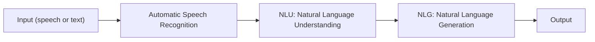
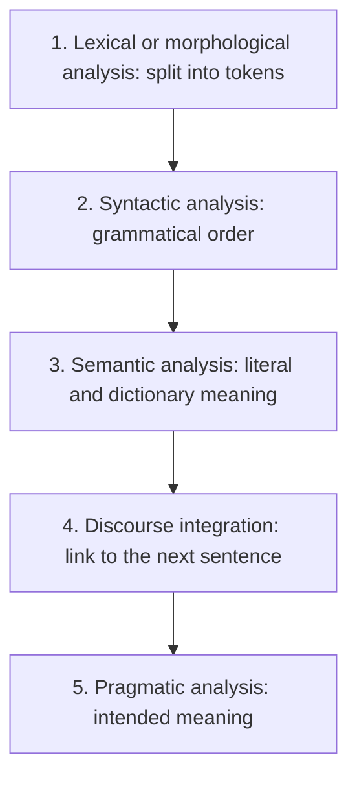
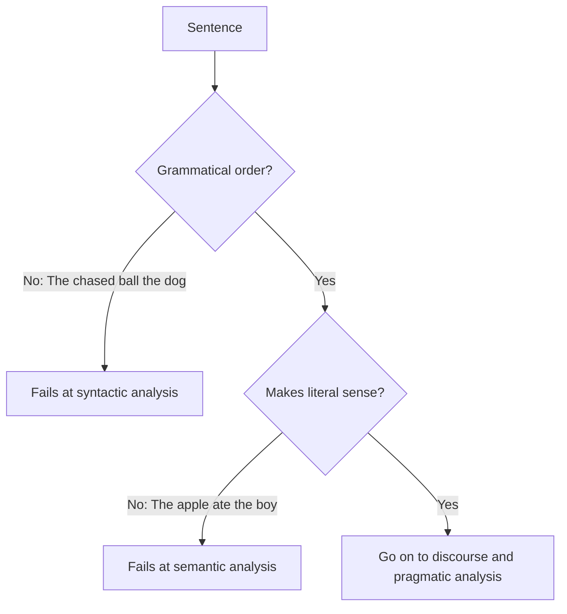

Before the new ideas, here are the old ones you need. If you already know them, skip to the next section.

## The basics first

- A **sentence** is a string of words. A **word** is one meaningful unit of language. Computers do not understand them; they only store characters.
- A **token** is one piece of a sentence after it has been cut up (usually one word). <Cite id="class-nlp-m1" loc="p. 1" />
- **Grammar** is the set of rules for putting words in the right order. **Meaning** is what the sentence says about the world.

## What is NLP?

<Box kind="definition">

**Natural Language Processing (NLP)** is a branch of AI that focuses on interaction between computers and humans. <Cite id="class-nlp-m1" loc="p. 1" />

</Box>

In plain words: we talk to a computer in our own language (English, Hindi) and it understands and answers in that language. Examples from the class: **Alexa, Siri and ChatGPT**. <Cite id="class-nlp-m1" loc="p. 1" />

This is syllabus <Syl m="1" />.

## The NLP process (generic NLP system)

The teacher draws the process as one line of blocks. <Cite id="class-nlp-m1" loc="p. 1" />

- **Automatic Speech Recognition** turns spoken words into text.
- **NLU (Natural Language Understanding)** works out what the text means.
- **NLG (Natural Language Generation)** writes the answer in human language.

Everyday analogy: you ask Alexa "what is the weather?". Alexa first hears your voice (speech recognition), then works out that you want the weather (NLU), then says the answer in a sentence (NLG).

## Stages of NLP

The class lists five stages and marks this as important. <Cite id="class-nlp-m1" loc="p. 1" />

### 1) Lexical or morphological analysis

It divides the sentence into chunks or tokens. <Cite id="class-nlp-m1" loc="p. 1" />

Example: "The cat is running" becomes the tokens **The | cat | is | running**. Splitting a word into its smaller parts (running = run + ing) is the morphological part (see <Syl m="2" />).

### 2) Syntactic analysis

Grammar and structure are checked: are the words in a grammatically proper order? <Cite id="class-nlp-m1" loc="p. 2" />

- "The chased ball the dog" is wrong.
- "The dog chased the ball" is right. The order is subject, verb, object (the teacher writes "sub-verb-sub" and asks you to check this sequence).

### 3) Semantic analysis

It looks at the literal and dictionary meaning. <Cite id="class-nlp-m1" loc="p. 2" />

- "The apple ate the boy" is wrong: an apple cannot eat.
- "The boy ate the apple" is right.

Notice that "The apple ate the boy" is grammatically perfect. It passes the syntax stage and fails only at the meaning stage. That is why we need more than one stage.

### 4) Discourse integration

It is about how a sentence relates to the immediately next sentence. <Cite id="class-nlp-m1" loc="p. 2" /> Discourse analysis connects related sentences so that the meaning stays consistent across the text; a key job is **anaphora resolution**, linking a pronoun to the right noun. <Cite id="class-nlp-asol" loc="p. 1" />

Example: "John wants to read a book. He picked it up." Here "He" is John and "it" is the book.

### 5) Pragmatic analysis

It finds the **intended meaning**. <Cite id="class-nlp-m1" loc="p. 2" /> Pragmatic analysis looks beyond the literal meaning, at context, tone and what the speaker wants. <Cite id="class-nlp-asol" loc="p. 1" />

- "I want to buy apple": fruit or phone? Only the situation tells.
- "It's freezing out here": the machine may answer with the temperature, or it should ask "can I turn on the heater?" (the real intention is a request).

## All five stages on one sentence

| Stage | Question it answers | Teacher's example |
|---|---|---|
| Lexical or morphological | What are the tokens? | The cat is running becomes The, cat, is, running |
| Syntactic | Is the order grammatical? | The dog chased the ball is right |
| Semantic | Does it make sense literally? | The apple ate the boy is wrong |
| Discourse integration | Which earlier word does this refer to? | John wants to read a book. He picked it up. |
| Pragmatic | What does the speaker really want? | It's freezing out here |

**Exam answer (stages of NLP).** Write the five names in order, one line of definition and one example for each, and draw the process line (input, ASR, NLU, NLG, output).

## Where this was asked

| If the question says | What to write | Seen as |
|---|---|---|
| "What is NLP? Discuss the stages with an example" | Definition, process diagram, five stages with examples | <PYQ id="2024-12/q3b" /> <PYQ id="assignment-1/q1a" /> |
| "Explain the different stages of NLP with a suitable example" | Five stages, one example each | <PYQ id="2022-12-ce/q2b" /> |
| "Explain the various stages of NLP" (5 marks) | Five stages in short | <PYQ id="2023-05-ce/q1e" /> |
| "Stages of NLP and a generic NLP system" | The five stages plus the input, ASR, NLU, NLG, output process | <PYQ id="2025-05-ce/q2b" /> |

## Quick revision

- NLP is a branch of AI that focuses on interaction between computers and humans.
- Process: input, Automatic Speech Recognition, NLU, NLG, output.
- Five stages: lexical or morphological, syntactic, semantic, discourse integration, pragmatic.
- Lexical: divide into tokens. Syntactic: grammatical order. Semantic: literal and dictionary meaning. Discourse: relation to the next sentence. Pragmatic: intended meaning.
- Examples to remember: The cat is running, The dog chased the ball, The apple ate the boy, John wants to read a book. He picked it up, I want to buy apple, It's freezing out here.

**Conclusion.** A sentence is understood step by step: first the words, then the grammar, then the meaning, then the links between sentences, and last what the speaker really wants. <Cite id="class-nlp-m1" loc="p. 1" />
