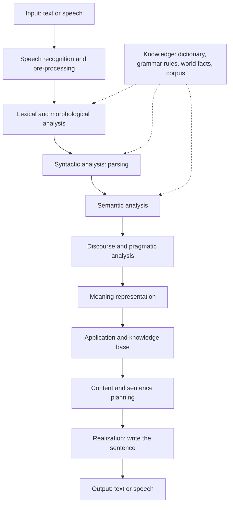
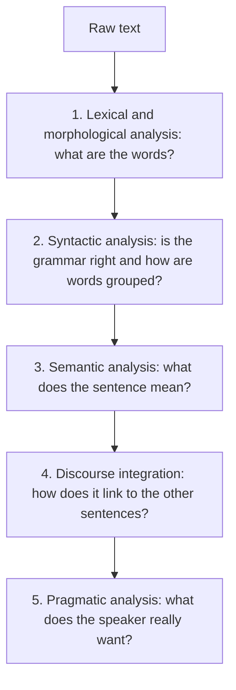
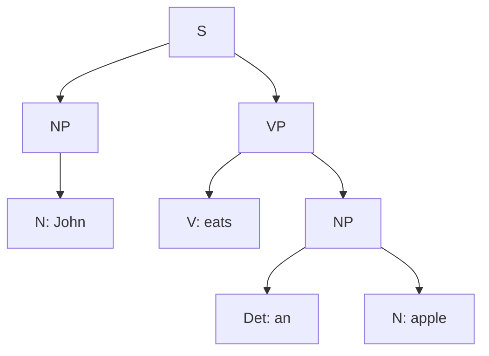

Before the new ideas, here are the old ones you need. If you already know them, skip to the next section.

## The basics first

- A **natural language** is a language people speak and write every day, such as English, Hindi or Marathi. It grew by itself over time and is full of exceptions.
- A **formal (artificial) language** is a language designed with exact rules, such as C, Java or SQL. A compiler can read it without any doubt about the meaning.
- A **word** is a unit of meaning that we write between spaces. A **sentence** is a group of words that gives a complete thought. **Text** or a **document** is a collection of sentences.
- **Grammar** is the set of rules for building correct sentences. **Meaning** (semantics) is what the sentence says about the world.
- A **corpus** (plural corpora) is a large collection of real text used to study or train language systems.
- **Linguistics** is the scientific study of language. **Computational linguistics** uses computers to study it. NLP is the engineering side: building programs that work with language.

## What is NLP

**What it is.** Natural Language Processing (NLP) is the field of computer science and artificial intelligence that lets computers understand, interpret and produce human language, written or spoken. <Cite id="nlp-introduction-wiki-nlp" /> <Cite id="nlp-introduction-gfg-nlp" /> <Cite id="nlp-introduction-ibm-nlp" /> This is syllabus <Syl m="1" />.

It has two halves:

- **Natural Language Understanding (NLU):** reading text or listening to speech and turning it into a meaning the computer can use. Example: from "Book a train to Pune tomorrow" find the action (book), the thing (train ticket), the place (Pune) and the date (tomorrow).
- **Natural Language Generation (NLG):** producing text or speech from data or from a meaning. Example: turning the number 32 and the word "Pune" into "It is 32 degrees in Pune today." <Cite id="nlp-introduction-wiki-nlp" />

**Everyday analogy.** NLU is a clerk who reads your letter and understands what you want. NLG is the same clerk writing the reply. NLP is the whole office.

<Box kind="definition">

**NLP** is the area of AI that builds programs able to understand human language (NLU) and to produce it (NLG), so that people and computers can communicate in a natural language.

</Box>

## Origin and history of NLP

**Why history matters.** Each period of NLP tried a different idea, and each failed in a way that led to the next idea. Knowing the order helps you answer "origin and history" questions in a few lines.

```mermaid
%% caption: A short timeline of NLP. Read left to right: from hand-written rules, to statistics learned from data, to neural networks that learn word meanings, to Transformers and large language models.
flowchart LR
  A["1950 Turing test"] --> B["1954 Georgetown-IBM translation demo"]
  B --> C["1957 Chomsky: Syntactic Structures"]
  C --> D["1966 ELIZA released, ALPAC report cuts funding"]
  D --> E["Late 1980s: statistical methods"]
  E --> F["2013 word2vec word vectors"]
  F --> G["2017 Transformer"]
  G --> H["2018 BERT, then large language models"]
```

<Cite id="nlp-introduction-wiki-hist" />

| Period | What happened | Idea behind it |
|---|---|---|
| 1950 | Alan Turing proposed the "imitation game", now called the Turing test: if a judge cannot tell a machine from a person in a text conversation, the machine passes. <Cite id="nlp-introduction-wiki-turing" /> | Intelligence can be tested through language. |
| 1954 | The Georgetown-IBM experiment automatically translated over sixty Russian sentences into English with about 250 vocabulary items and 6 grammar rules. The makers predicted the problem would be solved in three to five years; it was not. <Cite id="nlp-introduction-wiki-georgetown" /> | Translation by dictionary plus rules. |
| 1957 | Noam Chomsky's *Syntactic Structures* gave a rule-based model of grammar. <Cite id="nlp-introduction-wiki-hist" /> | Grammar can be described by formal rules. |
| 1960s | ELIZA, written by Joseph Weizenbaum at MIT (released 1966), imitated a psychotherapist by keyword matching and rearranging the user's own words. It gave an illusion of understanding without any real understanding. <Cite id="nlp-introduction-wiki-eliza" /> | Pattern matching on surface words. |
| 1966 | The ALPAC report said machine translation research had fallen short of expectations; US funding was cut sharply. <Cite id="nlp-introduction-wiki-alpac" /> | Hard problems need deeper language knowledge. |
| 1970s to 1980s | Systems that worked in small, limited worlds (for example SHRDLU, which talked about a blocks world) and hand-written grammars. <Cite id="nlp-introduction-wiki-hist" /> | Deep understanding, but only for tiny domains. |
| Late 1980s to 2000s | Machine learning and statistics replaced hand-written rules; hidden Markov models for part-of-speech tagging are an early example. <Cite id="nlp-introduction-wiki-nlp" /> | Learn patterns from large corpora instead of writing rules. |
| 2013 | word2vec learned word vectors (numbers) from huge text, so that similar words get similar vectors. <Cite id="nlp-introduction-w2v" /> | Meaning as position in a vector space. |
| 2017 | The Transformer architecture ("Attention Is All You Need") processes a whole sentence using attention instead of reading one word at a time. <Cite id="nlp-introduction-transformer" /> | Look at all words at once and learn which ones matter. |
| 2018 onwards | BERT showed that one large pre-trained model can be fine-tuned for many tasks. <Cite id="nlp-introduction-bert" /> Large language models followed, and ChatGPT was released in 2022. <Cite id="nlp-introduction-wiki-llm" /> <Cite id="nlp-introduction-wiki-hist" /> | One big model, trained on a lot of text, used for everything. |

<Box kind="key">

The three big approaches are **symbolic** (hand-written rules and dictionaries), **statistical** (learn from corpora) and **neural** (learn from data with neural networks, since about 2015 mostly replacing the statistical ones). <Cite id="nlp-introduction-wiki-nlp" />

</Box>

## The need for NLP

**Why it is needed.** Computers are good with tables and numbers, but most of what humans know and say is in **unstructured text and speech**: emails, books, news, reviews, social media, and phone calls. NLP is the bridge. <Cite id="nlp-introduction-ibm-nlp" /> <Cite id="nlp-introduction-gfg-nlp" />

1. **Huge amount of text.** No person can read millions of reviews or documents. NLP can search, sort and summarize them.
2. **Natural interface.** People want to ask a machine a question in their own language, by typing or speaking, instead of learning a command language.
3. **Many languages.** India alone has many languages. Translation and cross-language search need machines to handle them.
4. **Automation of routine work.** Spam filtering, support chatbots, form filling and resume screening save time. <Cite id="nlp-introduction-av-apps" />
5. **Finding hidden information.** Opinions (sentiment), names of people and places, and trends can be pulled out of plain text.
6. **Helping people.** Voice assistants, speech to text and grammar checkers help people who are blind, have difficulty typing, or are learning a language.

(The full list of applications and the reasons language is hard are in the next topic, <Syl m="1" /> "Ambiguity, challenges and applications".)

## Generic NLP system

**What it is.** A generic NLP system is the common block diagram that most language applications follow: take the input, understand it, let an application work on the meaning, then build a reply in language. The best-known textbook picture is the pipeline of a spoken dialogue system in the NLTK book: speech input is recognized, parsed and interpreted, an application acts, and a response is planned, realized and spoken, with linguistic knowledge sources supporting each stage. <Cite id="nlp-introduction-nltk1" loc="§5.5" />

**How it works, step by step.**

1. **Input.** Typed text, or speech which is first turned into text by speech recognition.
2. **Pre-processing.** Clean the text: split into sentences and words (tokenization), lower-case, remove extra symbols, reduce words to base forms. <Cite id="nlp-introduction-ibm-nlp" />
3. **Analysis (the NLU half).** Find the word forms, the grammar structure, the meaning, and how the sentence fits the conversation. These are the levels in the next section.
4. **Meaning representation.** The result is stored in a form the program can use, such as a label, a set of slots (action, place, date) or a logic formula.
5. **Application / task.** The program does the real job: look up a train, translate, answer, classify, summarize. It uses a **knowledge base** or database.
6. **Generation (the NLG half).** Decide what to say, choose words and sentence structure, and write the sentence correctly.
7. **Output.** Text on the screen, or speech produced by a speech synthesizer.

<Cite id="nlp-introduction-nltk1" loc="diagram" /> <Cite id="nlp-introduction-gfg-nlp" />

**Example.** User says: "Which train goes to Pune tomorrow?" Speech is recognized as text, the stages find the intent "find train", place "Pune", date "tomorrow", the application queries the timetable, and the generator replies "The 7:15 Deccan Express leaves tomorrow."

**Advantages.** The split into stages keeps each part simple, testable and replaceable (you can swap the parser without changing the generator). **Limitation.** Errors pass down the pipeline: a wrong word at the start makes every later stage wrong. Modern neural systems often merge several stages into one model, but the stages are still the best way to understand and explain language. <Cite id="nlp-introduction-wiki-nlp" />

## Levels (stages) of NLP

**What it is.** To understand a sentence, an NLP system goes through levels, each answering a different question. Most study sites give five phases: lexical and morphological analysis, syntactic analysis, semantic analysis, discourse integration and pragmatic analysis. <Cite id="nlp-introduction-gfg-phases" /> <Cite id="nlp-introduction-tp-nlp" /> (Some textbooks add phonology for speech; it is skipped for written text.)

**Everyday analogy.** Reading a letter: first you recognise the words, then check the sentence makes grammatical sense, then understand what it says, then connect it with the earlier sentences, and last think about what the writer really wants from you.

<Cite id="nlp-introduction-gfg-phases" loc="diagram" />

### 1. Lexical and morphological analysis

**Lexical analysis** splits the text into **tokens** (words, numbers, punctuation) and looks each up in a dictionary (lexicon) to get its part of speech. **Morphological analysis** studies the **structure of a word**: the smallest meaningful parts of a word are called **morphemes**. "Independently" has four morphemes: in-, depend, -ent, -ly. <Cite id="nlp-introduction-wiki-morph" /> Finding the base form is called **stemming** or **lemmatization**, for example "ate" gives "eat". This stage also handles tokens such as "U.K." which spaCy keeps as one token. <Cite id="nlp-introduction-spacy" />

Example: "The boy ate an apple." gives tokens The / boy / ate / an / apple / "."

### 2. Syntactic analysis (parsing)

**Syntax** is how words combine into phrases and sentences. <Cite id="nlp-introduction-wiki-syntax" /> Syntactic analysis checks the words against grammar rules and builds a **parse tree**, which shows the structure. A sentence like "Apple eats a John" is allowed in this stage only if the word order fits the grammar; "John eats an apple" is correct and gets the tree below.

Syntax says whether the sentence is **well formed**, not whether it makes sense.

### 3. Semantic analysis

**Semantics** is the study of meaning. This stage finds the meaning of words (picking the right sense, called word sense disambiguation) and the meaning of the whole sentence: **who did what to whom**. <Cite id="nlp-introduction-wiki-nlp" /> <Cite id="nlp-introduction-nltk1" loc="§5.1" /> It rejects sentences that are grammatical but meaningless: "Apple eats a John" or Chomsky's "Colorless green ideas sleep furiously". <Cite id="nlp-introduction-gfg-phases" />

Example: "The boy ate an apple" becomes ate(agent = boy, thing eaten = apple).

### 4. Discourse integration (discourse analysis)

**Discourse** means a group of connected sentences, like a paragraph or a conversation. **Discourse analysis** finds how a sentence depends on the sentences before and after it. Its main jobs are resolving pronouns and other references (**anaphora resolution**) and finding how sentences connect to form a coherent text. <Cite id="nlp-introduction-gfg-phases" /> <Cite id="nlp-introduction-nltk1" loc="§5.2" />

Example: "Taylor went to the store. She bought groceries." "She" must be linked to Taylor. <Cite id="nlp-introduction-gfg-phases" /> In "The thieves stole the paintings. They were sold", the word "They" refers to the paintings, not the thieves. <Cite id="nlp-introduction-nltk1" loc="§5.2" />

### 5. Pragmatic analysis

**Pragmatics** is the study of how context adds to meaning. <Cite id="nlp-introduction-wiki-prag" /> **Pragmatic analysis** finds the **intended meaning**, tone and figurative use of a sentence, which can be different from the literal meaning, using knowledge of the situation and of the world. <Cite id="nlp-introduction-gfg-phases" />

Example: "Can you pass the salt?" is literally a question about ability, but it is really a polite **request**. <Cite id="nlp-introduction-gfg-phases" /> <Cite id="nlp-introduction-wiki-prag" /> Other cases: "It's cold in here" can mean "please close the window", and "Great, another Monday!" can be sarcasm.

<Box kind="exam">

**Definition for 5 marks (Discourse and Pragmatic analysis):** "Discourse analysis studies how sentences are connected in a text or conversation, for example by linking a pronoun like 'she' to the person named earlier. Pragmatic analysis finds the intended meaning of an utterance from context and world knowledge, for example reading 'Can you pass the salt?' as a request and not as a question about ability." <PYQ id="2024-12/q1c" />

</Box>

### Summary table of the stages

| Stage | Question it answers | Input to the stage | Knowledge used | Example (and what it produces) |
|---|---|---|---|---|
| Lexical and morphological | What are the words and their parts? | Raw text | Dictionary, word-formation rules | "ate" gives eat + past tense |
| Syntactic | Is the word order correct, and how are words grouped? | Tagged words | Grammar rules | Parse tree of "John eats an apple" |
| Semantic | What does it mean? | Parse tree | Word meanings, sentence meaning rules | ate(boy, apple); rejects "Apple eats a John" |
| Discourse integration | How does it link to other sentences? | Meaning of each sentence | Context of earlier sentences | "She" = Taylor |
| Pragmatic | What does the speaker really want? | Full meaning in context | World knowledge, situation, intention | "Can you pass the salt?" = a request |

### What can go wrong at each stage

Natural language is **ambiguous**: one form can have more than one reading, and the meaning often depends on context. So every stage has its own difficulty. (Details are in the topic <Syl m="1" /> "Ambiguity, challenges and applications".) <PYQ id="2023-12-ce/q2b" />

| Stage | Typical challenge | Example |
|---|---|---|
| Lexical and morphological | Words have many forms, new words appear, irregular forms, spelling mistakes, slang | "ate" and "went" do not follow the "-ed" rule; "u r gr8" |
| Syntactic | One sentence can have more than one parse tree (structural ambiguity) | "I saw the man with a telescope": who has the telescope? |
| Semantic | A word has several meanings (lexical ambiguity) | "bank": river bank or money bank |
| Discourse | A pronoun can refer to more than one thing | "The thieves stole the paintings. They were sold." <Cite id="nlp-introduction-nltk1" loc="§5.2" /> |
| Pragmatic | The meaning depends on situation, tone and world knowledge, which a program rarely has | "Can you pass the salt?"; sarcasm |

## Worked example: one sentence through all stages

The question "explain the stages with a suitable example" is best answered by following one example from start to end. The sum below does that and counts what it can.

<Sum>

<Given>

Text: "The boy ate an apple. He liked it."

</Given>

<Find>

what each stage of NLP produces for this text, and the number of tokens.

</Find>

<Steps>

1. **Lexical.** Split sentence 1 into tokens: The, boy, ate, an, apple, "." That is 6 tokens. Sentence 2: He, liked, it, "." That is 4 tokens. Total $6 + 4 = 10$. *Reason: every word and the full stop is one token.* Parts of speech: The (determiner), boy (noun), ate (verb), an (determiner), apple (noun).
2. **Morphological.** "ate" has base form eat with past tense; "liked" has base like with the ending -ed (past tense). *Reason: finding the base form lets the dictionary match all forms of a word.*
3. **Syntactic.** Sentence 1 has the structure S = NP (The boy) + VP (ate + NP (an apple)). *Reason: the grammar rules S to NP VP, NP to Det N, VP to V NP all fit.*
4. **Semantic.** ate(agent = boy, thing eaten = apple), past time. *Reason: the verb "ate" needs someone who eats and something eaten.*
5. **Discourse.** In sentence 2, "He" is linked to "the boy" and "it" to "the apple". *Reason: "He" is a male person and "it" a thing; the only matching earlier nouns are boy and apple.*
6. **Pragmatic.** The text is a plain statement; the boy enjoyed the apple. No hidden request is needed, so the literal meaning is the intended meaning here.

</Steps>

<Answer>

Tokens: 10. Meaning: boy ate apple, and the boy liked the apple (He = boy, it = apple).

</Answer>

<Box kind="verify">

Read the answer back: joining the tokens of sentence 1 gives "The boy ate an apple ." (6 tokens), and of sentence 2 gives "He liked it ." (4 tokens), so $6 + 4 = 10$. Replacing He and it by the linked nouns gives "The boy liked the apple", which matches the text.

</Box>

</Sum>

## Knowledge in language processing

**What it is.** To work through the levels above, a system needs different kinds of knowledge about language. The syllabus calls this "Knowledge in language processing". The kinds below are the usual textbook list, matched to the levels above. <Cite id="nlp-introduction-wiki-nlp" />

| Kind of knowledge | What it knows | Used in | Example |
|---|---|---|---|
| Phonetic and phonological | Speech sounds and how they form words | Speech recognition and synthesis | "ph" sounds like "f" in "phone" |
| Morphological | How words are built from smaller parts | Lexical and morphological analysis | un + happy + ness |
| Lexical | The words of the language and their meanings and parts of speech | Lexical and semantic analysis | "bank" is a noun with two senses |
| Syntactic | How words are ordered and grouped | Parsing | An English sentence usually goes subject, verb, object |
| Semantic | What words and sentences mean | Semantic analysis | A boy can eat an apple, an apple cannot eat a boy |
| Pragmatic | How language is used in situations to get things done | Pragmatic analysis | A question can be a request |
| Discourse | How sentences join up in a text | Discourse integration | A pronoun refers back to an earlier noun |
| World knowledge | Facts about the world and how people behave | Semantic, discourse and pragmatic analysis | A cold room may mean "close the window" |

**Conclusion.** NLP started as rules and translation dreams, passed through statistics, and now uses neural models, but the problem is the same: take language through the stages of words, grammar, meaning, links between sentences and intention, using different knowledge at each stage.

Further reading: the Introduction chapter and the later chapters of Jurafsky and Martin go deeper on every stage. <Cite id="nlp-introduction-slp3" />

## How to answer in the exam

<Box kind="exam">

**"Explain the stages (phases) of NLP with an example" (10 marks).** Write in this order:

1. One-line definition of NLP (understand and produce human language).
2. Name the five stages in order: lexical and morphological, syntactic, semantic, discourse integration, pragmatic.
3. Draw the stage diagram above, with the question each stage answers.
4. For each stage write 2 lines and one example on the same sentence.
5. Add a small table (stage, purpose, example).
6. One line on challenges (ambiguity at every stage), then a conclusion.

For the "generic NLP system" part, draw the block diagram (input, pre-processing, NLU stages, application with knowledge base, NLG, output) and explain each block in one line.

</Box>

Questions on this topic from past papers:

- <PYQ id="2022-12-ce/q2b" />: stages of NLP with an example (10 marks)
- <PYQ id="2023-05-ce/q1e" />: various stages of NLP (5 marks)
- <PYQ id="2023-12-ce/q2b" />: challenges in the stages of NLP (10 marks)
- <PYQ id="2024-12/q1c" />: discourse and pragmatic analysis (5 marks)
- <PYQ id="2024-12/q3b" />: what is NLP and its stages with an example (10 marks)
- <PYQ id="2025-05-ce/q2b" />: stages of NLP and the generic NLP system (10 marks)
