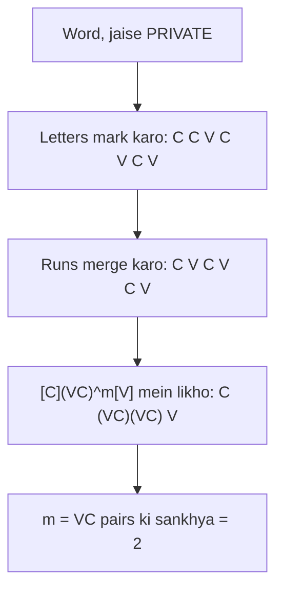
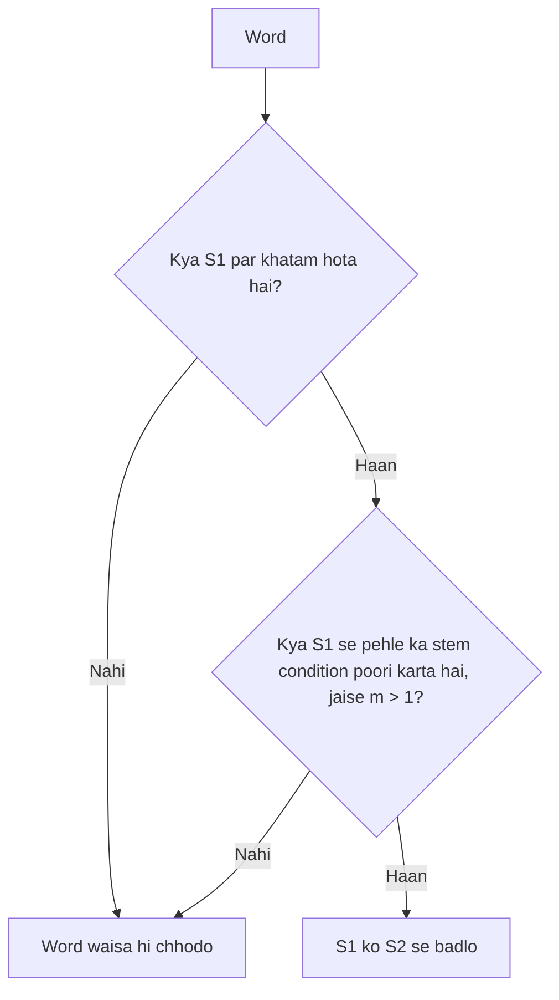

Naye ideas se pehle wo purani baatein jo chahiye. Agar aapko pata hai to seedha agle section par jao.

## Basics pehle

- **Vowel** a, e, i, o, u hain. **Consonant** baaki har letter hai. (y ke liye ek special case neeche hai.)
- **Stem** word ka main part hai jab uska ending kaat diya jaye. Ending **suffix** hai: -ing, -ed, -s, -ment. <Cite id="class-nlp-m2" loc="p. 19" />
- **Information retrieval (IR)** matlab search ke liye documents dhundna. Agar aap "connect" search karte ho to "connected" aur "connecting" bhi chahiye.

## Stemming kya hai?

<Box kind="definition">

**Stemming** is a simplified form of morphological analysis which is basically used to find the root word. <Cite id="class-nlp-m2" loc="p. 19" />

</Box>

**Porter stemmer** stemming ke liye ek simple rule-based algorithm hai. Ismein 5 sets of rules order mein lagte hain, aur wo apni speed aur simplicity ke liye jaana jaata hai. <Cite id="class-nlp-m2" loc="p. 19" /> Ye English word se suffixes hatakar stem nikalta hai, jo IR mein kaam aata hai: system kam terms rakhta hai, isse space aur time dono bachte hain. Ise British computer scientist Martin F. Porter ne banaya. <Cite id="class-nlp-pyq2" loc="p. 2" />

Example: connect, connected, connecting, connection aur connections sab ban jaate hain **connect**, isliye ek search sabko dhundh leta hai. Ye syllabus <Syl m="2" /> hai.

## Consonants aur vowels

Class exact rule deti hai. <Cite id="class-nlp-m2" loc="p. 19" /> <Cite id="class-nlp-pyq2" loc="p. 2" />

- **Consonant** wo letter hai jo vowels a, e, i, o, u nahi hai aur wo y nahi hai jo consonant ke baad aaya ho.
- Jo letter consonant nahi hai wo **vowel** hai. To y vowel hota hai jab wo consonant ke baad aaye, aur consonant hota hai jab vowel ke baad aaye.
- TOY mein consonants T aur Y hain (Y vowel O ke baad hai). SYZYGY mein S, Z aur G hain (har Y consonant ke baad hai, isliye wo Y vowel hain).
- One or more consonants ki string **C** likhi jaati hai; one or more vowels ki string **V**.

## Measure m

Kisi bhi word ke chaar forms mein se ek hota hai. <Cite id="class-nlp-pyq2" loc="p. 2" />

| Form | Example |
|---|---|
| C V C V ... C | collection, management |
| C V C V ... V | conclude, revise |
| V C V C ... C | entertainment, illumination |
| V C V C ... V | illustrate, abundance |

Sab ek formula mein fit hote hain. <Cite id="class-nlp-m2" loc="p. 20" />

<Box kind="definition">

**Form of a word:** $[C](VC)^m[V]$, jahan $C$ one or more consonants ki string hai, $V$ one or more vowels ki string, aur $m$ word ya word part ka **measure** hai, yaani $VC$ pairs ki sankhya. <Cite id="class-nlp-m2" loc="p. 20" />

</Box>

**m kaise nikaalein (teen steps).**

1. Har consonant letter ke liye C aur har vowel letter ke liye V likho.
2. Barabar letters ke run ko ek mein merge karo: CC ban jaata hai C, VV ban jaata hai V.
3. Ginti karo ki V ke baad kitni baar C aata hai. Wahi m hai.

| m | Examples (class) |
|---|---|
| 0 | TREE, TR, EE, Y, BY |
| 1 | TROUBLE, OATS, TREES, IVY, TRAP |
| 2 | TROUBLES, PRIVATE, OATEN, ROBBERY |
| 4 | RELATIONAL |

<Cite id="class-nlp-pyq2" loc="p. 2" /> <Cite id="class-nlp-m2" loc="p. 21" />

## Rule ka form

Suffix replace ya remove karne ka rule (condition) S1 to S2 likha jaata hai. <Cite id="class-nlp-pyq2" loc="p. 2" /> <Cite id="class-nlp-pyq2" loc="p. 3" />

> Agar word suffix S1 par khatam hota hai, aur S1 se pehle ka stem di gayi condition poori karta hai, to S1 ko S2 se badal diya jaata hai.

Condition usually S1 se pehle ke stem ke m ke terms mein hoti hai. Example: **(m > 1) EMENT to nothing**. S1 EMENT hai aur S2 khali hai. REPLACEMENT ban jaata hai REPLAC, kyunki stem REPLAC ka m = 2 hai. <Cite id="class-nlp-pyq2" loc="p. 3" />

## Paanch steps aur unke main rules

Class kehti hai ki 5 sets of rules hain par unhe list nahi karti, isliye neeche ke rules Porter ke algorithm ke standard rules hain, chhote rakhe gaye. Har example us **step ke baad** ka word dikhata hai. Conditions mein $*v*$ matlab stem mein vowel hai, $*d$ matlab stem double consonant par khatam hota hai, aur $*o$ matlab stem consonant-vowel-consonant par khatam hota hai jahan aakhri consonant W, X ya Y nahi hai.

| Step | Kaam | Main rules | Examples |
|---|---|---|---|
| 1a | Plurals | SSES to SS, IES to I, SS to SS, S to nothing | caresses to caress, ponies to poni, caress to caress, cats to cat |
| 1b | -ed aur -ing | (m > 0) EED to EE, (\*v\*) ED to nothing, (\*v\*) ING to nothing | feed feed hi rehta hai, agreed to agree, plastered to plaster, bled bled hi rehta hai, motoring to motor, sing sing hi rehta hai |
| 1b clean-up | -ed ya -ing hatane ke baad | AT to ATE, BL to BLE, IZ to IZE; double consonant to single (L, S, Z nahi); (m = 1 and \*o) E jodo | conflated to conflate, troubled to trouble, sized to size, hopping to hop, falling fall hi rehta hai, filing to file |
| 1c | Aakhri y | (\*v\*) Y to I | happy to happi, sky sky hi rehta hai |
| 2 | Lambe suffixes, sab (m > 0) | ATIONAL to ATE, TIONAL to TION, IZER to IZE, IZATION to IZE, ATION to ATE, ATOR to ATE, ALISM to AL, FULNESS to FUL, OUSNESS to OUS, IVENESS to IVE, ALITI to AL | relational to relate, conditional to condition, digitizer to digitize, vietnamization to vietnamize, predication to predicate, operator to operate, feudalism to feudal, hopefulness to hopeful |
| 3 | Suffixes, sab (m > 0) | ICATE to IC, ATIVE to nothing, ALIZE to AL, ICITI to IC, ICAL to IC, FUL to nothing, NESS to nothing | triplicate to triplic, formative to form, formalize to formal, electrical to electric, hopeful to hope, goodness to good |
| 4 | Suffixes hatao, sab (m > 1) | AL, ANCE, ENCE, ER, IC, ABLE, IBLE, ANT, EMENT, MENT, ENT, ION (S ya T ke baad), OU, ISM, ATE, ITI, OUS, IVE, IZE to nothing | revival to reviv, allowance to allow, replacement to replac, adoption to adopt, communism to commun, effective to effect |
| 5a | Aakhri e | (m > 1) E to nothing; (m = 1 and not \*o) E to nothing | probate to probat, cease to ceas, rate rate hi rehta hai |
| 5b | Double l | (m > 1 and *d and L par khatam) to a single letter | controll to control, roll roll hi rehta hai |

Agar ek group mein ek se zyada rule match karein to sabse lamba S1 wala rule use hota hai.

## Worked traces

<Sum>

<Given>

word **generalizations**.

</Given>

<Find>

uska Porter stem.

</Find>

<Steps>

1. Step 1a: word ek single S par khatam hota hai, isliye S to nothing: generalizations ban jaata hai **generalization**.
2. Step 2: (m > 0) IZATION to IZE. Isse pehle ka stem GENERAL hai jiska m = 3 hai, isliye rule fire hota hai: **generalize**.
3. Step 3: (m > 0) ALIZE to AL. Stem GENER ka m = 2 hai, isliye rule fire hota hai: **general**.
4. Step 4: (m > 1) AL to nothing. Stem GENER ka m = 2 hai, isliye rule fire hota hai: **gener**.
5. Step 5: word e ya double l par khatam nahi hota, isliye kuch nahi badalta.

</Steps>

<Answer>

**gener**

</Answer>

<Box kind="verify">

Har m check karo: GENERAL hai G-E-N-E-R-A-L = C V C V C V C, yaani VC teen baar (m = 3); GENER hai C V C V C, yaani m = 2. Dono un limits 0 aur 1 se bade hain jo rules ko chahiye. Porter stemmer program bhi gener deta hai.

</Box>

</Sum>

<Sum>

<Given>

word **relational**.

</Given>

<Find>

uska Porter stem.

</Find>

<Steps>

1. Step 1: koi rule match nahi karta (ye S, ED, ING ya Y par khatam nahi hota).
2. Step 2: (m > 0) ATIONAL to ATE. Stem REL hai C V C, isliye m = 1 aur rule fire hota hai: **relate**.
3. Steps 3 aur 4: koi rule match nahi karta.
4. Step 5a: (m > 1) E to nothing. Stem RELAT hai C V C V C, isliye m = 2 aur rule fire hota hai: **relat**.

</Steps>

<Answer>

**relat**

</Answer>

<Box kind="verify">

RELATIONAL ka apna measure 4 hai (class page), isliye Step 2 ko kaatne ki permission hai. Porter stemmer program bhi relat deta hai.

</Box>

</Sum>

<Sum>

<Given>

word **hopefulness**.

</Given>

<Find>

uska Porter stem.

</Find>

<Steps>

1. Steps 1a se 1c: koi rule match nahi karta.
2. Step 2: (m > 0) FULNESS to FUL. Stem HOPE hai C V C V, isliye m = 1: **hopeful**.
3. Step 3: (m > 0) FUL to nothing. Stem HOPE ka m = 1: **hope**.
4. Step 4: koi rule match nahi karta.
5. Step 5a: word E par khatam hota hai, aur stem HOP ka m = 1 hai aur wo consonant-vowel-consonant (*o) hai, isliye E rakha jaata hai.

</Steps>

<Answer>

**hope**

</Answer>

<Box kind="verify">

Rule 5a m = 1 ke saath final E tabhi hataata hai jab stem consonant-vowel-consonant na ho. HOP hai, isliye E rehta hai. Isi wajah se rate rate hi rehta hai. Porter stemmer program bhi hope deta hai.

</Box>

</Sum>

## Advantages aur limits

- **Fast aur simple**, isliye information retrieval mein use hota hai; terms ki sankhya kam karta hai. <Cite id="class-nlp-m2" loc="p. 19" /> <Cite id="class-nlp-pyq2" loc="p. 2" />
- Ye ek **crude, heuristic process** hai jo word endings kaat deta hai, isliye aise roots de sakta hai jo dictionary words nahi hote (happy ban jaata hai happi, studies ban jaata hai studi). Lemmatization dictionary use karta hai aur real words deta hai (better ban jaata hai good). <Cite id="class-nlp-asol" loc="p. 12" />
- Alag words ko same stem mil sakta hai (universe, university aur universal sab ban jaate hain univers). Ye stemming ki limit hai.

## Ye kahan puchha gaya

| Agar question kehta hai | Kya likhna hai | Kab aaya |
|---|---|---|
| "Explain Porter stemming algorithm in detail" | Definition, consonant aur vowel rule, form [C](VC)^m[V], measure examples, rule form, paanch steps, ek trace | <PYQ id="2022-12-ce/q6b" /> <PYQ id="2023-12-ce/q5a" /> <PYQ id="2024-12-ce/q5a" /> <PYQ id="2025-05/q3a" /> |
| "Explain Porter stemmer algorithm with rules" | Paanch steps ki table, phir ek trace | <PYQ id="2023-05-ce/q5b" /> <PYQ id="assignment-1/q2b" /> |
| "Explain Porter's stemming algorithm with example" | EMENT example ke saath rule form aur traces | <PYQ id="2024-12/q2b" /> |
| "Illustrate the working of Porter stemmer" | Flow diagram aur ek trace | <PYQ id="2024-05-ce/q2b" /> |

## Quick revision

- Stemming root word dhundta hai. Porter stemmer ek simple rule-based algorithm hai jisme 5 sets of rules hain, speed aur simplicity ke liye jaana jaata hai.
- Consonant: a, e, i, o, u nahi aur consonant ke baad wala y nahi. Baaki sab vowel.
- Form $[C](VC)^m[V]$. m VC pairs ginta hai. TREE 0, TROUBLE 1, TRAP 1, TROUBLES 2, PRIVATE 2, RELATIONAL 4.
- Rule: (condition) S1 to S2. Example (m > 1) EMENT to nothing: REPLACEMENT ban jaata hai REPLAC.
- Steps: 1 plurals aur -ed/-ing, 2 aur 3 lambe suffixes, 4 suffixes hatao, 5 tidy up.
- Traces: generalizations se gener, relational se relat, hopefulness se hope.

**Conclusion.** Porter stemmer chhote conditional rules se word endings kaat deta hai, jinki condition stem ka measure m hai, aur IR ke liye fast aur simple stemming deta hai. <Cite id="class-nlp-m2" loc="p. 19" />
