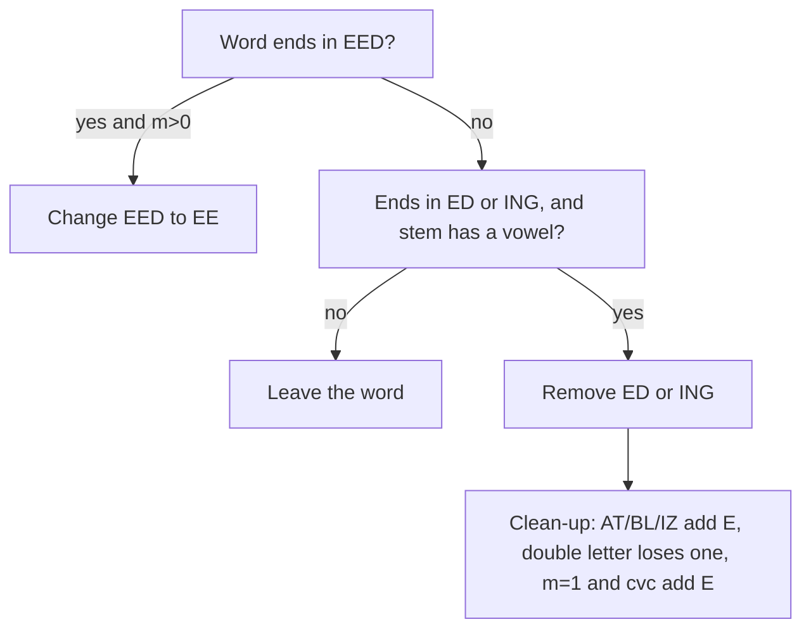
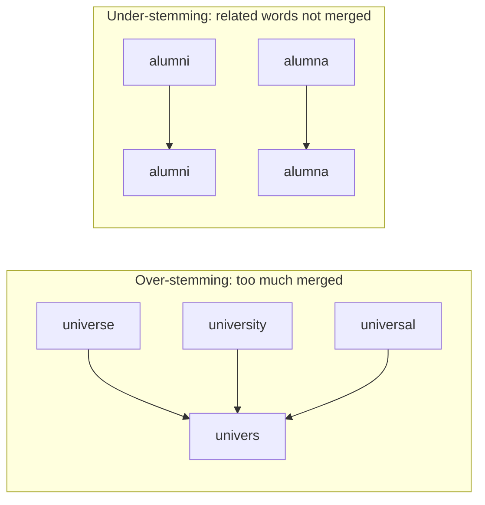

Naye ideas se pehle, ye purane ideas chahiye honge. Agar pehle se aate hain, to agle section pe jao.

## Pehle basics

- **Word form** woh word hai jaisa likha jaata hai: *connect*, *connected*, *connecting*. **Suffix** word ke end mein judne wale letters ka group hai: *-ed*, *-ing*, *-ion*, *-s*. **Prefix** shuru mein judta hai (*un-*, *re-*).
- **Stem** suffix hatane ke baad bacha main part hai. **Root** ya **lemma** word ka dictionary form hai (*running* ke liye *run*, *better* ke liye *good*).
- **Inflection** word ko sirf grammar ke hisaab se badalta hai aur basic meaning wahi rehta hai (*cat*, *cats*; *walk*, *walked*). **Derivation** naya word banata hai, aksar nayi class ka (*happy*, *happiness*; *act*, *action*). Details <Syl m="2" /> "Morphology, finite automata and finite state transducers" mein hain.
- **Vowel** a, e, i, o ya u hai; baaki har letter **consonant** hai. (Porter ka y ke baare mein ek chhota rule hai, neeche diya hai.)
- **Information retrieval (IR)** matlab query se match karte documents dhoondhna, jaise search engine karta hai. **Vocabulary** text ke collection ke alag-alag words ki list hai. **Tokenization** text ko pehle words mein todta hai; stemming un tokens par chalta hai (topic <Syl m="2" /> "Text pre-processing" dekho).

## Stemming kya hai

**Ye kya hai.** Stemming kisi word ko uske ending kaatkar (aur kabhi-kabhi kuch chhote repair rules lagakar) stem tak ghatane ka process hai. *connect, connected, connecting, connection, connections* jaise related forms sab ek stem *connect* ban jaate hain. <Cite id="porter-stemmer-def" loc="§1" /> <Cite id="porter-stemmer-wiki-stem" /> <Cite id="porter-stemmer-gfg-stemming" />

**Stem real word hona zaroori nahi.** Stem sirf words ke group ka label hai. Porter stemmer *happy* ko *happi* aur *troubled* ko *troubl* bana deta hai. Isse fark nahi padta, bas har related word ko wahi label mile. <Cite id="porter-stemmer-av-stemming" />

**Rozmarra ki misaal.** Ek library socho jo ek author ki saari books ek shelf pe rakhti hai. Shelf ka label poora sentence hona zaroori nahi. Bas har book ke liye same hona chahiye. Stem words ke parivaar ka shelf label hai.

<Box kind="definition">

**Stemming** ek kaccha, rule-based tarika hai jisse kisi word ke alag-alag forms ko suffix hatakar ek common base form (stem) mein badla jaata hai, taaki program unhe ek hi term maane.

</Box>


## Stemming kyun zaroori hai

1. **Behtar search.** Jo user *connect* search karta hai wo *connected* ya *connections* wale pages bhi chahta hai. Agar har form alag term ho to search unhe miss kar deta hai. Porter ne apna algorithm isi kaam ke liye likha tha. <Cite id="porter-stemmer-def" loc="§1" />
2. **Chhoti vocabulary.** Kai forms ek ho jaate hain, to index aur models chhote ho jaate hain. Porter ke test mein 10,000 words ki vocabulary stemming se lagbhag ek-tihai ghat gayi (6,370 alag stems). <Cite id="porter-stemmer-def" />
3. **Simple pre-processing.** Words gin-ne, text classify karne ya topic modelling se pehle ye ek tez normalization step hai. <Cite id="porter-stemmer-av-stemming" /> <Cite id="text-preprocessing-ibm-stemlem" />


## Stemming versus lemmatization

**Lemmatizer** word ko dictionary mein dekhta hai (aur uska part of speech use karta hai) aur real word, yaani lemma, deta hai. Stemmer sirf spelling rules follow karta hai aur sentence kabhi nahi dekhta. <Cite id="text-preprocessing-wiki-lem" /> <Cite id="text-preprocessing-ibm-stemlem" />

| Point | Stemming | Lemmatization |
|---|---|---|
| Method | Rules se suffix kaatna | Dictionary lookup plus part of speech |
| Output | Stem, aksar word nahi (*studies* se *studi*) | Real word, lemma (*studies* se *study*) |
| Irregular forms | Nahi sambhaal paata (*went* *went* hi rehta hai) | Sambhaalta hai (*went* se *go*, *better* se *good*) |
| Context | Koi nahi; ek time pe ek word | Part of speech use karta hai (*meeting* noun ya verb) |
| Speed | Tez aur simple | Dheema; WordNet jaisi dictionary chahiye |
| Typical use | Search aur indexing | Vocabulary banana, meaning-sensitive tasks |

NLTK book real text par fark dikhati hai: Porter stemmer *lying* ko *lie* banata hai aur *women* waisa hi rehta hai, jabki WordNet lemmatizer *women* ko *woman* banata hai. <Cite id="text-preprocessing-nltk-book3" loc="§3.6" />


## Stemmers ke types

| Stemmer | Idea | Remark |
|---|---|---|
| Lovins (1968) | Ek pass; lambi list se sabse lamba matching suffix hatao, phir recoding rules se stem theek karo | Pehla published stemmer. <Cite id="porter-stemmer-wiki-stem" /> |
| Porter (1980) | Chhote rules ke paanch steps, har ek ki stem par condition | English ke liye de facto standard; ye note. <Cite id="text-preprocessing-porter1980" /> |
| Snowball / Porter2 | Porter ka khud ka sudhra hua version, Snowball language mein likha | Original ki galtiyan theek karta hai; Porter practical kaam ke liye ise recommend karte hain. <Cite id="porter-stemmer-snowball-porter2" /> <Cite id="porter-stemmer-nltk-snowball" /> |
| Lancaster (Paice/Husk) | Rules ki ek table baar-baar lagti hai | Sabse aggressive; stems aksar bahut chhote ho jaate hain. <Cite id="porter-stemmer-nltk-lancaster" /> <Cite id="porter-stemmer-av-stemming" /> |

## Porter stemmer: main idea

Martin Porter ne ye algorithm 1980 mein information retrieval ke liye publish kiya. Ismein dictionary nahi hai. Ismein suffix rules ki list hai aur har suffix ke liye ek condition, jisme use hatana allowed hai. <Cite id="text-preprocessing-porter1980" /> <Cite id="porter-stemmer-def" loc="§1" />

Do ideas isse chalate hain:

- **Complex suffixes thoda-thoda karke hatte hain.** *-ization* jaisa lamba ending ek hi rule mein nahi hai. Step 2 *-ization* ko *-ize* banata hai, Step 3 *-alize* ko *-al* banata hai, aur Step 4 *-al* hata deta hai. Har step chhota hai, isliye rule list chhoti rehti hai. <Cite id="porter-stemmer-def" loc="§2" />
- **Suffix tabhi hatta hai jab bacha hua stem kaafi lamba ho.** Ye **measure m** se naapa jaata hai (agla section). Isse bekaar cuts rukte hain: *activate* se *-ate* hat jaata hai (*activ* milta hai) lekin *rate* se nahi.

```mermaid
%% caption: Porter stemmer ke paanch steps. Word har step se order mein guzarta hai; har step use badal bhi sakta hai ya chhod bhi sakta hai. Shuru ke steps plurals aur -ed/-ing sambhaalte hain; beech ke steps lambe derivational endings chhote karte hain; aakhri step tidy-up karta hai.
flowchart LR
  W["Word"] --> S1["Step 1: plurals, -ed, -ing, y to i"]
  S1 --> S2["Step 2: long suffixes, e.g. -ational to -ate"]
  S2 --> S3["Step 3: -icate, -ful, -ness, ..."]
  S3 --> S4["Step 4: remove -al, -ance, -ment, -ion, ..."]
  S4 --> S5["Step 5: drop final e, double l"]
  S5 --> R["Stem"]
```



<Cite id="porter-stemmer-snowball" loc="the steps" />

## Consonants, vowels aur measure m

**Consonant aur vowel.** Letter **vowel** hai agar wo a, e, i, o ya u hai, ya **y jo consonant ke baad aaye**. Baaki har letter **consonant** hai. To *toy* mein consonants t aur y hain (y vowel o ke baad hai), lekin *by* aur *syzygy* mein consonant ke baad aane wala y vowel ginta hai. <Cite id="porter-stemmer-def" loc="§2" />

**Word ki shape.** Consonant ke liye c aur vowel ke liye v likho, aur repeats ko merge karo (consonants ka run ek **C**, vowels ka run ek **V**). Tab har word ka form ye hota hai

$$
[C](VC)^m[V]
$$

jahan square brackets ka matlab hai ki wo part absent ho sakta hai. Number $m$ **measure** hai: word mein kitne VC groups hain. $m = 0$ ka matlab word mein koi vowel-consonant pair nahi.

**m kaise nikaalte hain, step by step.**

1. Har letter ko v ya c mark karo (y rule yaad rakho).
2. Repeated letters merge karo: *ccvv* se C V.
3. V ke baad C ke pairs gino. Wahi $m$ hai.

| m | Examples (Porter se) | Shape |
|---|---|---|
| 0 | tr, ee, tree, y, by | C, V, CV, V, CV |
| 1 | trouble, oats, trees, ivy | CVCV, VC, CVC, VCV |
| 2 | troubles, private, oaten, orrery | CVCVC, CVCVCV, VCVC, VCVCV |

<Sum>

<Given>

words *tree*, *oats*, *trouble*, *private*, *orrery*.

</Given>

<Find>

har word ka measure $m$.

</Find>

<Steps>

1. **tree.** Letters: t=c, r=c, e=v, e=v. Merged: C V. V ke baad C nahi, to $m = 0$. *Reason: ek consonant group ke baad vowel group par khatam hone wale word mein koi VC pair nahi hota.*
2. **oats.** Letters: o=v, a=v, t=c, s=c. Merged: V C. Ek VC pair, to $m = 1$.
3. **trouble.** t,r = c; o,u = v; b = c; l = c; e = v. Merged: C V C V. Pairs: V ke baad C ek baar (ou phir bl). Aakhri V ke baad koi C nahi. To $m = 1$.
4. **private.** p,r = c; i = v; v = c; a = v; t = c; e = v. Merged: C V C V C V. Pairs: (i,v) aur (a,t), to $m = 2$.
5. **orrery.** o = v; r,r = c; e = v; r = c; consonant ke baad y = v. Merged: V C V C V. Pairs: (o,rr) aur (e,r), to $m = 2$.

</Steps>

<Answer>

tree 0, oats 1, trouble 1, private 2, orrery 2.

</Answer>

<Box kind="verify">

Ye paanchon values Porter ke paper mein chhapi lists se milti hain (tree $m=0$; oats aur trouble $m=1$; private aur orrery $m=2$). Dusra check: un vowel groups ko gino jinke baad consonant aata hai: private mein v se pehle "i" aur t se pehle "a" hai, yaani do. <Cite id="porter-stemmer-def" loc="§2" />

</Box>

</Sum>

## Rules mein use hone wali conditions

Rules **(condition) S1 to S2** form mein likhe hote hain: agar word S1 pe khatam hota hai aur S1 se pehle ka stem condition poori karta hai, to S1 ko S2 se badal do. Jaise `(m>1) EMENT` ko nothing se badalna *replacement* ko *replac* bana deta hai, kyunki *replac* ka $m = 2$ hai. <Cite id="porter-stemmer-def" loc="§2" />

| Symbol | Matlab | Example |
|---|---|---|
| `m>0`, `m>1`, `m=1` | Stem ka measure | `m>1` *replac* ke liye true, *rel* ke liye false |
| `*v*` | Stem mein vowel hai | *plastered* mein *plaster*; *bled* mein *bl* ke liye false |
| `*d` | Stem double consonant par khatam hota hai | *-tt*, *-ss* |
| `*o` | Stem consonant-vowel-consonant par khatam hota hai, aur aakhri consonant w, x ya y nahi | *-wil*, *-hop* |
| `*S`, `*T`, `*L` | Stem us letter par khatam hota hai | Step 4 aur 5 mein use |

**Longest-match rule.** Ek ke neeche ek likhe rules ke group mein sirf ek rule chalta hai: jiska S1 word ke saath **sabse lamba match** hai. Agar us rule ki condition fail ho jaaye, to us group se word waisa hi rehta hai; chhota rule try nahi hota. Example: `SSES to SS`, `IES to I`, `SS to SS`, `S to nothing` ke saath *caresses* SSES (sabse lamba) match karta hai aur *caress* ban jaata hai; *caress* SS match karta hai aur waisa hi rehta hai; *cares* S match karta hai aur *care* ban jaata hai. <Cite id="porter-stemmer-def" loc="§2" />

## Rules, step by step

Neeche ke rules bilkul Porter ke 1980 ke paper wale hain. <Cite id="porter-stemmer-def" loc="§2" /> <Cite id="text-preprocessing-porter1980" />

### Step 1a: plurals

| Rule | Example |
|---|---|
| SSES to SS | caresses to caress |
| IES to I | ponies to poni, ties to ti |
| SS to SS | caress to caress |
| S to (nothing) | cats to cat |

### Step 1b: past tense aur -ing

| Rule | Example |
|---|---|
| (m>0) EED to EE | agreed to agree; feed feed hi rehta hai |
| (`*v*`) ED to (nothing) | plastered to plaster; bled bled hi rehta hai |
| (`*v*`) ING to (nothing) | motoring to motor; sing sing hi rehta hai |

Agar **doosra ya teesra** rule chala (ED ya ING hata), to result par **clean-up** hota hai:

| Clean-up rule | Example |
|---|---|
| AT to ATE | conflat(ed) to conflate |
| BL to BLE | troubl(ed) to trouble |
| IZ to IZE | siz(ed) to size |
| (`*d` and not `*L`, `*S`, `*Z`) to a single letter | hopp(ing) to hop; tann(ed) to tan; lekin fall(ing), hiss(ing), fizz(ed) waise hi rehte hain |
| (m=1 and `*o`) to add E | fil(ing) to file; lekin fail(ing) fail hi rehta hai |



<Cite id="porter-stemmer-def" loc="Step 1b" />

### Step 1c: y to i

| Rule | Example |
|---|---|
| (`*v*`) Y to I | happy to happi; sky sky hi rehta hai |

Step 1 plurals aur past participles sambhaalta hai. Baad ke steps zyada seedhe hain. <Cite id="porter-stemmer-def" loc="Step 1c" />

### Step 2: double suffixes se single (sab ke liye m>0)

| Rule | Example | Rule | Example |
|---|---|---|---|
| ATIONAL to ATE | relational to relate | ALISM to AL | feudalism to feudal |
| TIONAL to TION | conditional to condition | IVENESS to IVE | decisiveness to decisive |
| ENCI to ENCE | valenci to valence | FULNESS to FUL | hopefulness to hopeful |
| ANCI to ANCE | hesitanci to hesitance | OUSNESS to OUS | callousness to callous |
| IZER to IZE | digitizer to digitize | ALITI to AL | formaliti to formal |
| ABLI to ABLE | conformabli to conformable | IVITI to IVE | sensitiviti to sensitive |
| ALLI to AL | radicalli to radical | BILITI to BLE | sensibiliti to sensible |
| ENTLI to ENT | differentli to different | IZATION to IZE | vietnamization to vietnamize |
| ELI to E | vileli to vile | ATION to ATE | predication to predicate |
| OUSLI to OUS | analogousli to analogous | ATOR to ATE | operator to operate |

### Step 3: (sab ke liye m>0)

| Rule | Example |
|---|---|
| ICATE to IC | triplicate to triplic |
| ATIVE to (nothing) | formative to form |
| ALIZE to AL | formalize to formal |
| ICITI to IC | electriciti to electric |
| ICAL to IC | electrical to electric |
| FUL to (nothing) | hopeful to hope |
| NESS to (nothing) | goodness to good |

### Step 4: suffix hatao (m>1 chahiye)

AL, ANCE, ENCE, ER, IC, ABLE, IBLE, ANT, EMENT, MENT, ENT, OU, ISM, ATE, ITI, OUS, IVE aur IZE tab hatte hain jab stem ka $m > 1$ ho. ION tab hatta hai jab stem ka $m > 1$ ho **aur** stem S ya T par khatam ho. <Cite id="porter-stemmer-def" loc="Step 4" />

| Example | Result | Example | Result |
|---|---|---|---|
| revival | reviv | dependent | depend |
| allowance | allow | adoption (ION) | adopt |
| inference | infer | communism | commun |
| airliner | airlin | activate | activ |
| gyroscopic | gyroscop | angulariti | angular |
| adjustable | adjust | effective | effect |
| irritant | irrit | bowdlerize | bowdler |
| replacement | replac | adjustment | adjust |

### Step 5: tidy up

| Rule | Example |
|---|---|
| 5a: (m>1) E to (nothing) | probate to probat; rate rate hi rehta hai |
| 5a: (m=1 and not `*o`) E to (nothing) | cease to ceas |
| 5b: (m>1 and `*d` and `*L`) to a single letter | controll to control; roll roll hi rehta hai |

**m-conditions kyun zaroori hain.** *-ate* ko lo. *activate* mein stem *activ* ka $m = 2$ hai, to *-ate* hat jaata hai. *rate* mein stem *r* ka $m = 0$ hai, to wo rehta hai. Porter ki lists dikhati hain ki *relate*, *probate*, *pirate* apna *-ate* rakhte hain jabki *derivate*, *demonstrate*, *renovate* use kho dete hain. <Cite id="porter-stemmer-def" loc="§2" />

## Worked examples

Neeche ke saare traces 1980 ke rules follow karte hain. Maine har ek ko haath se dobara nikaala aur NLTK ke Porter stemmer ke `ORIGINAL_ALGORITHM` mode se check kiya. <Cite id="text-preprocessing-nltk-porter" />

### Example 1: plurals par Step 1a

<Sum>

<Given>

words *caresses*, *ponies*, *ties*, *caress*, *cats*.

</Given>

<Find>

har word ke liye Step 1a ka result.

</Find>

<Steps>

1. **caresses** SSES pe khatam hota hai, aur SSES sabse lamba match hai (S se lamba). Rule SSES to SS se *caress* milta hai. *Reason: longest match jeetta hai.*
2. **ponies** IES pe khatam hota hai. IES to I se *poni* milta hai.
3. **ties** IES pe khatam hota hai. IES to I se *ti* milta hai (chhota, ajeeb result, lekin rule yahi hai).
4. **caress** SS pe khatam hota hai. SS to SS se *caress* waisa hi rehta hai. *Reason: ye rule isliye hai ki seedha S wala rule caress ko cares na bana de.*
5. **cats** sirf S pe khatam hota hai. S to nothing se *cat* milta hai.

</Steps>

<Answer>

caress, poni, ti, caress, cat.

</Answer>

<Box kind="verify">

Ye paanchon outputs Porter ke paper mein Step 1a ke example column se milte hain. Dusra check: *cares* par longest-match rule *care* deta hai (rule S), jisse dikhta hai ki SSES ko S se pehle try karna kyun zaroori hai.

</Box>

</Sum>

### Example 2: Step 1b aur 1c

<Sum>

<Given>

words *agreed*, *feed*, *plastered*, *bled*, *motoring*, *sing*, *happy*, *sky*.

</Given>

<Find>

har word ke liye Step 1b aur Step 1c ka result.

</Find>

<Steps>

1. **agreed** EED pe khatam hota hai, stem *agr* ka $m = 1 > 0$ hai, to EED se EE: *agree*.
2. **feed** EED pe khatam hota hai, lekin stem *f* ka $m = 0$ hai, to rule fail: *feed*.
3. **plastered**: EED nahi; ED pe khatam; stem *plaster* mein vowel hai, to ED hatao: *plaster*. Clean-up rules lagte nahi.
4. **bled**: ED pe khatam, lekin stem *bl* mein vowel nahi, to rule fail: *bled*.
5. **motoring**: ING hata, stem *motor* mein vowels hain: *motor*.
6. **sing**: ING match karta hai, lekin stem *s* mein vowel nahi: *sing*.
7. **happy** (Step 1c): stem *happ* mein vowel hai, to Y se I: *happi*.
8. **sky** (Step 1c): stem *sk* mein vowel nahi, to waisa hi: *sky*.

</Steps>

<Answer>

agree, feed, plaster, bled, motor, sing, happi, sky.

</Answer>

<Box kind="verify">

Values Porter ke paper ke Step 1b aur 1c examples ke barabar hain. Dhyan do ki ye sirf Step 1 ke baad ke results hain. Paanchon steps chalane par *agree* Step 5a mein ek baar aur chhota hokar *agre* ho jaata hai (stem *agre* ka $m = 1$ hai aur wo consonant-vowel-consonant par khatam nahi hota, to aakhri E hat jaata hai). NLTK ka original-mode stemmer bhi *agre* deta hai.

</Box>

</Sum>

### Example 3: Step 1b ke clean-up rules

<Sum>

<Given>

words *conflated*, *troubled*, *sized*, *hopping*, *tanned*, *falling*, *hissing*, *filing*, *failing*.

</Given>

<Find>

clean-up rules sahit Step 1b ka result.

</Find>

<Steps>

1. **conflated**: ED hatao, *conflat* milta hai. Ye AT pe khatam hota hai, to E jodo: *conflate*.
2. **troubled**: ED hatao, *troubl* milta hai. Ye BL pe khatam hota hai, to E jodo: *trouble*.
3. **sized**: ED hatao, *siz* milta hai. Ye IZ pe khatam hota hai, to E jodo: *size*.
4. **hopping**: ING hatao, *hopp* milta hai. Ye double consonant (pp) pe khatam hota hai jo L, S ya Z nahi hai, to ek letter girao: *hop*.
5. **tanned**: ED hatao, *tann* milta hai. Double nn, to ek girao: *tan*.
6. **falling**: ING hatao, *fall* milta hai. Double ll, lekin L exception hai, to rakho: *fall*.
7. **hissing**: *hiss*. Double ss, S exception hai, to rakho.
8. **filing**: ING hatao, *fil* milta hai. AT/BL/IZ nahi, double letter nahi. Ab $m(\text{fil}) = 1$ (f, i, l yaani C V C) aur ye consonant-vowel-consonant par khatam hota hai jisme l, w, x ya y nahi hai, to E jodo: *file*.
9. **failing**: ING hatao, *fail* milta hai. Stem f, ai, l hai: C V C, $m = 1$, lekin ye "ail" yaani vowel-vowel-consonant par khatam hota hai, consonant-vowel-consonant par nahi, to E nahi judta: *fail*.

</Steps>

<Answer>

conflate, trouble, size, hop, tan, fall, hiss, file, fail.

</Answer>

<Box kind="verify">

Naun ke naun Porter ke paper ki Step 1b clean-up table se milte hain (conflate, trouble, size, hop, tan, fall, hiss, file, fail). E rule ka dusra check: *fil* ka $m = 1$ hai aur wo c-v-c hai, to E judta hai; *fail* ka $m = 1$ hai lekin wo c-v-v-c hai, to nahi judta.

</Box>

</Sum>

### Example 4: lambe word par paanchon steps

Porter ka apna example *generalizations* hai, "stripped to generalization (Step 1), then to generalize (Step 2), then to general (Step 3), and then to gener (Step 4)". <Cite id="porter-stemmer-def" loc="§2" />

<Sum>

<Given>

word *generalizations*.

</Given>

<Find>

paanchon steps ke baad uska stem, har decision par measure ke saath.

</Find>

<Steps>

1. **Step 1a.** Word S pe khatam hota hai. Sabse lamba matching rule S to nothing hai (ye "ons" pe khatam hota hai, SS, IES ya SSES pe nahi). Result: *generalization*.
2. **Step 1b aur 1c.** Word EED, ED, ING ya Y pe khatam nahi hota. Koi change nahi.
3. **Step 2.** Ye IZATION pe khatam hota hai; stem *general* ka $m = 3 > 0$ hai. Rule IZATION to IZE se *generalize* milta hai. *Reason: IZATION, ATION se lamba match hai.*
4. **Step 3.** Ye ALIZE pe khatam hota hai; stem *gener* ka $m = 2 > 0$ hai. ALIZE to AL se *general* milta hai.
5. **Step 4.** Ye AL pe khatam hota hai; stem *gener* ka $m = 2 > 1$ hai. AL hatao: *gener*.
6. **Step 5.** *gener* E pe khatam nahi hota, aur double L pe bhi nahi. Koi change nahi.

</Steps>

<Answer>

generalizations se gener.

</Answer>

<Box kind="verify">

Measures: g-e-n-e-r C V C V C hai, to $m(\text{gener}) = 2$; general C V C V C V C hai, to $m = 3$. Dono use hui limits (0, phir 1) se bade hain. generalization, generalize, general, gener wala raasta paper mein chhapa hua wahi hai, aur NLTK ka original mode *gener* deta hai.

</Box>

</Sum>

### Example 5: ek word jisme Step 5b chahiye

<Sum>

<Given>

word *oscillators*.

</Given>

<Find>

paanchon steps ke baad uska stem.

</Find>

<Steps>

1. **Step 1a.** Aakhri S hatao: *oscillator*.
2. **Step 2.** Ye ATOR pe khatam hota hai; stem *oscill* ka $m = 2 > 0$ hai. ATOR to ATE se *oscillate* milta hai.
3. **Step 3.** *oscillate* ke end mein koi Step 3 suffix nahi. Koi change nahi.
4. **Step 4.** Ye ATE pe khatam hota hai; stem *oscill* ka $m = 2 > 1$ hai. ATE hatao: *oscill*.
5. **Step 5a.** Aakhir mein E nahi hai.
6. **Step 5b.** Word double L pe khatam hota hai, aur $m(\text{oscill}) = 2 > 1$, to ek L girta hai: *oscil*.

</Steps>

<Answer>

oscillators se oscil.

</Answer>

<Box kind="verify">

Porter ka paper wahi raasta deta hai: oscillators, oscillator (Step 1), oscillate (Step 2), oscill (Step 4), oscil (Step 5). m ka check: o-s-c-i-l-l: o=v, sc=C, i=v, ll=C, to V C V C se $m = 2$.

</Box>

</Sum>

### Example 6: jab condition rule ko rok deti hai

<Sum>

<Given>

words *relational*, *conditional*, *rational*.

</Given>

<Find>

har ka final stem, aur kaun si condition kis rule ko rokti hai.

</Find>

<Steps>

1. **relational.** Step 2: sabse lamba match ATIONAL hai; stem *rel* ka $m = 1 > 0$ hai. ATIONAL to ATE se *relate* milta hai. Step 4: ATE ko $m > 1$ chahiye lekin *rel* ka $m = 1$ hai, to ATE rehta hai. Step 5a: stem *relat* ka $m = 2 > 1$ hai, to aakhri E hat jaata hai: *relat*.
2. **conditional.** Step 2: TIONAL (stem *condi*, $m = 1$) to TION se *condition* milta hai. Step 4: ION ko $m > 1$ chahiye aur stem S ya T par khatam ho; stem *condit* ka $m = 2$ hai aur wo T pe khatam hota hai, to ION hat jaata hai: *condit*.
3. **rational.** Step 2: sabse lamba match ATIONAL hai, lekin stem *r* ka $m = 0$ hai, to rule fail ho jaata hai. Kyunki sirf sabse lamba match try hota hai, chhota TIONAL rule use nahi hota. Step 4: AL; stem *ration* ka $m = 2 > 1$ hai, to AL hat jaata hai: *ration*.

</Steps>

<Answer>

relational se relat, conditional se condit, rational se ration.

</Answer>

<Box kind="verify">

Measures check karo: rel C V C hai, $m=1$; relat (r-e-l-a-t) C V C V C hai, $m=2$; condit C V C V C hai, $m=2$; ration (r-a-t-io-n) C V C V C hai, $m=2$. Porter ke apne examples Step 2 ke results se milte hain (relational se relate; conditional se condition; rational Step 2 mein rational hi rehta hai). NLTK original mode relat, condit, ration deta hai.

</Box>

</Sum>

### Example 7: ek sentence ko stem karna

Ye "tokenization and stemming" wale question ka chhota roop hai. Pehle tokens mein todo, phir har token ko stem karo.

<Sum>

<Given>

sentence "The ponies were running and hopping happily."

</Given>

<Find>

tokens aur har ka Porter stem.

</Find>

<Steps>

1. **Tokenize** (lower-case, full stop hatao): the, ponies, were, running, and, hopping, happily.
2. **the, were, and:** koi rule nahi lagta (*the* aur *were* mein Step 5a mein aakhri E rehta hai: *th* ka $m = 0$ hai aur *wer* ka $m = 1$ hai aur wo consonant-vowel-consonant par khatam hota hai). Ye waise hi rehte hain.
3. **ponies:** Step 1a, IES to I: *poni*.
4. **running:** Step 1b, ING hatao: *runn*; double N, to ek girao: *run*.
5. **hopping:** ING hatao: *hopp*; double P, to ek girao: *hop*.
6. **happily:** Step 1c, Y to I: *happili*. Baad ka koi rule *-ili* ending se match nahi karta.

</Steps>

<Answer>

the, poni, were, run, and, hop, happili.

</Answer>

<Box kind="verify">

NLTK ke original-mode Porter stemmer se dobara nikaala: the, poni, were, run, and, hop, happili. Dhyan do ki *happily* aur *happy* ko alag stems *happili* aur *happi* milte hain, jo under-stemming ka chhota example hai (NLTK ka Snowball stemmer bhi *happili* deta hai).

</Box>

</Sum>

## Stemming ki galtiyan

Rule-based stemming perfect nahi ho sakta. Do tarah ki galti hoti hai. <Cite id="porter-stemmer-wiki-stem" /> <Cite id="porter-stemmer-gfg-stemming" /> <Cite id="text-preprocessing-ibm-stemlem" />

- **Over-stemming (false positive).** Alag words ko wahi stem mil jaata hai. Porter *universal*, *university* aur *universe* ko *univers* bana deta hai. IBM ka example hai *news* ka *new* ban jaana. Suffix asal mein word ka hissa tha.
- **Under-stemming (false negative).** Related words ke stems alag rehte hain. Porter *alumni* aur *alumna* ko alag rakhta hai, aur IBM ka example *knavish* aur *knave* hai. *went* aur *go* jaise irregular forms bhi miss hote hain.
- Ek galti sudharne se aksar doosri badh jaati hai, isliye rule set ek compromise hai. Porter ne khud likha ki vocabulary ke ek hisse ke liye zyada rules jodne se jaldi doosra hissa kharab hone lagta hai. <Cite id="porter-stemmer-def" loc="§1" />



<Cite id="porter-stemmer-gfg-stemming" loc="diagram" />

## Porter stemmer ke advantages aur disadvantages

| Advantages | Disadvantages |
|---|---|
| Simple, chhota aur bahut tez; dictionary nahi chahiye. <Cite id="porter-stemmer-gfg-stemming" /> <Cite id="porter-stemmer-def" loc="§1" /> | Stems aksar real words nahi hote (*happi*, *troubl*). |
| Vocabulary ghatata hai aur search mein recall badhata hai. | Over-stemming aur under-stemming ki galtiyan. |
| Complex suffixes kuch chhote steps se sambhal jaate hain. | Irregular forms nahi sambhaal paata (*went*, *mice*). |
| Har jagah same chalta hai, to queries aur documents ko same stems milte hain. | Sirf English ke liye bana; context aur part of speech ignore karta hai. |
| Kisi bhi language mein implement karna aasaan. | Kuch rules mein known faults hain jo Porter ne baad mein Snowball mein theek kiye. <Cite id="porter-stemmer-snowball-porter2" /> |

## Porter, Snowball aur Lancaster ka comparison

| Point | Porter | Snowball (Porter2) | Lancaster |
|---|---|---|---|
| Year / author | 1980, M. F. Porter | baad mein, M. F. Porter | late 1980s, C. D. Paice (Lancaster University) |
| Languages | English | English aur kai aur | English |
| Speed and design | Simple aur tez | Porter se thoda tez aur zyada logical | Iterative: rules baar-baar lagte hain |
| Strength | Naram | Naram, kam galtiyan | Bahut aggressive; bura over-stem kar sakta hai |
| Example | generate se *gener*; friendship *friendship* hi rehta hai | generate se *generat*; friendship *friendship* hi rehta hai | generate se *gen*; friendship se *friend* |

(Example outputs NLTK implementations se chalaye gaye; Analytics Vidhya bhi Snowball aur Lancaster ka yahi behaviour dikhata hai.) <Cite id="porter-stemmer-av-stemming" /> <Cite id="porter-stemmer-nltk-stem" /> <Cite id="porter-stemmer-wiki-stem" />

## Python mein use

NLTK mein Porter stemmer aata hai. <Cite id="text-preprocessing-nltk-porter" /> <Cite id="porter-stemmer-gfg-stem-nltk" />

```python
from nltk.stem import PorterStemmer
ps = PorterStemmer()
for w in ["programs", "programmed", "programming"]:
    print(w, ps.stem(w))   # all three print: program
```

NLTK ke default mode mein kuch extensions hain jo Porter ne 1980 ke baad jode, isliye kuch outputs paper se alag hote hain (jaise *ties* se *tie*, *ti* nahi). 1980 ke rules bilkul follow karne ke liye, jaise is note mein, `PorterStemmer(mode="ORIGINAL_ALGORITHM")` use karo. Porter khud practical kaam ke liye Snowball (Porter2) stemmer recommend karte hain. <Cite id="text-preprocessing-nltk-porter" /> <Cite id="porter-stemmer-snowball-porter2" />

## Applications

- **Search engines aur IR:** query ko word ke saare forms se match karna. <Cite id="porter-stemmer-def" loc="§1" />
- **Text mining aur classification:** kam features, to chhote models. <Cite id="porter-stemmer-av-stemming" />
- **Indexing aur tagging systems, SEO.** <Cite id="porter-stemmer-av-stemming" />
- **Vocabulary reduction** words gin-ne ya topic model banane se pehle.

## Exam mein kaise likhein

10-mark question "Explain the Porter stemming algorithm" ke liye:

1. Stemming define karo aur batao kyun zaroori hai (search recall, chhoti vocabulary).
2. Consonant, vowel aur measure m define karo, do examples ke saath (tree 0, trouble 1, private 2).
3. Rule form (condition) S1 to S2 aur longest-match rule likho.
4. Paanchon steps ke naam ek line mein batao, aur har step ka ek ya do rule example ke saath do (caresses to caress; agreed to agree; happy to happi; relational to relate; hopeful to hope; replacement to replac; probate to probat).
5. Five-step pipeline ka diagram banao.
6. Ek word ko saare steps se guzaro (generalizations to gener).
7. Galtiyan (over- aur under-stemming), advantages aur disadvantages likho.

Exam mein English mein likho: **Short definition for 5 marks:** "Stemming reduces the different forms of a word to a common stem by removing suffixes with rules, so that a search for connect also finds connected and connecting. Tokenization splits text into words; stemming then maps each token to its stem, for example ponies to poni and running to run."

## Pichhle papers mein ye kahan aaya

- <PYQ id="2022-12-ce/q6b" />: explain the Porter stemming algorithm in detail (10 marks)
- <PYQ id="2023-05-ce/q5b" />: explain the Porter stemmer algorithm with rules (10 marks)
- <PYQ id="2023-12-ce/q5a" />: explain the Porter stemming algorithm in detail (10 marks)
- <PYQ id="2024-05-ce/q1b" />: tokenization and stemming (5 marks)
- <PYQ id="2024-05-ce/q2b" />: working of the Porter stemmer algorithm (10 marks)
- <PYQ id="2024-12-ce/q5a" />: explain the Porter stemming algorithm in detail (10 marks)
- <PYQ id="2024-12/q2b" />: Porter's stemming algorithm with example (10 marks)
- <PYQ id="2025-05/q3a" />: explain the Porter stemmer algorithm in detail (10 marks)

## Conclusion

Porter stemmer paanch steps mein suffix rules ka ek chhota, tez, bina-dictionary wala set hai. Har rule tabhi chalta hai jab bacha hua stem kaafi lamba ho (measure m), isliye complex endings thoda-thoda karke utarte hain. Ye do tarah ki galti karta hai (over- aur under-stemming) aur stems hamesha words nahi hote, lekin search aur text pre-processing ke liye ye simple aur kaafi achha hai.
