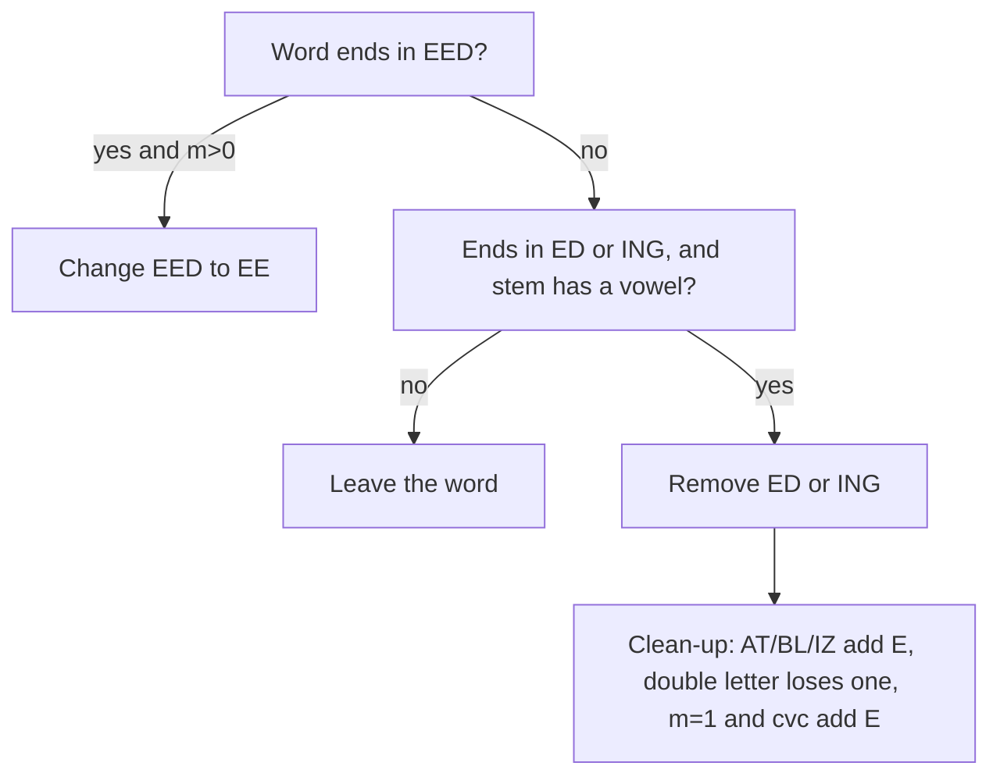
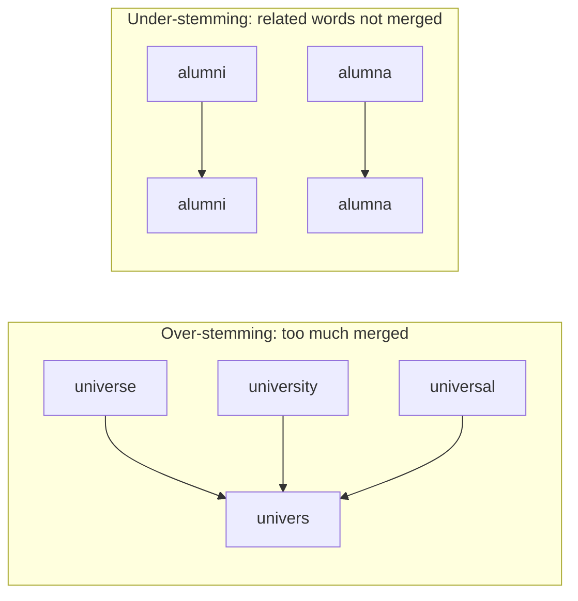

Before the new ideas, here are the old ones you need. If you already know them, skip to the next section.

## The basics first

- A **word form** is a word as written: *connect*, *connected*, *connecting*. A **suffix** is a group of letters added at the end of a word: *-ed*, *-ing*, *-ion*, *-s*. A **prefix** is added at the start (*un-*, *re-*).
- A **stem** is the main part left after the suffix is removed. A **root** or **lemma** is the dictionary form of a word (*run* for *running*, *good* for *better*).
- **Inflection** changes a word only to fit grammar and keeps its basic meaning (*cat*, *cats*; *walk*, *walked*). **Derivation** builds a new word, often of a new class (*happy*, *happiness*; *act*, *action*). Details are in <Syl m="2" /> "Morphology, finite automata and finite state transducers".
- A **vowel** is a, e, i, o or u; every other letter is a **consonant**. (Porter has one small rule about y, given below.)
- **Information retrieval (IR)** is finding the documents that match a query, as a search engine does. A **vocabulary** is the list of different words in a collection of text. **Tokenization** splits text into words first; stemming works on those tokens (see the topic <Syl m="2" /> "Text pre-processing").

## What is stemming

**What it is.** Stemming is the process of reducing a word to its stem by chopping off its ending (and sometimes using a few small repair rules). Related forms such as *connect, connected, connecting, connection, connections* are all reduced to the one stem *connect*. <Cite id="porter-stemmer-def" loc="§1" /> <Cite id="porter-stemmer-wiki-stem" /> <Cite id="porter-stemmer-gfg-stemming" />

**The stem need not be a real word.** The stem is only a label used to group words. Porter's stemmer turns *happy* into *happi* and *troubled* into *troubl*. This does not matter as long as every related word gets the same label. <Cite id="porter-stemmer-av-stemming" />

**Everyday analogy.** Think of a library that files all books of one author on one shelf. The shelf label need not be a full sentence. It only has to be the same for every book of that author. A stem is the shelf label for a family of words.

<Box kind="definition">

**Stemming** is a crude, rule-based way of reducing the different forms of a word to a common base form (the stem) by removing suffixes, so that a program can treat the forms as one term.

</Box>


## Why stemming is needed

1. **Better search.** A user who searches for *connect* also wants pages containing *connected* or *connections*. If each form is a different term, the search misses them. Porter wrote his algorithm for exactly this purpose. <Cite id="porter-stemmer-def" loc="§1" />
2. **Smaller vocabulary.** Many forms collapse into one, so the index and the models become smaller. In Porter's test on a 10,000-word vocabulary, stemming reduced it by about one third (to 6,370 distinct stems). <Cite id="porter-stemmer-def" />
3. **Simple pre-processing.** It is a quick normalization step before counting words, classifying text or topic modelling. <Cite id="porter-stemmer-av-stemming" /> <Cite id="text-preprocessing-ibm-stemlem" />


## Stemming versus lemmatization

A **lemmatizer** looks the word up in a dictionary (and uses its part of speech) and returns a real word, the lemma. A stemmer only follows spelling rules and never looks at the sentence. <Cite id="text-preprocessing-wiki-lem" /> <Cite id="text-preprocessing-ibm-stemlem" />

| Point | Stemming | Lemmatization |
|---|---|---|
| Method | Cut suffixes by rules | Dictionary lookup plus part of speech |
| Output | A stem, often not a word (*studies* gives *studi*) | A real word, the lemma (*studies* gives *study*) |
| Irregular forms | Cannot handle (*went* stays *went*) | Handles (*went* gives *go*, *better* gives *good*) |
| Context | None; one word at a time | Uses the part of speech (*meeting* as noun or verb) |
| Speed | Fast and simple | Slower; needs a dictionary such as WordNet |
| Typical use | Search and indexing | Vocabulary building, meaning-sensitive tasks |

The NLTK book shows the difference on real text: the Porter stemmer maps *lying* to *lie* and *women* stays unchanged, while the WordNet lemmatizer maps *women* to *woman*. <Cite id="text-preprocessing-nltk-book3" loc="§3.6" />


## Kinds of stemmers

| Stemmer | Idea | Remark |
|---|---|---|
| Lovins (1968) | One pass; remove the longest matching suffix from a long list, then repair the stem with recoding rules | The first published stemmer. <Cite id="porter-stemmer-wiki-stem" /> |
| Porter (1980) | Five steps of small rules, each with a condition on the stem | The de facto standard for English; this note. <Cite id="text-preprocessing-porter1980" /> |
| Snowball / Porter2 | Porter's own improved version, written in the Snowball language | Fixes errors of the original; Porter recommends it for practical work. <Cite id="porter-stemmer-snowball-porter2" /> <Cite id="porter-stemmer-nltk-snowball" /> |
| Lancaster (Paice/Husk) | One table of rules applied again and again | The most aggressive; stems often become very short. <Cite id="porter-stemmer-nltk-lancaster" /> <Cite id="porter-stemmer-av-stemming" /> |

## The Porter stemmer: main idea

Martin Porter published the algorithm in 1980 for information retrieval. It does not use a dictionary. It has a list of suffix rules and, for each suffix, a condition under which it may be removed. <Cite id="text-preprocessing-porter1980" /> <Cite id="porter-stemmer-def" loc="§1" />

Two ideas make it work:

- **Complex suffixes are removed bit by bit.** A long ending such as *-ization* is not in one rule. Step 2 turns *-ization* into *-ize*, Step 3 turns *-alize* into *-al*, and Step 4 removes *-al*. Because each step is small, the rule list stays short. <Cite id="porter-stemmer-def" loc="§2" />
- **A suffix is removed only if the stem left behind is long enough.** This is measured by the **measure m** (next section). It stops silly cuts: *-ate* is removed from *activate* (giving *activ*) but not from *rate*.

```mermaid
%% caption: The five steps of the Porter stemmer. A word goes through every step in order; each step may change it or leave it alone. Early steps deal with plurals and -ed/-ing; middle steps shorten long derivational endings; the last step tidies up.
flowchart LR
  W["Word"] --> S1["Step 1: plurals, -ed, -ing, y to i"]
  S1 --> S2["Step 2: long suffixes, e.g. -ational to -ate"]
  S2 --> S3["Step 3: -icate, -ful, -ness, ..."]
  S3 --> S4["Step 4: remove -al, -ance, -ment, -ion, ..."]
  S4 --> S5["Step 5: drop final e, double l"]
  S5 --> R["Stem"]
```



<Cite id="porter-stemmer-snowball" loc="the steps" />

## Consonants, vowels and the measure m

**Consonant and vowel.** A letter is a **vowel** if it is a, e, i, o or u, or a **y that follows a consonant**. Every other letter is a **consonant**. So in *toy* the consonants are t and y (y follows the vowel o), but in *by* and *syzygy* the y after a consonant counts as a vowel. <Cite id="porter-stemmer-def" loc="§2" />

**The shape of a word.** Write c for a consonant and v for a vowel, and merge repeats (a run of consonants is one **C**, a run of vowels one **V**). Every word then has the form

$$
[C](VC)^m[V]
$$

where the square brackets mean the part may be absent. The number $m$ is the **measure**: how many VC groups the word has. $m = 0$ is a word with no vowel-consonant pair.

**How to find m, step by step.**

1. Mark each letter v or c (remember the y rule).
2. Merge repeated letters: *ccvv* becomes C V.
3. Count the V-then-C pairs. That count is $m$.

| m | Examples (from Porter) | Shape |
|---|---|---|
| 0 | tr, ee, tree, y, by | C, V, CV, V, CV |
| 1 | trouble, oats, trees, ivy | CVCV, VC, CVC, VCV |
| 2 | troubles, private, oaten, orrery | CVCVC, CVCVCV, VCVC, VCVCV |

<Sum>

<Given>

the words *tree*, *oats*, *trouble*, *private*, *orrery*.

</Given>

<Find>

the measure $m$ of each word.

</Find>

<Steps>

1. **tree.** Letters: t=c, r=c, e=v, e=v. Merged: C V. There is no V followed by C, so $m = 0$. *Reason: a word ending in a vowel group after one consonant group has no VC pair.*
2. **oats.** Letters: o=v, a=v, t=c, s=c. Merged: V C. One VC pair, so $m = 1$.
3. **trouble.** t,r = c; o,u = v; b = c; l = c; e = v. Merged: C V C V. Pairs: V then C once (ou then bl). The final V has no C after it. So $m = 1$.
4. **private.** p,r = c; i = v; v = c; a = v; t = c; e = v. Merged: C V C V C V. Pairs: (i,v) and (a,t), so $m = 2$.
5. **orrery.** o = v; r,r = c; e = v; r = c; y after a consonant = v. Merged: V C V C V. Pairs: (o,rr) and (e,r), so $m = 2$.

</Steps>

<Answer>

tree 0, oats 1, trouble 1, private 2, orrery 2.

</Answer>

<Box kind="verify">

These five values agree with the lists printed in Porter's paper (tree $m=0$; oats and trouble $m=1$; private and orrery $m=2$). As a second check, count the vowel groups that are followed by a consonant: private has "i" before v and "a" before t, that is two. <Cite id="porter-stemmer-def" loc="§2" />

</Box>

</Sum>

## Conditions used in the rules

Rules are written as **(condition) S1 to S2**: if the word ends in S1 and the stem before it satisfies the condition, replace S1 by S2. For example, `(m>1) EMENT` to nothing maps *replacement* to *replac*, because *replac* has $m = 2$. <Cite id="porter-stemmer-def" loc="§2" />

| Symbol | Meaning | Example |
|---|---|---|
| `m>0`, `m>1`, `m=1` | Measure of the stem | `m>1` is true for *replac*, false for *rel* |
| `*v*` | The stem contains a vowel | *plaster* in *plastered*; false for *bl* in *bled* |
| `*d` | The stem ends in a double consonant | *-tt*, *-ss* |
| `*o` | The stem ends consonant-vowel-consonant, and the last consonant is not w, x or y | *-wil*, *-hop* |
| `*S`, `*T`, `*L` | The stem ends with that letter | used in Step 4 and 5 |

**The longest-match rule.** In a group of rules written one below the other, only one rule is used: the one whose S1 is the **longest match** for the word. If that rule's condition fails, the word is left unchanged by that group; no shorter rule is tried. Example: with `SSES to SS`, `IES to I`, `SS to SS`, `S to nothing`, the word *caresses* matches SSES (longest) and becomes *caress*; *caress* matches SS and stays; *cares* matches S and becomes *care*. <Cite id="porter-stemmer-def" loc="§2" />

## The rules, step by step

The rules below are exactly those of Porter's 1980 paper. <Cite id="porter-stemmer-def" loc="§2" /> <Cite id="text-preprocessing-porter1980" />

### Step 1a: plurals

| Rule | Example |
|---|---|
| SSES to SS | caresses to caress |
| IES to I | ponies to poni, ties to ti |
| SS to SS | caress to caress |
| S to (nothing) | cats to cat |

### Step 1b: past tense and -ing

| Rule | Example |
|---|---|
| (m>0) EED to EE | agreed to agree; feed stays feed |
| (`*v*`) ED to (nothing) | plastered to plaster; bled stays bled |
| (`*v*`) ING to (nothing) | motoring to motor; sing stays sing |

If the **second or third** rule fired (ED or ING was removed), a **clean-up** is done on the result:

| Clean-up rule | Example |
|---|---|
| AT to ATE | conflat(ed) to conflate |
| BL to BLE | troubl(ed) to trouble |
| IZ to IZE | siz(ed) to size |
| (`*d` and not `*L`, `*S`, `*Z`) to a single letter | hopp(ing) to hop; tann(ed) to tan; but fall(ing), hiss(ing), fizz(ed) stay |
| (m=1 and `*o`) to add E | fil(ing) to file; but fail(ing) stays fail |



<Cite id="porter-stemmer-def" loc="Step 1b" />

### Step 1c: y to i

| Rule | Example |
|---|---|
| (`*v*`) Y to I | happy to happi; sky stays sky |

Step 1 deals with plurals and past participles. The later steps are more straightforward. <Cite id="porter-stemmer-def" loc="Step 1c" />

### Step 2: double suffixes to single (all need m>0)

| Rule | Example | Rule | Example |
|---|---|---|---|
| ATIONAL to ATE | relational to relate | ALISM to AL | feudalism to feudal |
| TIONAL to TION | conditional to condition | IVENESS to IVE | decisiveness to decisive |
| ENCI to ENCE | valenci to valence | FULNESS to FUL | hopefulness to hopeful |
| ANCI to ANCE | hesitanci to hesitance | OUSNESS to OUS | callousness to callous |
| IZER to IZE | digitizer to digitize | ALITI to AL | formaliti to formal |
| ABLI to ABLE | conformabli to conformable | IVITI to IVE | sensitiviti to sensitive |
| ALLI to AL | radicalli to radical | BILITI to BLE | sensibiliti to sensible |
| ENTLI to ENT | differentli to different | IZATION to IZE | vietnamization to vietnamize |
| ELI to E | vileli to vile | ATION to ATE | predication to predicate |
| OUSLI to OUS | analogousli to analogous | ATOR to ATE | operator to operate |

### Step 3: (all need m>0)

| Rule | Example |
|---|---|
| ICATE to IC | triplicate to triplic |
| ATIVE to (nothing) | formative to form |
| ALIZE to AL | formalize to formal |
| ICITI to IC | electriciti to electric |
| ICAL to IC | electrical to electric |
| FUL to (nothing) | hopeful to hope |
| NESS to (nothing) | goodness to good |

### Step 4: remove the suffix (need m>1)

AL, ANCE, ENCE, ER, IC, ABLE, IBLE, ANT, EMENT, MENT, ENT, OU, ISM, ATE, ITI, OUS, IVE and IZE are removed when the stem has $m > 1$. ION is removed when the stem has $m > 1$ **and** ends in S or T. <Cite id="porter-stemmer-def" loc="Step 4" />

| Example | Result | Example | Result |
|---|---|---|---|
| revival | reviv | dependent | depend |
| allowance | allow | adoption (ION) | adopt |
| inference | infer | communism | commun |
| airliner | airlin | activate | activ |
| gyroscopic | gyroscop | angulariti | angular |
| adjustable | adjust | effective | effect |
| irritant | irrit | bowdlerize | bowdler |
| replacement | replac | adjustment | adjust |

### Step 5: tidy up

| Rule | Example |
|---|---|
| 5a: (m>1) E to (nothing) | probate to probat; rate stays rate |
| 5a: (m=1 and not `*o`) E to (nothing) | cease to ceas |
| 5b: (m>1 and `*d` and `*L`) to a single letter | controll to control; roll stays roll |

**Why the m-conditions matter.** Take *-ate*. In *activate* the stem *activ* has $m = 2$, so *-ate* goes. In *rate* the stem *r* has $m = 0$, so it stays. Porter's lists show that *relate*, *probate*, *pirate* keep their *-ate* while *derivate*, *demonstrate*, *renovate* lose it. <Cite id="porter-stemmer-def" loc="§2" />

## Worked examples

All traces below follow the 1980 rules. I recomputed each one by hand and checked it with NLTK's `ORIGINAL_ALGORITHM` mode of the Porter stemmer. <Cite id="text-preprocessing-nltk-porter" />

### Example 1: Step 1a on plurals

<Sum>

<Given>

the words *caresses*, *ponies*, *ties*, *caress*, *cats*.

</Given>

<Find>

the result of Step 1a for each word.

</Find>

<Steps>

1. **caresses** ends in SSES, and SSES is the longest match (longer than S). Rule SSES to SS gives *caress*. *Reason: longest match wins.*
2. **ponies** ends in IES. IES to I gives *poni*.
3. **ties** ends in IES. IES to I gives *ti* (a short, odd result, but that is the rule).
4. **caress** ends in SS. SS to SS leaves *caress* unchanged. *Reason: this rule exists so that the plain S rule does not cut caress to cares.*
5. **cats** ends in S only. S to nothing gives *cat*.

</Steps>

<Answer>

caress, poni, ti, caress, cat.

</Answer>

<Box kind="verify">

These five outputs match the example column of Step 1a in Porter's paper. Second check: running the longest-match rule on *cares* gives *care* (rule S), which shows why SSES must be tried before S.

</Box>

</Sum>

### Example 2: Step 1b and 1c

<Sum>

<Given>

the words *agreed*, *feed*, *plastered*, *bled*, *motoring*, *sing*, *happy*, *sky*.

</Given>

<Find>

the result of Step 1b and Step 1c for each word.

</Find>

<Steps>

1. **agreed** ends in EED, the stem *agr* has $m = 1 > 0$, so EED becomes EE: *agree*.
2. **feed** ends in EED, but the stem *f* has $m = 0$, so the rule fails: *feed*.
3. **plastered**: not EED; ends in ED; stem *plaster* has a vowel, so remove ED: *plaster*. The clean-up rules do not apply.
4. **bled**: ends in ED, but the stem *bl* has no vowel, so the rule fails: *bled*.
5. **motoring**: ING removed, stem *motor* has vowels: *motor*.
6. **sing**: ING matches, but the stem *s* has no vowel: *sing*.
7. **happy** (Step 1c): the stem *happ* has a vowel, so Y becomes I: *happi*.
8. **sky** (Step 1c): the stem *sk* has no vowel, so it stays: *sky*.

</Steps>

<Answer>

agree, feed, plaster, bled, motor, sing, happi, sky.

</Answer>

<Box kind="verify">

The values equal the Step 1b and 1c examples in Porter's paper. Note that these are the results after Step 1 only. Running all five steps, *agree* is shortened once more to *agre* in Step 5a (the stem *agre* has $m = 1$ and does not end consonant-vowel-consonant, so the final E goes). NLTK's original-mode stemmer also returns *agre*.

</Box>

</Sum>

### Example 3: the clean-up rules of Step 1b

<Sum>

<Given>

the words *conflated*, *troubled*, *sized*, *hopping*, *tanned*, *falling*, *hissing*, *filing*, *failing*.

</Given>

<Find>

the result of Step 1b including its clean-up rules.

</Find>

<Steps>

1. **conflated**: remove ED, giving *conflat*. It ends in AT, so add E: *conflate*.
2. **troubled**: remove ED, giving *troubl*. It ends in BL, so add E: *trouble*.
3. **sized**: remove ED, giving *siz*. It ends in IZ, so add E: *size*.
4. **hopping**: remove ING, giving *hopp*. It ends in a double consonant (pp) that is not L, S or Z, so drop one letter: *hop*.
5. **tanned**: remove ED, giving *tann*. Double nn, so drop one: *tan*.
6. **falling**: remove ING, giving *fall*. Double ll, but L is an exception, so keep it: *fall*.
7. **hissing**: *hiss*. Double ss, S is an exception, so keep it.
8. **filing**: remove ING, giving *fil*. No AT/BL/IZ, no double letter. Now $m(\text{fil}) = 1$ (f, i, l is C V C) and it ends consonant-vowel-consonant with l not w, x or y, so add E: *file*.
9. **failing**: remove ING, giving *fail*. The stem is f, ai, l: C V C, $m = 1$, but it ends in "ail", that is vowel-vowel-consonant, not consonant-vowel-consonant, so no E is added: *fail*.

</Steps>

<Answer>

conflate, trouble, size, hop, tan, fall, hiss, file, fail.

</Answer>

<Box kind="verify">

All nine agree with the Step 1b clean-up table in Porter's paper (conflate, trouble, size, hop, tan, fall, hiss, file, fail). Second check on the E rule: *fil* has $m = 1$ and is c-v-c, so E is added; *fail* has $m = 1$ but is c-v-v-c, so it is not.

</Box>

</Sum>

### Example 4: all five steps on a long word

Porter's own example is *generalizations*, "stripped to generalization (Step 1), then to generalize (Step 2), then to general (Step 3), and then to gener (Step 4)". <Cite id="porter-stemmer-def" loc="§2" />

<Sum>

<Given>

the word *generalizations*.

</Given>

<Find>

its stem after all five steps, with the measure at each decision.

</Find>

<Steps>

1. **Step 1a.** The word ends in S. The longest matching rule is S to nothing (it ends in "ons", not SS, IES or SSES). Result: *generalization*.
2. **Steps 1b and 1c.** The word does not end in EED, ED, ING or Y. No change.
3. **Step 2.** It ends in IZATION; the stem *general* has $m = 3 > 0$. Rule IZATION to IZE gives *generalize*. *Reason: IZATION is a longer match than ATION.*
4. **Step 3.** It ends in ALIZE; the stem *gener* has $m = 2 > 0$. ALIZE to AL gives *general*.
5. **Step 4.** It ends in AL; the stem *gener* has $m = 2 > 1$. Remove AL: *gener*.
6. **Step 5.** *gener* does not end in E, and does not end in a double L. No change.

</Steps>

<Answer>

generalizations becomes gener.

</Answer>

<Box kind="verify">

Measures: g-e-n-e-r is C V C V C, so $m(\text{gener}) = 2$; general is C V C V C V C, so $m = 3$. Both are greater than the limits used (0, then 1). The path generalization, generalize, general, gener is the one printed in the paper, and NLTK's original mode returns *gener*.

</Box>

</Sum>

### Example 5: a word that needs Step 5b

<Sum>

<Given>

the word *oscillators*.

</Given>

<Find>

its stem after all five steps.

</Find>

<Steps>

1. **Step 1a.** Remove the final S: *oscillator*.
2. **Step 2.** It ends in ATOR; the stem *oscill* has $m = 2 > 0$. ATOR to ATE gives *oscillate*.
3. **Step 3.** No Step 3 suffix at the end of *oscillate*. No change.
4. **Step 4.** It ends in ATE; the stem *oscill* has $m = 2 > 1$. Remove ATE: *oscill*.
5. **Step 5a.** There is no final E.
6. **Step 5b.** The word ends in a double L, and $m(\text{oscill}) = 2 > 1$, so one L is dropped: *oscil*.

</Steps>

<Answer>

oscillators becomes oscil.

</Answer>

<Box kind="verify">

Porter's paper gives the same path: oscillators, oscillator (Step 1), oscillate (Step 2), oscill (Step 4), oscil (Step 5). Check on m: o-s-c-i-l-l-: o=v, sc=C, i=v, ll=C, so V C V C gives $m = 2$.

</Box>

</Sum>

### Example 6: when a condition stops a rule

<Sum>

<Given>

the words *relational*, *conditional*, *rational*.

</Given>

<Find>

the final stem of each, and which conditions block a rule.

</Find>

<Steps>

1. **relational.** Step 2: the longest match is ATIONAL; the stem *rel* has $m = 1 > 0$. ATIONAL to ATE gives *relate*. Step 4: ATE needs $m > 1$ but *rel* has $m = 1$, so ATE stays. Step 5a: the stem *relat* has $m = 2 > 1$, so the final E is removed: *relat*.
2. **conditional.** Step 2: TIONAL (stem *condi*, $m = 1$) to TION gives *condition*. Step 4: ION needs $m > 1$ and a stem ending in S or T; the stem *condit* has $m = 2$ and ends in T, so ION is removed: *condit*.
3. **rational.** Step 2: the longest match is ATIONAL, but the stem *r* has $m = 0$, so the rule fails. Because only the longest match is tried, the shorter TIONAL rule is not used. Step 4: AL; the stem *ration* has $m = 2 > 1$, so AL is removed: *ration*.

</Steps>

<Answer>

relational becomes relat, conditional becomes condit, rational becomes ration.

</Answer>

<Box kind="verify">

Check the measures: rel is C V C, $m=1$; relat (r-e-l-a-t) is C V C V C, $m=2$; condit is c-o-nd-i-t: C V C V C, $m=2$; ration is r-a-t-io-n: C V C V C, $m=2$. Porter's own examples agree for the Step 2 results (relational gives relate; conditional gives condition; rational stays rational in Step 2). NLTK original mode returns relat, condit, ration.

</Box>

</Sum>

### Example 7: stemming a sentence

This is the "tokenization and stemming" question in small form. First split into tokens, then stem each token.

<Sum>

<Given>

the sentence "The ponies were running and hopping happily."

</Given>

<Find>

the tokens and the Porter stem of each.

</Find>

<Steps>

1. **Tokenize** (lower-case, drop the full stop): the, ponies, were, running, and, hopping, happily.
2. **the, were, and:** no rule applies (for *the* and *were* the final E is kept in Step 5a: *th* has $m = 0$ and *wer* has $m = 1$ and ends consonant-vowel-consonant). They stay.
3. **ponies:** Step 1a, IES to I: *poni*.
4. **running:** Step 1b, remove ING: *runn*; double N, so drop one: *run*.
5. **hopping:** remove ING: *hopp*; double P, so drop one: *hop*.
6. **happily:** Step 1c, Y to I: *happili*. No later rule matches the ending *-ili*.

</Steps>

<Answer>

the, poni, were, run, and, hop, happili.

</Answer>

<Box kind="verify">

Recomputed with the original-mode Porter stemmer from NLTK: the, poni, were, run, and, hop, happili. Note that *happily* and *happy* get the different stems *happili* and *happi*, a small case of under-stemming (NLTK's Snowball stemmer also gives *happili*).

</Box>

</Sum>

## Errors stemming makes

Rule-based stemming cannot be perfect. There are two kinds of error. <Cite id="porter-stemmer-wiki-stem" /> <Cite id="porter-stemmer-gfg-stemming" /> <Cite id="text-preprocessing-ibm-stemlem" />

- **Over-stemming (false positive).** Different words get the same stem. Porter reduces *universal*, *university* and *universe* to *univers*. IBM gives *news* becoming *new*. The suffix was really part of the word.
- **Under-stemming (false negative).** Related words keep different stems. Porter leaves *alumni* and *alumna* apart, and IBM gives *knavish* and *knave*. Irregular forms such as *went* and *go* are also missed.
- Fixing one error often makes the other worse, so the rule set is a compromise. Porter himself noted that adding more rules for one part of the vocabulary soon damages another part. <Cite id="porter-stemmer-def" loc="§1" />



<Cite id="porter-stemmer-gfg-stemming" loc="diagram" />

## Advantages and disadvantages of the Porter stemmer

| Advantages | Disadvantages |
|---|---|
| Simple, small and very fast; no dictionary needed. <Cite id="porter-stemmer-gfg-stemming" /> <Cite id="porter-stemmer-def" loc="§1" /> | Stems are often not real words (*happi*, *troubl*). |
| Shrinks the vocabulary and improves recall in search. | Over-stemming and under-stemming errors. |
| Complex suffixes are handled by a few small steps. | Cannot handle irregular forms (*went*, *mice*). |
| Works the same everywhere, so queries and documents get the same stems. | Built for English only; ignores context and the part of speech. |
| Easy to implement in any language. | Some rules have known faults that Porter later fixed in Snowball. <Cite id="porter-stemmer-snowball-porter2" /> |

## Porter, Snowball and Lancaster compared

| Point | Porter | Snowball (Porter2) | Lancaster |
|---|---|---|---|
| Year / author | 1980, M. F. Porter | later, M. F. Porter | late 1980s, C. D. Paice (Lancaster University) |
| Languages | English | English and many others | English |
| Speed and design | Simple and fast | A little faster and more logical than Porter | Iterative: rules are applied again and again |
| Strength | Gentle | Gentle, fewer errors | Very aggressive; may over-stem badly |
| Example | generate gives *gener*; friendship stays *friendship* | generate gives *generat*; friendship stays *friendship* | generate gives *gen*; friendship gives *friend* |

(The example outputs were run with the NLTK implementations; Analytics Vidhya shows the same Snowball and Lancaster behaviour.) <Cite id="porter-stemmer-av-stemming" /> <Cite id="porter-stemmer-nltk-stem" /> <Cite id="porter-stemmer-wiki-stem" />

## Using it in Python

NLTK ships the Porter stemmer. <Cite id="text-preprocessing-nltk-porter" /> <Cite id="porter-stemmer-gfg-stem-nltk" />

```python
from nltk.stem import PorterStemmer
ps = PorterStemmer()
for w in ["programs", "programmed", "programming"]:
    print(w, ps.stem(w))   # all three print: program
```

NLTK's default mode includes some extensions Porter added after 1980, so a few outputs differ from the paper (for example *ties* gives *tie*, not *ti*). To follow the 1980 rules exactly, as in this note, use `PorterStemmer(mode="ORIGINAL_ALGORITHM")`. Porter himself recommends the Snowball (Porter2) stemmer for practical work. <Cite id="text-preprocessing-nltk-porter" /> <Cite id="porter-stemmer-snowball-porter2" />

## Applications

- **Search engines and IR:** match a query with all forms of a word. <Cite id="porter-stemmer-def" loc="§1" />
- **Text mining and classification:** fewer features, so smaller models. <Cite id="porter-stemmer-av-stemming" />
- **Indexing and tagging systems, SEO.** <Cite id="porter-stemmer-av-stemming" />
- **Vocabulary reduction** before counting words or building a topic model.

## How to answer in the exam

For a 10-mark question "Explain the Porter stemming algorithm":

1. Define stemming and say why it is needed (search recall, smaller vocabulary).
2. Define consonant, vowel and the measure m, with two examples (tree 0, trouble 1, private 2).
3. State the rule form (condition) S1 to S2 and the longest-match rule.
4. Name the five steps with one line each, and give one or two rules with an example per step (caresses to caress; agreed to agree; happy to happi; relational to relate; hopeful to hope; replacement to replac; probate to probat).
5. Draw the five-step pipeline.
6. Trace one word through all steps (generalizations to gener).
7. Mention the errors (over- and under-stemming), advantages and disadvantages.

**Short definition for 5 marks:** "Stemming reduces the different forms of a word to a common stem by removing suffixes with rules, so that a search for connect also finds connected and connecting. Tokenization splits text into words; stemming then maps each token to its stem, for example ponies to poni and running to run."

## Where this appeared in past papers

- <PYQ id="2022-12-ce/q6b" />: explain the Porter stemming algorithm in detail (10 marks)
- <PYQ id="2023-05-ce/q5b" />: explain the Porter stemmer algorithm with rules (10 marks)
- <PYQ id="2023-12-ce/q5a" />: explain the Porter stemming algorithm in detail (10 marks)
- <PYQ id="2024-05-ce/q1b" />: tokenization and stemming (5 marks)
- <PYQ id="2024-05-ce/q2b" />: working of the Porter stemmer algorithm (10 marks)
- <PYQ id="2024-12-ce/q5a" />: explain the Porter stemming algorithm in detail (10 marks)
- <PYQ id="2024-12/q2b" />: Porter's stemming algorithm with example (10 marks)
- <PYQ id="2025-05/q3a" />: explain the Porter stemmer algorithm in detail (10 marks)

## Conclusion

The Porter stemmer is a small, fast, dictionary-free set of suffix rules in five steps. Each rule fires only when the stem left behind is long enough (measure m), so complex endings are peeled off bit by bit. It makes two kinds of error (over- and under-stemming) and gives stems that are not always words, but for search and text pre-processing it is simple and good enough.
