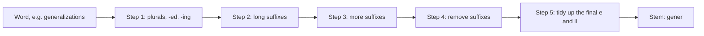
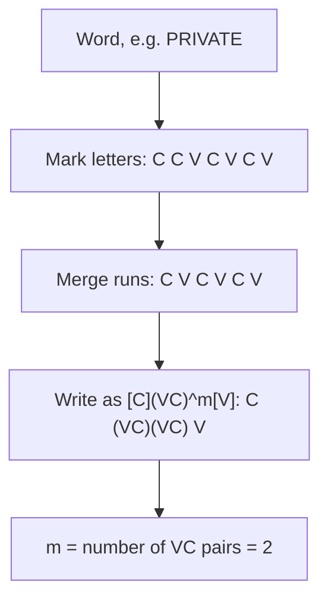
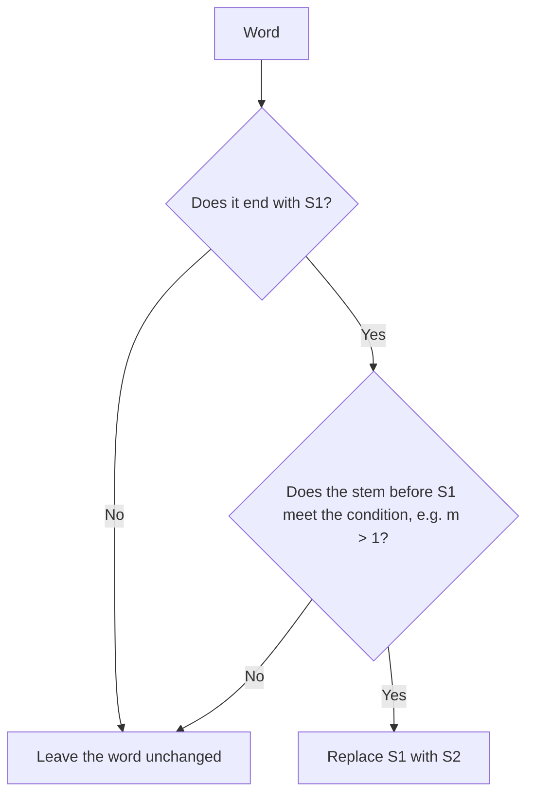

Before the new ideas, here are the old ones you need. If you already know them, skip to the next section.

## The basics first

- A **vowel** is a, e, i, o, u. A **consonant** is any other letter. (One special case for y comes below.)
- A **stem** is the main part of a word after its ending is cut off. The ending is a **suffix**: -ing, -ed, -s, -ment. <Cite id="class-nlp-m2" loc="p. 19" />
- **Information retrieval (IR)** means finding documents for a search. If you search for "connect", you also want "connected" and "connecting".

## What is stemming?

<Box kind="definition">

**Stemming** is a simplified form of morphological analysis which is basically used to find the root word. <Cite id="class-nlp-m2" loc="p. 19" />

</Box>

**The Porter stemmer** is a simple rule-based algorithm for stemming. It consists of 5 sets of rules applied in order, and it is known for its speed and simplicity. <Cite id="class-nlp-m2" loc="p. 19" /> It removes suffixes from an English word to get its stem, which is useful in IR: the system keeps fewer terms, which saves both space and time. It was developed by the British computer scientist Martin F. Porter. <Cite id="class-nlp-pyq2" loc="p. 2" />

Example: connect, connected, connecting, connection and connections all become **connect**, so one search finds them all. This is syllabus <Syl m="2" />.

## Consonants and vowels

The class gives the exact rule. <Cite id="class-nlp-m2" loc="p. 19" /> <Cite id="class-nlp-pyq2" loc="p. 2" />

- A **consonant** is a letter other than the vowels a, e, i, o, u and other than a letter y preceded by a consonant.
- If a letter is not a consonant it is a **vowel**. So y is a vowel when it follows a consonant, and a consonant when it follows a vowel.
- In TOY the consonants are T and Y (Y follows the vowel O). In SYZYGY they are S, Z and G (each Y follows a consonant, so those Ys are vowels).
- A string of one or more consonants is written **C**; a string of one or more vowels is written **V**.

## The measure m

Any word has one of four forms. <Cite id="class-nlp-pyq2" loc="p. 2" />

| Form | Example |
|---|---|
| C V C V ... C | collection, management |
| C V C V ... V | conclude, revise |
| V C V C ... C | entertainment, illumination |
| V C V C ... V | illustrate, abundance |

All of them fit one formula. <Cite id="class-nlp-m2" loc="p. 20" />

<Box kind="definition">

**Form of a word:** $[C](VC)^m[V]$, where $C$ is a string of one or more consonants, $V$ a string of one or more vowels, and $m$ is the **measure** of the word or word part, the number of $VC$ pairs. <Cite id="class-nlp-m2" loc="p. 20" />

</Box>

**How to find m (three steps).**

1. Write C for each consonant letter and V for each vowel letter.
2. Merge each run of equal letters into one: CC becomes C, VV becomes V.
3. Count how many times V is followed by C. That count is m.

| m | Examples (class) |
|---|---|
| 0 | TREE, TR, EE, Y, BY |
| 1 | TROUBLE, OATS, TREES, IVY, TRAP |
| 2 | TROUBLES, PRIVATE, OATEN, ROBBERY |
| 4 | RELATIONAL |

<Cite id="class-nlp-pyq2" loc="p. 2" /> <Cite id="class-nlp-m2" loc="p. 21" />

## The form of a rule

A rule for replacing or removing a suffix is written (condition) S1 to S2. <Cite id="class-nlp-pyq2" loc="p. 2" /> <Cite id="class-nlp-pyq2" loc="p. 3" />

> If a word ends with the suffix S1, and the stem before S1 satisfies the given condition, S1 is replaced by S2.

The condition is usually given in terms of m for the stem before S1. Example: **(m > 1) EMENT to nothing**. S1 is EMENT and S2 is empty. REPLACEMENT becomes REPLAC, because the stem REPLAC has m = 2. <Cite id="class-nlp-pyq2" loc="p. 3" />

## The five steps and their main rules

The class says there are 5 sets of rules but does not list them, so the rules below are the standard ones from Porter's algorithm, kept short. Each example shows the word **after that step**. In the conditions, $*v*$ means the stem contains a vowel, $*d$ means it ends in a double consonant, and $*o$ means it ends consonant-vowel-consonant where the last consonant is not W, X or Y.

| Step | Job | Main rules | Examples |
|---|---|---|---|
| 1a | Plurals | SSES to SS, IES to I, SS to SS, S to nothing | caresses to caress, ponies to poni, caress to caress, cats to cat |
| 1b | -ed and -ing | (m > 0) EED to EE, (\*v\*) ED to nothing, (\*v\*) ING to nothing | feed stays feed, agreed to agree, plastered to plaster, bled stays bled, motoring to motor, sing stays sing |
| 1b clean-up | After removing -ed or -ing | AT to ATE, BL to BLE, IZ to IZE; double consonant to single (not L, S, Z); (m = 1 and \*o) add E | conflated to conflate, troubled to trouble, sized to size, hopping to hop, falling stays fall, filing to file |
| 1c | Final y | (\*v\*) Y to I | happy to happi, sky stays sky |
| 2 | Long suffixes, all (m > 0) | ATIONAL to ATE, TIONAL to TION, IZER to IZE, IZATION to IZE, ATION to ATE, ATOR to ATE, ALISM to AL, FULNESS to FUL, OUSNESS to OUS, IVENESS to IVE, ALITI to AL | relational to relate, conditional to condition, digitizer to digitize, vietnamization to vietnamize, predication to predicate, operator to operate, feudalism to feudal, hopefulness to hopeful |
| 3 | Suffixes, all (m > 0) | ICATE to IC, ATIVE to nothing, ALIZE to AL, ICITI to IC, ICAL to IC, FUL to nothing, NESS to nothing | triplicate to triplic, formative to form, formalize to formal, electrical to electric, hopeful to hope, goodness to good |
| 4 | Remove suffixes, all (m > 1) | AL, ANCE, ENCE, ER, IC, ABLE, IBLE, ANT, EMENT, MENT, ENT, ION (after S or T), OU, ISM, ATE, ITI, OUS, IVE, IZE to nothing | revival to reviv, allowance to allow, replacement to replac, adoption to adopt, communism to commun, effective to effect |
| 5a | Final e | (m > 1) E to nothing; (m = 1 and not \*o) E to nothing | probate to probat, cease to ceas, rate stays rate |
| 5b | Double l | (m > 1 and *d and ends in L) to a single letter | controll to control, roll stays roll |

If more than one rule in a group matches, the rule with the longest S1 is used.

## Worked traces

<Sum>

<Given>

the word **generalizations**.

</Given>

<Find>

its Porter stem.

</Find>

<Steps>

1. Step 1a: the word ends in a single S, so S to nothing: generalizations to **generalization**.
2. Step 2: (m > 0) IZATION to IZE. The stem before it is GENERAL with m = 3, so it fires: **generalize**.
3. Step 3: (m > 0) ALIZE to AL. The stem GENER has m = 2, so it fires: **general**.
4. Step 4: (m > 1) AL to nothing. The stem GENER has m = 2, so it fires: **gener**.
5. Step 5: the word does not end in e or double l, so nothing changes.

</Steps>

<Answer>

**gener**

</Answer>

<Box kind="verify">

Check each m: GENERAL is G-E-N-E-R-A-L = C V C V C V C, so VC three times (m = 3); GENER is C V C V C, so m = 2. Both are greater than the limits 0 and 1 that the rules need. The Porter stemmer program also returns gener.

</Box>

</Sum>

<Sum>

<Given>

the word **relational**.

</Given>

<Find>

its Porter stem.

</Find>

<Steps>

1. Step 1: no rule matches the ending (it does not end in S, ED, ING or Y).
2. Step 2: (m > 0) ATIONAL to ATE. The stem REL is C V C, so m = 1 and the rule fires: **relate**.
3. Steps 3 and 4: no rule matches.
4. Step 5a: (m > 1) E to nothing. The stem RELAT is C V C V C, so m = 2 and the rule fires: **relat**.

</Steps>

<Answer>

**relat**

</Answer>

<Box kind="verify">

The measure of RELATIONAL itself is 4 (class page), which is why Step 2 is allowed to cut. The Porter stemmer program also returns relat.

</Box>

</Sum>

<Sum>

<Given>

the word **hopefulness**.

</Given>

<Find>

its Porter stem.

</Find>

<Steps>

1. Steps 1a to 1c: no rule matches.
2. Step 2: (m > 0) FULNESS to FUL. The stem HOPE is C V C V, so m = 1: **hopeful**.
3. Step 3: (m > 0) FUL to nothing. The stem HOPE has m = 1: **hope**.
4. Step 4: no rule matches.
5. Step 5a: the word ends in E, and the stem HOP has m = 1 and is consonant-vowel-consonant (*o), so the E is kept.

</Steps>

<Answer>

**hope**

</Answer>

<Box kind="verify">

Rule 5a with m = 1 removes the final E only when the stem is not consonant-vowel-consonant. HOP is, so E stays. This is the same reason rate stays rate. The Porter stemmer program also returns hope.

</Box>

</Sum>

## Advantages and limits

- **Fast and simple**, so it is used in information retrieval; it shrinks the number of terms. <Cite id="class-nlp-m2" loc="p. 19" /> <Cite id="class-nlp-pyq2" loc="p. 2" />
- It is a **crude, heuristic process** that chops word endings, so it can give roots that are not dictionary words (happy becomes happi, studies becomes studi). Lemmatization uses a dictionary and returns real words (better becomes good). <Cite id="class-nlp-asol" loc="p. 12" />
- Different words can get the same stem (universe, university and universal all become univers). This is a limit of stemming.

## Where this was asked

| If the question says | What to write | Seen as |
|---|---|---|
| "Explain Porter stemming algorithm in detail" | Definition, consonant and vowel rule, form [C](VC)^m[V], measure examples, rule form, the five steps, one trace | <PYQ id="2022-12-ce/q6b" /> <PYQ id="2023-12-ce/q5a" /> <PYQ id="2024-12-ce/q5a" /> <PYQ id="2025-05/q3a" /> |
| "Explain Porter stemmer algorithm with rules" | The five steps table, then one trace | <PYQ id="2023-05-ce/q5b" /> <PYQ id="assignment-1/q2b" /> |
| "Explain Porter's stemming algorithm with example" | Rule form with the EMENT example and the traces | <PYQ id="2024-12/q2b" /> |
| "Illustrate the working of Porter stemmer" | The flow diagram and a trace | <PYQ id="2024-05-ce/q2b" /> |

## Quick revision

- Stemming finds the root word. The Porter stemmer is a simple rule-based algorithm with 5 sets of rules, known for speed and simplicity.
- Consonant: not a, e, i, o, u and not y after a consonant. Everything else is a vowel.
- Form $[C](VC)^m[V]$. m counts the VC pairs. TREE 0, TROUBLE 1, TRAP 1, TROUBLES 2, PRIVATE 2, RELATIONAL 4.
- Rule: (condition) S1 to S2. Example (m > 1) EMENT to nothing: REPLACEMENT becomes REPLAC.
- Steps: 1 plurals and -ed/-ing, 2 and 3 long suffixes, 4 remove suffixes, 5 tidy up.
- Traces: generalizations to gener, relational to relat, hopefulness to hope.

**Conclusion.** The Porter stemmer cuts word endings with a small set of conditional rules whose condition is the measure m of the stem, giving fast and simple stemming for IR. <Cite id="class-nlp-m2" loc="p. 19" />
