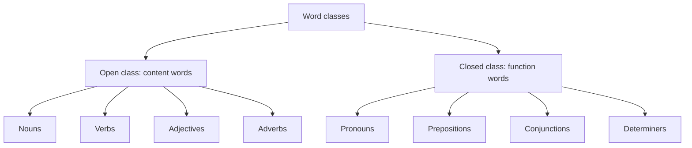
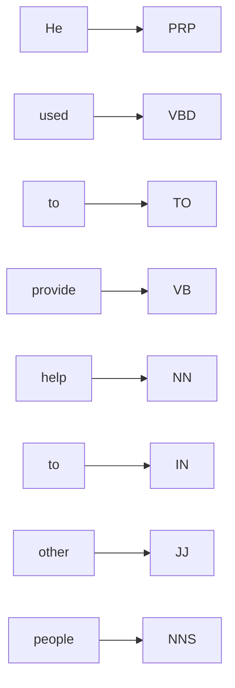
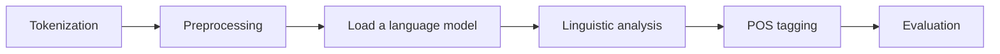
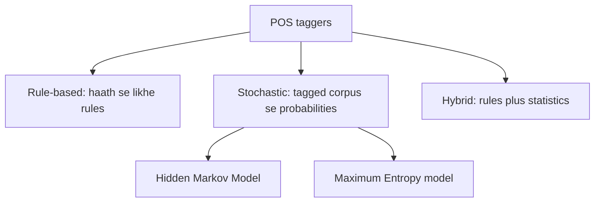
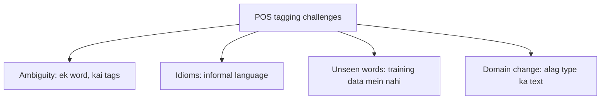

Ye note syllabus <Syl m="3" /> hai: part-of-speech tagging, rule-based aur statistical taggers. HMM, MaxEnt aur CRF models ka alag note hai, aur CFG aur parsing ka alag.

## Pehle basics

- Yahan **word** ka matlab token hai: sentence todne ke baad ka ek piece. <Cite id="class-nlp-pyq3" loc="p. 4" />
- **Tag** wo label hai jo hum word ko dete hain: uska part of speech (noun, verb aadi).
- **Corpus** text ka bada collection hai; **tagged corpus** mein har word ke baad uska tag hota hai. Taggers isi par train hote hain. <Cite id="class-nlp-pyq3" loc="p. 4" />
- **Tag set** tags ki list hai. Class answers Penn Treebank style tags use karte hain: NN (noun), NNS (plural noun), NNP (proper noun), VB (verb), VBD (past-tense verb), VBZ (verb, he/she/it form), MD (modal), DT (determiner), JJ (adjective), IN (preposition), TO (infinitive marker *to*), PRP (pronoun), RB (adverb). <Cite id="class-nlp-pyq3" loc="p. 1" /> <Cite id="class-nlp-pyq3" loc="p. 4" /> <Cite id="class-nlp-pyq3" loc="p. 7" />

## POS tagging kya hai?

<Box kind="definition">

**POS tagging:** Parts of speech (PoS) tagging Natural Language Processing (NLP) ka ek fundamental task hai jisme sentence ke har word ko ek grammatical category di jaati hai, jaise noun, verb, adjective ya adverb. <Cite id="class-nlp-pyq3" loc="p. 4" />

</Box>

Ye machines ko sentences ka structure aur meaning samajhne mein madad karti hai kyunki ye words ke roles aur unke relations pehchanti hai. Isse text analysis, parsing, machine translation aur information extraction behtar hote hain, aur ye text classification, sentiment analysis, chatbots aur search engines mein widely use hoti hai. <Cite id="class-nlp-pyq3" loc="p. 4" />

**Example:** "The quick brown fox jumps over the lazy dog." ka tag hota hai The/DT quick/JJ brown/JJ fox/NN jumps/VBZ over/IN the/DT lazy/JJ dog/NN. *Quick* aur *brown* adjectives hain jo noun *fox* ko describe karte hain. <Cite id="class-nlp-pyq3" loc="p. 4" />

## Word classes: open aur closed

**Open class words:** ye wo words hain jinme naye words aur changes aasani se jud jaate hain. Ye aam taur par content words hote hain jo meaning dete hain, jaise nouns, verbs, adjectives aur adverbs. Language badalne ke saath ye classes badhti rehti hain. <Cite id="class-nlp-pyq3" loc="p. 1" />

- Nouns: book, dog, computer
- Verbs: run, eat, sleep
- Adjectives: big, red, happy
- Adverbs: quickly, softly, beautifully

**Closed class words:** inme naye members aasani se nahi judte. Ye aksar function words hote hain jo grammar ka kaam karte hain aur sentence ke andar structure ka relation dikhate hain. Ye classes kaafi stable hain aur time ke saath mushkil se badalti hain. <Cite id="class-nlp-pyq3" loc="p. 1" />

- Pronouns: he, she, it, they
- Prepositions: on, in, at, with
- Conjunctions: and, but, or, so
- Determiners: the, a, an, some (articles *the, a, an* determiners hi hain)

| Point | Open class | Closed class |
|---|---|---|
| Naye words | Aasani se jude | Lagbhag kabhi nahi |
| Kisam ke words | Content words (meaning) | Function words (grammar) |
| Examples | book, run, big, quickly | he, on, and, the |

**Ye split kyun zaroori hai:** tagger kam closed-class words ko achhe se jaanta hai, aur unseen word lagbhag hamesha open-class ka hota hai. <Cite id="class-nlp-pyq3" loc="p. 5" />

## Sentence ko tag karna

**"He used to provide help to other people." ko tag karna.** Har word ko wo tag milta hai jo yahan uska kaam hai. <Cite id="class-nlp-pyq3" loc="p. 1" />

| Word | POS tag | Word class |
|---|---|---|
| He | PRP | Pronoun |
| used | VBD | Verb (past tense) |
| to | TO | Infinitive marker |
| provide | VB | Verb |
| help | NN | Noun |
| to | IN | Preposition |
| other | JJ | Adjective |
| people | NNS | Plural noun |

*Ye tags kyun:* *used* past-tense verb hai; pehla *to* verb *provide* se pehle hai, isliye infinitive marker hai; *help* wo cheez hai jo di ja rahi hai, isliye noun hai; doosra *to* noun phrase se pehle hai, isliye preposition hai (class answer ismein IN use karta hai); *other* *people* ko describe karta hai; *people* plural hai. (Penn Treebank har *to* ko TO tag deta hai; table class jaisi hi likho.)

<PYQ id="2024-12/q1a" /> <PYQ id="assignment-1/q3a" />

## Tagging kaise kaam karti hai

**Steps:** tokenization (text ko words mein todna), preprocessing (lowercase karna, special characters hatana), language model load karna (NLTK ya SpaCy jaise tools), linguistic analysis (context mein har word ka role), POS tagging, aur evaluation (accuracy check karna aur errors sudharna). <Cite id="class-nlp-pyq3" loc="p. 4" /> <Cite id="class-nlp-pyq3" loc="p. 5" />

## Taggers ki kisme

### Rule-based taggers

Rule-based POS tagging predefined grammatical rules se POS tags deti hai. Ye rules morphological features (jaise word endings) aur syntactic context se banaye jaate hain, isliye ye approach bahut interpretable aur transparent hai. <Cite id="class-nlp-pyq3" loc="p. 3" />

*Example:* rule "-tion ya -ment par khatam hone wale words ko Noun tag do". "The presentation highlighted the key achievements of the project's development" mein *presentation*, *achievements* aur *development* is rule se noun ban jaate hain, aur *highlighted* verb hai (iske liye doosra rule chahiye, jaise "-ed par khatam hone wala word verb hai"). <Cite id="class-nlp-pyq3" loc="p. 3" /> <Cite id="class-nlp-pyq3" loc="p. 4" />

### Statistical (stochastic) taggers

Ye tagged corpus se seekhe probabilities se sabse probable tag ya tag sequence chunte hain. Hidden Markov Model transition aur emission probabilities use karta hai <Cite id="class-nlp-pyq3" loc="p. 2" /> aur Maximum Entropy model context ke weighted features <Cite id="class-nlp-pyq3" loc="p. 8" />; HMM, MaxEnt aur CRF ka note dekho.

### Hybrid taggers

*(Class files mein nahi hai; standard short idea.)* Hybrid tagger dono ko milata hai: statistical tagger pehla tag deta hai, aur rules galtiyan theek karte hain (ya rules impossible tags hatate hain aur statistics baaki mein se chunti hai).

| Point | Rule-based | Stochastic |
|---|---|---|
| Knowledge from | Hand-written rules | Counts in a tagged corpus |
| Easy to understand | Yes, very | Less |
| Effort | Experts must write rules | Needs a large tagged corpus |
| Example | Suffix rule (-tion gives noun) | HMM, MaxEnt |

<PYQ id="2023-12-ce/q1a" /> <PYQ id="2024-12-ce/q1d" />

## POS tagging ke challenges

**Challenges** <Cite id="class-nlp-pyq3" loc="p. 5" />

1. **Ambiguity:** ek word ke context ke hisaab se kai meanings ya tags ho sakte hain. *Book* "read a book" mein noun hai aur "book a ticket" mein verb.
2. **Idiomatic expressions:** informal language aur idioms ko sahi tag karna mushkil hai.
3. **Out-of-vocabulary words:** pehle na dekhe gaye words (naye words, names) galat tags dete hain.
4. **Domain dependence:** model apni training domain ke bahar achha nahi chalta (news text versus tweets).

<PYQ id="2022-12-ce/q3c" /> <PYQ id="2023-12-ce/q4b" /> <PYQ id="2024-05-ce/q1c" />

## Past papers aur class assignment ke questions

- <PYQ id="2022-12-ce/q1c" /> open aur closed class words (5 marks)
- <PYQ id="2025-05/q1d" /> word classes ke types (5 marks)
- <PYQ id="2024-12/q1a" /> aur <PYQ id="assignment-1/q3a" /> word classes aur "He used to provide help to other people" ki tagging
- <PYQ id="2022-12-ce/q3c" />, <PYQ id="2023-12-ce/q4b" />, <PYQ id="2024-05-ce/q1c" /> POS tagging aur uske challenges
- <PYQ id="2023-12-ce/q1a" /> rule-based aur stochastic taggers; <PYQ id="2024-12-ce/q1d" /> hybrid tagging
