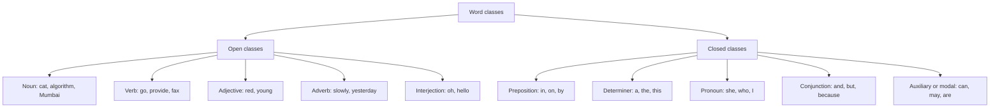
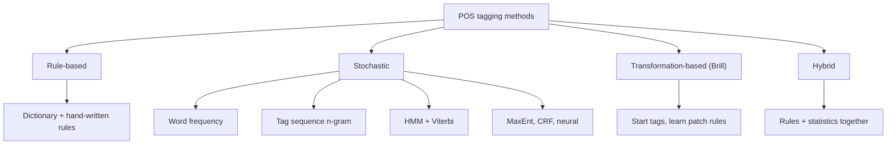
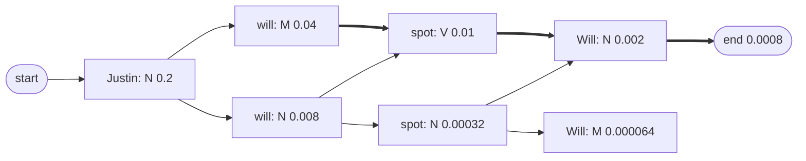
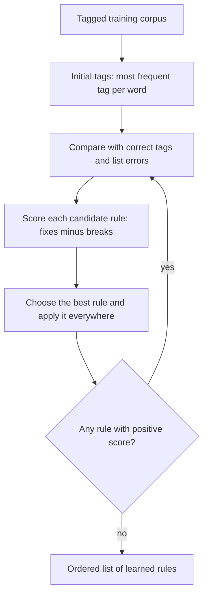
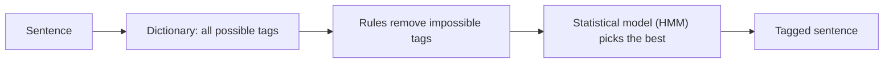

Ye note syllabus <Syl m="3" /> hai: 3.1 Part-of-speech tagging, open aur closed words, Penn Treebank tag set; 3.2 rule-based aur transformation-based tagging; 3.3 stochastic tagging aur uske issues (multiple tags and words, unknown words); 3.5 tagging ke liye Hidden Markov Model. Module 3 ke CFG, MaxEnt aur CRF parts ke alag notes hain.

## Pehle basics

- Yahan **word** matlab tokenization se bana token (dekho <Syl m="2" /> "Text pre-processing"). Punctuation marks bhi tokens hain.
- **Grammar** un rules ka set hai jo batata hai words ko kaise arrange kar sakte hain. Har word grammar mein ek role nibhata hai: kisi cheez ka naam batana, action dikhana, cheez ko describe karna, wagairah. Is role ko **part of speech (POS)** ya **word class** kehte hain.
- **Tag** word class ka chhota label hai, jaise singular noun ke liye `NN`. **Tag set** un tags ki poori list hai jo ek project use karne par agree karta hai.
- **Corpus** text ka bada collection hai. **Tagged corpus** woh corpus hai jisme logon ne har word ke saamne sahi tag likh diya hai. Ye tagger ko train aur test karne ki "answer book" hai.
- **Counts se probability.** Agar koi cheez 10 chances mein 3 baar hui, to uski probability $3/10$ hai. Ise **maximum likelihood estimate (MLE)** kehte hain. Taggers zyaadatar kuch tagged corpus mein ginti karke seekhte hain. Words par yehi idea <Syl m="2" /> "N-gram language models" mein hai.
- **Context** matlab word ke aas-paas ke words. Context hi tagger ko batata hai ki *book* noun hai ya verb.

## POS tagging kya hai

<Box kind="definition">

**Part-of-speech tagging** text ke har word ko ek part of speech (tag) dene ka process hai, jisme word aur uska context dono use hote hain. Input words ka sequence $x_1, x_2, \dots, x_n$ aur ek tag set hai; output tags ka sequence $y_1, y_2, \dots, y_n$ hai, har word ke liye theek ek tag. <Cite id="pos-tagging-slp3-ch18" loc="§18.2" /> <Cite id="pos-tagging-wiki-pos-tagging" />

</Box>

Example, Penn Treebank tags ke saath: *Janet/NNP will/MD back/VB the/DT bill/NN*. Janet proper noun hai, *will* modal verb hai, *back* base-form verb hai ("support karna"), *the* determiner hai aur *bill* noun hai. <Cite id="pos-tagging-slp3-ch18" loc="§18.2" />

**Roz ki analogy.** Socho teacher sentence ko alag-alag rang ke pens se mark kar raha hai: nouns ke liye neela, verbs ke liye laal, adjectives ke liye hara. POS tagger woh teacher hai aur tag set pens ka dabba hai. Asli skill un words ka rang decide karna hai jo do cheezein ho sakte hain, jaise *book* ya *back*.

**Tagging disambiguation hai.** Bahut se words ke ek se zyada tags ho sakte hain, to asli kaam is sentence ke liye sahi tag chunna hai. "book that flight" mein *book* verb hai aur "hand me that book" mein noun. <Cite id="pos-tagging-slp3-ch18" loc="§18.2" />

## POS tagging kyun zaroori hai

1. **Parsing.** Word noun hai ya verb, ye jaanke parser ko pata chalta hai ki aas-paas kaun se words aa sakte hain (English mein nouns determiners aur adjectives ke baad aate hain, verbs nouns ke baad), isliye tagging parsing se pehle ka key step hai (<Syl m="3" /> CFG and parsing). <Cite id="pos-tagging-slp3-ch18" />
2. **Lemmatization aur stemming.** *saw* ka lemma tag par depend karta hai: verb ho to *see*, noun ho to *saw*. <Cite id="pos-tagging-nltk-ch5" />
3. **Information extraction aur NER.** Names zyaadatar proper nouns hote hain; relations aam taur par nouns ke beech ke verbs hote hain.
4. **Word sense disambiguation.** Tag se word ke possible senses kam ho jaate hain (*bank* noun ya *bank* verb).
5. **Speech synthesis aur machine translation.** *record* word ka stress noun aur verb mein alag hota hai; translation mein har class ke liye alag target word chunna padta hai.
6. **Search aur sentiment analysis.** Adjectives aur adverbs opinion batate hain; nouns topic batate hain. <Cite id="pos-tagging-gfg-pos" />

## Word classes: open aur closed

Parts of speech sirf meaning se nahi, balki word apne padosiyon ke saath kaise behave karta hai aur uske affixes se define hote hain. Ye do groups mein aate hain. <Cite id="pos-tagging-slp3-ch18" loc="§18.1" /> <Cite id="pos-tagging-wiki-pos" />

- **Open classes** mein naye members judte rehte hain. Naye nouns aur verbs hamesha aate hain, jaise *iPhone* ya *to fax*. English mein paanch hain: noun (proper nouns samet), verb, adjective, adverb aur interjection.
- **Closed classes** ka membership chhota aur lagbhag fixed hota hai. Nayi prepositions kam hi banti hain. Inke members **function words** hain jaise *of*, *it*, *and*, *you*: chhote, bahut frequent aur grammar ke kaam ke.



<Cite id="pos-tagging-slp3-ch18" loc="§18.1" /> <Cite id="pos-tagging-gfg-pos" loc="diagram" />

| Class | Meaning | Examples |
|---|---|---|
| Noun | Person, place, thing ya idea; determiner, possessive ya plural ke saath aata hai | cat, algorithm, beauty, IBM |
| Verb | Action ya process; inflections hote hain (eat, eats, eating, eaten) | draw, provide, go |
| Adjective | Noun ko describe karta hai: colour, age, value | red, young, good |
| Adverb | Verb, adjective ya dusre adverb ko modify karta hai: time, place, manner, degree | slowly, very, home, yesterday |
| Interjection | Exclamation, greeting, response | oh, hello, yes |
| Preposition | Noun ka spatial, time ya dusra relation dikhata hai | in, on, by, under |
| Determiner | Noun phrase shuru karta hai; articles *a, an, the* determiners hain | a, the, this, that |
| Pronoun | Noun ki jagah aata hai | she, I, who, my |
| Conjunction | Phrases ya clauses ko jodta hai: coordinating (*and, or, but*) aur subordinating (*because, that*) | and, but, because |
| Auxiliary / modal | Tense, mood, negation ke liye helping verb; modals jaise *can, may, must* | can, may, should, be, have |
| Particle | Function word jo kisi dusre word ke saath hi aata hai | *not*, infinitive *to*, *give up* mein *up* |
| Numeral | Ginti ka word | one, two, 2026 |

<Cite id="pos-tagging-slp3-ch18" loc="§18.1" />

<Box kind="pitfall">

Dono groups membership ke baare mein hain, importance ke baare mein nahi. *The* closed-class word hai aur written English ka sabse common word hai. Aur "open" ka matlab ye nahi ki har word naya hai; sirf ye ki class badh sakti hai. Ye bhi dhyan rakho ki tag use par depend karta hai: *back* sentence ke hisaab se noun, adjective, adverb, verb ya particle ho sakta hai.

</Box>

<Box kind="exam">

**Open aur closed classes (5 marks):** dono define karo, table se har ek ke paanch examples do, likho ki closed-class words function words hain, aur neeche Example 1 ka tagged sentence jodo. <PYQ id="2022-12-ce/q1c" /> <PYQ id="2024-12/q1a" /> <PYQ id="2025-05/q1d" />

</Box>

## Tag sets

**Tag set** tags ki list aur split kitna fine hai, ye tay karta hai. Do sabse zyada use hote hain.

**Penn Treebank tag set.** Isme 36 core tags hain (aur punctuation aur symbols ke extra tags), aur isse Penn Treebank label hua, jo English ka bada syntactically annotated corpus hai. Ye verbs ko tense aur form ke hisaab se todta hai aur word *there* aur infinitive *to* ke liye khaas tag rakhta hai. <Cite id="pos-tagging-marcus1993" /> <Cite id="pos-tagging-slp3-ch18" loc="§18.1" /> <Cite id="pos-tagging-ptb-tags" /> <Cite id="pos-tagging-wiki-ptb" />

| Tag | Meaning | Example | Tag | Meaning | Example |
|---|---|---|---|---|---|
| NN | noun, singular or mass | llama | VB | verb, base form | eat |
| NNS | noun, plural | llamas | VBD | verb, past tense | ate |
| NNP | proper noun, singular | IBM | VBG | verb, gerund or present participle | eating |
| NNPS | proper noun, plural | Carolinas | VBN | verb, past participle | eaten |
| PRP | personal pronoun | I, you, he | VBP | verb, non-3rd-person singular present | eat |
| PRP$ | possessive pronoun | your | VBZ | verb, 3rd-person singular present | eats |
| DT | determiner | a, the | MD | modal | can, should |
| IN | preposition or subordinating conjunction | of, in, by | TO | the word *to* | to |
| JJ | adjective | yellow | CC | coordinating conjunction | and, but |
| JJR / JJS | comparative / superlative adjective | bigger / wildest | CD | cardinal number | one, two |
| RB | adverb | quickly | RP | particle | up, off |
| RBR / RBS | comparative / superlative adverb | faster / fastest | EX | existential *there* | there |

<Cite id="pos-tagging-slp3-ch18" loc="§18.1" />

**Universal Dependencies (UD) tag set.** Isme sabhi languages ke liye 17 coarse tags hain: ADJ, ADP, ADV, AUX, CCONJ, DET, INTJ, NOUN, NUM, PART, PRON, PROPN, PUNCT, SCONJ, SYM, VERB aur X. <Cite id="pos-tagging-ud-pos" /> <Cite id="pos-tagging-slp3-ch18" loc="§18.1" /> spaCy dono deta hai: coarse UD tag `token.pos_` mein aur fine tag (English ke liye Penn style) `token.tag_` mein. <Cite id="pos-tagging-spacy" />

| Point | Penn Treebank | Universal Dependencies |
|---|---|---|
| Size | 36 core tags (Treebank-3 mein punctuation ke saath 45) | 17 tags |
| Languages | English | Sau se zyada languages |
| Verb detail | Tense aur form VB, VBD, VBG, VBN, VBP, VBZ mein bante hain | Ek VERB tag; tense alag feature hai |
| Plural noun | NNS | NOUN with a number feature |
| Typical use | Purane English corpora aur taggers | Modern multilingual kaam |

<Cite id="pos-tagging-slp3-ch18" loc="§18.1" /> <Cite id="pos-tagging-slp3-ch18" loc="§18.7" />

Bada tag set zyada information deta hai lekin sahi tag karna mushkil hota hai, kyunki tagger ke paas chunne ko zyada labels aur har ek ke kam examples hote hain. Purana Brown Corpus (1961 ke American English ke lagbhag ek million words) lagbhag 87 tags ke set se tag hua tha. <Cite id="pos-tagging-wiki-brown" />


### Example 1: tag set se sentence tag karna

<Sum>

<Given>

sentence "He used to provide help to other people".

</Given>

<Find>

har word ka Penn Treebank tag aur Universal Dependencies tag, aur class (open ya closed).

</Find>

<Steps>

1. **Tokenize:** He, used, to, provide, help, to, other, people (8 tokens).
2. **He** personal pronoun hai: PRP (Penn), PRON (UD). Closed class. *Reason: ye kisi person ki jagah aata hai.*
3. **used** "used to" mein verb ka past tense hai: VBD, VERB. Open class.
4. **to** (pehla) verb *provide* se pehle infinitive marker hai: TO, PART. Closed class.
5. **provide** infinitive *to* ke baad aaya, isliye base-form verb hai: VB, VERB. Open class.
6. **help** woh cheez hai jo provide ki ja rahi hai, isliye noun: NN, NOUN. Open class. *Reason: verb provide ke baad, determiner ke bina, ek cheez expected hai; help verb bhi ho sakta hai, par yahan nahi.*
7. **to** (dusra) noun phrase *other people* se pehle aaya, isliye preposition hai: Penn mein TO (Penn har *to* ke liye TO use karta hai), UD mein ADP. Closed class.
8. **other** *people* ko describe karta hai: JJ, ADJ. Open class.
9. **people** plural noun hai: NNS, NOUN. Open class.

</Steps>

<Answer>

He/PRP used/VBD to/TO provide/VB help/NN to/TO other/JJ people/NNS.
UD: He/PRON used/VERB to/PART provide/VERB help/NOUN to/ADP other/ADJ people/NOUN.

</Answer>

<Box kind="verify">

Har word ka theek ek tag hai, aur 8 tokens ke liye 8 tags hain. Penn ka rule ki *to* ko hamesha TO milta hai, Penn tag list se aata hai. Open-class words (used, provide, help, other, people) content words hain; closed-class words (He, to, to) function words hain. UD coarse set hai, isliye *used* aur *provide* dono VERB hain jabki Penn VBD aur VB alag karta hai. <Cite id="pos-tagging-ptb-tags" /> <Cite id="pos-tagging-slp3-ch18" loc="§18.1" />

</Box>

</Sum>

## POS tagging kyun mushkil hai: challenges

<Cite id="pos-tagging-slp3-ch18" loc="§18.2" /> <Cite id="pos-tagging-wiki-pos-tagging" />

1. **Ambiguity (ek word, kai tags).** Ek word kai classes mein aa sakta hai. WSJ mein word *back* ke chhe tags hain: adjective (*back seat*), noun (*the back*), verb non-3rd-person (*back the bill*), base verb (*back toward the door*), particle (*buy back debt*) aur adverb (*twenty-one back then*). *That* determiner (*that flight*) ya complementizer (*I thought that your flight was earlier*) ho sakta hai. Dusre ambiguous common words *down*, *put* aur *set* hain.
2. **Ambiguous words kam hain par common hain.** Zyaadatar word types (85 se 86 percent) ka ek hi tag hai, lekin ambiguous types bahut frequent hain, isliye running text ke 55 se 67 percent tokens ambiguous hain (neeche Example 2).
3. **Unknown words.** Jo words training corpus mein kabhi aaye hi nahi (naye names, naye banaye words, spelling mistakes) unki koi counts nahi hoti, to tagger ke paas unki probability nahi hoti. Open classes badhti rehti hain, isliye ye problem kabhi khatam nahi hoti. <Cite id="pos-tagging-tp-pos" />
4. **Multi-word units aur tokenization.** *New York*, *as well as*, *in spite of* ek unit ki tarah kaam karte hain. Penn Treebank *'s* aur *n't* ko word se alag bhi karta hai, isliye tagger is par depend karta hai ki text kaise tokenize hua. *London Journal of Medicine* jaise naam mein *journal* aur *medicine* proper nouns (NNP) tag hote hain, jabki kahin aur ye common nouns hain.
5. **Sparse data.** Rare words aur rare tag pairs ki counts kam ya zero hoti hain; zero probabilities ko smooth karna padta hai.
6. **Tag set ka farak.** Ek tag set par train hue tagger ko dusre tag set se seedha compare nahi kar sakte, aur fine tag sets (zyada tags) mein sahi hona mushkil hota hai.
7. **Domain aur style.** Newspaper text par train hua tagger tweets, speech, medical text ya SMS-style spelling par zyada galtiyan karta hai.
8. **Morphologically rich languages.** Turkish, Czech ya Hungarian jaisi languages mein word forms bahut zyada hote hain, isliye bahut unknown words aate hain, aur unke tags mein case aur gender bhi hona chahiye. Turkish word *izin* ke teen alag morphological tags ke saath teen matlab ho sakte hain: *trace*, *fingerprint* ya *permission*. <Cite id="pos-tagging-slp3-ch18" loc="§18.7.2" />
9. **Human disagreement aur long-range context.** English par human annotators bhi sirf lagbhag 97 percent tak pahunchte hain, isliye wahi lagbhag ceiling hai. Kuch choices door ke words par depend karte hain, jo woh tagger use nahi kar sakta jo sirf pichhle ek-do tags dekhta hai.

<Box kind="exam">

**POS tagging ki challenges (5 ya 10 marks):** pehle ambiguity likho (*book* aur *back* ke saath), phir unknown words, multi-word units, sparse data, tag sets, domain aur rich-morphology languages. Har ek ka ek example do, aur end mein likho ki problems kaise handle hoti hain (context, probabilities, suffix aur capital-letter clues, bade training corpora). <PYQ id="2022-12-ce/q3c" /> <PYQ id="2023-12-ce/q4b" /> <PYQ id="2024-05-ce/q1c" />

</Box>

### Example 2: kitni ambiguity hai?

<Sum>

<Given>

WSJ aur Brown corpora ki token counts (Treebank-3 tag set): WSJ mein 577,421 unambiguous aur 711,780 ambiguous tokens hain; Brown mein 384,349 unambiguous aur 786,646 ambiguous hain.

</Given>

<Find>

har corpus mein running words ka kitna share ambiguous hai.

</Find>

<Steps>

1. WSJ total $= 577{,}421 + 711{,}780 = 1{,}289{,}201$ tokens. *Reason: share nikalne ke liye total chahiye.*
2. WSJ share $= 711{,}780 / 1{,}289{,}201 = 0.552$, yaani 55 percent.
3. Brown total $= 384{,}349 + 786{,}646 = 1{,}170{,}995$ tokens.
4. Brown share $= 786{,}646 / 1{,}170{,}995 = 0.672$, yaani 67 percent.

</Steps>

<Answer>

WSJ ke lagbhag 55 percent aur Brown ke lagbhag 67 percent tokens ambiguous hain.

</Answer>

<Box kind="verify">

Unambiguous shares $577{,}421/1{,}289{,}201 = 0.448$ aur $384{,}349/1{,}170{,}995 = 0.328$ hain. Har ek ko apne ambiguous share mein jodne par 1.000 aata hai. Values book ke Fig. 18.4 mein chhape 45 / 55 aur 33 / 67 percent split se match karti hain. <Cite id="pos-tagging-slp3-ch18" loc="§18.2" />

</Box>

</Sum>

## POS tagging ki approaches

POS-tagging algorithms teen main families mein aate hain: rule-based, stochastic (statistical) aur transformation-based. Jo systems inhe mila dete hain unhe hybrid kehte hain. <Cite id="pos-tagging-tp-pos" /> <Cite id="pos-tagging-gfg-pos" /> <Cite id="pos-tagging-wiki-pos-tagging" />



<Cite id="pos-tagging-tp-pos" loc="diagram" /> <Cite id="pos-tagging-gfg-pos" loc="diagram" />

## Rule-based tagging

Rule-based tagging sabse purani techniques mein se ek hai. Ye **do stages** mein kaam karta hai. <Cite id="pos-tagging-tp-pos" /> <Cite id="pos-tagging-slp3-ch18" loc="§18.7.1" />

1. **Dictionary lookup.** Dictionary ya lexicon (aksar morphological analyser ke saath) har word ke saare possible tags deta hai. *Round* ke liye list mein noun, verb, adjective, adverb, preposition aa sakte hain.
2. **Rules se disambiguation.** Hand-written rules ka bada set (real systems mein hazaaron, jaise English Constraint Grammar) un tags ko hata deta hai jo context mein fit nahi hote, jab tak har word ke liye ek tag na bache.

Linguists ke likhe is tarah ke example rules (ye sketches hain, poora grammar nahi):

- Agar pichhla word determiner (*a, the*) hai aur word noun ya verb ho sakta hai, to noun chuno. (*the book* mein noun milta hai.)
- Agar word *-ly* par khatam hota hai aur adverb ya adjective ho sakta hai, to adverb chuno.
- Agar pichhla tag infinitive *to* hai, to base-form verb chuno. (*to race* mein VB.)
- Agar word sentence ke shuru mein nahi hai, capital letter se shuru hota hai aur unknown hai, to proper noun chuno.

Is tarah ke sabse pehle taggers 1950s aur 1960s ke hain: Harris ke project (1958 se 1959) ne 14 rules use kiye, Computational Grammar Coder ne 500 context rules, aur TAGGIT program ne Brown Corpus ka 77 percent sahi tag kiya. <Cite id="pos-tagging-slp3-ch18" loc="§18.7.1" />

| Advantages | Disadvantages |
|---|---|
| Knowledge-driven; har decision explain ho sakta hai | Rules linguists ko haath se likhne padte hain, jo dheema aur mehnga hai |
| Tagged training corpus nahi chahiye | Saare exceptions cover karna mushkil; ek rule jodne se doosra toot sakta hai |
| Ban jaane ke baad tez | Rule set language-specific aur aksar domain-specific hota hai |
| Known patterns ko bahut precisely handle karta hai | Unseen patterns ko kharab handle karta hai; "zyada likely" aur "kam likely" tol nahi sakta |

<Cite id="pos-tagging-tp-pos" /> <Cite id="pos-tagging-brill1992" /> <Cite id="pos-tagging-gfg-pos" />

<Box kind="exam">

**Rule-based aur stochastic taggers (5 marks):** likho ki rule-based tagger dictionary aur hand-written disambiguation rules do stages mein use karta hai, aur stochastic tagger tagged corpus se seekhi probabilities (most frequent tag, tag n-grams, HMM). Ek rule aur ek probability formula do, aur do-column comparison jodo. <PYQ id="2023-12-ce/q1a" /> <PYQ id="2025-05/q6b" />

</Box>

## Stochastic tagging

Jo model frequencies ya probabilities use karta hai use **stochastic** kehte hain. Ise tagged training corpus aur alag test corpus chahiye. Isme teen levels ki cleverness hai. <Cite id="pos-tagging-tp-pos" /> <Cite id="pos-tagging-church1988" />

### Level 1: word-frequency (most-frequent-tag) approach

Har word ko woh tag do jo training corpus mein usne sabse zyada baar liya. Ye sabse simple tagger hai aur ek **baseline** hai jise aapko beat karna hota hai. Isse lagbhag 92 percent accuracy milti hai, jabki best systems aur human annotators lagbhag 97 percent tak jaate hain, to asli mushkil aakhri 5 percent mein hai. <Cite id="pos-tagging-slp3-ch18" loc="§18.2" /> Kamzori: ye impossible tag sequence de sakta hai (determiner ke baad verb), kyunki ye context kabhi dekhta hi nahi. <Cite id="pos-tagging-tp-pos" />

### Example 3: most-frequent-tag baseline

<Sum>

<Given>

training corpus mein word *that* 100 baar aaya: 60 baar DT (determiner) aur 40 baar IN (complementizer). Test sentences mein *that* paanch baar hai, gold tags DT, IN, DT, IN, DT.

</Given>

<Find>

baseline *that* ko kaun sa tag deta hai aur in paanch tokens par uski accuracy.

</Find>

<Steps>

1. $P(\text{DT} \mid \textit{that}) = 60/100 = 0.6$ aur $P(\text{IN} \mid \textit{that}) = 40/100 = 0.4$. *Reason: probability count ko word ke total se divide karke milti hai.*
2. DT zyada frequent tag hai, isliye baseline har *that* ko DT deta hai.
3. Gold se compare karo: DT sahi, IN galat, DT sahi, IN galat, DT sahi. Paanch mein se 3 sahi.
4. Accuracy $= 3/5 = 0.6$, yaani 60 percent.

</Steps>

<Answer>

Baseline har *that* ko DT tag karta hai, in tokens par 60 percent accuracy ke saath.

</Answer>

<Box kind="verify">

Dono probabilities ka sum 1 hai (0.6 + 0.4). Accuracy test mein DT ke share (5 mein 3) ke barabar hai, jo expected hai kyunki har token ko DT mila. "I thought that your flight..." (IN) mein baseline kitni bhi baar chalao galat hi rahega, isse context ki zaroorat dikhti hai.

</Box>

</Sum>

### Level 2: tag-sequence probabilities (n-gram approach)

Word ka best tag is hisaab se chuna jaata hai ki pichhle $n-1$ tags ke baad woh kitna likely hai. Determiner ke baad noun, verb se kahin zyada likely hai, jisse *the book* mein *book* ko noun tag karne mein madad milti hai. Yehi idea neeche ke HMM tagger mein use hota hai. <Cite id="pos-tagging-tp-pos" />

### Level 3: Hidden Markov Model tagger

HMM tagger tags ko **hidden** maanta hai (hamein sirf words dikhte hain) aur words ke liye most probable tag sequence dhoondhta hai. Ise pehli baar Church (1988) ne implement kiya aur ye ab bhi standard textbook method hai. <Cite id="pos-tagging-slp3-ch18" loc="§18.4" /> <Cite id="pos-tagging-church1988" /> <Cite id="pos-tagging-wiki-hmm" />

**HMM ke parts.** <Cite id="pos-tagging-slp3-ch18" loc="§18.4.2" />

- $Q$: states ka set. Tagging mein state ek tag hota hai.
- $A$: **transition probabilities** $a_{ij} = P(t_j \mid t_i)$, tag $i$ ke baad tag $j$ aane ka chance. Har row ka sum 1 hota hai.
- $B$: **emission (observation) probabilities** $b_i(w) = P(w \mid t_i)$, tag $i$ se word $w$ nikalne ka chance.
- $\pi$: **initial probabilities**, sentence ke har tag se shuru hone ka chance. Aam trick: start symbol `<s>` aur end symbol `</s>` rakhna, to $\pi_i = P(t_i \mid \texttt{<s>})$.


**Do simplifying assumptions.** <Cite id="pos-tagging-slp3-ch18" loc="§18.4.2" />

1. **Markov assumption:** tag sirf pichhle tag par depend karta hai, $P(t_i \mid t_1, \dots, t_{i-1}) = P(t_i \mid t_{i-1})$.
2. **Output independence:** word sirf apne tag par depend karta hai, $P(w_i \mid \text{all tags}, \text{other words}) = P(w_i \mid t_i)$.

**Idea words mein.** Hamein woh tag sequence $\hat{t}_{1:n}$ chahiye jiska $P(t_{1:n} \mid w_{1:n})$ sabse zyada ho. Bayes' rule se, aur denominator $P(w_{1:n})$ ko hata ke (kyunki ye har candidate ke liye same hai), ye woh sequence hai jo "ye tag sequence kitni likely hai" aur "in tags ko dekhte hue ye words kitne likely hain" ke product ko maximize karti hai:

$$
\hat{t}_{1:n} = \arg\max_{t_{1:n}} \prod_{i=1}^{n} P(w_i \mid t_i)\, P(t_i \mid t_{i-1})
$$

jahan $P(w_i \mid t_i)$ emission hai aur $P(t_i \mid t_{i-1})$ transition hai. <Cite id="pos-tagging-slp3-ch18" loc="§18.4.4" />

**Tagged corpus mein counting se probabilities estimate karna** (MLE): <Cite id="pos-tagging-slp3-ch18" loc="§18.4.3" />

$$
P(t_i \mid t_{i-1}) = \frac{C(t_{i-1}, t_i)}{C(t_{i-1})}, \qquad P(w_i \mid t_i) = \frac{C(t_i, w_i)}{C(t_i)}
$$

jahan $C(\cdot)$ count hai. WSJ mein tag MD 13,124 baar aaya; uske baad VB 10,471 baar aaya aur woh word *will* 4,046 baar tha, to $P(\text{VB} \mid \text{MD}) \approx 0.80$ aur $P(\textit{will} \mid \text{MD}) \approx 0.31$. <Cite id="pos-tagging-slp3-ch18" loc="§18.4.3" />

<Box kind="pitfall">

Emission $P(\textit{will} \mid \text{MD})$ ka matlab "will ke modal hone ki probability" nahi hai. Ye jawab deta hai: "agar hum ek modal generate karein, to woh *will* hone ka chance kitna hai?". Ulti direction $P(\text{MD} \mid \textit{will})$ alag number hai. <Cite id="pos-tagging-slp3-ch18" loc="§18.4.3" />

</Box>

**Viterbi algorithm se decoding.** Har tag sequence try karna bahut slow hai ($T$ tags aur $n$ words ke liye $T^n$ sequences). Viterbi ek **dynamic programming** method hai jo table (**trellis**) bharta hai, har word ke liye ek column aur har tag ke liye ek row. Cell $v_t(j)$ us best path ki probability rakhta hai jo word $t$ par tag $j$ par khatam hota hai: <Cite id="pos-tagging-slp3-ch18" loc="§18.4.5" /> <Cite id="pos-tagging-slp3-appA" loc="A.4" /> <Cite id="pos-tagging-wiki-viterbi" />

$$
v_1(j) = a_{\langle s \rangle j}\, b_j(w_1), \qquad v_t(j) = \max_{i}\, v_{t-1}(i)\, a_{ij}\, b_j(w_t)
$$

har cell mein best $i$ ka back-pointer save hota hai. End mein $a_{j\langle /s \rangle}$ se multiply karo, best last cell chuno aur back-pointers follow karke tags padh lo.

Algorithm ke steps:

1. **Training.** Tagged corpus mein tags, tag pairs aur (tag, word) pairs gino; $A$ aur $B$ nikalo.
2. **Candidates.** Test sentence ke har word ke liye woh tags dhoondho jo use produce kar sakte hain (non-zero emission).
3. **Initialization.** Pehla column: start probability ganit emission.
4. **Recursion.** Har agle word aur tag ke liye, best pichhla cell ganit transition ganit emission lo; yaad rakho kaun sa pichhla tag best tha.
5. **Termination.** End transition se multiply karo; best cell chuno.
6. **Backtrace.** Pointers follow karke tag sequence nikalo.



<Cite id="pos-tagging-iiith-hmm" loc="diagram" /> <Cite id="pos-tagging-gfg-hmm" loc="diagram" />


### Example 4: "Justin will spot Will" ka HMM tagging

Ye classic past-paper corpus hai. <PYQ id="2023-05-ce/q4a" /> <PYQ id="2025-05-ce/q4a" />

<Sum>

<Given>

chaar tagged sentences (N noun, M modal, V verb; `<S>` start, `<E>` end), har word lower case mein taaki *Will* aur *will* ek hi count share karein; tags question mein diye hain:

1. Martin/N Justin/N can/M watch/V Will/N
2. Spot/N will/M watch/V Martin/N
3. Will/N Justin/N spot/V Martin/N
4. Martin/N will/M pat/V Spot/N

Test sentence: "Justin will spot Will".

</Given>

<Find>

transition matrix, emission matrix aur test sentence ki best tag sequence HMM aur Viterbi algorithm se.

</Find>

<Steps>

1. **Tags gino.** N: Martin 4, Justin 2, Will 2, Spot 2, to $C(N) = 10$. M: can 1, will 2, to $C(M) = 3$. V: watch 2, spot 1, pat 1, to $C(V) = 4$. 4 sentences hain, to $C(\texttt{<S>}) = 4$. *Reason: har probability inhi totals mein se kisi se divide hoti hai.*
2. **Tag pairs gino.** `<S>` se: N 4. N se: N 2 (Martin Justin, Will Justin), M 3 (Justin can, Spot will, Martin will), V 1 (Justin spot), `<E>` 4. M se: V 3. V se: N 4. Check: N ke baad 2 + 3 + 1 + 4 = 10 baar kuch aaya, jo $C(N)$ ke barabar hai.
3. **Transition matrix** $P(\text{next} \mid \text{previous})$:

| from \ to | N | M | V | `<E>` |
|---|---|---|---|---|
| `<S>` | 1 | 0 | 0 | 0 |
| N | 0.2 | 0.3 | 0.1 | 0.4 |
| M | 0 | 0 | 1 | 0 |
| V | 1 | 0 | 0 | 0 |

4. **Emission matrix** $P(\text{word} \mid \text{tag})$ (khaali matlab 0):

| tag \ word | martin | justin | will | spot | can | watch | pat |
|---|---|---|---|---|---|---|---|
| N | 0.4 | 0.2 | 0.2 | 0.2 | | | |
| M | | | 0.667 | | 0.333 | | |
| V | | | | 0.25 | | 0.5 | 0.25 |

5. **Word 1, Justin.** Sirf N ise emit kar sakta hai: $v_1(N) = 1 \times 0.2 = 0.2$.
6. **Word 2, will.** N: $0.2 \times 0.2 \times 0.2 = 0.008$. M: $0.2 \times 0.3 \times 0.667 = 0.04$. V *will* emit nahi kar sakta.
7. **Word 3, spot.** V: M se $0.04 \times 1 \times 0.25 = 0.01$; N se $0.008 \times 0.1 \times 0.25 = 0.0002$. Best 0.01 hai, M se. N: N se $0.008 \times 0.2 \times 0.2 = 0.00032$; M se N par jaana 0 hai. To N 0.00032 hai.
8. **Word 4, Will.** N: V se $0.01 \times 1 \times 0.2 = 0.002$; N se $0.00032 \times 0.2 \times 0.2 = 0.0000128$. Best 0.002, V se. M: N se $0.00032 \times 0.3 \times 0.667 = 0.000064$; V se M par jaana 0 hai.
9. **End.** N se `<E>`: $0.002 \times 0.4 = 0.0008$. M se `<E>`: $0.000064 \times 0 = 0$. Winner N hai.
10. **Backtrace.** Will: N (V se), spot: V (M se), will: M (N se), Justin: N.

Trellis (har cell mein best path probability, bracket mein pichhla tag):

| tag | Justin | will | spot | Will |
|---|---|---|---|---|
| N | 0.2 | 0.008 (N) | 0.00032 (N) | 0.002 (V) |
| M | 0 | 0.04 (N) | 0 | 0.000064 (N) |
| V | 0 | 0 | 0.01 (M) | 0 |

</Steps>

<Answer>

Justin/N will/M spot/V Will/N, probability $0.0008$ (yaani 1/1250).

</Answer>

<Box kind="verify">

Har transition row ka sum 1 hai (N row: 0.2 + 0.3 + 0.1 + 0.4) aur har emission row ka sum 1 hai (N: 0.4 + 0.2 + 0.2 + 0.2; M: 0.333 + 0.667; V: 0.25 + 0.5 + 0.25). Jeetne wale path ka product, saare transitions aur saare emissions ko group karke dobara: transitions (start se N, N se M, M se V, V se N, N se end) $1 \cdot 0.3 \cdot 1 \cdot 1 \cdot 0.4 = 0.12$ aur emissions $0.2 \cdot 0.667 \cdot 0.25 \cdot 0.2 = 0.00667$; $0.12 \times 0.00667 = 0.0008$. Sense check: output meaning se bhi match karta hai: *Justin* (naam) *will* (modal) *spot* (verb) *Will* (naam).

</Box>

</Sum>

### Example 5: "The students wait for the test" ka HMM tagging

Ye 2023-12 paper ka corpus hai. <PYQ id="2023-12-ce/q3a" />

<Sum>

<Given>

tagged corpus (DT determiner, NN noun, V verb, P preposition):

1. the/DT students/NN pass/V the/DT test/NN
2. the/DT students/NN wait/V for/P the/DT result/NN
3. teachers/NN test/V students/NN

Test sentence: "The students wait for the test".

</Given>

<Find>

bigram HMM ki transition aur emission probabilities, aur test sentence ke Viterbi tags.

</Find>

<Steps>

1. **Tag counts.** DT 4 (the ×4), NN 6 (students ×3, test ×1, result ×1, teachers ×1), V 3 (pass, wait, test), P 1 (for). Sentences: 3.
2. **Starts.** Do sentences DT se shuru hote hain, ek NN se: $P(DT \mid \texttt{<s>}) = 2/3$, $P(NN \mid \texttt{<s>}) = 1/3$.
3. **Transitions.** DT ke baad hamesha NN aata hai (4 mein se 4). NN ke baad V 3 baar aata hai aur `</s>` 3 baar (kul 6): dono 1/2. V ke baad DT, P aur NN ek-ek baar: har ek 1/3. P ke baad DT: 1.
4. **Emissions.** DT: *the* 1. NN: *students* 3/6 = 1/2, aur *test*, *result*, *teachers* 1/6 har ek. V: *pass*, *wait*, *test* 1/3 har ek. P: *for* 1.
5. **Trellis.** *the* sirf DT ho sakta hai: $v = 2/3 \times 1 = 2/3$. *students* NN hai: $2/3 \times 1 \times 1/2 = 1/3$. *wait* V hai: $1/3 \times 1/2 \times 1/3 = 1/18$. *for* P hai: $1/18 \times 1/3 \times 1 = 1/54$. *the* DT hai: $1/54 \times 1 \times 1 = 1/54$.
6. **Aakhri word, test.** NN ke roop mein: $1/54 \times P(NN \mid DT) \times P(test \mid NN) = 1/54 \times 1 \times 1/6 = 1/324$. V ke roop mein: DT ke baad V kabhi nahi aaya, to transition 0 hai aur path mar jaata hai. *Reason: yahan sirf NN possible hai.*
7. **End.** NN se `</s>` 1/2 hai: $1/324 \times 1/2 = 1/648$.

Transition table (rows pichhla tag hain):

| from \ to | DT | NN | V | P | `</s>` |
|---|---|---|---|---|---|
| `<s>` | 2/3 | 1/3 | 0 | 0 | 0 |
| DT | 0 | 1 | 0 | 0 | 0 |
| NN | 0 | 0 | 1/2 | 0 | 1/2 |
| V | 1/3 | 1/3 | 0 | 1/3 | 0 |
| P | 1 | 0 | 0 | 0 | 0 |

</Steps>

<Answer>

the/DT students/NN wait/V for/P the/DT test/NN, probability $1/648 \approx 0.00154$.

</Answer>

<Box kind="verify">

Har row ka sum 1 hai (`<s>`: 2/3 + 1/3; NN: 1/2 + 1/2; V: 3 × 1/3). Path product scratch se dobara: transitions $2/3 \cdot 1 \cdot 1/2 \cdot 1/3 \cdot 1 \cdot 1 \cdot 1/2 = 1/18$ aur emissions $1 \cdot 1/2 \cdot 1/3 \cdot 1 \cdot 1 \cdot 1/6 = 1/36$, aur $1/18 \times 1/36 = 1/648$. Rival tagging (test ko V) ki probability 0 hai, isliye jawab unique hai. Dhyan do: test word *test* sentence mein NN hai kyunki pehle ke tags noun force karte hain.

</Box>

</Sum>

### Example 6: "The cat chases the dog" ka HMM tagging

Ye 2024-12 paper ka corpus hai. Full stop hata diya gaya hai kyunki corpus mein punctuation tag nahi hai. <PYQ id="2024-12-ce/q3a" />

<Sum>

<Given>

tagged corpus (DT, NN, V verb, RB adverb):

1. a/DT dog/NN chases/V a/DT cat/NN
2. the/DT dog/NN barks/V loudly/RB
3. a/DT cat/NN runs/V fast/RB

Test sentence: "The cat chases the dog".

</Given>

<Find>

transition aur emission probabilities aur Viterbi tag sequence.

</Find>

<Steps>

1. **Tag counts.** DT 4 (a ×3, the ×1), NN 4 (dog ×2, cat ×2), V 3 (chases, barks, runs), RB 2 (loudly, fast).
2. **Start aur transitions.** Teeno sentences DT se shuru hote hain, to $P(DT \mid \texttt{<s>}) = 1$. DT se NN: 4 mein se 4 = 1. NN se V: 3 (dog chases, dog barks, cat runs), NN se `</s>`: 1 (sentence 1 cat par khatam), to 3/4 aur 1/4. V se DT: 1 (chases a), V se RB: 2 (barks loudly, runs fast), to 1/3 aur 2/3. RB se `</s>`: 2 mein se 2 = 1.
3. **Emissions.** DT: *a* 3/4, *the* 1/4. NN: *dog* 1/2, *cat* 1/2. V: *chases*, *barks*, *runs* har ek 1/3. RB: *loudly* 1/2, *fast* 1/2.
4. **Trellis.** the: DT $= 1 \times 1/4 = 1/4$. cat: NN $= 1/4 \times 1 \times 1/2 = 1/8$. chases: V $= 1/8 \times 3/4 \times 1/3 = 1/32$. the: DT $= 1/32 \times 1/3 \times 1/4 = 1/384$. dog: NN $= 1/384 \times 1 \times 1/2 = 1/768$. *Reason: yahan har word ka sirf ek possible tag hai, isliye har column mein ek hi live cell hai.*
5. **End.** NN se `</s>` 1/4 hai: $1/768 \times 1/4 = 1/3072$.

</Steps>

<Answer>

the/DT cat/NN chases/V the/DT dog/NN, probability $1/3072 \approx 0.000326$.

</Answer>

<Box kind="verify">

Rows ka sum 1 hai (NN: 3/4 + 1/4; V: 1/3 + 2/3). Saare factors multiply karke dobara: transitions $1 \cdot 1 \cdot 3/4 \cdot 1/3 \cdot 1 \cdot 1/4 = 1/16$ (start se DT, DT se NN, NN se V, V se DT, DT se NN, NN se end) aur emissions $1/4 \cdot 1/2 \cdot 1/3 \cdot 1/4 \cdot 1/2 = 1/192$; $1/16 \times 1/192 = 1/3072$.

</Box>

</Sum>

<Box kind="pitfall">

Jo word training mein kabhi nahi dikha (ya sirf dusre tags ke saath dikha) uski emission 0 hoti hai aur woh uske through jaane wale har path ko maar deta hai. Real taggers smoothing aur unknown words ke liye suffix-based guess use karte hain. Exam sums mein likho ki aap smoothing ke bina plain counts use kar rahe ho, kyunki corpus chhota hai.

</Box>

<Box kind="exam">

**POS tagging ke liye HMM (10 marks):** (1) likho hidden aur observed kya hain (tags aur words), (2) components $A$, $B$, $\pi$ aur do assumptions do, (3) equation $\arg\max \prod P(w_i \mid t_i)P(t_i \mid t_{i-1})$ likho, (4) dikhao $A$ aur $B$ counting se kaise estimate hote hain, (5) chhote trellis ke saath Viterbi explain karo, (6) limits batao: tagged corpus chahiye, sirf pichhla tag dekhta hai, unknown words ko kharab handle karta hai. <PYQ id="2024-05-ce/q3a" /> <PYQ id="2025-05/q4a" />

</Box>

| HMM tagging ke advantages | Disadvantages |
|---|---|
| Probabilistic hai, isliye saari possible taggings ko rank karke best chunta hai | Bada tagged corpus chahiye |
| Training sirf counting hai; Viterbi tez hai ($O(n T^2)$) | Sirf pichhla tag dekhta hai (first order) aur capitalization ya suffix jaise features seedha use nahi kar sakta |
| Achhe unknown-word handling ke saath English par lagbhag 95 se 97 percent accuracy deta hai | Extend kiye bina unknown words par kamzor; sparse data ke liye smoothing chahiye |

<Cite id="pos-tagging-slp3-ch18" loc="§18.4" /> <Cite id="pos-tagging-brants2000" /> <Cite id="pos-tagging-gfg-hmm" />

## Transformation-based (Brill) tagging

Transformation-based tagging, jise Eric Brill ke naam par Brill tagging bhi kehte hain, transformation-based learning (TBL) ka ek instance hai. Ye rule-based tagger jaisa dikhta hai (readable rules se bana hai) aur stochastic tagger jaisa bhi (rules haath se nahi likhe jaate, tagged corpus se seekhe jaate hain). <Cite id="pos-tagging-tp-pos" /> <Cite id="pos-tagging-brill1995" /> <Cite id="pos-tagging-wiki-brill" />

**Kaise kaam karta hai.**

1. **Initial tagging.** Har known word ko uska most frequent tag do. Unknown word ko pehle tag noun milta hai (kuch versions capitalized hone par proper noun use karte hain). <Cite id="pos-tagging-wiki-brill" />
2. **Candidate rules.** Rules templates bharke bante hain jaise "tag A ko tag B karo jab (condition)", jahan condition word ke theek pehle ya baad ke tags ya words dekhti hai. Example: NN ko VB karo jab pichhla tag TO ho.
3. **Score.** Har candidate rule ke liye gino woh kitni tagging errors fix karta hai minus kitne sahi tags tod deta hai, tagged training corpus ke against.
4. **Best rule chuno.** Sabse zyada positive score wala rule poore corpus par lagao aur ordered list mein save karo.
5. **Repeat** step 3 se, jab tak koi rule score ko kaafi improve na kare.
6. **Naya text tag karna.** Initial tags do, phir saved rules order mein lagao.



<Cite id="pos-tagging-tp-pos" loc="diagram" /> <Cite id="pos-tagging-wiki-brill" loc="diagram" />

### Example 7: Brill rules ka scoring

<Sum>

<Given>

training corpus ke chaar tokens. Har target word ka initial (most frequent) tag NN hai. Sahi tags dikhaye gaye hain.

1. to/TO race/NN, correct VB
2. to/TO play/NN, correct VB
3. the/DT race/NN, correct NN
4. to/TO school/NN, correct NN

Candidate rules: R1: NN ko VB karo agar pichhla tag TO hai. R2: NN ko VB karo agar pichhla tag DT hai.

</Given>

<Find>

har rule ka score, kaun sa chuna jaayega, aur uske pehle aur baad target tokens par accuracy.

</Find>

<Steps>

1. **Koi rule lagane se pehle:** tokens 3 aur 4 sahi hain (NN), tokens 1 aur 2 galat. Accuracy $= 2/4 = 50$ percent.
2. **R1 fire hota hai** jahan pichhla tag TO hai: tokens 1, 2 aur 4. Tokens 1 aur 2 VB ban jaate hain, jo sahi hai (+2 fixes). Token 4 VB ban jaata hai, jo galat hai kyunki pehle sahi tha (1 break). Score $= 2 - 1 = +1$.
3. **R2 fire hota hai** jahan pichhla tag DT hai: sirf token 3. Ye VB ban jaata hai, lekin sahi tag NN tha (1 break, 0 fixes). Score $= 0 - 1 = -1$.
4. **R1 chuno** kyunki uska score best (aur akela positive) hai.
5. **R1 ke baad:** tokens 1, 2 aur 3 sahi hain, token 4 galat. Accuracy $= 3/4 = 75$ percent.
6. Agla round token 4 theek karne ke liye koi aur rule dhoondhega (jaise woh jo word khud use kare).

</Steps>

<Answer>

R1 ka score +1 aur R2 ka -1 hai, to R1 chuna jaata hai; in tokens par accuracy 50 percent se 75 percent ho jaati hai.

</Answer>

<Box kind="verify">

R1 ke liye sahi tokens mein net change $= +2 - 1 = +1$ hai, aur rule ke baad $2 + 1 = 3$ sahi tokens 4 ke 75 percent ke barabar hain, jo score se match karta hai. R2 ke liye sahi count 2 se girke 1 hota, jo uske score -1 se match karta hai.

</Box>

</Sum>

| Advantages | Disadvantages |
|---|---|
| Chhote, simple, readable rules seekhta hai, isliye debug karna aasaan | Tag probabilities nahi deta |
| Tagging mein Markov-model tagger se kaafi tez | Bade corpora par training bahut der leti hai |
| Human-style rules ko machine learning ke saath milata hai | Rule ka order matter karta hai, aur ek rule pehle ke results badal sakta hai |

<Cite id="pos-tagging-tp-pos" /> <Cite id="pos-tagging-brill1995" />

## Hybrid tagging

**Hybrid tagger** upar ke do ya zyada methods ko mila deta hai taaki har ek ki strengths mil jaayein. Koi ek standard recipe nahi hai; common designs ye hain: <Cite id="pos-tagging-tp-pos" /> <Cite id="pos-tagging-brill1995" /> <Cite id="pos-tagging-slp3-ch18" loc="§18.7.1" />

- **Statistical start, rule correction.** Statistical ya frequency-based tagger pehle tags deta hai aur learned ya hand-written rules usi ki typical galtiyan theek karte hain. Brill tagger sabse jaana-mana example hai; learning step stochastic tagger ki tarah data se aata hai, aur output rule-based tagger ki tarah rules ki list hai.
- **Rules se prune, statistics se choose.** Dictionary aur constraint rules woh tags hata dete hain jo context mein impossible hain, phir HMM ya koi aur statistical model bache hue tags mein se best chunta hai. Isse Viterbi bhi tez ho jaata hai, kyunki kam tags try hote hain.



<Cite id="pos-tagging-tp-pos" loc="diagram" />

<Box kind="exam">

**Hybrid POS tagging kya hai? (5 marks):** ise rule-based aur stochastic ideas ke mel ki tarah define karo, upar wali pipeline draw karo, Brill ke transformation-based tagger ko example do (frequency tags se shuru, learned rules se correction), aur gain (statistics ki accuracy plus rules ka control) aur cost (banana aur train karna zyada complex) likho. <PYQ id="2024-12-ce/q1d" />

</Box>

## Unknown words

Probabilities ko counts chahiye, aur naye word ki koi count nahi hoti. Common upay: <Cite id="pos-tagging-brants2000" /> <Cite id="pos-tagging-slp3-ch18" loc="§18.7.2" /> <Cite id="pos-tagging-tp-pos" />

1. **Open class maan lo.** Word ko noun (ya koi open-class tag) maan lo, kyunki naye words zyaadatar nouns, verbs ya adjectives hote hain. Brill ka tagger unknown words ko noun se shuru karta hai. <Cite id="pos-tagging-wiki-brill" />
2. **Spelling use karo.** Sentence ke beech mein capital letter proper noun (NNP) ka hint hai. Suffixes madad karte hain: *-ing* se VBG, *-ed* se VBD ya VBN, *-ly* se RB, *-s* se NNS ya VBZ, *-tion* se NN. Digits se CD. Hyphen se JJ. TnT, ek trigram HMM tagger, unknown words ke tags guess karne ke liye suffix information use karta hai. <Cite id="pos-tagging-brants2000" />
3. **Morphological analyser use karo** jo unseen word ko known stem plus affix mein tod sake aur uske tags dhoondh sake. Rich-morphology languages ke liye ye usual method hai. <Cite id="pos-tagging-slp3-ch18" loc="§18.7.2" />
4. **Features aur neighbours use karo.** Discriminative models (MaxEnt, CRF) prefix, suffix, capitalization aur aas-paas ke words jaise features use karte hain, isliye plain HMM se unknown words ko behtar sambhalte hain. <Cite id="pos-tagging-toutanova2003" /> <Cite id="pos-tagging-slp3-ch18" loc="§18.5" /> <Cite id="pos-tagging-gfg-crf" />

## Teen families ka comparison

| Point | Rule-based | Stochastic (HMM) | Transformation-based (Brill) |
|---|---|---|---|
| Knowledge kahan se | Linguists | Tagged corpus ki counts | Tagged corpus se seekhe rules |
| Tagged corpus chahiye | Nahi | Haan | Haan |
| Output | Rules se chuna tag | Most probable tag sequence | Ordered corrections ke baad ke tags |
| Probabilities | Nahi | Haan | Nahi |
| Explainable | Haan | Partly (numbers) | Haan (readable rules) |
| Tagging speed | Tez | Tez (Viterbi) | Tez; training slow |
| Kamzor point | Rules haath se; exceptions | Unknown words; sirf pichhla tag | Probabilities nahi; lambi training |
| Typical accuracy | Kam, jab tak rules bahut bade na hon | Lagbhag 95 se 97 percent | Lagbhag 95 se 97 percent |

<Cite id="pos-tagging-tp-pos" /> <Cite id="pos-tagging-gfg-pos" /> <Cite id="pos-tagging-brill1995" /> <Cite id="pos-tagging-slp3-ch18" loc="§18.2" />

## Syllabus ke aage: discriminative aur neural taggers

HMM sirf word aur pichhla tag use kar sakta hai. **Conditional Random Field (CRF)** ya **Maximum Entropy** tagger ek saath kai features use kar sakta hai, jaise word ka suffix, capitalization aur agla word, aur English par lagbhag 97 percent tak pahunchta hai. Modern neural taggers (BiLSTM, BERT) bhi lagbhag 97 percent tak jaate hain; English par har strong algorithm ki accuracy lagbhag same hai, human level ke kareeb. Ye HMM, MaxEnt aur CRF ke note mein explain hain. <Cite id="pos-tagging-toutanova2003" /> <Cite id="pos-tagging-slp3-ch18" loc="§18.2" />

## Python mein use karna

NLTK aur spaCy dono mein ready taggers hain. <Cite id="pos-tagging-nltk-ch5" /> <Cite id="pos-tagging-spacy" /> <Cite id="pos-tagging-gfg-pos" />

```python
import nltk
tokens = nltk.word_tokenize("They refuse to permit us to obtain the refuse permit")
print(nltk.pos_tag(tokens))   # Penn Treebank tags such as PRP, VBP, TO, VB, NN
```

Is sentence mein *refuse* aur *permit* har ek ek baar verb aur ek baar noun ke roop mein aata hai, isliye ye dikhata hai ki tagger context kaise use karta hai. NLTK book default tagger, regular-expression tagger, lookup tagger aur back-off wale n-gram taggers bhi explain karti hai. <Cite id="pos-tagging-nltk-ch5" />

## Applications

- **Parsing aur grammar checking:** tags parser ka input hain (<Syl m="3" /> CFG).
- **Information extraction, NER aur question answering:** proper nouns aur verbs entities aur relations mark karte hain. <Cite id="pos-tagging-slp3-ch18" />
- **Lemmatization, word sense disambiguation, text-to-speech, machine translation, sentiment analysis, search.** <Cite id="pos-tagging-gfg-pos" />

## Exam mein kaise likhein

- **5 marks, definition type** (open aur closed classes; hybrid tagging kya hai; rule-based aur stochastic taggers): definition, ek diagram ya table, do-teen examples, advantages aur disadvantages ki ek line.
- **10 marks, theory** (challenges; tagging ke liye HMM): definition, kyun zaroori hai, diagram, steps, example, advantages aur disadvantages. Challenges ke liye kam se kam paanch examples ke saath likho.
- **10 marks, sum** (transition aur emission matrices, phir Viterbi): tags gino, tag pairs gino, dono matrices likho jinki rows ka sum 1 ho, trellis column-by-column bharo, backpointers dikhao aur tags padho. `<s>` aur `</s>` aur case par apni assumption likho.

## Past papers mein ye kahan aaya

- <PYQ id="2022-12-ce/q1c" />: open aur closed class words examples ke saath (5 marks)
- <PYQ id="2022-12-ce/q3c" />: POS tagging kya hai; challenges (10 marks)
- <PYQ id="2023-05-ce/q4a" />: transition aur emission matrices; "Justin will spot Will" ka HMM tagging (10 marks)
- <PYQ id="2023-12-ce/q1a" />: rule-based aur stochastic taggers (5 marks)
- <PYQ id="2023-12-ce/q3a" />: bigram HMM probabilities aur "The students wait for the test" par Viterbi (10 marks)
- <PYQ id="2023-12-ce/q4b" />: POS tagging ki challenges (10 marks)
- <PYQ id="2024-05-ce/q1c" />: POS tagging ki challenges (5 marks)
- <PYQ id="2024-05-ce/q3a" />: POS tagging ke liye HMM (10 marks)
- <PYQ id="2024-12-ce/q1d" />: hybrid POS tagging (5 marks)
- <PYQ id="2024-12-ce/q3a" />: bigram HMM aur "The cat chases the dog" par Viterbi (10 marks)
- <PYQ id="2024-12/q1a" />: open aur closed classes; sentence "He used to provide help to other people" tag karo (5 marks)
- <PYQ id="2025-05-ce/q4a" />: transition aur emission matrices; "Justin will spot Will" ka HMM tagging (10 marks)
- <PYQ id="2025-05/q1d" />: word classes ke types (5 marks)
- <PYQ id="2025-05/q4a" />: POS tagging ke liye HMM (10 marks)
- <PYQ id="2025-05/q6b" />: rule-based taggers par short note (perplexity ke saath) (10 marks)

## Conclusion

POS tagging har word ko uski word class se label karta hai taaki parsing aur extraction jaise agle steps ko pata ho ki har word kya kaam kar raha hai. Words open class ya closed class hote hain, aur Penn Treebank aur Universal Dependencies tag sets labels fix karte hain. Mushkil ambiguity aur unknown words mein hai. Rule-based taggers dictionary aur hand-written rules use karte hain, stochastic taggers probabilities (Viterbi wala HMM main hai), transformation-based taggers apne rules data se seekhte hain, aur hybrid taggers inhe mila dete hain. Achhe model se lagbhag 97 percent accuracy mumkin hai, jo lagbhag human level hai.
