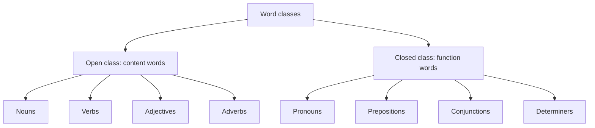
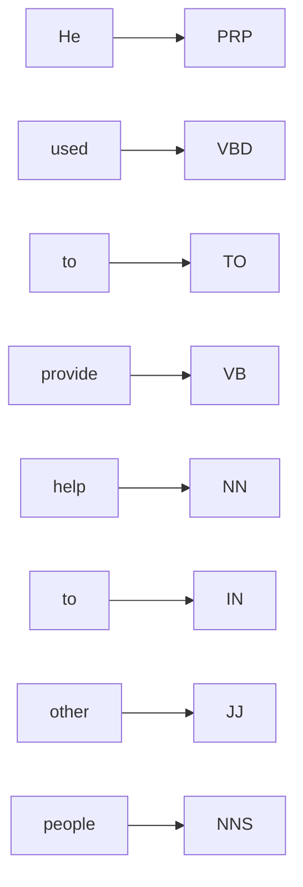
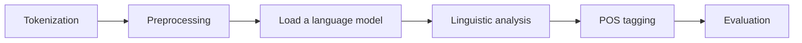
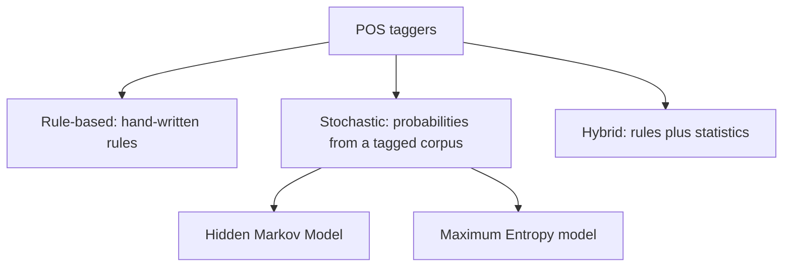
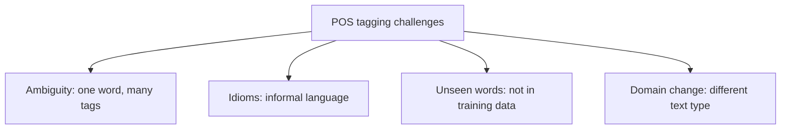

This note is syllabus <Syl m="3" />: part-of-speech tagging, rule-based and statistical taggers. The HMM, MaxEnt and CRF models have their own note, and CFG and parsing have theirs.

## The basics first

- A **word** here means a token: one piece of text after the sentence is split. <Cite id="class-nlp-pyq3" loc="p. 4" />
- A **tag** is the label we give a word: its part of speech (noun, verb and so on).
- A **corpus** is a large collection of text; a **tagged corpus** has a tag after every word. Taggers are trained on it. <Cite id="class-nlp-pyq3" loc="p. 4" />
- A **tag set** is the list of tags. The class answers use Penn Treebank style tags: NN (noun), NNS (plural noun), NNP (proper noun), VB (verb), VBD (past-tense verb), VBZ (verb, he/she/it form), MD (modal), DT (determiner), JJ (adjective), IN (preposition), TO (infinitive marker *to*), PRP (pronoun), RB (adverb). <Cite id="class-nlp-pyq3" loc="p. 1" /> <Cite id="class-nlp-pyq3" loc="p. 4" /> <Cite id="class-nlp-pyq3" loc="p. 7" />

## What is POS tagging?

<Box kind="definition">

**POS tagging:** Parts of speech (PoS) tagging is a fundamental task in Natural Language Processing (NLP) where each word in a sentence is assigned a grammatical category such as noun, verb, adjective or adverb. <Cite id="class-nlp-pyq3" loc="p. 4" />

</Box>

It helps machines understand the structure and meaning of sentences by identifying the roles of words and their relationships. It improves text analysis, parsing, machine translation and information extraction, and is widely used in text classification, sentiment analysis, chatbots and search engines. <Cite id="class-nlp-pyq3" loc="p. 4" />

**Example:** "The quick brown fox jumps over the lazy dog." gives The/DT quick/JJ brown/JJ fox/NN jumps/VBZ over/IN the/DT lazy/JJ dog/NN. *Quick* and *brown* are adjectives that describe the noun *fox*. <Cite id="class-nlp-pyq3" loc="p. 4" />

## Word classes: open and closed

**Open class words:** words that readily accept new vocabulary additions and changes. They are typically content words that convey meaning, such as nouns, verbs, adjectives and adverbs. These classes are open to expansion and innovation as languages evolve. <Cite id="class-nlp-pyq3" loc="p. 1" />

- Nouns: book, dog, computer
- Verbs: run, eat, sleep
- Adjectives: big, red, happy
- Adverbs: quickly, softly, beautifully

**Closed class words:** words that do not readily accept new members. They are often function words that serve grammatical purposes and show structural relationships within sentences. These classes are relatively stable and resistant to change over time. <Cite id="class-nlp-pyq3" loc="p. 1" />

- Pronouns: he, she, it, they
- Prepositions: on, in, at, with
- Conjunctions: and, but, or, so
- Determiners: the, a, an, some (the articles *the, a, an* are determiners)

| Point | Open class | Closed class |
|---|---|---|
| New words | Easily added | Hardly ever added |
| Kind of word | Content words (meaning) | Function words (grammar) |
| Examples | book, run, big, quickly | he, on, and, the |

**Why the split matters:** a tagger knows the few closed-class words well, and an unseen word is almost always an open-class word. <Cite id="class-nlp-pyq3" loc="p. 5" />

## Tagging a sentence

**Tagging "He used to provide help to other people."** Each word gets the tag that matches its job here. <Cite id="class-nlp-pyq3" loc="p. 1" />

| Word | POS tag | Word class |
|---|---|---|
| He | PRP | Pronoun |
| used | VBD | Verb (past tense) |
| to | TO | Infinitive marker |
| provide | VB | Verb |
| help | NN | Noun |
| to | IN | Preposition |
| other | JJ | Adjective |
| people | NNS | Plural noun |

*Why these tags:* *used* is a past-tense verb; the first *to* sits in front of the verb *provide*, so it is the infinitive marker; *help* is the thing provided, so it is a noun; the second *to* is followed by a noun phrase, so it is a preposition (the class answer uses IN for it); *other* describes *people*; *people* is plural. (The Penn Treebank gives the tag TO to every *to*; write the table as in class.)

<PYQ id="2024-12/q1a" /> <PYQ id="assignment-1/q3a" />

## How tagging works

**Steps:** tokenization (split the text into words), preprocessing (lower-case, remove special characters), loading a language model (tools like NLTK or SpaCy), linguistic analysis (role of each word in context), POS tagging, and evaluation (check accuracy and correct the errors). <Cite id="class-nlp-pyq3" loc="p. 4" /> <Cite id="class-nlp-pyq3" loc="p. 5" />

## Kinds of taggers

### Rule-based taggers

Rule-based POS tagging assigns POS tags based on predefined grammatical rules. These rules are crafted from morphological features (like word endings) and syntactic context, making the approach highly interpretable and transparent. <Cite id="class-nlp-pyq3" loc="p. 3" />

*Example:* the rule "assign the tag Noun to words ending in -tion or -ment". In "The presentation highlighted the key achievements of the project's development" the words *presentation*, *achievements* and *development* become nouns by this rule, and *highlighted* is a verb (it needs a second rule, such as "a word ending in -ed is a verb"). <Cite id="class-nlp-pyq3" loc="p. 3" /> <Cite id="class-nlp-pyq3" loc="p. 4" />

### Statistical (stochastic) taggers

They choose the most probable tag or tag sequence using probabilities learned from a tagged corpus. The Hidden Markov Model uses transition and emission probabilities <Cite id="class-nlp-pyq3" loc="p. 2" /> and the Maximum Entropy model uses weighted features of the context <Cite id="class-nlp-pyq3" loc="p. 8" />; see the HMM, MaxEnt and CRF note.

### Hybrid taggers

*(The class files do not cover this; it is the standard short idea.)* A hybrid tagger combines the two: a statistical tagger gives a first tag, and rules correct the mistakes (or rules remove impossible tags and statistics choose among the rest).

| Point | Rule-based | Stochastic |
|---|---|---|
| Knowledge from | Hand-written rules | Counts in a tagged corpus |
| Easy to understand | Yes, very | Less |
| Effort | Experts must write rules | Needs a large tagged corpus |
| Example | Suffix rule (-tion gives noun) | HMM, MaxEnt |

<PYQ id="2023-12-ce/q1a" /> <PYQ id="2024-12-ce/q1d" />

## Challenges of POS tagging

**Challenges** <Cite id="class-nlp-pyq3" loc="p. 5" />

1. **Ambiguity:** a word can have several meanings or tags depending on the context. *Book* is a noun in "read a book" and a verb in "book a ticket".
2. **Idiomatic expressions:** informal language and idioms are hard to tag correctly.
3. **Out-of-vocabulary words:** words not seen before (new words, names) lead to wrong tags.
4. **Domain dependence:** a model may not work well outside the domain it was trained on (news text versus tweets).

<PYQ id="2022-12-ce/q3c" /> <PYQ id="2023-12-ce/q4b" /> <PYQ id="2024-05-ce/q1c" />

## Questions from past papers and the class assignment

- <PYQ id="2022-12-ce/q1c" /> open and closed class words (5 marks)
- <PYQ id="2025-05/q1d" /> types of word classes (5 marks)
- <PYQ id="2024-12/q1a" /> and <PYQ id="assignment-1/q3a" /> word classes and tagging "He used to provide help to other people"
- <PYQ id="2022-12-ce/q3c" />, <PYQ id="2023-12-ce/q4b" />, <PYQ id="2024-05-ce/q1c" /> POS tagging and its challenges
- <PYQ id="2023-12-ce/q1a" /> rule-based and stochastic taggers; <PYQ id="2024-12-ce/q1d" /> hybrid tagging
