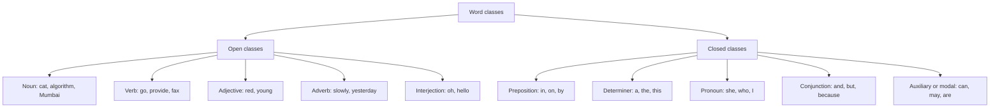
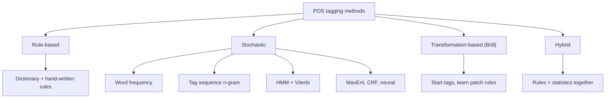
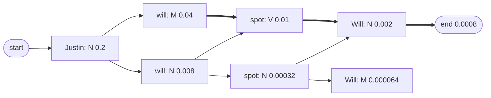
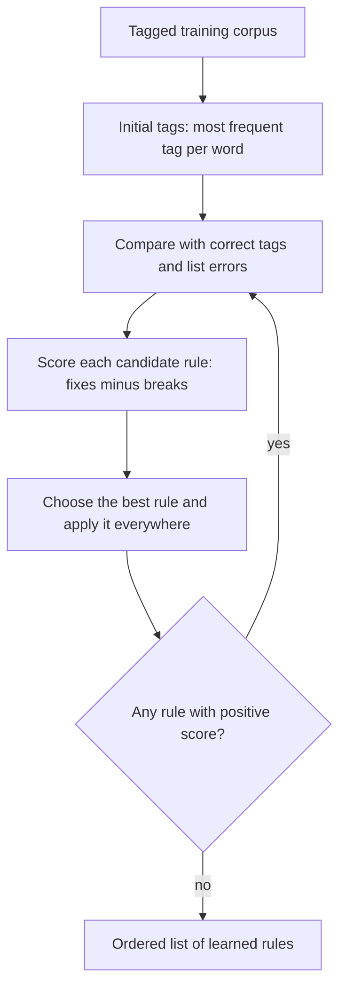
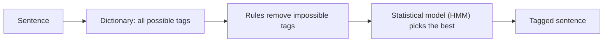

This note is syllabus <Syl m="3" />: 3.1 Part-of-speech tagging, open and closed words, the Penn Treebank tag set; 3.2 rule-based and transformation-based tagging; 3.3 stochastic tagging and its issues (multiple tags and words, unknown words); 3.5 the Hidden Markov Model as used for tagging. The CFG, MaxEnt and CRF parts of module 3 have their own notes.

## The basics first

- A **word** here means a token produced by tokenization (see <Syl m="2" /> "Text pre-processing"). Punctuation marks are tokens too.
- **Grammar** is the set of rules that says how words may be arranged. Each word plays a role in it: naming a thing, showing an action, describing a thing, and so on. The role is its **part of speech (POS)** or **word class**.
- A **tag** is a short label for a word class, such as `NN` for a singular noun. A **tag set** is the full list of tags a project agrees to use.
- A **corpus** is a large collection of text. A **tagged corpus** is a corpus in which people have already written the correct tag against every word. It is the "answer book" used to train and test a tagger.
- **Probability from counts.** If a thing happened 3 times out of 10 chances, its probability is $3/10$. This is called the **maximum likelihood estimate (MLE)**. Taggers learn most of what they know by counting in a tagged corpus. See <Syl m="2" /> "N-gram language models" for the same idea on words.
- **Context** means the words around a word. Context is what lets a tagger tell *book* the noun from *book* the verb.

## What is POS tagging

<Box kind="definition">

**Part-of-speech tagging** is the process of assigning a part of speech (a tag) to each word in a text, using both the word itself and its context. The input is a sequence of words $x_1, x_2, \dots, x_n$ and a tag set; the output is a sequence of tags $y_1, y_2, \dots, y_n$, with exactly one tag for every word. <Cite id="pos-tagging-slp3-ch18" loc="§18.2" /> <Cite id="pos-tagging-wiki-pos-tagging" />

</Box>

Example, using the Penn Treebank tags: *Janet/NNP will/MD back/VB the/DT bill/NN*. Janet is a proper noun, *will* is a modal verb, *back* is a base-form verb ("support"), *the* is a determiner and *bill* is a noun. <Cite id="pos-tagging-slp3-ch18" loc="§18.2" />

**Everyday analogy.** Think of a teacher marking a sentence with coloured pens: blue for nouns, red for verbs, green for adjectives. A POS tagger is the teacher, and the tag set is the box of pens. The skill lies in deciding the colour for words that could be two things, such as *book* or *back*.

**Tagging is disambiguation.** Many words can have more than one tag, so the real job is to pick the right tag for this sentence. *Book* is a verb in "book that flight" and a noun in "hand me that book". <Cite id="pos-tagging-slp3-ch18" loc="§18.2" />

## Why POS tagging is needed

1. **Parsing.** Knowing that a word is a noun or a verb tells the parser which neighbours are likely (English nouns follow determiners and adjectives, verbs follow nouns), so tagging is a key step before parsing (<Syl m="3" /> CFG and parsing). <Cite id="pos-tagging-slp3-ch18" />
2. **Lemmatization and stemming.** The lemma of *saw* depends on the tag: verb gives *see*, noun gives *saw*. <Cite id="pos-tagging-nltk-ch5" />
3. **Information extraction and NER.** Names are mostly proper nouns; relations are usually verbs between nouns.
4. **Word sense disambiguation.** The tag narrows the senses a word can have (*bank* as a noun or *bank* as a verb).
5. **Speech synthesis and machine translation.** The word *record* is stressed differently as a noun and as a verb; translation chooses a different target word for each class.
6. **Search and sentiment analysis.** Adjectives and adverbs carry opinion; nouns carry topics. <Cite id="pos-tagging-gfg-pos" />

## Word classes: open and closed

Parts of speech are defined by how a word behaves with its neighbours and by its affixes, not only by meaning. They fall into two groups. <Cite id="pos-tagging-slp3-ch18" loc="§18.1" /> <Cite id="pos-tagging-wiki-pos" />

- **Open classes** keep gaining new members. New nouns and verbs appear all the time, such as *iPhone* or *to fax*. English has five: noun (including proper nouns), verb, adjective, adverb and interjection.
- **Closed classes** have a small, nearly fixed membership. New prepositions are rarely invented. Their members are **function words** such as *of*, *it*, *and*, *you*: short, very frequent and used for grammar.



<Cite id="pos-tagging-slp3-ch18" loc="§18.1" /> <Cite id="pos-tagging-gfg-pos" loc="diagram" />

| Class | Meaning | Examples |
|---|---|---|
| Noun | Person, place, thing or idea; takes a determiner, a possessive or a plural | cat, algorithm, beauty, IBM |
| Verb | Action or process; has inflections (eat, eats, eating, eaten) | draw, provide, go |
| Adjective | Describes a noun: colour, age, value | red, young, good |
| Adverb | Modifies a verb, an adjective or another adverb: time, place, manner, degree | slowly, very, home, yesterday |
| Interjection | Exclamation, greeting, response | oh, hello, yes |
| Preposition | Shows a spatial, time or other relation of a noun | in, on, by, under |
| Determiner | Starts a noun phrase; articles *a, an, the* are determiners | a, the, this, that |
| Pronoun | Stands for a noun | she, I, who, my |
| Conjunction | Joins phrases or clauses: coordinating (*and, or, but*) and subordinating (*because, that*) | and, but, because |
| Auxiliary / modal | Helping verb for tense, mood, negation; modals like *can, may, must* | can, may, should, be, have |
| Particle | Function word that must go with another word | *not*, infinitive *to*, *up* in *give up* |
| Numeral | Counting word | one, two, 2026 |

<Cite id="pos-tagging-slp3-ch18" loc="§18.1" />

<Box kind="pitfall">

The two groups are about membership, not importance. *The* is a closed-class word and is the most common word in written English. And "open" does not mean every word is new; it only means the class can grow. Also note that the tag depends on use: *back* is a noun, adjective, adverb, verb or particle depending on the sentence.

</Box>

<Box kind="exam">

**Open and closed classes (5 marks):** define both, give five examples of each from the table, say that closed-class words are function words, and add the tagged sentence from Example 1 below. <PYQ id="2022-12-ce/q1c" /> <PYQ id="2024-12/q1a" /> <PYQ id="2025-05/q1d" />

</Box>

## Tag sets

A **tag set** fixes the list of tags and how fine the split is. Two are used most.

**Penn Treebank tag set.** It has 36 core tags (and extra tags for punctuation and symbols) and was used to label the Penn Treebank, a large syntactically annotated corpus of English. It splits verbs by tense and form and has a special tag for the word *there* and for the infinitive *to*. <Cite id="pos-tagging-marcus1993" /> <Cite id="pos-tagging-slp3-ch18" loc="§18.1" /> <Cite id="pos-tagging-ptb-tags" /> <Cite id="pos-tagging-wiki-ptb" />

| Tag | Meaning | Example | Tag | Meaning | Example |
|---|---|---|---|---|---|
| NN | noun, singular or mass | llama | VB | verb, base form | eat |
| NNS | noun, plural | llamas | VBD | verb, past tense | ate |
| NNP | proper noun, singular | IBM | VBG | verb, gerund or present participle | eating |
| NNPS | proper noun, plural | Carolinas | VBN | verb, past participle | eaten |
| PRP | personal pronoun | I, you, he | VBP | verb, non-3rd-person singular present | eat |
| PRP$ | possessive pronoun | your | VBZ | verb, 3rd-person singular present | eats |
| DT | determiner | a, the | MD | modal | can, should |
| IN | preposition or subordinating conjunction | of, in, by | TO | the word *to* | to |
| JJ | adjective | yellow | CC | coordinating conjunction | and, but |
| JJR / JJS | comparative / superlative adjective | bigger / wildest | CD | cardinal number | one, two |
| RB | adverb | quickly | RP | particle | up, off |
| RBR / RBS | comparative / superlative adverb | faster / fastest | EX | existential *there* | there |

<Cite id="pos-tagging-slp3-ch18" loc="§18.1" />

**Universal Dependencies (UD) tag set.** It has 17 coarse tags for all languages: ADJ, ADP, ADV, AUX, CCONJ, DET, INTJ, NOUN, NUM, PART, PRON, PROPN, PUNCT, SCONJ, SYM, VERB and X. <Cite id="pos-tagging-ud-pos" /> <Cite id="pos-tagging-slp3-ch18" loc="§18.1" /> spaCy gives both: the coarse UD tag in `token.pos_` and a fine tag (Penn style for English) in `token.tag_`. <Cite id="pos-tagging-spacy" />

| Point | Penn Treebank | Universal Dependencies |
|---|---|---|
| Size | 36 core tags (45 with punctuation in Treebank-3) | 17 tags |
| Languages | English | Over a hundred languages |
| Verb detail | Tense and form split into VB, VBD, VBG, VBN, VBP, VBZ | One VERB tag; tense is a separate feature |
| Plural noun | NNS | NOUN with a number feature |
| Typical use | Older English corpora and taggers | Modern multilingual work |

<Cite id="pos-tagging-slp3-ch18" loc="§18.1" /> <Cite id="pos-tagging-slp3-ch18" loc="§18.7" />

A bigger tag set carries more information but is harder to tag correctly, because the tagger has more labels to choose from and fewer examples of each. The early Brown Corpus (about a million words of 1961 American English) was tagged with a set of about 87 tags. <Cite id="pos-tagging-wiki-brown" />


### Example 1: tagging a sentence with a tag set

<Sum>

<Given>

the sentence "He used to provide help to other people".

</Given>

<Find>

the Penn Treebank tag and the Universal Dependencies tag of every word, and the class (open or closed).

</Find>

<Steps>

1. **Tokenize:** He, used, to, provide, help, to, other, people (8 tokens).
2. **He** is a personal pronoun: PRP (Penn), PRON (UD). Closed class. *Reason: it stands for a person.*
3. **used** is the past tense of the verb in "used to": VBD, VERB. Open class.
4. **to** (first) is the infinitive marker before the verb *provide*: TO, PART. Closed class.
5. **provide** follows the infinitive *to*, so it is a base-form verb: VB, VERB. Open class.
6. **help** is the thing provided, so a noun: NN, NOUN. Open class. *Reason: after the verb provide, with no determiner, a thing is expected; help can also be a verb, but not here.*
7. **to** (second) comes before the noun phrase *other people*, so it is a preposition: TO in the Penn scheme (which uses TO for every *to*), ADP in UD. Closed class.
8. **other** describes *people*: JJ, ADJ. Open class.
9. **people** is a plural noun: NNS, NOUN. Open class.

</Steps>

<Answer>

He/PRP used/VBD to/TO provide/VB help/NN to/TO other/JJ people/NNS.
UD: He/PRON used/VERB to/PART provide/VERB help/NOUN to/ADP other/ADJ people/NOUN.

</Answer>

<Box kind="verify">

Every word has exactly one tag, and the count is 8 tags for 8 tokens. The Penn rule that *to* always gets TO follows the Penn tag list. The open-class words (used, provide, help, other, people) are the content words; the closed-class words (He, to, to) are function words. UD uses a coarse set, so *used* and *provide* are both VERB although Penn separates VBD and VB. <Cite id="pos-tagging-ptb-tags" /> <Cite id="pos-tagging-slp3-ch18" loc="§18.1" />

</Box>

</Sum>

## Why POS tagging is hard: the challenges

<Cite id="pos-tagging-slp3-ch18" loc="§18.2" /> <Cite id="pos-tagging-wiki-pos-tagging" />

1. **Ambiguity (multiple tags per word).** A word can belong to several classes. The word *back* has six tags in the WSJ: adjective (*back seat*), noun (*the back*), verb non-3rd-person (*back the bill*), base verb (*back toward the door*), particle (*buy back debt*) and adverb (*twenty-one back then*). *That* can be a determiner (*that flight*) or a complementizer (*I thought that your flight was earlier*). Other common ambiguous words are *down*, *put* and *set*.
2. **Ambiguous words are common even if few.** Most word types (85 to 86 percent) have one tag, but the ambiguous types are very frequent, so 55 to 67 percent of the tokens in running text are ambiguous (Example 2 below).
3. **Unknown words.** Words that never appeared in the training corpus (new names, new coinages, spelling mistakes) have no counts, so the tagger has no probability for them. Open classes keep growing, so this problem never ends. <Cite id="pos-tagging-tp-pos" />
4. **Multi-word units and tokenization.** *New York*, *as well as*, *in spite of* work as one unit. Penn Treebank also splits *'s* and *n't* from the word, so the tagger depends on how the text was tokenized. In a name such as *London Journal of Medicine*, the words *journal* and *medicine* are tagged as proper nouns (NNP) although they are common nouns elsewhere.
5. **Sparse data.** Rare words and rare tag pairs have few or zero counts; zero probabilities must be smoothed.
6. **Tag set differences.** A tagger trained with one tag set cannot be compared directly with another, and finer tag sets (more tags) are harder to get right.
7. **Domain and style.** A tagger trained on newspaper text makes more errors on tweets, speech, medical text or SMS-style spelling.
8. **Morphologically rich languages.** Languages such as Turkish, Czech or Hungarian have far more word forms, so many unknown words, and their tags must also carry case and gender. A Turkish word *izin* can mean *trace*, *fingerprint* or *permission* with three different morphological tags. <Cite id="pos-tagging-slp3-ch18" loc="§18.7.2" />
9. **Human disagreement and long-range context.** Human annotators reach only about 97 percent on English, so that is roughly the ceiling. Some choices depend on words far away, which a tagger that sees only the last one or two tags cannot use.

<Box kind="exam">

**Challenges of POS tagging (5 or 10 marks):** list ambiguity first (with *book* and *back*), then unknown words, multi-word units, sparse data, tag sets, domain, and rich-morphology languages. Give one example for each, and end with how the problems are handled (context, probabilities, suffix and capital-letter clues, larger training corpora). <PYQ id="2022-12-ce/q3c" /> <PYQ id="2023-12-ce/q4b" /> <PYQ id="2024-05-ce/q1c" />

</Box>

### Example 2: how much ambiguity is there?

<Sum>

<Given>

token counts from the WSJ and Brown corpora (Treebank-3 tag set): WSJ has 577,421 unambiguous tokens and 711,780 ambiguous tokens; Brown has 384,349 unambiguous and 786,646 ambiguous.

</Given>

<Find>

the share of running words that are ambiguous in each corpus.

</Find>

<Steps>

1. WSJ total $= 577{,}421 + 711{,}780 = 1{,}289{,}201$ tokens. *Reason: the share needs the total.*
2. WSJ share $= 711{,}780 / 1{,}289{,}201 = 0.552$, that is 55 percent.
3. Brown total $= 384{,}349 + 786{,}646 = 1{,}170{,}995$ tokens.
4. Brown share $= 786{,}646 / 1{,}170{,}995 = 0.672$, that is 67 percent.

</Steps>

<Answer>

About 55 percent of WSJ tokens and 67 percent of Brown tokens are ambiguous.

</Answer>

<Box kind="verify">

The unambiguous shares are $577{,}421/1{,}289{,}201 = 0.448$ and $384{,}349/1{,}170{,}995 = 0.328$. Adding each to its ambiguous share gives 1.000. The values agree with the 45 / 55 and 33 / 67 percent split printed in the book's Fig. 18.4. <Cite id="pos-tagging-slp3-ch18" loc="§18.2" />

</Box>

</Sum>

## Approaches to POS tagging

POS-tagging algorithms fall into three main families: rule-based, stochastic (statistical) and transformation-based. Systems that mix them are called hybrid. <Cite id="pos-tagging-tp-pos" /> <Cite id="pos-tagging-gfg-pos" /> <Cite id="pos-tagging-wiki-pos-tagging" />



<Cite id="pos-tagging-tp-pos" loc="diagram" /> <Cite id="pos-tagging-gfg-pos" loc="diagram" />

## Rule-based tagging

Rule-based tagging is one of the oldest techniques. It works in **two stages**. <Cite id="pos-tagging-tp-pos" /> <Cite id="pos-tagging-slp3-ch18" loc="§18.7.1" />

1. **Dictionary lookup.** A dictionary or lexicon (often with a morphological analyser) gives every possible tag of each word. *Round* might list noun, verb, adjective, adverb, preposition.
2. **Disambiguation by rules.** A large set of hand-written rules (thousands in real systems such as the English Constraint Grammar) removes tags that do not fit the context, until one is left per word.

Example rules of the kind written by linguists (they are sketches, not a complete grammar):

- If the previous word is a determiner (*a, the*) and the word can be a noun or a verb, choose noun. (*the book* gives noun.)
- If the word ends in *-ly* and can be an adverb or an adjective, choose adverb.
- If the previous tag is the infinitive *to*, choose base-form verb. (*to race* gives VB.)
- If the word is not at the start of the sentence and begins with a capital letter and is unknown, choose proper noun.

The earliest taggers of this kind date from the 1950s and 1960s: Harris's project (1958 to 1959) used 14 rules, and the Computational Grammar Coder used 500 context rules; the TAGGIT program then tagged 77 percent of the Brown Corpus correctly. <Cite id="pos-tagging-slp3-ch18" loc="§18.7.1" />

| Advantages | Disadvantages |
|---|---|
| Knowledge-driven; every decision can be explained | Rules must be written by hand by linguists, which is slow and costly |
| Needs no tagged training corpus | Hard to cover all exceptions; adding a rule can break another |
| Fast once built | A rule set is language-specific and often domain-specific |
| Handles known patterns very precisely | Handles unseen patterns badly; cannot weigh "more likely" and "less likely" |

<Cite id="pos-tagging-tp-pos" /> <Cite id="pos-tagging-brill1992" /> <Cite id="pos-tagging-gfg-pos" />

<Box kind="exam">

**Rule-based and stochastic taggers (5 marks):** say that a rule-based tagger uses a dictionary plus hand-written disambiguation rules in two stages, and a stochastic tagger uses probabilities learned from a tagged corpus (most frequent tag, tag n-grams, HMM). Give one rule and one probability formula, and a two-column comparison. <PYQ id="2023-12-ce/q1a" /> <PYQ id="2025-05/q6b" />

</Box>

## Stochastic tagging

A model that uses frequencies or probabilities is **stochastic**. It needs a tagged training corpus and a separate test corpus. There are three levels of cleverness. <Cite id="pos-tagging-tp-pos" /> <Cite id="pos-tagging-church1988" />

### Level 1: the word-frequency (most-frequent-tag) approach

Give every word the tag it had most often in the training corpus. It is the simplest tagger and a **baseline** you must beat. It reaches about 92 percent accuracy, while the best systems and human annotators reach about 97 percent, so the real difficulty lies in the last 5 percent. <Cite id="pos-tagging-slp3-ch18" loc="§18.2" /> The weakness: it can output an impossible tag sequence (a determiner followed by a verb) because it never looks at context. <Cite id="pos-tagging-tp-pos" />

### Example 3: the most-frequent-tag baseline

<Sum>

<Given>

in the training corpus the word *that* occurs 100 times: 60 as DT (determiner) and 40 as IN (complementizer). The test sentences contain *that* five times, with gold tags DT, IN, DT, IN, DT.

</Given>

<Find>

the tag the baseline gives to *that* and its accuracy on these five tokens.

</Find>

<Steps>

1. $P(\text{DT} \mid \textit{that}) = 60/100 = 0.6$ and $P(\text{IN} \mid \textit{that}) = 40/100 = 0.4$. *Reason: probability is count divided by the word's total.*
2. DT is the more frequent tag, so the baseline gives DT to every *that*.
3. Compare with gold: DT correct, IN wrong, DT correct, IN wrong, DT correct. That is 3 correct out of 5.
4. Accuracy $= 3/5 = 0.6$, that is 60 percent.

</Steps>

<Answer>

The baseline tags every *that* as DT, with 60 percent accuracy on these tokens.

</Answer>

<Box kind="verify">

The two probabilities add to 1 (0.6 + 0.4). The accuracy equals the share of DT in the test (3 of 5), which is as expected because every token got DT. The baseline cannot be right on "I thought that your flight..." (IN) however often it is run, which shows the need for context.

</Box>

</Sum>

### Level 2: tag-sequence probabilities (the n-gram approach)

The best tag for a word is chosen from how likely it is after the previous $n-1$ tags. After a determiner, a noun is far more likely than a verb, which helps to tag *book* as a noun in *the book*. This is the idea used by the HMM tagger below. <Cite id="pos-tagging-tp-pos" />

### Level 3: the Hidden Markov Model tagger

An HMM tagger treats the tags as **hidden** (we see only the words) and finds the most probable tag sequence for the words. It was first implemented by Church (1988) and is still the standard textbook method. <Cite id="pos-tagging-slp3-ch18" loc="§18.4" /> <Cite id="pos-tagging-church1988" /> <Cite id="pos-tagging-wiki-hmm" />

**The parts of an HMM.** <Cite id="pos-tagging-slp3-ch18" loc="§18.4.2" />

- $Q$: the set of states. For tagging, a state is a tag.
- $A$: **transition probabilities** $a_{ij} = P(t_j \mid t_i)$, the chance that tag $j$ follows tag $i$. Each row sums to 1.
- $B$: **emission (observation) probabilities** $b_i(w) = P(w \mid t_i)$, the chance that tag $i$ produces word $w$.
- $\pi$: **initial probabilities**, the chance that a sentence starts with each tag. The usual trick is a start symbol `<s>` and an end symbol `</s>`, so $\pi_i = P(t_i \mid \texttt{<s>})$.


**Two simplifying assumptions.** <Cite id="pos-tagging-slp3-ch18" loc="§18.4.2" />

1. **Markov assumption:** a tag depends only on the previous tag, $P(t_i \mid t_1, \dots, t_{i-1}) = P(t_i \mid t_{i-1})$.
2. **Output independence:** a word depends only on its own tag, $P(w_i \mid \text{all tags}, \text{other words}) = P(w_i \mid t_i)$.

**The idea in words.** We want the tag sequence $\hat{t}_{1:n}$ with the highest $P(t_{1:n} \mid w_{1:n})$. By Bayes' rule, and dropping the denominator $P(w_{1:n})$ because it is the same for every candidate, this is the sequence that maximizes the product of "how likely is this tag sequence" and "how likely are these words given the tags":

$$
\hat{t}_{1:n} = \arg\max_{t_{1:n}} \prod_{i=1}^{n} P(w_i \mid t_i)\, P(t_i \mid t_{i-1})
$$

where $P(w_i \mid t_i)$ is the emission and $P(t_i \mid t_{i-1})$ is the transition. <Cite id="pos-tagging-slp3-ch18" loc="§18.4.4" />

**Estimating the probabilities by counting** in a tagged corpus (MLE): <Cite id="pos-tagging-slp3-ch18" loc="§18.4.3" />

$$
P(t_i \mid t_{i-1}) = \frac{C(t_{i-1}, t_i)}{C(t_{i-1})}, \qquad P(w_i \mid t_i) = \frac{C(t_i, w_i)}{C(t_i)}
$$

where $C(\cdot)$ is a count. In the WSJ, the tag MD occurs 13,124 times; it is followed by VB 10,471 times and is the word *will* 4,046 times, so $P(\text{VB} \mid \text{MD}) \approx 0.80$ and $P(\textit{will} \mid \text{MD}) \approx 0.31$. <Cite id="pos-tagging-slp3-ch18" loc="§18.4.3" />

<Box kind="pitfall">

The emission $P(\textit{will} \mid \text{MD})$ is not "the probability that *will* is a modal". It answers "if we were to generate a modal, how likely is it to be *will*?". The other direction, $P(\text{MD} \mid \textit{will})$, is a different number. <Cite id="pos-tagging-slp3-ch18" loc="§18.4.3" />

</Box>

**Decoding with the Viterbi algorithm.** Trying every tag sequence is too slow ($T^n$ sequences for $T$ tags and $n$ words). Viterbi is a **dynamic programming** method that fills a table (a **trellis**) with one column per word and one row per tag. Cell $v_t(j)$ holds the probability of the best path that ends in tag $j$ at word $t$: <Cite id="pos-tagging-slp3-ch18" loc="§18.4.5" /> <Cite id="pos-tagging-slp3-appA" loc="A.4" /> <Cite id="pos-tagging-wiki-viterbi" />

$$
v_1(j) = a_{\langle s \rangle j}\, b_j(w_1), \qquad v_t(j) = \max_{i}\, v_{t-1}(i)\, a_{ij}\, b_j(w_t)
$$

with a back-pointer to the best $i$ stored in each cell. At the end multiply by $a_{j\langle /s \rangle}$, pick the best last cell and follow the back-pointers to read off the tags.

Steps of the algorithm:

1. **Training.** Count tags, tag pairs and (tag, word) pairs in the tagged corpus; compute $A$ and $B$.
2. **Candidates.** For each word of the test sentence, find the tags that can produce it (non-zero emission).
3. **Initialization.** First column: start probability times emission.
4. **Recursion.** For each next word and tag, take the best previous cell times transition times emission; remember which previous tag gave the best.
5. **Termination.** Multiply by the end transition; take the best cell.
6. **Backtrace.** Follow the pointers back to get the tag sequence.



<Cite id="pos-tagging-iiith-hmm" loc="diagram" /> <Cite id="pos-tagging-gfg-hmm" loc="diagram" />


### Example 4: HMM tagging of "Justin will spot Will"

This is the classic past-paper corpus. <PYQ id="2023-05-ce/q4a" /> <PYQ id="2025-05-ce/q4a" />

<Sum>

<Given>

the four tagged sentences (N noun, M modal, V verb; `<S>` start, `<E>` end), with every word turned to lower case so that *Will* and *will* share a count; the tags are given in the question:

1. Martin/N Justin/N can/M watch/V Will/N
2. Spot/N will/M watch/V Martin/N
3. Will/N Justin/N spot/V Martin/N
4. Martin/N will/M pat/V Spot/N

Test sentence: "Justin will spot Will".

</Given>

<Find>

the transition matrix, the emission matrix and the best tag sequence of the test sentence by the HMM and the Viterbi algorithm.

</Find>

<Steps>

1. **Count the tags.** N: Martin 4, Justin 2, Will 2, Spot 2, so $C(N) = 10$. M: can 1, will 2, so $C(M) = 3$. V: watch 2, spot 1, pat 1, so $C(V) = 4$. There are 4 sentences, so $C(\texttt{<S>}) = 4$. *Reason: every probability is a count divided by one of these totals.*
2. **Count the tag pairs.** From `<S>`: N 4. From N: N 2 (Martin Justin, Will Justin), M 3 (Justin can, Spot will, Martin will), V 1 (Justin spot), `<E>` 4. From M: V 3. From V: N 4. Check: N is followed 2 + 3 + 1 + 4 = 10 times, equal to $C(N)$.
3. **Transition matrix** $P(\text{next} \mid \text{previous})$:

| from \ to | N | M | V | `<E>` |
|---|---|---|---|---|
| `<S>` | 1 | 0 | 0 | 0 |
| N | 0.2 | 0.3 | 0.1 | 0.4 |
| M | 0 | 0 | 1 | 0 |
| V | 1 | 0 | 0 | 0 |

4. **Emission matrix** $P(\text{word} \mid \text{tag})$ (blank is 0):

| tag \ word | martin | justin | will | spot | can | watch | pat |
|---|---|---|---|---|---|---|---|
| N | 0.4 | 0.2 | 0.2 | 0.2 | | | |
| M | | | 0.667 | | 0.333 | | |
| V | | | | 0.25 | | 0.5 | 0.25 |

5. **Word 1, Justin.** Only N can emit it: $v_1(N) = 1 \times 0.2 = 0.2$.
6. **Word 2, will.** N: $0.2 \times 0.2 \times 0.2 = 0.008$. M: $0.2 \times 0.3 \times 0.667 = 0.04$. V cannot emit *will*.
7. **Word 3, spot.** V: from M $0.04 \times 1 \times 0.25 = 0.01$; from N $0.008 \times 0.1 \times 0.25 = 0.0002$. Best is 0.01, from M. N: from N $0.008 \times 0.2 \times 0.2 = 0.00032$; from M the move to N is 0. So N is 0.00032.
8. **Word 4, Will.** N: from V $0.01 \times 1 \times 0.2 = 0.002$; from N $0.00032 \times 0.2 \times 0.2 = 0.0000128$. Best 0.002, from V. M: from N $0.00032 \times 0.3 \times 0.667 = 0.000064$; from V the move to M is 0.
9. **End.** N to `<E>`: $0.002 \times 0.4 = 0.0008$. M to `<E>`: $0.000064 \times 0 = 0$. The winner is N.
10. **Backtrace.** Will: N (from V), spot: V (from M), will: M (from N), Justin: N.

Trellis (best path probability in each cell, with the previous tag in brackets):

| tag | Justin | will | spot | Will |
|---|---|---|---|---|
| N | 0.2 | 0.008 (N) | 0.00032 (N) | 0.002 (V) |
| M | 0 | 0.04 (N) | 0 | 0.000064 (N) |
| V | 0 | 0 | 0.01 (M) | 0 |

</Steps>

<Answer>

Justin/N will/M spot/V Will/N, with probability $0.0008$ (that is 1/1250).

</Answer>

<Box kind="verify">

Each transition row sums to 1 (N row: 0.2 + 0.3 + 0.1 + 0.4) and each emission row sums to 1 (N: 0.4 + 0.2 + 0.2 + 0.2; M: 0.333 + 0.667; V: 0.25 + 0.5 + 0.25). The product along the winning path, recomputed by grouping all transitions and all emissions: transitions (start to N, N to M, M to V, V to N, N to end) $1 \cdot 0.3 \cdot 1 \cdot 1 \cdot 0.4 = 0.12$ and emissions $0.2 \cdot 0.667 \cdot 0.25 \cdot 0.2 = 0.00667$; $0.12 \times 0.00667 = 0.0008$. As a sense check, the output also matches meaning: *Justin* (name) *will* (modal) *spot* (verb) *Will* (name).

</Box>

</Sum>

### Example 5: HMM tagging of "The students wait for the test"

This is the corpus of the 2023-12 paper. <PYQ id="2023-12-ce/q3a" />

<Sum>

<Given>

the tagged corpus (DT determiner, NN noun, V verb, P preposition):

1. the/DT students/NN pass/V the/DT test/NN
2. the/DT students/NN wait/V for/P the/DT result/NN
3. teachers/NN test/V students/NN

Test sentence: "The students wait for the test".

</Given>

<Find>

the transition and emission probabilities of the bigram HMM, and the Viterbi tags of the test sentence.

</Find>

<Steps>

1. **Tag counts.** DT 4 (the ×4), NN 6 (students ×3, test ×1, result ×1, teachers ×1), V 3 (pass, wait, test), P 1 (for). Sentences: 3.
2. **Starts.** Two sentences start with DT, one with NN: $P(DT \mid \texttt{<s>}) = 2/3$, $P(NN \mid \texttt{<s>}) = 1/3$.
3. **Transitions.** DT is always followed by NN (4 of 4). NN is followed by V 3 times and by `</s>` 3 times (6 in all): 1/2 each. V is followed by DT, P and NN once each: 1/3 each. P is followed by DT: 1.
4. **Emissions.** DT: *the* 1. NN: *students* 3/6 = 1/2, and *test*, *result*, *teachers* 1/6 each. V: *pass*, *wait*, *test* 1/3 each. P: *for* 1.
5. **Trellis.** *the* can only be DT: $v = 2/3 \times 1 = 2/3$. *students* is NN: $2/3 \times 1 \times 1/2 = 1/3$. *wait* is V: $1/3 \times 1/2 \times 1/3 = 1/18$. *for* is P: $1/18 \times 1/3 \times 1 = 1/54$. *the* is DT: $1/54 \times 1 \times 1 = 1/54$.
6. **Last word, test.** As NN: $1/54 \times P(NN \mid DT) \times P(test \mid NN) = 1/54 \times 1 \times 1/6 = 1/324$. As V: DT is never followed by V, so the transition is 0 and the path dies. *Reason: only NN is possible here.*
7. **End.** NN to `</s>` is 1/2: $1/324 \times 1/2 = 1/648$.

Transition table (rows are the previous tag):

| from \ to | DT | NN | V | P | `</s>` |
|---|---|---|---|---|---|
| `<s>` | 2/3 | 1/3 | 0 | 0 | 0 |
| DT | 0 | 1 | 0 | 0 | 0 |
| NN | 0 | 0 | 1/2 | 0 | 1/2 |
| V | 1/3 | 1/3 | 0 | 1/3 | 0 |
| P | 1 | 0 | 0 | 0 | 0 |

</Steps>

<Answer>

the/DT students/NN wait/V for/P the/DT test/NN, with probability $1/648 \approx 0.00154$.

</Answer>

<Box kind="verify">

Each row sums to 1 (`<s>`: 2/3 + 1/3; NN: 1/2 + 1/2; V: 3 × 1/3). Recomputing the path product from scratch: transitions $2/3 \cdot 1 \cdot 1/2 \cdot 1/3 \cdot 1 \cdot 1 \cdot 1/2 = 1/18$ and emissions $1 \cdot 1/2 \cdot 1/3 \cdot 1 \cdot 1 \cdot 1/6 = 1/36$, and $1/18 \times 1/36 = 1/648$. The rival tagging (test as V) has probability 0, so the answer is unique. Note: the test word *test* is NN in the sentence because the tags before it force the noun.

</Box>

</Sum>

### Example 6: HMM tagging of "The cat chases the dog"

This is the corpus of the 2024-12 paper. The full stop is dropped because the corpus has no punctuation tag. <PYQ id="2024-12-ce/q3a" />

<Sum>

<Given>

the tagged corpus (DT, NN, V verb, RB adverb):

1. a/DT dog/NN chases/V a/DT cat/NN
2. the/DT dog/NN barks/V loudly/RB
3. a/DT cat/NN runs/V fast/RB

Test sentence: "The cat chases the dog".

</Given>

<Find>

the transition and emission probabilities and the Viterbi tag sequence.

</Find>

<Steps>

1. **Tag counts.** DT 4 (a ×3, the ×1), NN 4 (dog ×2, cat ×2), V 3 (chases, barks, runs), RB 2 (loudly, fast).
2. **Start and transitions.** All 3 sentences start with DT, so $P(DT \mid \texttt{<s>}) = 1$. DT to NN: 4 of 4 = 1. NN to V: 3 (dog chases, dog barks, cat runs), NN to `</s>`: 1 (sentence 1 ends with cat), so 3/4 and 1/4. V to DT: 1 (chases a), V to RB: 2 (barks loudly, runs fast), so 1/3 and 2/3. RB to `</s>`: 2 of 2 = 1.
3. **Emissions.** DT: *a* 3/4, *the* 1/4. NN: *dog* 1/2, *cat* 1/2. V: *chases*, *barks*, *runs* 1/3 each. RB: *loudly* 1/2, *fast* 1/2.
4. **Trellis.** the: DT $= 1 \times 1/4 = 1/4$. cat: NN $= 1/4 \times 1 \times 1/2 = 1/8$. chases: V $= 1/8 \times 3/4 \times 1/3 = 1/32$. the: DT $= 1/32 \times 1/3 \times 1/4 = 1/384$. dog: NN $= 1/384 \times 1 \times 1/2 = 1/768$. *Reason: every word here has only one possible tag, so each column has one live cell.*
5. **End.** NN to `</s>` is 1/4: $1/768 \times 1/4 = 1/3072$.

</Steps>

<Answer>

the/DT cat/NN chases/V the/DT dog/NN, with probability $1/3072 \approx 0.000326$.

</Answer>

<Box kind="verify">

Rows sum to 1 (NN: 3/4 + 1/4; V: 1/3 + 2/3). Recompute by multiplying all factors: transitions $1 \cdot 1 \cdot 3/4 \cdot 1/3 \cdot 1 \cdot 1/4 = 1/16$ (start to DT, DT to NN, NN to V, V to DT, DT to NN, NN to end) and emissions $1/4 \cdot 1/2 \cdot 1/3 \cdot 1/4 \cdot 1/2 = 1/192$; $1/16 \times 1/192 = 1/3072$.

</Box>

</Sum>

<Box kind="pitfall">

A word never seen in training (or seen only with other tags) gets emission 0 and kills every path through it. Real taggers use smoothing and a suffix-based guess for unknown words. In exam sums, state that you use plain counts without smoothing, as the corpus is tiny.

</Box>

<Box kind="exam">

**HMM for POS tagging (10 marks):** (1) say what hidden and observed are (tags and words), (2) give the components $A$, $B$, $\pi$ and the two assumptions, (3) give the equation $\arg\max \prod P(w_i \mid t_i)P(t_i \mid t_{i-1})$, (4) show how to estimate $A$ and $B$ by counting, (5) explain Viterbi with a small trellis, (6) mention the limits: needs a tagged corpus, only looks at the previous tag, handles unknown words poorly. <PYQ id="2024-05-ce/q3a" /> <PYQ id="2025-05/q4a" />

</Box>

| Advantages of HMM tagging | Disadvantages |
|---|---|
| Probabilistic, so it ranks all possible taggings and chooses the best | Needs a large tagged corpus |
| Training is just counting; Viterbi is fast ($O(n T^2)$) | Looks only at the previous tag (first order) and cannot use features such as capitalization or suffix directly |
| Gives about 95 to 97 percent accuracy on English with good unknown-word handling | Poor with unknown words unless extended; sparse data needs smoothing |

<Cite id="pos-tagging-slp3-ch18" loc="§18.4" /> <Cite id="pos-tagging-brants2000" /> <Cite id="pos-tagging-gfg-hmm" />

## Transformation-based (Brill) tagging

Transformation-based tagging, also called Brill tagging after Eric Brill, is an instance of transformation-based learning (TBL). It looks like a rule-based tagger (it is made of readable rules) and like a stochastic tagger (the rules are learned from a tagged corpus, not written by hand). <Cite id="pos-tagging-tp-pos" /> <Cite id="pos-tagging-brill1995" /> <Cite id="pos-tagging-wiki-brill" />

**How it works.**

1. **Initial tagging.** Give each known word its most frequent tag. An unknown word is first given the tag noun (some versions use proper noun when it is capitalized). <Cite id="pos-tagging-wiki-brill" />
2. **Candidate rules.** Rules fill in templates of the form "change tag A to tag B when (condition)", where the condition looks at the tags or words just before or after. Example: change NN to VB when the previous tag is TO.
3. **Score.** For every candidate rule, count the tagging errors it fixes minus the correct tags it breaks, against the tagged training corpus.
4. **Pick the best rule.** Apply the rule with the highest positive score to the whole corpus and save it in an ordered list.
5. **Repeat** from step 3 until no rule improves the score enough.
6. **Tagging new text.** Give the initial tags, then apply the saved rules in order.



<Cite id="pos-tagging-tp-pos" loc="diagram" /> <Cite id="pos-tagging-wiki-brill" loc="diagram" />

### Example 7: scoring Brill rules

<Sum>

<Given>

four tokens from the training corpus. The initial (most frequent) tag of each target word is NN. The correct tags are shown.

1. to/TO race/NN, correct VB
2. to/TO play/NN, correct VB
3. the/DT race/NN, correct NN
4. to/TO school/NN, correct NN

Candidate rules: R1: change NN to VB if the previous tag is TO. R2: change NN to VB if the previous tag is DT.

</Given>

<Find>

the score of each rule, which one is chosen, and the accuracy on the target tokens before and after it.

</Find>

<Steps>

1. **Before any rule:** tokens 3 and 4 are right (NN), tokens 1 and 2 are wrong. Accuracy $= 2/4 = 50$ percent.
2. **R1 fires** where the previous tag is TO: tokens 1, 2 and 4. Tokens 1 and 2 become VB, which is correct (+2 fixes). Token 4 becomes VB, which is wrong because it was right before (1 break). Score $= 2 - 1 = +1$.
3. **R2 fires** where the previous tag is DT: only token 3. It becomes VB, but the correct tag was NN (1 break, 0 fixes). Score $= 0 - 1 = -1$.
4. **Choose R1** because it has the best (and only positive) score.
5. **After R1:** tokens 1, 2 and 3 are right, token 4 is wrong. Accuracy $= 3/4 = 75$ percent.
6. The next round would look for another rule (for example one that uses the word itself) to repair token 4.

</Steps>

<Answer>

R1 scores +1 and R2 scores -1, so R1 is chosen; accuracy on these tokens rises from 50 percent to 75 percent.

</Answer>

<Box kind="verify">

Net change in correct tokens $= +2 - 1 = +1$ for R1, and $2 + 1 = 3$ correct tokens after the rule equals 75 percent of 4, matching the score. For R2 the correct count would fall from 2 to 1, matching its score of -1.

</Box>

</Sum>

| Advantages | Disadvantages |
|---|---|
| Learns a small set of simple, readable rules, so it is easy to debug | Does not give tag probabilities |
| Much faster at tagging than a Markov-model tagger | Training takes a very long time on large corpora |
| Combines human-style rules with machine learning | Rule order matters, and a rule can change earlier results |

<Cite id="pos-tagging-tp-pos" /> <Cite id="pos-tagging-brill1995" />

## Hybrid tagging

A **hybrid tagger** combines two or more of the methods above to get the strengths of each. There is no single standard recipe; common designs are: <Cite id="pos-tagging-tp-pos" /> <Cite id="pos-tagging-brill1995" /> <Cite id="pos-tagging-slp3-ch18" loc="§18.7.1" />

- **Statistical start, rule correction.** A statistical or frequency-based tagger gives the first tags and learned or hand-written rules fix the typical mistakes. The Brill tagger is the best-known example; the learning step comes from data like a stochastic tagger, and the output is a list of rules like a rule-based tagger.
- **Rules to prune, statistics to choose.** A dictionary and constraint rules remove tags that are impossible in context, then an HMM or other statistical model picks the best of the remaining tags. This also makes Viterbi faster, because fewer tags are tried.



<Cite id="pos-tagging-tp-pos" loc="diagram" />

<Box kind="exam">

**What is hybrid POS tagging? (5 marks):** define it as a mix of rule-based and stochastic ideas, draw the pipeline above, name Brill's transformation-based tagger as an example (start with frequency tags, correct with learned rules), and list the gain (accuracy of statistics plus control of rules) and the cost (more complex to build and train). <PYQ id="2024-12-ce/q1d" />

</Box>

## Unknown words

Probabilities need counts, and a new word has none. Common remedies: <Cite id="pos-tagging-brants2000" /> <Cite id="pos-tagging-slp3-ch18" loc="§18.7.2" /> <Cite id="pos-tagging-tp-pos" />

1. **Assume an open class.** Treat the word as a noun (or any open-class tag), since new words are mostly nouns, verbs or adjectives. Brill's tagger starts unknown words as nouns. <Cite id="pos-tagging-wiki-brill" />
2. **Use the spelling.** A capital letter in mid-sentence suggests a proper noun (NNP). Suffixes help: *-ing* suggests VBG, *-ed* VBD or VBN, *-ly* RB, *-s* NNS or VBZ, *-tion* NN. Digits give CD. Hyphens suggest JJ. TnT, a trigram HMM tagger, uses suffix information to guess tags of unknown words. <Cite id="pos-tagging-brants2000" />
3. **Use a morphological analyser** that can split an unseen word into a known stem plus affix and so find its tags. This is the usual method for rich-morphology languages. <Cite id="pos-tagging-slp3-ch18" loc="§18.7.2" />
4. **Use features and neighbours.** Discriminative models (MaxEnt, CRF) include features such as prefix, suffix, capitalization and the surrounding words, and so cope with unknown words better than a plain HMM. <Cite id="pos-tagging-toutanova2003" /> <Cite id="pos-tagging-slp3-ch18" loc="§18.5" /> <Cite id="pos-tagging-gfg-crf" />

## Comparison of the three families

| Point | Rule-based | Stochastic (HMM) | Transformation-based (Brill) |
|---|---|---|---|
| Knowledge from | Linguists | Counts in a tagged corpus | Rules learned from a tagged corpus |
| Needs tagged corpus | No | Yes | Yes |
| Output | Tag chosen by rules | Most probable tag sequence | Tags after ordered corrections |
| Probabilities | No | Yes | No |
| Explainable | Yes | Partly (numbers) | Yes (readable rules) |
| Speed of tagging | Fast | Fast (Viterbi) | Fast; training is slow |
| Weak point | Rules by hand; exceptions | Unknown words; only previous tag | No probabilities; long training |
| Typical accuracy | Lower unless rules are very large | About 95 to 97 percent | About 95 to 97 percent |

<Cite id="pos-tagging-tp-pos" /> <Cite id="pos-tagging-gfg-pos" /> <Cite id="pos-tagging-brill1995" /> <Cite id="pos-tagging-slp3-ch18" loc="§18.2" />

## Beyond the syllabus: discriminative and neural taggers

An HMM can use only the word and the previous tag. A **Conditional Random Field (CRF)** or **Maximum Entropy** tagger can use many features at once, such as the word's suffix, capitalization and the next word, and reaches about 97 percent on English. Modern neural taggers (BiLSTM, BERT) also reach about 97 percent; on English the accuracy is almost the same for every strong algorithm, close to the human level. These are explained in the note on HMM, MaxEnt and CRF. <Cite id="pos-tagging-toutanova2003" /> <Cite id="pos-tagging-slp3-ch18" loc="§18.2" />

## Using it in Python

NLTK and spaCy both have ready taggers. <Cite id="pos-tagging-nltk-ch5" /> <Cite id="pos-tagging-spacy" /> <Cite id="pos-tagging-gfg-pos" />

```python
import nltk
tokens = nltk.word_tokenize("They refuse to permit us to obtain the refuse permit")
print(nltk.pos_tag(tokens))   # Penn Treebank tags such as PRP, VBP, TO, VB, NN
```

In this sentence *refuse* and *permit* each appear once as a verb and once as a noun, so it shows how the tagger uses context. The NLTK book also explains a default tagger, a regular-expression tagger, a lookup tagger and n-gram taggers with back-off. <Cite id="pos-tagging-nltk-ch5" />

## Applications

- **Parsing and grammar checking:** tags are the input to the parser (<Syl m="3" /> CFG).
- **Information extraction, NER and question answering:** proper nouns and verbs mark entities and relations. <Cite id="pos-tagging-slp3-ch18" />
- **Lemmatization, word sense disambiguation, text-to-speech, machine translation, sentiment analysis, search.** <Cite id="pos-tagging-gfg-pos" />

## How to answer in the exam

- **5 marks, definition type** (open and closed classes; what is hybrid tagging; rule-based and stochastic taggers): definition, one diagram or table, two or three examples, one line of advantages and disadvantages.
- **10 marks, theory** (challenges; HMM for tagging): definition, why it is needed, diagram, steps, example, advantages and disadvantages. For challenges, list at least five with examples.
- **10 marks, sum** (transition and emission matrices, then Viterbi): count tags, count tag pairs, write both matrices with the rows summing to 1, fill the trellis column by column, show the backpointers and read off the tags. State your assumption on `<s>` and `</s>` and on case.

## Where this appeared in past papers

- <PYQ id="2022-12-ce/q1c" />: open and closed class words with examples (5 marks)
- <PYQ id="2022-12-ce/q3c" />: what is POS tagging; challenges (10 marks)
- <PYQ id="2023-05-ce/q4a" />: transition and emission matrices; HMM tagging of "Justin will spot Will" (10 marks)
- <PYQ id="2023-12-ce/q1a" />: rule-based and stochastic taggers (5 marks)
- <PYQ id="2023-12-ce/q3a" />: bigram HMM probabilities and Viterbi on "The students wait for the test" (10 marks)
- <PYQ id="2023-12-ce/q4b" />: challenges in POS tagging (10 marks)
- <PYQ id="2024-05-ce/q1c" />: challenges in POS tagging (5 marks)
- <PYQ id="2024-05-ce/q3a" />: HMM for POS tagging (10 marks)
- <PYQ id="2024-12-ce/q1d" />: hybrid POS tagging (5 marks)
- <PYQ id="2024-12-ce/q3a" />: bigram HMM and Viterbi on "The cat chases the dog" (10 marks)
- <PYQ id="2024-12/q1a" />: open and closed classes; tag the sentence "He used to provide help to other people" (5 marks)
- <PYQ id="2025-05-ce/q4a" />: transition and emission matrices; HMM tagging of "Justin will spot Will" (10 marks)
- <PYQ id="2025-05/q1d" />: types of word classes (5 marks)
- <PYQ id="2025-05/q4a" />: HMM for POS tagging (10 marks)
- <PYQ id="2025-05/q6b" />: short note on rule-based taggers (with perplexity) (10 marks)

## Conclusion

POS tagging labels every word with its word class so that later steps such as parsing and extraction know what each word does. Words are open class or closed class, and the Penn Treebank and Universal Dependencies tag sets fix the labels. The difficulty is ambiguity and unknown words. Rule-based taggers use a dictionary and hand-written rules, stochastic taggers use probabilities (the HMM with Viterbi being the main one), transformation-based taggers learn their rules from data, and hybrid taggers combine them. With a good model about 97 percent accuracy is possible, which is about the human level.
