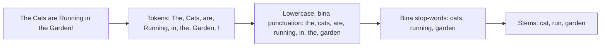
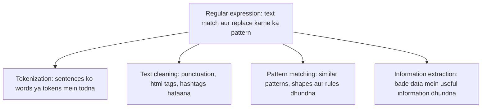

Naye ideas se pehle wo purani baatein jo chahiye. Agar aapko pata hai to seedha agle section par jao.

## Basics pehle

- Real duniya ka **text** (web pages, tweets, PDFs) mein capital letters, symbols, tags aur spelling ki variety hoti hai. Computer "Cat" aur "cat" ko do alag cheezein samajhta hai.
- **Token** text ka ek chhota piece hai, zyadatar ek word. <Cite id="class-nlp-asol" loc="p. 11" />
- **Stem** ya **root** word ka main part hai jo endings hataane ke baad bachta hai (playing mein play). <Cite id="class-nlp-m2" loc="p. 19" />

## Text preprocessing kya hai?

<Box kind="definition">

**Data preprocessing** is cleaning a text before giving it to computers. <Cite id="class-nlp-m2" loc="p. 19" />

</Box>

Teacher ka example: "Hello bbbb, we all love NL@P" ko clean kiya jaata hai taaki junk symbol hat jaaye aur sentence "we all love NLP" padha jaaye. <Cite id="class-nlp-m2" loc="p. 19" />

Rozmarra ka example: khana banane se pehle aap sabziyan dhote aur kaatte ho. Preprocessing text ko dhoti aur kaatti hai taaki program use kar sake. Ye syllabus <Syl m="2" /> hai.

## Text processing ke steps

```mermaid
%% caption: Text processing pipeline jaise class batati hai. Left se raw text andar jaata hai; right se clean, uniform terms nikalte hain jo indexing ke liye ready hain.
flowchart LR
  A["Raw text"] --> B["1. Extraction aur noise removal"]
  B --> C["2. Tokenization"]
  C --> D["3. Case normalization"]
  D --> E["4. Stop-word removal"]
  E --> F["5. Term normalization"]
  F --> G["6. Stemming ya lemmatization"]
  G --> H["7. Feature extraction aur indexing"]
```

Class information retrieval ke liye text taiyaar karne ke steps batati hai. <Cite id="class-nlp-asol" loc="p. 11" /> <Cite id="class-nlp-asol" loc="p. 12" /> Module 6 slides ek milti-julti chhoti list deti hain. <Cite id="class-nlp-m6" loc="slide 33" />

| Step | Ye kya karta hai | Teacher ki detail |
|---|---|---|
| 1. Extraction aur format standardization | HTML, PDF ya DOCX se raw text nikalta hai | Noise removal (HTML tags, markdown, metadata, tabs aur line breaks); ek character encoding (usually UTF-8) |
| 2. Tokenization | Text ke stream ko tokens mein todta hai | Whitespace aur punctuation par split. Mushkil cases: compound nouns, hyphenated words (state-of-the-art), bina spaces wali languages (Chinese, Thai) |
| 3. Case normalization | Har token ko ek case mein badalta hai, usually lowercase | Information, information aur INFORMATION ban jaate hain information |
| 4. Stop-word removal | Kam meaning wale high-frequency words hataata hai | the, is, a, and, in. Index chhota hota hai aur noise kam hota hai |
| 5. Term normalization | Variants ko ek form mein map karta hai | Commas, periods, emojis hataata hai; U.S.A., USA aur United States ek form ban jaate hain |
| 6. Stemming ya lemmatization | Words ko base form mein laata hai | Neeche ki table dekho |
| 7. Feature extraction aur indexing | Search ke liye structure banata hai | Inverted index, TF-IDF ya BM25 jaisi weighting |

<Cite id="class-nlp-asol" loc="p. 11" /> <Cite id="class-nlp-asol" loc="p. 12" />

Slides sentiment analysis ke liye wahi idea batati hain: text cleaning (HTML tags, special characters, numbers aur emojis hataana), tokenization, stop-word removal, stemming ya lemmatization, aur emojis aur slang handle karna. <Cite id="class-nlp-m6" loc="slide 33" />

### Stemming aur lemmatization

Stemming is a simplified form of morphological analysis which is basically used to find the root word. <Cite id="class-nlp-m2" loc="p. 19" />

| Technique | Description | Example |
|---|---|---|
| Stemming | Ek crude, heuristic process jo rules se words ke ends kaat deta hai (jaise Porter stemmer). Fast hai, par non-dictionary roots de sakta hai. | retrieval, retrieved, retrieving ban jaate hain retriev |
| Lemmatization | Linguistic analysis jo vocabulary aur morphological rules se dictionary form (lemma) deta hai. Part-of-speech context chahiye. | better ban jaata hai good; mice ban jaata hai mouse |

<Cite id="class-nlp-asol" loc="p. 12" />

Porter stemmer ka apna topic hai: <Syl m="2" /> "Porter stemmer".

### Morphological analysis (preprocessing idea ki tarah)

Morphological analysis is breaking a word into smaller and meaningful parts. <Cite id="class-nlp-m2" loc="p. 19" /> Example: Playing aur Running action verbs hain; playing = play + ing, jahan play stem hai aur ing ending hai. (Aur detail <Syl m="2" /> "Morphology" mein.)

## Ek sentence poori pipeline se

Raw text lo `
The Cats are Running in the Garden!
`. Har row pichhle step ka output hai (stemming Porter stemmer se check ki gayi).

| Step | Output |
|---|---|
| Raw text | `
The Cats are Running in the Garden!
` |
| Noise removal (HTML tags) | The Cats are Running in the Garden! |
| Tokenization | The, Cats, are, Running, in, the, Garden, ! |
| Case normalization | the, cats, are, running, in, the, garden, ! |
| Punctuation hataana (term normalization) | the, cats, are, running, in, the, garden |
| Stop-word removal (the, are, in) | cats, running, garden |
| Stemming | cat, run, garden |

## Regular expressions

<Box kind="definition">

**Regular expression (regex)** is a pattern used to match and replace text. <Cite id="class-nlp-m2" loc="p. 18" />

</Box>

**Regular expressions ke uses** <Cite id="class-nlp-m2" loc="p. 18" />

1. Clean the text.
2. Find words, numbers, emails, dates.
3. Remove unwanted symbols.

**NLP mein regex kya karta hai** (teacher inhe regular expression ke types kehte hain). <Cite id="class-nlp-m2" loc="p. 18" /> <Cite id="class-nlp-m2" loc="p. 19" />

| Kaam | Matlab | Teacher ka example |
|---|---|---|
| Tokenization | Sentences ko words ya tokens mein todna | "NLP is fun" ban jaata hai "NLP", "is", "fun" |
| Text cleaning | Punctuation, html tags, hashtags jaise unwanted characters hataana | "NLP@2026 is easy" ban jaata hai "NLP2026 is easy" |
| Pattern matching | Text ke andar similar patterns, shapes aur rules dhundna | "my age is 20", "her age is 18": pattern hai age is Number |
| Information extraction | Bade data se useful information dhundna | Google search |

**Idea samajhne ke liye kuch patterns** (class pattern syntax nahi deti, isliye ye standard examples hain). `[0-9]+` numbers dhundta hai, to "my age is 20" par 20 milta hai; `<[^>]+>` html tags dhundta hai taaki hataaye ja sakein; `\w+` words dhundta hai, to "NLP is fun" par NLP, is, fun milta hai.

**NLP mein regular expressions ka significance:** ye chhote, fast aur exact hote hain, isliye kisi model se pehle text ko clean karne, todne aur dates, emails aur numbers nikaalne ke liye pehla tool yahi hai.

## Ye kahan puchha gaya

| Agar question kehta hai | Kya likhna hai | Kab aaya |
|---|---|---|
| "Explain preprocessing steps of NLP with an example" | Saat steps aur ek-sentence wala example | <PYQ id="2025-05/q4b" /> <PYQ id="2024-12-ce/q2b" /> |
| "Explain pre-processing steps generally used in NLP" (5 marks) | Steps ki chhoti list, har ek ek line | <PYQ id="2025-05-ce/q1d" /> |
| "Tokenization and stemming" (5 marks) | Tokenization definition, stemming definition aur retriev example | <PYQ id="2024-05-ce/q1b" /> |
| "Significance of regular expression in NLP" | Definition, uses, teacher ke examples ke saath chaar kaam | <PYQ id="2025-05-ce/q5b" /> |

## Quick revision

- Data preprocessing is cleaning a text before giving it to computers.
- Steps: noise removal, tokenization, case normalization, stop-word removal, term normalization, stemming ya lemmatization, feature extraction aur indexing.
- Tokenization: text ke stream ko tokens mein todna. Stop-words: the, is, a, and, in.
- Stemming endings kaat deta hai (retriev); lemmatization dictionary word deta hai (better se good).
- Regular expression: text match aur replace karne ka pattern. Kaam: tokenization, text cleaning, pattern matching, information extraction.

**Conclusion.** Preprocessing messy raw text ko clean tokens aur stems mein badalta hai, aur regular expressions wo pattern tool hain jo is kaam ka bada hissa karte hain. <Cite id="class-nlp-asol" loc="p. 11" />
