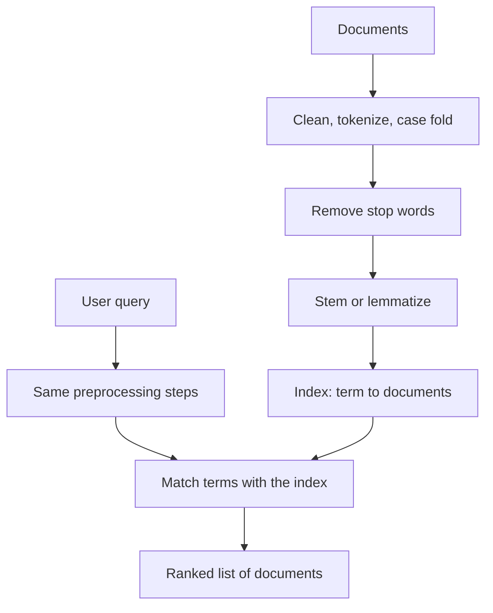
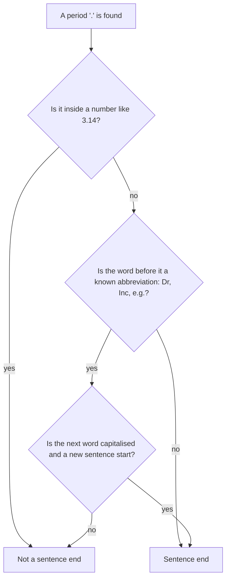
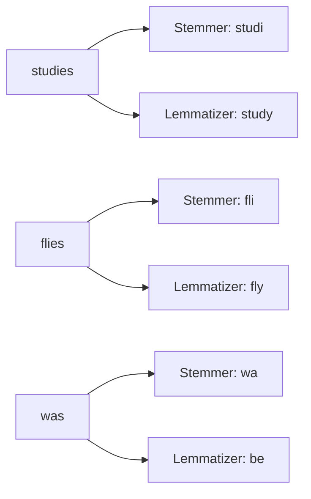
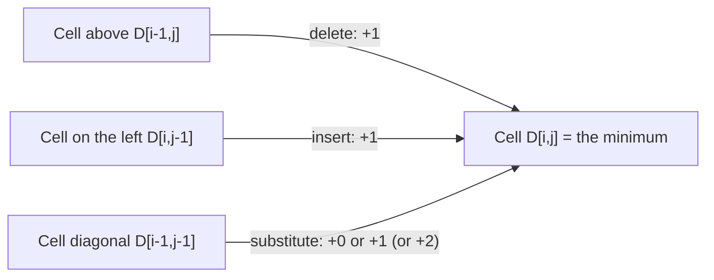

Naye ideas se pehle, ye purane ideas chahiye honge. Agar pehle se aate hain, to agle section pe jao.

## Pehle basics

- **Character** matlab ek letter, digit, space ya symbol. **String** characters ki ek line hai, jaise `"cats"`.
- **Corpus** (plural **corpora**) bahut saare text ka collection hai jo study ya training ke liye use hota hai, jaise news articles ka dher.
- Yahan **word** matlab letters ka wo hissa jise hum normally word kehte hain. **Sentence** words ka group hai jo full stop, question mark ya exclamation mark pe khatam hota hai.
- Computer text ko sirf characters ki lambi line ki tarah dekhta hai. Use nahi pata ki word kahan khatam hota hai, ki `The` aur `the` same word hain, ya ki `running` aur `ran` related hain. Preprocessing ye sab sikhata hai.
- **Word instance aur word type.** "to be or not to be" mein 6 word instances hain (har baar aana gina jaata hai) lekin sirf 4 word types hain (to, be, or, not: alag-alag words). Purani books instance ko "token" kehti hain. Jurafsky aur Martin ka naya draft *token* shabd tokenizer ke banaye pieces ke liye rakhta hai, lekin zyadatar exam answers aur tutorials abhi bhi words ko "tokens" hi kehte hain. <Cite id="text-preprocessing-slp3-ch2" loc="§2.1" /> <Cite id="text-preprocessing-wiki-tt" />

<Box kind="definition">

**Dynamic programming** bade problem ko chhote sub-problems mein todkar har ek ko sirf ek baar solve karta hai, answers table mein likhta hai, aur table se bada answer banata hai. Hum ise neeche edit distance ke liye use karte hain.

</Box>

## Big picture: text preprocessing kya hai

**Ye kya hai.** Text preprocessing safai aur splitting ke steps ka set hai jo raw text pe lagta hai, kisi NLP task (search, classification, translation) se pehle. Ye syllabus <Syl m="2" /> hai, section 2.1 (tokenization, stemming, segmentation, lemmatization, edit distance, collocations) aur section 2.4 (regular expressions). <Cite id="text-preprocessing-gfg-pre" /> <Cite id="text-preprocessing-av-pre" />

**Ye kyun zaroori hai.** Real text untidy hota hai: alag-alag capital letters, words se chipki punctuation, "the" jaise filler words, ek word ke kai forms (play, plays, playing, played), spelling mistakes, emojis aur web addresses. Agar safai na karein to computer `Play`, `play` aur `playing` ko teen alag cheezein maanta hai, counts bikhar jaate hain aur model kam seekhta hai. Preprocessing text ko *uniform* banata hai taaki ek hi idea hamesha ek hi tarah likha jaye.

**Roz ki analogy.** Khana banane ki tarah socho. Sabzi pakane se pehle tum use dhote ho, chheelte ho aur kaat te ho. Koi mitti wala poora aloo pateele mein nahi daalta. Preprocessing text ko dhona, chheelna aur kaatna hai.

<Box kind="definition">

**Text preprocessing** raw text ko saaf, standard form mein badalna hai jo chhote units (sentences, words, stems ya lemmas) se bana ho aur NLP system process kar sake.

</Box>

### Aam pipeline

```mermaid
%% caption: Aam preprocessing pipeline. Har box pichhle box ka output leta hai. Har task ko har step nahi chahiye: search engine aam taur pe sab rakhta hai, lekin modern language model wala chatbot aksar sirf tokenization rakhta hai.
flowchart LR
  A["Raw text"] --> B["Sentence segmentation"]
  B --> C["Tokenization"]
  C --> D["Case folding (lower-case)"]
  D --> E["Remove punctuation and noise"]
  E --> F["Remove stop words"]
  F --> G["Stemming or lemmatization"]
  G --> H["Clean tokens for the NLP task"]
```

Ye wahi steps hain jo zyadatar study sites par likhe hote hain. <Cite id="text-preprocessing-gfg-pre" /> <Cite id="text-preprocessing-av-pre" />

Steps short mein:

1. **Sentence segmentation:** text ko sentences mein kaato.
2. **Tokenization:** har sentence ko words aur punctuation marks mein kaato.
3. **Case folding:** sab kuch lower case karo taaki `The` aur `the` match ho.
4. **Punctuation, numbers aur noise hatao** (extra spaces, HTML tags, URLs) jab task ko unki zaroorat na ho.
5. **Stop words hatao:** bahut common words jinka meaning kam hota hai (the, is, of, to) nikaal do.
6. **Stemming ya lemmatization:** har word ko common base form mein laao.

Order thoda matter karta hai: hum sentences mein *pehle* split karte hain aur punctuation *baad mein* hatate hain, kyunki full stop hi sentence ke end ka clue hai. <Cite id="text-preprocessing-slp3-ch2" loc="§2.8.1" />

### Poori pipeline ka worked example

Raw text lo: `The Children were RUNNING to the new parks! They loved it.`

| Step | Result |
|---|---|
| Sentence segmentation | (1) `The Children were RUNNING to the new parks!` (2) `They loved it.` |
| Tokenization | sentence 1 ke pieces: `The`, `Children`, `were`, `RUNNING`, `to`, `the`, `new`, `parks`, `!` aur sentence 2: `They`, `loved`, `it`, `.` |
| Case folding | `the`, `children`, `were`, `running`, `to`, `the`, `new`, `parks`, `!` aur `they`, `loved`, `it`, `.` |
| Remove punctuation | `!` aur `.` hat gaye |
| Remove stop words | `the`, `were`, `to`, `the`, `they`, `it` hat gaye, bachte hain `children`, `running`, `new`, `parks`, `loved` |
| Stemming (Porter) | `children`, `run`, `new`, `park`, `love` |
| Lemmatization (part of speech ke saath) | `child`, `run`, `new`, `park`, `love` |

Dhyan do ki stemmer ne `children` ko waisa hi chhod diya (wo sirf endings kaat ta hai aur irregular plural nahi jaanta), jabki lemmatizer ne dictionary use karke `child` diya. Yahan stop-word list wahi standard English list hai jo NLTK ke saath aati hai. <Cite id="text-preprocessing-gfg-stop" /> <Cite id="text-preprocessing-nltk-porter" />

<Box kind="exam">

**Pre-processing steps of NLP (5 ya 10 marks):** upar ki pipeline ko numbered list mein likho, har step ki ek line, flowchart banao, aur `The Children were RUNNING...` wala chhota example do. Ek line add karo ki steps task pe depend karte hain. Exam mein English mein likho: "The preprocessing steps depend on the NLP task." <PYQ id="2024-12-ce/q2b" /> <PYQ id="2025-05-ce/q1d" /> <PYQ id="2025-05/q4b" />

</Box>

### Information Retrieval ke liye preprocessing

**Information Retrieval (IR)** system, jaise search engine, wo documents dhoondhta hai jo user ki query se match karein. Documents aur query dono *same* preprocessing se guzarte hain taaki match ho sakein. Steps: documents collect karke saaf karo (HTML hatao, encoding theek karo), tokenize, case fold, stop words hatao, stem ya lemmatize, aur aakhir mein **index** banao (har term se un documents ki table jinme wo hai). Query bhi isi tarah normalise hoti hai, isliye query `Running shoes` ek aise page ko dhoondh sakti hai jisme likha ho "this shoe is good for run". Stop words hatane se index chhota rehta hai, lekin "to be or not to be" jaise phrase queries dikhati hain ki unhe hatana nuksaan bhi kar sakta hai. <Cite id="text-preprocessing-wiki-stop" />

<Box kind="exam">

**Explain the different steps in text processing for Information Retrieval (5 marks):** document cleaning, tokenization, normalisation (case folding), stop-word removal, stemming ya lemmatization, indexing, aur query ko usi tarah process karna. <PYQ id="2022-12-ce/q4b" />

</Box>

## Tokenization

**Definition.** Tokenization running text ko chhote pieces mein todne ka kaam hai, jinhe tokens kehte hain: aam taur pe words, numbers aur punctuation marks. Ye lagbhag har NLP system ka pehla step hai. <Cite id="text-preprocessing-slp3-ch2" loc="§2.8" /> <Cite id="text-preprocessing-gfg-tok" /> <Cite id="text-preprocessing-wiki-tok" />

**Ye kyun zaroori hai.** Computer poore paragraph ko ek block ki tarah handle nahi kar sakta. Words ginne, dictionary mein dekhne ya tag karne ke liye pehle text ko units mein kaatna padta hai.

**Sirf space pe split karna kyun kaafi nahi.** Ye sentence dekho: `Dr. Rao's U.S.A. trip costs $12.40, doesn't it?`. Agar sirf spaces pe split karein to `Rao's`, `$12.40,` aur `it?` mein punctuation chipka rehta hai. Agar har punctuation pe split karein to `U.S.A.`, `$12.40` aur `doesn't` toot jaate hain. Achha tokenizer jo saath rehna chahiye use saath rakhta hai aur jo alag hona chahiye use alag karta hai. Aam dikkat wali jagahein:

- **Words ke andar punctuation:** `m.p.h.`, `Ph.D.`, `AT&T`, `cap'n`.
- **Numbers, paisa aur dates:** `$45.55`, `555,500.50`, `01/02/06`.
- **Web items:** URLs, e-mail addresses, hashtags jaise `#nlproc`.
- **Clitics (contractions):** `what're` se `what` aur `are`; `doesn't` se `does` aur `n't`.
- **Multi-word expressions:** `New York` ya `rock 'n' roll` ek token ho sakta hai.
- **Bina spaces wali languages** (Chinese, Japanese, Thai) ko special tokenizers chahiye. <Cite id="text-preprocessing-slp3-ch2" loc="§2.8" />

### Tokenizers ke kinds

| Kind | How it works | Example output | Good for | Weak point |
|---|---|---|---|---|
| Whitespace | spaces pe split | `costs`, `$12.40,` | quick experiments | punctuation chipka rehta hai |
| Rule or regular-expression based | hand-written patterns pieces decide karte hain | `costs`, `$12.40`, `,` | English text, classic NLP | har language ke liye rules likhne padte hain |
| Penn Treebank standard | clitics aur saari punctuation alag karta hai, hyphenated words saath rakhta hai | `does`, `n't`, `charge`, `$`, `10` | parsers aur tagged corpora | `$10` ko do tokens mein tod deta hai |
| Subword (Byte-Pair Encoding) | data se frequent letter groups seekhta hai | `token`, `ization` | modern neural models, unknown words | pieces hamesha real words nahi hote |

<Cite id="text-preprocessing-slp3-ch2" loc="§2.8" /> <Cite id="text-preprocessing-sennrich2016" /> <Cite id="text-preprocessing-av-token" />

Penn Treebank standard `"The San Francisco-based restaurant," they said, "doesn't charge $10".` ko `" The San Francisco-based restaurant , " they said , " does n't charge $ 10 " .` bana deta hai. <Cite id="text-preprocessing-slp3-ch2" loc="§2.8" />

**Byte-Pair Encoding (BPE) ek paragraph mein.** Vocabulary mein sirf single characters se shuru karo. Training text mein jo neighbouring symbols ki jodi sabse zyada baar aati hai use dhoondho, use naye symbol mein merge karo, aur fixed number of merges ke baad ruk jao. Common words ek token ban jaate hain aur rare words known pieces mein toot jaate hain, isliye koi word "unknown" nahi hota. Modern language models yahi idea use karte hain. <Cite id="text-preprocessing-slp3-ch2" loc="§2.4" /> <Cite id="text-preprocessing-sennrich2016" />

### Worked example: regular-expression tokenizer

<Sum>

<Given>

Text: `That U.S.A. poster-print costs $12.40...`

Tokenizer pattern mein paanch alternatives hain, har position pe isi order mein try hote hain: (1) abbreviations jaise `U.S.A.`, (2) optional inner hyphens wale words, (3) money aur percentages, (4) ellipsis `...`, (5) single punctuation marks. <Cite id="text-preprocessing-slp3-ch2" loc="Fig. 2.16" />

</Given>

<Find>

tokens ki list.

</Find>

<Steps>

1. `That` pe: alternative 1 ko capital letter ke baad full stop chahiye, lekin `T` ke baad `h` hai, to fail. Alternative 2 poora word `That` match karta hai. *Reason: word matlab letters, optional hyphens ke saath.*
2. Space kisi alternative mein nahi hai, isliye skip ho jaata hai.
3. `U.S.A.` pe: alternative 1 `U.`, `S.`, `A.` teen baar lagaatar match karta hai, to ek token `U.S.A.` banta hai. *Reason: alternatives order mein try hote hain aur abbreviation rule sabse pehle hai.*
4. `poster-print` pe: alternative 2 `poster`, phir inner hyphen aur `print` match karta hai, to token `poster-print` hai.
5. `costs` pe: alternative 2 word `costs` match karta hai.
6. `$12.40` pe: alternative 3 optional `$`, digits `12`, decimal part `.40` match karta hai, to token `$12.40` hai.
7. `...` pe: alternative 4 teeno dots ko ek token ki tarah match karta hai.

</Steps>

<Answer>

`['That', 'U.S.A.', 'poster-print', 'costs', '$12.40', '...']` (6 tokens)

</Answer>

<Box kind="verify">

Tokens ko order mein jodo: `That U.S.A. poster-print costs $12.40...` input ke barabar hai, bas spaces gayab hain. Textbook mein NLTK ka `regexp_tokenize` yahi list print karta hai, aur Python mein pattern chalane pe bhi wahi 6 tokens aate hain. <Cite id="text-preprocessing-nltk-book3" /> <Cite id="text-preprocessing-pyre" />

</Box>

</Sum>

### Worked example: word instances aur word types ginna

<Sum>

<Given>

Sentence: `the cat sat on the mat and the dog sat on the rug`

</Given>

<Find>

word instances (tokens) ki ginti, word types ki ginti, aur type to token ratio.

</Find>

<Steps>

1. Spaces pe split karo: the, cat, sat, on, the, mat, and, the, dog, sat, on, the, rug. Ginti: 13 instances.
2. Har alag word ko ek baar rakho: the, cat, sat, on, mat, and, dog, rug. Ye 8 types hain. *Reason: type matlab alag word, chahe wo kitni baar repeat ho.*
3. Ratio $= \dfrac{\text{types}}{\text{instances}} = \dfrac{8}{13} \approx 0.62$.

</Steps>

<Answer>

13 word instances, 8 word types, ratio lagbhag 0.62.

</Answer>

<Box kind="verify">

Word ke hisaab se ginti: the = 4, sat = 2, on = 2, aur cat, mat, and, dog, rug 1-1 baar (5 words). Jodo: $4 + 2 + 2 + 5 = 13$ instances. Alag words ki list 8 hai, jo types se match karti hai. <Cite id="text-preprocessing-slp3-ch2" loc="§2.1" />

</Box>

</Sum>

<Box kind="exam">

**Illustrate tokenization and stemming (5 marks):** tokenization ko ek example ke saath define karo, do-teen problem cases likho (`U.S.A.`, `doesn't`, `$12.40`), tokenizers ke kinds batao, phir stemming (agle sections) define karo, `playing, played, plays` se `play` ke example ke saath. <PYQ id="2024-05-ce/q1b" />

</Box>

## Sentence segmentation

**Definition.** Sentence segmentation text ko sentences mein kaatta hai. English mein clues hain full stop, question mark aur exclamation mark. Question mark aur exclamation mark lagbhag hamesha sentence ka end hote hain, lekin **period ambiguous hai**: wo sentence khatam kar sakta hai, ya abbreviation (`Dr.`, `Inc.`, `e.g.`), number (`3.14`) ya web address ka hissa ho sakta hai. <Cite id="text-preprocessing-slp3-ch2" loc="§2.8.1" />

Ek common method pehle decide karta hai ki har period kisi word ka hissa hai ya nahi, abbreviation list (haath se bani ya data se seekhi) aur simple rules se, ya machine-learning model se. NLTK ka Punkt sentence splitter bina label wale text se abbreviations seekhta hai. <Cite id="text-preprocessing-kiss2006" /> <Cite id="text-preprocessing-wiki-sbd" />

**Example.** `Dr. Rao works at Tata Inc. He likes NLP.` Har period pe naive split chaar pieces deta hai (`Dr`, `Rao works at Tata Inc`, `He likes NLP`, aur ek khaali). Achha splitter do sentences deta hai: `Dr. Rao works at Tata Inc.` aur `He likes NLP.` `Inc.` ka period abbreviation bhi hai aur sentence end bhi, isliye ye mushkil hai. <Cite id="text-preprocessing-slp3-ch2" loc="§2.8.1" />

## Normalization: case folding, punctuation aur stop words

**Normalization** matlab ek hi cheez ke alag-alag likhe forms ko ek standard form mein badalna. <Cite id="text-preprocessing-ibm-stemlem" />

- **Case folding** saare letters lower case kar deta hai, to `The`, `THE` aur `the` ek word type ban jaate hain. Dhyan rakho: ye `US` (desh) ko `us` (pronoun) se, aur `Apple` (company) ko `apple` se mila sakta hai. Isliye named entity recognition jaise tasks aksar case rakhte hain. <Cite id="text-preprocessing-slp3-ch2" loc="§2.1" />
- **Punctuation aur noise hatana** symbols, extra spaces, HTML tags waghera delete karta hai. Lekin punctuation kabhi matter karti hai: question mark meaning badal deta hai, aur periods sentence end ka clue hain.
- **Stop-word removal.** Stop words bahut frequent words hain jinka apna meaning kam hota hai: the, is, in, of, and, to. Inhe hatane se data chhota hota hai aur content words ubhar ke aate hain (search aur topic finding ke liye achha). Jab chhote words matter karte hain tab nuksaan hota hai, jaise sentiment mein ("not good" mein `not` kho jaata hai) ya phrase "to be or not to be" mein. List language aur task ke hisaab se chuni jaati hai. <Cite id="text-preprocessing-gfg-stop" /> <Cite id="text-preprocessing-wiki-stop" />

## Stemming aur lemmatization

Dono word ke kai forms ko ek common base tak laate hain, taaki `plays`, `played` aur `playing` ko ek hi idea maana jaye.

**Stemming** simple rules se words ke ends kaat deta hai, dictionary check kiye bina. Result ek **stem** hota hai, jo real word nahi bhi ho sakta. English ka sabse famous stemmer Porter stemmer (1980) hai, jo suffix-stripping rule groups ki series lagata hai; uska apna alag note hai. Porter stemmer ke examples: `running` se `run`, `parks` se `park`, `caring` se `care`, lekin `studies` se `studi` aur `flies` se `fli`. <Cite id="text-preprocessing-porter1980" /> <Cite id="text-preprocessing-nltk-porter" /> <Cite id="text-preprocessing-wiki-lem" />

**Lemmatization** word ka **lemma** (dictionary form) dhoondhta hai, vocabulary aur word ke part of speech ki madad se. `studies` (noun ya verb) se `study`, `better` (adjective) se `good`, `was` (verb) se `be`, `feet` se `foot`. NLTK lemmatizer words ko WordNet mein dekhta hai, isliye use part of speech chahiye: `running` verb ho to `run`, noun ho to `running` hi rehta hai. <Cite id="text-preprocessing-nltk-wordnet" /> <Cite id="text-preprocessing-gfg-lem" /> <Cite id="text-preprocessing-wiki-lem" />

IBM aur GeeksforGeeks stemming versus lemmatization ka wahi contrast draw karte hain; unki pictures dekhne ke liye click karo. <Cite id="text-preprocessing-ibm-stemlem" loc="diagram" /> <Cite id="text-preprocessing-gfg-lem" loc="diagram" />

| Point | Stemming | Lemmatization |
|---|---|---|
| Method | suffixes ki rule-based chopping | dictionary look-up plus part of speech |
| Output | stem, aksar real word nahi (`studi`) | lemma, hamesha real word (`study`) |
| Irregular forms (`was`, `feet`) | aksar miss | handle hote hain |
| Speed | bahut fast | slow |
| Accuracy | kam (over-stemming aur under-stemming) | zyada |
| Needs a dictionary | nahi | haan (jaise WordNet) |
| Typical use | search engines, jahan speed matter karti hai | chatbots, text analysis, jahan meaning matter karta hai |

<Cite id="text-preprocessing-ibm-stemlem" /> <Cite id="text-preprocessing-wiki-lem" />

Stemmer do tarah se galat ho sakta hai: **over-stemming** alag meaning wale words ko jod deta hai (`universe` aur `university` dono `univers` ban jaate hain) aur **under-stemming** related words ko nahi jodta (`data` aur `datum`). Porter stemmer ka `university` se `univers` example NLTK mein check kiya gaya tha. <Cite id="text-preprocessing-nltk-porter" />

## Minimum edit distance

**Definition.** Do strings ke beech minimum edit distance wo sabse kam editing operations ki ginti hai jo ek string ko doosri mein badalne ke liye chahiye. Operations hain **insertion** (letter jodna), **deletion** (letter hatana) aur **substitution** (ek letter ko doosre se badalna). <Cite id="text-preprocessing-slp3-ch2" loc="§2.9" /> <Cite id="text-preprocessing-gfg-ed" /> <Cite id="text-preprocessing-wiki-lev" />

**Ye kyun zaroori hai.** Ye naapta hai ki do strings kitni similar hain. Uses: spell checkers (`graf` `giraffe` ke kareeb hai), typing mistake ke liye sabse paas wala dictionary word dhoondhna, speech recognizer ke output ko sahi words se compare karna, machine translation evaluation, aur DNA sequences match karna.

**Do common cost schemes.**

- **Levenshtein distance:** insertion, deletion aur substitution har ek ka cost 1. Letter ko khud se substitute karne ka cost 0. <Cite id="text-preprocessing-slp3-ch2" loc="§2.9" />
- **Textbook table wala variant:** insertion aur deletion ka cost 1, substitution ka cost 2 (kyunki substitution ek deletion plus ek insertion ke barabar hai). Isse `intention` se `execution` 8 hai, aur ordinary Levenshtein se 5. <Cite id="text-preprocessing-slp3-ch2" loc="§2.9" />

**Ye kaise kaam karta hai (dynamic programming).** Maan lo source string $X$ mein $n$ letters hain aur target $Y$ mein $m$. $D[i,j]$ matlab $X$ ke pehle $i$ letters aur $Y$ ke pehle $j$ letters ke beech distance. Words mein: cell $(i,j)$ tak pahunchne ke teen raaste hain: upar wali cell se (letter delete), baayein wali cell se (letter insert) ya diagonal upar-baayein wali cell se (substitute, ya letters match hon to copy), aur hum sabse sasta choose karte hain.

$$
D[i,j] = \min \begin{cases} D[i-1,j] + 1 & \text{(delete)} \\ D[i,j-1] + 1 & \text{(insert)} \\ D[i-1,j-1] + c & \text{(substitute)} \end{cases}
$$

Yahan $c = 0$ agar dono letters equal hain, warna $c = 1$ (Levenshtein) ya $c = 2$ (upar wala variant). Pehli row aur column base case hain: $i$ letters ko khaali karne ke liye $i$ deletions, aur khaali se $j$ letters banane ke liye $j$ insertions. Answer bottom-right cell $D[n,m]$ hai. <Cite id="text-preprocessing-slp3-ch2" loc="§2.9.1" /> <Cite id="text-preprocessing-gfg-ed" />

GeeksforGeeks apne edit distance page par yahi teen moves draw karta hai; uski pictures dekhne ke liye click karo. <Cite id="text-preprocessing-gfg-ed" loc="diagram" />

### Worked example 1: Levenshtein distance, saare costs 1

<Sum>

<Given>

Source `kitten` (6 letters), target `sitting` (7 letters). Insert, delete aur substitute har ek ka cost 1; equal letters ka cost 0.

</Given>

<Find>

minimum edit distance aur ek best edits ka sequence.

</Find>

<Steps>

1. Pehli row $0,1,2,\dots,7$ (insertions) aur pehla column $0,1,\dots,6$ (deletions) se bharo. *Reason: ye base case hai.*
2. Baaki har cell ko above $+1$, left $+1$ aur diagonal $+ c$ ke minimum se bharo. Jaise cell (k, s): above 1 hai, left 1 hai, diagonal $0 + 1 = 1$ hai (k aur s alag hain), to cell $\min(1+1, 1+1, 0+1) = 1$.
3. Row `i` mein cell (i, i): letters match karte hain, to diagonal $1 + 0 = 1$; cell 1 hai. Row by row aage badho to neeche wali table milti hai.
4. Answer bottom-right cell mein padho.

| | # | s | i | t | t | i | n | g |
|---|---|---|---|---|---|---|---|---|
| **#** | 0 | 1 | 2 | 3 | 4 | 5 | 6 | 7 |
| **k** | 1 | 1 | 2 | 3 | 4 | 5 | 6 | 7 |
| **i** | 2 | 2 | 1 | 2 | 3 | 4 | 5 | 6 |
| **t** | 3 | 3 | 2 | 1 | 2 | 3 | 4 | 5 |
| **t** | 4 | 4 | 3 | 2 | 1 | 2 | 3 | 4 |
| **e** | 5 | 5 | 4 | 3 | 2 | 2 | 3 | 4 |
| **n** | 6 | 6 | 5 | 4 | 3 | 3 | 2 | 3 |

5. Bottom-right cell se peeche trace karo, hamesha us padosi pe jao jisne minimum diya: `g` insert (3, 2 se), `n` match (free), `e` ko `i` se substitute (2, 1 se), `t` match, `t` match, `i` match, `k` ko `s` se substitute (1, 0 se).

</Steps>

<Answer>

Minimum edit distance $= 3$: k ko s se substitute, e ko i se substitute, g insert.

</Answer>

<Box kind="verify">

Teeno edits haath se lagao: `kitten` se `sitten` (k se s) se `sittin` (e se i) se `sitting` (g insert). Teen edits target tak pahunchate hain. Distance 2 possible nahi hai kyunki lengths mein 1 ka fark hai (kam se kam ek insertion chahiye) aur words kam se kam do aur jagah alag hain (pehla letter, aur e/i ki jodi). Program se dobara nikaalne pe bhi 3 aata hai.

</Box>

</Sum>

### Worked example 2: textbook version, substitution cost 2

<Sum>

<Given>

Source `intention` (9 letters), target `execution` (9 letters). Insert aur delete ka cost 1, substitute ka cost 2, equal letters ka cost 0.

</Given>

<Find>

minimum edit distance.

</Find>

<Steps>

1. Pehli row $0,1,\dots,9$ aur pehla column $0,1,\dots,9$. *Reason: base case.*
2. Har cell ko $\min(\text{above}+1,\ \text{left}+1,\ \text{diagonal}+c)$ se bharo, jahan equal letters ke liye $c = 0$ aur baaki ke liye $2$. Jaise cell (i, e): above $= 1$, left $= 1$, diagonal $= 0 + 2 = 2$, to $\min(2, 2, 2) = 2$.
3. Doosri row mein cell (n, e): above $=2$, left $=2$, diagonal $=1+2=3$, to $\min(3,3,3)=3$. Row by row aage badho.

| | # | e | x | e | c | u | t | i | o | n |
|---|---|---|---|---|---|---|---|---|---|---|
| **#** | 0 | 1 | 2 | 3 | 4 | 5 | 6 | 7 | 8 | 9 |
| **i** | 1 | 2 | 3 | 4 | 5 | 6 | 7 | 6 | 7 | 8 |
| **n** | 2 | 3 | 4 | 5 | 6 | 7 | 8 | 7 | 8 | 7 |
| **t** | 3 | 4 | 5 | 6 | 7 | 8 | 7 | 8 | 9 | 8 |
| **e** | 4 | 3 | 4 | 5 | 6 | 7 | 8 | 9 | 10 | 9 |
| **n** | 5 | 4 | 5 | 6 | 7 | 8 | 9 | 10 | 11 | 10 |
| **t** | 6 | 5 | 6 | 7 | 8 | 9 | 8 | 9 | 10 | 11 |
| **i** | 7 | 6 | 7 | 8 | 9 | 10 | 9 | 8 | 9 | 10 |
| **o** | 8 | 7 | 8 | 9 | 10 | 11 | 10 | 9 | 8 | 9 |
| **n** | 9 | 8 | 9 | 10 | 11 | 12 | 11 | 10 | 9 | 8 |

4. Answer bottom-right cell hai, 8.

</Steps>

<Answer>

Minimum edit distance $= 8$.

</Answer>

<Box kind="verify">

Best path: `i` delete (1), `n` ko `e` se substitute (2), `t` ko `x` se substitute (2), `u` insert (1), `n` ko `c` se substitute (2), aur letters `e`, `t`, `i`, `o`, `n` free match hote hain. Total $1 + 2 + 2 + 1 + 2 = 8$. Saare costs 1 hon to wahi path $1+1+1+1+1 = 5$ ka hai, jo is pair ka known Levenshtein distance hai. Table textbook ke Fig. 2.20 se match karti hai. <Cite id="text-preprocessing-slp3-ch2" loc="Fig. 2.20" />

</Box>

</Sum>

**Complexity.** Table mein $(n+1)(m+1)$ cells hain aur har cell constant time mein bharti hai, to time aur space dono $O(nm)$ hain. Algorithm ka naam Wagner aur Fischer (1974) ke naam pe hai, aur textbook batati hai ki kai logon ne ise independently dhoondha tha. <Cite id="text-preprocessing-slp3-ch2" loc="§2.9.1" />

<Box kind="pitfall">

Dono cost schemes ko mat milao. Agar question na bataye to Levenshtein use karo jisme substitution cost 1 hai, aur answer mein ye likh do. Agar likha ho "substitution costs 2" to distance bada ho sakta hai.

</Box>

## Collocations

**Definition.** Collocation do ya zyada words ka group hai jo chance se zyada saath use hote hain, aur jahan ek word ko synonym se badalne pe aksar ajeeb lagta hai. `Strong tea` aur `heavy rain` natural hain; `powerful tea` aur `strong rain` nahi, jabki *strong* aur *powerful* lagbhag synonyms hain. Aur examples: `make a decision`, `New York`, `kick the bucket`. <Cite id="text-preprocessing-fsnlp" /> <Cite id="text-preprocessing-wiki-coll" />

**Ye kyun matter karte hain.** Ye machine translation mein madad karte hain (pair ko ek unit ki tarah translate karna padta hai), dictionary banane mein, information retrieval mein (`New York` ko ek term maano) aur natural-sounding text generation mein.

**Inhe kaise dhoondhein.**

1. **Raw frequency:** bigrams gino aur sabse common rakho. Dikkat: sabse common pairs boring hote hain (`of the`, `in the`). Fix: part of speech se filter karo (adjective plus noun, noun plus noun rakho). <Cite id="text-preprocessing-fsnlp" />
2. **Hypothesis tests (t-test, chi-square):** poochte hain ki pair us se zyada baar aata hai ya nahi jitna tab aata jab dono words independent hote. <Cite id="text-preprocessing-fsnlp" />
3. **Pointwise mutual information (PMI):** pair dikhne ke chance ko dono words alag-alag dikhne ke chance se compare karta hai. Word association ke liye Church aur Hanks (1990) ne introduce kiya.

$$
\text{PMI}(x,y) = \log_2 \frac{P(x,y)}{P(x)\,P(y)}
$$

Words mein: agar $x$ aur $y$ unrelated hote to $P(x,y)$, $P(x)P(y)$ ke barabar hota aur PMI 0 hota. PMI jitna zyada, link utna strong. Kamzori: PMI un bahut rare words ko zyada number deta hai jo ek baar saath aa gaye. <Cite id="text-preprocessing-church1990" /> <Cite id="text-preprocessing-wiki-pmi" />

### Worked example: do word pairs ka PMI

<Sum>

<Given>

$N = 10{,}000$ words ka corpus (bigrams ki ginti lagbhag $N$ maan lete hain). Counts: `strong` = 50, `drink` = 60, `tea` = 40, `strong tea` = 10, `drink tea` = 2.

</Given>

<Find>

`strong tea` aur `drink tea` ka PMI, aur kaun sa pair strong collocation hai.

</Find>

<Steps>

1. Probabilities: $P(\text{strong}) = 50/10000 = 0.005$, $P(\text{drink}) = 60/10000 = 0.006$, $P(\text{tea}) = 40/10000 = 0.004$.
2. Pair probabilities: $P(\text{strong tea}) = 10/10000 = 0.001$ aur $P(\text{drink tea}) = 2/10000 = 0.0002$.
3. `strong tea` ke liye: independent chance $= 0.005 \times 0.004 = 0.00002$. Ratio $= 0.001 / 0.00002 = 50$. PMI $= \log_2 50 \approx 5.64$. *Reason: $2^5 = 32$ aur $2^6 = 64$, isliye $\log_2 50$ 5 aur 6 ke beech hai.*
4. `drink tea` ke liye: independent chance $= 0.006 \times 0.004 = 0.000024$. Ratio $= 0.0002 / 0.000024 \approx 8.33$. PMI $= \log_2 8.33 \approx 3.06$.
5. Compare: $5.64 > 3.06$.

</Steps>

<Answer>

PMI(strong tea) $\approx 5.64$, PMI(drink tea) $\approx 3.06$. `Strong tea` zyada strong collocation hai.

</Answer>

<Box kind="verify">

Logs ko undo karo: $2^{5.64} \approx 49.9 \approx 50$ aur $2^{3.06} \approx 8.3$, jo dono ratios se match karte hain. Dono PMI values positive hain, jaisa un pairs ke liye expected hai jo chance se zyada dikhte hain (ratio 1 se upar). Numbers practice ke liye banaye gaye hain, real corpus counts nahi hain.

</Box>

</Sum>

## Regular expressions

**Definition.** Regular expression (regex) ek chhota pattern hai jo strings ke ek set ko describe karta hai. Program ise text dhoondhne, nikaalne ya badalne ke liye use karta hai. <Cite id="text-preprocessing-slp3-ch2" loc="§2.6" /> <Cite id="text-preprocessing-wiki-regex" />

**Ye kyun zaroori hai (NLP mein significance).** Text patterns se bhara hai: phone numbers, dates, e-mail addresses, prices, hashtags, plural endings. Har pattern ke liye code likhne se regex likhna bahut jaldi hota hai. NLP mein regexes ye kaam aate hain:

1. **Tokenization:** upar tokenizer example wala pattern.
2. **Text cleaning:** URLs, HTML tags aur extra spaces delete karna.
3. **Information extraction:** fixed format wali dates, amounts, names nikaalna.
4. **Text search aur replace:** `ing` pe khatam hone wale saare words dhoondhna, `colour` ko `color` karna.
5. **Rule-based stemming aur morphology:** suffix-stripping rules patterns hi hain.
6. **Sentence segmentation aur simple chatbots** (ELIZA chatbot user input ko regex rules se match karta tha).

Regular expressions seedhe **finite automata** se bhi jude hain: har regex ko finite state machine mein badla ja sakta hai, isliye regex pe bane tokenizers bahut fast hote hain. <Cite id="text-preprocessing-slp3-ch2" loc="§2.8" /> <Cite id="text-preprocessing-gfg-regex" /> <Cite id="text-preprocessing-w3s-regex" />

### Regular-expression operators ke types

| Type | Symbol | Meaning | Example and what it matches |
|---|---|---|---|
| Literal (concatenation) | `abc` | letters ek ke baad ek | `the` matches `the` |
| Character set (disjunction of characters) | `[abc]`, `[A-Z]`, `[0-9]` | set ya range ka koi ek character | `[A-Z]` ek capital letter match karta hai |
| Negated set | `[^0-9]` | set mein na hone wala koi ek character | non-digit match karta hai |
| Wildcard | `.` | koi bhi ek character | `a.c` matches `abc`, `a-c` |
| Optional | `?` | pichhle ka zero ya ek | `colou?r` matches `color`, `colour` |
| Kleene star | `*` | pichhle ka zero ya zyada | `ba*` matches `b`, `ba`, `baaa` |
| Kleene plus | `+` | pichhle ka ek ya zyada | `ba+` matches `ba`, `baaa` lekin `b` nahi |
| Counters | `{n}`, `{n,m}` | exactly n, ya n se m repeats | `\d{3}` teen digits match karta hai |
| Anchors | `^`, `$` | line ki shuruaat ya end | `^The` sirf start mein `The` match karta hai |
| Word boundary | `\b` | word ka kinara | `\bthe\b` `the` match karta hai lekin `then` nahi |
| Disjunction (alternation) | `\|` | koi ek side | `cat\|dog` matches `cat` ya `dog` |
| Grouping | `( )` | hisse ko ek unit maano aur yaad rakho | `(cat\|dog)s?` matches `cats`, `dog` |
| Capture group and back-reference | `\1` | group ne jo match kiya use dobara use karo | `s/(\w+) (\w+)/\2 \1/` do words swap karta hai |
| Lookahead | `(?=...)` | tabhi match jab aage kuch ho, use consume kiye bina | `\w+(?= is)` ` is` se pehle wala word dhoondhta hai |

<Cite id="text-preprocessing-slp3-ch2" loc="§2.6" /> <Cite id="text-preprocessing-pyre" />

Theory mein saari regular expressions banane ke liye teen operations kaafi hain: **concatenation** (letters ek ke baad ek), **union** (`|`) aur **closure** (Kleene star). Table ki baaki cheezein convenient shortcuts hain. <Cite id="text-preprocessing-wiki-regex" />

### Worked example: `\b\w+ing\b` match karna

<Sum>

<Given>

Pattern `\b\w+ing\b` (word boundary, ek ya zyada word characters, letters `ing`, word boundary). Text: `The king was running and jumping.`

</Given>

<Find>

text mein har match.

</Find>

<Steps>

1. `\b\w+` sirf word ki shuruaat se start ho sakta hai, isliye engine har word ko baari-baari try karta hai.
2. `The`: `ing` pe khatam nahi hota. No match.
3. `king`: `\w+` `k` leta hai, phir `ing` aata hai aur uske baad boundary. Match `king`. *Reason: `\w+` ko `ing` se pehle kam se kam ek letter chahiye, aur `k` kaafi hai.*
4. `was`: no. `running`: `\w+` = `runn`, phir `ing`. Match. `and`: no. `jumping`: `\w+` = `jump`, phir `ing`. Match.

</Steps>

<Answer>

Matches: `king`, `running`, `jumping`.

</Answer>

<Box kind="verify">

Python mein wahi pattern (`re.findall`) chalao to wahi teen words milte hain. Dhyan do ki `king` galat match hai, kyunki wo noun hai, verb form nahi. Regex sirf letters dekhta hai, meaning nahi, isliye results ko aankh se check karo. Jahan zyada care chahiye wahan tagger ya lemmatizer use hota hai.

</Box>

</Sum>

**Aur chhote examples** (har ek Python mein check kiya): `colou?r` "The color and colour" mein `color` aur `colour` dhoondhta hai; `\d{3}-\d{4}` `555-1234` dhoondhta hai; dono taraf `\b` lagao to wo `9999-1111` ko sahi se mana kar deta hai; `s/colour/color/` `colour colour` ko `color color` bana deta hai. <Cite id="text-preprocessing-pyre" />

**Limits.** Regexes meaning nahi samajhte, unexpected spellings pe toot jaate hain, aur lambe patterns padhna mushkil hota hai. Ye pehla tool hain jo uthana chahiye, akela tool nahi.

<Box kind="exam">

**Explain the significance of regular expression in NLP (10 marks):** definition, text ko pattern matching kyun chahiye, operators ki table har ek ke example ke saath, uses (tokenization, cleaning, extraction, search and replace, rule-based stemming), finite automata se link, aur limits. <PYQ id="2025-05-ce/q5b" />

</Box>

## Sab ko jodkar: steps kaise chunein

| Step | Helps with | Can hurt when |
|---|---|---|
| Sentence segmentation | parsing, sentence-level tasks | abbreviations splitter ko confuse karte hain |
| Tokenization | har task | language ke liye rules galat hon |
| Case folding | `The` aur `the` ko jodna | `US` aur `us`, names |
| Remove punctuation | saaf counts | question marks, smileys, sentence ends |
| Stop-word removal | chhota index, topic finding | sentiment, phrases |
| Stemming | speed, search recall | non-words, galat merges |
| Lemmatization | sahi dictionary forms | slow, part of speech chahiye |

BERT ya GPT jaise modern neural models subword tokenization use karte hain aur aksar stemming aur stop-word removal chhod dete hain, kyunki model raw pieces se seekh sakta hai. Classical systems (search, topic models, rule-based pipelines) abhi bhi upar ki poori pipeline use karte hain. <Cite id="text-preprocessing-sennrich2016" />

## Conclusion

Text preprocessing raw text ko uniform banata hai: sentences aur tokens mein todo, case fold karo, noise aur stop words hatao, aur words ko stems ya lemmas tak laao. Minimum edit distance chhoti dynamic programming table se strings compare karta hai, collocations saath rehne wale words pakadte hain, aur regular expressions patterns dhoondhne aur badalne ka chhota tareeka dete hain. Steps ka sahi choice task pe depend karta hai.
