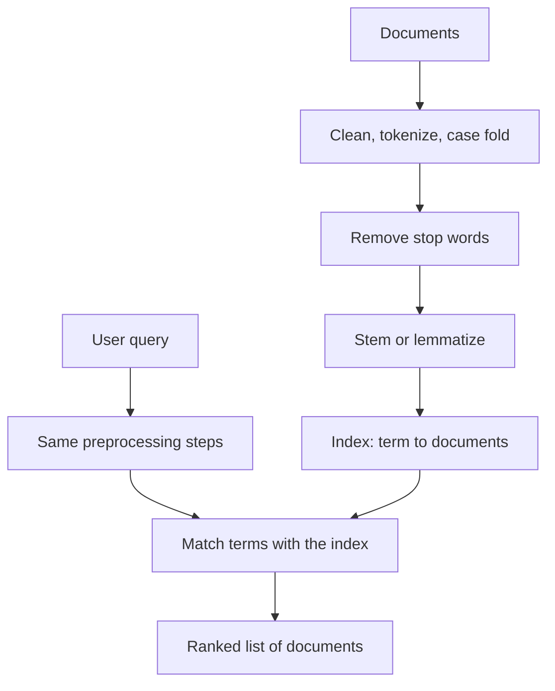
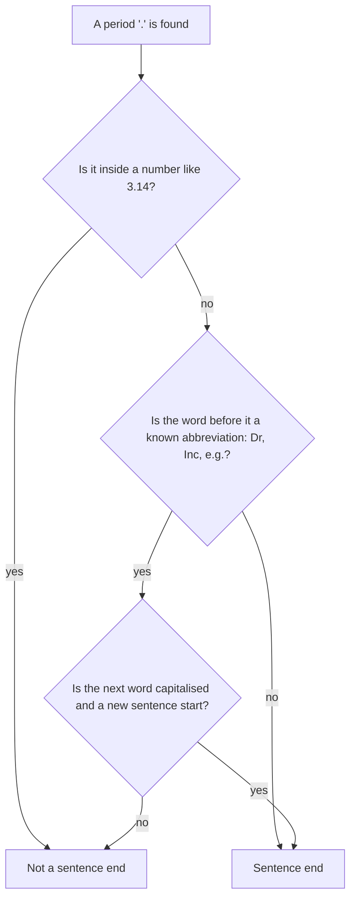
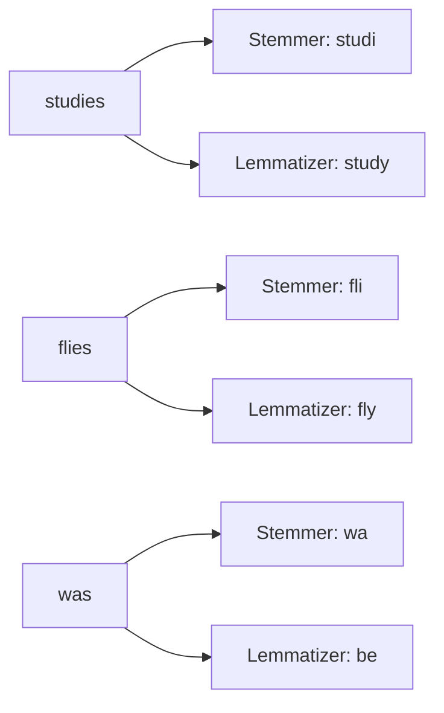
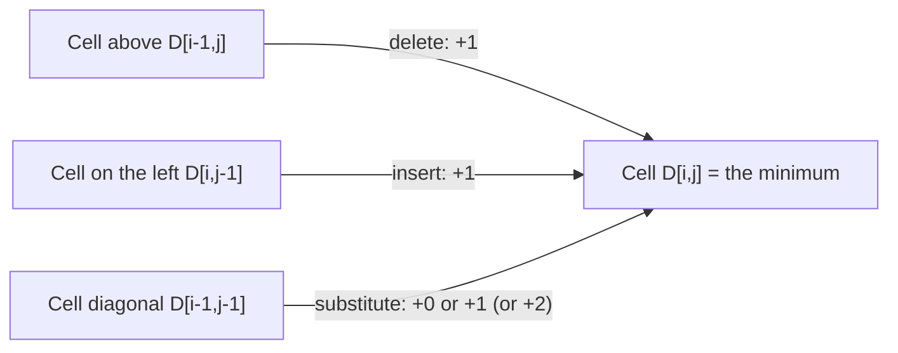

Before the new ideas, here are the old ones you need. If you already know them, skip to the next section.

## The basics first

- A **character** is one letter, digit, space or symbol. A **string** is a row of characters, like `"cats"`.
- A **corpus** (plural **corpora**) is a large collection of text used for study or training, for example a pile of news articles.
- A **word** here means a stretch of letters we would normally call a word. A **sentence** is a group of words that ends with a full stop, question mark or exclamation mark.
- A computer sees text only as a long row of characters. It does not know where one word ends, that `The` and `the` are the same word, or that `running` and `ran` are related. Preprocessing teaches it these things.
- **Word instance and word type.** In "to be or not to be" there are 6 word instances (every occurrence counts) but only 4 word types (to, be, or, not: the different words). Older books call an instance a "token". The newest Jurafsky and Martin draft keeps the word *token* for the pieces produced by a tokenizer, but most exam answers and tutorials still say "tokens" for words. <Cite id="text-preprocessing-slp3-ch2" loc="§2.1" /> <Cite id="text-preprocessing-wiki-tt" />

<Box kind="definition">

**Dynamic programming** solves a big problem by solving small sub-problems once, writing the answers in a table, and building the big answer from the table. We use it for edit distance below.

</Box>

## The big picture: what text preprocessing is

**What it is.** Text preprocessing is the set of cleaning and splitting steps applied to raw text before an NLP task such as search, classification or translation. It is syllabus <Syl m="2" />, section 2.1 (tokenization, stemming, segmentation, lemmatization, edit distance, collocations) and section 2.4 (regular expressions). <Cite id="text-preprocessing-gfg-pre" /> <Cite id="text-preprocessing-av-pre" />

**Why it is needed.** Real text is untidy: different capital letters, punctuation stuck to words, filler words like "the", many forms of one word (play, plays, playing, played), spelling mistakes, emojis and web addresses. If we do not clean it, the computer treats `Play`, `play` and `playing` as three unrelated things, counts become scattered and models learn less. Preprocessing makes the text *uniform* so that the same idea is always written the same way.

**Everyday analogy.** Think of cooking. Before cooking vegetables you wash them, peel them and cut them into pieces. Nobody puts a whole muddy potato in the pot. Preprocessing is the washing, peeling and cutting of text.

<Box kind="definition">

**Text preprocessing** is the conversion of raw text into a clean, standard form made of small units (sentences, words, stems or lemmas) that an NLP system can process.

</Box>

### The usual pipeline

```mermaid
%% caption: A usual preprocessing pipeline. Each box takes the output of the box before it. Not every task needs every step: a search engine usually keeps all of them, a chatbot using a modern language model often keeps only tokenization.
flowchart LR
  A["Raw text"] --> B["Sentence segmentation"]
  B --> C["Tokenization"]
  C --> D["Case folding (lower-case)"]
  D --> E["Remove punctuation and noise"]
  E --> F["Remove stop words"]
  F --> G["Stemming or lemmatization"]
  G --> H["Clean tokens for the NLP task"]
```

These are the steps listed on most study sites. <Cite id="text-preprocessing-gfg-pre" /> <Cite id="text-preprocessing-av-pre" />

Steps in short:

1. **Sentence segmentation:** cut the text into sentences.
2. **Tokenization:** cut each sentence into words and punctuation marks.
3. **Case folding:** make everything lower case so `The` and `the` match.
4. **Remove punctuation, numbers and noise** (extra spaces, HTML tags, URLs) when the task does not need them.
5. **Remove stop words:** drop very common words that carry little meaning (the, is, of, to).
6. **Stemming or lemmatization:** reduce each word to a common base form.

The order matters a little: we split into sentences *before* removing punctuation, because the full stops are the clue for sentence ends. <Cite id="text-preprocessing-slp3-ch2" loc="§2.8.1" />

### A worked example of the whole pipeline

Take the raw text: `The Children were RUNNING to the new parks! They loved it.`

| Step | Result |
|---|---|
| Sentence segmentation | (1) `The Children were RUNNING to the new parks!` (2) `They loved it.` |
| Tokenization | the sentence 1 pieces: `The`, `Children`, `were`, `RUNNING`, `to`, `the`, `new`, `parks`, `!` and sentence 2: `They`, `loved`, `it`, `.` |
| Case folding | `the`, `children`, `were`, `running`, `to`, `the`, `new`, `parks`, `!` and `they`, `loved`, `it`, `.` |
| Remove punctuation | `!` and `.` are dropped |
| Remove stop words | `the`, `were`, `to`, `the`, `they`, `it` are dropped, leaving `children`, `running`, `new`, `parks`, `loved` |
| Stemming (Porter) | `children`, `run`, `new`, `park`, `love` |
| Lemmatization (with part of speech) | `child`, `run`, `new`, `park`, `love` |

Notice that the stemmer left `children` unchanged (it only chops endings and does not know the irregular plural), while the lemmatizer used a dictionary and returned `child`. The stop-word list used here is the standard English list shipped with NLTK. <Cite id="text-preprocessing-gfg-stop" /> <Cite id="text-preprocessing-nltk-porter" />

<Box kind="exam">

**Pre-processing steps of NLP (5 or 10 marks):** write the pipeline above as a numbered list with one line each, draw the flowchart, and give the small example with `The Children were RUNNING...`. Add one line saying that the steps depend on the task. <PYQ id="2024-12-ce/q2b" /> <PYQ id="2025-05-ce/q1d" /> <PYQ id="2025-05/q4b" />

</Box>

### Preprocessing for Information Retrieval

An **Information Retrieval (IR)** system, such as a search engine, finds documents that match a user's query. Both the documents and the query go through the *same* preprocessing so that they can be matched. The steps are: collect and clean the documents (remove HTML, fix encoding), tokenize, case fold, remove stop words, stem or lemmatize, and finally build an **index** (a table from each term to the documents that contain it). Because the query is normalised in the same way, the query `Running shoes` can find a page that says "this shoe is good for run". Dropping stop words keeps the index small, though phrase queries such as "to be or not to be" show that removing them can hurt. <Cite id="text-preprocessing-wiki-stop" />

<Box kind="exam">

**Explain the different steps in text processing for Information Retrieval (5 marks):** document cleaning, tokenization, normalisation (case folding), stop-word removal, stemming or lemmatization, indexing, and processing the query in the same way. <PYQ id="2022-12-ce/q4b" />

</Box>

## Tokenization

**Definition.** Tokenization is the task of splitting running text into small pieces called tokens: usually words, numbers and punctuation marks. It is the first step of almost every NLP system. <Cite id="text-preprocessing-slp3-ch2" loc="§2.8" /> <Cite id="text-preprocessing-gfg-tok" /> <Cite id="text-preprocessing-wiki-tok" />

**Why it is needed.** The computer cannot work on a whole paragraph as one block. Counting words, looking them up in a dictionary or tagging them needs the text cut into units first.

**Why it is not just splitting on spaces.** Look at the sentence `Dr. Rao's U.S.A. trip costs $12.40, doesn't it?`. If we split only on spaces we get `Rao's`, `$12.40,` and `it?` with punctuation glued on. If we split on every punctuation mark we destroy `U.S.A.`, `$12.40` and `doesn't`. A good tokenizer keeps what belongs together and separates what does not. Typical trouble spots are:

- **Punctuation inside words:** `m.p.h.`, `Ph.D.`, `AT&T`, `cap'n`.
- **Numbers, money and dates:** `$45.55`, `555,500.50`, `01/02/06`.
- **Web items:** URLs, e-mail addresses, hashtags such as `#nlproc`.
- **Clitics (contractions):** `what're` becomes `what` and `are`; `doesn't` becomes `does` and `n't`.
- **Multi-word expressions:** `New York` or `rock 'n' roll` may be one token.
- **Languages without spaces** (Chinese, Japanese, Thai) need special tokenizers. <Cite id="text-preprocessing-slp3-ch2" loc="§2.8" />

### Kinds of tokenizers

| Kind | How it works | Example output | Good for | Weak point |
|---|---|---|---|---|
| Whitespace | split on spaces | `costs`, `$12.40,` | quick experiments | punctuation stays glued |
| Rule or regular-expression based | hand-written patterns decide the pieces | `costs`, `$12.40`, `,` | English text, classic NLP | rules must be written for each language |
| Penn Treebank standard | separates clitics and all punctuation, keeps hyphenated words | `does`, `n't`, `charge`, `$`, `10` | parsers and tagged corpora | splits `$10` into two tokens |
| Subword (Byte-Pair Encoding) | learns frequent letter groups from data | `token`, `ization` | modern neural models, unknown words | pieces are not always real words |

<Cite id="text-preprocessing-slp3-ch2" loc="§2.8" /> <Cite id="text-preprocessing-sennrich2016" /> <Cite id="text-preprocessing-av-token" />

The Penn Treebank standard turns `"The San Francisco-based restaurant," they said, "doesn't charge $10".` into `" The San Francisco-based restaurant , " they said , " does n't charge $ 10 " .` <Cite id="text-preprocessing-slp3-ch2" loc="§2.8" />

**Byte-Pair Encoding (BPE) in one paragraph.** Start with single characters as the vocabulary. Repeatedly find the pair of neighbouring symbols that occurs most often in the training text, merge it into a new symbol, and stop after a fixed number of merges. Common words become single tokens while rare words are split into known pieces, so no word is ever "unknown". Modern language models use this idea. <Cite id="text-preprocessing-slp3-ch2" loc="§2.4" /> <Cite id="text-preprocessing-sennrich2016" />

### Worked example: a regular-expression tokenizer

<Sum>

<Given>

Text: `That U.S.A. poster-print costs $12.40...`

The tokenizer pattern has five alternatives, tried in this order at each position: (1) abbreviations like `U.S.A.`, (2) words with optional inner hyphens, (3) money and percentages, (4) the ellipsis `...`, (5) single punctuation marks. <Cite id="text-preprocessing-slp3-ch2" loc="Fig. 2.16" />

</Given>

<Find>

the list of tokens.

</Find>

<Steps>

1. At `That`: alternative 1 needs a capital letter followed by a full stop, but `T` is followed by `h`, so it fails. Alternative 2 matches the whole word `That`. *Reason: a word is letters with optional hyphens.*
2. The space is not in any alternative, so it is skipped.
3. At `U.S.A.`: alternative 1 matches `U.`, `S.`, `A.` three times in a row, so one token `U.S.A.` is produced. *Reason: alternatives are tried in order and the abbreviation rule comes first.*
4. At `poster-print`: alternative 2 matches `poster`, then the inner hyphen and `print`, so the token is `poster-print`.
5. At `costs`: alternative 2 matches the word `costs`.
6. At `$12.40`: alternative 3 matches the optional `$`, the digits `12`, the decimal part `.40`, so the token is `$12.40`.
7. At `...`: alternative 4 matches the three dots as one token.

</Steps>

<Answer>

`['That', 'U.S.A.', 'poster-print', 'costs', '$12.40', '...']` (6 tokens)

</Answer>

<Box kind="verify">

Rejoin the tokens in order: `That U.S.A. poster-print costs $12.40...` equals the input with only spaces lost. The same list is printed by NLTK's `regexp_tokenize` in the textbook, and a run of the pattern in Python gives the same 6 tokens. <Cite id="text-preprocessing-nltk-book3" /> <Cite id="text-preprocessing-pyre" />

</Box>

</Sum>

### Worked example: counting word instances and word types

<Sum>

<Given>

Sentence: `the cat sat on the mat and the dog sat on the rug`

</Given>

<Find>

the number of word instances (tokens), the number of word types, and the type to token ratio.

</Find>

<Steps>

1. Split on spaces: the, cat, sat, on, the, mat, and, the, dog, sat, on, the, rug. Count them: 13 instances.
2. Keep each different word once: the, cat, sat, on, mat, and, dog, rug. That is 8 types. *Reason: a type is a different word, no matter how often it repeats.*
3. Ratio $= \dfrac{\text{types}}{\text{instances}} = \dfrac{8}{13} \approx 0.62$.

</Steps>

<Answer>

13 word instances, 8 word types, ratio about 0.62.

</Answer>

<Box kind="verify">

Count by word: the = 4, sat = 2, on = 2, and cat, mat, and, dog, rug are 1 each (5 words). Add: $4 + 2 + 2 + 5 = 13$ instances. The number of different words listed is 8, matching the types. <Cite id="text-preprocessing-slp3-ch2" loc="§2.1" />

</Box>

</Sum>

<Box kind="exam">

**Illustrate tokenization and stemming (5 marks):** define tokenization with one example, list two or three problem cases (`U.S.A.`, `doesn't`, `$12.40`), name the kinds of tokenizers, then define stemming (next sections) with `playing, played, plays` becoming `play`. <PYQ id="2024-05-ce/q1b" />

</Box>

## Sentence segmentation

**Definition.** Sentence segmentation cuts a text into sentences. In English the cues are the full stop, question mark and exclamation mark. The question mark and exclamation mark are almost always sentence ends, but the **period is ambiguous**: it can end a sentence, or be part of an abbreviation (`Dr.`, `Inc.`, `e.g.`), a number (`3.14`) or a web address. <Cite id="text-preprocessing-slp3-ch2" loc="§2.8.1" />

A common method first decides whether each period belongs to a word, using an abbreviation list (hand-made or learned from data) and simple rules, or a machine-learning model. The Punkt sentence splitter in NLTK learns abbreviations from unlabelled text. <Cite id="text-preprocessing-kiss2006" /> <Cite id="text-preprocessing-wiki-sbd" />

**Example.** `Dr. Rao works at Tata Inc. He likes NLP.` A naive split on every period gives four pieces (`Dr`, `Rao works at Tata Inc`, `He likes NLP`, and an empty one). A good splitter gives two sentences: `Dr. Rao works at Tata Inc.` and `He likes NLP.` The period in `Inc.` is both an abbreviation and a sentence end, which is why this is hard. <Cite id="text-preprocessing-slp3-ch2" loc="§2.8.1" />

## Normalization: case folding, punctuation and stop words

**Normalization** means turning different written forms of the same thing into one standard form. <Cite id="text-preprocessing-ibm-stemlem" />

- **Case folding** turns all letters to lower case, so `The`, `THE` and `the` are one word type. Careful: it can merge `US` (the country) with `us` (the pronoun), and `Apple` (company) with `apple`. Tasks such as named entity recognition therefore often keep the case. <Cite id="text-preprocessing-slp3-ch2" loc="§2.1" />
- **Removing punctuation and noise** deletes symbols, extra spaces, HTML tags and so on. But punctuation can matter: a question mark changes meaning, and periods are the clue for sentence ends.
- **Stop-word removal.** Stop words are very frequent words with little meaning of their own: the, is, in, of, and, to. Removing them shrinks the data and lets the content words stand out (good for search and topic finding). It can hurt when the small words matter, as in sentiment ("not good" loses `not`) or in the phrase "to be or not to be". The list is chosen per language and task. <Cite id="text-preprocessing-gfg-stop" /> <Cite id="text-preprocessing-wiki-stop" />

## Stemming and lemmatization

Both reduce the many forms of a word to a common base, so that `plays`, `played` and `playing` can be treated as one idea.

**Stemming** chops the ends of words using simple rules, without checking a dictionary. The result is a **stem**, which may not be a real word. The most famous English stemmer is the Porter stemmer (1980), which applies a series of suffix-stripping rule groups; it has its own note. Examples from the Porter stemmer: `running` becomes `run`, `parks` becomes `park`, `caring` becomes `care`, but `studies` becomes `studi` and `flies` becomes `fli`. <Cite id="text-preprocessing-porter1980" /> <Cite id="text-preprocessing-nltk-porter" /> <Cite id="text-preprocessing-wiki-lem" />

**Lemmatization** finds the **lemma**, the dictionary form of a word, using a vocabulary and the word's part of speech. `studies` (noun or verb) becomes `study`, `better` (adjective) becomes `good`, `was` (verb) becomes `be`, `feet` becomes `foot`. The NLTK lemmatizer looks words up in WordNet, so it needs the part of speech: `running` as a verb gives `run`, but as a noun it stays `running`. <Cite id="text-preprocessing-nltk-wordnet" /> <Cite id="text-preprocessing-gfg-lem" /> <Cite id="text-preprocessing-wiki-lem" />

IBM and GeeksforGeeks draw the same stemming versus lemmatization contrast; click through to see their pictures. <Cite id="text-preprocessing-ibm-stemlem" loc="diagram" /> <Cite id="text-preprocessing-gfg-lem" loc="diagram" />

| Point | Stemming | Lemmatization |
|---|---|---|
| Method | rule-based chopping of suffixes | dictionary look-up plus part of speech |
| Output | a stem, often not a real word (`studi`) | a lemma, always a real word (`study`) |
| Irregular forms (`was`, `feet`) | usually missed | handled |
| Speed | very fast | slower |
| Accuracy | lower (over-stemming and under-stemming) | higher |
| Needs a dictionary | no | yes (for example WordNet) |
| Typical use | search engines, where speed matters | chatbots, text analysis, where meaning matters |

<Cite id="text-preprocessing-ibm-stemlem" /> <Cite id="text-preprocessing-wiki-lem" />

Two ways a stemmer can go wrong: **over-stemming** joins words of different meaning (`universe` and `university` both become `univers`) and **under-stemming** fails to join related words (`data` and `datum`). The Porter stemmer example `university` to `univers` was checked in NLTK. <Cite id="text-preprocessing-nltk-porter" />

## Minimum edit distance

**Definition.** The minimum edit distance between two strings is the smallest number of editing operations needed to turn one string into the other. The operations are **insertion** (add a letter), **deletion** (remove a letter) and **substitution** (change one letter into another). <Cite id="text-preprocessing-slp3-ch2" loc="§2.9" /> <Cite id="text-preprocessing-gfg-ed" /> <Cite id="text-preprocessing-wiki-lev" />

**Why it is needed.** It measures how similar two strings are. Uses: spell checkers (`graf` is close to `giraffe`), finding the nearest dictionary word for a typing mistake, comparing a speech recognizer's output with the true words, machine translation evaluation, and matching DNA sequences.

**Two common cost schemes.**

- **Levenshtein distance:** insertion, deletion and substitution each cost 1. Substituting a letter by itself costs 0. <Cite id="text-preprocessing-slp3-ch2" loc="§2.9" />
- **Variant used in the textbook table:** insertion and deletion cost 1, substitution costs 2 (because a substitution is the same as one deletion plus one insertion). With it `intention` to `execution` is 8, with ordinary Levenshtein it is 5. <Cite id="text-preprocessing-slp3-ch2" loc="§2.9" />

**How it works (dynamic programming).** Let the source string $X$ have $n$ letters and the target $Y$ have $m$ letters. Let $D[i,j]$ be the distance between the first $i$ letters of $X$ and the first $j$ letters of $Y$. In words: to reach cell $(i,j)$ you come from the cell above (delete a letter), the cell to the left (insert a letter) or the cell diagonally above-left (substitute, or copy if the letters match), and you keep the cheapest choice.

$$
D[i,j] = \min \begin{cases} D[i-1,j] + 1 & \text{(delete)} \\ D[i,j-1] + 1 & \text{(insert)} \\ D[i-1,j-1] + c & \text{(substitute)} \end{cases}
$$

Here $c = 0$ if the two letters are equal, and otherwise $c = 1$ (Levenshtein) or $c = 2$ (the variant above). The first row and column are the base case: turning $i$ letters into nothing needs $i$ deletions, and nothing into $j$ letters needs $j$ insertions. The answer is the bottom-right cell $D[n,m]$. <Cite id="text-preprocessing-slp3-ch2" loc="§2.9.1" /> <Cite id="text-preprocessing-gfg-ed" />

GeeksforGeeks draws the same three moves on its edit distance page; click through to see its pictures. <Cite id="text-preprocessing-gfg-ed" loc="diagram" />

### Worked example 1: Levenshtein distance, all costs 1

<Sum>

<Given>

Source `kitten` (6 letters), target `sitting` (7 letters). Insert, delete and substitute each cost 1; equal letters cost 0.

</Given>

<Find>

the minimum edit distance and one best sequence of edits.

</Find>

<Steps>

1. Fill the first row with $0,1,2,\dots,7$ (insertions) and the first column with $0,1,\dots,6$ (deletions). *Reason: this is the base case.*
2. Fill each other cell with the minimum of above $+1$, left $+1$ and diagonal $+ c$. For example cell (k, s): above is 1, left is 1, diagonal is $0 + 1 = 1$ (k and s differ), so the cell is $\min(1+1, 1+1, 0+1) = 1$.
3. Cell (i, i) in row `i`: letters match, so the diagonal is $1 + 0 = 1$; the cell is 1. Continue row by row to get the table below.
4. Read the answer in the bottom-right cell.

| | # | s | i | t | t | i | n | g |
|---|---|---|---|---|---|---|---|---|
| **#** | 0 | 1 | 2 | 3 | 4 | 5 | 6 | 7 |
| **k** | 1 | 1 | 2 | 3 | 4 | 5 | 6 | 7 |
| **i** | 2 | 2 | 1 | 2 | 3 | 4 | 5 | 6 |
| **t** | 3 | 3 | 2 | 1 | 2 | 3 | 4 | 5 |
| **t** | 4 | 4 | 3 | 2 | 1 | 2 | 3 | 4 |
| **e** | 5 | 5 | 4 | 3 | 2 | 2 | 3 | 4 |
| **n** | 6 | 6 | 5 | 4 | 3 | 3 | 2 | 3 |

5. Trace back from the bottom-right cell, always stepping to the neighbour that gave the minimum: insert `g` (3 from 2), match `n` (free), substitute `e` by `i` (2 from 1), match `t`, match `t`, match `i`, substitute `k` by `s` (1 from 0).

</Steps>

<Answer>

Minimum edit distance $= 3$: substitute k by s, substitute e by i, insert g.

</Answer>

<Box kind="verify">

Apply the three edits by hand: `kitten` to `sitten` (k to s) to `sittin` (e to i) to `sitting` (insert g). Three edits reach the target. A distance of 2 is impossible because the lengths differ by 1 (needs at least one insertion) and the words differ in at least two other places (first letter, and the e/i pair). A recomputation by program also gives 3.

</Box>

</Sum>

### Worked example 2: the textbook version, substitution costs 2

<Sum>

<Given>

Source `intention` (9 letters), target `execution` (9 letters). Insert and delete cost 1, substitute costs 2, equal letters cost 0.

</Given>

<Find>

the minimum edit distance.

</Find>

<Steps>

1. First row $0,1,\dots,9$ and first column $0,1,\dots,9$. *Reason: base case.*
2. Fill each cell with $\min(\text{above}+1,\ \text{left}+1,\ \text{diagonal}+c)$, where $c = 0$ for equal letters and $2$ otherwise. For example cell (i, e): above $= 1$, left $= 1$, diagonal $= 0 + 2 = 2$, so $\min(2, 2, 2) = 2$.
3. Cell (n, e) in the second row: above $=2$, left $=2$, diagonal $=1+2=3$, so $\min(3,3,3)=3$. Continue row by row.

| | # | e | x | e | c | u | t | i | o | n |
|---|---|---|---|---|---|---|---|---|---|---|
| **#** | 0 | 1 | 2 | 3 | 4 | 5 | 6 | 7 | 8 | 9 |
| **i** | 1 | 2 | 3 | 4 | 5 | 6 | 7 | 6 | 7 | 8 |
| **n** | 2 | 3 | 4 | 5 | 6 | 7 | 8 | 7 | 8 | 7 |
| **t** | 3 | 4 | 5 | 6 | 7 | 8 | 7 | 8 | 9 | 8 |
| **e** | 4 | 3 | 4 | 5 | 6 | 7 | 8 | 9 | 10 | 9 |
| **n** | 5 | 4 | 5 | 6 | 7 | 8 | 9 | 10 | 11 | 10 |
| **t** | 6 | 5 | 6 | 7 | 8 | 9 | 8 | 9 | 10 | 11 |
| **i** | 7 | 6 | 7 | 8 | 9 | 10 | 9 | 8 | 9 | 10 |
| **o** | 8 | 7 | 8 | 9 | 10 | 11 | 10 | 9 | 8 | 9 |
| **n** | 9 | 8 | 9 | 10 | 11 | 12 | 11 | 10 | 9 | 8 |

4. The answer is the bottom-right cell, 8.

</Steps>

<Answer>

Minimum edit distance $= 8$.

</Answer>

<Box kind="verify">

The best path is: delete `i` (1), substitute `n` by `e` (2), substitute `t` by `x` (2), insert `u` (1), substitute `n` by `c` (2), and the letters `e`, `t`, `i`, `o`, `n` match for free. Total $1 + 2 + 2 + 1 + 2 = 8$. With all costs 1 the same path costs $1+1+1+1+1 = 5$, the known Levenshtein distance for this pair. The table matches Fig. 2.20 of the textbook. <Cite id="text-preprocessing-slp3-ch2" loc="Fig. 2.20" />

</Box>

</Sum>

**Complexity.** The table has $(n+1)(m+1)$ cells and each is filled in constant time, so time and space are both $O(nm)$. The algorithm is named after Wagner and Fischer (1974), and the textbook notes that many people found it independently. <Cite id="text-preprocessing-slp3-ch2" loc="§2.9.1" />

<Box kind="pitfall">

Do not mix up the two cost schemes. If the question does not say, use Levenshtein with substitution cost 1, and say so in your answer. If it says "substitution costs 2", the distance can be larger.

</Box>

## Collocations

**Definition.** A collocation is a group of two or more words that are used together more often than chance would suggest, and that often sound unnatural if you replace a word by a synonym. `Strong tea` and `heavy rain` are natural; `powerful tea` and `strong rain` are not, although *strong* and *powerful* are near synonyms. Other examples: `make a decision`, `New York`, `kick the bucket`. <Cite id="text-preprocessing-fsnlp" /> <Cite id="text-preprocessing-wiki-coll" />

**Why they matter.** They help machine translation (the pair must be translated as a unit), dictionary making, information retrieval (treat `New York` as one term) and natural-sounding text generation.

**How to find them.**

1. **Raw frequency:** count bigrams and keep the commonest. Problem: the commonest pairs are boring (`of the`, `in the`). Fix: filter by part of speech (keep adjective plus noun, noun plus noun). <Cite id="text-preprocessing-fsnlp" />
2. **Hypothesis tests (t-test, chi-square):** ask whether the pair occurs more often than if the two words were independent. <Cite id="text-preprocessing-fsnlp" />
3. **Pointwise mutual information (PMI):** compares the chance of seeing the pair with the chance of seeing the two words separately. Introduced for word association by Church and Hanks (1990).

$$
\text{PMI}(x,y) = \log_2 \frac{P(x,y)}{P(x)\,P(y)}
$$

In words: if $x$ and $y$ were unrelated, $P(x,y)$ would equal $P(x)P(y)$ and the PMI would be 0. The higher the PMI, the stronger the link. A weakness: PMI over-rewards very rare words that happen to appear together once. <Cite id="text-preprocessing-church1990" /> <Cite id="text-preprocessing-wiki-pmi" />

### Worked example: PMI of two word pairs

<Sum>

<Given>

A corpus of $N = 10{,}000$ words (we treat the number of bigrams as about $N$). Counts: `strong` = 50, `drink` = 60, `tea` = 40, `strong tea` = 10, `drink tea` = 2.

</Given>

<Find>

PMI of `strong tea` and of `drink tea`, and which pair is the stronger collocation.

</Find>

<Steps>

1. Probabilities: $P(\text{strong}) = 50/10000 = 0.005$, $P(\text{drink}) = 60/10000 = 0.006$, $P(\text{tea}) = 40/10000 = 0.004$.
2. Pair probabilities: $P(\text{strong tea}) = 10/10000 = 0.001$ and $P(\text{drink tea}) = 2/10000 = 0.0002$.
3. For `strong tea`: independent chance $= 0.005 \times 0.004 = 0.00002$. Ratio $= 0.001 / 0.00002 = 50$. PMI $= \log_2 50 \approx 5.64$. *Reason: $2^5 = 32$ and $2^6 = 64$, so $\log_2 50$ lies between 5 and 6.*
4. For `drink tea`: independent chance $= 0.006 \times 0.004 = 0.000024$. Ratio $= 0.0002 / 0.000024 \approx 8.33$. PMI $= \log_2 8.33 \approx 3.06$.
5. Compare: $5.64 > 3.06$.

</Steps>

<Answer>

PMI(strong tea) $\approx 5.64$, PMI(drink tea) $\approx 3.06$. `Strong tea` is the stronger collocation.

</Answer>

<Box kind="verify">

Undo the logs: $2^{5.64} \approx 49.9 \approx 50$ and $2^{3.06} \approx 8.3$, matching the two ratios. Both PMI values are positive, as expected for pairs seen more often than chance (ratio above 1). The numbers are made up for practice and are not real corpus counts.

</Box>

</Sum>

## Regular expressions

**Definition.** A regular expression (regex) is a compact pattern that describes a set of strings. A program uses it to search for, extract or replace text. <Cite id="text-preprocessing-slp3-ch2" loc="§2.6" /> <Cite id="text-preprocessing-wiki-regex" />

**Why it is needed (significance in NLP).** Text is full of patterns: phone numbers, dates, e-mail addresses, prices, hashtags, plural endings. Writing a regex is far quicker than writing code for each pattern. In NLP regexes are used for:

1. **Tokenization:** the pattern in the tokenizer example above.
2. **Cleaning text:** delete URLs, HTML tags and extra spaces.
3. **Information extraction:** pull out dates, amounts, names with fixed formats.
4. **Text search and replace:** find all words ending in `ing`, change `colour` to `color`.
5. **Rule-based stemming and morphology:** suffix-stripping rules are patterns.
6. **Sentence segmentation and simple chatbots** (the ELIZA chatbot matched user input with regex rules).

Regular expressions are also directly connected to **finite automata**: every regex can be turned into a finite state machine, which is why tokenizers built on regexes are very fast. <Cite id="text-preprocessing-slp3-ch2" loc="§2.8" /> <Cite id="text-preprocessing-gfg-regex" /> <Cite id="text-preprocessing-w3s-regex" />

### Types of regular-expression operators

| Type | Symbol | Meaning | Example and what it matches |
|---|---|---|---|
| Literal (concatenation) | `abc` | the letters in a row | `the` matches `the` |
| Character set (disjunction of characters) | `[abc]`, `[A-Z]`, `[0-9]` | any one character from the set or range | `[A-Z]` matches one capital letter |
| Negated set | `[^0-9]` | any one character not in the set | matches a non-digit |
| Wildcard | `.` | any one character | `a.c` matches `abc`, `a-c` |
| Optional | `?` | zero or one of the previous | `colou?r` matches `color`, `colour` |
| Kleene star | `*` | zero or more of the previous | `ba*` matches `b`, `ba`, `baaa` |
| Kleene plus | `+` | one or more of the previous | `ba+` matches `ba`, `baaa` but not `b` |
| Counters | `{n}`, `{n,m}` | exactly n, or n to m, repeats | `\d{3}` matches three digits |
| Anchors | `^`, `$` | start or end of the line | `^The` matches `The` only at the start |
| Word boundary | `\b` | edge of a word | `\bthe\b` matches `the` but not `then` |
| Disjunction (alternation) | `\|` | either side | `cat\|dog` matches `cat` or `dog` |
| Grouping | `( )` | treat a part as a unit and remember it | `(cat\|dog)s?` matches `cats`, `dog` |
| Capture group and back-reference | `\1` | reuse what a group matched | `s/(\w+) (\w+)/\2 \1/` swaps two words |
| Lookahead | `(?=...)` | match only if followed by something, without using it | `\w+(?= is)` finds the word before ` is` |

<Cite id="text-preprocessing-slp3-ch2" loc="§2.6" /> <Cite id="text-preprocessing-pyre" />

Three operations are enough to build all regular expressions in theory: **concatenation** (letters in a row), **union** (the `|`) and **closure** (the Kleene star). Everything else in the table is a convenient shortcut. <Cite id="text-preprocessing-wiki-regex" />

### Worked example: matching `\b\w+ing\b`

<Sum>

<Given>

Pattern `\b\w+ing\b` (a word boundary, one or more word characters, the letters `ing`, a word boundary). Text: `The king was running and jumping.`

</Given>

<Find>

every match in the text.

</Find>

<Steps>

1. `\b\w+` can start only at the beginning of a word, so the engine tries each word in turn.
2. `The`: does not end in `ing`. No match.
3. `king`: `\w+` takes `k`, then `ing` follows and a boundary comes next. Match `king`. *Reason: `\w+` needs at least one letter before `ing`, and `k` is enough.*
4. `was`: no. `running`: `\w+` = `runn`, then `ing`. Match. `and`: no. `jumping`: `\w+` = `jump`, then `ing`. Match.

</Steps>

<Answer>

Matches: `king`, `running`, `jumping`.

</Answer>

<Box kind="verify">

Run the same pattern in Python (`re.findall`) and you get the same three words. Note that `king` is a false match, because it is a noun and not a verb form. A regex only looks at letters, not meaning, so check results by eye. Tools that need more care use a tagger or a lemmatizer instead.

</Box>

</Sum>

**Other tiny examples** (each checked in Python): `colou?r` finds `color` and `colour` in "The color and colour"; `\d{3}-\d{4}` finds `555-1234`; with `\b` on both sides it correctly refuses `9999-1111`; `s/colour/color/` rewrites `colour colour` as `color color`. <Cite id="text-preprocessing-pyre" />

**Limits.** Regexes cannot understand meaning, they break on unexpected spellings, and long patterns become hard to read. They are the first tool to reach for, not the only one.

<Box kind="exam">

**Explain the significance of regular expression in NLP (10 marks):** definition, why text needs pattern matching, the table of operators with one example each, the uses (tokenization, cleaning, extraction, search and replace, rule-based stemming), the link with finite automata, and the limits. <PYQ id="2025-05-ce/q5b" />

</Box>

## Putting it together: choosing the steps

| Step | Helps with | Can hurt when |
|---|---|---|
| Sentence segmentation | parsing, sentence-level tasks | abbreviations confuse the splitter |
| Tokenization | every task | rules are wrong for the language |
| Case folding | joining `The` and `the` | `US` and `us`, names |
| Remove punctuation | cleaner counts | question marks, smileys, sentence ends |
| Stop-word removal | smaller index, topic finding | sentiment, phrases |
| Stemming | speed, search recall | non-words, wrong merges |
| Lemmatization | correct dictionary forms | slower, needs part of speech |

Modern neural models such as BERT or GPT use subword tokenization and often skip stemming and stop-word removal, because the model can learn from the raw pieces. Classical systems (search, topic models, rule-based pipelines) still use the full pipeline above. <Cite id="text-preprocessing-sennrich2016" />

## Conclusion

Text preprocessing makes raw text uniform: split it into sentences and tokens, fold the case, drop noise and stop words, and reduce words to stems or lemmas. Minimum edit distance compares strings with a small dynamic programming table, collocations capture words that belong together, and regular expressions give a short way to find and change patterns. The right choice of steps depends on the task.
