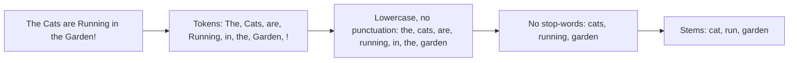
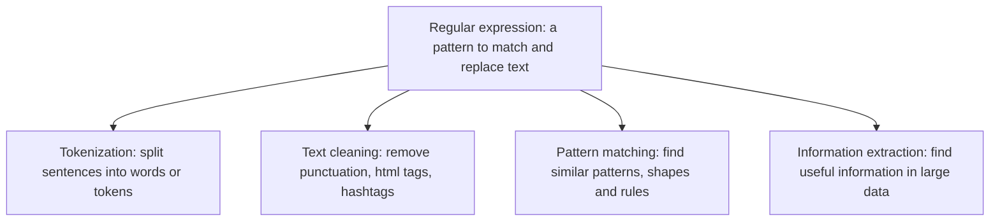

Before the new ideas, here are the old ones you need. If you already know them, skip to the next section.

## The basics first

- **Text** that comes from the real world (web pages, tweets, PDFs) has capital letters, symbols, tags and spelling variety. A computer treats "Cat" and "cat" as two different things.
- A **token** is one small piece of the text, usually one word. <Cite id="class-nlp-asol" loc="p. 11" />
- A **stem** or **root** is the main part of a word left after taking off endings (play in playing). <Cite id="class-nlp-m2" loc="p. 19" />

## What is text preprocessing?

<Box kind="definition">

**Data preprocessing** is cleaning a text before giving it to computers. <Cite id="class-nlp-m2" loc="p. 19" />

</Box>

Teacher's example: "Hello bbbb, we all love NL@P" is cleaned so that the junk symbol is removed and the sentence reads "we all love NLP". <Cite id="class-nlp-m2" loc="p. 19" />

Everyday analogy: before cooking you wash the vegetables and cut them. Preprocessing washes and cuts the text so the program can use it. This is syllabus <Syl m="2" />.

## The steps of text processing

```mermaid
%% caption: The text processing pipeline as the class lists it. Raw text goes in on the left; clean, uniform terms ready for indexing come out on the right.
flowchart LR
  A["Raw text"] --> B["1. Extraction and noise removal"]
  B --> C["2. Tokenization"]
  C --> D["3. Case normalization"]
  D --> E["4. Stop-word removal"]
  E --> F["5. Term normalization"]
  F --> G["6. Stemming or lemmatization"]
  G --> H["7. Feature extraction and indexing"]
```

The class lists the steps used to prepare text for information retrieval. <Cite id="class-nlp-asol" loc="p. 11" /> <Cite id="class-nlp-asol" loc="p. 12" /> The Module 6 slides give a similar short list. <Cite id="class-nlp-m6" loc="slide 33" />

| Step | What it does | Teacher's detail |
|---|---|---|
| 1. Extraction and format standardization | Takes raw text out of HTML, PDF or DOCX | Noise removal (HTML tags, markdown, metadata, tabs and line breaks); one character encoding (usually UTF-8) |
| 2. Tokenization | Breaks the stream of text into tokens | Split on whitespace and punctuation. Hard cases: compound nouns, hyphenated words (state-of-the-art), languages without spaces (Chinese, Thai) |
| 3. Case normalization | Converts every token to one case, usually lowercase | Information, information and INFORMATION become information |
| 4. Stop-word removal | Drops high-frequency words with little meaning | the, is, a, and, in. It shrinks the index and removes noise |
| 5. Term normalization | Maps variants to one form | Removes commas, periods, emojis; U.S.A., USA and United States become one form |
| 6. Stemming or lemmatization | Reduces words to a base form | See the table below |
| 7. Feature extraction and indexing | Builds the structure used for search | An inverted index, weighting such as TF-IDF or BM25 |

<Cite id="class-nlp-asol" loc="p. 11" /> <Cite id="class-nlp-asol" loc="p. 12" />

The slides list the same idea for sentiment analysis: text cleaning (remove HTML tags, special characters, numbers and emojis), tokenization, stop-word removal, stemming or lemmatization, and handling emojis and slang. <Cite id="class-nlp-m6" loc="slide 33" />

### Stemming and lemmatization

Stemming is a simplified form of morphological analysis which is basically used to find the root word. <Cite id="class-nlp-m2" loc="p. 19" />

| Technique | Description | Example |
|---|---|---|
| Stemming | A crude, heuristic process that chops off the ends of words using rules (for example the Porter stemmer). Fast, but can give non-dictionary roots. | retrieval, retrieved, retrieving become retriev |
| Lemmatization | A linguistic analysis that uses vocabulary and morphological rules to return the dictionary form (lemma). Needs part-of-speech context. | better becomes good; mice becomes mouse |

<Cite id="class-nlp-asol" loc="p. 12" />

The Porter stemmer has its own topic: <Syl m="2" /> "Porter stemmer".

### Morphological analysis (as a preprocessing idea)

Morphological analysis is breaking a word into smaller and meaningful parts. <Cite id="class-nlp-m2" loc="p. 19" /> Example: Playing and Running are action verbs; playing = play + ing, where play is the stem and ing is the ending. (More in <Syl m="2" /> "Morphology".)

## One sentence through the whole pipeline

Take the raw text `
The Cats are Running in the Garden!
`. Every row is the output of the step before it (stemming checked with the Porter stemmer).

| Step | Output |
|---|---|
| Raw text | `
The Cats are Running in the Garden!
` |
| Noise removal (HTML tags) | The Cats are Running in the Garden! |
| Tokenization | The, Cats, are, Running, in, the, Garden, ! |
| Case normalization | the, cats, are, running, in, the, garden, ! |
| Remove punctuation (term normalization) | the, cats, are, running, in, the, garden |
| Stop-word removal (the, are, in) | cats, running, garden |
| Stemming | cat, run, garden |

## Regular expressions

<Box kind="definition">

**Regular expression (regex)** is a pattern used to match and replace text. <Cite id="class-nlp-m2" loc="p. 18" />

</Box>

**Uses of regular expressions** <Cite id="class-nlp-m2" loc="p. 18" />

1. Clean the text.
2. Find words, numbers, emails, dates.
3. Remove unwanted symbols.

**What a regex does in NLP** (the teacher calls these the types of regular expression use). <Cite id="class-nlp-m2" loc="p. 18" /> <Cite id="class-nlp-m2" loc="p. 19" />

| Job | Meaning | Teacher's example |
|---|---|---|
| Tokenization | Splitting sentences into words or tokens | "NLP is fun" becomes "NLP", "is", "fun" |
| Text cleaning | Removing unwanted characters like punctuation, html tags, hashtags | "NLP@2026 is easy" becomes "NLP2026 is easy" |
| Pattern matching | Finding similar patterns, shapes and rules inside the text | "my age is 20", "her age is 18": the pattern is age is Number |
| Information extraction | Finding useful information from a large amount of data | Google search |

**A few patterns to see the idea** (the class gives no pattern syntax, so these are standard examples). `[0-9]+` finds numbers, so on "my age is 20" it finds 20; `<[^>]+>` finds html tags so they can be removed; `\w+` finds words, so on "NLP is fun" it finds NLP, is, fun.

**Significance of regular expressions in NLP:** they are small, fast and exact, so they are the first tool used for cleaning and splitting text and for pulling out dates, emails and numbers, before any model is used.

## Where this was asked

| If the question says | What to write | Seen as |
|---|---|---|
| "Explain preprocessing steps of NLP with an example" | The seven steps with the one-sentence example | <PYQ id="2025-05/q4b" /> <PYQ id="2024-12-ce/q2b" /> |
| "Explain pre-processing steps generally used in NLP" (5 marks) | The steps in a short list, one line each | <PYQ id="2025-05-ce/q1d" /> |
| "Tokenization and stemming" (5 marks) | Tokenization definition, stemming definition and the retriev example | <PYQ id="2024-05-ce/q1b" /> |
| "Significance of regular expression in NLP" | Definition, uses, the four jobs with the teacher's examples | <PYQ id="2025-05-ce/q5b" /> |

## Quick revision

- Data preprocessing is cleaning a text before giving it to computers.
- Steps: noise removal, tokenization, case normalization, stop-word removal, term normalization, stemming or lemmatization, feature extraction and indexing.
- Tokenization: breaking a stream of text into tokens. Stop-words: the, is, a, and, in.
- Stemming chops endings (retriev); lemmatization returns the dictionary word (better to good).
- Regular expression: a pattern to match and replace text. Jobs: tokenization, text cleaning, pattern matching, information extraction.

**Conclusion.** Preprocessing turns messy raw text into clean tokens and stems, and regular expressions are the pattern tool that does much of that work. <Cite id="class-nlp-asol" loc="p. 11" />
