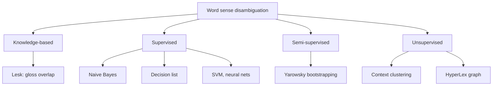
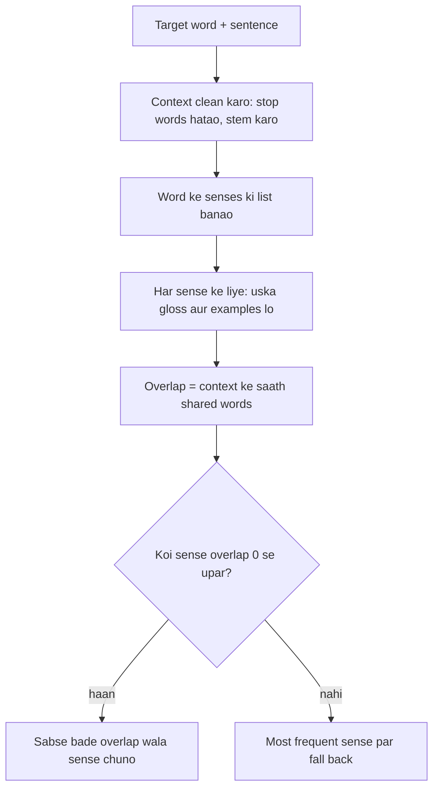
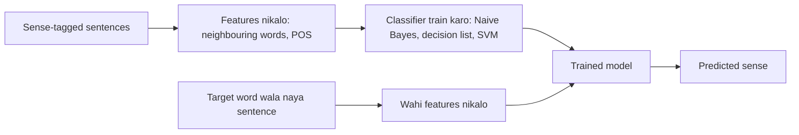
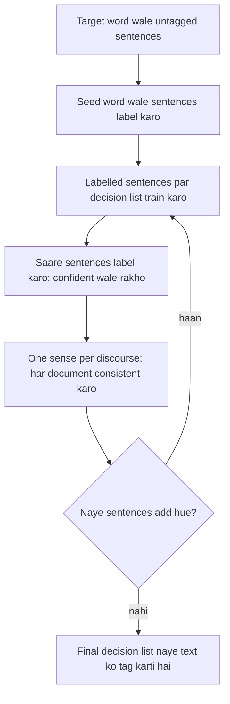
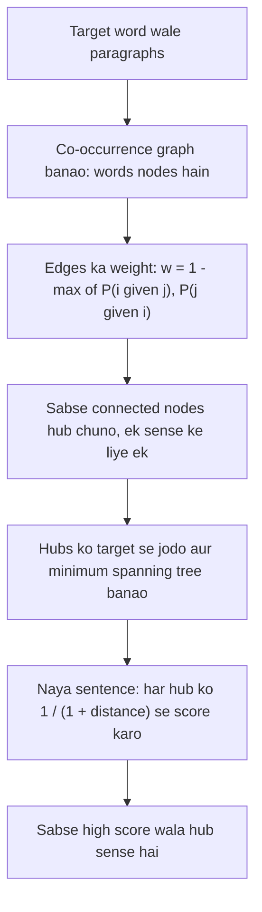

Ye note syllabus <Syl m="4" /> hai: 4.5 senses ke beech relations, 4.6 semantic ambiguity, 4.7 word sense disambiguation, 4.8 knowledge-based (Lesk) aur supervised (Naive Bayes, decision list) methods, aur 4.9 semi-supervised (Yarowsky) aur unsupervised (HyperLex) methods. Dictionaries WordNet aur BabelNet (4.4) yahan sirf utna introduce kiye hain jitna WSD ko chahiye.

## Pehle basics

- Ek **word** alag-alag cheezein bata sakta hai. Har alag meaning ek **sense** hai. "Bank" ka ek paise wala sense hai aur ek nadi ke kinare wala sense. <Cite id="word-sense-disambiguation-slp3-I" loc="§I.1" />
- **Gloss** ek sense ki chhoti dictionary definition hai, jaise "sloping land beside a body of water". <Cite id="word-sense-disambiguation-slp3-I" loc="§I.1.1" />
- **Homonymy:** do unrelated meanings ki spelling ek hi hai (river bank aur savings bank). **Polysemy:** ek word ke kai related meanings hain (bank building aur bank organisation). Dono ek doosre mein ghul jaate hain, aur dictionaries line kahan kheenchni hai isme hamesha agree nahi karti. <Cite id="word-sense-disambiguation-wiki-homonym" /> <Cite id="ambiguity-challenges-wiki-polysemy" />
- **Synonyms** ka sense lagbhag same hota hai (couch, sofa). **Hyponym** zyada specific word hai (car, vehicle ka hyponym hai); general word **hypernym** hai. <Cite id="word-sense-disambiguation-slp3-I" loc="§I.2" />
- **WordNet** ek free English lexical database hai. Jin words ka sense same hai wo ek **synset** (synonym set) mein group hote hain; har synset ka ek gloss hota hai, aur synsets hypernym, hyponym jaise relations se jude hote hain. WordNet 3.0 mein lagbhag 118 hazaar nouns, 11 hazaar verbs, 22 hazaar adjectives aur 4 hazaar adverbs hain; noun *bass* ke 8 senses hain. <Cite id="word-sense-disambiguation-slp3-I" loc="§I.3" /> <Cite id="word-sense-disambiguation-wiki-wordnet" /> <Cite id="word-sense-disambiguation-nltk-wordnet" />
- **BabelNet** WordNet ko Wikipedia aur doosre resources se jodkar ek multilingual network banata hai senses aur named entities ka, isliye English ka ek sense bahut si languages ke wahi sense se juda hota hai. <Cite id="word-sense-disambiguation-wiki-babelnet" /> <Cite id="word-sense-disambiguation-babelnet" />
- **Semantic ambiguity** (syllabus 4.6) ka matlab hai ki word ya sentence ke ek se zyada meaning hain, chahe grammar saaf ho. Word-level case ka standard ilaaj WSD hai. Doosre types ke liye ambiguity wala note dekho. <Cite id="word-sense-disambiguation-tp-wsd" />

## WSD kya hai

<Box kind="definition">

**Word sense disambiguation (WSD)** wo task hai jisme decide kiya jaata hai ki diye gaye context mein ambiguous word ka kaun sa sense hai. Input ek sentence mein word aur uske possible senses ki fixed list (**sense inventory**) hai; output wo ek sense hai jo fit hota hai. <Cite id="word-sense-disambiguation-slp3-I" loc="§I.4" /> <Cite id="ambiguity-challenges-wiki-wsd" />

</Box>

**Example.** "I can hear bass sound" ka matlab low frequency hai; "He likes to eat grilled bass" ka matlab machhli hai. Word wahi hai, sirf aas-paas ke words alag hain. <Cite id="word-sense-disambiguation-tp-wsd" />

**Roz ki misaal.** Tum sunte ho "I went to the bank" aur baaki baatcheet se samajh jaate ho "paise" ya "nadi". WSD computer ko wahi clues use karna sikhata hai.

## WSD kyun chahiye

- **Machine translation:** "bank" ko Hindi mein paise wali jagah aur nadi ke kinare ke liye alag word banana hai, isliye program ko pehle sense chunna padta hai. Translation ke liye sense inventory seedha target-language ke words ka set ho sakta hai. <Cite id="word-sense-disambiguation-slp3-I" loc="§I.4.1" /> <Cite id="word-sense-disambiguation-tp-wsd" />
- **Information retrieval aur search:** "bass fishing" search karne par music pages nahi aane chahiye.
- **Question answering aur text classification:** sahi sense decide karta hai ki kaun sa fact ya topic matlab hai. <Cite id="word-sense-disambiguation-cam-l98" />
- **Information extraction, lexicography aur content analysis** mein bhi use hota hai. <Cite id="ambiguity-challenges-navigli2009" loc="§9" />

## Task kaise set hota hai

- **Lexical sample task:** chhoti, pehle se chuni hui target words ki list (jaise 50 words), har ek ke senses ke saath. Yahan simple supervised classifiers bahut achha kaam karte hain.
- **All-words task:** text ka har content word disambiguate karna hai. Ye POS tagging jaisa hai par tag set bahut bada hai, isliye training data sparse hota hai. <Cite id="word-sense-disambiguation-slp3-I" loc="§I.4.1" />
- **Training data:** **sense-tagged corpus** jaise **SemCor**, jo Brown corpus ka ek hissa hai jiske words haath se WordNet senses se tag kiye gaye. <Cite id="word-sense-disambiguation-slp3-I" loc="§I.4.1" />
- **Baseline:** hamesha most frequent sense chuno. Ise harana mushkil hai: competitions mein fine-grained senses par ye 51 se 57 percent laaya jabki best systems 59 se 69 percent tak pahunche. Coarse-grained WSD 90 percent paar kar chuka hai. <Cite id="ambiguity-challenges-wiki-wsd" />

## WSD mushkil kyun hai

- **Dictionaries agree nahi karti** ki ek word ke kitne senses hain aur ek sense kahan khatam hota hai. Dictionaries bahut fine senses use karti hain; computing ke liye hum aksar unhe group kar dete hain. <Cite id="word-sense-disambiguation-slp3-I" loc="§I.1.2" /> <Cite id="word-sense-disambiguation-tp-wsd" />
- **Senses saaf alag nahi hote.** Human annotators sense par sirf 70 se 95 percent time agree karte hain, isliye "sahi jawab" bhi kuch had tak raay ki baat hai. <Cite id="word-sense-disambiguation-vcet-lesk" />
- **Labelled data mehenga hai.** Bade corpus ke har word ko haath se tag karna dheema hai, ye **knowledge acquisition bottleneck** hai. <Cite id="ambiguity-challenges-navigli2009" loc="§10.2" />
- **Context subtle ho sakta hai:** metaphors, negation aur door ke clues.
- **Alag applications ko alag sense size chahiye** (translation ko sirf wo distinctions chahiye jo target word badal dein).

## WSD methods ki families

<Cite id="word-sense-disambiguation-gfg-wsd" loc="diagram" /> <Cite id="word-sense-disambiguation-cam-l98" /> <Cite id="ambiguity-challenges-navigli2009" loc="§3 to §5" />

## Knowledge-based approach: Lesk ka algorithm

**Idea.** Jo words ek sentence mein saath aate hain wo ek hi topic ke hote hain, isliye sahi sense ki definition ke kuch words uske aas-paas ke words se milne chahiye. **Lesk algorithm** (Michael Lesk, 1986) ye shared words ginta hai aur sabse zyada count wala sense chunta hai. Ye standard **dictionary-based** method hai: dictionary ya WordNet chahiye par labelled sentences nahi. <Cite id="word-sense-disambiguation-wiki-lesk" /> <Cite id="ambiguity-challenges-navigli2009" loc="§5.1" /> <Cite id="word-sense-disambiguation-slp3-I" loc="§I.5.2" />

**Steps (simplified Lesk, ek time pe ek word):**

1. Target word aur uska sentence lo; sentence ke words **context** banate hain.
2. Stop words (the, of, to ...) hata do aur ho sake to words ko stem tak le jao taaki tree aur trees match ho.
3. Target word ke har sense ke liye uska **signature** banao: uske gloss ke words (aur example sentences, agar dictionary mein hain).
4. **Overlap** gino: signature aur context kitne words share karte hain.
5. Sabse bade overlap wala sense chuno. Agar sab overlaps zero hain to most frequent sense par fall back karo. <Cite id="word-sense-disambiguation-slp3-I" loc="§I.5.2" /> <Cite id="word-sense-disambiguation-cam-l98" />

<Cite id="word-sense-disambiguation-cam-l98" loc="diagram" /> <Cite id="word-sense-disambiguation-vcet-lesk" />

**Versions.** **Original Lesk** sentence ke saare ambiguous words ki definitions ko ek doosre se compare karta hai (mutual disambiguation), jisme $|Senses(w_1)| \times |Senses(w_2)| \times \dots$ comparisons lagte hain, jo bahut bada number hai. **Simplified Lesk** (Kilgarriff aur Rosenzweig, 2000) har word ke glosses ko sirf plain context words se compare karta hai aur tez hai; ek study mein ye original se saaf behtar nikla. **Extended Lesk** (Banerjee aur Pedersen) related senses (hypernyms, hyponyms) ke glosses bhi jod deta hai, taaki chhote glosses ki dikkat kam ho. <Cite id="ambiguity-challenges-navigli2009" loc="§5.1" /> <Cite id="word-sense-disambiguation-wiki-lesk" /> <Cite id="word-sense-disambiguation-tp-wsd" />

### Example 1: pine cone (original Lesk)

<Sum>

<Given>

Context: do words "pine" aur "cone". Dictionary definitions:

- PINE 1: kinds of evergreen tree with needle-shaped leaves
- PINE 2: waste away through sorrow or illness
- CONE 1: solid body which narrows to a point
- CONE 2: something of this shape whether solid or hollow
- CONE 3: fruit of certain evergreen trees

Stop words ignore: of, with, to, a, which, or, this, through, whether. "trees" aur "tree" ko same word maano. <Cite id="word-sense-disambiguation-wiki-lesk" /> <Cite id="word-sense-disambiguation-cam-l98" />

</Given>

<Find>

wo (pine, cone) senses ki pair jiska overlap sabse bada hai.

</Find>

<Steps>

1. Har definition ke content words. PINE 1 = \{kinds, evergreen, tree, needle-shaped, leaves\}; PINE 2 = \{waste, away, sorrow, illness\}; CONE 1 = \{solid, body, narrows, point\}; CONE 2 = \{something, shape, solid, hollow\}; CONE 3 = \{fruit, certain, evergreen, tree\}. *Reason: sirf content words meaning rakhte hain.*
2. Har PINE sense ko har CONE sense se compare karo (2 × 3 = 6 pairs) aur shared words gino:

| Pair | Shared words | Overlap |
|---|---|---|
| PINE 1 and CONE 1 | none | 0 |
| PINE 1 and CONE 2 | none | 0 |
| PINE 1 and CONE 3 | evergreen, tree | 2 |
| PINE 2 and CONE 1 | none | 0 |
| PINE 2 and CONE 2 | none | 0 |
| PINE 2 and CONE 3 | none | 0 |

3. Sabse bada overlap 2 hai, PINE 1 aur CONE 3 ka. *Reason: Lesk sabse high count wali pair rakhta hai.*

</Steps>

<Answer>

pine = sense 1 (evergreen tree), cone = sense 3 (fruit of an evergreen tree), overlap 2.

</Answer>

<Box kind="verify">

Cone ki taraf se dobara gino: CONE 1 aur CONE 2 kisi pine sense ke saath kuch share nahi karte, aur CONE 3 \{evergreen, tree\} sirf PINE 1 ke saath share karta hai, to 2 hi maximum hai. Stemming ke bina "trees" aur "tree" match nahi honge aur best overlap 1 (evergreen) hoga, par PINE 1 aur CONE 3 phir bhi jeetenge, to answer nahi badalta. Common sense bhi agree karta hai: "pine cone" pine tree ka cone hai.

</Box>

</Sum>

### Example 2: bank (simplified Lesk)

<Sum>

<Given>

Sentence: "The bank can guarantee deposits will eventually cover future tuition costs because it invests in adjustable-rate mortgage securities."

*bank* ke WordNet senses (gloss aur examples):

- bank 1: a financial institution that accepts deposits and channels the money into lending activities. Examples: "he cashed a check at the bank", "that bank holds the mortgage on my home".
- bank 2: sloping land (especially the slope beside a body of water). Examples: "they pulled the canoe up on the bank", "he sat on the bank of the river and watched the currents".

Stop words aur target word "bank" khud ko ignore karo. <Cite id="word-sense-disambiguation-slp3-I" loc="§I.5.2" /> <Cite id="word-sense-disambiguation-cam-l98" />

</Given>

<Find>

sentence mein *bank* ka sense.

</Find>

<Steps>

1. Context words (content words, "bank" ke bina): guarantee, deposits, eventually, cover, future, tuition, costs, invests, adjustable-rate, mortgage, securities. *Reason: ye target ke aas-paas ke clues hain.*
2. bank 1 ka signature: financial, institution, accepts, deposits, channels, money, lending, activities, cashed, check, holds, mortgage, home. Context ke saath shared: **deposits**, **mortgage**. Overlap = 2.
3. bank 2 ka signature: sloping, land, especially, slope, beside, body, water, pulled, canoe, sat, river, watched, currents. Context ke saath shared: koi nahi. Overlap = 0.
4. 2, 0 se bada hai, isliye bank 1 chuno.

</Steps>

<Answer>

bank = sense 1 (financial institution), overlap 2 vs 0.

</Answer>

<Box kind="verify">

Sentence deposits, tuition costs aur mortgages ki baat karta hai, jo paise ki baat hai, isliye financial sense sahi hai. Doosri taraf se dobara gino: 11 context words mein se sirf "deposits" aur "mortgage" kisi signature mein aate hain, aur dono bank 1 mein hain, yani 2 aur 0.

</Box>

</Sum>

<Box kind="pitfall">

Lesk nazuk hai. Ye gloss ke exact words par depend karta hai, isliye ek word missing ho to answer palat sakta hai, aur glosses chhote hote hain. NLTK ka `lesk` "I went to the bank to deposit money" par sense "a container (usually with a slot in the top) for keeping money at home" (piggy bank) deta hai, financial institution nahi, kyunki us gloss ke kuch words sentence se mil jaate hain. Original method fine senses par sirf 50 se 70 percent accuracy tak pahunchi, aur extended Lesk ne ek test mein 18.3 se 34.6 percent kiya. <Cite id="ambiguity-challenges-navigli2009" loc="§5.1" /> <Cite id="word-sense-disambiguation-nltk-wsd" />

</Box>

**Advantages:** labelled data nahi chahiye, samjhana aasan, dictionary ke kisi bhi word par chalta hai. **Disadvantages:** gloss ki wording par sensitive, chhote glosses se kam overlaps, aur aam taur par supervised methods se kam accurate.

## Supervised approach

**Idea.** WSD ko **classification** maano. Aise sentences jama karo jinme target word ka sense pehle se tag hai, har sentence ko **features** ki list banao, classifier train karo, aur naye sentences par use karo. Ye lexical sample task ke liye achha chalta hai par bahut saara haath se tagged data chahiye. Is tarah ka statistical WSD Brown et al. (1991) tak jaata hai. <Cite id="word-sense-disambiguation-brown1991" /> <Cite id="word-sense-disambiguation-slp3-I" loc="§I.5.1" /> <Cite id="word-sense-disambiguation-gfg-wsd" /> <Cite id="ambiguity-challenges-navigli2009" loc="§3" />

**Features** jo target word ke liye use hote hain:

- **Collocation features:** target ke bagal mein fixed positions par exact words (aur unke POS tags), jaise target se theek pehle aur theek baad wala word.
- **Bag-of-words features:** target ke aas-paas window mein kaun se words aaye, order ignore karke.
- **Syntactic features:** jaise wo verb jo is word ko object leta hai.
- Naye systems word embeddings bhi jodte hain. <Cite id="word-sense-disambiguation-slp3-I" loc="§I.5.1" />

**Steps:** (1) sense-tagged corpus jama karo (jaise SemCor); (2) har tagged example ke features nikalo; (3) classifier train karo (Naive Bayes, decision list, decision tree, SVM, neural network); (4) naye sentence ke liye wahi features nikalo aur classifier se sense nikalwao. <Cite id="word-sense-disambiguation-gfg-wsd" />

<Cite id="word-sense-disambiguation-gfg-wsd" loc="diagram" />

### Naive Bayes classifier

**Idea.** Wo sense $s$ chuno jo context words $w_1 \dots w_m$ ko dekhte hue sabse zyada probable hai. Bayes' rule se, aur "naive" assumption se ki sense pata hone par context words ek doosre se independent hain, ye ban jaata hai

$$\hat{s} = \arg\max_{s} \; P(s) \prod_{j=1}^{m} P(w_j \mid s)$$

Yahan $P(s)$ **prior** hai: training data mein sense kitna common hai. $P(w_j \mid s)$ **likelihood** hai: word $w_j$ sense $s$ ke contexts mein kitni baar aata hai. Dono counting se milte hain. Jo word kisi sense ke saath kabhi nahi dikha wo product ko zero kar dega, isliye **add-one (Laplace) smoothing** use karte hain: $P(w \mid s) = \dfrac{\text{count}(w, s) + 1}{\text{total words in } s \text{ contexts} + |V|}$ jahan $|V|$ vocabulary size hai. <Cite id="ambiguity-challenges-navigli2009" loc="§3.3" /> <Cite id="word-sense-disambiguation-slp3-B" loc="§B.1 and §B.2" /> <Cite id="word-sense-disambiguation-wiki-naive-bayes" />

<Sum>

<Given>

*bank* ke training set mein 10 sentences hain: 6 paise wale sense (FIN) ke aur 4 nadi wale sense (RIV) ke. Vocabulary mein 6 context words hain. Har sense ke saare contexts par word counts:

| Word | money | loan | account | river | water | fish | Total |
|---|---|---|---|---|---|---|---|
| FIN | 5 | 3 | 4 | 0 | 1 | 0 | 13 |
| RIV | 1 | 0 | 0 | 4 | 3 | 2 | 10 |

Naye sentence ke context words: river, water, money. Add-one smoothing use karo.

</Given>

<Find>

*bank* ka zyada probable sense.

</Find>

<Steps>

1. Priors: $P(\text{FIN}) = 6/10 = 0.6$, $P(\text{RIV}) = 4/10 = 0.4$. *Reason: training sentences ka hissa.*
2. FIN ke smoothed likelihoods ka denominator $13 + 6 = 19$: $P(\text{river}) = 1/19$, $P(\text{water}) = 2/19$, $P(\text{money}) = 6/19$.
3. Score FIN $= 0.6 \times \frac{1}{19} \times \frac{2}{19} \times \frac{6}{19} = 0.6 \times \frac{12}{6859} = 0.6 \times 0.001750 = 0.001050$.
4. RIV ke smoothed likelihoods ka denominator $10 + 6 = 16$: $P(\text{river}) = 5/16$, $P(\text{water}) = 4/16$, $P(\text{money}) = 2/16$.
5. Score RIV $= 0.4 \times \frac{5}{16} \times \frac{4}{16} \times \frac{2}{16} = 0.4 \times \frac{40}{4096} = 0.4 \times 0.009766 = 0.003906$.
6. Compare: $0.003906 > 0.001050$, isliye RIV chuno. *Reason: Naive Bayes bada score wala sense rakhta hai.*

</Steps>

<Answer>

bank = river sense (RIV); scores RIV ke liye 0.003906 aur FIN ke liye 0.001050, normalise karne ke baad lagbhag 78.8 percent.

</Answer>

<Box kind="verify">

Har smoothed row ka sum 1 hai: FIN $(6+4+5+1+2+1)/19 = 19/19$ aur RIV $(2+1+1+5+4+3)/16 = 16/16$. Normalise karke, $0.003906 / (0.003906 + 0.001050) = 0.788$. Smoothing ke bina FIN ka score exactly 0 hota kyunki "river" FIN ke saath kabhi nahi aaya, jo bahut sakht hai; unsmoothed RIV score $0.4 \times 0.4 \times 0.3 \times 0.1 = 0.0048$ hai, winner wahi. Sentence mein do river-jaise words (river, water) hain aur ek money word, isliye RIV samajhdaar hai.

</Box>

</Sum>

**Advantages:** simple, tez, independence assumption unrealistic hone par bhi achha chalta hai. **Disadvantages:** tagged data chahiye, word order aur words ki aapas ki dependence ignore karta hai. <Cite id="ambiguity-challenges-navigli2009" loc="§3.3" />

### Decision list

**Idea.** **Decision list** (feature, sense, score) form ke if-then rules ki ranked list hai. Rules score ke hisaab se sabse strong se sabse weak tak sorted hote hain. Classify karne ke liye list mein neeche jao aur **pehla rule jiska feature sentence mein hai** use karo; baaki saare rules ignore. Yarowsky ne har feature ko is baat se score kiya ki wo senses ke beech kitna ek-taraf jhuka hai, sense probabilities ke ratio ka log use karke. Do senses ke liye ye hai

$$\text{score}(f) = \left| \log \frac{P(s_1 \mid f)}{P(s_2 \mid f)} \right|$$

jahan $f$ feature hai (ek collocation jaise "word *manufacturing* target ke bagal mein"). Score jitna bada, rule utna reliable. Counts smooth kiye jaate hain taaki zero se infinite score na bane. <Cite id="word-sense-disambiguation-yarowsky1994" /> <Cite id="ambiguity-challenges-navigli2009" loc="§3.1" />

<Sum>

<Given>

Target word *plant* ke do senses: A = factory, B = living thing. Training counts ki har feature kitni baar kis sense ke saath aaya:

| Feature in the sentence | with A (factory) | with B (living) |
|---|---|---|
| manufacturing | 15 | 0 |
| species | 0 | 7 |
| life | 1 | 11 |
| worker | 7 | 1 |
| water | 3 | 5 |

Dono counts par add-one smoothing aur base-2 logs use karo: $\text{score} = |\log_2 \frac{c_A + 1}{c_B + 1}|$. Test sentence: "The plant workers use water from the river."

</Given>

<Find>

decision list se test sentence mein *plant* ka sense.

</Find>

<Steps>

1. Har rule score karo. manufacturing: $\log_2(16/1) = 4$, A ke favour mein. species: $\log_2(1/8) = -3$, to 3, B ke favour mein. life: $\log_2(2/12) = -\log_2 6 = -2.585$, to 2.585, B ke favour mein. worker: $\log_2(8/2) = 2$, A ke favour mein. water: $\log_2(4/6) = -0.585$, to 0.585, B ke favour mein. *Reason: (c + 1) smoothed count hai, aur sign batata hai kaun sa sense jeetta hai.*
2. Score ke hisaab se sort karo, sabse bada pehle:

| Rank | Feature | Sense | Score |
|---|---|---|---|
| 1 | manufacturing | A | 4 |
| 2 | species | B | 3 |
| 3 | life | B | 2.585 |
| 4 | worker | A | 2 |
| 5 | water | B | 0.585 |

3. Test sentence ke features: "workers" (feature *worker*, base word par laakar) aur *water*. Rule 1 (manufacturing) match nahi karta, rule 2 (species) nahi, rule 3 (life) nahi, rule 4 (worker) match karta hai. *Reason: list mein neeche jao aur pehle match par ruk jao.*
4. Rule 4 sense A (factory) kehta hai. Kamzor *water* rule (B) kabhi use nahi hota.

</Steps>

<Answer>

plant = sense A (factory), rule "worker" se decide hua, score 2.

</Answer>

<Box kind="verify">

Logs ko powers of two se check karo: $2^4 = 16$, $2^3 = 8$, $2^2 = 4$, $2^{2.585} \approx 6$ aur $2^{0.585} \approx 1.5 = 6/4$. Decision samajhdaar hai: workers factory ke hote hain, aur "water" clue living plants ki taraf sirf halka sa hai. Agar sentence mein "species" bhi hota to rule 2 pehle fire hota aur answer B aata.

</Box>

</Sum>

**Advantages:** padhne mein aasan (dikhta hai kaun sa rule chala), pehle Senseval contests mein strong results. **Disadvantages:** ek decision ke liye sirf ek feature use hota hai aur tagged data chahiye. <Cite id="ambiguity-challenges-navigli2009" loc="§3.1" />

## Semi-supervised approach: Yarowsky ki bootstrapping

**Problem.** Tagged data mehenga hai, raw text sasta. **Bootstrapping** bahut chhote tagged set se shuru karti hai aur program ko khud aur data label karne deti hai. <Cite id="ambiguity-challenges-navigli2009" loc="§3.8.1" /> <Cite id="word-sense-disambiguation-tp-wsd" />

**Language ke do rules jo Yarowsky use karta hai:**

1. **One sense per collocation:** paas ke words strong, consistent clues dete hain. "Plant" jab "manufacturing" ke paas ho to lagbhag hamesha factory matlab hota hai. <Cite id="word-sense-disambiguation-yarowsky1993" />
2. **One sense per discourse:** ek document ke andar word lagbhag hamesha ek hi sense rakhta hai. Agar "plant" paragraph one mein factory hai to paragraph five mein bhi bahut zyada chance hai ki factory hi hai. <Cite id="word-sense-disambiguation-gale1992" />

**Algorithm ke steps (Yarowsky 1995):**

1. Bade untagged corpus se target word wale saare sentences jama karo.
2. Haath se kuch **seed collocations** do, har sense ke liye ek (*plant* ke liye: living sense ke liye "life" aur factory sense ke liye "manufacturing"). Jis sentence mein seed ho use wo sense mil jaata hai; wo pehla labelled set banta hai. Zyadatar sentences unlabelled rehte hain.
3. Labelled set par ek **decision list** train karo. Wo naye collocations seekhti hai, jaise living ke liye "species" aur "animal", factory ke liye "worker" aur "assembly".
4. Decision list ko saare sentences par lagao; jo high confidence se label hue unhe labelled set mein jodo.
5. **One sense per discourse** lagao: agar kisi document mein zyadatar labelled occurrences ka ek sense hai to us document ke baaki occurrences ko bhi wahi label do.
6. Steps 3 se 5 repeat karo. Jab koi naya sentence add na ho sake to ruk jao. Final decision list naye text ko tag karne mein use hoti hai. <Cite id="word-sense-disambiguation-yarowsky1995" /> <Cite id="ambiguity-challenges-navigli2009" loc="§3.8.1" /> <Cite id="word-sense-disambiguation-wiki-yarowsky" />

<Cite id="ambiguity-challenges-navigli2009" loc="Fig. 14" /> <Cite id="word-sense-disambiguation-wiki-yarowsky" />

**Result.** Yarowsky ne do-sense words par 96 percent se upar accuracy batayi, jo supervised methods ke barabar thi. Navigli kehte hain ki test chhota aur binary tha, isliye ise baad ke contests se compare nahi kar sakte. <Cite id="word-sense-disambiguation-yarowsky1995" /> <Cite id="ambiguity-challenges-navigli2009" loc="§3.8.1" />

**Advantages:** sirf seeds aur raw text chahiye. **Disadvantages:** shuru ka galat label phail sakta hai (error propagation), confidence threshold aur rounds ki sankhya chunna mushkil hai, aur dono rules har word par sahi nahi baithte. <Cite id="ambiguity-challenges-navigli2009" loc="§3.8.1" />

## Unsupervised approach: sense induction aur HyperLex

**Idea.** Na dictionary na tagged data. Jo words milte-julte contexts mein aate hain unke meaning milte-julte hote hain, isliye ek word ke contexts ko group karo; har group ek sense hai. Senses dictionary se padhe nahi, khoje gaye hain, isliye ise **word sense induction** (ya discrimination) kehte hain. Groups ke naam nahi hote, sirf numbers (sense 1, sense 2). <Cite id="word-sense-disambiguation-slp3-I" loc="§I.7" /> <Cite id="word-sense-disambiguation-tp-wsd" />

**Context clustering (aam tareeka):**

1. Word ke har occurrence ke liye aas-paas ke words se ek **context vector** banao.
2. In vectors ko groups mein **cluster** karo; har cluster ek sense hai.
3. Har cluster ka centre (centroid) **sense vector** lo.
4. Naye occurrence ko disambiguate karne ke liye uska context vector banao aur use sabse nazdeeki sense vector ka sense do. <Cite id="word-sense-disambiguation-slp3-I" loc="§I.7" />

### HyperLex

**HyperLex** (Véronis, 2004) senses ko **co-occurrence graph** se dhundhta hai: words nodes hain, aur do words jude hote hain agar wo target word ke saath ek hi paragraph mein aate hain. <Cite id="ambiguity-challenges-navigli2009" loc="§4.3" />

1. Target word (jaise *barn*) wale paragraphs se **graph banao**.
2. **Har edge ko weight do** is hisaab se ki do words kitni kam saath aate hain: $w_{ij} = 1 - \max\{P(w_i \mid w_j),\ P(w_j \mid w_i)\}$, jahan $P(w_i \mid w_j) = \text{freq}_{ij} / \text{freq}_j$. Jo words aksar saath aate hain unka weight 0 ke paas (nazdeek), jo kam aate hain unka weight 1 ke paas (door). Threshold se upar ki edges hata do.
3. **Hubs dhundho:** baar-baar sabse zyada connections wala node **hub** chuno, phir uske neighbours ko hub candidate se bahar kar do. Jab agla hub bahut rare ho to ruk jao. Har hub ek sense hai.
4. **Hubs ko target word se zero-weight edges se jodo** aur **minimum spanning tree** (MST) nikalo.
5. **Disambiguate:** naye sentence ke liye, har context word ka MST mein hub dhundho aur us hub ko $1 / (1 + d)$ se score do, jahan $d$ hub tak ki doori hai. Saare context words ke scores jodo; sabse high total wala hub sense deta hai. <Cite id="ambiguity-challenges-navigli2009" loc="§4.3" />

<Cite id="ambiguity-challenges-navigli2009" loc="Fig. 16" />

<Sum>

<Given>

Target word *barn* ke corpus mein: word pair (milk, cow) 30 paragraphs mein saath aata hai, milk 60 mein aata hai aur cow 40 mein. Word pair (milk, tractor) 2 paragraphs mein saath aata hai, milk 50 mein aur tractor 40 mein. $w_{ij} = 1 - \max\{P(w_i \mid w_j), P(w_j \mid w_i)\}$ use karo jahan $P(w_i \mid w_j) = \text{freq}_{ij}/\text{freq}_j$. Numbers practice ke liye banaye gaye hain.

</Given>

<Find>

(milk, cow) aur (milk, tractor) ke edge weights.

</Find>

<Steps>

1. (milk, cow): $P(\text{milk} \mid \text{cow}) = 30/40 = 0.75$ aur $P(\text{cow} \mid \text{milk}) = 30/60 = 0.50$. Maximum 0.75 hai, to $w = 1 - 0.75 = 0.25$.
2. (milk, tractor): $P(\text{milk} \mid \text{tractor}) = 2/40 = 0.05$ aur $P(\text{tractor} \mid \text{milk}) = 2/50 = 0.04$. Maximum 0.05 hai, to $w = 1 - 0.05 = 0.95$. *Reason: formula dono conditional probabilities mein se bada wala leta hai.*

</Steps>

<Answer>

$w(\text{milk}, \text{cow}) = 0.25$ (nazdeek); $w(\text{milk}, \text{tractor}) = 0.95$ (door).

</Answer>

<Box kind="verify">

Meaning se check karo: milk aur cow aksar saath aate hain, isliye weight 0 ke paas hona chahiye aur 0.25 hai; milk aur tractor lagbhag kabhi saath nahi aate, isliye weight 1 ke paas hona chahiye aur 0.95 hai. Dono weights 0 aur 1 ke beech hain, jaisa formula chahta hai. Graph mein milk aur cow ek hi cluster (dairy sense) mein honge, tractor doosre mein.

</Box>

</Sum>

Navigli batate hain ki HyperLex aur ek PageRank variant, Senseval-3 nouns par tune karne ke baad, supervised systems ke kareeb pahunche. **Advantages:** labelled data nahi chahiye, dictionaries mein missing senses bhi dhundh leta hai. **Disadvantages:** khoje gaye senses ko compare karne se pehle dictionary senses se map karna padta hai, tune karne ke liye bahut parameters, aur koi standard evaluation nahi. <Cite id="ambiguity-challenges-navigli2009" loc="§4.3" /> <Cite id="word-sense-disambiguation-slp3-I" loc="§I.7" />

## Chaaron approaches ki comparison

| Point | Knowledge-based (Lesk) | Supervised (Naive Bayes, decision list) | Semi-supervised (Yarowsky) | Unsupervised (HyperLex, clustering) |
|---|---|---|---|---|
| Needs | dictionary or WordNet | sense-tagged corpus | few seeds + raw text | raw text only |
| Senses kahan se | dictionary | tagged data | seeds, phir learned | text se discovered |
| Accuracy | sabse kam | sabse zyada | simple words par supervised ke kareeb | compare karne ke liye mapping chahiye |
| Main weakness | gloss wording par depend | tagging ka kharcha | error phailna | bina naam ke senses |
| Best when | tagged data nahi, koi bhi word | kam target words, bahut data | thoda data | naya domain ya language |

<Cite id="ambiguity-challenges-navigli2009" loc="§3 to §5" /> <Cite id="word-sense-disambiguation-cam-l98" /> <Cite id="word-sense-disambiguation-tp-wsd" />

## Applications

Machine translation (sahi target word chunna), search engines, question answering, text classification, information extraction, dictionary banana, aur semantic web. Modern systems contextual embeddings (BERT jaise models) se har occurrence ko represent karte hain aur sense embeddings se compare karte hain. <Cite id="word-sense-disambiguation-slp3-I" loc="§I.4.2" /> <Cite id="ambiguity-challenges-navigli2009" loc="§9" />

## Exam answers

<Box kind="exam">

**What is WSD? Why is it needed (5 marks):** define karo (ambiguous word ka sahi sense context se chunna), bank ya bass example, teen needs (translation, search, question answering), kyun mushkil hai (dictionaries alag, tagged data mehenga), aur chaar method families ki ek line ki list. <PYQ id="2024-12/q1d" /> <PYQ id="2024-12-ce/q1a" /> <PYQ id="2025-05-ce/q3a" />

**Dictionary-based approach and Lesk's algorithm (10 marks):** WSD define karo, phir idea (gloss overlap), paanch steps, flowchart, 2 × 3 overlap table ke saath pine cone sum, doosra example (bank), versions (original, simplified, extended), advantages aur disadvantages. <PYQ id="2022-12-ce/q5a" /> <PYQ id="2023-05-ce/q2a" /> <PYQ id="2023-12-ce/q4a" /> <PYQ id="2024-05-ce/q4a" /> <PYQ id="2024-12/q5a" /> <PYQ id="2025-05/q3b" />

**Supervised learning for WSD / Naive Bayes (10 marks):** classification view, features, pipeline diagram ke steps, prior aur likelihood ke saath Naive Bayes formula, chhota smoothed example, doosre classifier ke roop mein decision list, advantages (accuracy) aur disadvantages (tagged data). <PYQ id="2024-12-ce/q4a" /> <PYQ id="2025-05-ce/q3a" />

**Yarowsky bootstrapping (5 ya 10 marks):** problem (mehenga tagged data), seeds, diagram mein decision-list loop, do rules (one sense per collocation aur per discourse), stopping rule, result aur limits. 10 marks ke liye Hyperlex jodo: co-occurrence graph, edge weight, hubs aur spanning tree. <PYQ id="2022-12-ce/q3b" /> <PYQ id="2025-05-ce/q6a" />

</Box>

<Box kind="key">

Yaad rakhne ka tareeka: **Lesk dictionary dekhta hai, supervised tagged text se seekhta hai, Yarowsky seeds se ugta hai, HyperLex hubs dhundta hai.** Hamesha ek line mein likho ki har ek ko kya chahiye: dictionary, tagged data, kuch seeds, ya sirf raw text.

</Box>

## Conclusion

WSD ambiguous word ke liye wo sense chunta hai jo uske context mein fit hota hai. Lesk jaise knowledge-based methods ko sirf dictionary chahiye par wo nazuk hain; Naive Bayes aur decision lists jaise supervised methods sabse accurate hain par tagged data maangte hain; Yarowsky ki bootstrapping us zaroorat ko kuch seeds tak ghata deti hai; aur HyperLex jaise unsupervised methods senses raw text se dhundhte hain. Practice mein kaun sa method chunna hai ye is par depend karta hai ki kitna labelled data aur kitni achhi dictionary available hai.
